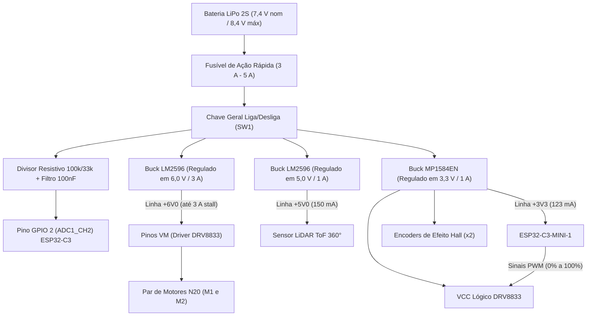

# Análise de Consumo Energético do Produto

## 1. Identificação dos Subsistemas Elétricos

A arquitetura do Micromouse organiza a distribuição de potência e os níveis lógicos a partir da fonte principal. O subsistema elétrico divide-se em barramentos de potência e barramentos de regulação chaveada. O perfil de carga foi levantado com base nas especificações dos componentes e na folha de dados da equipe. Para o dimensionamento da autonomia contínua, padronizou-se o ciclo de missão unitário em **600 segundos (10 minutos)** de exploração e tomada de tempo, e a missão estendida de homologação em **1.800 segundos (30 minutos)** para cumprir a resolução consecutiva dos 3 labirintos da competição (RNF-04).

* **ESP32-C3-MINI-1 (MCU e Telemetria):** Opera sob linha regulada de 3,3 V derivada do conversor Buck dedicado. Consumo médio nominal de **110 mA (0,11 A)** em processamento de controle e transmissões periódicas de rádio.
* **Motores DC GA12-N20 com Redução (Par de Atuadores M1 e M2):** Tensão nominal de catálogo de 6,0 V, alimentados por linha regulada dedicada de +6,0 V gerada por conversor Buck LM2596 de 3 A conectado ao pino VM do driver DRV8833. Consumo médio dinâmico em piso de corrida estimado em **0,15 A por motor (0,30 A conjunto)**, com picos de travamento (*stall*) de até **~1,5 A por motor (~3,0 A conjunto)**.
* **Driver Ponte H Dupla (DRV8833 - Lógica de Controle):** Alimentação lógica e pinos de sinal PWM a 3,3 V comutados pelos GPIOs do microcontrolador. Apresenta consumo quiescente de **3 mA (0,003 A)**.
* **Encoders Incrementais de Efeito Hall (2 unidades):** Conectados via interrupções de quadratura aos GPIOs do MCU e alimentados pela linha de 3,3 V. Consumo conjunto estimado em **10 mA (0,01 A)**.
* **Sensor LiDAR ToF 360° (Sensoriamento Primário de Pista):** Opera com linha dedicada de alimentação de 5,0 V (+5V0) e interface serial UART. Apresenta consumo nominal médio de **150 mA (0,15 A)** em rotação contínua e varredura óptica.

---

## 2. Cálculo da Energia Consumida por Componente

O cálculo de energia elétrica em regime de corrente contínua adota a relação fundamental:

$$E = V \cdot I \cdot t$$

Onde:
* $E$ = Energia em joules (J)
* $V$ = Tensão de alimentação do subsistema em volts (V)
* $I$ = Corrente média consumida em ampères (A)
* $t$ = Tempo operacional de missão unitária ($t = 600\text{ s} = 10\text{ min}$)

| Componente / Subsistema | Tensão ($V$) | Corrente Média ($I$) | Tempo ($t$) | Energia Consumida ($E$) |
| :--- | :---: | :---: | :---: | :---: |
| ESP32-C3-MINI-1 | 3,3 V | 0,110 A | 600 s | 217,80 J |
| Motores DC N20 (Par M1 + M2) | 6,0 V | 0,300 A | 600 s | 1.080,00 J |
| Driver DRV8833 (Lógica) | 3,3 V | 0,003 A | 600 s | 5,94 J |
| Encoders Incrementais (Par) | 3,3 V | 0,010 A | 600 s | 19,80 J |
| Sensor LiDAR ToF 360° | 5,0 V | 0,150 A | 600 s | 450,00 J |

---

## 3. Estimativa do Consumo Total de Energia

A demanda energética líquida total calculada para um ciclo unitário de 10 minutos de missão ($E_{\text{total}}$) é obtida pela soma das parcelas energéticas de cada componente:

$$E_{\text{total}} = 217,80 + 1080,00 + 5,94 + 19,80 + 450,00 = \mathbf{1.773,54\text{ J}}$$

Convertendo para Watt-hora (Wh) utilizando a equivalência padrão ($1\text{ Wh} = 3600\text{ J}$):

$$E_{\text{Wh}} = \frac{E_{\text{total}}}{3600} = \frac{1773,54}{3600} \approx \mathbf{0,493\text{ Wh}}$$

---

## 4. Escolha e Dimensionamento da Fonte de Alimentação

### 4.1 Margem de Segurança e Eficiência Energética
Para robôs móveis autônomos de labirinto, adota-se uma margem de segurança de **40%**, combinada com um rendimento médio de **85%** ($\eta = 0{,}85$) dos conversores chaveados Buck da placa. Essa folga de projeto sustenta:
1. **Transientes Dinâmicos:** As partidas, frenagens e rotações rápidas dos motores elevam a corrente momentânea muito acima do patamar nominal de regime permanente.
2. **Perdas Térmicas nos Conversores:** O chaveamento e a resistência parasita das bobinas e diodos internos dos reguladores Step-Down degradam parte da potência útil em calor.
3. **Preservação Química da Célula:** Células à base de lítio sofrem danos de capacidade irreversíveis quando descarregadas abaixo de 20% de sua reserva total (profundidade de descarga limite de 80% DoD).

A energia total demandada na fonte para uma corrida unitária de 10 minutos é:

$$E_{\text{necessária}} = \frac{E_{\text{Wh}}}{\eta \cdot (1 - \text{Margem})} = \frac{0,493}{0,85 \cdot (1 - 0,40)} \approx \mathbf{0,967\text{ Wh}}$$

### 4.2 Capacidade Mínima Teórica Requerida
Adotando topologia recarregável **LiPo 2S** com tensão nominal de $V_{\text{nominal}} = 7{,}4\text{ V}$ (8,4 V em plena carga e corte de subtensão operacional em 6,6 V / 3,3 V por célula):

$$\text{Capacidade Teórica (Ah)} = \frac{E_{\text{necessária}}}{V_{\text{nominal}}} = \frac{0,967\text{ Wh}}{7,4\text{ V}} \approx 0,1306\text{ Ah} \implies \mathbf{130\text{ mAh}}$$

### 4.3 Validação de Autonomia para os 3 Labirintos Consecutivos (RNF-04)
O requisito **RNF-04** exige autonomia ininterrupta para completar as 3 configurações de labirinto da competição (4×4, 8×4 e 12×4 células), cada uma com teto regulamentar de 10 minutos (**RNF-03**), totalizando **30 minutos contínuos ($t_{\text{total}} = 1.800\text{ s} = 0{,}5\text{ h}$)** no pior cenário de estresse.

Calculando a potência média drenada da bateria sob rendimento de 85% dos conversores chaveados Buck:
* Potência útil das cargas lógicas e sensores (+5V0 e +3V3): $P_{\text{lógica}} \approx 1{,}19\text{ W} \implies P_{\text{fonte, lógica}} = \frac{1,19}{0,85} \approx 1{,}40\text{ W}$
* Potência útil dos motores sob linha regulada de +6V0 ($I = 0{,}30\text{ A}$ contínuo): $P_{\text{motores}} = 6{,}0\text{ V} \cdot 0{,}30\text{ A} = 1{,}80\text{ W} \implies P_{\text{fonte, motores}} = \frac{1,80}{0,85} \approx 2{,}12\text{ W}$
* **Potência média total drenada da bateria:** $P_{\text{bat\_total}} \approx 1{,}40 + 2{,}12 = \mathbf{3{,}52\text{ W}}$

A corrente média contínua consumida do barramento de 7,4 V nominal é:

$$I_{\text{bat\_médio}} = \frac{P_{\text{bat\_total}}}{V_{\text{nominal}}} = \frac{3{,}52\text{ W}}{7,4\text{ V}} \approx \mathbf{0{,}476\text{ A}} \ (\mathbf{476\text{ mA}})$$

Portanto, a capacidade consumida durante os 30 minutos ininterruptos de missão é:

$$C_{\text{consumida\_30min}} = I_{\text{bat\_médio}} \cdot 0,5\text{ h} = 476\text{ mA} \cdot 0,5\text{ h} = \mathbf{238\text{ mAh}}$$

Aplicando o fator de segurança química de 80% de profundidade máxima de descarga (DoD):

$$C_{\text{mínima\_30min}} = \frac{238\text{ mAh}}{0,80} = \mathbf{297{,}5\text{ mAh}}$$

### 4.4 Homologação do Pack Comercial Selecionado
Com base no dimensionamento de 130 mAh (missão unitária) e na demanda estendida de 297,5 mAh (3 labirintos), homologa-se formalmente o seguinte pack comercial:

=======
* **Fabricante / Modelo:** **Tattu 650mAh 2S1P 75C 7.4V Lipo Battery Pack with XT30 Plug**
* **Topologia:** Polímero de Lítio (LiPo) 2S1P / 2 Células
* **Tensão:** 7,4 V nominal | 8,4 V em plena carga
* **Capacidade Mínima:** **650 mAh**
* **Taxa de Descarga Contínua (C-Rating):** **75C**
* **Taxa de Descarga de Pico (*Burst*):** **150C**
* **Dimensões Físicas:** **57 mm (Comprimento) × 31 mm (Largura) × 12 mm (Altura)**
* **Massa Líquida:** **43 g (±20 g)**
* **Plugue de Descarga:** **XT-30**
* **Plugue de Carga / Balanceamento:** **JST-XHR-3P**

#### Justificativa Técnica da Homologação:
1. **Margem de Autonomia Real:** Com 650 mAh e respeitando a profundidade máxima de descarga recomendada de 80% (DoD), a bateria disponibiliza **520 mAh úteis**. Sob a corrente média de consumo de 476 mA, a autonomia contínua calculada é de **~65,5 minutos** ($\frac{520\text{ mAh}}{476\text{ mA}} \times 60 \approx 65{,}5\text{ min}$), cobrindo com folga de **+118% de margem** o teto regulamentar de 30 minutos dos 3 labirintos consecutivos (RNF-04).
2. **Robustez Contra Queda de Tensão (*Voltage Sag*) e Picos de Stall:** A taxa contínua de 75C permite entrega ininterrupta de até **48,75 A** ($0,65\text{ A} \times 75$), com picos de até **97,5 A** a 150C. Mesmo sob o pior cenário com ambos os motores em travamento de bancada/rampa (*stall* de até ~3,0 A no barramento de 6 V), a demanda refletida na bateria fica em torno de 3,5 A a 4,0 A (menos de 9% da taxa 75C contínua), garantindo barramento elétrico perfeitamente estável e eliminando qualquer risco de *brownout reset* no microcontrolador ESP32-C3.
3. **Alívio Mecânico e Dinâmica de Pista:** A massa contida de 43 g reduz a inércia rotacional do conjunto móvel, alivia as cargas radiais sobre os mancais e pinhões metálicos da redução dos motores N20 e minimiza o escorregamento dos pneus nas curvas de 90° e 180°, aumentando a precisão da odometria.
4. **Padronização de Conectores e Carga:** O conector de alta corrente XT-30 previne desconexões mecânicas por vibração, enquanto o plugue JST-XHR-3P viabiliza o carregamento com balanceamento individual de células no carregador inteligente de bancada (B6 V3 Smart Charger em modo *LiPo Balance* a 0,6 A / 0,7 A).

* **Modelo Comercial Homologado:** Bateria LiPo 2S de **650 mAh** (modelo **Tattu 650mAh 2S1P 75C / 150C burst** com conector XT-30).
* **Justificativa Técnica:** Essa capacidade garante fornecimento contínuo de pico de até 48,75 A sem colapsar a tensão do barramento (*voltage sag*), assegura peso baixo compatível com o chassi (43 g ±20 g) e estende a autonomia contínua para mais de 65 minutos em regime de corrida, cobrindo com folga de +118% a meta regulamentar de 30 minutos dos 3 labirintos (RNF-04).

### 4.5 Mapeamento Matemático da Curva de Descarga (Issue #139)

O comportamento de descarga de células eletroquímicas à base de Polímero de Lítio (LiPo) não é linear, apresentando três zonas operacionais características: uma queda exponencial pronunciada logo após a plena carga, um extenso platô de tensão relativamente constante e um joelho de descarga profunda com decaimento acentuado de tensão.

Para permitir a simulação do comportamento da bateria no firmware (Issue #215) e o diagnóstico preditivo de carga sem demandar testes destrutivos imediatos de bancada, implementou-se o modelo matemático eletroquímico de **Shepherd modificado** (formalizado por Tremblay e Dessaint):

$$V_{\text{cel}}(Q_{\text{d}}) = E_0 - R \cdot I - K \cdot \left(\frac{Q}{Q - Q_{\text{d}}}\right) \cdot Q_{\text{d}} + A \cdot e^{-B \cdot Q_{\text{d}}}$$

$$V_{\text{pack}}(t) = 2 \cdot V_{\text{cel}}(Q_{\text{d}}(t))$$

Onde:
* $V_{\text{pack}}(t)$: Tensão total nos terminais do pack LiPo 2S (V).
* $E_0$: Tensão constante do patamar eletroquímico por célula ($E_0 = 3{,}740\text{ V}$).
* $R$: Resistência interna série por célula ($R = 15\text{ m}\Omega \implies 30\text{ m}\Omega$ no pack).
* $I$: Corrente média de descarga contínua em regime de missão nominal ($I = 0{,}476\text{ A}$).
* $K$: Coeficiente de polarização na zona de esgotamento ($K = 0{,}085\text{ V}$).
* $Q$: Capacidade nominal total da célula ($Q = 0{,}650\text{ Ah} = 650\text{ mAh}$).
* $Q_{\text{d}}$: Carga acumulada descarregada até o instante $t$ ($Q_{\text{d}} = I \cdot t$).
* $A$: Amplitude da zona exponencial inicial de estabilização pós-carga ($A = 0{,}440\text{ V}$).
* $B$: Constante de capacidade inversa da zona exponencial ($B = 16{,}0\ \text{Ah}^{-1}$).

#### Curva de Descarga Teórica Simulada

O script computacional implementado em `scripts/curva_descarga_lipo.py` modela a resposta dinâmica sob regime de corrida nominal ($476\text{ mA}$) e regime de baixo consumo ($150\text{ mA}$ em *standby* / leitura de sensores), gerando a curva característica apresentada na figura abaixo:

#### Tabela de Correlação: Estado de Carga (SoC) vs. Tensão de Terminal

A relação entre o Estado de Carga (*State of Charge* - SoC), a tensão sob carga nominal contínua ($I = 476\text{ mA}$) e a energia residual útil do pack Tattu 650 mAh é sumarizada na tabela abaixo:

| Estado de Carga (SoC) | Tensão do Pack 2S ($V_{\text{pack}}$) | Tensão por Célula ($V_{\text{cel}}$) | Capacidade Restante (mAh) | Regime Operacional / Diagnóstico |
| :---: | :---: | :---: | :---: | :--- |
| **100%** | **8,35 V a 8,40 V** | 4,17 V a 4,20 V | 650 mAh | Bateria plena pós-carregamento balanceado |
| **90%**  | 7,78 V | 3,89 V | 585 mAh | Fim da zona de decaimento exponencial inicial |
| **80%**  | 7,57 V | 3,78 V | 520 mAh | Início do platô estável de corrida |
| **70%**  | 7,48 V | 3,74 V | 455 mAh | Platô nominal de regime permanente |
| **60%**  | 7,43 V | 3,72 V | 390 mAh | **Ponto operacional aos 30 min de prova (RNF-04)** |
| **50%**  | 7,39 V | 3,69 V | 325 mAh | Metade da carga útil |
| **40%**  | 7,31 V | 3,66 V | 260 mAh | Operação em corrida contínua segura |
| **30%**  | 7,19 V | 3,59 V | 195 mAh | Alerta amarelo no Dashboard de telemetria |
| **20%**  | 6,92 V | 3,46 V | 130 mAh | Aproximação do joelho de descarga rápida |
| **10%**  | 6,09 V | 3,04 V | 65 mAh | Zona de esgotamento acentuado |
| **0% (Corte UVLO)**| **6,60 V** | **3,30 V** | **~45 mAh (7%)** | **Desarme forçado via software (PWM = 0)** |

#### Integração com a Camada de Software e Firmware

Os coeficientes e a tabela de conversão foram exportados diretamente para o arquivo de cabeçalho C++ `src/firmware/lib/simulacao/TabelaDescargaLiPo.h`. Essa tabela é consumida pela classe de emulação `SensorBateriaMock` (Issue #215), garantindo que:
1. O Dashboard web receba leituras realistas e reproduzíveis de tensão e porcentagem de bateria ao longo do tempo.
2. A máquina de estados de subtensão (*Under-Voltage Lockout* — UVLO) seja testada com antecedência, cortando a tração quando $V_{\text{pack}} \le 6{,}60\text{ V}$.
3. Haja um gabarito teórico formal para validação e cálculo do erro experimental quando a bateria física for submetida ao ensaio de descarga em bancada.

---

## 5. Planejamento do Circuito de Alimentação

A distribuição de energia segrega a malha de acionamento eletromecânico dos circuitos lógicos e de sensoriamento:

* **Entrada de Energia, Proteções e Chaveamento (detalhado em [4.2.1 Proteções de entrada](protecoes-entrada.md)):**
  * O polo positivo da bateria LiPo 2S conecta-se ao circuito através do conector polarizado de alta corrente **XT-30**.
  * Em série com a linha positiva (`VBAT_RAW`), posiciona-se um **Fusível Rearmável PPTC Bourns MF-R185** ($I_{\text{hold}} = 1{,}85\text{ A}$, $I_{\text{trip}} \approx 3{,}5\text{ A a }3{,}7\text{ A}$, $V_{\text{max}} = 30\text{ V}$), salvaguardando o circuito contra curtos-circuitos e travamento severo dos motores N20 sem desarmar em arrancadas.
  * Após o PPTC, integra-se uma malha ativa contra inversão de polaridade com **P-MOSFET Canal P de baixa perda (AO3407A, $R_{\text{DS(on)}} \approx 28\text{ m}\Omega$)** em configuração *High-Side*, garantindo queda de tensão inferior a $0{,}02\text{ V}$ em regime nominal e preservando a margem de *dropout* do regulador de 5 V.
  * Na saída protegida (`+VBAT_PROT`), uma **Chave de Potência** mecânica (`SW1`) comanda a energização geral do barramento `+VBAT_2S` antes da derivação para os conversores e ponte H.
* **Barramento Direto dos Motores (+VBAT_2S / Pinos VM):**
  * O terminal `VM` do driver DRV8833 recebe diretamente a tensão não regulada da bateria (+VBAT_2S, entre 7,4 V e 8,4 V).
  * *Validação da Tensão de 8,4 V em Motores Nominais de 6,0 V:* O DRV8833 suporta até 10,8 V em VM, operando com ampla folga de segurança. Para proteger as bobinas dos micromotores N20 sem a inclusão de um regulador de potência de 6 V, adota-se **limitação por software via modulação PWM**: o *duty cycle* máximo enviado pelo ESP32-C3 é travado em **71%** ($6,0\text{ V} / 8,4\text{ V}$), garantindo que a tensão eficaz nos motores não ultrapasse os 6,0 V nominais sob bateria plena.
* **Barramento de Regulação Chaveada (Dois Módulos Buck Independentes):**
  * **Conversor Buck +5V0:** Regulador Step-Down com capacidade mínima de 1 A contínuo. Alimenta de forma isolada a linha de potência do sensor LiDAR ToF 360°.
  * **Conversor Buck +3V3:** Regulador Step-Down com capacidade mínima de 1 A contínuo. Alimenta a linha digital do microcontrolador ESP32-C3-MINI-1, os encoders de quadratura e a polarização lógica do DRV8833. A especificação de 1 A supre com ampla folga os picos transitórios de rádio do chip ESP32 (de até 350 mA).
* **Entrada de Energia, Gerenciamento e Chaveamento:**
  * O polo positivo da bateria LiPo 2S conecta-se ao circuito através de conector de alta corrente **XT30**.
  * Em série com a linha positiva (+VBAT), posiciona-se um **Fusível de Proteção de Ação Rápida (3 A a 5 A)** (formato mini automotivo ou SMD), indispensável para salvaguardar o circuito contra curtos-circuitos acidentais decorrentes da elevada capacidade de descarga da célula LiPo (75C contínuo / 150C pico).
  * Em série após o fusível, uma **Chave de Potência** mecânica (SW1) comanda a ligação geral do circuito antes da derivação dos barramentos de potência e regulação.
* **Barramento Regulado dos Motores (+6V0 / Pinos VM do DRV8833):**
  * O terminal `VM` do driver DRV8833 recebe diretamente a alimentação regulada de **+6,0 V** gerada pelo conversor Step-Down Buck dedicado (LM2596 3 A).
  * *Vantagens da Regulação Ativa em 6,0 V:* 
    1. **Eliminação da Trava de PWM por Software:** Como a tensão é fixada em 6,0 V nominais, o microcontrolador pode modular o PWM livremente de **0% a 100%**, sem necessidade de travar o ciclo de trabalho em 71% por software.
    2. **Desempenho Dinâmico Constante:** A rotação e o torque dos motores permanecem estáveis durante toda a prova, desacoplados do decaimento natural da bateria LiPo (de 8,4 V para 6,6 V), assegurando resposta homogênea dos algoritmos de odometria e controle PID.
    3. **Imunidade Eletromecânica:** A malha de chaveamento e o filtro LC de saída do Buck isolam os surtos e transientes gerados pela comutação das escovas dos micromotores, impedindo ruídos nos barramentos de sensoriamento e controle.
* **Barramento de Regulação Chaveada (Três Módulos Buck Independentes):**
  * **Conversor Buck +6V0 (Motores e Tração):** Regulador Step-Down LM2596 ajustado para 6,0 V, com capacidade para suprir até **3,0 A de corrente de stall** em transitórios de partida/travamento e 0,30 A contínuos em corrida. Alimenta de forma dedicada o pino VM do driver DRV8833.
  * **Conversor Buck +5V0 (Sensoriamento Óptico):** Regulador Step-Down LM2596-ADJ com capacidade de 1 A contínuo dimensionado. Alimenta de forma isolada a linha de potência do sensor LiDAR ToF 360°.
  * **Conversor Buck +3V3 (Controle, Encoders e Lógica):** Regulador Step-Down MP1584EN de alta frequência (1,0 MHz) com capacidade de 1 A contínuo. Alimenta a linha digital do microcontrolador ESP32-C3-MINI-1, os encoders de quadratura e a polarização lógica do DRV8833. A especificação de 1 A supre com ampla folga os picos transitórios de rádio do chip ESP32 (de até 350 mA).
* **Controle de Ruído e Estabilidade de Referência (GND Comum):**
  * **Filtragem de Transientes:** Instalação de capacitores eletrolíticos Low-ESR de 470 µF soldados nas proximidades do pino VM do DRV8833 e nas saídas dos reguladores Buck, absorvendo o rebote indutivo provocado pelas manobras dos motores.
  * **Desacoplamento de Linha:** Capacitores cerâmicos de 100 nF distribuídos nos terminais de cada circuito integrado e diretamente soldados na carcaça dos motores N20.
  * **Topologia de Referência (GND Único em Estrela):** Todos os módulos compartilham o mesmo potencial de terra, mas as trilhas de retorno de alta corrente (motores e chaveamento) são fisicamente separadas do terra de sinal do MCU e dos sensores, conectando-se em um único nó central junto ao conector da bateria. Isso impede que transitórios induzidos por comutação mecânica gerem flutuações e causem *brownout reset* no processador.

---

## 6. Monitoramento via Software Embarcado

Para registrar a curva de descarga da célula e diagnosticar a integridade da bateria em tempo de execução sem danificar os pinos analógicos do ESP32-C3:

* **Atenuação da Tensão de Bateria (Divisor Resistivo R1/R2):**
  * O barramento +VBAT_2S (variando entre 6,0 V descarregada e 8,4 V em carga plena) passa por um divisor resistivo em série formado por resistores de precisão com $R_1 = 100\text{ k}\Omega$ (ligado a +VBAT) e $R_2 = 33\text{ k}\Omega$ (ligado ao GND). O ponto central de medição é conectado diretamente ao canal analógico dedicado **GPIO 2 (ADC1_CH2)** do ESP32-C3.
  * A tensão atenuada entregue ao pino ADC é dada por:

$$V_{\text{ADC}} = V_{\text{BAT}} \cdot \left(\frac{R_2}{R_1 + R_2}\right) = V_{\text{BAT}} \cdot \left(\frac{33}{100 + 33}\right) \approx V_{\text{BAT}} \cdot 0,248$$

  * Sob tensão máxima de 8,4 V, o nível atenuado resultante é de aproximadamente **2,08 V** (ou **2,36 V** caso se adote $R_2 = 39\text{ k}\Omega$). Ambos os patamares operam com ampla margem abaixo do limite absoluto do pino (3,3 V) e dentro da faixa de máxima linearidade e precisão do ADC do ESP32-C3 sob atenuação de 11 dB (0 V a 2,50 V).

* **Rotinas de Aquisição e Proteção:**
  * O firmware realiza leituras periódicas do canal ADC com filtro digital de média móvel para rejeitar flutuações induzidas pelo chaveamento PWM do driver.
  * O software implementa proteção de subtensão lógica (*Under-Voltage Lockout*): se a leitura atestar tensão global inferior a 6,4 V (equivalente a 3,2 V por célula) em amostragens sucessivas, os sinais de controle PWM para o DRV8833 são zerados, cortando a tração e preservando a bateria contra descarga profunda.
  * A telemetria empacota o tempo contínuo de atividade e a leitura instantânea de tensão, registrando os dados de consumo em tempo real para contraste com o modelo de energia projetado.

---

  * O software implementa proteção de subtensão lógica (*Under-Voltage Lockout* - UVLO): se a leitura atestar tensão global inferior a **6,6 V** (equivalente a **3,3 V por célula**) em amostragens sucessivas, os sinais de controle PWM para o DRV8833 são zerados, cortando a tração dos motores e preservando as células LiPo contra descarga profunda.
  * *Compatibilidade com o Regulador Buck de 5 V:* O limiar de corte em 6,6 V garante também que o conversor Step-Down LM2596 (responsável pela linha do LiDAR) opere sempre acima de sua tensão mínima de *dropout* ($V_{\text{in}} \ge 5{,}0\text{ V} + 1{,}5\text{ V} = 6{,}5\text{ V}$), impedindo flutuações e reinicializações ## 7. Dimensionamento e Análise dos Reguladores Step-Down (LM2596 de 6 V, LM2596 de 5 V e MP1584EN de 3,3 V)

Esta seção formaliza o projeto, os cálculos de componentes e a validação térmica dos três circuitos reguladores de tensão chaveados (conversores Step-Down Buck) que compõem o subsistema de conversão de energia do Micromouse, atendendo aos critérios de aceitação da **Issue #199** e incorporando a linha regulada dedicada de **+6,0 V** para acionamento dos micromotores sob corrente de travamento (*stall*) de até **~3,0 A**.

### 7.1 Requisitos Operacionais e Metodologia de Projeto

A alimentação primária provém do barramento de bateria LiPo 2S, operando na faixa dinâmica de **6,6 V a 8,4 V** ($V_{\text{nom}} = 7{,}4\text{ V}$):
* **Tensão Máxima de Entrada ($V_{\text{in,max}}$):** $8{,}4\text{ V}$ (células plenamente carregadas a 4,20 V cada).
* **Tensão Nominal de Entrada ($V_{\text{in,nom}}$):** $7{,}4\text{ V}$ (patamar médio da curva de descarga).
* **Tensão Mínima de Entrada ($V_{\text{in,min}}$):** $6{,}6\text{ V}$ (limiar de corte seguro por software via UVLO a 3,30 V/célula).
* **Segmentação das Cargas:**
  * **Barramento +6V0:** Dedicado exclusivamente aos micromotores DC GA12-N20 através dos pinos `VM` da ponte H DRV8833. Projetado para suportar **0,30 A contínuos** em corrida e picos transitórios de travamento (*stall*) de **até ~3,0 A**.
  * **Barramento +5V0:** Dedicado à alimentação de potência do sensor óptico LiDAR ToF 360° (consumo nominal de 150 mA, projetado para 1,0 A contínuo).
  * **Barramento +3V3:** Dedicado à eletrônica de controle: microcontrolador ESP32-C3-MINI-1, encoders Hall e polarização lógica do DRV8833 (consumo nominal de ~123 mA, projetado para 1,0 A contínuo).

---

### 7.2 Dimensionamento do Regulador LM2596-ADJ (Barramento +6V0 — Motores DC e Corrente de Stall de até ~3 A)

O regulador **LM2596** (versão ajustável ou módulo comercial com indutor reforçado) opera com frequência fixa de **150 kHz** e chave interna bipolar capaz de conduzir até **3,0 A de saída**, sendo a solução ótima para alimentar os atuadores eletromecânicos sem sobrecarregar as linhas lógicas.

#### 7.2.1 Razão Cíclica (*Duty Cycle*) e Comportamento em *Dropout*
A razão cíclica $D$ sob rendimento estimado de $\eta \approx 85\%$ ($0{,}85$):

$$D = \frac{V_{\text{out}}}{V_{\text{in}} \cdot \eta}$$

* Com bateria em plena carga ($V_{\text{in}} = 8{,}4\text{ V}$):
  $$D_{\text{min}} = \frac{6{,}0}{8{,}4 \cdot 0{,}85} \approx 0{,}840 \implies \mathbf{84{,}0\%}$$
* Com bateria em tensão nominal ($V_{\text{in}} = 7{,}4\text{ V}$):
  $$D_{\text{nom}} = \frac{6{,}0}{7{,}4 \cdot 0{,}85} \approx 0{,}954 \implies \mathbf{95{,}4\%}$$

**Análise Crítica de *Dropout Voltage* ($V_{\text{drop}}$):**  
O LM2596 utiliza transistor bipolar Darlington interno com queda de saturação de $V_{\text{drop}} \approx 1{,}2\text{ V}$ a $1{,}4\text{ V}$. Para garantir $6{,}0\text{ V}$ perfeitamente regulados em malha fechada, a tensão de entrada ideal requerida é $V_{\text{in}} \ge 6{,}0\text{ V} + 1{,}3\text{ V} = 7{,}3\text{ V}$.  
Quando a bateria LiPo 2S descarrega na faixa de $7{,}3\text{ V}$ até o limiar de corte UVLO de $6{,}6\text{ V}$, o conversor atinge sua razão cíclica máxima (~100% *pass-through*), entregando na saída uma tensão ligeiramente inferior: $V_{\text{out}} \approx V_{\text{in}} - V_{\text{drop}}$, variando de $6{,}0\text{ V}$ até $\sim 5{,}2\text{ V}$ no esgotamento da bateria.  
*Validação Prática:* Como os motores GA12-N20 são atuadores DC com faixa de trabalho linear de 3 V a 6 V, essa ligeira diminuição na fase final da bateria gera apenas uma desaceleração sutil da velocidade máxima, sem instabilidade de controle e sem qualquer risco de desligamento da eletrônica.

#### 7.2.2 Malha de Realimentação e Ajuste de Tensão (Feedback)
A tensão de referência interna do LM2596 é $V_{\text{ref}} = 1{,}23\text{ V}$. A tensão de $6{,}0\text{ V}$ é determinada pelo divisor resistivo formado por $R_1$ (FB para GND) e $R_2$ (OUT para FB):

$$V_{\text{out}} = V_{\text{ref}} \cdot \left(1 + \frac{R_2}{R_1}\right) = 1{,}23\text{ V} \cdot \left(1 + \frac{R_2}{R_1}\right)$$

Fixando $R_1 = 1{,}0\text{ k}\Omega$:

$$\frac{R_2}{R_1} = \frac{6{,}0}{1{,}23} - 1 \approx 3{,}878 \implies R_2 = 1{,}0\text{ k}\Omega \cdot 3{,}878 \approx \mathbf{3{,}88\text{ k}\Omega}$$

* **Implementação Física:** Em placas customizadas, emprega-se resistor comercial da série E96 de **$3{,}9\text{ k}\Omega \ (1\%)$**, gerando $V_{\text{out}} = 1{,}23 \cdot (1 + 3{,}9/1{,}0) = \mathbf{6{,}027\text{ V}}$ (erro relativo ínfimo de +0,45%). Em módulos comerciais prontos, o ajuste é realizado via trimpot multivoltas pré-calibrado em bancada para $6{,}00\text{ V} \pm 0{,}02\text{ V}$.

#### 7.2.3 Indutor de Potência ($L$) Dimensionado para 3 A de Stall
Para suportar o pico de partida e travamento (*stall*) de **$I_{\text{out,stall}} = 3{,}0\text{ A}$** sem que o núcleo magnético entre em saturação profunda e estipulando uma ondulação máxima de corrente de $\Delta I_L = 30\% \cdot 3{,}0\text{ A} = 0{,}90\text{ A}$ a $f_{\text{sw}} = 150\text{ kHz}$:

$$L_{\text{mín}} = \frac{(V_{\text{in,max}} - V_{\text{out}}) \cdot D_{\text{min}}}{\Delta I_L \cdot f_{\text{sw}}} = \frac{(8{,}4 - 6{,}0) \cdot 0{,}840}{0{,}90 \cdot 150.000} = \frac{2{,}016}{135.000} \approx \mathbf{14{,}93\ \mu\text{H}}$$

Adota-se indutor comercial blindado de **$22\ \mu\text{H}$ a $33\ \mu\text{H}$** com alta capacidade de corrente:
* **Corrente Nominal Contínua ($I_{\text{rms}}$):** $\ge 3{,}0\text{ A}$
* **Corrente de Saturação ($I_{\text{sat}}$):** $\ge 4{,}0\text{ A}$ a $4{,}5\text{ A}$ (ex.: indutores blindados toroidais ou encapsulamento SMD série CDRH127 / 104R), prevenindo o colapso da indutância durante arranques bruscos.

#### 7.2.4 Diodo de Recirculação Schottky
O diodo deve suportar com folga o regime transitório de 3 A de stall:
* **Componente Selecionado:** **SS54** (SMD) ou **1N5822** (Through-hole).
* **Parâmetros:** Tensão reversa máxima $V_R = 40\text{ V}$, corrente direta nominal $I_F = 5{,}0\text{ A}$ (margem de 66% sobre os 3 A de stall) e tensão direta reduzida ($V_F \le 0{,}45\text{ V}$), garantindo dissipação térmica mínima na comutação.

#### 7.2.5 Capacitores de Entrada e Saída
* **Capacitor de Entrada ($C_{\text{in}}$):** Absorve a corrente pulsada de entrada e evita que a indutância da fiação da bateria crie picos de tensão. Padroniza-se capacitor eletrolítico de alumínio Low-ESR de **$470\ \mu\text{F} \ / \ 16\text{ V}$** associado em paralelo com cerâmico de **$100\text{ nF} \ / \ 50\text{ V}$**.
* **Capacitor de Saída ($C_{\text{out}}$):** Fundamental para absorver a energia indutiva refletida das bobinas dos motores durante acelerações e frenagens comutadas pela ponte H. Padroniza-se capacitor eletrolítico Low-ESR de **$470\ \mu\text{F} \ / \ 10\text{ V}$** em paralelo com cerâmico de **$100\text{ nF}$**.

#### 7.2.6 Análise Térmica e Diretriz de Proteção contra Stall Prolongado
1. **Regime Permanente Nominal de Corrida ($I_{\text{out}} = 0{,}30\text{ A}$):**
   $$P_{\text{d,nominal}} = (6{,}0\text{ V} \cdot 0{,}30\text{ A}) \cdot \left(\frac{1}{0{,}85} - 1\right) = 1{,}80\text{ W} \cdot 0{,}176 \approx \mathbf{0{,}32\text{ W}}$$
   Com resistência térmica típica de $R_{\theta JA} \approx 35\text{ °C/W}$ e temperatura ambiente de $T_a = 25\text{ °C}$:
   $$\Delta T_{\text{nom}} = 0{,}32\text{ W} \cdot 35\text{ °C/W} \approx 11{,}2\text{ °C} \implies T_j \approx 25 + 11{,}2 = \mathbf{36{,}2\text{ °C}}$$
   *(Operação perfeitamente fria e estável em corrida contínua).*

2. **Regime Transitório de Stall ($I_{\text{out}} = 3{,}0\text{ A}$):**
   $$P_{\text{d,stall}} = (6{,}0\text{ V} \cdot 3{,}0\text{ A}) \cdot \left(\frac{1}{0{,}80} - 1\right) = 18{,}0\text{ W} \cdot 0{,}25 \approx \mathbf{4{,}50\text{ W}}$$
   Uma dissipação contínua de 4,5 W elevaria a temperatura do chip a níveis críticos ($\Delta T \approx 157\text{ °C}$), provocando o desarme térmico (*Thermal Shutdown* a 150 °C).

> [!IMPORTANT]
> **Diretriz de Segurança no Firmware:**  
> A corrente de travamento (*stall*) de ~3 A deve ocorrer exclusivamente como evento **transitório** (duração típica de 50 ms a 200 ms em acelerações rápidas).  
> Para resguardar o conversor LM2596 e as escovas dos motores N20 contra danos térmicos irreversíveis em caso de colisão mecânica com travamento de roda, o firmware supervisiona as leituras dos encoders: **se houver comando ativo de movimentação PWM mas os encoders acusarem zero pulsos por um intervalo superior a 500 ms**, o firmware zera automaticamente os sinais PWM do DRV8833, desarmando o consumo de potência.

---

### 7.3 Dimensionamento do Regulador LM2596-ADJ (Barramento +5V0 — Sensor LiDAR ToF)

O regulador **LM2596** na versão ajustável alimenta a linha dedicada de **5,0 V** do sensor óptico LiDAR ToF 360°, mantendo isolamento contra ruídos de comutação dos motores.

#### 7.3.1 Razão Cíclica (*Duty Cycle*)
A razão cíclica $D$ sob rendimento estimado de $\eta \approx 82\%$ ($0{,}82$):

$$D = \frac{V_{\text{out}}}{V_{\text{in}} \cdot \eta}$$

* Para bateria em plena carga ($V_{\text{in}} = 8{,}4\text{ V}$):
  $$D_{\text{min}} = \frac{5{,}0}{8{,}4 \cdot 0{,}82} \approx 0{,}725 \implies \mathbf{72{,}5\%}$$
* Para bateria no corte UVLO ($V_{\text{in}} = 6{,}6\text{ V}$):
  $$D_{\text{max}} = \frac{5{,}0}{6{,}6 \cdot 0{,}82} \approx 0{,}923 \implies \mathbf{92{,}3\%}$$

#### 7.3.2 Malha de Realimentação e Ajuste de Tensão (Feedback)
Com $V_{\text{ref}} = 1{,}23\text{ V}$ e fixando $R_1 = 1{,}0\text{ k}\Omega$:

$$\frac{R_2}{R_1} = \frac{V_{\text{out}}}{V_{\text{ref}}} - 1 = \frac{5{,}0}{1{,}23} - 1 \approx 3{,}065 \implies R_2 = 1{,}0\text{ k}\Omega \cdot 3{,}065 \approx \mathbf{3{,}06\text{ k}\Omega}$$

* **Implementação Física:** Resistor fixo de $3{,}0\text{ k}\Omega$ em série com $68\ \Omega$ (ou $3{,}09\text{ k}\Omega$ E96, gerando $V_{\text{out}} = 5{,}03\text{ V}$) ou trimpot calibrado em bancada para $5{,}00\text{ V} \pm 0{,}02\text{ V}$.

#### 7.3.3 Indutor de Filtragem de Potência ($L$)
Operando sob $f_{\text{sw}} = 150\text{ kHz}$ e $\Delta I_L = 0{,}30\text{ A}$ (30% de 1,0 A):

$$L_{\text{mín}} = \frac{(V_{\text{in,max}} - V_{\text{out}}) \cdot D_{\text{min}}}{\Delta I_L \cdot f_{\text{sw}}} = \frac{(8{,}4 - 5{,}0) \cdot 0{,}725}{0{,}30 \cdot 150.000} \approx \mathbf{54{,}8\ \mu\text{H}}$$

Adota-se indutor comercial blindado de **$47\ \mu\text{H}$ a $68\ \mu\text{H}$**, com $I_{\text{rms}} \ge 1{,}5\text{ A}$ e $I_{\text{sat}} \ge 2{,}0\text{ A}$.

#### 7.3.4 Diodo de Recirculação (*Catch Diode*)
* **Componente Selecionado:** **SS34** (SMD) ou **1N5822** (Through-hole).
* **Parâmetros:** $V_R = 40\text{ V}$, $I_F = 3{,}0\text{ A}$ e $V_F \le 0{,}45\text{ V}$.

#### 7.3.5 Capacitores de Entrada e Saída
* **Capacitor de Entrada ($C_{\text{in}}$):** Eletrolítico Low-ESR de **$220\ \mu\text{F} \ / \ 16\text{ V}$** em paralelo com cerâmico de **$100\text{ nF} \ / \ 50\text{ V}$**.
* **Capacitor de Saída ($C_{\text{out}}$):** Eletrolítico Low-ESR de **$330\ \mu\text{F} \ / \ 10\text{ V}$** em paralelo com cerâmico de **$100\text{ nF}$**.

#### 7.3.6 Compatibilidade Crítica de *Dropout Voltage*
Com queda interna de $V_{\text{drop}} \approx 1{,}5\text{ V}$, a tensão de entrada mínima para regulação contínua em 5,0 V é:

$$V_{\text{in,mín\_reg}} = 5{,}0\text{ V} + 1{,}5\text{ V} = \mathbf{6{,}5\text{ V}}$$

Como o corte de subtensão (UVLO) no firmware encerra a corrida em **6,60 V**, a bateria nunca atinge o patamar inferior a 6,5 V, assegurando que o regulador de 5 V opere 100% do tempo em regime perfeitamente linear e sem quedas.

#### 7.3.7 Análise de Dissipação Térmica e Temperatura de Junção
* Carga nominal do LiDAR ($150\text{ mA}$): $P_{\text{d,nom}} = (5{,}0\text{ V} \cdot 0{,}15\text{ A}) \cdot (1/0{,}85 - 1) \approx 0{,}13\text{ W} \implies \Delta T \approx 4{,}6\text{ °C} \implies T_j \approx \mathbf{29{,}6\text{ °C}}$.
* Limite contínuo de 1,0 A: $P_{\text{d,estresse}} \approx 1{,}10\text{ W} \implies \Delta T \approx 38{,}5\text{ °C} \implies T_j \approx \mathbf{63{,}5\text{ °C}}$ (ampla margem contra $T_{j,\text{max}} = 125\text{ °C}$).

---

### 7.4 Dimensionamento do Regulador MP1584EN (Barramento +3V3 — MCU, Encoders e Lógica)

O conversor **MP1584EN** opera em alta frequência programada em **1,0 MHz**, utilizando chave MOSFET interna de alta eficiência ($R_{\text{DS(on)}} \approx 180\text{ m}\Omega$). Alimenta a linha digital de **3,3 V** do microcontrolador ESP32-C3-MINI-1, encoders de quadratura e lógica do DRV8833.

#### 7.4.1 Razão Cíclica (*Duty Cycle*)
Sob rendimento de $\eta \approx 88\%$ ($0{,}88$):
* Para bateria em $8{,}4\text{ V}$: $D_{\text{min}} = \frac{3{,}3}{8{,}4 \cdot 0{,}88} \approx \mathbf{44{,}6\%}$
* Para bateria em $6{,}6\text{ V}$: $D_{\text{max}} = \frac{3{,}3}{6{,}6 \cdot 0{,}88} \approx \mathbf{56{,}8\%}$

A chave MOSFET permite tensão de *dropout* muito baixa ($< 0{,}4\text{ V}$), operando com folga total em toda a faixa de descarga da bateria.

#### 7.4.2 Malha de Realimentação e Ajuste de Tensão (Feedback)
A referência interna é $V_{\text{ref}} = 0{,}80\text{ V} \pm 2\%$. Com $R_2 = 10\text{ k}\Omega$:

$$\frac{R_1}{R_2} = \frac{V_{\text{out}}}{V_{\text{ref}}} - 1 = \frac{3{,}3}{0{,}80} - 1 = 3{,}125 \implies R_1 = 10\text{ k}\Omega \cdot 3{,}125 = \mathbf{31{,}25\text{ k}\Omega}$$

* **Implementação Física:** Resistor de precisão de **$31{,}6\text{ k}\Omega \ (1\%)$** (resultando em $V_{\text{out}} = 3{,}328\text{ V}$, erro de apenas +0,8%) ou ajuste fino por trimpot SMD em micromódulo comercial.

#### 7.4.3 Indutor de Filtragem de Alta Frequência ($L$)
Com $f_{\text{sw}} = 1{,}0\text{ MHz}$ e $\Delta I_L = 0{,}30\text{ A}$ (30% de 1,0 A):

$$L_{\text{mín}} = \frac{(V_{\text{in,max}} - V_{\text{out}}) \cdot D_{\text{min}}}{\Delta I_L \cdot f_{\text{sw}}} = \frac{(8{,}4 - 3{,}3) \cdot 0{,}446}{0{,}30 \cdot 1.000.000} \approx \mathbf{7{,}58\ \mu\text{H}}$$

Adota-se indutor SMD blindado de **$4{,}7\ \mu\text{H}$ a $10\ \mu\text{H}$** ($I_{\text{sat}} \ge 2{,}0\text{ A}$ e $\text{DCR} \le 50\text{ m}\Omega$).

#### 7.4.4 Diodo de Recirculação Schottky
* **Componente Selecionado:** **SS24** ou **B230A** ($40\text{ V} / 2\text{ A}$, $V_F \approx 0{,}40\text{ V}$).

#### 7.4.5 Capacitores de Filtragem Cerâmicos (MLCC)
* **Entrada ($C_{\text{in}}$):** Dois cerâmicos MLCC de **$10\ \mu\text{F} \ / \ 16\text{ V}$ X7R** em paralelo com cerâmico de **$100\text{ nF}$**.
* **Saída ($C_{\text{out}}$):** Dois cerâmicos MLCC de **$22\ \mu\text{F} \ / \ 10\text{ V}$ X7R** em paralelo com cerâmico de **$100\text{ nF}$** (ondulação $< 15\text{ mV}$).

#### 7.4.6 Análise Térmica e Temperatura de Junção
* Carga nominal (~123 mA): $P_{\text{d,nom}} \approx 0{,}055\text{ W} \implies \Delta T \approx 3{,}3\text{ °C} \implies T_j \approx \mathbf{28{,}3\text{ °C}}$.
* Limite contínuo de 1,0 A: $P_{\text{d,estresse}} \approx 0{,}449\text{ W} \implies \Delta T \approx 26{,}9\text{ °C} \implies T_j \approx \mathbf{51{,}9\text{ °C}}$ (muito inferior a $160\text{ °C}$).

---

### 7.5 Tabela de Consolidação dos Três Reguladores Step-Down

A tabela a seguir consolida as especificações elétricas, componentes calculados e a validação de conformidade para as três linhas reguladas do Micromouse:

| Parâmetro de Projeto | Linha +6V0 (Motores / VM DRV8833) | Linha +5V0 (Sensor LiDAR ToF) | Linha +3V3 (MCU, Encoders, Lógica) |
| :--- | :--- | :--- | :--- |
| **CI Regulador Adotado** | **LM2596 Step-Down 3 A** | **LM2596-ADJ** | **MP1584EN** |
| **Topologia / Chaveamento** | Buck bipolar (150 kHz) | Buck bipolar (150 kHz) | Buck MOSFET ($R_{\text{DS(on)}}=180\text{ m}\Omega$, 1,0 MHz) |
| **Carga Alimentada** | Par de motores GA12-N20 (pinos VM) | Sensor LiDAR ToF 360° | ESP32-C3-MINI-1, Encoders, DRV8833 Lógica |
| **Tensão Regulada ($V_{\text{out}}$)** | **$6{,}00\text{ V}$** | **$5{,}00\text{ V}$** | **$3{,}30\text{ V}$** |
| **Tensão de Referência ($V_{\text{ref}}$)**| $1{,}23\text{ V}$ | $1{,}23\text{ V}$ | $0{,}80\text{ V}$ |
| **Divisor de Feedback ($R_1, R_2$)** | $R_1 = 1{,}0\text{ k}\Omega$, $R_2 = 3{,}9\text{ k}\Omega$ (1%) | $R_1 = 1{,}0\text{ k}\Omega$, $R_2 = 3{,}06\text{ k}\Omega$ | $R_2 = 10\text{ k}\Omega$, $R_1 = 31{,}6\text{ k}\Omega$ (1%) |
| **Consumo em Regime Nominal** | $0{,}30\text{ A}$ ($1{,}80\text{ W}$) | $0{,}15\text{ A}$ ($0{,}75\text{ W}$) | $0{,}123\text{ A}$ nom. / $0{,}35\text{ A}$ pico ($0{,}41\text{ W}$) |
| **Capacidade de Corrente de Projeto**| **Até 3,0 A em stall** | **1,0 A contínuo** | **1,0 A contínuo** (3 A pico do CI) |
| **Indutância de Projeto ($L$)** | $22\ \mu\text{H}$ a $33\ \mu\text{H}$ ($I_{\text{sat}} \ge 4{,}0\text{ A}$) | $47\ \mu\text{H}$ a $68\ \mu\text{H}$ ($I_{\text{sat}} \ge 2{,}0\text{ A}$) | $4{,}7\ \mu\text{H}$ a $10\ \mu\text{H}$ ($I_{\text{sat}} \ge 2{,}0\text{ A}$) |
| **Diodo Schottky de Recirculação** | SS54 / 1N5822 ($40\text{ V} \ / \ 5\text{ A}$) | SS34 / 1N5822 ($40\text{ V} \ / \ 3\text{ A}$) | SS24 / B230A ($40\text{ V} \ / \ 2\text{ A}$) |
| **Capacitores de Entrada / Saída**| $C_{\text{in}} = 470\ \mu\text{F}$, $C_{\text{out}} = 470\ \mu\text{F}$ | $C_{\text{in}} = 220\ \mu\text{F}$, $C_{\text{out}} = 330\ \mu\text{F}$ | $C_{\text{in}} = 20\ \mu\text{F}$ MLCC, $C_{\text{out}} = 44\ \mu\text{F}$ MLCC |
| **Potência Dissipada em Regime** | $0{,}32\text{ W}$ (nom.) / transitório no stall | $0{,}13\text{ W}$ (nom.) / $1{,}10\text{ W}$ (1 A) | $0{,}055\text{ W}$ (nom.) / $0{,}45\text{ W}$ (1 A) |
| **Temperatura Junção ($T_j$) Estimada**| **$36{,}2\text{ °C}$** (nom.) | **$29{,}6\text{ °C}$** (nom.) / **$63{,}5\text{ °C}$** (1 A) | **$28{,}3\text{ °C}$** (nom.) / **$51{,}9\text{ °C}$** (1 A) |
| **Mecanismo de Proteção Crítico** | Corte PWM se stall $> 500\text{ ms}$ | Operação acima do dropout $\ge 6{,}5\text{ V}$ | Proteção térmica interna a $160\text{ °C}$ |
| **Status de Homologação** | **Aprovado para Tração** | **Aprovado para LiDAR** | **Aprovado para Controle** |

---

### 7.6 Diagrama Funcional da Distribuição de Potência

O fluxograma abaixo detalha a topologia elétrica implementada, destacando a derivação em estrela a partir da bateria e a alimentação segregada dos três reguladores:

---

## 8. Referências Bibliográficas

1. **TEXAS INSTRUMENTS.** *LM2596 SIMPLE SWITCHER® Power Converter 150-kHz 3-A Step-Down Voltage Regulator*. Datasheet SNVS124D, Rev. Maio 2020. Disponível em: <https://www.ti.com/lit/ds/symlink/lm2596.pdf>.
2. **MONOLITHIC POWER SYSTEMS (MPS).** *MP1584: 3A, 1.5MHz, 28V Step-Down Converter*. Datasheet Rev. 1.0, 2011. Disponível em: <https://www.monolithicpower.com>.
3. **ESPRESSIF SYSTEMS.** *ESP32-C3-MINI-1 Datasheet*. Versão 1.4, 2024. Disponível em: <https://www.espressif.com>.
4. **TEXAS INSTRUMENTS.** *DRV8833 Dual H-Bridge Motor Driver*. Datasheet SLVSAR1E, Rev. Julho 2015. Disponível em: <https://www.ti.com/lit/ds/symlink/drv8833.pdf>.
5. **GIBILISCO, Stan.** *Beginner's Guide to Reading Schematics*. 3. ed. Nova York: McGraw-Hill Education, 2014.
6. **MOHAN, Ned; UNDELAND, Tore M.; ROBBINS, William P.** *Power Electronics: Converters, Applications, and Design*. 3. ed. Nova York: John Wiley & Sons, 2003.
7. **SHEPHERD, C. M.** *Design of Primary and Secondary Cells - Part 2: An equation describing battery discharge*. Journal of The Electrochemical Society, v. 112, n. 7, p. 657-664, 1965.
8. **TREMBLAY, Olivier; DESSAINT, Louis-A.** *Experimental Validation of a Battery Dynamic Model for EV Applications*. World Electric Vehicle Journal, v. 3, n. 2, p. 289-298, 2009.
9. **TATTU.** *Tattu 650mAh 75C 2S1P Lipo Battery Pack with XT30 Plug Specification Sheet*. Gens Ace & Tattu Battery Co., 2023.
10. **ESPRESSIF SYSTEMS.** *ESP32-C3-MINI-1 Datasheet*. Versão 1.4, 2024. Disponível em: <https://www.espressif.com>.
11. **MOHAN, Ned; UNDELAND, Tore M.; ROBBINS, William P.** *Power Electronics: Converters, Applications, and Design*. 3. ed. Nova York: John Wiley & Sons, 2003.
1. **SHEPHERD, C. M.** *Design of Primary and Secondary Cells - Part 2: An equation describing battery discharge*. Journal of The Electrochemical Society, v. 112, n. 7, p. 657-664, 1965.
2. **TREMBLAY, Olivier; DESSAINT, Louis-A.** *Experimental Validation of a Battery Dynamic Model for EV Applications*. World Electric Vehicle Journal, v. 3, n. 2, p. 289-298, 2009.
3. **TATTU.** *Tattu 650mAh 75C 2S1P Lipo Battery Pack with XT30 Plug Specification Sheet*. Gens Ace & Tattu Battery Co., 2023.
4. **ESPRESSIF SYSTEMS.** *ESP32-C3-MINI-1 Datasheet*. Versão 1.4, 2024. Disponível em: <https://www.espressif.com>.
5. **MOHAN, Ned; UNDELAND, Tore M.; ROBBINS, William P.** *Power Electronics: Converters, Applications, and Design*. 3. ed. Nova York: John Wiley & Sons, 2003.
---

## Histórico de Versão

| Versão | Data | Descrição | Autor(es) | Revisor(es) |
| :---: | :---: | :--- | :--- | :--- |
| 1.0 | 05/10/2026 | Estruturação inicial do consumo de energia e dimensionamento da bateria LiPo 2S | Bruno Duarte e Paulo Melo | Equipe Micromouse |
| 1.1 | 10/10/2026 | Atualização das especificações dinâmicas da bateria LiPo e modelo Tattu 650mAh | Paulo Melo | Bruno Duarte |
| 1.2 | 12/10/2026 | Dimensionamento dos reguladores Step-Down LM2596 e MP1584EN, cálculo de componentes passivos, análise de dissipação térmica | Elias Oliveira | Equipe de Hardware |
| 1.3 | 17/10/2026 | Alinhamento da seção de proteções de entrada com o dimensionamento do PPTC (MF-R185) e P-MOSFET (AO3407A) | Paulo Melo | Equipe de Energia |
| 1.4 | 18/10/2026 | Inclusão do dimensionamento do conversor Buck dedicado de 6 V para os motores com suporte até ~3 A de stall, reanálise de dropout, atualização da autonomia para 65,5 min e consolidação dos três reguladores | Elias Oliveira | Bruno Duarte|
| 1.5 | 18/10/2026 | Mapeamento matemático da curva de descarga da bateria LiPo 2S (Equação de Shepherd), gráfico vetorial de descarga e geração da tabela SoC para o firmware (#139) | Elias Oliveira | Bruno Duarte|
