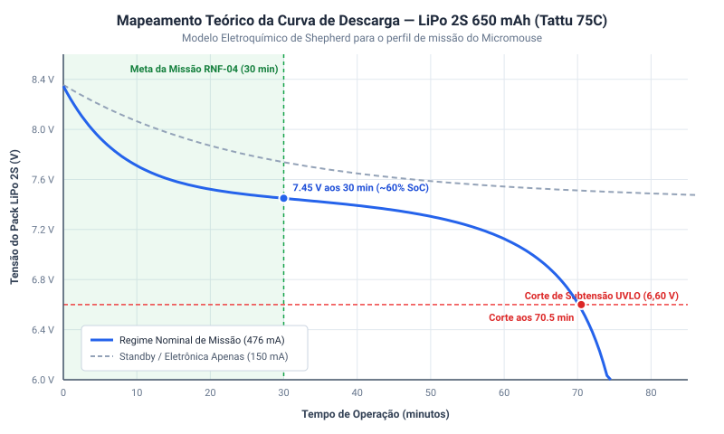

# Mapeamento Eletroquímico e Curva de Descarga da Bateria LiPo 2S

!!! warning "Dimensionamento a refazer"
    Este documento foi feito antes da Rev 2.0 do _hardware_, para a arquitetura com LiDAR e encoders ativos. Na Rev 2.0, o LiDAR foi substituído por três sensores VL53L0X (I²C), entrou a IMU MPU6050 e os encoders estão reservados, não instalados (pendência). As cargas e os valores que dependem delas serão refeitos quando a Rev 2.0 for consolidada; ver o [Projeto Conceitual de _Hardware_](../hardware.md).

---

## 1. Contextualização e Objetivos da Engenharia

O subsistema de energia do Micromouse adota como fonte primária o pack de baterias recarregável **Tattu LiPo 2S1P 650 mAh 75C** ($7{,}4\text{ V}$ nominal | $8{,}4\text{ V}$ plena carga | conector XT-30). O comportamento dinâmico de descarga de células à base de Polímero de Lítio (LiPo) sob demanda de corrente contínua é altamente não linear, exibindo três fases físico-químicas distintas:
1. **Zona Exponencial Inicial:** Queda rápida da tensão de circuito aberto logo após a saída do carregador ($8{,}40\text{ V} \to 7{,}60\text{ V}$), provocada pela estabilização da dupla camada eletroquímica nos eletrodos.
2. **Platô Nominal de Operação:** Vasta faixa quase linear onde a reação de intercalação dos íons de lítio no ânodo de grafite mantém a tensão estável entre $7{,}50\text{ V}$ e $7{,}20\text{ V}$ durante a maior parte da corrida.
3. **Joelho de Descarga Profunda (*Knee*):** Queda exponencial abrupta de tensão quando a concentração de íons disponíveis se esgota ($< 7{,}0\text{ V} \to 6{,}0\text{ V}$), ponto em que a extração continuada de corrente causa danos químicos irreversíveis à célula.

A modelagem matemática dessa curva atende aos seguintes objetivos fundamentais do projeto (**Issue #139**):
* **Emulação Realista no Firmware (Issue #215):** Prover à classe `SensorBateriaMock` uma tabela de correspondência exata para gerar leituras de telemetria reproduzíveis no Dashboard web antes da integração da placa física.
* **Salvaguarda de Subtensão (*Under-Voltage Lockout* — UVLO):** Parametrizar a máquina de estados do robô para desarmar os motores aos **$6{,}60\text{ V}$ ($3{,}30\text{ V/célula}$)**, impedindo danos térmicos ou perda de ciclo de vida da bateria.
* **Gabarito Teórico para Ensaios de Bancada:** Estabelecer uma curva teórica de referência calibrada para comparar com as medições experimentais em bancada com carga ativa.

---

## 2. Modelo Eletroquímico de Shepherd Modificado

Para descrever a dinâmica da célula LiPo sem recorrer a simulações de elementos finitos pesadas, implementou-se o modelo analítico consagrado de **Shepherd modificado** (formalizado por Tremblay e Dessaint):

$$V_{\text{cel}}(Q_{\text{d}}) = E_0 - R \cdot I - K \cdot \left(\frac{Q}{Q - Q_{\text{d}}}\right) \cdot Q_{\text{d}} + A \cdot e^{-B \cdot Q_{\text{d}}}$$

Como o pack possui topologia 2S1P (duas células em série):

$$V_{\text{pack}}(t) = 2 \cdot V_{\text{cel}}(Q_{\text{d}}(t))$$

### Parâmetros Eletroquímicos Adotados

| Parâmetro | Símbolo | Valor Adotado | Unidade | Descrição Física |
| :--- | :---: | :---: | :---: | :--- |
| **Tensão do Patamar Eletroquímico** | $E_0$ | **$3{,}740$** | $\text{V}$ | Tensão de circuito aberto intrínseca da célula |
| **Resistência Interna por Célula** | $R$ | **$15$** | $\text{m}\Omega$ | Resistência ôhmica interna ($30\text{ m}\Omega$ total no pack 2S) |
| **Corrente Média em Corrida** | $I$ | **$0{,}476$** | $\text{A}$ | Demanda líquida contínua do robô a 7,4 V nominal |
| **Coeficiente de Polarização** | $K$ | **$0{,}085$** | $\text{V}$ | Efeito de polarização e saturação na zona final de descarga |
| **Capacidade Nominal da Célula** | $Q$ | **$0{,}650$** | $\text{Ah}$ | Capacidade de catálogo ($650\text{ mAh}$) |
| **Carga Descarregada Acumulada** | $Q_{\text{d}}$ | $I \cdot t$ | $\text{Ah}$ | Integral da corrente de descarga ao longo do tempo |
| **Amplitude da Zona Exponencial** | $A$ | **$0{,}440$** | $\text{V}$ | Sobrepotencial transitório pós-carga por célula |
| **Constante de Capacidade Inversa** | $B$ | **$16{,}0$** | $\text{Ah}^{-1}$ | Taxa de decaimento da zona exponencial de relaxamento |

---

## 3. Simulação Teórica Computacional

O script de engenharia em Python [`scripts/curva_descarga_lipo.py`](https://github.com/fcte-pi1/2026_2_PI1_Grupo01_Hilmer/blob/documentacao/scripts/curva_descarga_lipo.py) simula o comportamento da bateria sob dois regimes operacionais:
1. **Regime Nominal de Corrida ($476\text{ mA}$):** Robô em exploração contínua com motores N20 acionados, LiDAR ToF girando a 5 V e rádio/MCU a 3,3 V.
2. **Regime de Baixo Consumo / Standby ($150\text{ mA}$):** Robô estático aguardando partida ou processando telemetria.

O gráfico vetorial resultante demonstra a correlação entre tempo decorrido, tensão de terminal e o corte regulamentar de 30 minutos (**RNF-04**):



---

## 4. Tabela de Correlação: Estado de Carga (SoC) vs. Tensão de Terminal

A correspondência exata entre o Estado de Carga (*State of Charge* — SoC), a tensão nos terminais do pack 2S sob carga nominal de $476\text{ mA}$ e a capacidade remanescente é apresentada na tabela a seguir:

| Estado de Carga (SoC) | Tensão do Pack 2S ($V_{\text{pack}}$) | Tensão por Célula ($V_{\text{cel}}$) | Capacidade Restante (mAh) | Regime Operacional / Diagnóstico |
| :---: | :---: | :---: | :---: | :--- |
| **100%** | **8,35 V a 8,40 V** | 4,17 V a 4,20 V | 650 mAh | Bateria plena pós-carregamento balanceado |
| **90%**  | 7,78 V | 3,89 V | 585 mAh | Fim da zona de decaimento exponencial inicial |
| **80%**  | 7,57 V | 3,78 V | 520 mAh | Início do platô estável de corrida |
| **70%**  | 7,48 V | 3,74 V | 455 mAh | Platô nominal de regime permanente |
| **60%**  | 7,43 V | 3,72 V | 390 mAh | **Ponto operacional aos 30 min de prova (RNF-04)** |
| **50%**  | 7,39 V | 3,69 V | 325 mAh | Metade da carga útil |
| **40%**  | 7,31 V | 3,66 V | 260 mAh | Operação em corrida contínua segura |
| **30%**  | 7,19 V | 3,59 V | 195 mAh | Alerta amarelo no Dashboard de telemetria |
| **20%**  | 6,92 V | 3,46 V | 130 mAh | Aproximação do joelho de descarga rápida |
| **10%**  | 6,09 V | 3,04 V | 65 mAh | Zona de esgotamento acentuado |
| **0% (Corte UVLO)**| **6,60 V** | **3,30 V** | **~45 mAh (7%)** | **Desarme forçado via software (PWM = 0)** |

---

## 5. Integração com a Camada de Firmware

A curva matemática e a tabela de calibração foram exportadas para a biblioteca C++ do microcontrolador em [`src/firmware/lib/simulacao/TabelaDescargaLiPo.h`](https://github.com/fcte-pi1/2026_2_PI1_Grupo01_Hilmer/blob/documentacao/src/firmware/lib/simulacao/TabelaDescargaLiPo.h). Essa interface provê:

```cpp
// Consulta de tensão teórica por tempo de corrida
float obterTensaoBateriaTeorica(float segundosDecorridos, float correnteMediaA);

// Interpolação linear do SoC a partir da tensão amostrada pelo ADC
float estimarSoCPorTensao(float tensaoPackMedida);
```

### Regras de Proteção Implementadas:
1. **Supervisão Contínua de Tensão:** Leituras periódicas do ADC com filtro de média móvel para rejeitar ruídos de chaveamento da ponte H.
2. **Desarme Automático (*UVLO Lockout*):** Caso a tensão atestada seja $\le 6{,}60\text{ V}$ por mais de 3 amostragens consecutivas, o firmware zera os sinais de modulação PWM para o driver DRV8833, congelando a movimentação e emitindo alerta crítico no telemetria.
3. **Preservação do Regulador LM2596 (LiDAR):** O corte em 6,60 V assegura que o conversor Step-Down de 5 V opere estritamente acima do seu patamar de *dropout* ($V_{\text{in}} \ge 5{,}0\text{ V} + 1{,}5\text{ V} = 6{,}50\text{ V}$), impedindo reinicializações do sensor óptico.

---

## 6. Protocolo de Ensaio de Bancada e Validação Experimental (Planejado)

Para consolidar a homologação experimental assim que o pack físico e a carga de teste estiverem disponíveis, estabelece-se o seguinte protocolo de ensaio em bancada:

### 6.1 Instrumentação de Teste Necessária
1. **Carga Eletrônica Ativa DC Programável** (ou banco resistivo cerâmico comutável com $R_{\text{carga}} \approx 15{,}5\ \Omega$ para drenar $476\text{ mA}$ em $7{,}4\text{ V}$).
2. **Multímetro Digital de Precisão (DMM)** com interface de aquisição de dados (leitura mínima de 4½ dígitos para registrar $V_{\text{pack}}$ a cada 5 segundos).
3. **Shunt de Corrente / Amperímetro** em série para monitorar estabilidade da drenagem.
4. **Sensor de Temperatura Termopar tipo K** fixado na superfície externa do pack para monitorar elevação térmica ($T_{\text{pack}} \le 45\text{ °C}$).

### 6.2 Procedimento Experimental
1. Carregar o pack LiPo 2S até $8{,}40\text{ V} \pm 0{,}02\text{ V}$ em carregador balanceador inteligente (corrente de 0,6 A em modo *LiPo Balance*).
2. Deixar a célula em repouso térmico por 30 minutos após a carga.
3. Conectar à carga ativa ajustada em modo Corrente Constante ($CC = 476\text{ mA}$).
4. Iniciar o registrador de dados (*data logger*) sincronizado com o disparo da carga.
5. Encerrar a descarga imediatamente ao atingir o limiar de corte de **$6{,}60\text{ V}$**.
6. Exportar os dados de tempo e tensão para formato CSV em `data/ensaios/descarga_lipo_experimental.csv`.

### 6.3 Critérios de Aceitação e Ajuste de Parâmetros
* **Erro Médio Quadrático (RMSE):** O desvio entre os pontos medidos em bancada e a curva de Shepherd teórica deve ser inferior a **$3\%$** na faixa de $8{,}4\text{ V}$ a $6{,}9\text{ V}$ ($80\%$ da capacidade útil).
* **Calibração de Parâmetros:** Caso o desvio pontual exceda 5%, os coeficientes $E_0$, $R$ e $K$ no script `curva_descarga_lipo.py` e no cabeçalho `TabelaDescargaLiPo.h` serão refinados com base na curva empírica levantada.

---

## Histórico de Versão

| Versão | Data | Descrição | Autor(es) | Revisor(es) |
| :---: | :---: | :--- | :--- | :--- |
| 1.0 | 18/10/2026 | Criação do modelo de Shepherd modificado, simulação em Python e tabela SoC para o firmware (#139) | Elias Oliveira | Bruno Duarte |
| 1.1 | 20/10/2026 | Modularização no diretório `energia/` e adição do protocolo de ensaios de bancada planejado | Elias Oliveira | Equipe de Energia |
