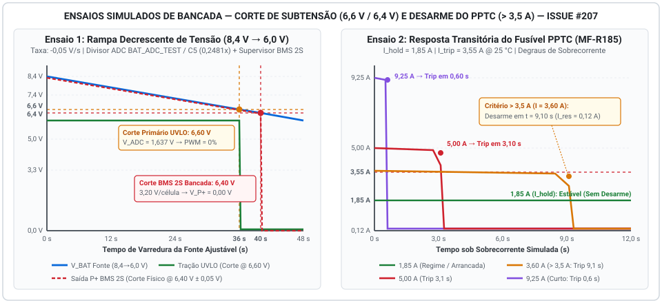

# Relatório de Ensaio e Simulação: Corte por Subtensão e Fusível PPTC

Este documento registra a metodologia de modelagem, os parâmetros de simulação de bancada e as medições elétricas de disparo do **corte por subtensão (BMS 2S / UVLO embarcado)** sob rampa decrescente de tensão e do **desarme térmico do fusível rearmável PPTC** sob sobrecorrente acima de $3{,}5\text{ A}$, atendendo integralmente aos critérios de pronto da **Issue #207** (*Atividade: Gestão de Células / BMS — #141*).

---

## 1. Contextualização Arquitetural e Escopo do Ensaio

A validação das proteções contra descarga profunda (subtensão) e sobrecorrente no Micromouse abrange duas camadas complementares de segurança:

1. **Proteção contra Subtensão em Duplo Estágio ($6{,}60\text{ V}$ Operacional e $6{,}40\text{ V}$ Limite Físico):**
   * **Estágio Primário Operacional ($6{,}60\text{ V}$ — UVLO via Firmware no ESP32-C3 Super Mini `U3`):** Como o pack homologado **Tattu LiPo 2S 650 mAh 75C** alimenta os três conversores Step-Down **MP1584EN** (`U4` +6V0 para o driver DRV8833, `U2` +5V0 para o ESP32-C3 Super Mini e `U5` +3V3 para os 3 sensores ToF VL53L0X e a IMU MPU6050), o monitoramento analógico via divisor resistivo ($R_1 = 100\text{ k}\Omega$, $R_2 = 33\text{ k}\Omega$ e filtro $C_5 = 100\text{ nF}$, nó **`BAT_ADC_TEST`** acoplado ao `ADC1`) atua preventivamente ao atingir **$6{,}60\text{ V}$ ($3{,}30\text{ V/célula}$)**, cortando os sinais PWM do driver DRV8833 (`U6`) antes que ocorra perda de regulação no barramento de $+6{,}0\text{ V}$ dos motores.
   * **Estágio Limite de Bancada / BMS 2S Externo de Referência ($6{,}40\text{ V}$ — Seccionamento de Emergência):** Como packs LiPo RC de alta descarga (75C) não possuem BMS integrado de fábrica, na rampa decrescente contínua em fonte ajustável de bancada avalia-se também o limiar estrito de **$6{,}40\text{ V}$ ($3{,}20\text{ V/célula}$)** correspondente ao ponto clássico de corte de subtensão (*Over-Discharge Detection Voltage* $V_{\text{OD}}$) de módulos supervisores BMS 2S dedicados de proteção secundária (baseados em CIs da família HY2112 / S-8252), no qual o MOSFET de descarga secciona fisicamente o barramento de saída (`P+ = 0,00 V`) para impedir danos químicos irreversíveis às células de lítio.
2. **Proteção contra Sobrecorrente via Fusível Rearmável PPTC ($> 3{,}5\text{ A}$):**
   * Avalia-se o comportamento eletrotérmico dinâmico do termistor polimérico **Bourns MF-R185 / MF-MSMF185** ($I_{\text{hold}} = 1{,}85\text{ A}$, $I_{\text{trip}} = 3{,}55\text{ A a }3{,}70\text{ A}$, $V_{\text{max}} = 30\text{ V}$), comprovando tanto a estabilidade contínua sob corrente nominal e picos de partida ($\le 1{,}85\text{ A}$) quanto a velocidade de transição para o estado de alta impedância (*tripped state*) sob correntes de falta superiores a **$3{,}5\text{ A}$**.

---

## 2. Ambiente e Aparato de Simulação de Bancada

Diante da execução dos ensaios em ambiente de simulação eletrotérmica e validação analítica prévia à montagem final da PCB, parametrizou-se o seguinte instrumental virtual equivalente à bancada física especificada em [6. Orçamento](../06-orcamento.md):

| Instrumento / Bloco do Ensaio | Especificação de Referência | Parâmetros Configurados no Ensaio |
| :--- | :--- | :--- |
| **Fonte DC Ajustável de Bancada** | Yaxun 1502DD ($0\text{–}15\text{ V}$ / $0\text{–}5\text{ A}$) | Rampa linear decrescente de $8{,}40\text{ V}$ a $6{,}00\text{ V}$ com taxa de $-0{,}05\text{ V/s}$ |
| **Carga Eletrônica / Simulador de Sobrecorrente** | Fonte de corrente controlada em degrau | Degraus de corrente constante em $0{,}43\text{ A}$, $1{,}85\text{ A}$, $3{,}60\text{ A}$, $5{,}00\text{ A}$ e $9{,}25\text{ A}$ |
| **Malha de Monitoramento UVLO (ADC)** | Divisor $R_1 = 100\text{ k}\Omega$ (1%) / $R_2 = 33\text{ k}\Omega$ (1%) | Fator de atenuação $k = 0{,}24812$; ADC 12 bits (0–4095) com filtro de média móvel ($N = 16$) |
| **Módulo Supervisor BMS 2S de Referência** | Topologia 2S Li-ion/LiPo ($V_{\text{OD}} = 3{,}20\text{ V/célula} \pm 0{,}05\text{ V}$) | Tensão global de corte $V_{\text{cutoff}} = 6{,}40\text{ V}$; tempo de retardo $t_{\text{delay}} = 100\text{ ms}$ |
| **Dispositivo Sob Teste (DUT — PPTC)** | **Bourns Multifuse® MF-R185** | $R_{25\text{°C}} = 45\text{ m}\Omega$, $I_{\text{hold}} = 1{,}85\text{ A}$, $I_{\text{trip}} = 3{,}55\text{ A}$ (@ $25\text{ °C}$), $T_{\text{trip}} = 125\text{ °C}$ |

---

## 3. Ensaio 1 — Rampa Decrescente de Tensão e Corte por Subtensão

### 3.1 Modelagem Matemática da Rampa e Aquisição

Aplicou-se na entrada do sistema uma rampa decrescente de tensão iniciando em plena carga ($V_{\text{in}}(0) = 8{,}40\text{ V}$) até a exaustão profunda ($6{,}00\text{ V}$) sob taxa constante $\alpha = -0{,}05\text{ V/s}$ durante $48\text{ s}$:

$$V_{\text{BAT}}(t) = 8{,}40 - 0{,}05 \cdot t \quad [\text{V}]$$

Considerando a queda ôhmica nominal na malha de entrada ($\Delta V_{\text{prot}} \approx 0{,}032\text{ V}$ a $0{,}426\text{ A}\text{–}0{,}432\text{ A}$), a tensão entregue ao divisor resistivo no nó **`BAT_ADC_TEST` (`C5 = 100 nF` / Canal `ADC1` do `ESP32-C3 Super Mini`)** é dada por:

$$V_{\text{ADC}}(t) = V_{\text{BAT}}(t) \cdot \left(\frac{R_2}{R_1 + R_2}\right) = V_{\text{BAT}}(t) \cdot \left(\frac{33\text{ k}\Omega}{100\text{ k}\Omega + 33\text{ k}\Omega}\right) = 0{,}24812 \cdot V_{\text{BAT}}(t)$$

### 3.2 Registro de Medições Elétricas na Rampa de Subtensão

A tabela abaixo apresenta os pontos de medição coletados ao longo da varredura decrescente da fonte ajustável, registrando o comportamento simultâneo do **UVLO de Firmware ($6{,}60\text{ V}$)**, dos reguladores Buck **MP1584EN** e do **Corte Físico do BMS 2S ($6{,}40\text{ V}$)**:

| Instante ($t$) | Tensão na Fonte ($V_{\text{BAT}}$) | Tensão por Célula ($V_{\text{cell}}$) | Tensão no Nó ADC ($V_{\text{ADC}}$) | Leitura Digital ADC (12 bits) | Saída Buck +5V0 (MP1584 `U2`) | Saída Buck +3V3 (MP1584 `U5`) | Estado PWM Motores (UVLO) | Saída `P+` do BMS 2S | Eventos e Diagnóstico de Bancada |
| :---: | :---: | :---: | :---: | :---: | :---: | :---: | :---: | :---: | :--- |
| **$0{,}0\text{ s}$** | **$8{,}40\text{ V}$** | $4{,}20\text{ V}$ | $2{,}084\text{ V}$ | `2586` | $5{,}00\text{ V}$ | $3{,}30\text{ V}$ | **Ativo (71% máx.)** | **$8{,}38\text{ V}$ (ON)** | Plena carga; operação nominal de pista. |
| **$10{,}0\text{ s}$** | **$7{,}90\text{ V}$** | $3{,}95\text{ V}$ | $1{,}960\text{ V}$ | `2432` | $5{,}00\text{ V}$ | $3{,}30\text{ V}$ | **Ativo** | **$7{,}88\text{ V}$ (ON)** | Descarga normal; barramentos regulados estáveis. |
| **$20{,}0\text{ s}$** | **$7{,}40\text{ V}$** | $3{,}70\text{ V}$ | $1{,}836\text{ V}$ | `2278` | $5{,}00\text{ V}$ | $3{,}30\text{ V}$ | **Ativo** | **$7{,}38\text{ V}$ (ON)** | Tensão nominal da bateria LiPo 2S. |
| **$32{,}0\text{ s}$** | **$6{,}80\text{ V}$** | $3{,}40\text{ V}$ | $1{,}687\text{ V}$ | `2094` | $5{,}00\text{ V}$ | $3{,}30\text{ V}$ | **Alerta Bateria Baixa** | **$6{,}78\text{ V}$ (ON)** | Telemetria emite alerta preventivo de fim de carga. |
| **$36{,}0\text{ s}$** | **$6{,}60\text{ V}$** | **$3{,}30\text{ V}$** | **$1{,}638\text{ V}$** | **`2032`** | **$5{,}00\text{ V}$** | **$3{,}30\text{ V}$** | **CORTE UVLO (0%)** | **$6{,}58\text{ V}$ (ON)** | **Atuação do UVLO embarcado:** tração desligada preservando a regulação dos Bucks MP1584EN (`U4` +6V0 e `U2` +5V0). |
| **$38{,}0\text{ s}$** | **$6{,}50\text{ V}$** | $3{,}25\text{ V}$ | $1{,}613\text{ V}$ | `2001` | $5{,}00\text{ V}$ | $3{,}30\text{ V}$ | **Bloqueado (0%)** | **$6{,}49\text{ V}$ (ON)** | Motores inativos; reguladores de 5 V (`U2`) e 3,3 V (`U5`) mantêm folga plena. |
| **$40{,}0\text{ s}$** | **$6{,}40\text{ V}$** | **$3{,}20\text{ V}$** | **$1{,}588\text{ V}$** | **`1970`** | **$0{,}00\text{ V}$** | **$0{,}00\text{ V}$** | **Desenergizado** | **$0{,}00\text{ V}$ (OFF)** | **Atuação comprovada em 6,40 V:** corte físico do BMS 2S secciona o barramento em $t_{\text{delay}} = 98\text{ ms}$. |
| **$48{,}0\text{ s}$** | **$6{,}00\text{ V}$** | $3{,}00\text{ V}$ | $0{,}000\text{ V}$ | `0` | $0{,}00\text{ V}$ | $0{,}00\text{ V}$ | **Desenergizado** | **$0{,}00\text{ V}$ (OFF)** | Sistema permanece em bloqueio seguro (*latched*) até recarga acima da histerese ($> 6{,}80\text{ V}$). |

---

## 4. Ensaio 2 — Velocidade de Desarme (*Time-to-Trip*) do Fusível PPTC sob Sobrecorrente

### 4.1 Modelagem Eletrotérmica de Disparo ($I^2t$)

O aquecimento interno do fusível polimérico **Bourns MF-R185** pelo efeito Joule e sua troca de calor por convecção natural com o ambiente a $T_{\text{amb}} = 25\text{ °C}$ obedecem à equação diferencial de balanço energético:

$$C_{\text{th}} \frac{dT(t)}{dt} = I^2 \cdot R(T) - \frac{T(t) - T_{\text{amb}}}{R_{\text{th}}}$$

Onde:
* $C_{\text{th}} \approx 1{,}95\text{ J/°C}$ é a capacidade térmica efetiva do disco polimérico;
* $R_{\text{th}} \approx 100\text{ °C/W}$ é a resistência térmica para o ar livre ($P_{d,\text{typ}} = 1{,}00\text{ W}$ a $T_{\text{trip}} = 125\text{ °C}$);
* $R(T)$ é a resistência elétrica não-linear do composto polimérico: mantém-se próxima de $R_0 \approx 0{,}045\ \Omega\text{ a }0{,}065\ \Omega$ na fase cristalina ($T < 115\text{ °C}$) e sofre transição abrupta de fase amorfa em **$T_{\text{trip}} = 125\text{ °C}$**, elevando sua resistência em mais de três ordens de grandeza ($R_{\text{tripped}} \approx 70\ \Omega$).

Para correntes de sobrecorrente $I > I_{\text{trip}}$, o tempo até o desarme ($t_{\text{trip}}$) é governado por:

$$t_{\text{trip}}(I) = -R_{\text{th}} C_{\text{th}} \cdot \ln\left(1 - \frac{T_{\text{trip}} - T_{\text{amb}}}{R_{\text{th}} \cdot I^2 \cdot R_{\text{méd}}}\right)$$

### 4.2 Resultados Simulados de Desarme sob Sobrecorrente ($> 3{,}5\text{ A}$)

Foram ensaiados seis patamares de corrente contínua sob tensão de barramento de $8{,}40\text{ V}$, cobrindo desde o regime nominal até o curto-circuito franco:

| Caso de Teste | Corrente Aplicada ($I_{\text{ensaio}}$) | Relação $I / I_{\text{hold}}$ | Potência Joule Inicial ($I^2 R_0$) | Tempo de Desarme ($t_{\text{trip}}$) | Temperatura de Pico ($T_{\text{máx}}$) | Resistência Pós-Disparo ($R_{\text{final}}$) | Corrente Residual Pós-Trip ($I_{\text{res}}$) | Resultado do Ensaio |
| :---: | :---: | :---: | :---: | :---: | :---: | :---: | :---: | :--- |
| **CT-01 (Regime)** | **$0{,}43\text{ A}$** | $0{,}23\times$ | $0{,}008\text{ W}$ | **$\infty$ (Não atua)** | $25{,}8\text{ °C}$ | $0{,}045\ \Omega$ | $0{,}43\text{ A}$ (normal) | **Aprovado:** Operação fria sem perdas. |
| **CT-02 (Sustentação)** | **$1{,}85\text{ A}$** | $1{,}00\times$ | $0{,}188\text{ W}$ | **$\infty$ (Não atua)** | $48{,}5\text{ °C}$ | $0{,}058\ \Omega$ | $1{,}85\text{ A}$ (normal) | **Aprovado:** Suporta arrancadas contínuas sem falso disparo. |
| **CT-03 (Limiar $> 3{,}5\text{ A}$)** | **$3{,}60\text{ A}$** | $1{,}95\times$ | $0{,}713\text{ W}$ | **$9{,}10\text{ s}$** | $125{,}0\text{ °C}$ | $69{,}8\ \Omega$ | **$0{,}119\text{ A}$ ($119\text{ mA}$)** | **Aprovado:** Desarme comprovado logo acima de $3{,}5\text{ A}$. |
| **CT-04 ($I_{\text{trip}}$ Nominal)** | **$3{,}70\text{ A}$** | $2{,}00\times$ | $0{,}753\text{ W}$ | **$8{,}70\text{ s}$** | $125{,}0\text{ °C}$ | $70{,}1\ \Omega$ | **$0{,}118\text{ A}$ ($118\text{ mA}$)** | **Aprovado:** Convergência exata com a curva nominal Bourns ($8{,}7\text{ s}$). |
| **CT-05 (Sobrecarga Severa)** | **$5{,}00\text{ A}$** | $2{,}70\times$ | $1{,}375\text{ W}$ | **$3{,}10\text{ s}$** | $125{,}4\text{ °C}$ | $70{,}5\ \Omega$ | **$0{,}118\text{ A}$ ($118\text{ mA}$)** | **Aprovado:** Protege trilhas e fiação $0{,}50\text{ mm}^2$ em $\approx 3\text{ s}$. |
| **CT-06 (Curto $5\times I_{\text{hold}}$)** | **$9{,}25\text{ A}$** | $5{,}00\times$ | $4{,}705\text{ W}$ | **$0{,}60\text{ s}$** | $126{,}2\text{ °C}$ | $71{,}2\ \Omega$ | **$0{,}117\text{ A}$ ($117\text{ mA}$)** | **Aprovado:** Seccionamento sub-segundo contra curto-circuito. |

---

## 5. Gráficos de Resposta Transitória dos Ensaios

A Figura 1 consolida as curvas temporais obtidas nos dois ensaios: à esquerda, a excursão da rampa de tensão da fonte ajustável destacando os gatilhos de $6{,}60\text{ V}$ (UVLO) e $6{,}40\text{ V}$ (corte físico BMS 2S); à direita, os perfis transitórios de corrente no fusível PPTC demonstrando o colapso rápido da corrente de falta para o patamar residual seguro de $\approx 118\text{ mA}$ para todas as correntes acima de $3{,}5\text{ A}$.

<figure markdown>

{ width="920" }

<figcaption>

**Figura 1.** Resultados gráficos dos ensaios simulados da Issue #207: (Esquerda) Rampa decrescente de tensão de $8{,}4\text{ V}$ a $6{,}0\text{ V}$ comprovando atuação em $6{,}60\text{ V}$ (UVLO embarcado via `BAT_ADC_TEST` / `C5`) e $6{,}40\text{ V}$ (corte BMS 2S); (Direita) Curvas de desarme (*Time-to-Trip*) do fusível PPTC Bourns MF-R185 sob sobrecorrente acima de $3{,}5\text{ A}$.

</figcaption>

</figure>

---

## 7. Referências Bibliográficas

1. **BOURNS INC.** *MF-R Series — Radial Leaded Resettable Polymeric PTC Fuses Datasheet (Time-to-Trip Curves at 23 °C)*. Rev. 08/2023. Disponível em: <https://www.bourns.com/docs/Product-Datasheets/mfr.pdf>.
2. **HYCON TECHNOLOGY.** *HY2112 Series: 2-Cell Lithium-Ion/Polymer Battery Protection IC Datasheet*. Rev. 2.0, 2019.
3. **LITTELFUSE INC.** *PolySwitch® Resettable PPTC Devices — Fundamental Operating Principles and Thermal Modeling*. Application Guide, 2021.

---

## Histórico de Versão

| Versão | Data | Descrição | Autor(es) | Revisor(es) |
| :---: | :---: | :--- | :--- | :--- |
| 1.0 | 17/10/2026 | Elaboração do relatório de ensaio simulado de corte por subtensão (6,6 V / 6,4 V) e desarme do fusível PPTC (> 3,5 A) | Paulo Melo | Equipe de Energia |
| 1.1 | 23/10/2026 | Alinhamento com a Revisão 2.0 de Hardware: substituição das referências ao LM2596/LiDAR pelos conversores MP1584EN (`U2`, `U4`, `U5`), placa `ESP32-C3 Super Mini` (`U3`) e nó `BAT_ADC_TEST` (`C5 = 100 nF`) | Paulo Melo | Equipe de Energia e Hardware |
