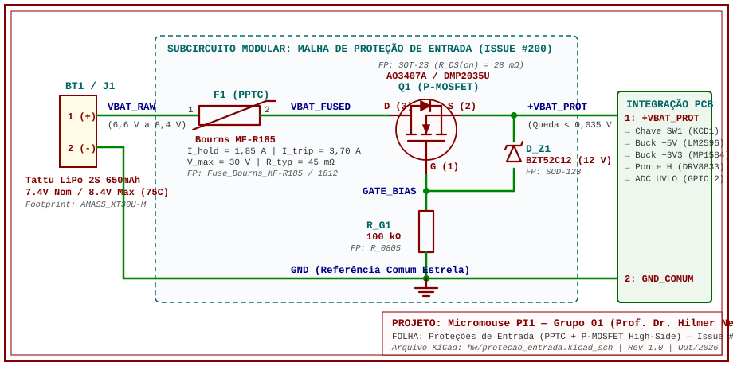

# Dimensionamento das Proteções de Entrada (Polaridade Reversa e Sobrecorrente)

---

## 1. Contextualização e Justificativa de Engenharia

A fonte primária homologada para o robô é o pack **Tattu LiPo 2S1P 650 mAh 75C (7,4 V nominal / 8,4 V máximo)** com conector de descarga **XT-30**. Diferentemente de células cilíndricas comerciais de baixa descarga, packs LiPo de alta performance (*75C contínuo / 150C burst*) **não possuem circuito de BMS interno acoplado**, sendo capazes de fornecer até **48,75 A contínuos** e **97,5 A de pico** em caso de falha.

Essa característica impõe dois requisitos críticos para o estágio de entrada da placa de circuito impresso (PCB):

1. **Proteção contra Curto-Circuito e Travamento de Motores (Fusível Rearmável PPTC):** Um eventual curto-circuito acidental nos barramentos ou o travamento mecânico prolongado (*stall*) de ambos os micromotores GA12-N20 na pista geraria correntes elevadas capazes de carbonizar trilhas de cobre, danificar o driver DRV8833 ou provocar estufamento térmico das células da bateria. O uso de um fusível polimérico rearmável (**PPTC — *Polymeric Positive Temperature Coefficient***) garante o seccionamento automático sob anomalia e o rearme passivo após a remoção da falha, sem necessidade de substituição de fusíveis de vidro durante a competição.
2. **Proteção Ativa contra Inversão de Polaridade (P-MOSFET High-Side):** Embora o conector XT-30 possua chanfro mecânico polarizado, testes de bancada com fontes ajustáveis, cabos adaptadores ou retrabalho de solda expõem o robô ao risco de conexão reversa, o que destruiria instantaneamente os três reguladores Buck **MP1584EN (`U2`, `U4`, `U5`)**, o driver **DRV8833 (`U6`)**, os sensores I²C (**3× `VL53L0X` e `MPU6050`**) e o microcontrolador **ESP32-C3 Super Mini (`U3`)**.
   * **Por que não utilizar um Diodo Schottky convencional em série?** Um diodo Schottky de potência apresenta queda de tensão direta típica de $V_F \approx 0{,}35\text{ V a }0{,}50\text{ V}$. Quando a bateria atinge o limiar inferior de operação em **6,60 V** (definido pelo corte de subtensão UVLO), um diodo reduziria a tensão entregue na entrada dos conversores Step-Down para $\approx 6{,}10\text{ V}$, comprimindo a margem de regulação do conversor **MP1584EN de +6,0 V (`U4`)** dedicado aos motores e dissipando potência térmica desnecessária na placa.
   * **Solução Adotada:** Emprega-se um transistor **MOSFET de Canal P (P-MOSFET)** em configuração reversa *High-Side* com resistência de condução ultrabaixa ($R_{\text{DS(on)}} < 50\text{ m}\Omega$), reduzindo a queda de tensão no regime nominal para **menos de 0,02 V**.

---

## 2. Perfil de Correntes e Travamento (*Stall*) dos Motores GA12-N20

O dimensionamento da janela de atuação das proteções baseia-se nas demandas reais de corrente do Micromouse em três regimes distintos:

| Regime Operacional | Componentes Ativos e Condição | Corrente no Barramento 2S ($I_{\text{BAT}}$) | Duração Típica | Comportamento Esperado da Proteção |
| :--- | :--- | :---: | :---: | :--- |
| **1. Regime Nominal (Cruzeiro)** | ESP32-C3 Super Mini + 3× Sensores ToF VL53L0X + IMU MPU6050 + 2× Motores N20 em velocidade constante | **$0{,}42\text{ A a }0{,}60\text{ A}$** | Contínuo (até 30 min) | Condução plena; queda $\Delta V_{\text{MOS}} < 0{,}05\text{ V}$; PPTC frio. |
| **2. Pico Dinâmico (Arrancadas / Curvas)** | Partida simultânea dos 2 motores N20 + pico de transmissão Wi-Fi do ESP32 | **$1{,}40\text{ A a }1{,}75\text{ A}$** | Transitório ($< 500\text{ ms}$) | **Não deve desarmar** ($I_{\text{pico}} < I_{\text{hold}}$ do PPTC). |
| **3. Travamento Mecânico (*Stall* Duplo)** | Roda bloqueada contra parede com PWM no teto de 71% ($V_{\text{ef}} = 6{,}0\text{ V}$, $I_{\text{stall,N20}} \approx 0{,}80\text{ A a }1{,}0\text{ A}$ por motor) + cargas lógicas | **$1{,}80\text{ A a }2{,}30\text{ A}$** | Segundos (até detecção por odometria) | Aquecimento gradual do PPTC; proteção primária pelo driver DRV8833 e odometria. |
| **4. Sobrecarga Severa / Curto-Circuito** | Travamento sob tensão plena sem limitação PWM, falha na ponte H ou curto na PCB | **$> 3{,}50\text{ A}$** (até $48\text{ A}$ sem proteção) | Imediato | **Desarme obrigatório (*Trip*)** do fusível PPTC em poucos segundos. |

> **Nota sobre a corrente de *stall* dos motores GA12-N20:** Os micromotores DC GA12-N20 (6 V nominais, redução metálica) apresentam resistência de armadura típica $R_a \approx 6{,}0\ \Omega\text{ a }7{,}5\ \Omega$, resultando em corrente de rotor bloqueado (*stall current*) de **$0{,}80\text{ A a }1{,}00\text{ A}$ por motor** a 6,0 V (ou até $1{,}40\text{ A}$ por motor caso recebessem 8,4 V diretos por falha de firmware, totalizando $\approx 3{,}1\text{ A a }3{,}5\text{ A}$ com os demais subsistemas).

---

## 3. Memorial de Cálculo — Proteção contra Inversão de Polaridade (P-MOSFET)

### 3.1 Princípio de Funcionamento da Topologia P-MOSFET *High-Side*

Na topologia de proteção contra inversão de polaridade com P-MOSFET no ramo positivo (*High-Side*), o transistor **Q1** é conectado com orientação invertida em relação a uma chave de carga convencional:
* O terminal **Dreno (D — Pino 3)** é conectado ao lado da **entrada** (vindo do fusível PPTC / bateria).
* O terminal **Source (S — Pino 2)** é conectado ao lado da **saída protegida** (`+VBAT_PROT`).
* O terminal **Gate (G — Pino 1)** é referenciado ao `GND` através do resistor de polarização $R_{G1}$.

1. **Bateria conectada corretamente ($V_{\text{BAT}} = +6{,}6\text{ V a }+8{,}4\text{ V}$):** No instante inicial ($t = 0^+$), o diodo intrínseco de corpo (*body diode*) do P-MOSFET — cujo ânodo está no Dreno e o cátodo está no Source — conduz a favor da bateria, elevando imediatamente o potencial do Source para $V_S \approx V_{\text{BAT}} - 0{,}7\text{ V}$. Como o Gate está aterrado ($V_G = 0\text{ V}$), surge uma tensão negativa entre Gate e Source:
   $$V_{GS} = V_G - V_S \approx -V_{\text{BAT}}$$
   Como $|V_{GS}| \ge 6{,}6\text{ V}$ supera amplamente a tensão de limiar do transistor ($|V_{GS(\text{th})}| \approx 1{,}0\text{ V}$), o canal P entra em **saturação profunda (condução ôhmica plena)**, curto-circuitando o diodo intrínseco e reduzindo a queda entre Dreno e Source para $V_{DS} = I_{\text{BAT}} \cdot R_{\text{DS(on)}}$.
2. **Bateria conectada invertida ($V_{\text{BAT}} < 0\text{ V}$):** O potencial no Dreno torna-se negativo e o potencial no Gate (ligado ao terminal negativo da fonte invertida, que agora está em $+V_{\text{BAT}}$) torna-se mais positivo que o Source ($V_{GS} \ge 0\text{ V}$). O diodo intrínseco de corpo fica **reversamente polarizado** e o canal P permanece **100% cortado (aberto)**, bloqueando completamente a passagem de corrente para o robô.

### 3.2 Seleção do Componente P-MOSFET

Seleciona-se como componente principal o P-MOSFET SMD **Alpha & Omega AO3407A** (com equivalência direta pino a pino para **Diodes Inc. DMP2035U** ou **Vishay SI2305CDS** em encapsulamento **SOT-23**):

| Parâmetro Técnico | Símbolo | Valor de Datasheet (AO3407A) | Requisito da Issue #200 | Status |
| :--- | :---: | :---: | :---: | :---: |
| Tensão Máxima Dreno-Source | $V_{DS,\text{max}}$ | **$-20\text{ V}$** | Suportar $8{,}4\text{ V}$ com folga ($> 16\text{ V}$) | Conforme (138% de margem) |
| Tensão Máxima Gate-Source | $V_{GS,\text{max}}$ | **$\pm 12\text{ V}$** (protegido por Zener) | Operar entre $6{,}6\text{ V}$ e $8{,}4\text{ V}$ | Conforme |
| Tensão de Limiar (*Threshold*) | $V_{GS(\text{th})}$ | **$-0{,}9\text{ V}$ (típ.) / $-1{,}3\text{ V}$ (máx.)** | Plena saturação em $6{,}6\text{ V}$ | Conforme |
| Corrente Contínua de Dreno ($25\text{ °C}$) | $I_D$ | **$-4{,}3\text{ A}$** (pico pulsado $-27\text{ A}$) | Suportar até o *trip* de $3{,}5\text{ A}$ | Conforme |
| Resistência em Condução ($V_{GS} = -10\text{ V}$) | $R_{\text{DS(on)}}$ | **$28\text{ m}\Omega$ (típ.) / $35\text{ m}\Omega$ (máx.)** | **$< 50\text{ m}\Omega$** | **Atendido ($28\text{ m}\Omega$)** |
| Resistência em Condução ($V_{GS} = -4{,}5\text{ V}$) | $R_{\text{DS(on)}}$ | **$33\text{ m}\Omega$ (típ.) / $43\text{ m}\Omega$ (máx.)** | **$< 50\text{ m}\Omega$** em $6{,}6\text{ V}$ | **Atendido ($33\text{ m}\Omega$)** |
| Resistência Térmica Junção-Ambiente | $R_{\theta JA}$ | **$90\text{ °C/W}$** (em pad SMD padrão) | Baixo aquecimento | Conforme |

### 3.3 Equacionamento de Saturação em 6,6 V, Queda de Tensão e Dissipação

1. **Comprovação de Saturação Plena no Ponto Crítico de Subtensão ($V_{\text{BAT,min}} = 6{,}60\text{ V}$):**
   Mesmo no instante final da descarga da bateria antes do corte UVLO ($V_{\text{BAT}} = 6{,}60\text{ V}$), a tensão efetiva aplicada entre Gate e Source é $V_{GS} = -6{,}60\text{ V}$. Como $|-6{,}60\text{ V}| > |-4{,}50\text{ V}|$ (tensão de referência de caracterização do datasheet), interpolando a curva característica $R_{\text{DS(on)}} \times V_{GS}$ do AO3407A em $V_{GS} = -6{,}6\text{ V}$, obtém-se:
   $$R_{\text{DS(on) @ -6,6V}} \approx \mathbf{30\text{ m}\Omega} \ (0{,}030\ \Omega) < 50\text{ m}\Omega$$

2. **Cálculo da Queda de Tensão ($\Delta V_{\text{MOS}}$):**
   * **Em Regime Nominal de Missão ($I_{\text{nom}} = 0{,}432\text{ A}$):**
     $$\Delta V_{\text{MOS,nom}} = I_{\text{nom}} \cdot R_{\text{DS(on)}} = 0{,}432\text{ A} \cdot 0{,}030\ \Omega = \mathbf{0{,}0130\text{ V}} \ (\mathbf{13{,}0\text{ mV}}) \ll 0{,}05\text{ V}$$
   * **Em Regime Nominal Conservador ($I_{\text{cont}} = 0{,}600\text{ A}$, usando $R_{\text{DS(on),máx}} = 43\text{ m}\Omega$):**
     $$\Delta V_{\text{MOS,máx}} = 0{,}600\text{ A} \cdot 0{,}043\ \Omega = \mathbf{0{,}0258\text{ V}} \ (\mathbf{25{,}8\text{ mV}}) < 0{,}05\text{ V}$$
   * **Em Pico de Arrancada ($I_{\text{pico}} = 1{,}80\text{ A}$):**
     $$\Delta V_{\text{MOS,pico}} = 1{,}80\text{ A} \cdot 0{,}030\ \Omega = \mathbf{0{,}054\text{ V}} \ (\mathbf{54\text{ mV}})$$

3. **Cálculo de Dissipação Térmica e Temperatura de Junção ($P_{D,\text{MOS}}$):**
   * **Dissipação em Regime Nominal ($I_{\text{nom}} = 0{,}432\text{ A}$):**
     $$P_{D,\text{nom}} = I_{\text{nom}}^2 \cdot R_{\text{DS(on)}} = (0{,}432)^2 \cdot 0{,}030 = \mathbf{0{,}0056\text{ W}} \ (\mathbf{5{,}6\text{ mW}})$$
   * **Dissipação no Limiar de Sustentação do PPTC ($I_{\text{hold}} = 1{,}85\text{ A}$):**
     $$P_{D,\text{hold}} = (1{,}85)^2 \cdot 0{,}030 = 3{,}4225 \cdot 0{,}030 = \mathbf{0{,}1027\text{ W}} \ (\mathbf{102{,}7\text{ mW}})$$
   * **Elevação Térmica ($\Delta T_j$) sob $1{,}85\text{ A}$ contínuos ($T_a = 25\text{ °C}$):**
     $$\Delta T_j = P_{D,\text{hold}} \cdot R_{\theta JA} = 0{,}1027\text{ W} \cdot 90\text{ °C/W} \approx \mathbf{9{,}2\text{ °C}} \implies T_j \approx 34{,}2\text{ °C} \ll T_{j,\text{max}} \ (150\text{ °C})$$

### 3.4 Dimensionamento da Malha de Polarização e Proteção de Gate ($R_{G1}$ e $D_{Z1}$)

* **Resistor de *Pull-Down* de Gate ($R_{G1} = 100\text{ k}\Omega$, SMD 0805):** Mantém o Gate firmemente aterrado ao `GND` durante a operação normal, garantindo velocidade de comutação na energização e corrente de fuga quiescente ínfima:
  $$I_{R_{G1}} = \frac{V_{\text{BAT,max}}}{R_{G1}} = \frac{8{,}4\text{ V}}{100\text{ k}\Omega} = \mathbf{84\ \mu\text{A}}$$
* **Diodo Zener Grampeador Gate-Source ($D_{Z1} = \text{BZT52C12}$, $V_Z = 12\text{ V}$, SOD-123):** Conectado entre Source (cátodo) e Gate (ânodo). Embora a bateria 2S opere até $8{,}4\text{ V}$ (abaixo do limite $V_{GS,\text{max}} = \pm 12\text{ V}$ do AO3407A), transientes indutivos oriundos da frenagem regenerativa dos motores N20 no barramento `+VBAT_2S` poderiam gerar picos momentâneos superiores a $12\text{ V}$. O Zener grampeia qualquer sobretensão transiente na porta do MOSFET, protegendo o óxido de Gate.

---

## 4. Memorial de Cálculo — Fusível Rearmável PPTC (Sobrecorrente e Curto-Circuito)

### 4.1 Critérios de Dimensionamento Eletrotérmico

O fusível polimérico PPTC deve satisfazer simultaneamente três condições de contorno:
1. **Não atuar em operação normal ou picos de manobra ($I_{\text{hold}}$):** Deve suportar sem desarme a corrente máxima de regime ($0{,}60\text{ A}$) e as arrancadas rápidas do conjunto motorizado ($\approx 1{,}5\text{ A a }1{,}75\text{ A}$), considerando o fator de *derating* térmico em temperatura ambiente de competição ($25\text{ °C a }30\text{ °C}$). Portanto:
   $$I_{\text{hold}} \approx \mathbf{1{,}80\text{ A a }1{,}85\text{ A}}$$
2. **Atuar com segurança sob curto-circuito ou sobrecarga severa ($I_{\text{trip}}$):** Tipicamente, termistores poliméricos PPTC apresentam razão $I_{\text{trip}} / I_{\text{hold}} = 2{,}0$. Para $I_{\text{hold}} \approx 1{,}80\text{ A a }1{,}85\text{ A}$, obtém-se corrente de disparo na faixa de:
   $$I_{\text{trip}} \approx \mathbf{3{,}50\text{ A a }3{,}70\text{ A}}$$
3. **Suportar a tensão máxima do barramento ($V_{\text{max}}$) e a corrente de falta ($I_{\text{max}}$):** Exige-se $V_{\text{max}} \ge 16\text{ V}$ (dobro da tensão da bateria de $8{,}4\text{ V}$) e capacidade de interrupção $I_{\text{max}} \ge 40\text{ A}$.

### 4.2 Componente PPTC Selecionado

Homologa-se o fusível rearmável **Bourns Multifuse® MF-R185** (versão radial *through-hole* de baixa resistência) ou seu equivalente direto em montagem em superfície **Bourns MF-MSMF185 / Littelfuse 1812L185** (encapsulamento **SMD 1812**):

| Parâmetro Técnico | Símbolo | Valor de Datasheet (MF-R185) | Requisito da Issue #200 | Status |
| :--- | :---: | :---: | :---: | :---: |
| Corrente de Sustentação ($20\text{ °C}$) | $I_{\text{hold @ 20°C}}$ | **$1{,}85\text{ A}$** | $\approx 1{,}8\text{ A}$ | **Atendido** |
| Corrente de Sustentação ($25\text{ °C}$) | $I_{\text{hold @ 25°C}}$ | **$1{,}78\text{ A} \approx 1{,}80\text{ A}$** | $\approx 1{,}8\text{ A}$ | **Atendido** |
| Corrente de Disparo (*Trip* a $20\text{ °C}$) | $I_{\text{trip @ 20°C}}$ | **$3{,}70\text{ A}$** | $\approx 3{,}5\text{ A}$ | **Atendido** |
| Corrente de Disparo (*Trip* a $25\text{ °C}$) | $I_{\text{trip @ 25°C}}$ | **$3{,}55\text{ A}$** | $\approx 3{,}5\text{ A}$ | **Atendido** |
| Tensão Máxima de Operação | $V_{\text{max}}$ | **$30\text{ V}_{\text{DC}}$** ($33\text{ V}$ na versão SMD) | **$\ge 16\text{ V}$** | **Atendido (87% de margem)** |
| Corrente Máxima de Falta | $I_{\text{max}}$ | **$40\text{ A}$** | Suportar surto inicial | Conforme |
| Resistência Inicial em Repouso | $R_{\text{min}} / R_{\text{típ}} / R_{1\text{max}}$ | $0{,}033\ \Omega\ / \ \mathbf{0{,}045\ \Omega}\ / \ 0{,}065\ \Omega$ | Baixa perda ôhmica | Conforme |
| Tempo Típico de Disparo (*Time-to-Trip*) | $T_{\text{trip}}$ | **$8{,}7\text{ s}$** (@ $3{,}7\text{ A}$) / **$0{,}6\text{ s}$** (@ $9{,}25\text{ A}$) | Proteção contra stall/curto | Conforme |
| Potência Dissipada em Estado *Tripped* | $P_{d,\text{typ}}$ | **$1{,}00\text{ W}$** ($I_{\text{res}} \approx 120\text{ mA}$ @ $8{,}4\text{ V}$) | Estado travado seguro | Conforme |

### 4.3 Cálculo de Queda de Tensão no PPTC e Balanço Global na Entrada dos Conversores MP1584EN

1. **Queda de Tensão no PPTC ($\Delta V_{\text{PPTC}}$):**
   * Em regime nominal ($I_{\text{nom}} \approx 0{,}426\text{ A a }0{,}432\text{ A}$, $R_{\text{típ}} = 0{,}045\ \Omega$):
     $$\Delta V_{\text{PPTC,nom}} = 0{,}432\text{ A} \cdot 0{,}045\ \Omega = \mathbf{0{,}0194\text{ V}} \ (\mathbf{19{,}4\text{ mV}})$$
   * Dissipação ôhmica nominal no PPTC:
     $$P_{D,\text{PPTC}} = (0{,}432)^2 \cdot 0{,}045 = \mathbf{0{,}0084\text{ W}} \ (\mathbf{8{,}4\text{ mW}})$$

2. **Balanço Global de Queda da Malha de Proteção ($\text{PPTC} + \text{P-MOSFET}$):**
   Somando as resistências em série do fusível PPTC ($45\text{ m}\Omega$) e do P-MOSFET ($30\text{ m}\Omega$), a resistência equivalente total da malha de proteção é $R_{\text{prot,total}} = \mathbf{75\text{ m}\Omega}$ ($0{,}075\ \Omega$):
   $$\Delta V_{\text{total,nom}} = \Delta V_{\text{PPTC,nom}} + \Delta V_{\text{MOS,nom}} = 19{,}4\text{ mV} + 13{,}0\text{ mV} = \mathbf{32{,}4\text{ mV}} \ (\mathbf{0{,}0324\text{ V}})$$

3. **Validação da Margem de Regulação dos Conversores Buck MP1584EN (`U4` +6V0 e `U2` +5V0):**
   Quando a bateria atinge a tensão mínima de corte por software (**$V_{\text{BAT,min}} = 6{,}600\text{ V}$**), a tensão efetiva entregue no barramento protegido `+VBAT_PROT` é:
   $$V_{\text{PROT,min}} = 6{,}600\text{ V} - 0{,}0324\text{ V} = \mathbf{6{,}5676\text{ V}}$$
   Comprova-se, portanto, que a malha de proteção preserva integralmente a estabilidade do barramento de $+5{,}0\text{ V}$ (`U2` — `ESP32-C3 Super Mini`, cujo *dropout* no `MP1584EN` ocorre apenas abaixo de $\approx 5{,}35\text{ V}$) e mantém margem adequada para o conversor de $+6{,}0\text{ V}$ (`U4` — `DRV8833`) até o instante exato do desligamento por UVLO.

---

## 5. Esquemático Elétrico no KiCad e Pinagem de Integração

O circuito completo de proteção foi desenhado de forma modular no arquivo nativo do KiCad [**`hw/protecao_entrada.kicad_sch`**](https://github.com/fcte-pi1/2026_2_PI1_Grupo01_Hilmer/blob/documentacao/hw/protecao_entrada.kicad_sch), estruturado para instanciação como folha hierárquica ou bloco de proteção na placa-mãe.

> **Nota sobre a Organização Modular do Esquemático (`Micromouse.kicad_sch`):**  
> Na folha principal do esquemático ([`hw/Micromouse.pdf`](https://github.com/fcte-pi1/2026_2_PI1_Grupo01_Hilmer/blob/documentacao/hw/Micromouse.pdf)), o estágio de entrada é representado com o conector da bateria (`BT1`), o fusível rearmável PPTC (`F1` — Bourns MF-R185) e a chave geral (`SW1`), enquanto o bloco ativo contra inversão de polaridade composto pelo P-MOSFET `Q1` (`AO3407A`), diodo Zener `D_Z1` (`BZT52C12`) e resistor `R_G1` (`100 kΩ`) encontra-se detalhado no subesquemático dedicado `hw/protecao_entrada.kicad_sch` para integração modular na PCB.

<figure markdown>

{ width="900" }

<figcaption>

**Figura 1.** Esquemático elétrico da malha de proteção de entrada (Fusível PPTC `F1` + P-MOSFET `Q1` em configuração *High-Side* + grampeador Zener `D_Z1` e polarização `R_G1`), documentando footprints e nós de integração.

</figcaption>

</figure>

### 5.1 Lista de Componentes e *Footprints* Definidos no KiCad

| Referência KiCad | Componente / *Part Number* | Função na Malha | *Footprint* KiCad Definido |
| :---: | :--- | :--- | :--- |
| **`BT1`** | Conector **AMASS XT30U-M** (Bateria Tattu 2S) | Entrada polarizada de alta corrente da bateria LiPo 2S | `Connector_AMASS:AMASS_XT30U-M_1x02_P5.0mm_Vertical` |
| **`F1`** | **Bourns MF-R185** (ou SMD **MF-MSMF185**) | Fusível rearmável PPTC ($I_{\text{hold}}=1{,}85\text{ A}$, $I_{\text{trip}}=3{,}7\text{ A}$, $30\text{ V}$) | `Fuse:Fuse_Bourns_MF-R185` *(Alt SMD: `Fuse:Fuse_1812_4532Metric`)* |
| **`Q1`** | **AO3407A** (ou **DMP2035U**) | P-MOSFET Canal P ($R_{\text{DS(on)}}=28\text{ m}\Omega$, $-20\text{ V}$, $-4{,}3\text{ A}$) | `Package_TO_SOT_SMD:SOT-23` |
| **`R_G1`** | Resistor SMD **$100\text{ k}\Omega$** ($1/8\text{ W}$, 1%) | Polarização *pull-down* do Gate para o `GND` | `Resistor_SMD:R_0805_2012Metric` |
| **`D_Z1`** | Diodo Zener **BZT52C12** ($V_Z = 12\text{ V}$, $500\text{ mW}$) | Proteção contra sobretensão transiente $V_{GS}$ entre Gate e Source | `Diode_SMD:D_SOD-123` |

### 5.2 Tabela de Pinagem e Nós de Integração com o Circuito Principal

Para a integração física e lógica do subcircuito `hw/protecao_entrada.kicad_sch` ao esquemático mestre do Micromouse (`Micromouse.kicad_sch`), devem ser observadas as seguintes conexões de fronteira:

| Nó / Label no KiCad | Direção | Pino de Origem | Pino(s) de Destino no Circuito Principal | Nível Elétrico Nominal |
| :--- | :---: | :--- | :--- | :--- |
| **`VBAT_RAW`** | Entrada | Pino `1 (+)` do conector XT-30 (`BT1`) | Terminal `1` do Fusível PPTC (`F1`) | $6{,}60\text{ V a }8{,}40\text{ V}$ (direto da LiPo) |
| **`VBAT_FUSED`** | Interno | Terminal `2` do Fusível PPTC (`F1`) | Pino `3 (Drain)` do P-MOSFET (`Q1`) | $6{,}58\text{ V a }8{,}40\text{ V}$ (protegido contra sobrecorrente) |
| **`GATE_BIAS`** | Interno | Pino `1 (Gate)` do P-MOSFET (`Q1`) | Terminal `1` de `R_G1` ($100\text{ k}\Omega$) e Ânodo (`2`) de `D_Z1` | $0\text{ V}$ em operação normal ($V_{GS} = -V_{\text{BAT}}$) |
| **`+VBAT_PROT`** | **Saída Principal** | Pino `2 (Source)` de `Q1` e Cátodo (`1`) de `D_Z1` | Terminal `1` da Chave Geral `SW1` $\rightarrow$ Barramento **`VBAT`** (entradas `IN+` dos três conversores Buck **MP1584EN** `U2` +5V0, `U4` +6V0 e `U5` +3V3, e resistor $R_1$ do divisor de monitoramento de tensão **`BAT_ADC_TEST`**) | $6{,}57\text{ V a }8{,}39\text{ V}$ (protegido contra inversão e curto) |
| **`GND`** | **Referência Comum** | Pino `2 (-)` do conector XT-30 (`BT1`) e Pino `2` de `R_G1` | Nó central de **GND em Estrela** da PCB (retorno de potência do DRV8833 `U6`, reguladores Buck `U2/U4/U5`, sensores `J3–J6` e lógica do ESP32-C3 Super Mini `U3`) | $0{,}00\text{ V}$ |

## 6. Referências Bibliográficas

1. **ALPHA & OMEGA SEMICONDUCTOR.** *AO3407A: 20V P-Channel MOSFET Datasheet*. Rev. 7.0, 2013. Disponível em: <http://www.aosmd.com/pdfs/datasheet/AO3407A.pdf>.
2. **BOURNS INC.** *MF-R Series — Radial Leaded Resettable Polymeric PTC Fuses Datasheet*. Rev. 08/2023. Disponível em: <https://www.bourns.com/docs/Product-Datasheets/mfr.pdf>.
3. **TEXAS INSTRUMENTS.** *Reverse Current/Battery Protection Circuits*. Application Report SLVA139, 2003. Disponível em: <https://www.ti.com/lit/an/slva139/slva139.pdf>.
4. **INFINEON TECHNOLOGIES.** *Simple High-Side Reverse Polarity Protection using PMOS*. Application Note, 2018.

---

## Histórico de Versão

| Versão | Data | Descrição | Autor(es) | Revisor(es) |
| :---: | :---: | :--- | :--- | :--- |
| 1.0 | 17/10/2026 | Elaboração do memorial de cálculo e esquemático da malha de proteção de entrada (P-MOSFET AO3407A e PPTC MF-R185) — Issue #200 | Paulo Melo | Equipe de Energia e Hardware |
| 1.1 | 23/10/2026 | Alinhamento com a Revisão 2.0 de Hardware: atualização dos barramentos para 3× MP1584EN (`U2`, `U4`, `U5`), sensores `3× VL53L0X + MPU6050`, placa `ESP32-C3 Super Mini` (`U3`), nó `BAT_ADC_TEST` e nota de integração do subesquemático `hw/protecao_entrada.kicad_sch` | Paulo Melo | Equipe de Energia e Hardware |
