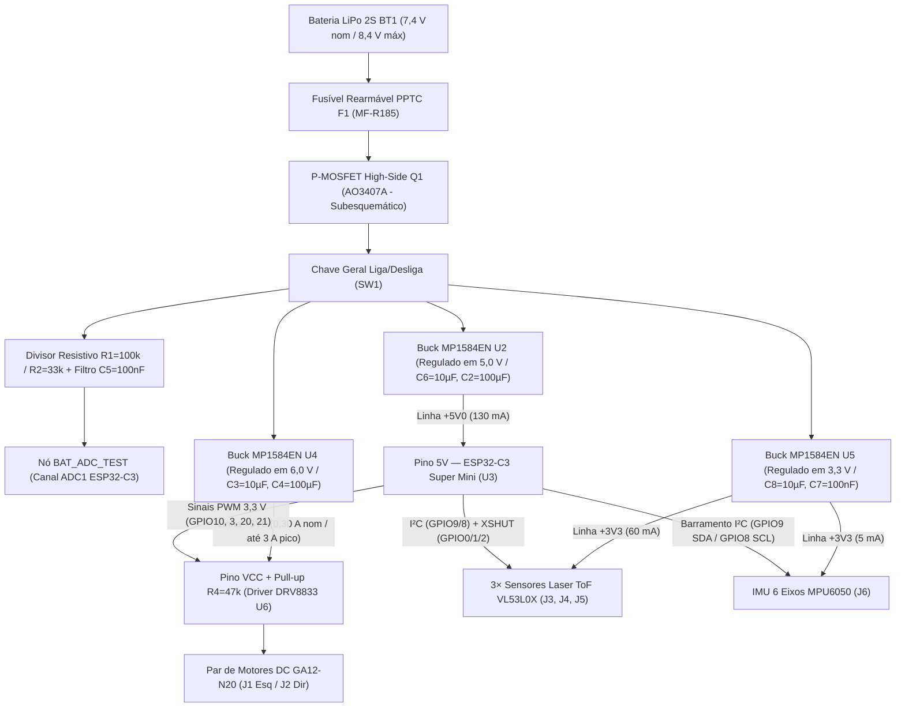

# Dimensionamento e Análise dos Reguladores Step-Down (Buck)

---

## 1. Contextualização e Metodologia de Projeto

O sistema de alimentação do Micromouse opera a partir do barramento primário de bateria LiPo 2S (**$6{,}60\text{ V a }8{,}40\text{ V}$**, $V_{\text{nominal}} = 7{,}40\text{ V}$). Para garantir isolamento de ruído entre atuadores, processamento lógico e sensoriamento óptico/inercial, bem como imunidade eletromagnética contra transientes indutivos, adota-se uma arquitetura com **três conversores chaveados Step-Down (Buck) de alta frequência independentes baseados no CI MP1584EN** ($f_{\text{sw}} \approx 1{,}0\text{ MHz}$, chave MOSFET interna de canal N com $R_{\text{DS(on)}} \approx 180\text{ m}\Omega$, limite de pico de $3{,}0\text{ A}$):

1. **Barramento `+6V0` (`U4` — Atuação Eletromecânica):** Alimentado por módulo regulador **MP1584EN (`U4`)** ajustado em $6{,}0\text{ V}$, dedicado ao pino de potência `VCC` do driver Ponte H **DRV8833 (`U6`)** e ao resistor de *pull-up* `R4 = 47 kΩ` do pino `EEP` (`nSLEEP`) para acionar os micromotores GA12-N20 (`J1` e `J2`) com tensão constante de $6{,}0\text{ V}$ e suporte a picos transitórios de partida/travamento (*stall*) de **até ~3,0 A**. Conta com filtragem externa dedicada na PCB ($C_3 = 10\ \mu\text{F}$ na entrada e $C_4 = 100\ \mu\text{F}$ na saída).
2. **Barramento `+5V0` (`U2` — Processamento e Rádio Wi-Fi):** Alimentado por módulo regulador **MP1584EN (`U2`)** ajustado em $5{,}0\text{ V}$, dedicado à alimentação da placa **ESP32-C3 Super Mini (`U3`)** através do seu pino `5V` (consumo médio nominal de $130\text{ mA}$ e picos curtos de rádio Wi-Fi de até $350\text{ mA}$), isolando o regulador linear LDO interno da placa das oscilações do barramento de tração. Conta com filtragem externa na PCB ($C_6 = 10\ \mu\text{F}$ na entrada e $C_2 = 100\ \mu\text{F}$ na saída).
3. **Barramento `+3V3` (`U5` — Sensoriamento Óptico e Inercial I²C):** Alimentado por módulo regulador **MP1584EN (`U5`)** ajustado em $3{,}3\text{ V}$, dedicado exclusivamente ao barramento de sensores I²C composto pelos **3 sensores laser ToF `VL53L0X` (`J3`, `J4`, `J5`)** e pela **IMU de 6 eixos `MPU6050` (`J6`)** (consumo médio combinado de $65\text{ mA}$). Conta com desacoplamento externo na PCB ($C_8 = 10\ \mu\text{F}$ na entrada e $C_7 = 100\text{ nF}$ cerâmico de alta frequência na saída).

---

## 2. Dimensionamento do Regulador MP1584EN — `U4` (+6V0 — Motores DC e Driver DRV8833)

O conversor **MP1584EN (`U4`)** opera com frequência nominal de chaveamento de **$1{,}0\text{ MHz}$** e chave MOSFET High-Side interna ($R_{\text{DS(on)}} \approx 180\text{ m}\Omega$, corrente limite de pico ciclo a ciclo de $3{,}0\text{ A a }3{,}5\text{ A}$), provendo alta eficiência, baixo volume ocupado na PCB e reduzida queda de tensão em *dropout*.

### 2.1 Razão Cíclica (*Duty Cycle*) e Análise de *Dropout Voltage*
Adotando rendimento médio sob carga de tração estimado em $\eta \approx 85\%$ ($0{,}85$):

$$D = \frac{V_{\text{out}}}{V_{\text{in}} \cdot \eta}$$

* **Bateria em Plena Carga ($V_{\text{in}} = 8{,}4\text{ V}$):**
  $$D_{\text{min}} = \frac{6{,}0}{8{,}4 \cdot 0{,}85} \approx 0{,}840 \implies \mathbf{84{,}0\%} \quad (\text{ideal sem perdas: } 71{,}4\%)$$
* **Bateria em Tensão Nominal ($V_{\text{in}} = 7{,}4\text{ V}$):**
  $$D_{\text{nom}} = \frac{6{,}0}{7{,}4 \cdot 0{,}85} \approx 0{,}954 \implies \mathbf{95{,}4\%} \quad (\text{ideal sem perdas: } 81{,}1\%)$$

**Comportamento em *Dropout* ($V_{\text{drop}}$):**  
O estágio MOSFET do **MP1584EN** apresenta resistência em condução de apenas $R_{\text{DS(on)}} \approx 0{,}18\ \Omega$. Em regime nominal de corrida ($I_{\text{out}} = 0{,}30\text{ A}$), a queda resistiva na chave interna é de apenas $\Delta V_{\text{sw}} \approx 0{,}30\text{ A} \cdot 0{,}18\ \Omega = \mathbf{54\text{ mV}}$.  
Considerando o ciclo de trabalho máximo do controlador PWM interno e a resistência série do indutor, o regulador `U4` sustenta a saída próxima de $6{,}0\text{ V}$ até o limiar de corte UVLO de **$6{,}60\text{ V}$** ($V_{\text{out}} \ge 5{,}85\text{ V}$), garantindo perfil cinemático uniforme aos motores GA12-N20 durante toda a descarga útil da bateria.

### 2.2 Malha de Realimentação (Feedback)
Com tensão de referência interna $V_{\text{ref}} = 0{,}80\text{ V}$:

$$V_{\text{out}} = V_{\text{ref}} \cdot \left(1 + \frac{R_{\text{fb1}}}{R_{\text{fb2}}}\right)$$

Fixando o resistor inferior da malha em $R_{\text{fb2}} = 10\text{ k}\Omega$:

$$R_{\text{fb1}} = 10\text{ k}\Omega \cdot \left(\frac{6{,}0}{0{,}80} - 1\right) = \mathbf{65{,}0\text{ k}\Omega}$$

* **Componente Selecionado:** Resistor comercial E96 de **$64{,}9\text{ k}\Omega \ (1\%)$**, gerando $V_{\text{out}} = \mathbf{5{,}992\text{ V}}$ (erro relativo de $-0{,}13\%$) ou calibração fina por trimpot no módulo `MP1584EN` para $6{,}00\text{ V} \pm 0{,}02\text{ V}$.

### 2.3 Indutor de Potência ($L$), Diodo Schottky e Capacitores (`C3` e `C4`)
Para operação a $f_{\text{sw}} = 1{,}0\text{ MHz}$ com ondulação de corrente no indutor $\Delta I_L = 0{,}60\text{ A}$:

$$L_{\text{mín}} = \frac{(V_{\text{in,max}} - V_{\text{out}}) \cdot (V_{\text{out}} / V_{\text{in,max}})}{\Delta I_L \cdot f_{\text{sw}}} = \frac{(8{,}4 - 6{,}0) \cdot 0{,}714}{0{,}60 \cdot 1.000.000} \approx \mathbf{2{,}86\ \mu\text{H}}$$

* **Indutor Selecionado:** Indutor blindado SMD de perfil baixo de **$4{,}7\ \mu\text{H}$ a $10\ \mu\text{H}$** com corrente eficaz $I_{\text{rms}} \ge 3{,}0\text{ A}$ e corrente de saturação $I_{\text{sat}} \ge 3{,}5\text{ A}$, prevenindo saturação magnética nas partidas rápidas.
* **Diodo de Recirculação:** Schottky **B340A / SS34** ($V_R = 40\text{ V}$, $I_F = 3{,}0\text{ A}$, $V_F \le 0{,}45\text{ V}$).
* **Capacitores de Desacoplamento Externos no Esquemático (`Micromouse.kicad_sch`):**
  * **Entrada (`C3`):** Capacitor de **$10\ \mu\text{F}$** próximo ao pino `IN+` de `U4` (complementando os capacitores MLCC internos do módulo).
  * **Saída (`C4`):** Capacitor de **$100\ \mu\text{F}$** no barramento `+6V` junto ao pino `VCC` do driver `DRV8833` (`U6`), atuando como reservatório de carga para amortecer os degraus de corrente de comutação das pontes H.

### 2.4 Análise Térmica e Diretriz de Proteção contra Stall Prolongado
1. **Regime Nominal de Corrida ($I_{\text{out}} = 0{,}30\text{ A}$):**
   $$P_{\text{d,nom}} = (6{,}0\text{ V} \cdot 0{,}30\text{ A}) \cdot \left(\frac{1}{0{,}85} - 1\right) \approx \mathbf{0{,}32\text{ W}} \implies \Delta T \approx 16{,}0\text{ °C} \ (R_{\theta JA} \approx 50\text{ °C/W SOIC-8E}) \implies T_j \approx \mathbf{41{,}0\text{ °C}}$$
   *(Operação fria e de alta eficiência em regime de exploração e corrida).*
2. **Regime Transitório de Stall ($I_{\text{out}} \approx 2{,}0\text{ A a }3{,}0\text{ A}$):**
   $$P_{\text{d,stall}} = (6{,}0\text{ V} \cdot 3{,}0\text{ A}) \cdot \left(\frac{1}{0{,}80} - 1\right) \approx \mathbf{4{,}50\text{ W}}$$
   *(O CI MP1584EN possui limitação de corrente pulso a pulso em ~3,5 A e desligamento térmico interno a $160\text{ °C}$).*

> [!IMPORTANT]
> **Diretriz de Segurança no Firmware:**  
> A corrente de travamento (*stall*) é admitida apenas em regime **transitório** (50 ms a 200 ms durante arrancadas e reversões).  
> Caso o microcontrolador comande acionamento PWM para o driver `DRV8833` (`U6`), mas a leitura inercial da IMU `MPU6050` (`J6`) e a variação de distância dos sensores frontais/laterais `VL53L0X` (`J3–J5`) indiquem imobilidade mecânica por mais de **500 ms**, o firmware zera imediatamente os sinais PWM (`GPIO10, 3, 20, 21`), protegendo o conversor `U4`, a ponte H `U6` e as escovas dos motores N20.

---

## 3. Dimensionamento do Regulador MP1584EN — `U2` (+5V0 — Placa ESP32-C3 Super Mini `U3`)

O barramento de $+5{,}0\text{ V}$ gerado pelo conversor **MP1584EN (`U2`)** alimenta exclusivamente o pino **`5V`** da placa microcontroladora **ESP32-C3 Super Mini (`U3`)** (consumo médio de $130\text{ mA}$ e picos de transmissão Wi-Fi de até $350\text{ mA}$). Essa topologia em cascata (Buck chaveado $7{,}4\text{ V} \to 5{,}0\text{ V}$ seguido do regulador LDO linear interno de $5{,}0\text{ V} \to 3{,}3\text{ V}$ da própria placa Super Mini) proporciona dupla rejeição de *ripple* (PSRR) para a CPU e o transceptor RF.

### 3.1 Razão Cíclica e Margem de *Dropout*
Com rendimento $\eta \approx 86\%$ ($0{,}86$) a $f_{\text{sw}} = 1{,}0\text{ MHz}$:
* $V_{\text{in}} = 8{,}4\text{ V} \implies D_{\text{min}} = \frac{5{,}0}{8{,}4 \cdot 0{,}86} \approx \mathbf{69{,}2\%}$
* $V_{\text{in}} = 6{,}6\text{ V} \implies D_{\text{max}} = \frac{5{,}0}{6{,}6 \cdot 0{,}86} \approx \mathbf{88{,}1\%}$

**Compatibilidade de *Dropout*:**  
Graças à chave MOSFET interna do MP1584EN ($R_{\text{DS(on)}} \approx 180\text{ m}\Omega$), a queda de tensão interna a $130\text{ mA}$ é inferior a $0{,}35\text{ V}$, exigindo tensão mínima de entrada de apenas:
$$V_{\text{in,mín\_reg}} \approx 5{,}0\text{ V} + 0{,}35\text{ V} = \mathbf{5{,}35\text{ V}}$$
Como o desarme por software (UVLO) encerra a missão aos **$6{,}60\text{ V}$**, o conversor `U2` opera com folga superior a **$1{,}25\text{ V}$** acima do *dropout*, eliminando qualquer risco de reinicialização (*brownout reset*) do `ESP32-C3 Super Mini` durante picos de motores.

### 3.2 Feedback e Componentes Passivos (`C6` e `C2`)
* **Divisor de Feedback:** Com $V_{\text{ref}} = 0{,}80\text{ V}$ e $R_{\text{fb2}} = 10\text{ k}\Omega$:
  $$R_{\text{fb1}} = 10\text{ k}\Omega \cdot \left(\frac{5{,}0}{0{,}80} - 1\right) = \mathbf{52{,}5\text{ k}\Omega} \implies \text{Resistor E96 de } 52{,}3\text{ k}\Omega \ (1\%) \text{ ou trimpot calibrado para } 5{,}00\text{ V} \pm 0{,}02\text{ V}$$
* **Indutor ($L$):** Para $\Delta I_L = 0{,}30\text{ A}$ a $1{,}0\text{ MHz}$:
  $$L_{\text{mín}} = \frac{(8{,}4 - 5{,}0) \cdot (5{,}0 / 8{,}4)}{0{,}30 \cdot 1.000.000} \approx \mathbf{6{,}75\ \mu\text{H}} \implies \text{Adota-se } \mathbf{6{,}8\ \mu\text{H a } 10\ \mu\text{H}} \ (I_{\text{sat}} \ge 2{,}0\text{ A})$$
* **Diodo Schottky:** **SS24 / B230A** ($40\text{ V} / 2\text{ A}$, $V_F \approx 0{,}40\text{ V}$).
* **Capacitores Externos no Esquemático (`Micromouse.kicad_sch`):**
  * **Entrada (`C6`):** **$10\ \mu\text{F}$** na entrada `IN+` de `U2`.
  * **Saída (`C2`):** **$100\ \mu\text{F}$** na linha `+5V` conectada ao pino `5V` de `U3`, suprindo instantaneamente os pulsos de corrente de até $350\text{ mA}$ das rajadas de pacotes Wi-Fi.
* **Dissipação Térmica em Carga Nominal ($130\text{ mA}$):**
  $$P_d = (5{,}0\text{ V} \cdot 0{,}130\text{ A}) \cdot \left(\frac{1}{0{,}86} - 1\right) \approx \mathbf{0{,}106\text{ W}} \implies T_j \approx \mathbf{30{,}3\text{ °C}}$$

---

## 4. Dimensionamento do Regulador MP1584EN — `U5` (+3V3 — Sensores I²C VL53L0X e MPU6050)

O terceiro conversor **MP1584EN (`U5`)** opera em **$1{,}0\text{ MHz}$** e alimenta de forma dedicada e isolada o barramento de $+3{,}3\text{ V}$ dos sensores I²C: os **3 sensores laser Time-of-Flight `VL53L0X` (`J3` esquerdo, `J4` frontal, `J5` direito — $3 \times 20\text{ mA} = 60\text{ mA}$)** e a **unidade de medição inercial `MPU6050` (`J6` — $5\text{ mA}$)**, totalizando corrente média de **$65\text{ mA}$** ($0{,}065\text{ A}$).

### 4.1 Razão Cíclica e Isolamento Óptico/Inercial
Com rendimento $\eta \approx 88\%$ ($0{,}88$):
* $V_{\text{in}} = 8{,}4\text{ V} \implies D_{\text{min}} = \frac{3{,}3}{8{,}4 \cdot 0{,}88} \approx \mathbf{44{,}6\%}$
* $V_{\text{in}} = 6{,}6\text{ V} \implies D_{\text{max}} = \frac{3{,}3}{6{,}6 \cdot 0{,}88} \approx \mathbf{56{,}8\%}$

A segregação dos sensores em `U5` (separado do microcontrolador em `U2` e dos motores em `U4`) garante que os emissores laser VCSEL de $940\text{ nm}$ dos sensores `VL53L0X` e o conversor A/D interno de 16 bits do giroscópio `MPU6050` operem sobre uma referência de $3{,}30\text{ V}$ livre de modulação por carga de rádio ou de tração.

### 4.2 Feedback e Componentes Passivos (`C8` e `C7`)
* **Divisor de Feedback:** Com $V_{\text{ref}} = 0{,}80\text{ V}$ e $R_{\text{fb2}} = 10\text{ k}\Omega$:
  $$R_{\text{fb1}} = 10\text{ k}\Omega \cdot \left(\frac{3{,}3}{0{,}80} - 1\right) = \mathbf{31{,}25\text{ k}\Omega} \implies \text{Resistor E96 de } 31{,}6\text{ k}\Omega \ (1\%)$$
* **Indutor de Alta Frequência ($L$):** Para $\Delta I_L = 0{,}30\text{ A}$ a $1{,}0\text{ MHz}$:
  $$L_{\text{mín}} = \frac{(8{,}4 - 3{,}3) \cdot 0{,}446}{0{,}30 \cdot 1.000.000} \approx \mathbf{7{,}58\ \mu\text{H}} \implies \text{Adota-se } \mathbf{6{,}8\ \mu\text{H a } 10\ \mu\text{H}} \ (I_{\text{sat}} \ge 2{,}0\text{ A})$$
* **Diodo Schottky:** **SS24 / B230A** ($40\text{ V} / 2\text{ A}$, $V_F \approx 0{,}40\text{ V}$).
* **Capacitores Externos no Esquemático (`Micromouse.kicad_sch`):**
  * **Entrada (`C8`):** **$10\ \mu\text{F}$** na entrada `IN+` de `U5`.
  * **Saída (`C7`):** Capacitor cerâmico de **$100\text{ nF}$** na saída `+3,3V` (em paralelo com os capacitores MLCC de $22\ \mu\text{F}$ internos do módulo `MP1584EN`), filtrando ruídos de alta frequência nos pinos `VDD` de `J3`, `J4`, `J5` e `J6` (ondulação $< 15\text{ mV}_{\text{pp}}$).
* **Dissipação Térmica Nominal ($65\text{ mA}$):**
  $$P_d = (3{,}3\text{ V} \cdot 0{,}065\text{ A}) \cdot \left(\frac{1}{0{,}88} - 1\right) \approx \mathbf{0{,}029\text{ W}} \implies T_j \approx \mathbf{26{,}5\text{ °C}}$$

---

## 5. Tabela Comparativa Consolidada dos Três Reguladores

| Parâmetro de Projeto | Linha `+6V0` (`U4` — Motores / DRV8833) | Linha `+5V0` (`U2` — MCU ESP32-C3) | Linha `+3V3` (`U5` — Sensores I²C) |
| :--- | :--- | :--- | :--- |
| **Designador e CI Regulador** | **`U4` — MP1584EN** | **`U2` — MP1584EN** | **`U5` — MP1584EN** |
| **Topologia / Chaveamento** | Buck MOSFET ($R_{\text{DS(on)}}=180\text{ m}\Omega$, $1{,}0\text{ MHz}$) | Buck MOSFET ($R_{\text{DS(on)}}=180\text{ m}\Omega$, $1{,}0\text{ MHz}$) | Buck MOSFET ($R_{\text{DS(on)}}=180\text{ m}\Omega$, $1{,}0\text{ MHz}$) |
| **Carga Principal Alimentada** | Pino `VCC` do DRV8833 (`U6`), *pull-up* `R4` e Motores N20 (`J1`, `J2`) | Pino `5V` da placa **ESP32-C3 Super Mini (`U3`)** | **3× ToF VL53L0X (`J3–J5`)** + **IMU MPU6050 (`J6`)** |
| **Tensão Regulada ($V_{\text{out}}$)** | **$6{,}00\text{ V}$** | **$5{,}00\text{ V}$** | **$3{,}30\text{ V}$** |
| **Tensão de Referência ($V_{\text{ref}}$)**| $0{,}80\text{ V}$ | $0{,}80\text{ V}$ | $0{,}80\text{ V}$ |
| **Divisor de Feedback ($R_{\text{fb1}}, R_{\text{fb2}}$)** | $R_{\text{fb2}} = 10\text{ k}\Omega$, $R_{\text{fb1}} = 64{,}9\text{ k}\Omega$ (1%) | $R_{\text{fb2}} = 10\text{ k}\Omega$, $R_{\text{fb1}} = 52{,}3\text{ k}\Omega$ (1%) | $R_{\text{fb2}} = 10\text{ k}\Omega$, $R_{\text{fb1}} = 31{,}6\text{ k}\Omega$ (1%) |
| **Consumo em Regime Nominal** | $0{,}300\text{ A}$ ($1{,}80\text{ W}$) | $0{,}130\text{ A}$ nom. / $0{,}35\text{ A}$ pico Wi-Fi ($0{,}65\text{ W}$) | $0{,}065\text{ A}$ nom. / $0{,}12\text{ A}$ pico laser ($0{,}215\text{ W}$) |
| **Capacidade de Corrente do Módulo**| **Até 3,0 A pico (*stall* transitório)** | **1,5 A contínuo / 3,0 A pico** | **1,5 A contínuo / 3,0 A pico** |
| **Indutância de Projeto ($L$)** | $4{,}7\ \mu\text{H}$ a $10\ \mu\text{H}$ ($I_{\text{sat}} \ge 3{,}5\text{ A}$) | $6{,}8\ \mu\text{H}$ a $10\ \mu\text{H}$ ($I_{\text{sat}} \ge 2{,}0\text{ A}$) | $6{,}8\ \mu\text{H}$ a $10\ \mu\text{H}$ ($I_{\text{sat}} \ge 2{,}0\text{ A}$) |
| **Diodo Schottky de Recirculação** | B340A / SS34 ($40\text{ V} \ / \ 3\text{ A}$) | SS24 / B230A ($40\text{ V} \ / \ 2\text{ A}$) | SS24 / B230A ($40\text{ V} \ / \ 2\text{ A}$) |
| **Capacitores Externos na PCB**| `C3 = 10 µF` (ent.), `C4 = 100 µF` (saída) | `C6 = 10 µF` (ent.), `C2 = 100 µF` (saída) | `C8 = 10 µF` (ent.), `C7 = 100 nF` (saída) |
| **Potência Dissipada em Regime** | $0{,}32\text{ W}$ (nom.) / transitório no stall | $0{,}106\text{ W}$ (nom.) / $0{,}28\text{ W}$ (pico) | $0{,}029\text{ W}$ (nom.) |
| **Temperatura Junção ($T_j$) Estimada**| **$41{,}0\text{ °C}$** (nom.) | **$30{,}3\text{ °C}$** (nom.) | **$26{,}5\text{ °C}$** (nom.) |
| **Mecanismo de Proteção Crítico** | Corte PWM se *stall* $> 500\text{ ms}$ + UVLO $6{,}6\text{ V}$ | Folga $> 1{,}25\text{ V}$ acima do *dropout* em $6{,}6\text{ V}$ | Isolamento de ruído e *shutdown* térmico a $160\text{ °C}$ |
| **Status de Homologação** | **Aprovado para Tração (`U4`)** | **Aprovado para Controle (`U2`)** | **Aprovado para Sensores I²C (`U5`)** |

---

## 6. Diagrama Funcional da Distribuição de Potência

---

## 7. Protocolo de Ensaio de Bancada e Validação Experimental (Planejado)

Para validação em bancada após o recebimento dos componentes e placas:

### 7.1 Regulação de Carga e Linha (*Line & Load Regulation*)
1. Conectar fonte DC regulável na entrada simulando a faixa de bateria ($6{,}6\text{ V a }8{,}4\text{ V}$).
2. Aplicar degraus de corrente de carga através de carga eletrônica ativa ($0\text{ mA}$, $65\text{ mA}$, $130\text{ mA}$, $300\text{ mA}$ e $1{,}0\text{ A}$).
3. Registrar a variação de tensão em cada linha (`U4` $+6{,}0\text{ V}$, `U2` $+5{,}0\text{ V}$ e `U5` $+3{,}3\text{ V}$) com multímetro digital.  
   * **Critério de Aceitação:** Regulação de carga $\le \pm 2\%$ da tensão nominal especificada.

### 7.2 Medição de Ondulação (*Ripple*) com Osciloscópio
1. Conectar ponta de prova atenuada 1X acoplada em AC com mola de aterramento curta diretamente sobre os terminais dos capacitores de saída (`C4`, `C2` e `C7`).
2. Medir a tensão pico a pico ($V_{\text{pp}}$) do chaveamento na frequência fundamental dos conversores `MP1584EN` ($\approx 1{,}0\text{ MHz}$).  
   * **Critério de Aceitação:**  
     * Linha `+6V0` (`U4`): $V_{\text{ripple}} < 100\text{ mV}_{\text{pp}}$.  
     * Linha `+5V0` (`U2`): $V_{\text{ripple}} < 50\text{ mV}_{\text{pp}}$.  
     * Linha `+3V3` (`U5`): $V_{\text{ripple}} < 25\text{ mV}_{\text{pp}}$.

### 7.3 Ensaio Térmico de Estresse sob Stall
1. Submeter o regulador `U4` ($6{,}0\text{ V}$) a pulso de carga de $2{,}5\text{ A}$ a $3{,}0\text{ A}$ por $500\text{ ms}$ com termopar monitorando o encapsulamento `SOIC-8E` do CI `MP1584EN`.
2. Confirmar que a elevação térmica transitória não ultrapassa $60\text{ °C}$ e que a tensão não sofre colapso.

---

## Histórico de Versão

| Versão | Data | Descrição | Autor(es) | Revisor(es) |
| :---: | :---: | :--- | :--- | :--- |
| 1.0 | 12/10/2026 | Dimensionamento dos reguladores Step-Down LM2596 e MP1584EN (#199) | Elias Oliveira | Equipe de Hardware |
| 1.1 | 18/10/2026 | Inclusão do regulador dedicado de 6 V para os motores com suporte a stall de até 3 A | Elias Oliveira | Bruno Duarte |
| 1.2 | 20/10/2026 | Modularização no diretório `energia/` e adição do protocolo de ensaios de bancada | Elias Oliveira | Equipe de Energia |
| 2.0 | 23/10/2026 | Alinhamento com a Revisão 2.0 de Hardware: padronização dos três conversores Step-Down para o CI MP1584EN (`U4` +6V0, `U2` +5V0, `U5` +3V3), realocação de cargas (`ESP32-C3 Super Mini` em 5 V e `3× VL53L0X + MPU6050` em 3,3 V) e sincronização dos capacitores (`C2–C8`) com o esquemático oficial | Paulo Melo | Equipe de Energia e Hardware |
