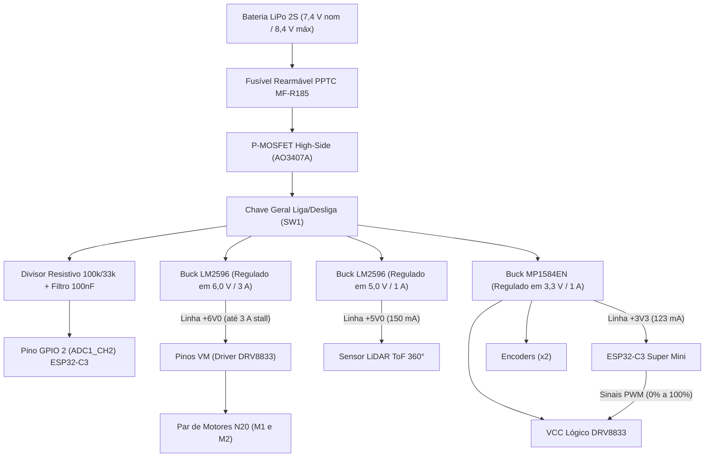

# Dimensionamento e Análise dos Reguladores Step-Down (Buck)

!!! warning "Dimensionamento a refazer"
    Este documento foi feito antes da Rev 2.0 do _hardware_, para a arquitetura com LiDAR e encoders ativos. Na Rev 2.0, o LiDAR foi substituído por três sensores VL53L0X (I²C), entrou a IMU MPU6050 e os encoders estão reservados, não instalados (pendência). As cargas e os valores que dependem delas serão refeitos quando a Rev 2.0 for consolidada; ver o [Projeto Conceitual de _Hardware_](../hardware.md).

---

## 1. Contextualização e Metodologia de Projeto

O sistema de alimentação do Micromouse opera a partir do barramento primário de bateria LiPo 2S (**$6{,}60\text{ V a }8{,}40\text{ V}$**, $V_{\text{nominal}} = 7{,}40\text{ V}$). Para garantir isolamento de ruído entre atuadores e processamento lógico, bem como imunidade eletromagnética contra transientes indutivos, adotou-se uma arquitetura com **três conversores chaveados Step-Down (Buck) independentes**:

1. **Barramento +6V0 (Atuação Eletromecânica):** Alimentado por regulador **LM2596 (3 A)**, dedicado exclusivamente aos pinos de potência `VM` do driver DRV8833 para acionar os motores GA12-N20 com tensão constante de 6,0 V e capacidade para suportar correntes de partida/travamento (*stall*) de **até ~3,0 A**.
2. **Barramento +5V0 (Sensoriamento Primário):** Alimentado por regulador **LM2596-ADJ (1 A)**, dedicado à linha de potência do sensor óptico LiDAR ToF 360° (consumo nominal de 150 mA).
3. **Barramento +3V3 (Controle e Sinais Digitais):** Alimentado por regulador síncrono de alta frequência **MP1584EN (1 A / 1,0 MHz)**, atendendo o microcontrolador ESP32-C3 Super Mini, encoders e polarização lógica do DRV8833.

---

## 2. Dimensionamento do Regulador LM2596-ADJ (+6V0 — Motores DC e Stall de até ~3 A)

O regulador **LM2596** opera com frequência fixa de chaveamento de **$150\text{ kHz}$** e chave bipolar interna capaz de conduzir até **$3{,}0\text{ A}$ contínuos**, provendo estabilidade mecânica aos atuadores.

### 2.1 Razão Cíclica (*Duty Cycle*) e Análise de *Dropout Voltage*
Adotando rendimento típico estimado em $\eta \approx 85\%$ ($0{,}85$):

$$D = \frac{V_{\text{out}}}{V_{\text{in}} \cdot \eta}$$

* **Bateria em Plena Carga ($V_{\text{in}} = 8{,}4\text{ V}$):**
  $$D_{\text{min}} = \frac{6{,}0}{8{,}4 \cdot 0{,}85} \approx 0{,}840 \implies \mathbf{84{,}0\%}$$
* **Bateria em Tensão Nominal ($V_{\text{in}} = 7{,}4\text{ V}$):**
  $$D_{\text{nom}} = \frac{6{,}0}{7{,}4 \cdot 0{,}85} \approx 0{,}954 \implies \mathbf{95{,}4\%}$$

**Comportamento em *Dropout* ($V_{\text{drop}}$):**  
O transistor bipolar Darlington interno do LM2596 apresenta queda de saturação de $V_{\text{drop}} \approx 1{,}2\text{ V a }1{,}4\text{ V}$. A regulação perfeita em $6{,}0\text{ V}$ ocorre para $V_{\text{in}} \ge 6{,}0\text{ V} + 1{,}3\text{ V} = 7{,}3\text{ V}$.  
Quando a bateria descarrega na faixa de $7{,}3\text{ V}$ até o corte UVLO de $6{,}6\text{ V}$, o conversor opera em razão cíclica máxima (~100%), entregando $V_{\text{out}} \approx V_{\text{in}} - V_{\text{drop}}$ (de $6{,}0\text{ V}$ até $\sim 5{,}2\text{ V}$). Como os micromotores N20 operam perfeitamente de 3 V a 6 V, essa ligeira diminuição na fase final da bateria causa apenas uma suave desaceleração na velocidade máxima sem qualquer impacto sobre a eletrônica digital ou algoritmos de controle.

### 2.2 Malha de Realimentação (Feedback)
Com tensão de referência interna $V_{\text{ref}} = 1{,}23\text{ V}$:

$$V_{\text{out}} = V_{\text{ref}} \cdot \left(1 + \frac{R_2}{R_1}\right)$$

Fixando $R_1 = 1{,}0\text{ k}\Omega$:

$$R_2 = 1{,}0\text{ k}\Omega \cdot \left(\frac{6{,}0}{1{,}23} - 1\right) \approx \mathbf{3{,}88\text{ k}\Omega}$$

* **Componente Selecionado:** Resistor comercial E96 de **$3{,}9\text{ k}\Omega \ (1\%)$**, gerando $V_{\text{out}} = \mathbf{6{,}027\text{ V}}$ (erro relativo ínfimo de $+0{,}45\%$) ou calibração por trimpot multivoltas em módulo comercial para $6{,}00\text{ V} \pm 0{,}02\text{ V}$.

### 2.3 Indutor de Potência ($L$) Dimensionado para 3 A de Stall
Para suportar o pico de travamento (*stall*) de $I_{\text{out,stall}} = 3{,}0\text{ A}$ com ondulação máxima de corrente de $\Delta I_L = 30\% \cdot 3{,}0\text{ A} = 0{,}90\text{ A}$ a $f_{\text{sw}} = 150\text{ kHz}$:

$$L_{\text{mín}} = \frac{(V_{\text{in,max}} - V_{\text{out}}) \cdot D_{\text{min}}}{\Delta I_L \cdot f_{\text{sw}}} = \frac{(8{,}4 - 6{,}0) \cdot 0{,}840}{0{,}90 \cdot 150.000} \approx \mathbf{14{,}93\ \mu\text{H}}$$

* **Componente Selecionado:** Indutor blindado toroidal de **$22\ \mu\text{H}$ a $33\ \mu\text{H}$** com corrente contínua $I_{\text{rms}} \ge 3{,}0\text{ A}$ e corrente de saturação $I_{\text{sat}} \ge 4{,}0\text{ A}$ (ex.: série CDRH127), impedindo saturação magnética em partidas rápidas.

### 2.4 Diodo Schottky e Capacitores
* **Diodo de Recirculação:** **SS54** (SMD) ou **1N5822** ($V_R = 40\text{ V}$, $I_F = 5{,}0\text{ A}$, $V_F \le 0{,}45\text{ V}$).
* **Capacitor de Entrada ($C_{\text{in}}$):** Eletrolítico Low-ESR de **$470\ \mu\text{F} \ / \ 16\text{ V}$** em paralelo com cerâmico de **$100\text{ nF}$**.
* **Capacitor de Saída ($C_{\text{out}}$):** Eletrolítico Low-ESR de **$470\ \mu\text{F} \ / \ 10\text{ V}$** em paralelo com cerâmico de **$100\text{ nF}$**.

### 2.5 Análise Térmica e Diretriz de Proteção contra Stall Prolongado
1. **Regime Nominal de Corrida ($I_{\text{out}} = 0{,}30\text{ A}$):**
   $$P_{\text{d,nom}} = (6{,}0\text{ V} \cdot 0{,}30\text{ A}) \cdot \left(\frac{1}{0{,}85} - 1\right) \approx \mathbf{0{,}32\text{ W}} \implies \Delta T \approx 11{,}2\text{ °C} \implies T_j \approx \mathbf{36{,}2\text{ °C}}$$
   *(Operação perfeitamente fria e estável em corrida).*
2. **Regime Transitório de Stall ($I_{\text{out}} = 3{,}0\text{ A}$):**
   $$P_{\text{d,stall}} = (6{,}0\text{ V} \cdot 3{,}0\text{ A}) \cdot \left(\frac{1}{0{,}80} - 1\right) \approx \mathbf{4{,}50\text{ W}}$$
   *(Uma dissipação contínua de 4,5 W provocaria desarme térmico em segundos).*

> [!IMPORTANT]
> **Diretriz de Segurança no Firmware:**  
> A corrente de travamento de ~3 A é admitida apenas em regime **transitório** (50 ms a 200 ms).  
> Se o microcontrolador comandar acionamento PWM para os motores mas os encoders registrarem zero pulsos por mais de **500 ms**, o firmware zera automaticamente os sinais PWM, desarmando o consumo de potência e protegendo o conversor LM2596 e as escovas dos motores N20.

---

## 3. Dimensionamento do Regulador LM2596-ADJ (+5V0 — Sensor LiDAR ToF)

### 3.1 Razão Cíclica e Dropout
Com rendimento $\eta \approx 82\%$ ($0{,}82$):
* $V_{\text{in}} = 8{,}4\text{ V} \implies D_{\text{min}} = \frac{5{,}0}{8{,}4 \cdot 0{,}82} \approx \mathbf{72{,}5\%}$
* $V_{\text{in}} = 6{,}6\text{ V} \implies D_{\text{max}} = \frac{5{,}0}{6{,}6 \cdot 0{,}82} \approx \mathbf{92{,}3\%}$

**Compatibilidade de *Dropout*:**  
Com queda interna de saturação $V_{\text{drop}} \approx 1{,}5\text{ V}$, a tensão de entrada mínima requerida é:
$$V_{\text{in,mín\_reg}} = 5{,}0\text{ V} + 1{,}5\text{ V} = \mathbf{6{,}50\text{ V}}$$
Como o desarme por software (UVLO) encerra a missão aos **$6{,}60\text{ V}$**, o regulador opera 100% do tempo em regime perfeitamente linear, sem reiniciar o LiDAR.

### 3.2 Feedback e Componentes Passivos
* **Divisor de Feedback:** $R_1 = 1{,}0\text{ k}\Omega$, $R_2 = 1{,}0\text{ k}\Omega \cdot (5{,}0/1{,}23 - 1) \approx \mathbf{3{,}06\text{ k}\Omega}$ (resistor E96 de $3{,}09\text{ k}\Omega$ ou trimpot calibrado para $5{,}00\text{ V} \pm 0{,}02\text{ V}$).
* **Indutor ($L$):** Para $\Delta I_L = 0{,}30\text{ A}$ a $150\text{ kHz}$:
  $$L_{\text{mín}} = \frac{(8{,}4 - 5{,}0) \cdot 0{,}725}{0{,}30 \cdot 150.000} \approx \mathbf{54{,}8\ \mu\text{H}} \implies \text{Adota-se } 47\ \mu\text{H a } 68\ \mu\text{H} \ (I_{\text{sat}} \ge 2{,}0\text{ A})$$
* **Diodo Schottky:** **SS34** / **1N5822** ($40\text{ V} / 3\text{ A}$, $V_F \le 0{,}45\text{ V}$).
* **Capacitores:** $C_{\text{in}} = 220\ \mu\text{F} \ / \ 16\text{ V}$ Low-ESR em paralelo com $100\text{ nF}$; $C_{\text{out}} = 330\ \mu\text{F} \ / \ 10\text{ V}$ Low-ESR em paralelo com $100\text{ nF}$.
* **Dissipação Térmica em Carga Nominal (150 mA):** $P_d \approx 0{,}13\text{ W} \implies T_j \approx \mathbf{29{,}6\text{ °C}}$.

---

## 4. Dimensionamento do Regulador MP1584EN (+3V3 — MCU e Lógica)

O **MP1584EN** opera em frequência elevada programada em **$1{,}0\text{ MHz}$**, empregando chave interna MOSFET de canal N ($R_{\text{DS(on)}} \approx 180\text{ m}\Omega$).

### 4.1 Razão Cíclica e Dropout
Com rendimento $\eta \approx 88\%$ ($0{,}88$):
* $V_{\text{in}} = 8{,}4\text{ V} \implies D_{\text{min}} = \frac{3{,}3}{8{,}4 \cdot 0{,}88} \approx \mathbf{44{,}6\%}$
* $V_{\text{in}} = 6{,}6\text{ V} \implies D_{\text{max}} = \frac{3{,}3}{6{,}6 \cdot 0{,}88} \approx \mathbf{56{,}8\%}$

A chave MOSFET permite tensão de *dropout* desprezível ($< 0{,}4\text{ V}$), garantindo regulação estável mesmo em descarga profunda.

### 4.2 Feedback e Componentes Passivos
* **Divisor de Feedback:** Com $V_{\text{ref}} = 0{,}80\text{ V}$ e $R_2 = 10\text{ k}\Omega$:
  $$R_1 = 10\text{ k}\Omega \cdot \left(\frac{3{,}3}{0{,}80} - 1\right) = \mathbf{31{,}25\text{ k}\Omega} \implies \text{Resistor E96 de } 31{,}6\text{ k}\Omega \ (1\%)$$
* **Indutor de Alta Frequência ($L$):** Para $\Delta I_L = 0{,}30\text{ A}$ a $1{,}0\text{ MHz}$:
  $$L_{\text{mín}} = \frac{(8{,}4 - 3{,}3) \cdot 0{,}446}{0{,}30 \cdot 1.000.000} \approx \mathbf{7{,}58\ \mu\text{H}} \implies \text{Adota-se } 4{,}7\ \mu\text{H a } 10\ \mu\text{H} \ (I_{\text{sat}} \ge 2{,}0\text{ A})$$
* **Diodo Schottky:** **SS24** / **B230A** ($40\text{ V} / 2\text{ A}$, $V_F \approx 0{,}40\text{ V}$).
* **Capacitores Cerâmicos Multicamada (MLCC):**
  * $C_{\text{in}}$: Dois cerâmicos MLCC de $10\ \mu\text{F} \ / \ 16\text{ V}$ X7R em paralelo com $100\text{ nF}$.
  * $C_{\text{out}}$: Dois cerâmicos MLCC de $22\ \mu\text{F} \ / \ 10\text{ V}$ X7R em paralelo com $100\text{ nF}$ (ondulação $< 15\text{ mV}$).
* **Dissipação Térmica Nominal (~123 mA):** $P_d \approx 0{,}055\text{ W} \implies T_j \approx \mathbf{28{,}3\text{ °C}}$.

---

## 5. Tabela Comparativa Consolidada dos Três Reguladores

| Parâmetro de Projeto | Linha +6V0 (Motores / VM DRV8833) | Linha +5V0 (Sensor LiDAR ToF) | Linha +3V3 (MCU, Encoders, Lógica) |
| :--- | :--- | :--- | :--- |
| **CI Regulador Adotado** | **LM2596 Step-Down 3 A** | **LM2596-ADJ** | **MP1584EN** |
| **Topologia / Chaveamento** | Buck bipolar (150 kHz) | Buck bipolar (150 kHz) | Buck MOSFET ($R_{\text{DS(on)}}=180\text{ m}\Omega$, 1,0 MHz) |
| **Carga Alimentada** | Par de motores GA12-N20 (pinos VM) | Sensor LiDAR ToF 360° | ESP32-C3 Super Mini, Encoders, DRV8833 Lógica |
| **Tensão Regulada ($V_{\text{out}}$)** | **$6{,}00\text{ V}$** | **$5{,}00\text{ V}$** | **$3{,}30\text{ V}$** |
| **Tensão de Referência ($V_{\text{ref}}$)**| $1{,}23\text{ V}$ | $1{,}23\text{ V}$ | $0{,}80\text{ V}$ |
| **Divisor de Feedback ($R_1, R_2$)** | $R_1 = 1{,}0\text{ k}\Omega$, $R_2 = 3{,}9\text{ k}\Omega$ (1%) | $R_1 = 1{,}0\text{ k}\Omega$, $R_2 = 3{,}06\text{ k}\Omega$ | $R_2 = 10\text{ k}\Omega$, $R_1 = 31{,}6\text{ k}\Omega$ (1%) |
| **Consumo em Regime Nominal** | $0{,}30\text{ A}$ ($1{,}80\text{ W}$) | $0{,}15\text{ A}$ ($0{,}75\text{ W}$) | $0{,}123\text{ A}$ nom. / $0{,}35\text{ A}$ pico ($0{,}41\text{ W}$) |
| **Capacidade de Corrente de Projeto**| **Até 3,0 A em stall** | **1,0 A contínuo** | **1,0 A contínuo** (3 A pico do CI) |
| **Indutância de Projeto ($L$)** | $22\ \mu\text{H}$ a $33\ \mu\text{H}$ ($I_{\text{sat}} \ge 4{,}0\text{ A}$) | $47\ \mu\text{H}$ a $68\ \mu\text{H}$ ($I_{\text{sat}} \ge 2{,}0\text{ A}$) | $4{,}7\ \mu\text{H}$ a $10\ \mu\text{H}$ ($I_{\text{sat}} \ge 2{,}0\text{ A}$) |
| **Diodo Schottky de Recirculação** | SS54 / 1N5822 ($40\text{ V} \ / \ 5\text{ A}$) | SS34 / 1N5822 ($40\text{ V} \ / \ 3\text{ A}$) | SS24 / B230A ($40\text{ V} \ / \ 2\text{ A}$) |
| **Capacitores de Entrada / Saída**| $C_{\text{in}} = 470\ \mu\text{F}$, $C_{\text{out}} = 470\ \mu\text{F}$ | $C_{\text{in}} = 220\ \mu\text{F}$, $C_{\text{out}} = 330\ \mu\text{F}$ | $C_{\text{in}} = 20\ \mu\text{F}$ MLCC, $C_{\text{out}} = 44\ \mu\text{F}$ MLCC |
| **Potência Dissipada em Regime** | $0{,}32\text{ W}$ (nom.) / transitório no stall | $0{,}13\text{ W}$ (nom.) / $1{,}10\text{ W}$ (1 A) | $0{,}055\text{ W}$ (nom.) / $0{,}45\text{ W}$ (1 A) |
| **Temperatura Junção ($T_j$) Estimada**| **$36{,}2\text{ °C}$** (nom.) | **$29{,}6\text{ °C}$** (nom.) / **$63{,}5\text{ °C}$** (1 A) | **$28{,}3\text{ °C}$** (nom.) / **$51{,}9\text{ °C}$** (1 A) |
| **Mecanismo de Proteção Crítico** | Corte PWM se stall $> 500\text{ ms}$ | Operação acima do dropout $\ge 6{,}5\text{ V}$ | Proteção térmica interna a $160\text{ °C}$ |
| **Status de Homologação** | **Aprovado para Tração** | **Aprovado para LiDAR** | **Aprovado para Controle** |

---

## 6. Diagrama Funcional da Distribuição de Potência

---

## 7. Protocolo de Ensaio de Bancada e Validação Experimental (Planejado)

Para validação em bancada após o recebimento dos componentes e placas:

### 7.1 Regulação de Carga e Linha (*Line & Load Regulation*)
1. Conectar fonte DC regulável na entrada simulando a faixa de bateria ($6{,}6\text{ V a }8{,}4\text{ V}$).
2. Aplicar degraus de corrente de carga através de carga eletrônica ativa (0 mA, 150 mA, 300 mA e 1,0 A).
3. Registrar a variação de tensão em cada linha com multímetro digital.  
   * **Critério de Aceitação:** Regulação de carga $\le \pm 2\%$ da tensão nominal especificada.

### 7.2 Medição de Ondulação (*Ripple*) com Osciloscópio
1. Conectar ponta de prova atenuada 1X acoplada em AC com mola de aterramento curta diretamente sobre os terminais do capacitor de saída $C_{\text{out}}$.
2. Medir a tensão pico a pico ($V_{\text{pp}}$) do chaveamento em frequência fundamental ($150\text{ kHz}$ e $1{,}0\text{ MHz}$).  
   * **Critério de Aceitação:**  
     * Linha +6V0: $V_{\text{ripple}} < 100\text{ mV}_{\text{pp}}$.  
     * Linha +5V0: $V_{\text{ripple}} < 50\text{ mV}_{\text{pp}}$.  
     * Linha +3V3: $V_{\text{ripple}} < 25\text{ mV}_{\text{pp}}$.

### 7.3 Ensaio Térmico de Estresse sob Stall
1. Submeter o regulador de 6,0 V a pulso de carga de 2,5 A a 3,0 A por 500 ms com termopar monitorando o encapsulamento TO-263 / TO-220.
2. Confirmar que a elevação térmica transitória não ultrapassa 60 °C e que a tensão não sofre colapso.

---

## Histórico de Versão

| Versão | Data | Descrição | Autor(es) | Revisor(es) |
| :---: | :---: | :--- | :--- | :--- |
| 1.0 | 12/10/2026 | Dimensionamento dos reguladores Step-Down LM2596 e MP1584EN (#199) | Elias Oliveira | Equipe de Hardware |
| 1.1 | 18/10/2026 | Inclusão do regulador dedicado de 6 V para os motores com suporte a stall de até 3 A | Elias Oliveira | Bruno Duarte |
| 1.2 | 20/10/2026 | Modularização no diretório `energia/` e adição do protocolo de ensaios de bancada | Elias Oliveira | Equipe de Energia |
