# Simulação do Divisor Resistivo e Filtro Anti-Aliasing para Monitoramento da Bateria

---

## 1. Contextualização e Requisitos de Projeto (Issue #203 e #136)

O monitoramento contínuo da tensão do barramento da bateria LiPo 2S (**$6{,}60\text{ V a }8{,}40\text{ V}$**) é essencial para estimar o Estado de Carga (SoC) em tempo real, transmitir telemetria para o Dashboard web (**RF08 / HU-08**) e executar o corte de segurança de subtensão (*Under-Voltage Lockout* — UVLO) quando o pack atinge $6{,}60\text{ V}$ ($3{,}30\text{ V/célula}$).

Como o conversor analógico-digital (ADC) da placa microcontroladora **ESP32-C3** opera sob tensão máxima lógica de $3{,}3\text{ V}$ e faixa de máxima linearidade de $0\text{ V a }2{,}50\text{ V}$ (sob atenuação de 11 dB), conectar o barramento de até $8{,}40\text{ V}$ diretamente ao pino causaria sobretensão destrutiva no silício. Adicionalmente, o chaveamento PWM da ponte H dos motores ($20\text{ kHz}$) e a comutação dos reguladores chaveados introduzem ruídos de alta frequência no barramento elétrico, o que provocaria falseamento (*aliasing*) na amostragem e possíveis disparos falsos de subtensão.

Portanto, o circuito de condicionamento de sinal analógico resolve simultaneamente dois requisitos críticos:
1. **Adequação de Tensão (Divisor Resistivo):** Atenuação estática para a faixa linear de $0\text{ V a }2{,}50\text{ V}$ com consumo quiescente desprezível ($I_{\text{fuga}} < 100\ \mu\text{A}$).
2. **Rejeição de Ruído Eletromecânico (Filtro Passa-Baixas Anti-Aliasing):** Rejeição superior a $-40\text{ dB}$ na frequência fundamental do PWM dos motores ($20\text{ kHz}$) sem introduzir atraso perceptível na dinâmica de descarga da bateria.

---

## 2. Topologia do Circuito de Condicionamento

O circuito conecta-se entre o barramento de alimentação da bateria (+VBAT_2S / pós-chave geral), o canal analógico do microcontrolador e a referência comum de terra (GND):

```
       +VBAT_2S (6,60 V a 8,40 V)
             │
            ┌┴┐
            │ │ R1 = 100 kΩ (1% precisão / filme metálico)
            │ │
            └┬┘
             ├─── Nó Analógico (V_ADC) ───► GPIO 2 / GPIO 4 (ADC1) do ESP32-C3
             │          │
            ┌┴┐        ───
            │ │ R2     ─── C1 = 100 nF (Cerâmico MLCC 50 V tipo X7R)
            │ │ 33 kΩ   │
            └┬┘         │
             │          │
            ─┴──────────┴─ GND Único do Sistema
```

---

## 3. Memorial de Cálculo do Divisor Resistivo ($R_1$ e $R_2$)

### 3.1 Relação de Atenuação Estática ($K_{\text{div}}$)
A tensão entregue ao pino analógico em corrente contínua (DC) é dada pela equação fundamental do divisor de tensão:

$$K_{\text{div}} = \frac{R_2}{R_1 + R_2} = \frac{33\text{ k}\Omega}{100\text{ k}\Omega + 33\text{ k}\Omega} = \frac{33}{133} \approx \mathbf{0{,}24812}$$

$$V_{\text{ADC}} = V_{\text{BAT}} \cdot K_{\text{div}} = V_{\text{BAT}} \cdot 0{,}24812$$

### 3.2 Mapeamento de Tensão nos Níveis Operacionais da Bateria
* **Bateria em Plena Carga ($V_{\text{BAT}} = 8{,}40\text{ V}$):**
  $$V_{\text{ADC,max}} = 8{,}40\text{ V} \cdot 0{,}24812 \approx \mathbf{2{,}084\text{ V}}$$
  *Margem de Proteção:* O valor de $2{,}084\text{ V}$ opera com folga de $0{,}416\text{ V}$ abaixo do teto de máxima linearidade do conversor sob atenuação de 11 dB ($2{,}50\text{ V}$) e com folga de $1{,}216\text{ V}$ em relação ao limite elétrico absoluto do pino ($3{,}30\text{ V}$), eliminando risco de sobretensão no silício.
* **Tensão Nominal do Pack ($V_{\text{BAT}} = 7{,}40\text{ V}$):**
  $$V_{\text{ADC,nom}} = 7{,}40\text{ V} \cdot 0{,}24812 \approx \mathbf{1{,}836\text{ V}}$$
* **Limiar de Corte UVLO ($V_{\text{BAT}} = 6{,}60\text{ V}$):**
  $$V_{\text{ADC,uvlo}} = 6{,}60\text{ V} \cdot 0{,}24812 \approx \mathbf{1{,}638\text{ V}}$$

### 3.3 Função Inversa de Calibração para o Firmware
Para reconstruir no software a tensão real da bateria a partir da amostragem digital do ADC ($V_{\text{ADC}}$):

$$V_{\text{BAT}} = V_{\text{ADC}} \cdot \left(\frac{R_1 + R_2}{R_2}\right) = V_{\text{ADC}} \cdot \left(\frac{133}{33}\right) = V_{\text{ADC}} \cdot \mathbf{4{,}0303}$$

### 3.4 Corrente de Fuga e Dissipação de Potência
* **Corrente drenada no pior caso sob bateria cheia ($8{,}40\text{ V}$):**
  $$I_{\text{fuga}} = \frac{8{,}40\text{ V}}{100\text{ k}\Omega + 33\text{ k}\Omega} = \frac{8{,}40\text{ V}}{133\text{ k}\Omega} \approx \mathbf{63{,}16\ \mu\text{A}}$$
  *(Consumo de apenas 0,063 mA, não descarregando a bateria em repouso).*
* **Potência dissipada máxima nos resistores:**
  $$P_{\text{total}} = \frac{(8{,}40\text{ V})^2}{133\text{ k}\Omega} \approx \mathbf{0{,}53\text{ mW}}$$
  $$P_{R1} = (63{,}16\ \mu\text{A})^2 \cdot 100\text{ k}\Omega \approx 0{,}40\text{ mW} \quad \text{e} \quad P_{R2} \approx 0{,}13\text{ mW}$$
  Ambas as dissipações operam a menos de 0,4% da potência nominal de resistores padrão SMD 0805 ou Through-hole de 1/8 W ($125\text{ mW}$), garantindo aquecimento térmico nulo e deriva resistiva desprezível.

---

## 4. Memorial de Cálculo do Filtro Anti-Aliasing Passa-Baixas

A comutação PWM da ponte H dos micromotores (operando a $20\text{ kHz}$) e o chaveamento dos reguladores Step-Down induzem ondulações de alta frequência no barramento elétrico. Se o ADC do microcontrolador amostrar esse sinal sem filtragem, as frequências de chaveamento sofrem falseamento (*aliasing*), gerando oscilações espúrias na leitura que poderiam desarmar indevidamente o sistema de proteção de subtensão.

1. **Impedância Equivalente de Thevenin ($R_{\text{th}}$):**
   A impedância de fonte vista pelo capacitor $C_1$ corresponde à associação em paralelo de $R_1$ e $R_2$:

   $$R_{\text{th}} = R_1 \parallel R_2 = \frac{R_1 \cdot R_2}{R_1 + R_2} = \frac{100\text{ k}\Omega \cdot 33\text{ k}\Omega}{133\text{ k}\Omega} \approx \mathbf{24{,}812\text{ k}\Omega}$$

2. **Frequência de Corte a -3 dB ($f_c$):**
   Adotando capacitor cerâmico multicamadas (MLCC) de $C_1 = 100\text{ nF}$ ($100 \times 10^{-9}\text{ F}$) de alta estabilidade térmica:

   $$f_c = \frac{1}{2\pi \cdot R_{\text{th}} \cdot C_1} = \frac{1}{2\pi \cdot 24.812\ \Omega \cdot 100 \times 10^{-9}\text{ F}} \approx \mathbf{64{,}14\text{ Hz}}$$

3. **Tempo de Resposta Transitória ($t_r$):**
   O tempo de subida (10% a 90%) para o circuito responder a variações em degrau na tensão da bateria é:

   $$t_r = 2{,}2 \cdot R_{\text{th}} \cdot C_1 = 2{,}2 \cdot 24.812\ \Omega \cdot 100 \times 10^{-9}\text{ F} \approx \mathbf{5{,}46\text{ ms}}$$

   Como a curva de descarga química da bateria LiPo ocorre ao longo de dezenas de minutos (taxa de variação $< 1\text{ mV/s}$), o atraso de $5{,}5\text{ ms}$ é desprezível e garante rastreamento instantâneo sem defasagem temporal de telemetria.

---

## 5. Simulação Analítica e Diagrama de Bode

A função de transferência no domínio da frequência $s = j\omega$ que relaciona a tensão no pino ADC com a tensão da bateria é dada por:

$$H(s) = K_{\text{div}} \cdot \frac{1}{1 + s \cdot R_{\text{th}} \cdot C_1} = 0{,}24812 \cdot \frac{1}{1 + j \left(\frac{f}{64{,}14\text{ Hz}}\right)}$$

A resposta em frequência analítica do circuito de condicionamento é apresentada no Diagrama de Bode vetorial abaixo:



### 5.1 Tabela de Atenuação nas Frequências Críticas

| Ponto de Frequência | Frequência ($f$) | Ganho Relativo (dB) | Fator de Atenuação / Redução | Comportamento do Sinal |
| :--- | :---: | :---: | :---: | :--- |
| **Banda Passante DC** | $0{,}0\text{ Hz}$ | $0{,}00\text{ dB}$ | $1{,}0\times$ | Sinal DC da bateria passa com integridade total |
| **Frequência de Corte ($f_c$)** | $64{,}14\text{ Hz}$ | $-3{,}01\text{ dB}$ | $1{,}41\times$ | Ponto de corte de meia potência |
| **Ondulação de Baixa Frequência** | $120\text{ Hz}$ | $-6{,}53\text{ dB}$ | $2{,}12\times$ | Início da atenuação de primeira ordem |
| **Frequência Intermediária** | $1\text{ kHz}$ | $-23{,}87\text{ dB}$ | $15{,}6\times$ | Rejeição de ruídos de acoplamento |
| **Comutação PWM Motores (DRV8833)** | **$20\text{ kHz}$** | **$-49{,}88\text{ dB}$** | **$311{,}8\times$** | **Ruído atenuado em mais de 310 vezes** |
| **Chaveamento Regulador Buck LM2596**| **$150\text{ kHz}$**| **$-67{,}38\text{ dB}$** | **$2.338{,}5\times$** | **Ruído atenuado em mais de 2.300 vezes** |

---

## 6. Rotinas de Aquisição e Proteção no Firmware (Issue #208)

O sinal filtrado entregue ao pino ADC do ESP32-C3 é processado pelo firmware através das seguintes etapas sequenciais:
1. **Amostragem com Oversampling:** A tarefa de telemetria realiza rajadas de 10 a 16 amostras consecutivas do pino ADC, aplicando média amostral para rejeição de ruído residual de quantização.
2. **Conversão Linear Calibrada:**
   ```cpp
   float tensao_adc = (leitura_raw / 4095.0f) * 2.50f; // Calibração com atenuação de 11 dB
   float tensao_bateria = tensao_adc * 4.0303f;         // Fator inverso do divisor (133k / 33k)
   ```
3. **Máquina de Estados de Subtensão (UVLO):** Se `tensao_bateria <= 6.60f` por mais de 5 amostragens sucessivas (descartando quedas momentâneas de partida), o firmware entra em estado de salvaguarda, forçando o PWM dos motores a zero e emitindo alerta crítico no payload de telemetria (**RF08 / HU-08**).

---

## 7. Referências Bibliográficas

1. **OPPENHEIM, Alan V.; WILLSKY, Alan S.** *Signals and Systems*. 2. ed. Upper Saddle River: Prentice Hall, 1996.
2. **ESPRESSIF SYSTEMS.** *ESP32-C3 Series Datasheet*. Versão 1.7, 2024. Disponível em: <https://www.espressif.com>.
3. **MOHAN, Ned; UNDELAND, Tore M.; ROBBINS, William P.** *Power Electronics: Converters, Applications, and Design*. 3. ed. Nova York: John Wiley & Sons, 2003.
4. **TEXAS INSTRUMENTS.** *DRV8833 Dual H-Bridge Motor Driver*. Datasheet SLVSAR1E, Rev. Julho 2015. Disponível em: <https://www.ti.com/lit/ds/symlink/drv8833.pdf>.

---

## Histórico de Versão

| Versão | Data | Descrição | Autor(es) | Revisor(es) |
| :---: | :---: | :--- | :--- | :--- |
| 1.0 | 18/10/2026 | Dimensionamento analítico do divisor resistivo (100k/33k) e filtro passa-baixas anti-aliasing RC de 64 Hz com comprovação de atenuação a -50 dB do ruído PWM de 20 kHz e Diagrama de Bode (#203) | Elias Oliveira | Bruno Duarte (System Architect) |
| 1.1 | 25/10/2026 | Modularização no diretório `energia/` como documento dedicado de simulação analítica e alinhamento com a arquitetura de potência | Elias Oliveira | Equipe de Energia |
