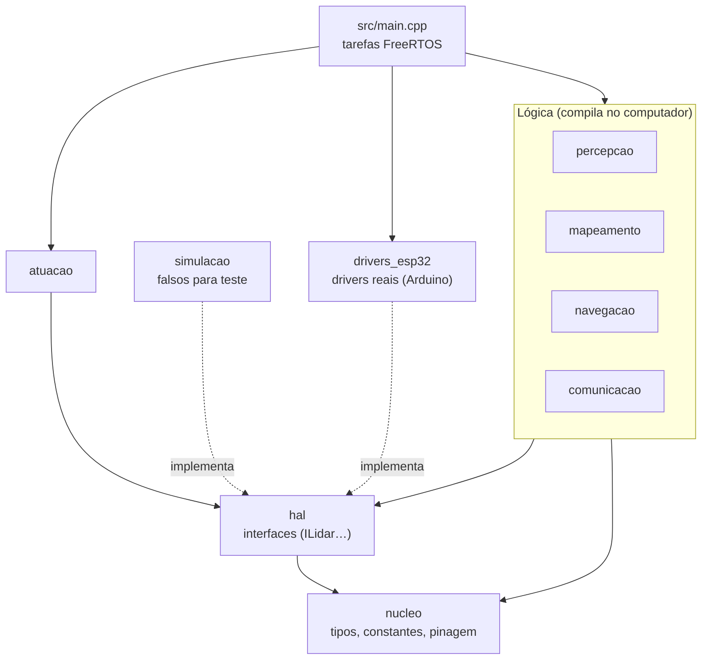
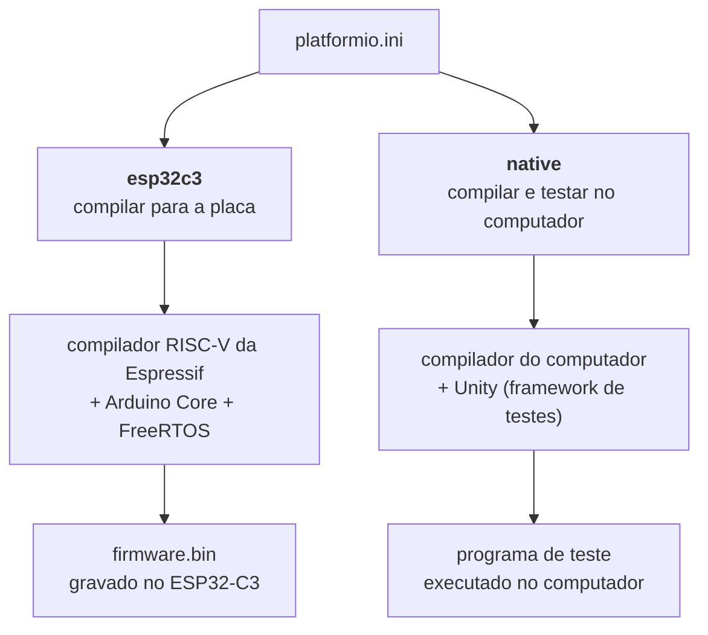
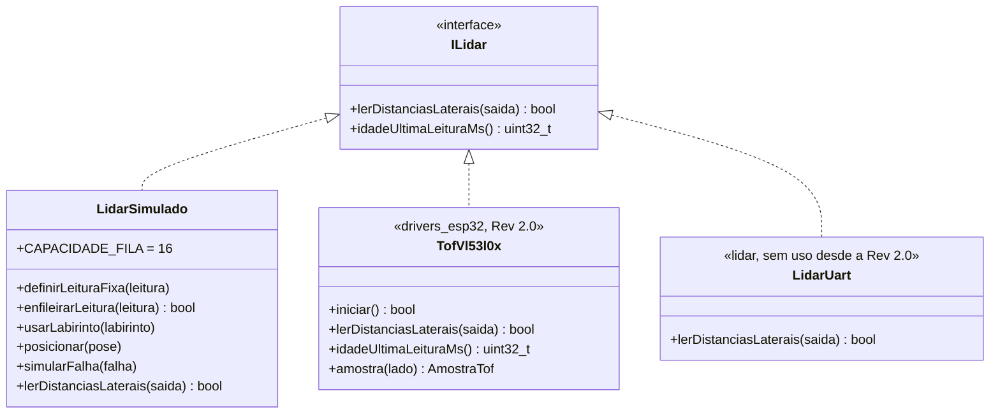
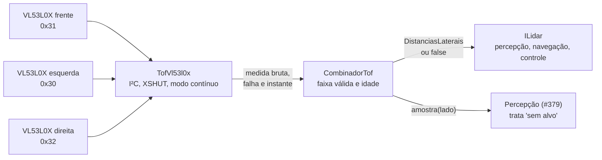
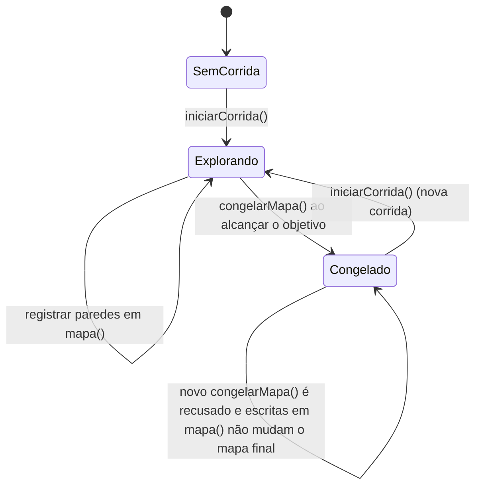
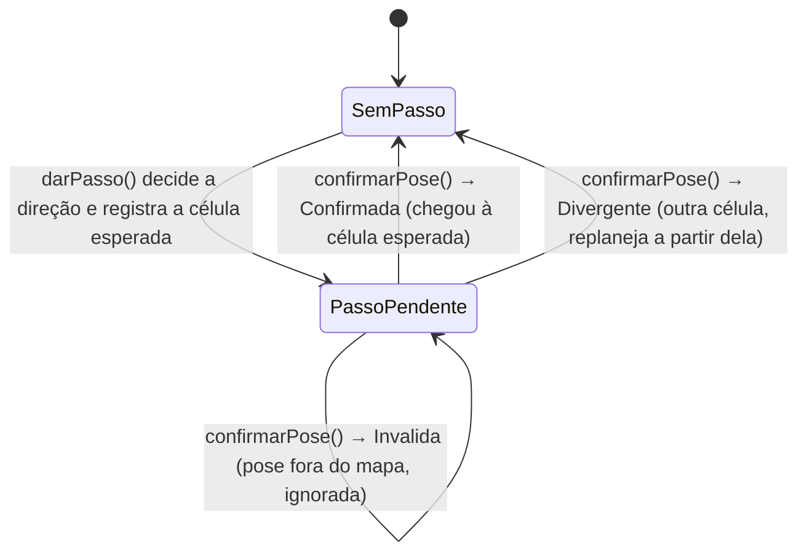
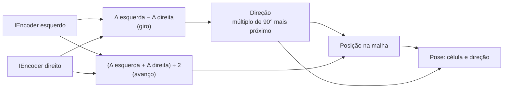
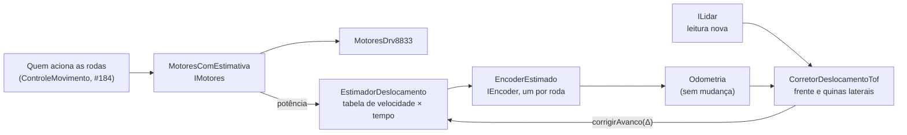
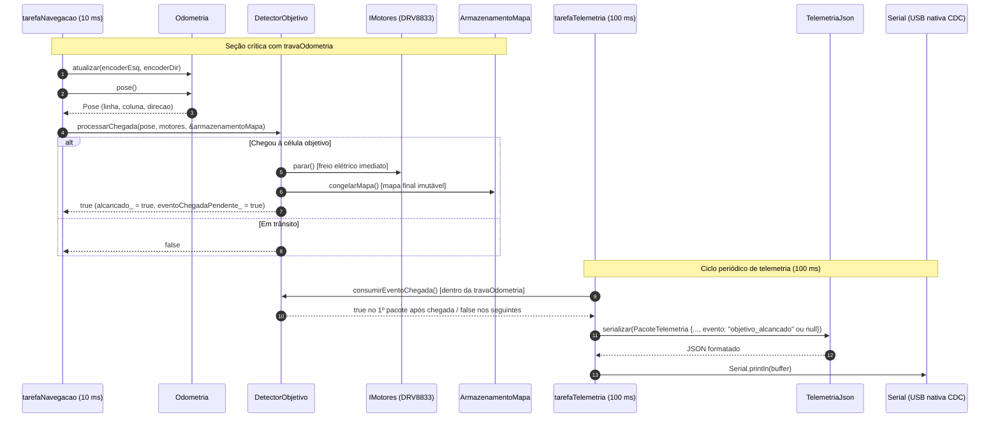
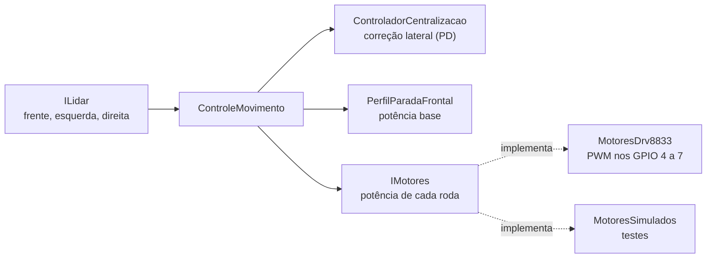

# Firmware: implementação

Esta página documenta o código do firmware do micromouse em `src/firmware`. Ela complementa a [arquitetura de software](software.md), que define as decisões de alto nível, e o [README do firmware](https://github.com/fcte-pi1/2026_2_PI1_Grupo01_Hilmer/tree/main/src/firmware), que traz os comandos do dia a dia.

O estado atual corresponde ao **projeto base** (tarefa [#172](https://github.com/fcte-pi1/2026_2_PI1_Grupo01_Hilmer/issues/172), Sprint 2, HU-02): estrutura de camadas, tipos compartilhados, interface do LiDAR, um LiDAR simulado para testes e as tarefas do FreeRTOS ainda vazias.

## Visão geral

O firmware roda no **ESP32-C3** com o **Arduino Core** (C++17) e é compilado com o **PlatformIO**. O código segue o ciclo *sense-think-act* (perceber, decidir, agir) e é dividido em camadas, uma biblioteca por camada em `lib/`.



**Figura 1.** Camadas do firmware e dependências entre elas: a lógica depende só das interfaces de `hal`, implementadas pelos drivers reais (`drivers_esp32`) e pelos falsos de teste (`simulacao`).

A lógica conhece só as **interfaces** de `hal`. Na placa, `main.cpp` liga cada interface ao driver real de `drivers_esp32`; nos testes, ela é ligada aos falsos de `simulacao`. É isso que permite testar percepção e mapeamento no computador, antes de o hardware estar montado.

## Dois ambientes: placa e computador

O `platformio.ini` define dois ambientes de compilação para o mesmo código:



**Figura 2.** Os dois ambientes de compilação definidos no `platformio.ini`: `esp32c3` gera o firmware gravado na placa e `native` compila e executa os testes no computador.

A lógica do robô (direções, mapa, classificação de paredes) não usa nada do Arduino, por isso compila nos dois ambientes. Assim, ela pode ser testada no computador, sem a placa e sem o sensor. Quando a lógica precisa do LiDAR, os testes usam o `LidarSimulado`, um sensor simulado que devolve as leituras escolhidas pelo próprio teste.

| | `esp32c3` | `native` |
|---|---|---|
| Onde roda | No ESP32-C3 | No computador de quem está desenvolvendo |
| O que inclui | Toda a lógica, `drivers_esp32` e `main.cpp` | A lógica e os falsos de `simulacao` (ignora `drivers_esp32`) |
| Comando | `pio run -e esp32c3` | `pio test -e native` |
| Resultado | `firmware.bin` e o uso de RAM e Flash | Relatório dos testes (aprovados ou com falha) |

Há ainda os ambientes de bancada, que herdam o `esp32c3` mas compilam só um programa de `src/bancada/`: **`bancada_tof`**, para os sensores de distância (veja [Bancada dos VL53L0X](#bancada-dos-vl53l0x)), e **`bancada_deslocamento`**, para o deslocamento sem encoder (veja [Bancada do deslocamento sem encoder](#bancada-do-deslocamento-sem-encoder)). O `esp32c3` exclui a pasta `src/bancada/` (`build_src_filter`), então o firmware do robô não muda.

## Estrutura de pastas

| Caminho | Conteúdo |
|---|---|
| `platformio.ini` | Ambientes `esp32c3` (placa) e `native` (testes no computador, com Unity) |
| `src/main.cpp` | Ponto de entrada: inicializa o log e cria as tarefas de navegação e telemetria |
| `lib/nucleo` | Tipos compartilhados, constantes do desafio e pinagem |
| `lib/hal` | Interfaces de hardware (`ILidar` e `IEncoder`; motores no Épico 02) |
| `lib/tof` | Regra de validade das leituras dos 3 VL53L0X (`CombinadorTof`) e seus parâmetros (`ConfiguracaoTof.h`), sem Arduino ([#344](https://github.com/fcte-pi1/2026_2_PI1_Grupo01_Hilmer/issues/344)) |
| `lib/deslocamento` | Deslocamento sem encoder: estimativa pela potência dos motores, `IEncoder` e `IMotores` provisórios e correção pelos ToF; todos os ajustes em `ConfiguracaoDeslocamento.h` ([#380](https://github.com/fcte-pi1/2026_2_PI1_Grupo01_Hilmer/issues/380)) |
| `lib/encoders` | Decodificação em quadratura dos encoders, conversão de pulsos em mm e distância por roda ([#186](https://github.com/fcte-pi1/2026_2_PI1_Grupo01_Hilmer/issues/186)) |
| `lib/percepcao` | Classificação `parede`/`livre` (tarefa [#174](https://github.com/fcte-pi1/2026_2_PI1_Grupo01_Hilmer/issues/174)) |
| `lib/mapeamento` | Mapa do labirinto, atualização, armazenamento em memória e mapa final ([#176](https://github.com/fcte-pi1/2026_2_PI1_Grupo01_Hilmer/issues/176), [#177](https://github.com/fcte-pi1/2026_2_PI1_Grupo01_Hilmer/issues/177), [#179](https://github.com/fcte-pi1/2026_2_PI1_Grupo01_Hilmer/issues/179), [#180](https://github.com/fcte-pi1/2026_2_PI1_Grupo01_Hilmer/issues/180)) |
| `lib/navegacao` | Algoritmo de resolução do labirinto por *flood fill* ([#183](https://github.com/fcte-pi1/2026_2_PI1_Grupo01_Hilmer/issues/183)), localização por odometria ([#187](https://github.com/fcte-pi1/2026_2_PI1_Grupo01_Hilmer/issues/187)) e detecção do objetivo ([#189](https://github.com/fcte-pi1/2026_2_PI1_Grupo01_Hilmer/issues/189)) |
| `lib/atuacao` | Controle dos motores e correção de trajetória (Épico 02) |
| `lib/comunicacao` | Telemetria e eventos pontuais (`TelemetriaJson`, [#189](https://github.com/fcte-pi1/2026_2_PI1_Grupo01_Hilmer/issues/189)), serialização do mapa em JSON ([#178](https://github.com/fcte-pi1/2026_2_PI1_Grupo01_Hilmer/issues/178)) e *buffer* de reenvio (Épico 03) |
| `lib/simulacao` | `LidarSimulado` e `LabirintoSimulado` ([#224](https://github.com/fcte-pi1/2026_2_PI1_Grupo01_Hilmer/issues/224)) |
| `lib/drivers_esp32` | Drivers que dependem do Arduino: 3 VL53L0X pelo I²C (`TofVl53l0x`), encoders, DRV8833, Wi-Fi |
| `src/bancada/` | Programas de bancada, fora do firmware do robô: `bancada_tof.cpp` testa os VL53L0X ([#344](https://github.com/fcte-pi1/2026_2_PI1_Grupo01_Hilmer/issues/344)) e `bancada_deslocamento.cpp`, o deslocamento sem encoder ([#380](https://github.com/fcte-pi1/2026_2_PI1_Grupo01_Hilmer/issues/380)) |
| `scripts/` | Ferramentas de bancada no computador: `bancada_tof.py` (menu dos VL53L0X), `bancada_deslocamento.py` (deslocamento sem encoder) e `calibrar_deslocamento_18cm.py` (encoders) |
| `test/` | Testes Unity, uma pasta `test_<modulo>` por módulo |

As pastas ainda vazias têm um arquivo `.gitkeep` para existirem no repositório.

## Regras de dependência

- As camadas de lógica (`nucleo`, `percepcao`, `mapeamento`, `navegacao`, `comunicacao`, `simulacao`) **não incluem `Arduino.h`**. Por isso o ambiente `native` ignora `drivers_esp32` (`lib_ignore` no `platformio.ini`).
- Todo acesso ao hardware passa por uma interface de `hal`.
- **Sem alocação dinâmica** na lógica: o maior labirinto tem 12×4 células, então estruturas de tamanho fixo bastam.
- Todo o código fica no namespace `micromouse`, com um `.h` por conceito e `#pragma once`.

## Núcleo: tipos e operações

Definidos em `lib/nucleo/src/Tipos.h` e `Direcao.h`.

| Tipo | Valores ou campos | Uso |
|---|---|---|
| `Direcao` | `Norte`, `Leste`, `Sul`, `Oeste` | Direção absoluta no labirinto |
| `Lado` | `Frente`, `Esquerda`, `Direita` | Lado relativo ao robô (leituras do LiDAR) |
| `EstadoParede` | `Desconhecido`, `Livre`, `Parede` | Estado de uma parede no mapa |
| `PosicaoCelula` | `linha`, `coluna` | Célula do labirinto; a partida é (0, 0) |
| `Pose` | `celula`, `direcao` | Onde o robô está e para onde está virado |
| `DistanciasLaterais` | `frenteMm`, `esquerdaMm`, `direitaMm` | Leitura do LiDAR, em milímetros |

A ordem de `Direcao` segue o **sentido horário**. As operações de `Direcao.h` usam essa ordem com soma módulo 4, por isso os valores não devem ser reordenados.

| Função | O que faz | Exemplo |
|---|---|---|
| `girarDireita(d)` | Giro de 90° no sentido horário | Norte → Leste |
| `girarEsquerda(d)` | Giro de 90° no sentido anti-horário | Norte → Oeste |
| `oposta(d)` | Giro de 180° | Norte → Sul |
| `direcaoAbsoluta(direcaoDoRobo, lado)` | Converte um lado do robô em direção do labirinto | Robô virado para Leste: esquerda = Norte, direita = Sul |

A `direcaoAbsoluta` é a ponte entre a percepção e o mapa: o LiDAR mede à frente, à esquerda e à direita do robô, e o mapa guarda as paredes por Norte, Sul, Leste e Oeste.

## Constantes

Definidas em `lib/nucleo/src/Configuracao.h`.

| Constante | Valor | Origem |
|---|---|---|
| `MAX_LINHAS_LABIRINTO` | 4 | Maior labirinto da competição (12×4) |
| `MAX_COLUNAS_LABIRINTO` | 12 | Maior labirinto da competição (12×4) |
| `TAMANHO_CELULA_MM` | 180 | Célula de 18 × 18 cm |
| `PERIODO_TELEMETRIA_MS` | 1000 | Envio a cerca de 1 s (arquitetura), dentro dos 2 s do RNF05 |
| `LIMITE_TEMPO_CORRIDA_MS` | 600 000 | 10 minutos por tentativa (RNF03) |

## Pinagem

Definida em `lib/nucleo/src/Pinos.h`, conforme os [diagramas de hardware](hardware-diagramas.md).

| Componente | Sinal | GPIO |
|---|---|---|
| DRV8833, motor M1 | AIN1 / AIN2 | 4 / 5 |
| DRV8833, motor M2 | BIN1 / BIN2 | 6 / 7 |
| Encoder esquerdo | A / B | 0 / 1 |
| Encoder direito | A / B | 3 / 10 |
| LiDAR (UART) | RX do ESP32 / TX do ESP32 | 20 / 21 |

!!! warning "Conflito a validar com a frente de hardware"
    GPIO20 e GPIO21 são os pinos padrão da **UART0** do ESP32-C3, a mesma usada pelo `Serial` (log e gravação). Esse ponto precisa ser resolvido antes dos testes de bancada com o LiDAR.

## Acesso ao LiDAR: `ILidar` e `LidarSimulado`



**Figura 3.** Interface `ILidar` e suas implementações: o `LidarSimulado`, usado nos testes, o `TofVl53l0x`, driver dos 3 VL53L0X da Rev 2.0, e o `LidarUart`, do LiDAR da primeira versão do hardware, que fica no código sem uso até depois da ED1. O nome `ILidar` foi mantido para que mapa, percepção e navegação não mudassem com a troca do sensor.

**Contrato de `ILidar::lerDistanciasLaterais`:** retorna `true` e preenche `saida` (em mm) quando há leitura válida das três direções; retorna `false` quando o sensor não responde ou a leitura é inválida. Nesse caso, o conteúdo de `saida` não deve ser usado.

**Contrato de `ILidar::idadeUltimaLeituraMs`:** idade, em ms, da amostra mais antiga que compõe a última leitura, medida no momento da chamada. Serve para a navegação não reagir duas vezes ao mesmo dado. A implementação padrão devolve 0 (leitura sempre nova), o que vale para o `LidarSimulado`.

**`LidarSimulado`** devolve o que o teste configurar. A cada leitura, segue esta ordem:

1. com a falha ligada (`simularFalha(true)`), a leitura falha e a fila não é consumida;
2. se houver leituras na fila, entrega a mais antiga e a remove;
3. se o modo labirinto estiver ativo (`usarLabirinto` e `posicionar`), entrega o que o [`LabirintoSimulado`](#labirinto-simulado-labirintosimulado) mostra na pose atual, e a leitura falha se a pose estiver fora do labirinto;
4. se houver leitura fixa, entrega a leitura fixa;
5. caso contrário, a leitura falha.

A fila é circular, com capacidade fixa de 16 leituras; `enfileirarLeitura` retorna `false` quando ela está cheia.

```cpp
LidarSimulado lidar;
lidar.definirLeituraFixa({500, 500, 500});  // corredor livre
lidar.enfileirarLeitura({90, 90, 270});     // depois, parede à frente e à esquerda
ILidar& sensor = lidar;                     // a lógica recebe só a interface
```

## Sensores de distância: 3 VL53L0X (`TofVl53l0x`)

Na Rev 2.0 do hardware (21/10/2026), o LiDAR por UART deu lugar a **3 sensores VL53L0X** pelo I²C: um à esquerda, um à frente e um à direita. O `TofVl53l0x` (`lib/drivers_esp32`) implementa o `ILidar`, então o resto do firmware não mudou ([#344](https://github.com/fcte-pi1/2026_2_PI1_Grupo01_Hilmer/issues/344), [HU-02](https://github.com/fcte-pi1/2026_2_PI1_Grupo01_Hilmer/issues/36)). A regra que decide se uma leitura vale fica no `CombinadorTof` (`lib/tof`), sem Arduino, e é testada no computador; o driver só conversa com os sensores pela biblioteca `pololu/VL53L0X` (1.3.1), que entra apenas no ambiente `esp32c3`.



**Figura 4.** Caminho de uma leitura: o driver lê cada sensor que tem medida pronta, o `CombinadorTof` classifica a medida e monta a leitura das três direções, e quem precisar do motivo de uma recusa consulta a amostra bruta do sensor.

### Ligação e endereços

Os três sensores dividem o barramento I²C com o MPU6050. Todos saem do reset no endereço de fábrica, 0x29, por isso cada um tem o seu pino XSHUT. Os valores ficam em `Pinos.h`, e o driver os recebe por parâmetro.

| Sensor | XSHUT | Endereço I²C |
|---|:-:|:-:|
| Esquerdo (J3) | GPIO0 | 0x30 |
| Frontal (J4) | GPIO1 | 0x31 |
| Direito (J5) | GPIO2 | 0x32 |
| Barramento | SDA GPIO9, SCL GPIO8 | MPU6050 em 0x68 |

Um `static_assert` em `Pinos.h` reprova a compilação se dois endereços coincidirem ou se algum deles for o 0x29 ou o 0x68.

### Regras de Negócio e Algoritmo

* **Inicialização (`iniciar()`):** os três XSHUT vão a nível baixo (sensores em reset); depois, um sensor por vez é solto, inicializado e recebe o seu endereço, e só então o próximo é solto. Cada sensor fica em modo contínuo com o tempo de medição configurado. Um sensor que não responde volta para o reset, para não ocupar o 0x29 e atrapalhar os seguintes; `sensorIniciado(lado)` diz quais iniciaram.
* **Leitura sem espera:** a cada `lerDistanciasLaterais()`, o driver consulta o registrador de medida pronta de cada sensor e só lê os que têm medida nova. Nunca espera o sensor terminar, então a tarefa de navegação (10 ms) não trava.
* **Classificação de cada medida** (`CombinadorTof::classificar`):

| Estado | Quando |
|---|---|
| `Valida` | Entre 30 e 1200 mm |
| `AbaixoDoMinimo` | Abaixo de 30 mm, onde o VL53L0X perde a precisão |
| `ForaDeAlcance` | Acima de 1200 mm, incluindo os 8190/8191 mm que o sensor devolve sem alvo |
| `Falha` | Sem resposta no I²C ou tempo de espera estourado |
| `SemAmostra` | O sensor ainda não entregou nenhuma medida |

* **Leitura válida:** `lerDistanciasLaterais()` devolve `true` só com os três sensores em `Valida` e com a amostra mais antiga dentro de 100 ms. Um sensor que para de medir faz a leitura falhar pela idade.
* **Amostra bruta exposta:** `amostra(lado)` devolve a última medida de cada sensor, com o estado e o instante. A percepção ([#379](https://github.com/fcte-pi1/2026_2_PI1_Grupo01_Hilmer/issues/379)) pode tratar `ForaDeAlcance` como lado livre sem mudar o driver.
* **Referência das distâncias:** as medidas partem da face de cada sensor, não do centro do robô. A conversão para a geometria do robô e os limiares de parede são da [#379](https://github.com/fcte-pi1/2026_2_PI1_Grupo01_Hilmer/issues/379); a compensação do desvio de cada sensor, da calibração ([#240](https://github.com/fcte-pi1/2026_2_PI1_Grupo01_Hilmer/issues/240)).

**Parâmetros** (`ConfiguracaoTof.h`, todos **provisórios**, a validar na bancada da [#175](https://github.com/fcte-pi1/2026_2_PI1_Grupo01_Hilmer/issues/175)):

| Parâmetro | Valor | Origem |
|---|---|---|
| Tempo de medição (*timing budget*) | 33 ms | Padrão do VL53L0X: cerca de 30 medidas por segundo, precisão razoável até 1,2 m |
| Período no modo contínuo | 0 (uma medida emendada na outra) | Biblioteca `pololu/VL53L0X` |
| Faixa válida | 30 a 1200 mm | Datasheet do VL53L0X, modo padrão em ambiente interno |
| Idade máxima da leitura | 100 ms | Cerca de 3 medidas perdidas |
| Tempo limite no I²C | 50 ms | Estimativa |
| Espera depois de soltar o XSHUT | 10 ms | O datasheet dá até 1,2 ms; a folga cobre o regulador do módulo |

### Interface da Classe

* **`TofVl53l0x(TwoWire&, frente, esquerda, direita, config)`:** recebe o barramento já iniciado (`Wire.begin(SDA, SCL)`) e a `ConexaoTof` (pino XSHUT e endereço) de cada sensor.
* **`bool iniciar()`:** sequência de XSHUT e endereços; `true` se os três iniciaram. Pode ser chamado de novo para reiniciar os sensores.
* **`bool lerDistanciasLaterais(DistanciasLaterais&)`** e **`uint32_t idadeUltimaLeituraMs() const`:** o contrato do `ILidar`; a idade é `CombinadorTof::IDADE_DESCONHECIDA` enquanto algum sensor não entregou amostra.
* **`const AmostraTof& amostra(Lado) const`:** distância bruta, `EstadoAmostraTof` e instante da última medida do sensor.
* **`CombinadorTof`:** `classificar(distancia, falhou)`, `registrar(lado, distancia, falhou, agoraMs)`, `distancias(agoraMs, saida)`, `idadeMs(agoraMs)` e `reiniciar()`.

**No `main.cpp`.** O `setup()` inicia o barramento e chama `iniciar()`; se algum sensor falhar, o log diz qual. A tarefa de navegação lê os sensores a cada 10 ms e guarda uma cópia, protegida por seção crítica, que a telemetria envia nos campos `tof_frente_mm`, `tof_esq_mm`, `tof_dir_mm`, `tof_valida` e `tof_idade_ms`.

### Bancada dos VL53L0X

Para a equipe de software e a eletrônica validarem o driver no hardware montado, há um firmware de bancada (`src/bancada/bancada_tof.cpp`, ambiente `bancada_tof`) e um menu no computador (`scripts/bancada_tof.py`). O firmware mantém os motores freados e responde a comandos pela serial; o menu grava esse firmware e conduz o roteiro, com resultado APROVADO, REPROVADO ou OBSERVADO em cada verificação e um relatório em Markdown no fim.

| Etapa | O que verifica | Critério provisório |
|---|---|---|
| 1. Fiação | Com os outros em reset, cada XSHUT liga só o seu sensor, que aparece no 0x29 | O sensor aparece sozinho; com todos em reset, ninguém no 0x29 |
| 2. Inicialização | `iniciar()` e varredura do barramento | 0x30, 0x31 e 0x32 presentes e 0x29 livre |
| 3. Taxa e tempo | Estatística de 5 s com obstáculo diante dos três | 20 a 40 Hz por sensor, leitura em até 5 ms, ≥ 95% de leituras válidas |
| 4. Régua | Média, erro e desvio contra distâncias medidas | Erro até ±10 mm ou ±5% |
| 5. Fora da faixa | Sensor sem alvo e sensor encostado | `ForaDeAlcance` e `AbaixoDoMinimo`; outro comportamento fica registrado como OBSERVADO para a [#379](https://github.com/fcte-pi1/2026_2_PI1_Grupo01_Hilmer/issues/379) |
| 6. Sensor ausente (opcional) | Um sensor desconectado com a placa desligada | Os outros dois iniciam e a leitura falha |

O passo a passo de uso está no [README do firmware](https://github.com/fcte-pi1/2026_2_PI1_Grupo01_Hilmer/blob/main/src/firmware/README.md#bancada-dos-vl53l0x).

## Labirinto simulado: `LabirintoSimulado`

O `LabirintoSimulado` (`lib/simulacao`) é um labirinto com todas as paredes conhecidas, usado como verdade de referência nos testes. Com ele, o `LidarSimulado` deixa de depender de leituras digitadas à mão: basta posicionar o robô numa célula, e o sensor simulado devolve o que o LiDAR real veria ali. Isso permite testar a classificação de paredes ([#174](https://github.com/fcte-pi1/2026_2_PI1_Grupo01_Hilmer/issues/174)) e a atualização do mapa ([#177](https://github.com/fcte-pi1/2026_2_PI1_Grupo01_Hilmer/issues/177)) num labirinto inteiro, sem hardware.

**Formato do labirinto.** O labirinto é escrito em texto, no formato clássico de micromouse. Cada célula ocupa 4 colunas e 2 linhas de texto; `+` marca os cantos, `---` uma parede horizontal e `|` uma parede vertical. A primeira linha é a borda Norte, e a partida (0, 0) é a célula do canto inferior esquerdo, com as mesmas convenções do `Mapa` e de `Direcao.h`.

```text
+---+---+---+---+
|       |       |
+   +---+   +   +
|   |       |   |
+   +   +---+   +
|       |       |
+   +---+   +---+
|   |           |
+---+---+---+---+
```

**Figura 5.** Labirinto 4×4 de exemplo (`LABIRINTO_4X4`), com a partida (0, 0) no canto inferior esquerdo.

Cada parede aparece uma única vez no texto, entre as duas células que ela separa. Por isso, o lado leste de uma célula e o lado oeste da vizinha nunca discordam. Ao carregar o texto, o `LabirintoSimulado` recusa:

| Resultado de `carregar` | Quando acontece |
|---|---|
| `Carregado` | Texto válido |
| `TamanhoInvalido` | O tamanho não é 4×4, 8×4 nem 12×4, ou as linhas têm larguras diferentes |
| `CaractereInvalido` | Caractere fora do formato |
| `ParedeIncompleta` | Parede pela metade, como `- -` |
| `PerimetroAberto` | Falta parede na borda externa |

**Distâncias.** Com o robô no centro da célula, a parede da própria célula está a 90 mm, e cada célula livre no caminho soma 180 mm (`TAMANHO_CELULA_MM`). No labirinto acima, com o robô em (0, 0) virado para o Norte, há três células livres à frente e paredes dos dois lados:

| Pose | Frente | Esquerda | Direita |
|---|:-:|:-:|:-:|
| (0, 0) Norte | 630 mm | 90 mm | 90 mm |
| (1, 0) Norte | 450 mm | 90 mm | 270 mm |
| (3, 0) Leste | 270 mm | 90 mm | 630 mm |

| Operação | O que faz |
|---|---|
| `carregar(texto)` | Lê o labirinto; se o texto for inválido, mantém o anterior |
| `temParede(celula, direcao)` | Se há parede naquele lado da célula (fora do labirinto conta como parede) |
| `distancias(pose, saida)` | Distâncias à frente, à esquerda e à direita para a pose; devolve `false` sem labirinto carregado ou com a célula fora dele |
| `LidarSimulado::usarLabirinto(labirinto)` e `posicionar(pose)` | Modo labirinto: a leitura passa a vir do labirinto, depois da falha e da fila e antes da leitura fixa. O labirinto não é copiado e precisa continuar existindo; sem `posicionar`, vale a leitura fixa |

Os testes ficam em `test/test_labirinto_simulado/`, com um labirinto de exemplo de cada tamanho da competição (4×4, 8×4 e 12×4) em `LabirintosExemplo.h`. Os três têm o perímetro fechado e todas as células alcançáveis a partir da partida, e os testes conferem essas duas propriedades a cada execução. O uso do simulador também está no [README do firmware](https://github.com/fcte-pi1/2026_2_PI1_Grupo01_Hilmer/blob/main/src/firmware/README.md#labirinto-simulado).

## Percepção: classificação de paredes

O módulo de percepção (`lib/percepcao`) implementa a classe `ClassificadorParede`, responsável por classificar se cada lado ao redor do robô está desimpedido (`Livre`) ou obstruído (`Parede`) com base nas leituras de distância do LiDAR.

### Regras de Negócio e Algoritmo

* **Filtragem por Média:** O classificador recebe um vetor de amostras (`DistanciasLaterais`) e calcula a média aritmética para cada direção (`frenteMm`, `esquerdaMm`, `direitaMm`), atenuando ruídos e picos isolados.
* **Limiar Configurável:** O limiar é definido no construtor (valor padrão: **180 mm**).
  * Média $\le$ 180 mm $\rightarrow$ `EstadoParede::Parede` (obstáculo na célula atual).
  * Média $>$ 180 mm $\rightarrow$ `EstadoParede::Livre` (passagem aberta para a próxima célula).
* **Comportamento Fail-Safe:** Se o vetor de amostras recebido estiver vazio, o classificador retorna `EstadoParede::Desconhecido` em todas as direções para evitar colisões.

### Interface da Classe

* **Entrada:** `const DistanciasLaterais *amostras, size_t quantidade`
* **Saída:** `micromouse::ResultadoClassificacao` (`frente`, `esquerda` e `direita`)

## Mapeamento: atualização do mapa

O módulo de mapeamento (`lib/mapeamento`) implementa a classe `AtualizadorMapa`, responsável por integrar a percepção à representação espacial: converte as observações relativas do LiDAR (frente, esquerda e direita) na pose atual do robô em direções cardeais absolutas (Norte, Leste, Sul e Oeste) e registra as paredes no `Mapa` ([#177](https://github.com/fcte-pi1/2026_2_PI1_Grupo01_Hilmer/issues/177)).

### Regras de Negócio e Algoritmo

* **Conversão de Eixos:** A partir de `pose.direcao`, calcula a direção absoluta para cada lado via `direcaoAbsoluta`:
  * Robô ao Norte: Frente $\rightarrow$ Norte, Esquerda $\rightarrow$ Oeste, Direita $\rightarrow$ Leste.
  * Robô a Leste: Frente $\rightarrow$ Leste, Esquerda $\rightarrow$ Norte, Direita $\rightarrow$ Sul.
  * Robô ao Sul: Frente $\rightarrow$ Sul, Esquerda $\rightarrow$ Leste, Direita $\rightarrow$ Oeste.
  * Robô a Oeste: Frente $\rightarrow$ Oeste, Esquerda $\rightarrow$ Sul, Direita $\rightarrow$ Norte.
* **Espelhamento Automático:** Cada parede registrada na célula atual atualiza automaticamente a aresta correspondente na célula vizinha via `Mapa::registrarParede`.
* **Tratamento de Conflito:** Se a leitura contradiz o mapa (ex.: sensor detecta livre onde já havia parede), o mapa **preserva o valor antigo** e o atualizador sinaliza `temConflito = true` em `ResultadoAtualizacao`. A política de decisão fica a cargo do algoritmo de navegação (#188).
* **Fail-Safe / Desconhecido:** Classificações com valor `Desconhecido` ou poses fora das dimensões válidas do mapa retornam `Invalida` e não alteram o mapa.

### Interface da Classe

* **Entrada principal:** `Mapa &mapa`, `const Pose &pose`, `const ClassificadorParede::ResultadoClassificacao &classificacao`
* **Sobrecarga de conveniência:** `Mapa &mapa`, `const Pose &pose`, `const ClassificadorParede &classificador`, `const DistanciasLaterais *amostras`, `size_t quantidadeAmostras`, realizando a classificação internamente antes do registro.
* **Saída:** `ResultadoAtualizacao` (`frente`, `esquerda`, `direita` e a flag `temConflito`).

## Mapeamento: mapa final da corrida

Quando o robô alcança a célula objetivo, o mapa do labirinto percorrido precisa ficar guardado e pronto para ser enviado ao servidor, vinculado ao registro da corrida (HU-04, [#180](https://github.com/fcte-pi1/2026_2_PI1_Grupo01_Hilmer/issues/180)). O `ArmazenamentoMapa` (`lib/mapeamento`), que já era o dono do mapa da corrida ([#179](https://github.com/fcte-pi1/2026_2_PI1_Grupo01_Hilmer/issues/179)), passou a guardar também o **mapa final**: uma cópia feita no momento do congelamento.



**Figura 6.** Ciclo de vida do mapa final no `ArmazenamentoMapa`: o congelamento só acontece uma vez por corrida e só uma nova corrida o destrava.

### Regras de Negócio e Algoritmo

* **Congelamento por cópia:** `congelarMapa()` copia o mapa da corrida para `mapaFinal_`. A cópia isola o resultado: a navegação pode continuar escrevendo no mapa da corrida (por exemplo, no caminho de volta à partida) sem alterar o mapa final, nem o JSON gerado a partir dele.
* **Uma vez por corrida:** congelar antes de `iniciarCorrida()` ou congelar de novo é recusado (`false`), e o mapa final continua o da primeira vez. `iniciarCorrida()` destrava o congelamento para a próxima corrida.
* **Leitura protegida:** `mapaFinal()` devolve `nullptr` enquanto o mapa não foi congelado e, depois, um ponteiro `const`, só para leitura.
* **Serialização no formato da [#178](https://github.com/fcte-pi1/2026_2_PI1_Grupo01_Hilmer/issues/178) (tarefa 5.3.3):** `MapaJson::serializarFinal(armazenamento, saida, capacidade)` gera o mesmo JSON de `serializar()`, mas do mapa final. Sem mapa congelado, devolve `0` e deixa `saida` com uma string vazia.
* **Memória sem alocação dinâmica:** os dois mapas ficam dentro do objeto, que passou de 196 para 392 bytes (dois `Mapa` de 195 bytes e dois indicadores), cerca de 0,1% dos 320 KB de RAM do ESP32-C3.

### Interface da Classe

* **`bool congelarMapa()`:** `true` se congelou; `false` se a corrida não foi iniciada ou se o mapa já estava congelado.
* **`bool mapaCongelado() const`:** `true` depois do congelamento, até a próxima `iniciarCorrida()`.
* **`const Mapa* mapaFinal() const`:** o mapa final, ou `nullptr` se ainda não congelou.
* **`static size_t MapaJson::serializarFinal(const ArmazenamentoMapa&, char* saida, size_t capacidade)`:** número de caracteres escritos sem o `\0`; `0` se não congelou, se `saida` é nulo ou se o buffer não comporta o JSON.

## Navegação: algoritmo de resolução do labirinto

O módulo de navegação (`lib/navegacao`) implementa a classe `Navegacao`, que decide para qual célula vizinha o robô deve ir para chegar à célula objetivo, usando só o que o `Mapa` já sabe sobre as paredes (HU-01, [#183](https://github.com/fcte-pi1/2026_2_PI1_Grupo01_Hilmer/issues/183)). Ela não aciona os motores: devolve uma **direção** e a **célula esperada**, e só atualiza a posição do robô quando os sensores a confirmam. Como não depende do Arduino nem aloca memória dinâmica, é testada no ambiente `native`.

O objetivo padrão é o canto diametralmente oposto à partida, `(linhas − 1, colunas − 1)`: (3, 3) no 4×4, (3, 7) no 8×4 e (3, 11) no 12×4. Ele pode ser trocado por `definirObjetivo()`.

### Lógica de decisão de movimentação

A cada decisão, a `Navegacao` executa três etapas:

1. **Calcula a distância de cada célula até o objetivo (*flood fill*).** Uma busca em largura (BFS) parte do objetivo, com distância 0, e se espalha pelas células vizinhas; cada célula recebe o número mínimo de células até o objetivo. A fila é um vetor estático de 48 posições (o maior labirinto, 12×4), sem alocação dinâmica.
2. **Considera o mapa de forma otimista.** Só uma parede confirmada (`EstadoParede::Parede`) bloqueia a passagem, conferida nas duas células que ela separa. Paredes `Livre` e `Desconhecido` são tratadas como passagem. Por isso o algoritmo funciona com o mapa parcial: ele planeja como se o desconhecido estivesse aberto e, quando o LiDAR revela uma parede nova, o próximo cálculo já desvia dela. O *flood fill* é refeito em toda decisão, porque o mapa muda a cada célula visitada.
3. **Escolhe a vizinha mais próxima do objetivo.** Entre as quatro vizinhas que estão dentro do mapa e não têm parede conhecida no caminho, escolhe a de **menor distância**. No empate, a preferência é, nesta ordem: **frente** (mantém a direção atual, sem giro), **direita**, **esquerda** e **trás**. Seguir em frente evita manobras, que gastam tempo e acumulam erro de odometria.

A decisão devolve `false`, sem direção, quando o robô já está no objetivo ou quando o objetivo é inalcançável pelas paredes conhecidas (a distância da célula atual é `DISTANCIA_INFINITA`, 255).

| 3 | 2 | 1 | **0** |
|:---:|:---:|:---:|:---:|
| 4 | 3 | 2 | 1 |
| 5 | 4 | 3 | 2 |
| **6** | 5 | 4 | 3 |

**Figura 7.** Distâncias calculadas pelo *flood fill* num mapa 4×4 sem paredes internas conhecidas, com o objetivo (3, 3) no canto superior direito (0) e a partida (0, 0) no canto inferior esquerdo (6). Na partida, virado para o Norte, as vizinhas Norte (1, 0) e Leste (0, 1) empatam com distância 5; o desempate escolhe a frente, o Norte. Se o LiDAR revelar uma parede ao Norte, o próximo cálculo descarta essa vizinha e o robô segue para Leste.

### Ciclo de um passo: decisão, movimento e confirmação pelos sensores

A `Navegacao` não considera que o robô andou só porque decidiu andar. Um passo tem três etapas, e cada uma tem um responsável:

| Etapa | Responsável | O que acontece |
|---|---|---|
| 1. Decidir | `Navegacao::darPasso(direcao)` | Aplica a lógica acima, devolve a direção e registra a célula esperada (`obterCelulaEsperada()`). A pose **não muda** |
| 2. Mover | Controle de movimento ([#184](https://github.com/fcte-pi1/2026_2_PI1_Grupo01_Hilmer/issues/184)), com os motores da [#341](https://github.com/fcte-pi1/2026_2_PI1_Grupo01_Hilmer/issues/341) | Gira até a direção e anda uma célula (18 cm) |
| 3. Confirmar | Sensores, como a odometria dos encoders ([#187](https://github.com/fcte-pi1/2026_2_PI1_Grupo01_Hilmer/issues/187)), por `Navegacao::confirmarPose(pose)` | Informa a célula e a direção medidas; a pose medida passa a ser a pose da navegação |



**Figura 8.** Estados de um passo na `Navegacao`: enquanto há passo pendente, `darPasso()` recusa um novo passo, e só a confirmação dos sensores conclui ou cancela o passo.

| `ResultadoConfirmacao` | Quando | Efeito |
|---|---|---|
| `Confirmada` | A pose medida está na célula esperada (ou não havia passo pendente) | Adota a pose medida e conclui o passo |
| `EmAndamento` | A pose medida ainda está na célula de origem | Adota a pose (por exemplo, a nova direção depois do giro) e mantém o passo pendente |
| `Divergente` | A pose medida está em outra célula (patinagem, deriva) | Adota a pose medida e cancela o passo; o próximo `darPasso()` replaneja a partir dela |
| `Invalida` | A pose medida está fora do mapa | Ignora a medida; a pose e o passo pendente não mudam |

A pose medida é sempre a referência: a navegação nunca “teletransporta” o robô para a célula que ela mesma escolheu. Se uma roda patinar ou uma parede impedir o movimento, os sensores informam onde o robô de fato está, e a decisão seguinte parte dali.

### Regras de Negócio e Algoritmo

* **Leitura antes da decisão:** a decisão usa as paredes da célula atual que já estão no mapa. Por isso o ciclo da navegação deve ler o LiDAR e atualizar o mapa (`AtualizadorMapa`, [#177](https://github.com/fcte-pi1/2026_2_PI1_Grupo01_Hilmer/issues/177)) antes de cada `darPasso()`; se a leitura falhar, o robô não decide e lê de novo, em vez de avançar com a parede da frente desconhecida. Os testes nos labirintos simulados seguem essa ordem; na `tarefaNavegacao` ela entra com a integração ao movimento.
* **Parede de trás:** o LiDAR vê frente, esquerda e direita. A parede de trás é a passagem por onde o robô veio ou, na partida, a borda do labirinto, que o `Mapa` já conhece.
* **Becos sem saída:** ao entrar num beco, as paredes reveladas aumentam a distância da célula, e o *flood fill* passa a apontar para trás; o robô volta sem precisar de regra especial.
* **Sem custo de giro:** a distância conta células, não giros. O desempate pela frente reduz manobras, mas o caminho escolhido não é necessariamente o de menos curvas.
* **Erros de sensor:** uma parede classificada como `Livre` por engano é tratada como passagem. A correção do erro acumulado pelas paredes é a [#188](https://github.com/fcte-pi1/2026_2_PI1_Grupo01_Hilmer/issues/188).

### Interface da Classe

* **Construtores:** `Navegacao(const Mapa&)`, com o objetivo no canto oposto e a partida em (0, 0) virada para o Norte; `Navegacao(const Mapa&, PosicaoCelula objetivo, Pose poseInicial)`, com objetivo e pose inicial escolhidos.
* **`bool darPasso(Direcao& direcao)`:** decide e inicia um passo; `false` se já há passo pendente, se não há caminho ou se o robô já está no objetivo.
* **`ResultadoConfirmacao confirmarPose(const Pose& poseMedida)`:** atualiza a pose com a medida dos sensores e a compara com o passo pendente.
* **`bool passoPendente() const`** e **`PosicaoCelula obterCelulaEsperada() const`:** estado do passo, para o controle de movimento saber para onde levar o robô.
* **`bool decidirProximaDirecao(Direcao& direcao)`:** só a decisão, sem iniciar passo; usada por `darPasso()`.
* **`uint8_t obterDistancia(PosicaoCelula) const`:** distância calculada para uma célula; `DISTANCIA_INFINITA` (255) se inalcançável ou fora do mapa.
* **`bool atingiuObjetivo() const`**, **`obterPose()`**, **`obterPosicao()`**, **`obterDirecao()`**, **`obterObjetivo()`:** consultas.
* **`definirPose(const Pose&)`** e **`moverPara(linha, coluna, direcao)`:** reposicionam o robô sem comparar com um passo (por exemplo, na partida) e cancelam o passo pendente. **`definirObjetivo(PosicaoCelula)`** troca o objetivo e recalcula as distâncias.

## Comunicação: serialização do mapa em JSON

O módulo de comunicação (`lib/comunicacao`) implementa a classe `MapaJson`, responsável por converter o `Mapa` em JSON para o envio na telemetria com a biblioteca ArduinoJson ([#178](https://github.com/fcte-pi1/2026_2_PI1_Grupo01_Hilmer/issues/178)). O formato foi combinado com os nomes das colunas da tabela `mapa_celulas` do banco, para que a lista de células possa ser inserida nela só acrescentando o `corrida_id`. Como não depende do Arduino, a serialização é testada no ambiente `native`.

```json
{
  "dimensao": "4x4",
  "linhas": 4,
  "colunas": 4,
  "celulas": [
    {"linha": 0, "coluna": 0, "parede_norte": null, "parede_sul": true,
     "parede_leste": null, "parede_oeste": true}
  ]
}
```

**Figura 9.** JSON de um mapa 4×4 recém-criado (só o perímetro conhecido), formatado aqui para leitura: a saída real não tem espaços nem quebras de linha.

| Campo | Valor |
|---|---|
| `dimensao` | `"4x4"`, `"8x4"` ou `"12x4"` (colunas × linhas, como `labirintos.tipo`) |
| `linhas`, `colunas` | Tamanho do labirinto |
| `linha`, `coluna` | Posição da célula, da linha 0 à última e, em cada linha, da coluna 0 à última; a partida é (0, 0) |
| `parede_norte`, `parede_sul`, `parede_leste`, `parede_oeste` | `true` se há parede, `false` se está livre e `null` se ainda é desconhecida |

### Regras de Negócio e Algoritmo

* **Buffer do chamador:** `MapaJson::serializar(mapa, saida, capacidade)` escreve o JSON num buffer de tamanho fixo fornecido por quem chama, terminado em `\0`. A ArduinoJson usa memória dinâmica só durante a conversão e a libera ao final.
* **Tamanho máximo:** `TAMANHO_MAX_JSON_MAPA` (5.100 bytes) é o maior tamanho, sem o `\0`, do JSON de um mapa 12×4 com as 48 células conhecidas e todas as paredes internas `Livre`. É o pior caso, porque `false` ocupa mais caracteres que `true` ou `null`, e o perímetro continua `true`. Esse buffer é maior que a pilha das tarefas (4.096 bytes), então precisa ser `static` ou global.
* **Fail-safe de capacidade:** se o buffer não comporta o JSON inteiro, ou é nulo, ou tem capacidade zero, a função devolve `0` e deixa `saida` com uma string vazia, sem escrever além da capacidade informada.
* **Imutabilidade e determinismo:** serializar não altera o `Mapa` (a telemetria só lê; a navegação segue com o mesmo mapa, HU-04), e duas serializações do mesmo mapa produzem o mesmo texto.

### Interface da Classe

* **Entrada:** `const Mapa &mapa`, `char *saida`, `size_t capacidade` (tamanho de `saida` em bytes, incluindo o `\0`)
* **Saída:** `size_t`, o número de caracteres escritos sem o `\0`; `0` quando a serialização falha
* **Mapa final:** `MapaJson::serializarFinal(const ArmazenamentoMapa &armazenamento, char *saida, size_t capacidade)` serializa o mapa congelado ao alcançar o objetivo, com as mesmas regras de buffer (veja [Mapeamento: mapa final da corrida](#mapeamento-mapa-final-da-corrida))

## Navegação: odometria

A `Odometria` (`lib/navegacao`) estima a **pose do robô**, isto é, a célula (linha e coluna) e a direção (Norte, Leste, Sul ou Oeste), a partir das contagens dos dois encoders ([#187](https://github.com/fcte-pi1/2026_2_PI1_Grupo01_Hilmer/issues/187), HU-05). A arquitetura não tem IMU: a rotação vem da diferença entre as rodas e o avanço vem da média delas (odometria diferencial). A lógica não depende do Arduino e só usa inteiros, porque o ESP32-C3 não tem unidade de ponto flutuante.



**Figura 10.** Da contagem dos encoders à pose: a diferença entre as rodas gira a direção, e a média das rodas avança o robô na direção atual.

### Regras de Negócio e Algoritmo

* **Convenção de sinal:** a contagem de cada roda aumenta quando ela avança (`IEncoder`). Girar para a direita (sentido horário, Norte para Leste) faz a roda esquerda avançar mais, então `contagem esquerda − contagem direita` cresce.
* **Orientação:** o giro acumulado é a diferença entre as rodas dividida por `pulsosDiferenciaisPor90Graus`, arredondada para o múltiplo de 90° mais próximo. Uma roda um pouco mais rápida em linha reta não muda a direção, e a direção só passa para a seguinte depois de 45°.
* **Posição:** o avanço (média dos deslocamentos das rodas) soma-se à posição na direção atual. A pose inicial é o centro da célula informada (partida em (0, 0)), e a célula muda ao cruzar a parede, a meia célula do centro. Um giro no lugar não muda a célula, e a marcha à ré funciona. Norte aumenta a linha e Leste aumenta a coluna.
* **Limites:** fora de 0 a 255, a célula é limitada a esses valores e `posicaoValida()` devolve `false`. As contas usam inteiros de 64 bits, sem estouro.
* **Reinício:** `reiniciar(pose, contagens)` reposiciona o robô e sincroniza a referência com contagens que não estão em zero, por exemplo depois de zerar os encoders.
* **Erro acumulado:** a odometria acumula erro (patinagem, arredondamento). A correção pelas paredes é a [#188](https://github.com/fcte-pi1/2026_2_PI1_Grupo01_Hilmer/issues/188).

**Parâmetros** (`ConfiguracaoOdometria.h`):

| Parâmetro | Valor | Origem |
|---|---|---|
| Distância por pulso | 251 µm | π × 32 mm ÷ 400 pulsos por volta, do documento de parâmetros da eletrônica (roda de 32 mm; ver `ConfiguracaoEncoder.h`) |
| Diferença de pulsos por giro de 90° | 625 (**provisório**) | Supõe bitola de 100 mm, que ainda não consta em nenhum documento; a calibração na bancada define o valor |
| Tamanho da célula | 180 mm | `TAMANHO_CELULA_MM` |

### Interface da Classe

* **`Odometria(configuracao, inicial)`:** parâmetros e pose de partida (padrão: célula (0, 0) virada para o Norte).
* **`void atualizar(int32_t contagemEsquerda, int32_t contagemDireita)`** e **`atualizar(const IEncoder&, const IEncoder&)`:** atualiza a pose a partir das contagens acumuladas.
* **`Pose pose() const`:** célula e direção estimadas. **`bool posicaoValida() const`:** `false` se a posição saiu de 0 a 255.
* **`void reiniciar(Pose, contagemEsquerda, contagemDireita)`:** define a pose e a referência das contagens.
* **`letraDaDirecao(Direcao)`** (`Direcao.h`): `'N'`, `'L'`, `'S'` ou `'O'`, os valores da coluna `orientacao` do banco.

**No `main.cpp`.** A tarefa de navegação chama `atualizar` a cada 10 ms, um intervalo curto o bastante para cada atualização trazer um giro ou um avanço, e não os dois. A tarefa de telemetria lê a pose e acrescenta à linha de JSON dos encoders os campos `linha`, `coluna`, `orientacao` e `pose_valida`. Como as duas tarefas usam a mesma `Odometria`, todo acesso passa por uma seção crítica. O comando `Z` da bancada zera os encoders e reinicia a odometria na pose atual.

## Navegação: deslocamento sem encoder

Na Rev 2.0 os encoders ainda não estão disponíveis, mas a `Odometria` precisa de contagens de roda. Enquanto eles não chegam, o deslocamento é **estimado pela potência comandada aos motores vezes o tempo** e **corrigido pelos ToF** sempre que uma parede dá uma referência de posição ([#380](https://github.com/fcte-pi1/2026_2_PI1_Grupo01_Hilmer/issues/380), [HU-05](https://github.com/fcte-pi1/2026_2_PI1_Grupo01_Hilmer/issues/41)). As peças ficam em `lib/deslocamento`, sem Arduino, e implementam as mesmas interfaces de `hal`: a `Odometria` e o `ControleMovimento` não mudaram, e a troca para o encoder real é uma constante.



**Figura 11.** Deslocamento sem encoder: os comandos dos motores passam pelo estimador, que gera as contagens lidas pela `Odometria`; as leituras do ToF corrigem a posição, somando pulsos iguais às duas rodas.

### Regras de Negócio e Algoritmo

* **Velocidade por potência:** uma tabela de calibração dá a velocidade de cada roda, em mm/s, para a potência comandada. Abaixo do primeiro ponto, a roda fica parada (zona morta); entre pontos, a velocidade é interpolada; acima do último, vale a do último; a ré usa a mesma tabela com o sinal trocado.
* **Integração:** a cada ciclo de 10 ms, cada roda avança a velocidade vezes o tempo. O acumulado sai em pulsos, na unidade da `ConfiguracaoOdometria` (251 µm). A roda para no instante do comando, sem inércia.
* **Rodas e giro:** rodas em sentidos opostos geram diferença de pulsos, que a `Odometria` converte em giro (o rumo pelo giroscópio é a [#190](https://github.com/fcte-pi1/2026_2_PI1_Grupo01_Hilmer/issues/190)).
* **Correção pela frente:** com o sensor frontal a até 300 mm de uma parede, a face da parede fica meia espessura (6 mm) antes de uma fronteira de célula. A fronteira mais próxima do que a leitura indica dá a posição real do centro do robô.
* **Correção pelas quinas laterais:** quando um lado passa de parede para livre (ou o contrário) com o robô avançando, o sensor lateral está na quina de uma parede: 6 mm depois da fronteira de célula ao sair da parede, 6 mm antes ao entrar. Uma histerese (parede até 120 mm, livre a partir de 160 mm) evita quinas inventadas pelo ruído.
* **Só o eixo de avanço:** as correções mudam quanto o robô andou, nunca o desvio lateral nem o rumo (esses são da [#188](https://github.com/fcte-pi1/2026_2_PI1_Grupo01_Hilmer/issues/188) e da [#190](https://github.com/fcte-pi1/2026_2_PI1_Grupo01_Hilmer/issues/190)). A correção entra como pulsos iguais nas duas rodas, então a `Odometria` avança ou recua sem girar.
* **Proteções:** correção acima de 70 mm é descartada (leitura errada); durante um giro no lugar, as leituras não servem de referência e o estado das laterais é esquecido.
* **Confiança da pose:** se o robô andar mais de 360 mm (duas células) sem nenhuma correção, a pose deixa de ser confiável, e a telemetria passa a informar `pose_valida: false` até a próxima correção.

**Parâmetros:** todos provisórios, num único arquivo, `lib/deslocamento/src/ConfiguracaoDeslocamento.h`, em que cada valor diz o que faz, de onde veio e como medir na bancada.

| Parâmetro | Valor | Origem |
|---|---|---|
| `ENCODERS_INSTALADOS` | `false` | Rev 2.0 sem encoders; `true` volta aos `EncoderEsp32` (GPIO4 a 7) |
| `TABELA_VELOCIDADE` | 150 → 45, 400 → 120, 700 → 210, 1000 → 300 (potência → mm/s) | Modelo da simulação da [#191](https://github.com/fcte-pi1/2026_2_PI1_Grupo01_Hilmer/issues/191) (0,3 mm/s por unidade) e zona morta de 150; o N20 e a tensão do VM ainda não foram informados ([#341](https://github.com/fcte-pi1/2026_2_PI1_Grupo01_Hilmer/issues/341)) |
| `DISTANCIA_SENSOR_FRONTAL_AO_CENTRO_MM` | 50 | Meio comprimento do chassi |
| `AVANCO_SENSORES_LATERAIS_MM` | 0 | Sensores laterais supostos alinhados ao centro |
| `DISTANCIA_FRONTAL_MAXIMA_PARA_CORRIGIR_MM` | 300 | Uma célula e meia |
| `LIMIAR_PAREDE_LATERAL_MM` e `HISTERESE_PAREDE_LATERAL_MM` | 120 e 40 | Entre a parede (~24 mm de um sensor na borda) e uma abertura (≥ 1 célula); usar o limiar da [#379](https://github.com/fcte-pi1/2026_2_PI1_Grupo01_Hilmer/issues/379) quando ela sair |
| `CORRECAO_MAXIMA_MM` | 70 | Maior que a deriva esperada entre referências e menor que meia célula |
| `DISTANCIA_MAXIMA_SEM_CORRECAO_MM` | 360 | Duas células, com erro de tabela de até ~20% |

### Interface da Classe

* **`DeslocamentoEstimado(IMotores& reais, config)`:** junta as peças. `motores()` substitui o driver para quem aciona as rodas; `encoderEsquerdo()` e `encoderDireito()` substituem os encoders.
* **`ResultadoCorrecao ciclo(dtMs, Odometria&, const DistanciasLaterais* leituraNova)`:** estima o avanço, atualiza a `Odometria` e aplica a correção da leitura nova, se houver. Devolve `SemReferencia`, `PelaFrente`, `PelaLateral`, `Descartada` ou `Girando`.
* **`reiniciar(Odometria&, Pose)`**, **`poseConfiavel()`** e **`distanciaSemCorrecaoMm()`:** pose conhecida, confiança e distância desde a última correção.
* **`ultimaCorrecao()`:** resultado e tamanho (`deltaUm`) da correção do último ciclo com leitura, para o log.
* **`EstimadorDeslocamento`:** `velocidadeMmPorS(potencia)`, `comandar`, `parar`, `atualizar(dtMs)`, `corrigirAvanco(deltaUm)`, `contagem(roda)` e `girando()`.
* **`CorretorDeslocamentoTof::avaliar(odometria, leitura, estimador)`:** calcula a correção sem aplicar; `posicaoAoLongoDoAvancoUm(odometria)` dá a posição no eixo para onde o robô está virado.

**No `main.cpp`.** A tarefa de navegação lê o ToF, considera a leitura nova quando o instante da amostra mais antiga muda (`idadeUltimaLeituraMs`, da [#344](https://github.com/fcte-pi1/2026_2_PI1_Grupo01_Hilmer/issues/344)) e chama `ciclo` a cada 10 ms. A telemetria informa `pose_valida` como `posicaoValida() && poseConfiavel()` e acrescenta `deslocamento` (`"estimado"` ou `"encoder"`) e `sem_correcao_mm`. O comando `Z` da bancada, no modo estimado, reposiciona o robô no centro da célula atual, devolve a confiança e reinicia o `DetectorObjetivo`. O detector do objetivo freia pelos motores do `DeslocamentoEstimado` (`deslocamento.motores()`), e não direto pelo driver, para o estimador saber que o robô parou; e, no modo estimado, só declara a chegada com a pose confiável, para uma estimativa sem correção não anunciar um objetivo que o robô não alcançou. Com `ENCODERS_INSTALADOS = true`, tudo volta ao caminho dos encoders reais.

**Limites deste modo:** mais deriva que com encoder (patinagem, bateria fraca e erro da tabela viram erro de posição até a próxima referência), nenhuma velocidade medida (a velocidade é a que a tabela supõe, então motor travado ou roda patinando não aparecem na estimativa), parada instantânea sem inércia, giro estimado grosseiro e, enquanto a [#379](https://github.com/fcte-pi1/2026_2_PI1_Grupo01_Hilmer/issues/379) não tratar "fora de alcance" como livre, nenhuma correção nas leituras com um lado aberto para mais de 1,2 m (corredores longos do 8×4 e do 12×4).

### Bancada do deslocamento sem encoder

Para conferir a estimativa no robô montado, há um firmware de bancada (`src/bancada/bancada_deslocamento.cpp`, ambiente `bancada_deslocamento`) e um menu no computador (`scripts/bancada_deslocamento.py`). O firmware aciona os motores por um tempo, roda o mesmo `DeslocamentoEstimado` do robô e manda o log pela serial a cada 50 ms (potência, pulsos, posição, pose, confiança e ToF), com uma linha à parte a cada correção. Qualquer byte recebido durante o movimento freia os motores, e cada movimento dura no máximo 10 s. O menu mostra o log ao vivo, salva cada movimento em CSV, compara a estimativa com a régua e gera um relatório.

| Etapa | O que verifica | Critério provisório |
|---|---|---|
| 1. Estado inicial | Modo estimado, ToF iniciados e pose (0, 0) Norte confiável | Tudo como esperado |
| 2. Tabela de velocidade | Zona morta e cada ponto da tabela, com 2 s de avanço medidos na régua; o menu imprime a tabela medida pronta para colar em `ConfiguracaoDeslocamento.h` | Velocidade real até ±10% da tabela |
| 3. Uma célula | ~180 mm sem correção: estimado contra régua e célula estimada | Erro até ±18 mm e célula certa |
| 4. Corredor com ToF | ~450 mm num corredor com parede no fim e, se possível, uma abertura lateral | Pelo menos uma correção, erro até ±15 mm e pose válida |
| 5. Confiança | ~450 mm sem correção e depois `ZERAR` | `pose_valida` falso acima de 360 mm e verdadeiro depois de `ZERAR` |
| 6. Giro de 90° | Giro no lugar pelo tempo que a tabela e a bitola supõem | Direção estimada Leste e giro real de 90 ± 20° |

O passo a passo está no [README do firmware](https://github.com/fcte-pi1/2026_2_PI1_Grupo01_Hilmer/blob/main/src/firmware/README.md#bancada-do-deslocamento-sem-encoder).

## Navegação: robustez da pose e do passo

A revisão do algoritmo de resolução ([#183](https://github.com/fcte-pi1/2026_2_PI1_Grupo01_Hilmer/issues/183), PR [#349](https://github.com/fcte-pi1/2026_2_PI1_Grupo01_Hilmer/pull/349)) encontrou dois problemas na `Navegacao` (`lib/navegacao`), corrigidos na [#357](https://github.com/fcte-pi1/2026_2_PI1_Grupo01_Hilmer/issues/357) (PR [#400](https://github.com/fcte-pi1/2026_2_PI1_Grupo01_Hilmer/pull/400)):

1. **Leitura fora do vetor.** `definirPose`, `moverPara` e o construtor aceitavam qualquer célula. Com uma pose fora do mapa, `decidirProximaDirecao` lia `distancias_` fora dos limites (comportamento indefinido, confirmado com o AddressSanitizer). Isso pode acontecer na prática: a `Odometria` limita a célula a 0..255 quando o robô sai da malha, e o `ArmazenamentoMapa::iniciarCorrida` troca o mapa por outro tamanho, deixando a pose antiga fora do mapa novo.
2. **Passo pendente que nunca terminava.** Se o sensor registrasse uma parede no caminho depois de o passo ser planejado, o robô continuava na origem, `confirmarPose` devolvia `EmAndamento` para sempre e `darPasso` recusava qualquer passo novo: o robô ficava parado.

### Regras de Negócio e Algoritmo

* **Toda pose é validada contra o mapa** (`Mapa::posValida`). Uma pose fora do mapa nunca é usada para ler o vetor de distâncias.

| Entrada da pose | Com célula fora do mapa |
|---|---|
| `definirPose(pose)` | Devolve `false` e nada muda: a pose e o passo pendente continuam os anteriores |
| `moverPara(linha, coluna, direcao)` | Mesmo comportamento (usa `definirPose`) |
| Construtor com pose inicial | Ignora a célula e começa na partida (0, 0), mantendo a direção informada |
| `confirmarPose(poseMedida)` | Devolve `Invalida` e nada muda (já era assim) |
| Pose que ficou fora porque o mapa foi trocado | `decidirProximaDirecao` e `darPasso` devolvem `false`, sem ler o vetor |

* **Passo bloqueado por parede:** se o robô ainda está na célula de origem e o mapa já mostra uma `Parede` entre a origem e a célula esperada, `confirmarPose` cancela o passo e devolve o novo resultado **`Bloqueado`**. O próximo `darPasso` replaneja a partir da pose atual.

| Resultado de `confirmarPose` | Quando | O que acontece |
|---|---|---|
| `Confirmada` | Robô na célula esperada (ou sem passo pendente) | Adota a pose; o passo termina |
| `EmAndamento` | Robô ainda na origem, sem parede no caminho | Adota a pose; o passo continua pendente |
| **`Bloqueado`** | Robô ainda na origem e há parede no caminho | Adota a pose; **o passo é cancelado** para replanejar |
| `Divergente` | Robô em outra célula | Adota a pose medida; o passo é cancelado para replanejar |
| `Invalida` | Pose medida fora do mapa | Ignora a pose; nada muda |

* **Ordem com o mapa da corrida:** a `Navegacao` guarda uma referência ao mapa e calcula o objetivo padrão (canto oposto à partida) na construção. Por isso, ela deve ser criada **depois** de `ArmazenamentoMapa::iniciarCorrida(...)`. Se o mapa for trocado por outro tamanho, é preciso chamar `definirObjetivo()` e `definirPose()` de novo.

### Interface da Classe

* **`bool definirPose(const Pose&)`** e **`bool moverPara(linha, coluna, direcao)`:** passaram de `void` para `bool`; `false` quando a célula está fora do mapa.
* **`void cancelarPasso()`:** novo; cancela o passo pendente, e o próximo `darPasso()` replaneja.
* **`ResultadoConfirmacao::Bloqueado`:** novo valor do resultado de `confirmarPose`.

## Navegação: detecção do objetivo e evento na telemetria

O módulo de navegação (`lib/navegacao`) implementa a classe `DetectorObjetivo`, responsável por identificar o instante em que o robô alcança a célula de destino (canto diametralmente oposto à partida), acionar a parada imediata dos motores, disparar o congelamento do mapa final e sinalizar o evento pontual correspondente ([#189](https://github.com/fcte-pi1/2026_2_PI1_Grupo01_Hilmer/issues/189), HU-07 / RF-07).

Em conjunto, a camada de comunicação (`lib/comunicacao`) provê a classe `TelemetriaJson`, que encapsula os dados de telemetria periódica e insere o evento pontual `"objetivo_alcancado"` em um único payload JSON transmitido via serial (USB nativa CDC), formatado com estrutura compatível com a tabela `telemetria` do Supabase para futura ingestão na nuvem ([#236](https://github.com/fcte-pi1/2026_2_PI1_Grupo01_Hilmer/issues/236)) e acompanhamento no dashboard web (HU-14).



**Figura 12.** Fluxo de detecção da célula objetivo: ao confirmar que a célula da pose coincide com o destino sob a seção crítica `travaOdometria`, o robô freia imediatamente, congela o mapa explorado e envia o evento pontual único pela telemetria serial.

### Regras de Negócio e Algoritmo

* **Cálculo da célula objetivo:**
  O labirinto do micromouse inicia na célula `(0, 0)` no canto inferior esquerdo. O objetivo padrão do desafio situa-se no canto diametralmente oposto: linha `linhas - 1` e coluna `colunas - 1`.
  * $4 \times 4$: célula objetivo em `(3, 3)`.
  * $8 \times 4$: célula objetivo em `(3, 7)`.
  * $12 \times 4$: célula objetivo em `(3, 11)`.
  * Dimensões genéricas ou customizadas são calculadas por `DetectorObjetivo::calcularObjetivo(linhas, colunas)`. Caso alguma dimensão seja zero, retorna de forma segura `(0, 0)` (*fail-safe*).
* **Critério de detecção na malha:**
  A verificação de chegada (`alcancouObjetivo`) compara as coordenadas discretas `(linha, coluna)` da célula atual com a célula objetivo configurada. A detecção é **invariante à orientação**: o robô é considerado no objetivo independentemente de estar virado para Norte, Leste, Sul ou Oeste.
* **Parada imediata dos motores e congelamento do mapa:**
  Ao detectar que o robô adentrou a célula objetivo, o método `processarChegada` invoca imediatamente `motores.parar()`, aciona `armazenamento->congelarMapa()` e atualiza a flag interna `alcancado_ = true`. No driver de hardware (`MotoresDrv8833`), a parada atua via freio elétrico (entradas IN1 e IN2 em nível alto simultaneamente no DRV8833), eliminando a inércia mecânica e prevenindo ultrapassagens (*overshoot*).
* **Idempotência do freio:**
  Após a primeira detecção de chegada, o `DetectorObjetivo` comuta seu estado interno para `alcancado_ = true`. Em todos os ciclos subsequentes de 10 ms da `tarefaNavegacao`, qualquer invocação repetida de `processarChegada` mantém os motores travados em parada (`motores.parar()`), garantindo idempotência e prevenindo qualquer reacionamento de motores.
* **Congelamento do mapa final:**
  Caso seja fornecido o ponteiro para `ArmazenamentoMapa`, a chegada ao objetivo aciona automaticamente `armazenamento->congelarMapa()`. Isso cria uma cópia imutável das paredes exploradas até o momento da vitória ([#180](https://github.com/fcte-pi1/2026_2_PI1_Grupo01_Hilmer/issues/180), HU-04), disponibilizando-a para serialização via `MapaJson::serializarFinal`.
* **Emissão pontual de evento na telemetria:**
  A estrutura `PacoteTelemetria` transporta as medições e os campos alinhados com a tabela `telemetria`. Para garantir que o evento de chegada seja estritamente **pontual** (uma única linha na telemetria), a `tarefaTelemetria` invoca `detectorObjetivo.consumirEventoChegada()` dentro da seção crítica `travaOdometria`. O campo `const char* evento` recebe `"objetivo_alcancado"` em apenas um único pacote imediatamente após a chegada; nos pacotes seguintes, o método retorna `false` e o campo permanece `nullptr`, sendo serializado como `null` no JSON. O comando serial de zeramento `'Z'` também limpa o evento pendente via `resetar()`.
* **Reinício de corrida:**
  O método `resetar()` restaura o indicador `alcancado_` e limpa qualquer evento pendente (`eventoChegadaPendente_ = false`), permitindo que novas corridas ou tentativas sejam iniciadas na mesma sessão sem necessidade de reiniciar o microcontrolador.

### Interface das Classes

#### `DetectorObjetivo` (`lib/navegacao`)

* **`static PosicaoCelula calcularObjetivo(uint8_t linhas, uint8_t colunas)`:** calcula a coordenada `(linhas - 1, colunas - 1)`; devolve `(0, 0)` se alguma dimensão for nula.
* **`static PosicaoCelula calcularObjetivo(DimensaoMapa dimensao)`:** calcula a coordenada correspondente para os labirintos pré-definidos (4×4, 8×4, 12×4).
* **`static bool alcancouObjetivo(const PosicaoCelula& atual, const PosicaoCelula& objetivo)`:** devolve `true` se as coordenadas forem coincidentes.
* **`explicit DetectorObjetivo(DimensaoMapa dimensao = DimensaoMapa::Labirinto4x4)`:** construtor padrão inicializado para a dimensão indicada.
* **`explicit DetectorObjetivo(PosicaoCelula objetivo)`** e **`DetectorObjetivo(uint8_t linhas, uint8_t colunas)`:** construtores alternativos para célula ou dimensões arbitrárias.
* **`bool alcancouObjetivo(const PosicaoCelula& atual) const`** e **`alcancouObjetivo(const Pose& pose) const`:** verifica se a célula/pose informada atingiu o objetivo configurado.
* **`bool processarChegada(const Pose& pose, IMotores& motores, ArmazenamentoMapa* armazenamento = nullptr)`:** verifica a pose, freia os motores imediatamente caso atingido e congela o mapa em `ArmazenamentoMapa` se fornecido. Devolve `true` se o objetivo foi alcançado.
* **`bool consumirEventoChegada()`:** consulta e consome a flag de evento pontual de chegada. Retorna `true` no primeiro consumo e `false` nos seguintes.
* **`PosicaoCelula celulaObjetivo() const`** e **`void definirObjetivo(...)`:** consulta e atualização dinâmica da célula alvo.
* **`bool objetivoAlcancado() const`:** consulta o status do objetivo.
* **`void resetar()`:** zera o flag de objetivo alcançado e limpa eventos pendentes.

#### `TelemetriaJson` (`lib/comunicacao`)

* **`struct PacoteTelemetria`:** estrutura com campos alinhados à tabela `telemetria` do Supabase (`numeroSequencia`, `pose`, `velocidade`, `tensaoBateria`, `evento`) e diagnósticos de baixo nível (`pulsosEsq`, `pulsosDir`, `esqMm`, `dirMm`, `medioMm`, `poseValida`).
* **`static size_t serializar(const PacoteTelemetria& pacote, char* saida, size_t capacidade)`:** serializa o pacote para formato JSON compacto. Devolve o total de bytes gravados (sem o `\0`) ou `0` caso o buffer seja insuficiente, nulo ou com capacidade zero (*fail-safe*).

| Campo no JSON | Coluna na tabela `telemetria` | Descrição |
|---|---|---|
| `numero_sequencia` | `numero_sequencia` (INT) | Sequencial monotônico incremental por corrida |
| `posicao_linha` | `posicao_linha` (INT) | Coordenada atual da linha na malha (0 a N-1) |
| `posicao_coluna` | `posicao_coluna` (INT) | Coordenada atual da coluna na malha (0 a M-1) |
| `orientacao` | `orientacao` (VARCHAR(2)) | Letra da direção: "N", "S", "L", "O" |
| `velocidade` | `velocidade` (FLOAT) | Velocidade linear instantânea em m/s |
| `tensao_bateria` | `tensao_bateria` (FLOAT) | Tensão instantânea da bateria em Volts |
| `evento` | `evento` (VARCHAR(30)) | Evento pontual (`"objetivo_alcancado"`, `"colisao"` ou `null`) |

**No `main.cpp`:**
Na `tarefaNavegacao`, a atualização da pose e a chamada `detectorObjetivo.processarChegada(pose, motores, &armazenamentoMapa)` executam sob a seção crítica `travaOdometria`. Caso o objetivo seja alcançado, o loop mantém os motores freados. Na `tarefaTelemetria` (100 ms), o evento pontual é consumido de forma atômica (`detectorObjetivo.consumirEventoChegada()`) também sob `travaOdometria`, garantindo que apenas um pacote envie `"evento": "objetivo_alcancado"` pela Serial (USB CDC) e os pacotes seguintes recebam `null`. O comando serial `'Z'` reinicia a medição de deslocamento e zera o detector via `resetar()`.

> [!NOTE]
> A inicialização com `Labirinto4x4` no `main.cpp` é **provisória** para validação de bancada. Em labirintos 8x4 ou 12x4, o tamanho deve ser recebido por comando dinâmico antes de iniciar a corrida. A duplicidade entre a instância de `DetectorObjetivo` em `main.cpp` e o `detector_` interno de `Navegacao` será unificada quando a classe `Navegacao` assumir o controle do laço de controle.

## Tarefas do FreeRTOS

Criadas em `src/main.cpp`. Navegação e telemetria rodam de forma concorrente, como no diagrama de atividades: o ESP32-C3 tem um único núcleo, e o FreeRTOS alterna entre as tarefas conforme a prioridade de cada uma.

| Tarefa | Período | Prioridade | Pilha | Responsabilidade |
|---|---|---|---|---|
| `tarefaNavegacao` | 10 ms | 2 | 4096 bytes | Ciclo percepção → decisão → atuação |
| `tarefaTelemetria` | 1000 ms (`PERIODO_TELEMETRIA_MS`) | 1 | 4096 bytes | Coleta e envio de telemetria |

A navegação tem prioridade maior para que o envio de dados nunca atrase o controle do robô. Por enquanto, as duas tarefas têm só o laço e a espera; a lógica entra nas tarefas das próximas sprints.

## Atuação: centralização no corredor e parada frontal

O módulo de atuação (`lib/atuacao`) leva o robô em linha reta mantendo-o no centro do corredor e o faz desacelerar e parar antes de uma parede frontal ([#191](https://github.com/fcte-pi1/2026_2_PI1_Grupo01_Hilmer/issues/191), PR [#359](https://github.com/fcte-pi1/2026_2_PI1_Grupo01_Hilmer/pull/359)). Atende aos critérios 1 e 2 da [HU-12](https://github.com/fcte-pi1/2026_2_PI1_Grupo01_Hilmer/issues/182) (RF-12). Como não depende do Arduino, é testado no ambiente `native`; só o driver do DRV8833 fica em `drivers_esp32`.



**Figura 13.** Fluxo do controle de movimento: a cada leitura do LiDAR, a distância frontal define a potência base, as distâncias laterais definem a correção, e o resultado vai para os motores pela interface `IMotores`.

### Geometria considerada

| Medida | Valor | Origem |
|---|---|---|
| Célula do labirinto | 180 mm, já com a parede | `TAMANHO_CELULA_MM` e tema do PI1 |
| Espessura da parede | 12 mm | Tema do PI1 |
| Chassi | 100 mm de comprimento × 120 mm de largura | [Estruturas](estruturas.md) |
| Distância do centro do robô a cada parede, centralizado | (180 − 12) / 2 = **84 mm** | `DISTANCIA_CENTRO_A_PAREDE_MM` |
| Folga entre o chassi e cada parede, centralizado | 84 − 60 = **24 mm** | Calculada |
| Folga até a parede da frente, parado no centro da célula | 84 − 50 = **34 mm** | Calculada |

O cálculo considera o LiDAR no centro do robô, com o feixe abaixo do topo das paredes (5 cm). A folga lateral é pequena: ao virar de volta para o centro, a traseira do chassi gira para o lado da parede. Por isso o controle corrige com ângulos pequenos e ganhos baixos.

### Regras de Negócio e Algoritmo

* **Erro lateral:** deslocamento do robô para a direita do centro, em mm. Com parede dos dois lados, é `(esquerda − direita) / 2`; só com a da esquerda, `esquerda − 84`; só com a da direita, `84 − direita`. Leituras acima de 180 mm contam como lado sem parede; sem parede nenhuma, não há correção e o robô segue reto.
* **Correção PD:** `(20 × erro + 15 × derivada) / 10`, em unidades de potência, limitada a 250. A derivada é a variação do erro entre leituras, em mm/s, com filtro passa-baixa de 40% contra o ruído do LiDAR. Ela recomeça do zero quando a referência muda (por exemplo, quando uma parede lateral acaba), para não reagir ao salto da leitura.
* **Aplicação nas rodas:** a correção é subtraída da roda esquerda e somada à direita (positiva vira para a esquerda) e nunca passa de 60% da potência base, para nenhuma roda girar para trás perto da parada.
* **Parada frontal:** potência de cruzeiro (400 de 1000) até 264 mm da parede, rampa linear até a mínima (150) e parada a 84 mm, o centro da célula. Parado, o robô freia e fica travado até a navegação chamar `reiniciar()`.
* **Fail-safe do LiDAR:** sem leitura válida, o robô segue reto na potência mínima e sem correção; depois de 500 ms sem leitura, freia.
* **Motores:** potência de −1000 a 1000 por roda, positiva para a frente (a mesma convenção do `IEncoder`). O `MotoresDrv8833` usa PWM de 20 kHz e 10 bits, no modo *fast decay* do DRV8833, e freia ligando IN1 e IN2. O motor direito é invertido no `main.cpp`, pela montagem espelhada.

Os ganhos, as potências e as distâncias de desaceleração estão em `ConfiguracaoControle.h` e são **provisórios**: foram ajustados numa simulação do corredor ([Testes de Software](../07-testes/software.md)) e precisam ser confirmados na bancada.

### Interface da Classe

* **`ControleMovimento::atualizar(ILidar&, IMotores&, dtMs)`:** lê o LiDAR, calcula e aplica nos motores; chame uma vez por leitura nova do LiDAR (cerca de 100 ms). Devolve o `EstadoMovimento`: `Cruzeiro`, `Desacelerando`, `ParadoNaParede`, `SemLeitura` ou `ParadoSemLeitura`.
* **`ControleMovimento::calcular(const DistanciasLaterais*, dtMs)`:** a mesma conta sem acessar o hardware; `nullptr` representa a falta de leitura. Devolve `PotenciaRodas` (`esquerda`, `direita`).
* **`ControleMovimento::reiniciar()`:** destrava a parada e esquece o histórico da centralização, para um novo trecho reto.
* **`ControladorCentralizacao::calcular(leitura, dtMs)`** e **`PerfilParadaFrontal::potenciaBase(frenteMm)`:** as duas partes, testadas separadamente.

**Rastreabilidade:** `lib/atuacao` (`ControleMovimento`, `ControladorCentralizacao`, `PerfilParadaFrontal`, `SinaisDrv8833`), `lib/hal/IMotores`, `lib/simulacao/MotoresSimulados` e `lib/drivers_esp32/MotoresDrv8833` atendem à tarefa [#191](https://github.com/fcte-pi1/2026_2_PI1_Grupo01_Hilmer/issues/191), da [HU-12](https://github.com/fcte-pi1/2026_2_PI1_Grupo01_Hilmer/issues/182) (RF-12).

**Pendências:** o critério 3 da HU-12 (teste de bancada no labirinto sem contato com as paredes) depende do chassi montado e da pista 4×4. O `ControleMovimento` ainda não está na tarefa de navegação: entra junto com o LiDAR e a navegação ([#183](https://github.com/fcte-pi1/2026_2_PI1_Grupo01_Hilmer/issues/183)).

## Testes

Os testes rodam no computador, no ambiente `native`, com o framework **Unity**. Cada módulo tem sua pasta `test/test_<modulo>/`.

| Arquivo | Teste | Verifica |
|---|---|---|
| `test_nucleo/test_direcao.cpp` | `test_girar_direita_percorre_as_quatro_direcoes` | Norte → Leste → Sul → Oeste → Norte |
| | `test_girar_esquerda_desfaz_girar_direita` | Giro à esquerda é o inverso do giro à direita |
| | `test_oposta_inverte_a_direcao` | Norte ↔ Sul, Leste ↔ Oeste |
| | `test_direcao_absoluta_converte_lado_do_robo_em_direcao_do_labirinto` | Frente, esquerda e direita com o robô virado para Leste |
| `test_simulacao/test_lidar_simulado.cpp` | `test_sem_leitura_configurada_a_leitura_falha` | Sem configuração, a leitura falha |
| | `test_leitura_fixa_se_repete_a_cada_chamada` | A leitura fixa se repete |
| | `test_fila_entrega_as_leituras_em_ordem_e_depois_volta_para_a_fixa` | Fila em ordem e retorno à leitura fixa |
| | `test_falha_simulada_retorna_false_e_nao_consome_a_fila` | Falha simulada não perde leituras da fila |
| | `test_fila_cheia_recusa_novas_leituras` | Limite de 16 leituras |
| | `test_pode_ser_usado_pela_interface_ILidar` | O simulado funciona por meio da interface |
| `test_percepcao/test_classificador.cpp` | `test_classificador_parede_proxima` | Média <= 180 mm classificada como Parede |
| | `test_classificador_passagem_livre` | Média > 180 mm classificada como Livre |
| | `test_classificador_valor_no_limiar` | Limite exato de 180 mm |
| | `test_classificador_limiar_configuravel` | Alteração e consulta do limiar dinâmico em tempo de execução |
| | `test_classificador_leituras_com_ruido` | Atenuação de ruído via média |
| | `test_classificador_vetor_vazio` | Vetor de amostras vazio assume Desconhecido por segurança (*fail-safe*) |
| `test_atualizador_mapa/test_atualizador_mapa.cpp` | `test_registro_nova_parede` | Registra parede interior desconhecida como Registrada |
| | `test_registro_parede_ja_conhecida` | Mesma leitura repetida retorna JaConhecida |
| | `test_sem_conflito_ao_percorrer_labirinto` | Percorre células mantendo temConflito falso |
| | `test_parede_desconhecida_nao_registrada` | Desconhecido não altera mapa e retorna Invalida |
| | `test_parede_compartilhada_sem_conflito` | Paredes compartilhadas entre vizinhas coincidem |
| | `test_mapa_final_identico_ao_labirinto_4x4` | Exploração completa gera mapa idêntico ao labirinto |
| | `test_conflito_preserva_mapa_e_sinaliza_tem_conflito` | Conflito marca temConflito e preserva valor antigo |
| | `test_conversao_direcoes_nas_quatro_orientacoes` | Conversão correta nas 4 orientações cardeais |
| | `test_pose_fora_do_mapa_retorna_invalida` | Pose fora dos limites retorna Invalida |
| | `test_sobrecarga_multiplas_amostras_com_classificador` | Sobrecarga com múltiplas amostras filtra ruído |
| `test_integracao_mapa/test_integracao_mapa.cpp` | `test_mapa_final_identico_ao_labirinto_4x4` | Robô simulado explora labirinto 4×4 e mapa fica idêntico |
| | `test_mapa_final_identico_ao_labirinto_8x4` | Robô simulado explora labirinto 8×4 e mapa fica idêntico |
| | `test_mapa_final_identico_ao_labirinto_12x4` | Robô simulado explora labirinto 12×4 e mapa fica idêntico |
| | `test_mapa_nao_e_identico_antes_de_explorar` | Mapa inicial difere do labirinto antes da exploração |
| | `test_uma_celula_registra_so_as_tres_paredes_que_o_sensor_ve` | Registra apenas as paredes observadas na célula atual |
| `test_json_mapa/test_json_mapa.cpp` | `test_mapa_vazio_4x4_tem_so_o_perimetro_conhecido` | Mapa novo: só o perímetro sai `true`, o resto `null` |
| | `test_cabecalho_traz_dimensao_linhas_e_colunas` | Início do JSON do 12×4 traz `dimensao`, `linhas` e `colunas` corretos |
| | `test_parede_livre_e_parede_viram_false_e_true` | `Parede` vira `true` e `Livre` vira `false` |
| | `test_parede_registrada_aparece_nas_duas_celulas_vizinhas` | A mesma parede aparece espelhada nas duas células que ela separa |
| | `test_json_tem_exatamente_os_campos_combinados_para_a_telemetria` | Objeto raiz com 4 campos e cada célula com 6, sem campo a mais ou a menos |
| | `test_json_sai_compacto_sem_espacos_nem_quebras_de_linha` | Saída sem espaço, tab ou quebra de linha |
| | `test_dimensao_combina_com_as_linhas_e_as_colunas_nos_tres_tamanhos` | `"4x4"/4/4`, `"8x4"/4/8` e `"12x4"/4/12` nos três tamanhos da competição |
| | `test_serializa_mapa_4x4_completo` | Mapa 4×4 com todas as paredes internas: ida e volta bate célula a célula |
| | `test_serializa_mapa_8x4` | Mapa 8×4 parcialmente preenchido: ida e volta bate célula a célula |
| | `test_serializa_mapa_12x4_completo` | Mapa 12×4 com todas as paredes internas, dentro de `TAMANHO_MAX_JSON_MAPA` |
| | `test_serializa_mapa_12x4_parcial` | Mapa 12×4 com poucas paredes conhecidas, como no meio de uma corrida |
| | `test_mapa_12x4_completo_e_reconstruido_a_partir_do_json` | O JSON do 12×4 completo remonta um `Mapa` idêntico (`==`) ao original |
| | `test_mapa_parcial_reconstruido_mantem_as_paredes_desconhecidas` | `null` volta como `Desconhecido`, não como `Livre`, na reconstrução |
| | `test_serializar_nao_altera_o_mapa` | `serializar` não muda o `Mapa` original (HU-04) |
| | `test_serializacoes_repetidas_do_mesmo_mapa_geram_o_mesmo_json` | Duas serializações do mesmo mapa produzem o mesmo texto |
| | `test_pior_caso_cabe_em_tamanho_max_json_mapa` | 12×4 com todas as paredes `Livre` (o pior caso) cabe em `TAMANHO_MAX_JSON_MAPA`, com folga menor que 10% |
| | `test_buffer_pequeno_devolve_zero_e_deixa_string_vazia` | Buffer pequeno demais devolve `0` e deixa string vazia |
| | `test_buffer_com_o_tamanho_exato_serve_e_um_a_menos_nao` | Capacidade exata (JSON + `\0`) funciona; um byte a menos falha |
| | `test_buffer_nulo_ou_sem_capacidade_devolve_zero` | Buffer nulo ou capacidade zero devolvem `0` |
| | `test_nao_escreve_depois_do_fim_da_capacidade_informada` | Nada é escrito além da capacidade informada, no sucesso e na falha |
| | `test_capacidade_de_um_byte_devolve_zero_e_string_vazia` | Capacidade de 1 byte devolve `0` e grava só o `\0` |
| | `test_dimensao_fora_do_enum_sai_como_texto_vazio` | Valor fora do enum `DimensaoMapa` sai com `dimensao` vazio, sem travar (*fail-safe*) |
| `test_armazenamento_mapa/test_armazenamento_mapa.cpp` | `test_congelamento_do_mapa` | Ciclo de vida do congelamento: recusa sem corrida e em dobro, isolamento do mapa final e destrave com nova corrida |
| `test_mapa_final/test_mapa_final.cpp` | `test_congelamento_ao_sinalizar_objetivo` | Ao sinalizar o objetivo, o mapa é congelado uma única vez e guarda as paredes descobertas |
| | `test_serializacao_mapa_final_formato_5_3_3` | `serializarFinal` recusa antes de congelar e, depois, gera o JSON da #178 (16 células no 4×4); buffer pequeno devolve `0` |
| | `test_mapa_final_testado_no_labirinto_simulado` | Robô simulado vai de (0, 0) ao objetivo (3, 3) no labirinto 4×4, congela e serializa o mapa explorado |
| | `test_mapa_final_permanece_inalterado_apos_novos_registros` | Escritas depois do congelamento mudam só o mapa da corrida; o JSON do mapa final continua idêntico |
| `test_resolucao_mapa/test_resolucao_mapa.cpp` | `test_flood_fill_mapa_vazio_4x4` | Sem paredes internas, a distância de cada célula até (3, 3) é a de Manhattan; na partida, o empate escolhe a frente (Norte) |
| | `test_contorno_parede_conhecida` | Com parede conhecida ao Norte da partida, a decisão é Leste |
| | `test_sem_caminho_ate_objetivo` | Partida cercada por paredes: distância `DISTANCIA_INFINITA` e decisão recusada |
| | `test_dar_passo_aguarda_confirmacao_dos_sensores` | `darPasso()` registra a célula esperada sem mudar a pose e recusa um segundo passo pendente |
| | `test_confirmar_pose_em_andamento_e_chegada` | Pose na origem mantém o passo (`EmAndamento`); na célula esperada, conclui (`Confirmada`) |
| | `test_confirmar_pose_divergente_replaneja` | Pose em outra célula é adotada (`Divergente`) e o passo seguinte replaneja a partir dela |
| | `test_confirmar_pose_invalida_ignorada` | Pose fora do mapa é ignorada (`Invalida`): pose e passo pendente não mudam |
| | `test_atingimento_de_objetivo` | No objetivo, não há decisão nem passo |
| | `test_resolucao_labirinto_4x4_simulado` | Com o mapa vazio, o robô simulado vai de (0, 0) a (3, 3) no `LABIRINTO_4X4`, confirmando cada passo e sem atravessar parede real |
| | `test_resolucao_labirinto_8x4_simulado` | O mesmo no `LABIRINTO_8X4`, até (3, 7) |
| | `test_resolucao_labirinto_12x4_simulado` | O mesmo no `LABIRINTO_12X4`, até (3, 11) |
| | `test_resolucao_com_falhas_de_leitura` | Com o LiDAR falhando uma a cada 3 leituras, o robô não decide sem leitura e ainda chega ao objetivo do 4×4 |
| `test_odometria/test_odometria.cpp` | `test_comeca_na_celula_0_0_virada_para_o_norte` | Pose inicial (0, 0) virada para o Norte e posição válida |
| | `test_uma_celula_para_o_norte_aumenta_a_linha` | Uma célula de avanço sobe a linha em 1 |
| | `test_a_celula_muda_ao_cruzar_a_parede_a_meia_celula` | A célula só muda depois de passar da parede, a meia célula do centro |
| | `test_marcha_a_re_volta_a_celula_anterior` | Marcha à ré volta à célula anterior |
| | `test_atualizar_de_uma_vez_ou_em_passos_da_o_mesmo_resultado` | Atualizar de uma vez ou em passos pequenos dá a mesma pose |
| | `test_giro_de_90_graus_para_a_direita_vai_para_leste` | Giro de 90° à direita vira para o Leste |
| | `test_giro_de_90_graus_para_a_esquerda_vai_para_oeste` | Giro de 90° à esquerda vira para o Oeste |
| | `test_giro_de_180_graus_vira_para_o_sul_nos_dois_sentidos` | Giro de 180° vira para o Sul nos dois sentidos |
| | `test_quatro_giros_para_a_direita_voltam_ao_norte` | Quatro giros à direita voltam ao Norte |
| | `test_giro_no_lugar_nao_muda_a_celula` | Giro no lugar não muda a célula |
| | `test_o_giro_so_passa_para_a_direcao_seguinte_depois_de_45_graus` | A direção só muda depois de 45° |
| | `test_uma_roda_um_pouco_mais_rapida_nao_muda_a_direcao_em_linha_reta` | Uma roda um pouco mais rápida em linha reta não gira o robô |
| | `test_percurso_em_L_dois_para_o_norte_e_dois_para_o_leste` | Percurso em L termina em (2, 2) virado para o Leste |
| | `test_percurso_em_U_e_volta_a_linha_da_partida` | Percurso em U volta à linha da partida |
| | `test_serpentina_pelo_labirinto_12x4` | Serpentina completa no 12×4 termina em (3, 0) virado para o Oeste |
| | `test_erro_pequeno_em_cada_celula_nao_atrapalha_um_corredor_de_11_celulas` | Erro de 1% em uma roda não atrapalha um corredor de 11 células |
| | `test_reiniciar_define_a_pose_e_usa_as_contagens_como_referencia` | `reiniciar` define a pose e a referência das contagens |
| | `test_atualizar_le_os_dois_encoders` | Atualização lendo dois `EncoderSimulado` |
| | `test_posicao_negativa_e_invalida_e_a_celula_fica_em_zero` | Posição negativa é inválida e a célula fica em 0 |
| | `test_posicao_acima_de_255_celulas_e_invalida_e_satura` | Acima de 255 a posição é inválida e a célula satura |
| | `test_contagem_muito_grande_nao_estoura` | Contagens extremas não estouram |
| `test_nucleo/test_direcao.cpp` | `test_letra_da_direcao_segue_o_banco_de_dados` | `N`, `L`, `S` e `O` como na coluna `orientacao` |
| `test_tof/test_tof.cpp` | `test_sem_amostras_a_leitura_falha` | Sem amostras, a leitura falha e a idade é desconhecida |
| | `test_tres_amostras_validas_montam_a_leitura_por_lado` | Cada sensor vai para o seu campo de `DistanciasLaterais` |
| | `test_classificacao_nos_limites_da_faixa` | 29 e 30 mm, 1200 e 1201 mm, e 8190, 8191 e 65535 mm |
| | `test_falha_tem_prioridade_sobre_a_distancia` | Sensor sem resposta é `Falha`, qualquer que seja a distância |
| | `test_sensor_com_falha_invalida_a_leitura` | Um sensor em falha invalida a leitura |
| | `test_fora_de_alcance_invalida_a_leitura_mas_fica_exposto_por_sensor` | "Sem alvo" invalida a leitura, e a amostra bruta continua disponível |
| | `test_abaixo_do_minimo_invalida_a_leitura` | Medida abaixo de 30 mm invalida a leitura |
| | `test_sensor_que_nunca_mediu_invalida_a_leitura` | Faltando um sensor, a leitura falha |
| | `test_a_idade_e_a_da_amostra_mais_antiga` | A idade da leitura é a do sensor mais atrasado |
| | `test_leitura_velha_falha_e_volta_quando_chega_amostra_nova` | Limite exato de 100 ms; um sensor parado segura a leitura até voltar |
| | `test_leitura_volta_depois_de_uma_falha` | Depois de uma falha, a próxima medida válida restaura a leitura |
| | `test_idade_correta_quando_o_relogio_da_a_volta` | A idade continua certa quando o contador de ms volta a zero |
| | `test_reiniciar_esquece_as_amostras` | `reiniciar()` volta todos os sensores a `SemAmostra` |
| | `test_configuracao_altera_faixa_e_idade` | Faixa e idade vêm da `ConfiguracaoTof` |
| `test_pinos/test_pinos.cpp` | `test_enderecos_dos_vl53l0x_conferem_com_a_issue_344` | Endereços 0x30, 0x31 e 0x32, distintos do 0x29 e do 0x68 |
| `test_deslocamento/test_deslocamento.cpp` | `test_tabela_zona_morta_pontos_e_interpolacao` | Tabela padrão: zona morta abaixo de 150, pontos exatos e interpolação |
| | `test_tabela_re_e_saturacao` | Ré com o sinal trocado e potência limitada a ±1000 |
| | `test_tabela_vazia_nao_move` | Sem tabela, a velocidade é zero |
| | `test_tabela_acima_do_ultimo_ponto_satura_e_re_arredonda_para_baixo` | Acima do último ponto vale o último; ré menor que um pulso já conta −1 |
| | `test_integra_velocidade_vezes_tempo_em_pulsos` | 1 s a 500 e 250 mm/s dá 2000 e 1000 pulsos |
| | `test_parar_congela_a_contagem_e_re_diminui` | Parado, a contagem não muda; em ré, ela diminui |
| | `test_encoders_estimados_seguem_o_iencoder` | `lerContagem` e `zerar` pela interface `IEncoder` |
| | `test_motores_com_estimativa_repassam_ao_driver_real` | Cada comando chega ao driver e ao estimador; rodas opostas contam como giro |
| | `test_odometria_avanca_uma_celula_com_encoders_estimados` | A `Odometria`, sem mudança, chega à célula (1, 0) |
| | `test_odometria_gira_90_graus_com_rodas_opostas` | Rodas opostas viram o robô para o Leste, sem mudar de célula |
| | `test_correcao_pela_frente_alinha_a_posicao_real` | Estimativa 50 mm atrás do real: a parede da frente zera o erro |
| | `test_parede_longe_nao_serve_de_referencia` | Parede além de 300 mm e lados livres não corrigem |
| | `test_correcao_grande_demais_e_descartada` | Correção de 30 mm aceita com limite de 70 mm e descartada com limite de 20 mm |
| | `test_girando_nao_corrige_e_esquece_as_laterais` | Durante o giro, a leitura não corrige |
| | `test_quina_lateral_corrige_na_fronteira_da_celula` | Real a 80% da tabela: a saída da parede direita corrige para 96 mm, com erro de até 3 mm |
| | `test_histerese_impede_quina_inventada_pelo_ruido` | Ruído dentro da histerese não gera quina |
| | `test_sem_estado_anterior_nao_corrige_pela_lateral` | Sem estado anterior, ou com o robô parado, a lateral não corrige |
| | `test_sem_tof_a_deriva_cresce_e_a_pose_deixa_de_ser_confiavel` | Sem ToF, 90 mm de erro em 450 mm e pose não confiável |
| | `test_com_tof_o_erro_fica_pequeno_ate_a_parede_da_frente` | Com ToF, o mesmo percurso termina com até 10 mm de erro, na linha 3 e com pose confiável |
| | `test_reiniciar_volta_a_pose_conhecida_e_confiavel` | `reiniciar` define a pose, zera as contagens e devolve a confiança |
| | `test_posicao_ao_longo_do_avanco_nas_quatro_direcoes` | Posição no eixo de avanço para Norte, Sul, Leste e Oeste |
| | `test_correcao_pela_frente_virado_para_o_sul` | A correção pela frente também vale virado para o Sul |

Para rodar, dentro de `src/firmware`:

```bash
pio test -e native                  # todos os testes
pio test -e native -f test_nucleo   # só um módulo
pio run -e esp32c3                  # compila para a placa
```

Resultado do projeto base, executado em 04/10/2026: **10 de 10 testes aprovados** e build para o ESP32-C3 concluído com 4,2% de RAM e 18,9% de Flash. O registro completo da execução (ambiente, saídas e pendências) está em [Testes de Software](../07-testes/software.md#registro-de-execucao-dos-testes).

### Como ler uma falha

Exemplo real, com um valor esperado alterado de propósito (registrado em [Testes de Software](../07-testes/software.md#verificacao-de-deteccao-de-falhas-teste-negativo)):

```text
test/test_nucleo/test_direcao.cpp:21: test_girar_direita_percorre_as_quatro_direcoes: Expected 2 Was 1  [FAILED]
```

| Parte | Significado |
|---|---|
| `test_direcao.cpp:21` | Arquivo e linha da verificação que falhou |
| `test_girar_direita_percorre_as_quatro_direcoes` | Caso de teste que falhou |
| `Expected 2 Was 1` | O teste esperava 2 (`Sul`) e o código devolveu 1 (`Leste`) |

Ao investigar uma falha, compare o esperado com o obtido: ou o código tem um erro, ou o teste espera um valor errado. Uma falha também faz o PlatformIO mostrar `Program received signal SIGHUP` e o status `ERRORED`, porque o programa de teste termina com o número de falhas como código de saída; isso não é um travamento.

## Rastreabilidade

| Parte do código | Tarefa | HU / requisito |
|---|---|---|
| Estrutura, camadas e padrão de testes | [#172](https://github.com/fcte-pi1/2026_2_PI1_Grupo01_Hilmer/issues/172) Projeto base do firmware | [HU-02](https://github.com/fcte-pi1/2026_2_PI1_Grupo01_Hilmer/issues/36) (RF02) |
| `ILidar`, `DistanciasLaterais` | Base para [#173](https://github.com/fcte-pi1/2026_2_PI1_Grupo01_Hilmer/issues/173) Driver do LiDAR e [#174](https://github.com/fcte-pi1/2026_2_PI1_Grupo01_Hilmer/issues/174) Classificação | [HU-02](https://github.com/fcte-pi1/2026_2_PI1_Grupo01_Hilmer/issues/36) (RF02) |
| `Direcao`, `direcaoAbsoluta`, `EstadoParede` | Base para [#176](https://github.com/fcte-pi1/2026_2_PI1_Grupo01_Hilmer/issues/176) Estrutura do mapa e [#177](https://github.com/fcte-pi1/2026_2_PI1_Grupo01_Hilmer/issues/177) Atualização do mapa | [HU-03](https://github.com/fcte-pi1/2026_2_PI1_Grupo01_Hilmer/issues/37) (RF03) |
| `MAX_LINHAS_LABIRINTO`, `MAX_COLUNAS_LABIRINTO` | Base para [#179](https://github.com/fcte-pi1/2026_2_PI1_Grupo01_Hilmer/issues/179) Mapa em memória | [HU-04](https://github.com/fcte-pi1/2026_2_PI1_Grupo01_Hilmer/issues/38) (RF04) |
| `PERIODO_TELEMETRIA_MS`, `tarefaTelemetria` | Épico 03 (envio e *buffer*) | [HU-08](https://github.com/fcte-pi1/2026_2_PI1_Grupo01_Hilmer/issues/45), [HU-16](https://github.com/fcte-pi1/2026_2_PI1_Grupo01_Hilmer/issues/46) (RF08, RF16, RNF05) |
| `LIMITE_TEMPO_CORRIDA_MS` | Épico 02 (encerramento por tempo) | [HU-01](https://github.com/fcte-pi1/2026_2_PI1_Grupo01_Hilmer/issues/42) (RNF03) |
| `lib/percepcao` (`ClassificadorParede`) | [#174](https://github.com/fcte-pi1/2026_2_PI1_Grupo01_Hilmer/issues/174) Classificação parede/livre | [HU-02](https://github.com/fcte-pi1/2026_2_PI1_Grupo01_Hilmer/issues/36) (RF02) |
| `lib/simulacao` (`LabirintoSimulado`) | [#224](https://github.com/fcte-pi1/2026_2_PI1_Grupo01_Hilmer/issues/224) Simulador de labirinto | [HU-02](https://github.com/fcte-pi1/2026_2_PI1_Grupo01_Hilmer/issues/36) (RF02) |
| `lib/comunicacao` (`MapaJson`) | [#178](https://github.com/fcte-pi1/2026_2_PI1_Grupo01_Hilmer/issues/178) Formato JSON do mapa | [HU-03](https://github.com/fcte-pi1/2026_2_PI1_Grupo01_Hilmer/issues/37) (RF03) |
| `ArmazenamentoMapa::congelarMapa`, `mapaFinal`, `MapaJson::serializarFinal` | [#180](https://github.com/fcte-pi1/2026_2_PI1_Grupo01_Hilmer/issues/180) Mapa final serializado | [HU-04](https://github.com/fcte-pi1/2026_2_PI1_Grupo01_Hilmer/issues/38) (RF04) |
| `lib/navegacao` (`Navegacao`) | [#183](https://github.com/fcte-pi1/2026_2_PI1_Grupo01_Hilmer/issues/183) Algoritmo de resolução sobre o mapa | [HU-01](https://github.com/fcte-pi1/2026_2_PI1_Grupo01_Hilmer/issues/42) (RF01) |
| `lib/navegacao` (`Odometria`) | [#187](https://github.com/fcte-pi1/2026_2_PI1_Grupo01_Hilmer/issues/187) Orientação e posição na malha | [HU-05](https://github.com/fcte-pi1/2026_2_PI1_Grupo01_Hilmer/issues/41) (RF05) |
| `lib/navegacao` (`DetectorObjetivo`), `lib/comunicacao` (`TelemetriaJson`) | [#189](https://github.com/fcte-pi1/2026_2_PI1_Grupo01_Hilmer/issues/189) Detecção da célula objetivo e evento na telemetria | [HU-07](https://github.com/fcte-pi1/2026_2_PI1_Grupo01_Hilmer/issues/43) (RF07) |
| `lib/navegacao` (`Navegacao`: validação da pose, `cancelarPasso`, `Bloqueado`) | [#357](https://github.com/fcte-pi1/2026_2_PI1_Grupo01_Hilmer/issues/357) Robustez da navegação | [HU-01](https://github.com/fcte-pi1/2026_2_PI1_Grupo01_Hilmer/issues/42) (RF01) |
| `lib/tof` (`CombinadorTof`), `TofVl53l0x`, `ILidar::idadeUltimaLeituraMs`, endereços em `Pinos.h`, firmware e menu de bancada | [#344](https://github.com/fcte-pi1/2026_2_PI1_Grupo01_Hilmer/issues/344) Driver dos 3 sensores VL53L0X | [HU-02](https://github.com/fcte-pi1/2026_2_PI1_Grupo01_Hilmer/issues/36) (RF02) |
| `lib/deslocamento` (`EstimadorDeslocamento`, `EncoderEstimado`, `MotoresComEstimativa`, `CorretorDeslocamentoTof`, `DeslocamentoEstimado`), firmware e menu de bancada do deslocamento | [#380](https://github.com/fcte-pi1/2026_2_PI1_Grupo01_Hilmer/issues/380) Deslocamento sem encoder | [HU-05](https://github.com/fcte-pi1/2026_2_PI1_Grupo01_Hilmer/issues/41) (RF05) |

## Próximos passos

- **Simulador de labirinto** ([#224](https://github.com/fcte-pi1/2026_2_PI1_Grupo01_Hilmer/issues/224)), concluído: a atualização do mapa ([#177](https://github.com/fcte-pi1/2026_2_PI1_Grupo01_Hilmer/issues/177)) já pode ser validada num labirinto simulado inteiro (veja [Labirinto simulado](#labirinto-simulado-labirintosimulado)).
- **CI do firmware** ([#223](https://github.com/fcte-pi1/2026_2_PI1_Grupo01_Hilmer/issues/223)), concluído no PR [#295](https://github.com/fcte-pi1/2026_2_PI1_Grupo01_Hilmer/pull/295): todo PR para a `main` roda os testes nativos com cobertura mínima de 80% e o build do ESP32-C3. Falta o administrador do repositório proteger a `main` exigindo os dois checks.
- **Tarefas da Sprint 2:** driver do LiDAR, classificação `parede`/`livre`, estrutura do mapa e armazenamento em memória, cada uma na pasta da sua camada e com testes em `test/`.
- **Validar com o hardware:** o conflito dos pinos da UART0 e o primeiro teste gravado na placa (o projeto base foi compilado, mas ainda não gravado).
- **Formato JSON do mapa** ([#178](https://github.com/fcte-pi1/2026_2_PI1_Grupo01_Hilmer/issues/178)): o formato foi validado com as outras equipes. O dashboard ([#239](https://github.com/fcte-pi1/2026_2_PI1_Grupo01_Hilmer/issues/239)) aceitou o JSON e vai tratar `null` como área não explorada, e a tabela `mapa_celulas` passou a aceitar `null` nas colunas `parede_*` ([#228](https://github.com/fcte-pi1/2026_2_PI1_Grupo01_Hilmer/issues/228), PR [#328](https://github.com/fcte-pi1/2026_2_PI1_Grupo01_Hilmer/pull/328)). Falta o envio de fato da lista de células ao banco, que entra com a telemetria (Épico 03).
- **Mapa final serializado** ([#180](https://github.com/fcte-pi1/2026_2_PI1_Grupo01_Hilmer/issues/180), PR [#330](https://github.com/fcte-pi1/2026_2_PI1_Grupo01_Hilmer/pull/330)), concluído: o mapa é congelado e serializado ao alcançar o objetivo e testado no labirinto simulado. Falta a navegação chamar `congelarMapa()` quando detectar o objetivo (Épico 02) e o envio do JSON do mapa final ao servidor, vinculado à corrida criada pela Edge Function `corridas` ([#233](https://github.com/fcte-pi1/2026_2_PI1_Grupo01_Hilmer/issues/233)), no Épico 03.
- **Algoritmo de resolução sobre o mapa** ([#183](https://github.com/fcte-pi1/2026_2_PI1_Grupo01_Hilmer/issues/183)), concluído: a `Navegacao` decide o próximo passo por *flood fill* com o mapa parcial e foi testada nos labirintos simulados 4×4, 8×4 e 12×4 (veja [Navegação: algoritmo de resolução do labirinto](#navegacao-algoritmo-de-resolucao-do-labirinto)). Falta ligar a navegação ao robô: o controle de movimento ([#184](https://github.com/fcte-pi1/2026_2_PI1_Grupo01_Hilmer/issues/184)) executa a direção decidida, e a odometria ([#187](https://github.com/fcte-pi1/2026_2_PI1_Grupo01_Hilmer/issues/187), PR [#343](https://github.com/fcte-pi1/2026_2_PI1_Grupo01_Hilmer/pull/343)) informa a pose a `confirmarPose()`, dentro de `tarefaNavegacao`.
- **Detecção do objetivo** ([#189](https://github.com/fcte-pi1/2026_2_PI1_Grupo01_Hilmer/issues/189), PR [#351](https://github.com/fcte-pi1/2026_2_PI1_Grupo01_Hilmer/pull/351)), concluídos: o robô detecta a chegada à célula objetivo (canto diametralmente oposto à partida), freia os motores imediatamente via DRV8833, congela o mapa explorado através de `congelarMapa()` e emite o evento `objetivo_alcancado` na telemetria JSON periódica. Falta o envio do JSON do mapa final ao servidor, vinculado à corrida criada pela Edge Function `corridas` ([#233](https://github.com/fcte-pi1/2026_2_PI1_Grupo01_Hilmer/issues/233)), no Épico 03.
- **Odometria** ([#187](https://github.com/fcte-pi1/2026_2_PI1_Grupo01_Hilmer/issues/187)): a lógica, os testes no computador e a ligação no `main.cpp` estão prontos. Falta a bancada: medir os pulsos de diferença entre as rodas num giro de 90° (hoje 625, provisório), testar giros de 90° e 180° e um percurso de 3 células, e registrar o erro.
- **Sensores VL53L0X** ([#344](https://github.com/fcte-pi1/2026_2_PI1_Grupo01_Hilmer/issues/344)): o driver, a regra de validade com testes no computador e a ligação no `main.cpp` estão prontos, e o build da placa compila. Falta rodar o roteiro da [bancada](#bancada-dos-vl53l0x) com o hardware montado ([#175](https://github.com/fcte-pi1/2026_2_PI1_Grupo01_Hilmer/issues/175)) e trocar os valores provisórios de `ConfiguracaoTof.h` pelos medidos. Dependem desta tarefa a percepção para ToF ([#379](https://github.com/fcte-pi1/2026_2_PI1_Grupo01_Hilmer/issues/379)), a calibração ([#240](https://github.com/fcte-pi1/2026_2_PI1_Grupo01_Hilmer/issues/240)), o boot ([#50](https://github.com/fcte-pi1/2026_2_PI1_Grupo01_Hilmer/issues/50)) e a recuperação de falhas do I²C ([#241](https://github.com/fcte-pi1/2026_2_PI1_Grupo01_Hilmer/issues/241)).
- **Deslocamento sem encoder** ([#380](https://github.com/fcte-pi1/2026_2_PI1_Grupo01_Hilmer/issues/380)): a estimativa, as correções pelo ToF, os testes no computador e a ligação no `main.cpp` estão prontos. Falta calibrar a `TABELA_VELOCIDADE` e as posições dos sensores na bancada (tudo em `ConfiguracaoDeslocamento.h`), com o roteiro da [bancada do deslocamento](#bancada-do-deslocamento-sem-encoder), e o `ControleMovimento` passar a acionar as rodas por `motoresTracao` quando entrar na tarefa de navegação ([#184](https://github.com/fcte-pi1/2026_2_PI1_Grupo01_Hilmer/issues/184)); até lá, ninguém comanda os motores e a estimativa fica parada.
