# Firmware: implementação

Esta página documenta o código do firmware do micromouse em `src/firmware`. Ela complementa a [arquitetura de software](software.md), que define as decisões de alto nível, e o [README do firmware](https://github.com/fcte-pi1/2026_2_PI1_Grupo01_Hilmer/tree/main/src/firmware), que traz os comandos do dia a dia.

O firmware começou no **projeto base** ([#172](https://github.com/fcte-pi1/2026_2_PI1_Grupo01_Hilmer/issues/172), Sprint 2) e hoje tem percepção, mapa, navegação, odometria, controle de movimento e telemetria, todos testados no computador. Desde 21/10/2026 ele segue a **Rev 2.0 do hardware**, descrita na seção [Hardware Rev 2.0](#hardware-rev-20) ([#382](https://github.com/fcte-pi1/2026_2_PI1_Grupo01_Hilmer/issues/382)).

## Visão geral

O firmware roda no **ESP32-C3** com o **Arduino Core** (C++17) e é compilado com o **PlatformIO**. O código segue o ciclo *sense-think-act* (perceber, decidir, agir) e é dividido em camadas, uma biblioteca por camada em `lib/`.

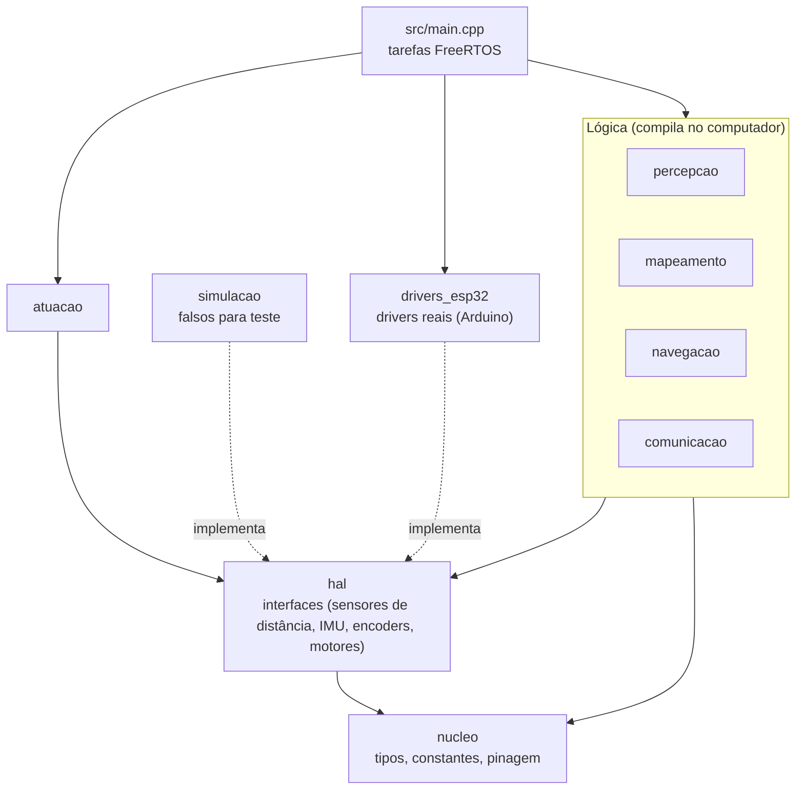

**Figura 1.** Camadas do firmware e dependências entre elas: a lógica depende só das interfaces de `hal`, implementadas pelos drivers reais (`drivers_esp32`) e pelos falsos de teste (`simulacao`).

A lógica conhece só as **interfaces** de `hal`. Na placa, `main.cpp` liga cada interface ao driver real de `drivers_esp32`; nos testes, ela é ligada aos falsos de `simulacao`. É isso que permite testar percepção e mapeamento no computador, antes de o hardware estar montado.

## Hardware Rev 2.0

Em 21/10/2026, a eletrônica enviou o esquemático e a lista de componentes da **Rev 2.0**, que é a referência do firmware até nova versão ([4.3 Hardware](hardware.md)).

| Parte | Antes | Rev 2.0 | Efeito no firmware |
|---|---|---|---|
| Placa | ESP32-C3 DevKit | **ESP32-C3 Super Mini** | O log sai pela USB nativa (GPIO18/19), porque a UART0 (GPIO20/21) passou a acionar os motores ([#377](https://github.com/fcte-pi1/2026_2_PI1_Grupo01_Hilmer/issues/377)) |
| Sensores de distância | LiDAR 360° por UART | **3 VL53L0X** (esquerdo, frontal e direito) por I²C | A interface dos sensores de distância continua (renomeada de `ILidar` para `ISensorDistancia` no PR #391); muda o driver por trás dela ([#344](https://github.com/fcte-pi1/2026_2_PI1_Grupo01_Hilmer/issues/344), PR [#391](https://github.com/fcte-pi1/2026_2_PI1_Grupo01_Hilmer/pull/391), em revisão) |
| Orientação | Só encoders | **IMU MPU6050** no mesmo I²C | Ângulo de giro pelo giroscópio ([#378](https://github.com/fcte-pi1/2026_2_PI1_Grupo01_Hilmer/issues/378), PR [#403](https://github.com/fcte-pi1/2026_2_PI1_Grupo01_Hilmer/pull/403), em revisão) |
| Motores | Motor TT | **N20** pelo DRV8833 | Pinos novos, freio no boot, duty máximo e detecção de motor travado sem encoder ([#341](https://github.com/fcte-pi1/2026_2_PI1_Grupo01_Hilmer/issues/341); veja [Atuação: motores N20 e proteção sem encoder](#atuacao-motores-n20-e-protecao-sem-encoder)) |
| Encoders | Encoder óptico | Encoders dos N20, em GPIO4 a 7 | A odometria ([#187](https://github.com/fcte-pi1/2026_2_PI1_Grupo01_Hilmer/issues/187)) continua; os parâmetros precisam ser recalibrados para o N20 |

Enquanto os encoders não eram integrados à Rev 2.0, o plano previa estimar o deslocamento pelo comando dos motores, corrigido pelos sensores de distância (modo sem encoder, [#380](https://github.com/fcte-pi1/2026_2_PI1_Grupo01_Hilmer/issues/380)). Com os encoders disponíveis, esse modo passa a ser o plano B.

**O LiDAR não é mais usado.** O código dele (`lib/lidar`, decodificador LD06 e `FonteBytesSerial`) ainda está na `main` e deve sair num PR de código. Os registros de teste anteriores a 21/10 em [Testes de software](../07-testes/software-registro.md) foram feitos com o LiDAR simulado e continuam como histórico.

## Dois ambientes: placa e computador

O `platformio.ini` define dois ambientes de compilação para o mesmo código:

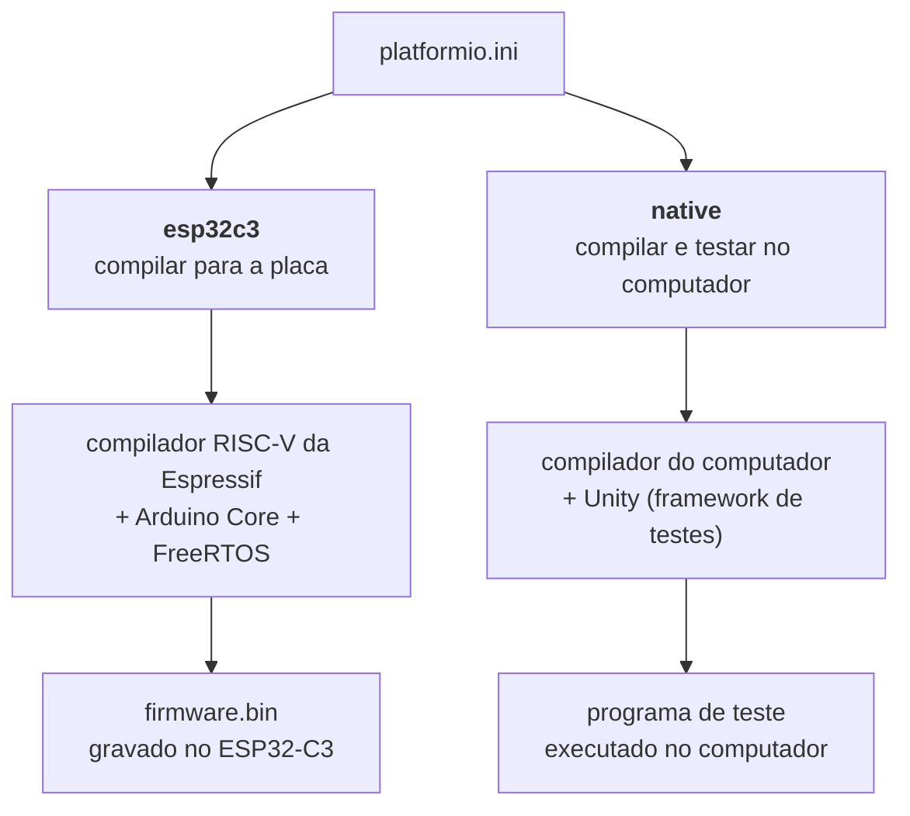

**Figura 2.** Os dois ambientes de compilação definidos no `platformio.ini`: `esp32c3` gera o firmware gravado na placa e `native` compila e executa os testes no computador.

A lógica do robô (direções, mapa, classificação de paredes) não usa nada do Arduino, por isso compila nos dois ambientes. Assim, ela pode ser testada no computador, sem a placa e sem o sensor. Quando a lógica precisa dos sensores de distância, os testes usam o `SensorDistanciaSimulado`, um sensor simulado que devolve as leituras escolhidas pelo próprio teste.

| | `esp32c3` | `native` |
|---|---|---|
| Onde roda | No ESP32-C3 | No computador de quem está desenvolvendo |
| O que inclui | Toda a lógica, `drivers_esp32` e `main.cpp` | A lógica e os falsos de `simulacao` (ignora `drivers_esp32`) |
| Comando | `pio run -e esp32c3` | `pio test -e native` |
| Resultado | `firmware.bin` e o uso de RAM e Flash | Relatório dos testes (aprovados ou com falha) |

Há ainda os ambientes de bancada, que herdam o `esp32c3` mas compilam só um programa de `src/bancada/`: **`bancada_tof`**, para os sensores de distância (veja [Bancada dos VL53L0X](#bancada-dos-vl53l0x)), e **`bancada_deslocamento`**, para o deslocamento sem encoder (veja [Bancada do deslocamento sem encoder](#bancada-do-deslocamento-sem-encoder)). O `esp32c3` exclui a pasta `src/bancada/` (`build_src_filter`), então o firmware do robô não muda.

## Estrutura de pastas

| Caminho | Conteúdo |
|---|---|
| `platformio.ini` | Ambientes `esp32c3` (placa) e `native` (testes no computador, com Unity) |
| `src/main.cpp` | Ponto de entrada: inicializa o log e cria as tarefas de navegação e telemetria |
| `lib/nucleo` | Tipos compartilhados, constantes do desafio e pinagem |
| `lib/hal` | Interfaces de hardware: `ISensorDistancia` (sensores de distância), `IEncoder`, `IMotores`, `IBarramentoI2c` ([#50](https://github.com/fcte-pi1/2026_2_PI1_Grupo01_Hilmer/issues/50)) e `IImu` (PR [#403](https://github.com/fcte-pi1/2026_2_PI1_Grupo01_Hilmer/pull/403), em revisão) |
| `lib/inicializacao` | Autoteste do boot: varredura do I²C, conferência dos 4 dispositivos e relatório (`AutotesteBoot`, `RelatorioBoot`), com os parâmetros em `ConfiguracaoBoot.h` ([#50](https://github.com/fcte-pi1/2026_2_PI1_Grupo01_Hilmer/issues/50)) |
| `lib/calibracao` | Rotina de autocalibração dos sensores de distância VL53L0X e do giroscópio no limite de 1 s (`CalibradorTof`, `CalibradorGiro` e `RotinaCalibracao`), com parâmetros em `ConfiguracaoCalibracao.h` ([#240](https://github.com/fcte-pi1/2026_2_PI1_Grupo01_Hilmer/issues/240)) |
| `lib/falhas` | Falha do I²C durante a corrida: tentativas, reinício e recuperação dos 4 dispositivos (`SupervisorI2c`), leitura de cada ToF pelas amostras (`VigiaTof`) e motores parados enquanto durar a falha (`TravaFalhaI2c`), com os parâmetros em `ConfiguracaoFalhasI2c.h` ([#241](https://github.com/fcte-pi1/2026_2_PI1_Grupo01_Hilmer/issues/241)) |
| `lib/tof` | Regra de validade das leituras dos 3 VL53L0X (`CombinadorTof`) e seus parâmetros (`ConfiguracaoTof.h`), sem Arduino ([#344](https://github.com/fcte-pi1/2026_2_PI1_Grupo01_Hilmer/issues/344)) |
| `lib/deslocamento` | Deslocamento sem encoder: estimativa pela potência dos motores, `IEncoder` e `IMotores` provisórios e correção pelos ToF; todos os ajustes em `ConfiguracaoDeslocamento.h` ([#380](https://github.com/fcte-pi1/2026_2_PI1_Grupo01_Hilmer/issues/380)) |
| `lib/encoders` | Decodificação em quadratura dos encoders, conversão de pulsos em mm e distância por roda ([#186](https://github.com/fcte-pi1/2026_2_PI1_Grupo01_Hilmer/issues/186)) |
| `lib/percepcao` | Classificação `parede`/`livre` (tarefa [#174](https://github.com/fcte-pi1/2026_2_PI1_Grupo01_Hilmer/issues/174)) |
| `lib/mapeamento` | Mapa do labirinto, atualização, armazenamento em memória e mapa final ([#176](https://github.com/fcte-pi1/2026_2_PI1_Grupo01_Hilmer/issues/176), [#177](https://github.com/fcte-pi1/2026_2_PI1_Grupo01_Hilmer/issues/177), [#179](https://github.com/fcte-pi1/2026_2_PI1_Grupo01_Hilmer/issues/179), [#180](https://github.com/fcte-pi1/2026_2_PI1_Grupo01_Hilmer/issues/180)) |
| `lib/navegacao` | Algoritmo de resolução do labirinto por *flood fill* ([#183](https://github.com/fcte-pi1/2026_2_PI1_Grupo01_Hilmer/issues/183)), localização por odometria ([#187](https://github.com/fcte-pi1/2026_2_PI1_Grupo01_Hilmer/issues/187)) e detecção do objetivo ([#189](https://github.com/fcte-pi1/2026_2_PI1_Grupo01_Hilmer/issues/189)) |
| `lib/atuacao` | Controle de movimento: centralização no corredor e parada frontal ([#191](https://github.com/fcte-pi1/2026_2_PI1_Grupo01_Hilmer/issues/191)), e trava dos motores (`MotoresComTrava`, [#50](https://github.com/fcte-pi1/2026_2_PI1_Grupo01_Hilmer/issues/50)) |
| `lib/execucao` | Execução dos movimentos entre células (`ExecutorMovimentos`), ciclo percepção → mapa → decisão → atuação (`CicloNavegacao`) e gatilho da largada (`GatilhoLargada`), com os parâmetros em `ConfiguracaoExecucao.h` ([#184](https://github.com/fcte-pi1/2026_2_PI1_Grupo01_Hilmer/issues/184)); detecção de colisão e recuperação (`DetectorColisao`, `ConfiguracaoColisao.h`, [#192](https://github.com/fcte-pi1/2026_2_PI1_Grupo01_Hilmer/issues/192)) |
| `lib/localizacao` | Correção do erro acumulado pelas paredes (`CorrecaoPelasParedes`), com os parâmetros do realinhamento e do rumo pelo corredor em `ConfiguracaoLocalizacao.h` ([#188](https://github.com/fcte-pi1/2026_2_PI1_Grupo01_Hilmer/issues/188)) |
| `lib/imu` | Calibração do viés e ângulo de giro do giroscópio ([#378](https://github.com/fcte-pi1/2026_2_PI1_Grupo01_Hilmer/issues/378), PR [#403](https://github.com/fcte-pi1/2026_2_PI1_Grupo01_Hilmer/pull/403), em revisão) |
| `lib/lidar` | Código do LiDAR da versão anterior do hardware; **não é usado** e deve ser removido |
| `lib/comunicacao` | Telemetria e eventos pontuais (`TelemetriaJson`, [#189](https://github.com/fcte-pi1/2026_2_PI1_Grupo01_Hilmer/issues/189)), serialização do mapa em JSON ([#178](https://github.com/fcte-pi1/2026_2_PI1_Grupo01_Hilmer/issues/178)) e *buffer* de reenvio (Épico 03) |
| `lib/simulacao` | Falsos para os testes: `SensorDistanciaSimulado`, `LabirintoSimulado` ([#224](https://github.com/fcte-pi1/2026_2_PI1_Grupo01_Hilmer/issues/224)), `TofSimulado` ([#344](https://github.com/fcte-pi1/2026_2_PI1_Grupo01_Hilmer/issues/344)), `EncoderSimulado`, `MotoresSimulados`, `BarramentoI2cSimulado` ([#50](https://github.com/fcte-pi1/2026_2_PI1_Grupo01_Hilmer/issues/50)) e `ImuSimulado` (PR [#403](https://github.com/fcte-pi1/2026_2_PI1_Grupo01_Hilmer/pull/403), em revisão) |
| `lib/drivers_esp32` | Drivers que dependem do Arduino: 3 VL53L0X pelo I²C (`TofVl53l0x`), varredura do I²C (`BarramentoI2cEsp32`), encoders, motores pelo DRV8833 e Wi-Fi; o driver do MPU6050 está em desenvolvimento ([#378](https://github.com/fcte-pi1/2026_2_PI1_Grupo01_Hilmer/issues/378)) |
| `src/bancada/` | Programas de bancada, fora do firmware do robô: `bancada_tof.cpp` testa os VL53L0X ([#344](https://github.com/fcte-pi1/2026_2_PI1_Grupo01_Hilmer/issues/344)) e `bancada_deslocamento.cpp`, o deslocamento sem encoder ([#380](https://github.com/fcte-pi1/2026_2_PI1_Grupo01_Hilmer/issues/380)) |
| `scripts/` | Ferramentas de bancada no computador: `bancada_tof.py` (menu dos VL53L0X), `bancada_deslocamento.py` (deslocamento sem encoder) e `calibrar_deslocamento_18cm.py` (encoders); os testes dos scripts ficam em `scripts/testes/` |
| `test/` | Testes Unity, uma pasta `test_<modulo>` por módulo |

As pastas ainda vazias têm um arquivo `.gitkeep` para existirem no repositório.

## Regras de dependência

- As camadas de lógica (`nucleo`, `percepcao`, `calibracao`, `mapeamento`, `navegacao`, `comunicacao`, `simulacao`) **não incluem `Arduino.h`**. Por isso o ambiente `native` ignora `drivers_esp32` (`lib_ignore` no `platformio.ini`).
- Todo acesso ao hardware passa por uma interface de `hal`.
- **Sem alocação dinâmica** na lógica: o maior labirinto tem 12×4 células, então estruturas de tamanho fixo bastam.
- Todo o código fica no namespace `micromouse`, com um `.h` por conceito e `#pragma once`.

## Núcleo: tipos e operações

Definidos em `lib/nucleo/src/Tipos.h` e `Direcao.h`.

| Tipo | Valores ou campos | Uso |
|---|---|---|
| `Direcao` | `Norte`, `Leste`, `Sul`, `Oeste` | Direção absoluta no labirinto |
| `Lado` | `Frente`, `Esquerda`, `Direita` | Lado relativo ao robô (leituras dos sensores de distância) |
| `EstadoParede` | `Desconhecido`, `Livre`, `Parede` | Estado de uma parede no mapa |
| `PosicaoCelula` | `linha`, `coluna` | Célula do labirinto; a partida é (0, 0) |
| `Pose` | `celula`, `direcao` | Onde o robô está e para onde está virado |
| `DistanciasLaterais` | `frenteMm`, `esquerdaMm`, `direitaMm` | Leitura dos sensores de distância (os 3 VL53L0X na Rev 2.0), em milímetros |

A ordem de `Direcao` segue o **sentido horário**. As operações de `Direcao.h` usam essa ordem com soma módulo 4, por isso os valores não devem ser reordenados.

| Função | O que faz | Exemplo |
|---|---|---|
| `girarDireita(d)` | Giro de 90° no sentido horário | Norte → Leste |
| `girarEsquerda(d)` | Giro de 90° no sentido anti-horário | Norte → Oeste |
| `oposta(d)` | Giro de 180° | Norte → Sul |
| `direcaoAbsoluta(direcaoDoRobo, lado)` | Converte um lado do robô em direção do labirinto | Robô virado para Leste: esquerda = Norte, direita = Sul |

A `direcaoAbsoluta` é a ponte entre a percepção e o mapa: os sensores de distância medem à frente, à esquerda e à direita do robô, e o mapa guarda as paredes por Norte, Sul, Leste e Oeste.

## Constantes

Definidas em `lib/nucleo/src/Configuracao.h`.

| Constante | Valor | Origem |
|---|---|---|
| `MAX_LINHAS_LABIRINTO` | 4 | Maior labirinto da competição (12×4) |
| `MAX_COLUNAS_LABIRINTO` | 12 | Maior labirinto da competição (12×4) |
| `TAMANHO_CELULA_MM` | 180 | Célula de 18 × 18 cm |
| `PERIODO_TELEMETRIA_MS` | 1000 | Envio a cerca de 1 s (arquitetura), dentro dos 2 s do RNF05 |
| `LIMITE_TEMPO_CORRIDA_MS` | 600 000 | 10 minutos por tentativa (RNF03) |

## Pinagem

Definida em `lib/nucleo/src/Pinos.h` ([#377](https://github.com/fcte-pi1/2026_2_PI1_Grupo01_Hilmer/issues/377)), conforme o [esquemático Rev 2.0](hardware.md#42-pinagem-do-esp32-c3).

| Componente | Sinal | GPIO |
|---|---|---|
| I²C dos 3 VL53L0X e do MPU6050 | SDA / SCL | 9 / 8 |
| VL53L0X esquerdo, frontal e direito | XSHUT | 0 / 1 / 2 |
| DRV8833, motor esquerdo | IN1 / IN2 | 10 / 3 |
| DRV8833, motor direito | IN3 / IN4 | 20 / 21 |
| Encoder esquerdo | A / B | 4 / 5 |
| Encoder direito | A / B | 6 / 7 |
| USB nativa (log e gravação) | D− / D+ | 18 / 19 |

**Conferência com o esquemático (23/10/2026):** os 15 pinos do `Pinos.h` da `main` são iguais aos da tabela de pinagem da [4.3 Hardware](hardware.md), publicada no commit `ca175d9`. A versão anterior do esquemático, com o I²C em GPIO6/7, foi substituída pela Rev 2.0 nesse mesmo PR da eletrônica. O teste `test_pinos` confere que nenhum GPIO é usado duas vezes.

!!! warning "Pontos a validar com a eletrônica"
    - **GPIO20/21 (UART0) acionam o motor direito.** O ESP32-C3 manda o log de boot por eles antes de o firmware assumir, o que pode dar um tranco no motor ao ligar. O próprio esquemático pede validação.
    - **GPIO2, GPIO8 e GPIO9 são pinos de *strapping*** (definem o modo de boot). Eles estão com o XSHUT direito e o I²C; a placa precisa iniciar normalmente com esses circuitos ligados.
    - **Leitura da bateria:** o divisor termina em `BAT_ADC_TEST`, sem GPIO, porque o GPIO2, que tem ADC, ficou com o XSHUT. Ainda não há pino definido para medir a bateria.
    - O esquemático ainda descreve os encoders como "reservados; encoder não instalado". Com os encoders disponíveis, a eletrônica precisa atualizar essa nota.

## Sensores de distância: interface `ISensorDistancia` e `SensorDistanciaSimulado`

Na Rev 2.0, o robô mede as paredes com **3 sensores VL53L0X** (esquerdo, frontal e direito), que medem a distância por tempo de voo da luz (*Time of Flight*, ToF). A lógica do firmware recebe essas distâncias pela interface `ISensorDistancia`. Até o PR [#391](https://github.com/fcte-pi1/2026_2_PI1_Grupo01_Hilmer/pull/391), ela se chamava `ILidar` (e o simulado, `LidarSimulado`), nome herdado da primeira versão do hardware; a troca do nome foi feita num commit só, e a percepção, o mapa e o controle de movimento não mudaram ([#344](https://github.com/fcte-pi1/2026_2_PI1_Grupo01_Hilmer/issues/344)).

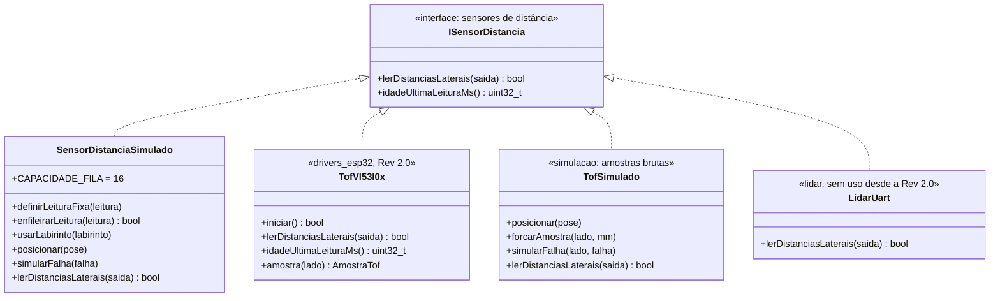

**Figura 3.** Interface `ISensorDistancia` e suas implementações: o `SensorDistanciaSimulado`, que devolve as leituras escolhidas pelo teste, o `TofVl53l0x`, driver dos 3 VL53L0X da Rev 2.0, o `TofSimulado`, que simula os 3 VL53L0X num labirinto passando pelo `CombinadorTof` real, e o `LidarUart`, do LiDAR da primeira versão do hardware, que fica no código sem uso até depois da ED1.

**Contrato de `ISensorDistancia::lerDistanciasLaterais`:** retorna `true` e preenche `saida` (em mm) quando há leitura válida das três direções; retorna `false` quando o sensor não responde ou a leitura é inválida. Nesse caso, o conteúdo de `saida` não deve ser usado. Medida fora da faixa do sensor **não** é inválida: sai limitada à faixa (no `TofVl53l0x`, "sem alvo" vira o alcance máximo, lado livre, e "perto demais" vira o mínimo, parede).

**Contrato de `ISensorDistancia::idadeUltimaLeituraMs`:** idade, em ms, da amostra mais antiga que compõe a última leitura, medida no momento da chamada. Serve para a navegação não reagir duas vezes ao mesmo dado. A implementação padrão devolve 0 (leitura sempre nova), o que vale para o `SensorDistanciaSimulado`.

**`SensorDistanciaSimulado`** devolve o que o teste configurar. A cada leitura, segue esta ordem:

1. com a falha ligada (`simularFalha(true)`), a leitura falha e a fila não é consumida;
2. se houver leituras na fila, entrega a mais antiga e a remove;
3. se o modo labirinto estiver ativo (`usarLabirinto` e `posicionar`), entrega o que o [`LabirintoSimulado`](#labirinto-simulado-labirintosimulado) mostra na pose atual, e a leitura falha se a pose estiver fora do labirinto;
4. se houver leitura fixa, entrega a leitura fixa;
5. caso contrário, a leitura falha.

A fila é circular, com capacidade fixa de 16 leituras; `enfileirarLeitura` retorna `false` quando ela está cheia.

```cpp
SensorDistanciaSimulado lidar;
lidar.definirLeituraFixa({500, 500, 500});  // corredor livre
lidar.enfileirarLeitura({90, 90, 270});     // depois, parede à frente e à esquerda
ISensorDistancia& sensor = lidar;           // a lógica recebe só a interface
```

## Sensores de distância: 3 VL53L0X (`TofVl53l0x`)

Na Rev 2.0 do hardware (21/10/2026), o LiDAR por UART deu lugar a **3 sensores VL53L0X** pelo I²C: um à esquerda, um à frente e um à direita. O `TofVl53l0x` (`lib/drivers_esp32`) implementa a `ISensorDistancia`, então o resto do firmware não mudou ([#344](https://github.com/fcte-pi1/2026_2_PI1_Grupo01_Hilmer/issues/344), [HU-02](https://github.com/fcte-pi1/2026_2_PI1_Grupo01_Hilmer/issues/36)). A regra que decide se uma leitura vale fica no `CombinadorTof` (`lib/tof`), sem Arduino, e é testada no computador; o driver só conversa com os sensores pela biblioteca `pololu/VL53L0X` (1.3.1), que entra apenas no ambiente `esp32c3`.

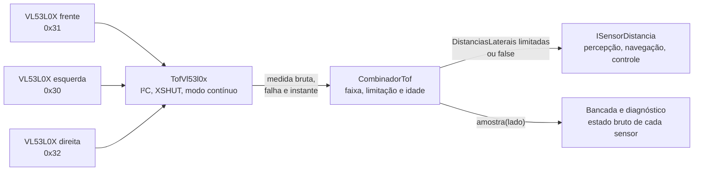

**Figura 4.** Caminho de uma leitura: o driver lê cada sensor que tem medida pronta, o `CombinadorTof` classifica a medida, limita à faixa as que ficaram fora dela e monta a leitura das três direções, e quem precisar do valor bruto (a bancada, por exemplo) consulta a amostra do sensor.

### Ligação e endereços

Os três sensores dividem o barramento I²C com o MPU6050. Todos saem do reset no endereço de fábrica, 0x29, por isso cada um tem o seu pino XSHUT. Os valores ficam em `Pinos.h`, e o driver os recebe por parâmetro.

| Sensor | XSHUT | Endereço I²C |
|---|:-:|:-:|
| Esquerdo (J3) | GPIO0 | 0x30 |
| Frontal (J4) | GPIO1 | 0x31 |
| Direito (J5) | GPIO2 | 0x32 |
| Barramento | SDA GPIO9, SCL GPIO8 | MPU6050 em 0x68 |

Um `static_assert` em `Pinos.h` reprova a compilação se dois endereços coincidirem ou se algum deles for o 0x29 ou o 0x68.

### Regras de Negócio e Algoritmo

* **Inicialização (`iniciar()`):** os três XSHUT vão a nível baixo (sensores em reset); depois, um sensor por vez é solto, inicializado e recebe o seu endereço, e só então o próximo é solto. Cada sensor fica em modo contínuo com o tempo de medição configurado. Um sensor que não responde volta para o reset, para não ocupar o 0x29 e atrapalhar os seguintes; `sensorIniciado(lado)` diz quais iniciaram.
* **Leitura sem espera:** a cada `lerDistanciasLaterais()`, o driver consulta o registrador de medida pronta de cada sensor e só lê os que têm medida nova. Nunca espera o sensor terminar, então a tarefa de navegação (10 ms) não trava.
* **Classificação de cada medida** (`CombinadorTof::classificar`):

| Estado | Quando |
|---|---|
| `Valida` | Entre 30 e 1200 mm |
| `AbaixoDoMinimo` | Abaixo de 30 mm, onde o VL53L0X perde a precisão |
| `ForaDeAlcance` | Acima de 1200 mm, incluindo os 8190/8191 mm que o sensor devolve sem alvo |
| `Falha` | Sem resposta no I²C ou tempo de espera estourado |
| `SemAmostra` | O sensor ainda não entregou nenhuma medida |

* **Fora da faixa não derruba a leitura:** a medida sai limitada à faixa, como a percepção ([#379](https://github.com/fcte-pi1/2026_2_PI1_Grupo01_Hilmer/issues/379)) trata. `ForaDeAlcance` vira 1200 mm, lado livre: no 12×4, "nada à frente" é uma leitura normal. `AbaixoDoMinimo` vira 30 mm, parede muito perto: o sensor lateral pode ler menos de 30 mm com o robô desviado. Antes da revisão do PR #391, um lado fora da faixa derrubava a leitura dos três.
* **Leitura válida:** `lerDistanciasLaterais()` devolve `true` com os três sensores respondendo (nenhum em `Falha` ou `SemAmostra`) e com a amostra mais antiga dentro de 100 ms. Um sensor que para de medir faz a leitura falhar pela idade.
* **Amostra bruta exposta:** `amostra(lado)` devolve a última medida de cada sensor, com o estado e a distância brutos e o instante, mesmo quando a leitura sai limitada.
* **Referência das distâncias:** as medidas partem da face de cada sensor, não do centro do robô. A conversão para a geometria do robô e os limiares de parede são da [#379](https://github.com/fcte-pi1/2026_2_PI1_Grupo01_Hilmer/issues/379); a compensação do desvio de cada sensor, da calibração ([#240](https://github.com/fcte-pi1/2026_2_PI1_Grupo01_Hilmer/issues/240)).

**Parâmetros** (`ConfiguracaoTof.h`, todos **provisórios**, a validar na bancada da [#175](https://github.com/fcte-pi1/2026_2_PI1_Grupo01_Hilmer/issues/175)):

| Parâmetro | Valor | Origem |
|---|---|---|
| Tempo de medição (*timing budget*) | 33 ms | Padrão do VL53L0X: cerca de 30 medidas por segundo, precisão razoável até 1,2 m |
| Período no modo contínuo | 0 (uma medida emendada na outra) | Biblioteca `pololu/VL53L0X` |
| Faixa válida | 30 a 1200 mm | Datasheet do VL53L0X, modo padrão em ambiente interno |
| Idade máxima da leitura | 100 ms | Cerca de 3 medidas perdidas |
| Tempo limite no I²C | 50 ms | Estimativa |
| Espera depois de soltar o XSHUT | 10 ms | O datasheet dá até 1,2 ms; a folga cobre o regulador do módulo |

### Interface da Classe

* **`TofVl53l0x(TwoWire&, frente, esquerda, direita, config)`:** recebe o barramento já iniciado (`Wire.begin(SDA, SCL)`) e a `ConexaoTof` (pino XSHUT e endereço) de cada sensor.
* **`bool iniciar()`:** sequência de XSHUT e endereços; `true` se os três iniciaram. Pode ser chamado de novo para reiniciar os sensores.
* **`bool lerDistanciasLaterais(DistanciasLaterais&)`** e **`uint32_t idadeUltimaLeituraMs() const`:** o contrato da `ISensorDistancia`; a idade é `CombinadorTof::IDADE_DESCONHECIDA` enquanto algum sensor não entregou amostra.
* **`const AmostraTof& amostra(Lado) const`:** distância bruta, `EstadoAmostraTof` e instante da última medida do sensor.
* **`CombinadorTof`:** `classificar(distancia, falhou)`, `registrar(lado, distancia, falhou, agoraMs)`, `distancias(agoraMs, saida)` (já com as distâncias limitadas), `idadeMs(agoraMs)` e `reiniciar()`.

**No `main.cpp`.** O `setup()` inicia o barramento e chama `iniciar()`; o autoteste do boot (próxima seção) confere o resultado e diz qual sensor falhou. A tarefa de navegação lê os sensores a cada 10 ms e guarda uma cópia, protegida por seção crítica, que a telemetria envia nos campos `tof_frente_mm`, `tof_esq_mm`, `tof_dir_mm`, `tof_valida` e `tof_idade_ms`.

### Bancada dos VL53L0X

Para a equipe de software e a eletrônica validarem o driver no hardware montado, há um firmware de bancada (`src/bancada/bancada_tof.cpp`, ambiente `bancada_tof`) e um menu no computador (`scripts/bancada_tof.py`). O firmware mantém os motores freados e responde a comandos pela serial; o menu grava esse firmware e conduz o roteiro, com resultado APROVADO, REPROVADO ou OBSERVADO em cada verificação e um relatório em Markdown no fim.

| Etapa | O que verifica | Critério provisório |
|---|---|---|
| 1. Fiação | Com os outros em reset, cada XSHUT liga só o seu sensor, que aparece no 0x29 | O sensor aparece sozinho; com todos em reset, ninguém no 0x29 |
| 2. Inicialização | `iniciar()` e varredura do barramento | 0x30, 0x31 e 0x32 presentes e 0x29 livre |
| 3. Taxa e tempo | Estatística de 5 s com obstáculo diante dos três | 20 a 40 Hz por sensor, leitura em até 5 ms, ≥ 95% de leituras válidas |
| 4. Régua | Média, erro e desvio contra distâncias medidas | Erro até ±10 mm ou ±5% |
| 5. Fora da faixa | Sensor sem alvo e sensor encostado | Leitura válida, limitada a 1200 mm ou 30 mm (campo `limitada`), com `ForaDeAlcance` ou `AbaixoDoMinimo` na amostra; outro estado do sensor fica registrado como OBSERVADO para a [#379](https://github.com/fcte-pi1/2026_2_PI1_Grupo01_Hilmer/issues/379) |
| 6. Sensor ausente (opcional) | Um sensor desconectado com a placa desligada | Os outros dois iniciam e a leitura falha |

O passo a passo de uso está no [README do firmware](https://github.com/fcte-pi1/2026_2_PI1_Grupo01_Hilmer/blob/main/src/firmware/README.md#bancada-dos-vl53l0x). O CI compila o `bancada_tof` junto com o firmware do robô e roda os testes do menu (`scripts/testes/test_bancada_tof.py`, job "Scripts de bancada"), que conferem cada etapa com respostas falsas da placa, sem hardware nem `pyserial`.

### Simulação dos VL53L0X e integração com o mapa

O `TofSimulado` (`lib/simulacao`) faz no computador o papel do driver: gera a amostra bruta de cada sensor no [`LabirintoSimulado`](#labirinto-simulado-labirintosimulado) e a passa pelo `CombinadorTof` real. Assim a regra de validade entra nos testes de integração.

* **Amostra bruta:** a distância do centro do robô à parede menos 30 mm (o recuo provisório dos sensores, o mesmo da [#379](https://github.com/fcte-pi1/2026_2_PI1_Grupo01_Hilmer/issues/379)); além de 1200 mm, o sensor devolve 8190 mm (sem alvo), como o real.
* **Casos do sensor real:** `forcarAmostra(lado, mm)` troca a próxima amostra de um lado (por exemplo, sensor encostado na parede) e `simularFalha(lado, true)` faz um sensor parar de responder.
* **`test_integracao_tof`:** explora os labirintos 4×4, 8×4 e 12×4 por `TofSimulado → CombinadorTof → ClassificadorParede → AtualizadorMapa → Mapa` e confere que o mapa final é igual ao labirinto. Como os exemplos não passam de 1140 mm brutos, há também um 12×4 em serpentina, com corredores de uma linha inteira (2070 mm do centro), que só se fecha com o "sem alvo" tratado como livre.

## Boot do sistema: autoteste do I²C (`AutotesteBoot`)

Na Rev 2.0, o boot passa pelo I²C: os 3 VL53L0X precisam receber os endereços e o MPU6050 precisa responder antes de o robô poder andar. O `AutotesteBoot` (`lib/inicializacao`) confere o barramento depois do `TofVl53l0x::iniciar()` e só então os motores são liberados ([#50](https://github.com/fcte-pi1/2026_2_PI1_Grupo01_Hilmer/issues/50), RNF-09). A lógica não usa Arduino e é testada no computador com o `BarramentoI2cSimulado`; na placa, o `BarramentoI2cEsp32` faz a varredura pelo `Wire`.

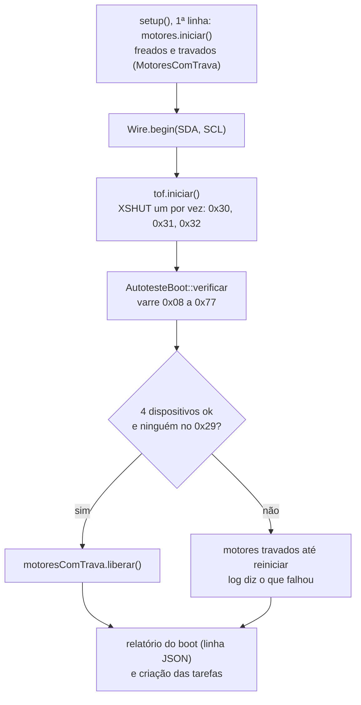

**Figura 5.** Sequência de boot da Rev 2.0: os motores começam travados e só são liberados com o autoteste aprovado; as tarefas sobem nos dois casos, para a telemetria continuar informando a falha.

### Regras de Negócio e Algoritmo

* **Dispositivos exigidos:** ToF esquerdo (0x30), frontal (0x31) e direito (0x32), e MPU6050 (0x68). Os endereços vêm de `Pinos.h`, a única fonte deles.
* **Estado de cada dispositivo:**

| Situação | Estado | Reprova o boot? |
|---|---|---|
| Responde no endereço esperado (no MPU6050, com o `WHO_AM_I` certo) | `ok` | Não |
| Ninguém no endereço | `ausente` | Sim |
| ToF responde no endereço novo, mas o driver não conseguiu configurá-lo | `nao_iniciou` | Sim |
| Algo no 0x68 com outro `WHO_AM_I`, ou sem leitura | `nao_identificado` | Sim |
| Algo no 0x29: um VL53L0X ficou no endereço de fábrica (não trocou de endereço ou o XSHUT está trocado) | `tof_0x29` | Sim |
| Outro endereço respondendo | `inesperados` | Não, só aviso |
| Boot acima de 2 s | `no_prazo: false` | Não, só aviso |

* **Identidade do MPU6050:** além de responder no 0x68, o registrador `WHO_AM_I` (0x75) precisa valer 0x68, para outro chip nesse endereço não passar pela IMU. Usa só o `Wire`, sem depender do driver da IMU ([#378](https://github.com/fcte-pi1/2026_2_PI1_Grupo01_Hilmer/issues/378)).
* **Falha:** os motores ficam travados **até o robô ser reiniciado**. Durante a corrida, a falha de um dispositivo é tratada pela [#241](https://github.com/fcte-pi1/2026_2_PI1_Grupo01_Hilmer/issues/241), com a mesma trava (veja [Falha do I²C durante a corrida](#falha-do-i2c-durante-a-corrida-supervisori2c)).
* **Trava dos motores:** a `MotoresComTrava` envolve o driver e começa travada. Travada, todo `definirPotencia` vira `parar()`; o `parar()` sempre passa. O `motores.iniciar()` é a primeira linha do `setup()`, para frear antes de tudo, porque o GPIO20/21 (IN3/IN4) recebe um tranco da ROM durante o reset.
* **Camadas dos motores:** no `main.cpp`, cada camada tem o próprio nome: `motores` é o driver e `motoresComTrava`, a trava. Quem aciona as rodas (o detector do objetivo hoje e o controle de movimento depois) usa só `motoresTracao`, uma referência (`IMotores&`) à camada de fora. Ordem combinada para quando as outras camadas entrarem: `MotoresComTrava` (#50) → `MotoresComProtecao` ([#341](https://github.com/fcte-pi1/2026_2_PI1_Grupo01_Hilmer/issues/341)) → `MotoresComEstimativa` ([#380](https://github.com/fcte-pi1/2026_2_PI1_Grupo01_Hilmer/issues/380)) → `MotoresDrv8833`. Com a trava por fora, a proteção recebe freio enquanto o robô não foi liberado e não acusa um motor travado falso; quando as camadas se juntarem, só a referência `motoresTracao` muda.
* **I²C compartilhado com a IMU:** o `BarramentoI2c` do PR [#403](https://github.com/fcte-pi1/2026_2_PI1_Grupo01_Hilmer/pull/403) (com mutex) vai tomar o lugar do `Wire.begin` do `setup()`, com `barramentoI2c.iniciar(SDA, SCL)` antes do `tof.iniciar()`. O `tof.iniciar()` e o autoteste não precisam do mutex, porque rodam antes dos `xTaskCreate` (inclusive o da IMU). Fica para essa integração unificar o `BarramentoI2cEsp32` com o `BarramentoI2c`, por exemplo com o `BarramentoI2cEsp32` usando o `BarramentoI2c::Uso` por dentro.
* **Tempo do boot (RNF-09):** `boot_ms` é o `millis()` no fim do `setup()`, contado desde o início do programa. A ROM e o bootloader do ESP32-C3 rodam antes e ficam de fora; o tempo desde o ligar precisa ser medido na bancada.

**Parâmetros:** em `lib/inicializacao/src/ConfiguracaoBoot.h`.

| Parâmetro | Valor | Observação |
|---|---|---|
| `TEMPO_MAXIMO_BOOT_MS` | 2000 | RNF-09 |
| `WHO_AM_I_MPU6050` | 0x68 | **Provisório:** clones do MPU6050 respondem outro valor (0x70, 0x72, 0x98); conferir na bancada pelo `mpu6050_who_am_i` do relatório |
| Faixa varrida | 0x08 a 0x77 | Fora dela ficam os endereços reservados do I²C |
| `MAXIMO_ENDERECOS_INESPERADOS` | 8 | Os seguintes só entram na contagem |

### Interface das Classes

* **`IBarramentoI2c`** (`lib/hal`): `bool responde(endereco)` e `bool lerRegistrador(endereco, registrador, valor&)`.
* **`ResultadoBoot AutotesteBoot::verificar(IBarramentoI2c&, InicializacaoTof)`:** varre o barramento e devolve o estado de cada dispositivo, o 0x29, o `WHO_AM_I` lido e os endereços inesperados. `InicializacaoTof` traz o `sensorIniciado` de cada ToF.
* **`ResultadoBoot::aprovado()`:** `true` com os 4 `ok` e ninguém no 0x29.
* **`AutotesteBoot::dentroDoPrazo(duracaoMs)`** e **`descreverFalhas(resultado, saida, capacidade)`:** prazo do RNF-09 e texto das falhas (por exemplo, `tof_frontal,mpu6050`).
* **`RelatorioBoot::serializar(resultado, autoteste, duracaoMs, saida, capacidade)`:** a linha JSON do boot, em até `TAMANHO_MAX_JSON_RELATORIO_BOOT` (512) bytes.
* **`MotoresComTrava`** (`lib/atuacao`): `IMotores` com `travar()`, `liberar()` e `travado()`.

```json
{"tipo":"boot","ok":false,"motores_liberados":false,"falhas":"tof_frontal","boot_ms":412,"prazo_ms":2000,"no_prazo":true,"dispositivos":{"tof_esquerdo":"ok","tof_frontal":"ausente","tof_direito":"ok","mpu6050":"ok"},"tof_0x29":false,"mpu6050_who_am_i":104,"inesperados":[],"inesperados_total":0}
```

**Figura 6.** Relatório de um boot com o ToF frontal ausente: os motores ficam travados e a falha é nomeada.

**No `main.cpp`.** A sequência da Figura 5 roda no `setup()`, antes de criar as tarefas. Como a linha do boot se perde se o monitor serial abrir depois do reset (a USB nativa reconecta), a telemetria repete `boot_ok`, `boot_falhas` e `boot_ms` em todo pacote, e o comando `B` no monitor reimprime o relatório. Com os campos do boot, o pior caso do JSON de telemetria chegou a 516 bytes, e o buffer (`TAMANHO_MAX_JSON_TELEMETRIA`) passou de 512 para 768 bytes.

## Calibração: autocalibração dos VL53L0X e do giroscópio (`CalibradorTof`, `CalibradorGiro` e `RotinaCalibracao`)

Na largada, o robô deve estar parado e centralizado na célula inicial (0, 0). Antes de iniciar o deslocamento pelo labirinto, o micromouse executa uma rotina de autocalibração dos sensores de distância (3 VL53L0X) e inerciais (IMU MPU6050, eixo Z) ([#240](https://github.com/fcte-pi1/2026_2_PI1_Grupo01_Hilmer/issues/240), [HU-13](https://github.com/fcte-pi1/2026_2_PI1_Grupo01_Hilmer/issues/51) / RF-13).

A camada `lib/calibracao` é puramente em C++17, não inclui `Arduino.h` e roda no computador com falsos (`SensorDistanciaSimulado` e `ImuSimulado`). A rotina cumpre o requisito não funcional **[RNF-08](https://github.com/fcte-pi1/2026_2_PI1_Grupo01_Hilmer/issues/26)**: a calibração completa deve ser concluída em **até 1 segundo** (1000 ms), com a duração ativamente medida pela rotina.

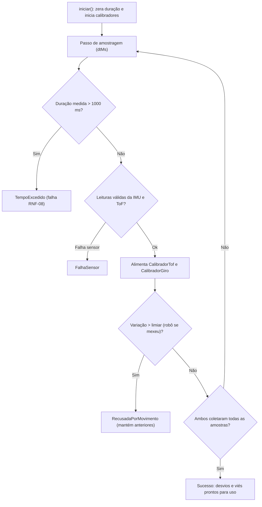

**Figura 7.** Fluxo de execução e máquinas de estado da rotina de autocalibração unificada.

### Componentes da calibração

1. **`CalibradorTof`:**
   - Estima o desvio de montagem de cada sensor ToF (frente, esquerda e direita) contra distâncias de referência conhecidas (nominalmente 54 mm na célula de partida centralizada).
   - O desvio é a diferença `média das amostras − referência nominal`.
   - Na aplicação (`corrigir`), subtrai o desvio da leitura bruta com saturação defensiva em zero (`uint16_t`).
   - Se durante a coleta de 10 amostras a amplitude `maior − menor` de qualquer lado ultrapassar `VARIACAO_MAXIMA_CALIBRACAO_TOF_MM` (8 mm), assume que o robô se mexeu ou houve interferência severa, transicionando para `Recusada` e mantendo os desvios anteriores inalterados.
2. **`CalibradorGiro`:**
   - Estima o viés estático do giroscópio em torno do eixo Z com o robô em repouso.
   - O viés é calculado pela média aritmética arredondada das amostras em décimos de °/s (`mediaArredondada`).
   - Na aplicação (`corrigir`), subtrai o viés da taxa medida (`taxaBruta − viés`).
   - Se a oscilação entre a maior e a menor amostra exceder `VARIACAO_MAXIMA_CALIBRACAO_GIRO_DECIMOS_DPS` (50 décimos de °/s, ou seja, 5,0 °/s), o estado vai para `Recusada`, mantendo o viés anterior.
3. **`RotinaCalibracao`:**
   - Orquestra a execução simultânea dos dois calibradores e **mede ativamente o tempo decorrido** (`duracaoMedidaMs()`).
   - Com 50 amostras a cada 10 ms da IMU e 10 amostras a cada ~33 ms dos ToF em paralelo, a rotina completa a autocalibração em **500 ms**, deixando 500 ms de margem de segurança dentro de 1 s (RNF-08).
   - Se o tempo total ultrapassar 1000 ms, transiciona para `TempoExcedido`.
   - Se qualquer um dos sensores recusar por movimento, transiciona para `RecusadaPorMovimento`.
   - Disponibiliza o método `executar(ISensorDistancia&, IImu&)` que encapsula o laço síncrono para inicialização no boot ou testes automatizados com simulação.

### Parâmetros da calibração (`ConfiguracaoCalibracao.h`)

| Parâmetro | Constante | Valor | Finalidade |
|---|---|---|---|
| Orçamento total | `ORCAMENTO_CALIBRACAO_MS` | **1000 ms** | Limite máximo estabelecido pelo RNF-08 |
| Fatia prevista ToF | `ORCAMENTO_CALIBRACAO_TOF_MS` | **400 ms** | Janela temporal para amostragem dos 3 VL53L0X |
| Fatia prevista Giro | `ORCAMENTO_CALIBRACAO_GIRO_MS` | **500 ms** | Janela temporal para amostragem do MPU6050 |
| Amostras ToF | `AMOSTRAS_CALIBRACAO_TOF` | **10** | 10 amostras a ~33 ms ≈ 330 ms |
| Amostras Giro | `AMOSTRAS_CALIBRACAO_GIRO` | **50** | 50 amostras a 10 ms = 500 ms |
| Variação máxima ToF | `VARIACAO_MAXIMA_CALIBRACAO_TOF_MM` | **8 mm** | Limiar de detecção de movimento/vibração lateral |
| Variação máxima Giro | `VARIACAO_MAXIMA_CALIBRACAO_GIRO_DECIMOS_DPS` | **50** (5 °/s) | Limiar de detecção de rotação do chassi |
| Referência nominal ToF | `DISTANCIA_REFERENCIA_TOF_MM` | **54 mm** | $84\text{ mm (centro à parede)} - 30\text{ mm (offset de montagem)}$ |

### Interface das Classes

* **`CalibradorTof`:** `iniciar(referencias)`, `adicionarAmostra(distancias)`, `estado()`, `desvios()` e `corrigir(bruta)`.
* **`CalibradorGiro`:** `iniciar()`, `adicionarAmostra(taxaDecimosDps)`, `estado()`, `viesDecimosDps()` e `corrigir(taxaBruta)`.
* **`RotinaCalibracao`:** `iniciar(referencias)`, `atualizar(distancias, distValidas, taxaGiro, giroValido, dtMs)`, `executar(ISensorDistancia&, IImu&)`, `estado()`, `duracaoMedidaMs()`, `corrigirTof(bruta)` e `corrigirGiro(taxaBruta)`.

## Labirinto simulado: `LabirintoSimulado`

O `LabirintoSimulado` (`lib/simulacao`) é um labirinto com todas as paredes conhecidas, usado como verdade de referência nos testes. Com ele, o `SensorDistanciaSimulado` deixa de depender de leituras digitadas à mão: basta posicionar o robô numa célula, e o sensor simulado devolve o que os sensores de distância reais veriam ali. Isso permite testar a classificação de paredes ([#174](https://github.com/fcte-pi1/2026_2_PI1_Grupo01_Hilmer/issues/174)) e a atualização do mapa ([#177](https://github.com/fcte-pi1/2026_2_PI1_Grupo01_Hilmer/issues/177)) num labirinto inteiro, sem hardware.

**Formato do labirinto.** O labirinto é escrito em texto, no formato clássico de micromouse. Cada célula ocupa 4 colunas e 2 linhas de texto; `+` marca os cantos, `---` uma parede horizontal e `|` uma parede vertical. A primeira linha é a borda Norte, e a partida (0, 0) é a célula do canto inferior esquerdo, com as mesmas convenções do `Mapa` e de `Direcao.h`.

```text
+---+---+---+---+
|       |       |
+   +---+   +   +
|   |       |   |
+   +   +---+   +
|       |       |
+   +---+   +---+
|   |           |
+---+---+---+---+
```

**Figura 8.** Labirinto 4×4 de exemplo (`LABIRINTO_4X4`), com a partida (0, 0) no canto inferior esquerdo.

Cada parede aparece uma única vez no texto, entre as duas células que ela separa. Por isso, o lado leste de uma célula e o lado oeste da vizinha nunca discordam. Ao carregar o texto, o `LabirintoSimulado` recusa:

| Resultado de `carregar` | Quando acontece |
|---|---|
| `Carregado` | Texto válido |
| `TamanhoInvalido` | O tamanho não é 4×4, 8×4 nem 12×4, ou as linhas têm larguras diferentes |
| `CaractereInvalido` | Caractere fora do formato |
| `ParedeIncompleta` | Parede pela metade, como `- -` |
| `PerimetroAberto` | Falta parede na borda externa |

**Distâncias.** Com o robô no centro da célula, a parede da própria célula está a 90 mm, e cada célula livre no caminho soma 180 mm (`TAMANHO_CELULA_MM`). No labirinto acima, com o robô em (0, 0) virado para o Norte, há três células livres à frente e paredes dos dois lados:

| Pose | Frente | Esquerda | Direita |
|---|:-:|:-:|:-:|
| (0, 0) Norte | 630 mm | 90 mm | 90 mm |
| (1, 0) Norte | 450 mm | 90 mm | 270 mm |
| (3, 0) Leste | 270 mm | 90 mm | 630 mm |

| Operação | O que faz |
|---|---|
| `carregar(texto)` | Lê o labirinto; se o texto for inválido, mantém o anterior |
| `temParede(celula, direcao)` | Se há parede naquele lado da célula (fora do labirinto conta como parede) |
| `distancias(pose, saida)` | Distâncias à frente, à esquerda e à direita para a pose; devolve `false` sem labirinto carregado ou com a célula fora dele |
| `SensorDistanciaSimulado::usarLabirinto(labirinto)` e `posicionar(pose)` | Modo labirinto: a leitura passa a vir do labirinto, depois da falha e da fila e antes da leitura fixa. O labirinto não é copiado e precisa continuar existindo; sem `posicionar`, vale a leitura fixa |

Os testes ficam em `test/test_labirinto_simulado/`, com um labirinto de exemplo de cada tamanho da competição (4×4, 8×4 e 12×4) em `LabirintosExemplo.h`. Os três têm o perímetro fechado e todas as células alcançáveis a partir da partida, e os testes conferem essas duas propriedades a cada execução. O uso do simulador também está no [README do firmware](https://github.com/fcte-pi1/2026_2_PI1_Grupo01_Hilmer/blob/main/src/firmware/README.md#labirinto-simulado).

## Percepção: classificação de paredes

O módulo de percepção (`lib/percepcao`) implementa a classe `ClassificadorParede`, responsável por processar as medições de distância e classificar se cada lado ao redor do robô (frente, esquerda e direita) está desimpedido (`Livre`) ou obstruído (`Parede`) para alimentar a atualização do mapa (HU-02, [#379](https://github.com/fcte-pi1/2026_2_PI1_Grupo01_Hilmer/issues/379)).

Com a revisão eletrônica Rev 2.0, o LiDAR 360° por UART foi substituído por **3 sensores Time-of-Flight (ToF) VL53L0X** via barramento I²C. Diferentemente do LiDAR centralizado único anterior, os sensores ToF possuem características ópticas distintas, limites físicos operacionais bem delimitados e são fixados em pontos específicos da estrutura mecânica do robô.

### Geometria dos sensores e dedução dos limiares

Os parâmetros físicos do labirinto e do micromouse determinam a faixa nominal de leituras de distância esperadas:

* **Largura do corredor livre:** A célula do labirinto mede 180 mm (`TAMANHO_CELULA_MM`, `Configuracao.h`) e a espessura das paredes de madeira é de 12 mm (`ESPESSURA_PAREDE_MM`, `ConfiguracaoControle.h`), resultando em um vão livre de $180 - 12 = 168\text{ mm}$.
* **Centro do corredor:** Com o robô perfeitamente centralizado, a distância do centro geométrico até a face de cada parede lateral é de $d_{\text{centro\_parede}} = (180 - 12) / 2 = 84\text{ mm}$ (`DISTANCIA_CENTRO_A_PAREDE_MM`).
* **Dimensões do chassi:** O chassi possui meia-largura de 60 mm e meio-comprimento de 50 mm (`estruturas.md`). Se os sensores laterais fossem montados na borda externa do chassi, a distância medida até a parede seria de $84 - 60 = 24\text{ mm}$. Como o datasheet do VL53L0X (ST DocID029104) especifica distância mínima confiável em torno de **30 mm**, a montagem física exige necessariamente sensores recuados em relação à borda externa.
* **Cálculo analítico do limiar de decisão:**
  Para um sensor montado com deslocamento $d_{\text{offset}}$ em relação ao centro do robô na direção de visada:
  $$\begin{aligned}
  d_{\text{parede}} &= d_{\text{centro\_parede}} - d_{\text{offset}} = 84\text{ mm} - d_{\text{offset}} \\
  d_{\text{livre}} &= d_{\text{parede}} + \text{TAMANHO\_CELULA\_MM} = d_{\text{parede}} + 180\text{ mm} \\
  \text{Limiar ideal} &= \frac{d_{\text{parede}} + d_{\text{livre}}}{2} = d_{\text{parede}} + 90\text{ mm}
  \end{aligned}$$
  Adotando provisoriamente um recuo de montagem de $d_{\text{offset}} = 30\text{ mm}$ (sensores a 30 mm do centro):
  - $d_{\text{parede}} = 84 - 30 = 54\text{ mm}$ (garantindo folga segura acima dos 30 mm mínimos).
  - $d_{\text{livre}} = 54 + 180 = 234\text{ mm}$ (ou saturação de fora de alcance em corredores contínuos).
  - Ponto médio ótimo: $54 + 90 = 144\text{ mm}$, parametrizado provisoriamente como **140 mm**.

Esse limiar de 140 mm também assegura perfeita compatibilidade com o ambiente simulado (`LabirintoSimulado`), no qual a parede imediata lê nominalmente 90 mm ($\le 140\text{ mm} \to \text{Parede}$) e o corredor aberto lê $\ge 270\text{ mm}$ ($> 140\text{ mm} \to \text{Livre}$).

### Valores provisórios de configuração (`ConfiguracaoPercepcao.h`)

Os parâmetros da camada de percepção estão isolados em `ConfiguracaoPercepcao.h`:

| Parâmetro | Constante | Valor provisório | Origem / Justificativa |
|---|---|---|---|
| Limiar frontal | `limiarFrenteMm` | **140 mm** | Ponto médio para offset frontal de 30 mm (54 mm vs 234 mm) |
| Limiar esquerdo | `limiarEsquerdaMm` | **140 mm** | Ponto médio para offset lateral de 30 mm (54 mm vs 234 mm) |
| Limiar direito | `limiarDireitaMm` | **140 mm** | Ponto médio para offset lateral de 30 mm (54 mm vs 234 mm) |
| Distância mínima | `distanciaMinimaMm` | **30 mm** | Limite operacional inferior do VL53L0X (datasheet ST DocID029104) |
| Distância máxima | `distanciaMaximaMm` | **1200 mm** | Limite superior operacional confiável para alvos difusos em ambiente interno |
| Código fora de alcance | `DISTANCIA_OUT_OF_RANGE_TOF_MM` | **8190 mm** | Código retornado pelo hardware/driver VL53L0X na ausência de retorno infravermelho |
| Tipo de filtro | `tipoFiltro` | **`Mediana`** | Filtro de mediana de até 16 amostras, imune a ruídos impulsivos pontuais |

> [!WARNING]
> **Valores provisórios:** os limiares e offsets foram calculados a partir da geometria teórica do labirinto e do esquemático Rev 2.0. A calibração final dos offsets e limiares reais depende da validação física na bancada de ensaios com os sensores montados no chassi ([#175](https://github.com/fcte-pi1/2026_2_PI1_Grupo01_Hilmer/issues/175)).

### Regras de Negócio e Algoritmo

1. **Tratamento defensivo de limites operacionais:**
   - **Fora de alcance ($> 1200\text{ mm}$ ou $\ge 8190\text{ mm}$):** Indica ausência de eco refletor próximo (lado livre). O método `tratarDistancia()` satura a medida em $1200\text{ mm}$ ($> \text{limiar} \to \text{Livre}$).
   - **Abaixo do mínimo ($< 30\text{ mm}$):** Indica robô muito próximo ou colado à parede. O método satura a medida em $30\text{ mm}$ ($\le \text{limiar} \to \text{Parede}$).
2. **Filtragem digital contra ruídos espúrios:**
   - Em vez de uma média aritmética simples — suscetível a desvios severos causados por leituras espúrias isoladas (por exemplo, uma perda momentânea de reflexão infravermelha retornando 8190 mm elevaria a média aritmética mesmo em frente a uma parede real) —, o classificador utiliza por padrão um **filtro de mediana** sobre uma janela estática de até 16 amostras.
   - O algoritmo ordena os valores tratados em ordem crescente (via *insertion sort* local, sem alocação dinâmica no heap) e seleciona o elemento mediano, eliminando *outliers* espúrios com custo computacional mínimo. Também suporta o modo `TipoFiltroPercepcao::Media` quando configurado.
3. **Decisão por direção independente:**
   - Cada direção avalia a distância filtrada contra o seu respectivo limiar (`limiarFrenteMm`, `limiarEsquerdaMm`, `limiarDireitaMm`). Se a distância filtrada for $\le \text{limiar}$, classifica como `EstadoParede::Parede`; caso contrário, `EstadoParede::Livre`.
4. **Comportamento Fail-Safe:** Se o vetor de amostras for nulo ou vazio (`quantidade == 0`), retorna `EstadoParede::Desconhecido` para todos os lados.

### Interface da Classe

* **Construtores:**
  - `ClassificadorParede()`: inicializa com a `ConfiguracaoPercepcao` padrão.
  - `explicit ClassificadorParede(uint16_t limiarMm)`: limiar uniforme para todos os lados (compatibilidade).
  - `ClassificadorParede(const ConfiguracaoPercepcao& config)`: configuração customizada completa.
  - `ClassificadorParede(uint16_t frente, uint16_t esquerda, uint16_t direita)`: limiares específicos por direção.
* **Métodos de ajuste e consulta:**
  - `void definirLimiar(uint16_t limiarMm)` / `void definirLimiar(Lado lado, uint16_t limiarMm)`.
  - `void definirLimiares(uint16_t frente, uint16_t esquerda, uint16_t direita)`.
  - `uint16_t obterLimiar() const` / `uint16_t obterLimiar(Lado lado) const`.
  - `const ConfiguracaoPercepcao& obterConfiguracao() const` / `void definirConfiguracao(...)`.
* **Métodos de tratamento e inspeção:**
  - `uint16_t tratarDistancia(uint16_t distanciaBrutaMm) const`: aplica saturação de limites.
  - `bool ehAbaixoDoMinimo(uint16_t distanciaMm) const`: valida se a medida viola o piso confiável.
  - `bool ehForaDeAlcance(uint16_t distanciaMm) const`: valida se a medida excede o teto confiável.
  - `EstadoParede classificarDistancia(Lado lado, uint16_t distanciaMm) const`: classifica uma leitura individual tratada.
* **Classificação de lotes e filtragem:**
  - `uint16_t filtrarAmostras(const uint16_t* valores, size_t quantidade) const`: filtra lote numérico via mediana/média.
  - `ResultadoClassificacao classificar(const DistanciasLaterais* amostras, size_t quantidade) const`.
  - `ResultadoClassificacao classificar(const DistanciasLaterais& leitura) const`: sobrecarga conveniente para amostra única.

## Mapeamento: atualização do mapa

O módulo de mapeamento (`lib/mapeamento`) implementa a classe `AtualizadorMapa`, responsável por integrar a percepção à representação espacial: converte as observações relativas dos sensores de distância (frente, esquerda e direita) na pose atual do robô em direções cardeais absolutas (Norte, Leste, Sul e Oeste) e registra as paredes no `Mapa` ([#177](https://github.com/fcte-pi1/2026_2_PI1_Grupo01_Hilmer/issues/177)).

### Regras de Negócio e Algoritmo

* **Conversão de Eixos:** A partir de `pose.direcao`, calcula a direção absoluta para cada lado via `direcaoAbsoluta`:
  * Robô ao Norte: Frente $\rightarrow$ Norte, Esquerda $\rightarrow$ Oeste, Direita $\rightarrow$ Leste.
  * Robô a Leste: Frente $\rightarrow$ Leste, Esquerda $\rightarrow$ Norte, Direita $\rightarrow$ Sul.
  * Robô ao Sul: Frente $\rightarrow$ Sul, Esquerda $\rightarrow$ Leste, Direita $\rightarrow$ Oeste.
  * Robô a Oeste: Frente $\rightarrow$ Oeste, Esquerda $\rightarrow$ Sul, Direita $\rightarrow$ Norte.
* **Espelhamento Automático:** Cada parede registrada na célula atual atualiza automaticamente a aresta correspondente na célula vizinha via `Mapa::registrarParede`.
* **Tratamento de Conflito:** Se a leitura contradiz o mapa (ex.: sensor detecta livre onde já havia parede), o mapa **preserva o valor antigo** e o atualizador sinaliza `temConflito = true` em `ResultadoAtualizacao`. A política de decisão fica a cargo do algoritmo de navegação (#188).
* **Fail-Safe / Desconhecido:** Classificações com valor `Desconhecido` ou poses fora das dimensões válidas do mapa retornam `Invalida` e não alteram o mapa.

### Interface da Classe

* **Entrada principal:** `Mapa &mapa`, `const Pose &pose`, `const ClassificadorParede::ResultadoClassificacao &classificacao`
* **Sobrecarga de conveniência:** `Mapa &mapa`, `const Pose &pose`, `const ClassificadorParede &classificador`, `const DistanciasLaterais *amostras`, `size_t quantidadeAmostras`, realizando a classificação internamente antes do registro.
* **Saída:** `ResultadoAtualizacao` (`frente`, `esquerda`, `direita` e a flag `temConflito`).

## Mapeamento: mapa final da corrida

Quando o robô alcança a célula objetivo, o mapa do labirinto percorrido precisa ficar guardado e pronto para ser enviado ao servidor, vinculado ao registro da corrida (HU-04, [#180](https://github.com/fcte-pi1/2026_2_PI1_Grupo01_Hilmer/issues/180)). O `ArmazenamentoMapa` (`lib/mapeamento`), que já era o dono do mapa da corrida ([#179](https://github.com/fcte-pi1/2026_2_PI1_Grupo01_Hilmer/issues/179)), passou a guardar também o **mapa final**: uma cópia feita no momento do congelamento.

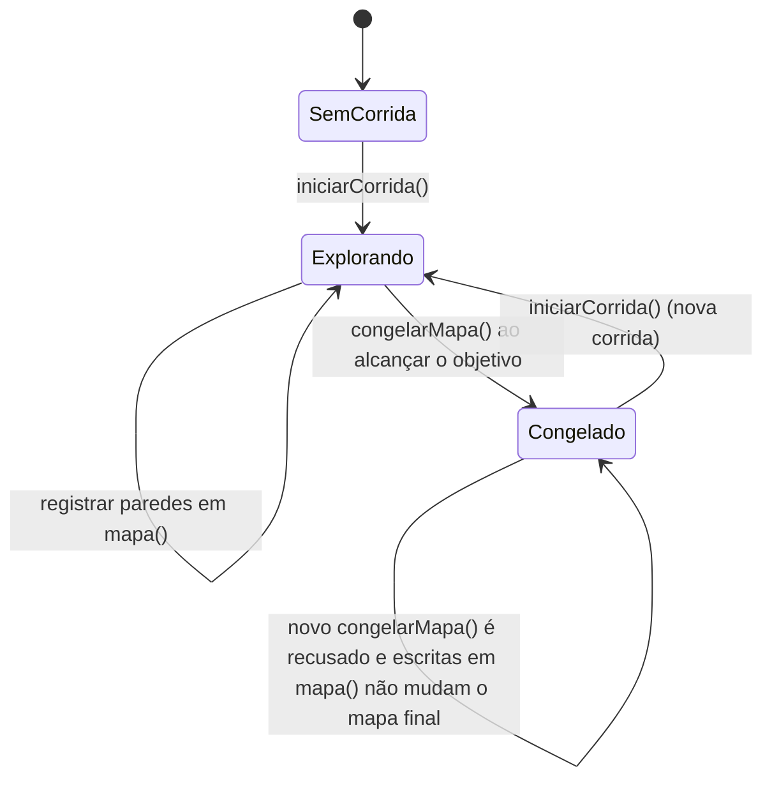

**Figura 9.** Ciclo de vida do mapa final no `ArmazenamentoMapa`: o congelamento só acontece uma vez por corrida e só uma nova corrida o destrava.

### Regras de Negócio e Algoritmo

* **Congelamento por cópia:** `congelarMapa()` copia o mapa da corrida para `mapaFinal_`. A cópia isola o resultado: a navegação pode continuar escrevendo no mapa da corrida (por exemplo, no caminho de volta à partida) sem alterar o mapa final, nem o JSON gerado a partir dele.
* **Uma vez por corrida:** congelar antes de `iniciarCorrida()` ou congelar de novo é recusado (`false`), e o mapa final continua o da primeira vez. `iniciarCorrida()` destrava o congelamento para a próxima corrida.
* **Leitura protegida:** `mapaFinal()` devolve `nullptr` enquanto o mapa não foi congelado e, depois, um ponteiro `const`, só para leitura.
* **Serialização no formato da [#178](https://github.com/fcte-pi1/2026_2_PI1_Grupo01_Hilmer/issues/178) (tarefa 5.3.3):** `MapaJson::serializarFinal(armazenamento, saida, capacidade)` gera o mesmo JSON de `serializar()`, mas do mapa final. Sem mapa congelado, devolve `0` e deixa `saida` com uma string vazia.
* **Memória sem alocação dinâmica:** os dois mapas ficam dentro do objeto, que passou de 196 para 392 bytes (dois `Mapa` de 195 bytes e dois indicadores), cerca de 0,1% dos 320 KB de RAM do ESP32-C3.

### Interface da Classe

* **`bool congelarMapa()`:** `true` se congelou; `false` se a corrida não foi iniciada ou se o mapa já estava congelado.
* **`bool mapaCongelado() const`:** `true` depois do congelamento, até a próxima `iniciarCorrida()`.
* **`const Mapa* mapaFinal() const`:** o mapa final, ou `nullptr` se ainda não congelou.
* **`static size_t MapaJson::serializarFinal(const ArmazenamentoMapa&, char* saida, size_t capacidade)`:** número de caracteres escritos sem o `\0`; `0` se não congelou, se `saida` é nulo ou se o buffer não comporta o JSON.

## Navegação: algoritmo de resolução do labirinto

O módulo de navegação (`lib/navegacao`) implementa a classe `Navegacao`, que decide para qual célula vizinha o robô deve ir para chegar à célula objetivo, usando só o que o `Mapa` já sabe sobre as paredes (HU-01, [#183](https://github.com/fcte-pi1/2026_2_PI1_Grupo01_Hilmer/issues/183)). Ela não aciona os motores: devolve uma **direção** e a **célula esperada**, e só atualiza a posição do robô quando os sensores a confirmam. Como não depende do Arduino nem aloca memória dinâmica, é testada no ambiente `native`.

O objetivo padrão é o canto diametralmente oposto à partida, `(linhas − 1, colunas − 1)`: (3, 3) no 4×4, (3, 7) no 8×4 e (3, 11) no 12×4. Ele pode ser trocado por `definirObjetivo()`.

### Lógica de decisão de movimentação

A cada decisão, a `Navegacao` executa três etapas:

1. **Calcula a distância de cada célula até o objetivo (*flood fill*).** Uma busca em largura (BFS) parte do objetivo, com distância 0, e se espalha pelas células vizinhas; cada célula recebe o número mínimo de células até o objetivo. A fila é um vetor estático de 48 posições (o maior labirinto, 12×4), sem alocação dinâmica.
2. **Considera o mapa de forma otimista.** Só uma parede confirmada (`EstadoParede::Parede`) bloqueia a passagem, conferida nas duas células que ela separa. Paredes `Livre` e `Desconhecido` são tratadas como passagem. Por isso o algoritmo funciona com o mapa parcial: ele planeja como se o desconhecido estivesse aberto e, quando os sensores de distância revelam uma parede nova, o próximo cálculo já desvia dela. O *flood fill* é refeito em toda decisão, porque o mapa muda a cada célula visitada.
3. **Escolhe a vizinha mais próxima do objetivo.** Entre as quatro vizinhas que estão dentro do mapa e não têm parede conhecida no caminho, escolhe a de **menor distância**. No empate, a preferência é, nesta ordem: **frente** (mantém a direção atual, sem giro), **direita**, **esquerda** e **trás**. Seguir em frente evita manobras, que gastam tempo e acumulam erro de odometria.

A decisão devolve `false`, sem direção, quando o robô já está no objetivo ou quando o objetivo é inalcançável pelas paredes conhecidas (a distância da célula atual é `DISTANCIA_INFINITA`, 255).

| 3 | 2 | 1 | **0** |
|:---:|:---:|:---:|:---:|
| 4 | 3 | 2 | 1 |
| 5 | 4 | 3 | 2 |
| **6** | 5 | 4 | 3 |

**Figura 10.** Distâncias calculadas pelo *flood fill* num mapa 4×4 sem paredes internas conhecidas, com o objetivo (3, 3) no canto superior direito (0) e a partida (0, 0) no canto inferior esquerdo (6). Na partida, virado para o Norte, as vizinhas Norte (1, 0) e Leste (0, 1) empatam com distância 5; o desempate escolhe a frente, o Norte. Se os sensores revelarem uma parede ao Norte, o próximo cálculo descarta essa vizinha e o robô segue para Leste.

### Ciclo de um passo: decisão, movimento e confirmação pelos sensores

A `Navegacao` não considera que o robô andou só porque decidiu andar. Um passo tem três etapas, e cada uma tem um responsável:

| Etapa | Responsável | O que acontece |
|---|---|---|
| 1. Decidir | `Navegacao::darPasso(direcao)` | Aplica a lógica acima, devolve a direção e registra a célula esperada (`obterCelulaEsperada()`). A pose **não muda** |
| 2. Mover | Controle de movimento ([#184](https://github.com/fcte-pi1/2026_2_PI1_Grupo01_Hilmer/issues/184)), com os motores da [#341](https://github.com/fcte-pi1/2026_2_PI1_Grupo01_Hilmer/issues/341) | Gira até a direção e anda uma célula (18 cm) |
| 3. Confirmar | Sensores, como a odometria dos encoders ([#187](https://github.com/fcte-pi1/2026_2_PI1_Grupo01_Hilmer/issues/187)), por `Navegacao::confirmarPose(pose)` | Informa a célula e a direção medidas; a pose medida passa a ser a pose da navegação |

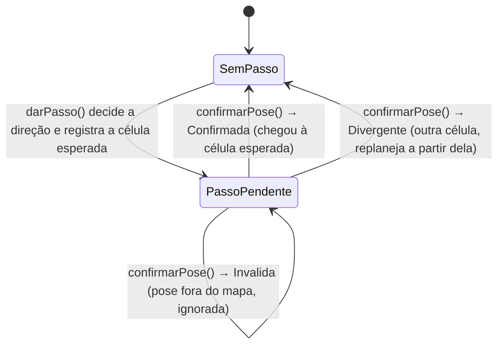

**Figura 11.** Estados de um passo na `Navegacao`: enquanto há passo pendente, `darPasso()` recusa um novo passo, e só a confirmação dos sensores conclui ou cancela o passo.

| `ResultadoConfirmacao` | Quando | Efeito |
|---|---|---|
| `Confirmada` | A pose medida está na célula esperada (ou não havia passo pendente) | Adota a pose medida e conclui o passo |
| `EmAndamento` | A pose medida ainda está na célula de origem | Adota a pose (por exemplo, a nova direção depois do giro) e mantém o passo pendente |
| `Divergente` | A pose medida está em outra célula (patinagem, deriva) | Adota a pose medida e cancela o passo; o próximo `darPasso()` replaneja a partir dela |
| `Invalida` | A pose medida está fora do mapa | Ignora a medida; a pose e o passo pendente não mudam |

A pose medida é sempre a referência: a navegação nunca “teletransporta” o robô para a célula que ela mesma escolheu. Se uma roda patinar ou uma parede impedir o movimento, os sensores informam onde o robô de fato está, e a decisão seguinte parte dali.

### Regras de Negócio e Algoritmo

* **Leitura antes da decisão:** a decisão usa as paredes da célula atual que já estão no mapa. Por isso o ciclo da navegação deve ler os sensores de distância e atualizar o mapa (`AtualizadorMapa`, [#177](https://github.com/fcte-pi1/2026_2_PI1_Grupo01_Hilmer/issues/177)) antes de cada `darPasso()`; se a leitura falhar, o robô não decide e lê de novo, em vez de avançar com a parede da frente desconhecida. Os testes nos labirintos simulados seguem essa ordem; na `tarefaNavegacao` ela entra com a integração ao movimento.
* **Parede de trás:** os sensores de distância medem frente, esquerda e direita. A parede de trás é a passagem por onde o robô veio ou, na partida, a borda do labirinto, que o `Mapa` já conhece.
* **Becos sem saída:** ao entrar num beco, as paredes reveladas aumentam a distância da célula, e o *flood fill* passa a apontar para trás; o robô volta sem precisar de regra especial.
* **Sem custo de giro:** a distância conta células, não giros. O desempate pela frente reduz manobras, mas o caminho escolhido não é necessariamente o de menos curvas.
* **Erros de sensor:** uma parede classificada como `Livre` por engano é tratada como passagem. A correção do erro acumulado pelas paredes é a [#188](https://github.com/fcte-pi1/2026_2_PI1_Grupo01_Hilmer/issues/188).

### Interface da Classe

* **Construtores:** `Navegacao(const Mapa&)`, com o objetivo no canto oposto e a partida em (0, 0) virada para o Norte; `Navegacao(const Mapa&, PosicaoCelula objetivo, Pose poseInicial)`, com objetivo e pose inicial escolhidos.
* **`bool darPasso(Direcao& direcao)`:** decide e inicia um passo; `false` se já há passo pendente, se não há caminho ou se o robô já está no objetivo.
* **`ResultadoConfirmacao confirmarPose(const Pose& poseMedida)`:** atualiza a pose com a medida dos sensores e a compara com o passo pendente.
* **`bool passoPendente() const`** e **`PosicaoCelula obterCelulaEsperada() const`:** estado do passo, para o controle de movimento saber para onde levar o robô.
* **`bool decidirProximaDirecao(Direcao& direcao)`:** só a decisão, sem iniciar passo; usada por `darPasso()`.
* **`uint8_t obterDistancia(PosicaoCelula) const`:** distância calculada para uma célula; `DISTANCIA_INFINITA` (255) se inalcançável ou fora do mapa.
* **`bool atingiuObjetivo() const`**, **`obterPose()`**, **`obterPosicao()`**, **`obterDirecao()`**, **`obterObjetivo()`:** consultas.
* **`definirPose(const Pose&)`** e **`moverPara(linha, coluna, direcao)`:** reposicionam o robô sem comparar com um passo (por exemplo, na partida) e cancelam o passo pendente. **`definirObjetivo(PosicaoCelula)`** troca o objetivo e recalcula as distâncias.

## Comunicação: serialização do mapa em JSON

O módulo de comunicação (`lib/comunicacao`) implementa a classe `MapaJson`, responsável por converter o `Mapa` em JSON para o envio na telemetria com a biblioteca ArduinoJson ([#178](https://github.com/fcte-pi1/2026_2_PI1_Grupo01_Hilmer/issues/178)). O formato foi combinado com os nomes das colunas da tabela `mapa_celulas` do banco, para que a lista de células possa ser inserida nela só acrescentando o `corrida_id`. Como não depende do Arduino, a serialização é testada no ambiente `native`.

```json
{
  "dimensao": "4x4",
  "linhas": 4,
  "colunas": 4,
  "celulas": [
    {"linha": 0, "coluna": 0, "parede_norte": null, "parede_sul": true,
     "parede_leste": null, "parede_oeste": true}
  ]
}
```

**Figura 12.** JSON de um mapa 4×4 recém-criado (só o perímetro conhecido), formatado aqui para leitura: a saída real não tem espaços nem quebras de linha.

| Campo | Valor |
|---|---|
| `dimensao` | `"4x4"`, `"8x4"` ou `"12x4"` (colunas × linhas, como `labirintos.tipo`) |
| `linhas`, `colunas` | Tamanho do labirinto |
| `linha`, `coluna` | Posição da célula, da linha 0 à última e, em cada linha, da coluna 0 à última; a partida é (0, 0) |
| `parede_norte`, `parede_sul`, `parede_leste`, `parede_oeste` | `true` se há parede, `false` se está livre e `null` se ainda é desconhecida |

### Regras de Negócio e Algoritmo

* **Buffer do chamador:** `MapaJson::serializar(mapa, saida, capacidade)` escreve o JSON num buffer de tamanho fixo fornecido por quem chama, terminado em `\0`. A ArduinoJson usa memória dinâmica só durante a conversão e a libera ao final.
* **Tamanho máximo:** `TAMANHO_MAX_JSON_MAPA` (5.100 bytes) é o maior tamanho, sem o `\0`, do JSON de um mapa 12×4 com as 48 células conhecidas e todas as paredes internas `Livre`. É o pior caso, porque `false` ocupa mais caracteres que `true` ou `null`, e o perímetro continua `true`. Esse buffer é maior que a pilha das tarefas (4.096 bytes), então precisa ser `static` ou global.
* **Fail-safe de capacidade:** se o buffer não comporta o JSON inteiro, ou é nulo, ou tem capacidade zero, a função devolve `0` e deixa `saida` com uma string vazia, sem escrever além da capacidade informada.
* **Imutabilidade e determinismo:** serializar não altera o `Mapa` (a telemetria só lê; a navegação segue com o mesmo mapa, HU-04), e duas serializações do mesmo mapa produzem o mesmo texto.

### Interface da Classe

* **Entrada:** `const Mapa &mapa`, `char *saida`, `size_t capacidade` (tamanho de `saida` em bytes, incluindo o `\0`)
* **Saída:** `size_t`, o número de caracteres escritos sem o `\0`; `0` quando a serialização falha
* **Mapa final:** `MapaJson::serializarFinal(const ArmazenamentoMapa &armazenamento, char *saida, size_t capacidade)` serializa o mapa congelado ao alcançar o objetivo, com as mesmas regras de buffer (veja [Mapeamento: mapa final da corrida](#mapeamento-mapa-final-da-corrida))

## Navegação: odometria

A `Odometria` (`lib/navegacao`) estima a **pose do robô**, isto é, a célula (linha e coluna) e a direção (Norte, Leste, Sul ou Oeste), a partir das contagens dos dois encoders ([#187](https://github.com/fcte-pi1/2026_2_PI1_Grupo01_Hilmer/issues/187), HU-05). A arquitetura não tem IMU: a rotação vem da diferença entre as rodas e o avanço vem da média delas (odometria diferencial). A lógica não depende do Arduino e só usa inteiros, porque o ESP32-C3 não tem unidade de ponto flutuante.

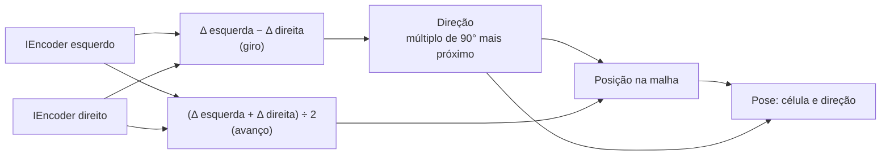

**Figura 13.** Da contagem dos encoders à pose: a diferença entre as rodas gira a direção, e a média das rodas avança o robô na direção atual.

### Regras de Negócio e Algoritmo

* **Convenção de sinal:** a contagem de cada roda aumenta quando ela avança (`IEncoder`). Girar para a direita (sentido horário, Norte para Leste) faz a roda esquerda avançar mais, então `contagem esquerda − contagem direita` cresce.
* **Orientação:** o giro acumulado é a diferença entre as rodas dividida por `pulsosDiferenciaisPor90Graus`, arredondada para o múltiplo de 90° mais próximo. Uma roda um pouco mais rápida em linha reta não muda a direção, e a direção só passa para a seguinte depois de 45°.
* **Posição:** o avanço (média dos deslocamentos das rodas) soma-se à posição na direção atual. A pose inicial é o centro da célula informada (partida em (0, 0)), e a célula muda ao cruzar a parede, a meia célula do centro. Um giro no lugar não muda a célula, e a marcha à ré funciona. Norte aumenta a linha e Leste aumenta a coluna.
* **Limites:** fora de 0 a 255, a célula é limitada a esses valores e `posicaoValida()` devolve `false`. As contas usam inteiros de 64 bits, sem estouro.
* **Reinício:** `reiniciar(pose, contagens)` reposiciona o robô e sincroniza a referência com contagens que não estão em zero, por exemplo depois de zerar os encoders.
* **Erro acumulado:** a odometria acumula erro (patinagem, arredondamento). A correção pelas paredes é a [#188](https://github.com/fcte-pi1/2026_2_PI1_Grupo01_Hilmer/issues/188).

**Parâmetros** (`ConfiguracaoOdometria.h`):

| Parâmetro | Valor | Origem |
|---|---|---|
| Distância por pulso | 251 µm | π × 32 mm ÷ 400 pulsos por volta, do documento de parâmetros da eletrônica (roda de 32 mm; ver `ConfiguracaoEncoder.h`) |
| Diferença de pulsos por giro de 90° | 625 (**provisório**) | Supõe bitola de 100 mm, que ainda não consta em nenhum documento; a calibração na bancada define o valor |
| Tamanho da célula | 180 mm | `TAMANHO_CELULA_MM` |

### Interface da Classe

* **`Odometria(configuracao, inicial)`:** parâmetros e pose de partida (padrão: célula (0, 0) virada para o Norte).
* **`void atualizar(int32_t contagemEsquerda, int32_t contagemDireita)`** e **`atualizar(const IEncoder&, const IEncoder&)`:** atualiza a pose a partir das contagens acumuladas.
* **`Pose pose() const`:** célula e direção estimadas. **`bool posicaoValida() const`:** `false` se a posição saiu de 0 a 255.
* **`void reiniciar(Pose, contagemEsquerda, contagemDireita)`:** define a pose e a referência das contagens.
* **`letraDaDirecao(Direcao)`** (`Direcao.h`): `'N'`, `'L'`, `'S'` ou `'O'`, os valores da coluna `orientacao` do banco.

**No `main.cpp`.** A tarefa de navegação chama `atualizar` a cada 10 ms, um intervalo curto o bastante para cada atualização trazer um giro ou um avanço, e não os dois. A tarefa de telemetria lê a pose e acrescenta à linha de JSON dos encoders os campos `linha`, `coluna`, `orientacao` e `pose_valida`. Como as duas tarefas usam a mesma `Odometria`, todo acesso passa por uma seção crítica. O comando `Z` da bancada zera os encoders e reinicia a odometria na pose atual.

## Navegação: robustez da pose e do passo

A revisão do algoritmo de resolução ([#183](https://github.com/fcte-pi1/2026_2_PI1_Grupo01_Hilmer/issues/183), PR [#349](https://github.com/fcte-pi1/2026_2_PI1_Grupo01_Hilmer/pull/349)) encontrou dois problemas na `Navegacao` (`lib/navegacao`), corrigidos na [#357](https://github.com/fcte-pi1/2026_2_PI1_Grupo01_Hilmer/issues/357) (PR [#400](https://github.com/fcte-pi1/2026_2_PI1_Grupo01_Hilmer/pull/400)):

1. **Leitura fora do vetor.** `definirPose`, `moverPara` e o construtor aceitavam qualquer célula. Com uma pose fora do mapa, `decidirProximaDirecao` lia `distancias_` fora dos limites (comportamento indefinido, confirmado com o AddressSanitizer). Isso pode acontecer na prática: a `Odometria` limita a célula a 0..255 quando o robô sai da malha, e o `ArmazenamentoMapa::iniciarCorrida` troca o mapa por outro tamanho, deixando a pose antiga fora do mapa novo.
2. **Passo pendente que nunca terminava.** Se o sensor registrasse uma parede no caminho depois de o passo ser planejado, o robô continuava na origem, `confirmarPose` devolvia `EmAndamento` para sempre e `darPasso` recusava qualquer passo novo: o robô ficava parado.

### Regras de Negócio e Algoritmo

* **Toda pose é validada contra o mapa** (`Mapa::posValida`). Uma pose fora do mapa nunca é usada para ler o vetor de distâncias.

| Entrada da pose | Com célula fora do mapa |
|---|---|
| `definirPose(pose)` | Devolve `false` e nada muda: a pose e o passo pendente continuam os anteriores |
| `moverPara(linha, coluna, direcao)` | Mesmo comportamento (usa `definirPose`) |
| Construtor com pose inicial | Ignora a célula e começa na partida (0, 0), mantendo a direção informada |
| `confirmarPose(poseMedida)` | Devolve `Invalida` e nada muda (já era assim) |
| Pose que ficou fora porque o mapa foi trocado | `decidirProximaDirecao` e `darPasso` devolvem `false`, sem ler o vetor |

* **Passo bloqueado por parede:** se o robô ainda está na célula de origem e o mapa já mostra uma `Parede` entre a origem e a célula esperada, `confirmarPose` cancela o passo e devolve o novo resultado **`Bloqueado`**. O próximo `darPasso` replaneja a partir da pose atual.

| Resultado de `confirmarPose` | Quando | O que acontece |
|---|---|---|
| `Confirmada` | Robô na célula esperada (ou sem passo pendente) | Adota a pose; o passo termina |
| `EmAndamento` | Robô ainda na origem, sem parede no caminho | Adota a pose; o passo continua pendente |
| **`Bloqueado`** | Robô ainda na origem e há parede no caminho | Adota a pose; **o passo é cancelado** para replanejar |
| `Divergente` | Robô em outra célula | Adota a pose medida; o passo é cancelado para replanejar |
| `Invalida` | Pose medida fora do mapa | Ignora a pose; nada muda |

* **Ordem com o mapa da corrida:** a `Navegacao` guarda uma referência ao mapa e calcula o objetivo padrão (canto oposto à partida) na construção. Por isso, ela deve ser criada **depois** de `ArmazenamentoMapa::iniciarCorrida(...)`. Se o mapa for trocado por outro tamanho, é preciso chamar `definirObjetivo()` e `definirPose()` de novo.

### Interface da Classe

* **`bool definirPose(const Pose&)`** e **`bool moverPara(linha, coluna, direcao)`:** passaram de `void` para `bool`; `false` quando a célula está fora do mapa.
* **`void cancelarPasso()`:** novo; cancela o passo pendente, e o próximo `darPasso()` replaneja.
* **`ResultadoConfirmacao::Bloqueado`:** novo valor do resultado de `confirmarPose`.

## Orientação: IMU e ângulo de giro

> **Situação:** implementado e integrado ao firmware na `main` ([#378](https://github.com/fcte-pi1/2026_2_PI1_Grupo01_Hilmer/issues/378), PR [#403](https://github.com/fcte-pi1/2026_2_PI1_Grupo01_Hilmer/pull/403)): a lógica do ângulo de giro, o driver do MPU6050, a tarefa da IMU e a trava do barramento I²C. Os testes rodam no computador, com um giroscópio simulado. **Ainda não houve leitura do sensor real**; a validação na placa faz parte da bancada integrada ([#381](https://github.com/fcte-pi1/2026_2_PI1_Grupo01_Hilmer/issues/381)).

Na Rev 2.0 do hardware, o robô tem uma IMU **MPU6050** no mesmo barramento I²C dos três VL53L0X (SDA no GPIO9 e SCL no GPIO8, endereço 0x68). O firmware usa o **giroscópio do eixo Z**, que mede a taxa de giro em torno do eixo vertical, para saber quanto o robô girou (o ângulo de giro, ou *yaw*). É a base dos giros de 90° e 180° ([#190](https://github.com/fcte-pi1/2026_2_PI1_Grupo01_Hilmer/issues/190)) e da calibração ([#240](https://github.com/fcte-pi1/2026_2_PI1_Grupo01_Hilmer/issues/240)).

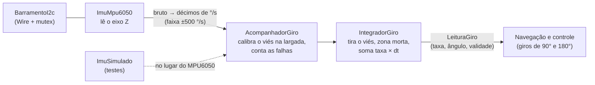

**Figura 14.** Do sensor ao ângulo de giro: a tarefa da IMU lê o MPU6050 pelo barramento compartilhado, o `AcompanhadorGiro` calibra o viés e o integrador soma a taxa ao longo do tempo. Nos testes, o `ImuSimulado` entra no lugar do MPU6050.

### Regras de Negócio e Algoritmo

* **Unidade e sinal:** a taxa é dada em **décimos de grau por segundo** (10 = 1 °/s), a mesma unidade usada na detecção de motor travado. É **positiva quando o robô gira para a esquerda** (anti-horário visto de cima) e negativa para a direita.
* **Viés e calibração:** todo giroscópio parado mede um pequeno valor diferente de zero, o **viés**. Integrado, ele vira deriva: com 1,2 °/s de viés, o ângulo andaria 12° em 10 s com o robô parado. Por isso, na largada, com o robô parado, o integrador lê 200 amostras (2 s) e usa a média como viés. Se a maior e a menor amostra diferirem mais que 5 °/s, o robô provavelmente se mexeu: a calibração é **recusada** e o viés anterior continua.
* **Zona morta:** depois de tirar o viés, taxas de até 0,3 °/s contam como zero, para o ruído do sensor parado não virar deriva.
* **Integração:** a cada leitura (10 ms), o ângulo soma `taxa × dt`. A soma é guardada sem arredondar a cada ciclo, para frações pequenas não se perderem.
* **Ângulo:** o ângulo é **acumulado** (um giro de 360° vale 360 000 mili-graus), o que facilita controlar um giro de 90°. Também há a versão **normalizada**, entre −180° e 180°.
* **Só inteiros:** o ESP32-C3 não tem unidade de ponto flutuante, então todas as contas usam inteiros.
* **Falhas de leitura:** uma leitura que falha (sensor sem resposta ou barramento ocupado) não soma nada ao ângulo e é contada. Depois de 5 falhas seguidas (50 ms sem leitura), o ângulo fica **inválido** até a próxima leitura boa: um giro de 300 °/s já andaria 15° sem ser contado.
* **Calibração automática:** se o robô se mexer durante a calibração e ela for recusada, a calibração recomeça sozinha com as próximas amostras. O ângulo só é válido depois da calibração concluída.

| Parâmetro (`ConfiguracaoImu.h`) | Valor | Origem |
|---|---|---|
| Endereço I²C | 0x68 | Pino AD0 no GND, esquemático Rev 2.0 |
| Faixa do giroscópio | ±500 °/s (65,5 LSB por °/s) | Um giro de 90° em 0,3 s passa de 300 °/s; ±250 °/s saturaria |
| Período de leitura | 10 ms | Ciclo da tarefa da IMU, igual à taxa de amostragem configurada no sensor (100 por segundo) |
| Amostras da calibração | 200 (2 s) | **Provisório** |
| Variação máxima na calibração | 5 °/s | **Provisório** |
| Zona morta | 0,3 °/s | **Provisório**; ajustar com o ruído medido na bancada |
| Falhas seguidas que invalidam o ângulo (`FALHAS_SEGUIDAS_GIRO_INVALIDO`) | 5 (50 ms) | Um giro de 300 °/s andaria 15° sem leitura |
| Sensor de cabeça para baixo (`INVERTER_GIRO_Z`) | `false` | **Provisório**; conferir na bancada: girando o robô para a esquerda com a mão, a taxa tem que ser positiva |
| Frequência do I²C (`FREQUENCIA_I2C_HZ`, em `Configuracao.h`) | 100 kHz | **Provisório**; modo padrão, aceito pelo MPU6050 e pelos VL53L0X, que aceitam 400 kHz (falta confirmar os resistores de *pull-up*) |
| Espera máxima pelo barramento (`ESPERA_MAXIMA_I2C_MS`, em `Configuracao.h`) | 8 ms | **Provisório**; menor que o período de leitura, para a tarefa nunca perder o ritmo esperando o barramento |

### Driver, barramento I²C e tarefa da IMU

O driver (`ImuMpu6050`) e o barramento (`BarramentoI2c`) ficam em `lib/drivers_esp32`, que só compila no ambiente `esp32c3`: os registradores do MPU6050 aparecem só ali, e o `pio test -e native` não depende deles. As contas que dá para testar no computador (montar o valor dos dois bytes, o valor do registrador da faixa e a inversão do sinal) ficam em `ConversorGiro.h` e têm teste.

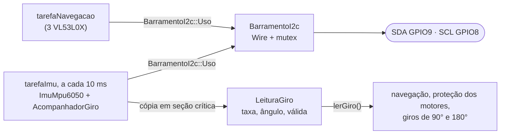

**Figura 15.** O barramento I²C compartilhado: as duas tarefas só falam com os sensores dentro de um `BarramentoI2c::Uso`, e as outras partes do firmware leem o giro pela cópia `LeituraGiro`, sem tocar no I²C.

* **Iniciar o sensor:** `ImuMpu6050::iniciar()` reinicia o MPU6050 (`PWR_MGMT_1` = 0x80 e espera de 100 ms), lê o `WHO_AM_I` (0x68 no MPU6050), tira o sensor do sono usando o relógio do giroscópio X, liga o filtro passa-baixa de 42 Hz (`CONFIG` = 0x03), divide a amostragem para 100 por segundo (`SMPLRT_DIV` = 9) e grava a faixa em `GYRO_CONFIG`. No fim, relê `GYRO_CONFIG` e só aceita o sensor se a faixa ficou gravada, porque uma faixa errada mudaria a escala de todas as leituras.
* **Ler o giro:** cada leitura busca os dois bytes do eixo Z (`GYRO_ZOUT_H` e `GYRO_ZOUT_L`, 0x47 e 0x48) numa só transação, com início repetido (sem STOP entre a escrita do registrador e a leitura), como pede o datasheet. Se chegarem menos bytes que o pedido, o que sobrou no `Wire` é descartado, para a próxima leitura não pegar bytes velhos.
* **Barramento compartilhado:** os 3 VL53L0X, lidos pela tarefa de navegação, e o MPU6050, lido pela tarefa da IMU, usam os mesmos fios. Uma transação no meio de outra misturaria os bytes dos sensores, então **toda transação I²C passa por um `BarramentoI2c::Uso`**, que segura um mutex do FreeRTOS e o libera ao sair do bloco. A proteção é um mutex, e não uma seção crítica (`portENTER_CRITICAL`): a seção crítica desliga as interrupções, de que o driver I²C do ESP32 depende. Com o mutex, quem espera dorme, e a herança de prioridade evita que a tarefa da IMU fique presa atrás de uma de prioridade menor. Se o barramento não vier em 8 ms, a leitura falha e é contada (`esperasEsgotadas`), em vez de atrasar a tarefa.
* **Intervalo fixo:** a `tarefaImu` usa `vTaskDelayUntil`, que acorda a cada 10 ms contados do início do ciclo anterior. Assim, o tempo gasto na leitura não se soma ao período, e o `dt` da integração é sempre 10 ms.
* **Acompanhamento do ângulo:** o `AcompanhadorGiro` faz um ciclo da tarefa: lê o sensor, alimenta a calibração ou o integrador e publica a `LeituraGiro`. Se a calibração for recusada porque o robô se mexeu, ela recomeça sozinha com as próximas amostras. Uma leitura que falhou não soma nada ao ângulo; com 5 falhas seguidas, a leitura passa a ser **inválida** até o sensor voltar a responder. Antes da calibração terminar, a leitura também é inválida: só use o ângulo para controle com `valida` verdadeiro.
* **Leitura pelas outras tarefas:** a tarefa da IMU guarda a `LeituraGiro` numa cópia protegida por uma seção crítica curta (só a cópia da estrutura), e as outras tarefas a leem por `lerGiro()`.
* **Ordem no boot:** o `setup()` inicia o barramento (mutex e `Wire`), os VL53L0X e o autoteste do I²C ([#50](https://github.com/fcte-pi1/2026_2_PI1_Grupo01_Hilmer/issues/50)), e só depois a IMU e as tarefas. Sem a IMU, o firmware segue, sem ângulo de giro válido.
* **Log:** no `setup()`, o log mostra `imu_iniciada` com o `who_am_i`, ou `falha_imu` se o sensor não respondeu (o firmware segue sem ângulo válido). Quando a calibração termina, sai `giroscopio_calibrado`, com o número de calibrações recusadas.

A `tarefaImu` (prioridade 3, pilha de 3072 bytes; veja [Tarefas do FreeRTOS](#tarefas-do-freertos)) tem a maior prioridade do firmware porque o ângulo só fica certo se as leituras vierem no intervalo certo. Ela é curta: cada ciclo é uma transação I²C de 2 bytes e algumas contas com inteiros.

### Interface das Classes

* **`IImu`** (`lib/hal`): `bool lerTaxaGiroZ(int16_t& taxaDecimosDps)`; `false` se o sensor não respondeu.
* **`ImuSimulado`** (`lib/simulacao`): giroscópio falso para os testes, com `definirTaxa`, `definirVies`, `definirRuidoAlternado` e `simularFalha`.
* **`converterBrutoParaDecimosDps(bruto, faixa)`** (`ConversorGiro.h`): converte a leitura bruta do MPU6050, com arredondamento.
* **`juntarBytesGiro(alto, baixo)`**, **`valorGyroConfig(faixa)`** e **`ajustarSinalGiro(taxa, inverter)`** (`ConversorGiro.h`): montam o valor de 16 bits a partir dos dois bytes, dão o valor do registrador `GYRO_CONFIG` de cada faixa e invertem o sinal sem estourar o `int16_t`.
* **`IntegradorGiro`** (`lib/imu`): `iniciarCalibracao()`, `adicionarAmostraCalibracao(taxa)`, `atualizar(taxa, dtMs)`, `anguloMiligraus()`, `anguloNormalizadoMiligraus()` e `zerarAngulo()`.
* **`AcompanhadorGiro`** (`lib/imu`): `iniciarCalibracao()`, `ciclo(dtMs)`, `ultima()` e `zerarAngulo()`. A `LeituraGiro` traz `taxaDecimosDps` (sem o viés), `anguloMiligraus`, `valida`, `calibracao`, `falhasLeitura` e `calibracoesRecusadas`.
* **`ImuMpu6050`** (`lib/drivers_esp32`): `IImu` real; `iniciar()`, `identificacao()` (o `WHO_AM_I` lido) e `falhasLeitura()`.
* **`BarramentoI2c`** (`lib/drivers_esp32`): `iniciar(sda, scl)`, que cria o mutex e inicia o `Wire`; a classe `Uso`, que segura o barramento enquanto existe (`conseguiu()` diz se deu tempo); `wire()`; e `esperasEsgotadas()`.

## Navegação: detecção do objetivo e evento na telemetria

O módulo de navegação (`lib/navegacao`) implementa a classe `DetectorObjetivo`, responsável por identificar o instante em que o robô alcança a célula de destino (canto diametralmente oposto à partida), acionar a parada imediata dos motores, disparar o congelamento do mapa final e sinalizar o evento pontual correspondente ([#189](https://github.com/fcte-pi1/2026_2_PI1_Grupo01_Hilmer/issues/189), HU-07 / RF-07).

Em conjunto, a camada de comunicação (`lib/comunicacao`) provê a classe `TelemetriaJson`, que encapsula os dados de telemetria periódica e insere o evento pontual `"objetivo_alcancado"` em um único payload JSON transmitido via serial (USB nativa CDC), formatado com estrutura compatível com a tabela `telemetria` do Supabase para futura ingestão na nuvem ([#236](https://github.com/fcte-pi1/2026_2_PI1_Grupo01_Hilmer/issues/236)) e acompanhamento no dashboard web (HU-14).

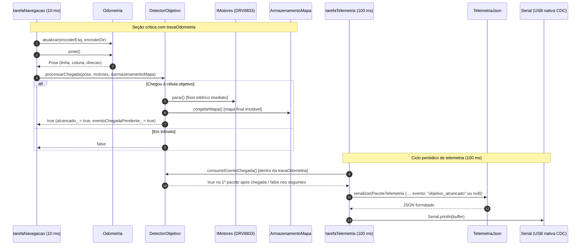

**Figura 16.** Fluxo de detecção da célula objetivo: ao confirmar que a célula da pose coincide com o destino sob a seção crítica `travaOdometria`, o robô freia imediatamente, congela o mapa explorado e envia o evento pontual único pela telemetria serial.

### Regras de Negócio e Algoritmo

* **Cálculo da célula objetivo:**
  O labirinto do micromouse inicia na célula `(0, 0)` no canto inferior esquerdo. O objetivo padrão do desafio situa-se no canto diametralmente oposto: linha `linhas - 1` e coluna `colunas - 1`.
  * $4 \times 4$: célula objetivo em `(3, 3)`.
  * $8 \times 4$: célula objetivo em `(3, 7)`.
  * $12 \times 4$: célula objetivo em `(3, 11)`.
  * Dimensões genéricas ou customizadas são calculadas por `DetectorObjetivo::calcularObjetivo(linhas, colunas)`. Caso alguma dimensão seja zero, retorna de forma segura `(0, 0)` (*fail-safe*).
* **Critério de detecção na malha:**
  A verificação de chegada (`alcancouObjetivo`) compara as coordenadas discretas `(linha, coluna)` da célula atual com a célula objetivo configurada. A detecção é **invariante à orientação**: o robô é considerado no objetivo independentemente de estar virado para Norte, Leste, Sul ou Oeste.
* **Parada imediata dos motores e congelamento do mapa:**
  Ao detectar que o robô adentrou a célula objetivo, o método `processarChegada` invoca imediatamente `motores.parar()`, aciona `armazenamento->congelarMapa()` e atualiza a flag interna `alcancado_ = true`. No driver de hardware (`MotoresDrv8833`), a parada atua via freio elétrico (entradas IN1 e IN2 em nível alto simultaneamente no DRV8833), eliminando a inércia mecânica e prevenindo ultrapassagens (*overshoot*).
* **Idempotência do freio:**
  Após a primeira detecção de chegada, o `DetectorObjetivo` comuta seu estado interno para `alcancado_ = true`. Em todos os ciclos subsequentes de 10 ms da `tarefaNavegacao`, qualquer invocação repetida de `processarChegada` mantém os motores travados em parada (`motores.parar()`), garantindo idempotência e prevenindo qualquer reacionamento de motores.
* **Congelamento do mapa final:**
  Caso seja fornecido o ponteiro para `ArmazenamentoMapa`, a chegada ao objetivo aciona automaticamente `armazenamento->congelarMapa()`. Isso cria uma cópia imutável das paredes exploradas até o momento da vitória ([#180](https://github.com/fcte-pi1/2026_2_PI1_Grupo01_Hilmer/issues/180), HU-04), disponibilizando-a para serialização via `MapaJson::serializarFinal`.
* **Emissão pontual de evento na telemetria:**
  A estrutura `PacoteTelemetria` transporta as medições e os campos alinhados com a tabela `telemetria`. Para garantir que o evento de chegada seja estritamente **pontual** (uma única linha na telemetria), a `tarefaTelemetria` invoca `detectorObjetivo.consumirEventoChegada()` dentro da seção crítica `travaOdometria`. O campo `const char* evento` recebe `"objetivo_alcancado"` em apenas um único pacote imediatamente após a chegada; nos pacotes seguintes, o método retorna `false` e o campo permanece `nullptr`, sendo serializado como `null` no JSON. O comando serial de zeramento `'Z'` também limpa o evento pendente via `resetar()`.
* **Reinício de corrida:**
  O método `resetar()` restaura o indicador `alcancado_` e limpa qualquer evento pendente (`eventoChegadaPendente_ = false`), permitindo que novas corridas ou tentativas sejam iniciadas na mesma sessão sem necessidade de reiniciar o microcontrolador.

### Interface das Classes

#### `DetectorObjetivo` (`lib/navegacao`)

* **`static PosicaoCelula calcularObjetivo(uint8_t linhas, uint8_t colunas)`:** calcula a coordenada `(linhas - 1, colunas - 1)`; devolve `(0, 0)` se alguma dimensão for nula.
* **`static PosicaoCelula calcularObjetivo(DimensaoMapa dimensao)`:** calcula a coordenada correspondente para os labirintos pré-definidos (4×4, 8×4, 12×4).
* **`static bool alcancouObjetivo(const PosicaoCelula& atual, const PosicaoCelula& objetivo)`:** devolve `true` se as coordenadas forem coincidentes.
* **`explicit DetectorObjetivo(DimensaoMapa dimensao = DimensaoMapa::Labirinto4x4)`:** construtor padrão inicializado para a dimensão indicada.
* **`explicit DetectorObjetivo(PosicaoCelula objetivo)`** e **`DetectorObjetivo(uint8_t linhas, uint8_t colunas)`:** construtores alternativos para célula ou dimensões arbitrárias.
* **`bool alcancouObjetivo(const PosicaoCelula& atual) const`** e **`alcancouObjetivo(const Pose& pose) const`:** verifica se a célula/pose informada atingiu o objetivo configurado.
* **`bool processarChegada(const Pose& pose, IMotores& motores, ArmazenamentoMapa* armazenamento = nullptr)`:** verifica a pose, freia os motores imediatamente caso atingido e congela o mapa em `ArmazenamentoMapa` se fornecido. Devolve `true` se o objetivo foi alcançado.
* **`bool consumirEventoChegada()`:** consulta e consome a flag de evento pontual de chegada. Retorna `true` no primeiro consumo e `false` nos seguintes.
* **`PosicaoCelula celulaObjetivo() const`** e **`void definirObjetivo(...)`:** consulta e atualização dinâmica da célula alvo.
* **`bool objetivoAlcancado() const`:** consulta o status do objetivo.
* **`void resetar()`:** zera o flag de objetivo alcançado e limpa eventos pendentes.

#### `TelemetriaJson` (`lib/comunicacao`)

* **`struct PacoteTelemetria`:** estrutura com campos alinhados à tabela `telemetria` do Supabase (`numeroSequencia`, `pose`, `velocidade`, `tensaoBateria`, `evento`) e diagnósticos de baixo nível (`pulsosEsq`, `pulsosDir`, `esqMm`, `dirMm`, `medioMm`, `poseValida`).
* **`static size_t serializar(const PacoteTelemetria& pacote, char* saida, size_t capacidade)`:** serializa o pacote para formato JSON compacto. Devolve o total de bytes gravados (sem o `\0`) ou `0` caso o buffer seja insuficiente, nulo ou com capacidade zero (*fail-safe*).

| Campo no JSON | Coluna na tabela `telemetria` | Descrição |
|---|---|---|
| `numero_sequencia` | `numero_sequencia` (INT) | Sequencial monotônico incremental por corrida |
| `posicao_linha` | `posicao_linha` (INT) | Coordenada atual da linha na malha (0 a N-1) |
| `posicao_coluna` | `posicao_coluna` (INT) | Coordenada atual da coluna na malha (0 a M-1) |
| `orientacao` | `orientacao` (VARCHAR(2)) | Letra da direção: "N", "S", "L", "O" |
| `velocidade` | `velocidade` (FLOAT) | Velocidade linear instantânea em m/s |
| `tensao_bateria` | `tensao_bateria` (FLOAT) | Tensão instantânea da bateria em Volts |
| `evento` | `evento` (VARCHAR(30)) | Evento pontual (`"objetivo_alcancado"`, `"colisao"` ou `null`) |

**No `main.cpp`:**
Na `tarefaNavegacao`, a atualização da pose e a chamada `detectorObjetivo.processarChegada(pose, motores, &armazenamentoMapa)` executam sob a seção crítica `travaOdometria`. Caso o objetivo seja alcançado, o loop mantém os motores freados. Na `tarefaTelemetria` (100 ms), o evento pontual é consumido de forma atômica (`detectorObjetivo.consumirEventoChegada()`) também sob `travaOdometria`, garantindo que apenas um pacote envie `"evento": "objetivo_alcancado"` pela Serial (USB CDC) e os pacotes seguintes recebam `null`. O comando serial `'Z'` reinicia a medição de deslocamento e zera o detector via `resetar()`.

> [!NOTE]
> A inicialização com `Labirinto4x4` no `main.cpp` é **provisória** para validação de bancada. Em labirintos 8x4 ou 12x4, o tamanho deve ser recebido por comando dinâmico antes de iniciar a corrida. A duplicidade entre a instância de `DetectorObjetivo` em `main.cpp` e o `detector_` interno de `Navegacao` será unificada quando a classe `Navegacao` assumir o controle do laço de controle.

## Comunicação: envio da telemetria ao Supabase, *buffer* e reenvio

A telemetria vai ao Supabase pelas Edge Functions, por HTTPS, a cada 1 s e sem atrasar a navegação ([#236](https://github.com/fcte-pi1/2026_2_PI1_Grupo01_Hilmer/issues/236)), **sem perder amostras quando o Wi-Fi cai e sem duplicá-las quando ele volta** ([#238](https://github.com/fcte-pi1/2026_2_PI1_Grupo01_Hilmer/issues/238)); o código está no PR [#412](https://github.com/fcte-pi1/2026_2_PI1_Grupo01_Hilmer/pull/412). O robô nunca escreve direto nas tabelas: ele chama as funções `corridas` ([#233](https://github.com/fcte-pi1/2026_2_PI1_Grupo01_Hilmer/issues/233)) e `telemetria` ([#229](https://github.com/fcte-pi1/2026_2_PI1_Grupo01_Hilmer/issues/229)), e a chave `anon` só lê. Atende à [HU-08](https://github.com/fcte-pi1/2026_2_PI1_Grupo01_Hilmer/issues/45) (RF08), à [HU-16](https://github.com/fcte-pi1/2026_2_PI1_Grupo01_Hilmer/issues/46) (RF16) e ao RNF05.

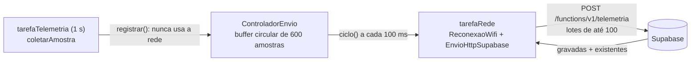

**Figura 17.** Caminho de uma amostra: a coleta só guarda no *buffer*; a tarefa de rede envia em lotes e só tira do *buffer* o que o servidor confirmou.

### Regras de Negócio e Algoritmo

* **Duas tarefas, nenhuma espera na coleta:** a `tarefaTelemetria` monta a amostra a cada 1 s e a entrega ao `ControladorEnvio::registrar()`, que nunca usa a rede. As chamadas HTTPS, que bloqueiam por até 5 s, ficam só na `tarefaRede`. As duas compartilham o *buffer* por uma seção crítica curta (`TravaSecaoCritica`), que só é segurada nas cópias, nunca durante uma chamada de rede.
* **Buffer circular de tamanho fixo:** 600 amostras (10 minutos a 1 por segundo, o RNF03), de 24 bytes cada, cerca de 14 KB, sem alocação dinâmica. Cheio, ele sobrescreve a amostra mais antiga e conta a perda. Reiniciar o ESP32 perde o *buffer* (gravar na flash ficou fora do escopo).
* **Numeração na coleta:** o `numero_sequencia` é dado em `registrar()` e nunca muda. Se a resposta de um lote se perde, ele é reenviado com os mesmos números, e o servidor ignora o que já tem (`ON CONFLICT (corrida_id, numero_sequencia) DO NOTHING`).
* **Remoção só com confirmação:** um lote só sai do *buffer* com resposta `2xx` cujas contagens fecham (`gravadas + existentes` igual ao tamanho do lote). Sem isso, ele fica e é tentado de novo.
* **Reenvio em ordem, com espera crescente:** do mais antigo para o mais novo, em lotes de até 100 amostras (o limite do servidor), um lote por ciclo da tarefa de rede. Depois de uma falha, a espera é de 1 s e dobra a cada falha seguida, até 30 s; um sucesso volta a 1 s.
* **Classificação das respostas (`PoliticaReenvio`):** sem resposta, `408`, `429` e `5xx` são tentados de novo; `400`, `404`, `413` e `422` descartam o lote e contam como erro, para um lote inválido não travar a fila; `401`, `403` e códigos desconhecidos pausam o envio, porque a chave ou o token estão errados e insistir não resolve.
* **Encerramento só com o buffer vazio:** a consolidação do servidor calcula tempo, velocidades e status pela telemetria gravada, então o `POST /corridas/{id}/encerrar` só sai depois de o *buffer* esvaziar, com `status` `concluida` (chegou ao objetivo) ou `nao_concluida` (acabaram os 10 minutos). Se não esvaziar em 10 s, o encerramento fica marcado como atrasado, o robô segue sem esperar e as tentativas continuam quando a rede voltar.
* **Wi-Fi com espera crescente (`ReconexaoWifi`):** a tarefa de rede tenta conectar por até 10 s; se não der, espera 1 s, depois 2 s, 4 s, até 30 s, e volta a 1 s depois de conectar. Uma queda com a rede já conectada é tentada de novo na hora e contada. A reconexão automática do próprio Wi-Fi do ESP32 fica desligada, para só a `ReconexaoWifi` decidir.
* **Fluxo de uma corrida:** com o Wi-Fi conectado e a calibração do boot concluída ([#242](https://github.com/fcte-pi1/2026_2_PI1_Grupo01_Hilmer/issues/242)), a tarefa de rede cria a corrida (`POST /corridas`, labirinto 4×4 por enquanto). Até a largada, o robô envia amostras `aguardando`, na célula de partida e com tempo e velocidade zerados; a coleta `explorando` e o cronômetro dos 10 minutos começam na largada, e não na criação da corrida. Se a criação falhar, ela é tentada de novo com a mesma espera crescente. Na chegada ao objetivo, ou aos 10 minutos, a coleta registra a última amostra (estado `parado`, com o evento `objetivo_alcancado` quando houver) e pede o encerramento; só um reinício da placa começa outra tentativa.
* **HTTPS e credenciais:** toda chamada leva os cabeçalhos `apikey` e `Authorization: Bearer` com a chave `anon` (exigidos pelo gateway do Supabase) e o `x-device-token` (conferido pelas funções). O servidor é validado pelo certificado raiz configurado; a opção de não validar o certificado existe só para a bancada e é avisada no log. As credenciais ficam em `include/credenciais.h`, fora do Git; sem esse arquivo o firmware compila, inicia e não envia nada.
* **Contrato do lote:** os nomes dos campos são os das colunas da tabela `telemetria` e as unidades são as do banco (m/s, V, A e s, com três casas). A velocidade vai zerada até a estimativa sem encoder ([#380](https://github.com/fcte-pi1/2026_2_PI1_Grupo01_Hilmer/issues/380)) entrar na telemetria, e a tensão e a corrente vão zeradas porque a Rev 2.0 não mede a bateria.

```json
{"corrida_id":7,"amostras":[{"numero_sequencia":3,"posicao_linha":1,"posicao_coluna":2,"orientacao":"L","velocidade":0.120,"tensao_bateria":7.400,"corrente_bateria":-0.250,"tempo_decorrido":1.500,"estado_corrida":"explorando"}]}
```

**Figura 18.** Lote com uma amostra, como sai do `serializarLote` (exemplo do teste do contrato). O campo `evento` só aparece quando existe.

| Mensagem no log | Quando |
|---|---|
| `envio_desligado` | Sem `include/credenciais.h`: o envio não começa |
| `corrida_criada` (com o `corrida_id`) | O servidor criou a corrida; a coleta começa |
| `falha_criar_corrida` (com o `codigo`) | Não criou; tenta de novo com espera crescente |
| `envio` (a cada 10 s) | Contadores: `ocupacao` do *buffer*, `perdidas` por *buffer* cheio, `confirmadas`, `existentes`, `descartadas`, `tentativas`, `falhas`, `reenvios`, `wifi_quedas` e `pausado` |
| `envio_pausado` | O servidor respondeu `401` ou `403`: o envio para |
| `corrida_encerrada` | O servidor confirmou o encerramento |

| Parâmetro | Arquivo | Valor |
|---|---|---|
| Capacidade do *buffer* | `ConfiguracaoReenvio.h` | 600 amostras, cerca de 14 KB |
| Maior lote | `ConfiguracaoReenvio.h` | 100 amostras |
| Espera entre tentativas de envio | `ConfiguracaoReenvio.h` | 1 s, dobrando até 30 s |
| Tempo limite do encerramento | `ConfiguracaoReenvio.h` | 10 s |
| Tempo limite de uma chamada HTTPS | `ConfiguracaoRede.h` | 5 s |
| Ciclo da tarefa de rede | `ConfiguracaoRede.h` | 100 ms |
| Tempo para o Wi-Fi conectar e esperas entre tentativas | `ConfiguracaoRede.h` | 10 s; 1 s dobrando até 30 s |
| Espaço do JSON do lote | `ConfiguracaoRede.h` | 280 bytes por amostra, cerca de 28 KB |

Todos são **provisórios**: nada foi medido com o Wi-Fi real. O envio ocupa cerca de 45 KB de RAM fixa (*buffer*, cópia do lote e JSON), de 320 KB do ESP32-C3.

### Interface das Classes

* **`ControladorEnvio`** (`lib/comunicacao`): `iniciarCorrida(id)`, `registrar(amostra)` (devolve o número de sequência dado), `ciclo(agoraMs)` (devolve `Ocioso`, `Aguardando`, `Enviado`, `Falhou`, `Descartado`, `Pausado` ou `Encerrada`), `solicitarEncerramento(agoraMs)`, `encerrada()`, `encerramentoAtrasado(agoraMs)`, `pausado()`, `retomar()`, `ocupacao()`, `amostrasPerdidas()` e `contadores()`.
* **`BufferCircular`** e **`PoliticaReenvio`** (`lib/comunicacao`): o *buffer* de tamanho fixo e a classificação das respostas com a espera crescente.
* **`ContratoTelemetria.h`** (`lib/comunicacao`): `serializarLote`, `lerRespostaLote`, `lerIdCorrida`, `serializarCriacaoCorrida`, `serializarEncerramento` e `montarAmostra`.
* **`ReconexaoWifi`** (`lib/comunicacao`) sobre **`IRedeWifi`** (`lib/hal`): `ciclo(agoraMs)` diz se a rede está conectada e cuida das tentativas; `tentativas()` e `quedas()` vão para o log.
* **`CredenciaisSupabase.h`** (`lib/comunicacao`): `credenciaisValidas` (só `https`, com certificado ou com a exceção de bancada) e `montarUrlFuncao`.
* **`IEnvioTelemetria`** e **`ITrava`** (`lib/hal`), com os falsos `EnvioSimulado` e `TravaNula` (`lib/simulacao`) para os testes.
* **`EnvioHttpSupabase`**, **`RedeWifiEsp32`** e **`TravaSecaoCritica`** (`lib/drivers_esp32`): o cliente HTTPS real (`criarCorrida`, `enviarLote`, `encerrarCorrida`, `definirResultadoCorrida`), o Wi-Fi do ESP32 em modo estação e a `ITrava` pela seção crítica do FreeRTOS.

**Rastreabilidade:** `lib/comunicacao` (`ControladorEnvio`, `BufferCircular`, `PoliticaReenvio`, `ContratoTelemetria`, `ReconexaoWifi`, `CredenciaisSupabase`), `lib/hal` (`IEnvioTelemetria`, `ITrava`, `IRedeWifi`) e `lib/drivers_esp32` (`EnvioHttpSupabase`, `RedeWifiEsp32`, `TravaSecaoCritica`) atendem às tarefas [#236](https://github.com/fcte-pi1/2026_2_PI1_Grupo01_Hilmer/issues/236), da [HU-08](https://github.com/fcte-pi1/2026_2_PI1_Grupo01_Hilmer/issues/45) (RF08), e [#238](https://github.com/fcte-pi1/2026_2_PI1_Grupo01_Hilmer/issues/238), da [HU-16](https://github.com/fcte-pi1/2026_2_PI1_Grupo01_Hilmer/issues/46) (RF16).

**Pendências:** a Edge Function `telemetria` ([#229](https://github.com/fcte-pi1/2026_2_PI1_Grupo01_Hilmer/issues/229), PR [#398](https://github.com/fcte-pi1/2026_2_PI1_Grupo01_Hilmer/pull/398)) já está na `main`; sem ela no ar, o servidor responderia `404` e os lotes seriam descartados (contados em `descartadas`). O teste com o Wi-Fi real fica para a bancada (ED2), e o teste ponta a ponta, para a [#232](https://github.com/fcte-pi1/2026_2_PI1_Grupo01_Hilmer/issues/232). O labirinto da corrida é fixo em 4×4 até o tamanho ser escolhido antes da largada.

## Tarefas do FreeRTOS

Criadas em `src/main.cpp`. Navegação, IMU, telemetria e rede rodam de forma concorrente, como no diagrama de atividades: o ESP32-C3 tem um único núcleo, e o FreeRTOS alterna entre as tarefas conforme a prioridade de cada uma.

| Tarefa | Período | Prioridade | Pilha | Responsabilidade |
|---|---|---|---|---|
| `tarefaNavegacao` | 10 ms | 2 | 4096 bytes | Ciclo percepção → decisão → atuação |
| `tarefaImu` | 10 ms (`PERIODO_LEITURA_IMU_MS`), em intervalo fixo (`vTaskDelayUntil`) | 3 | 3072 bytes | Ler o giroscópio, calibrar o viés, integrar o ângulo de giro e publicar a `LeituraGiro` ([#378](https://github.com/fcte-pi1/2026_2_PI1_Grupo01_Hilmer/issues/378)) |
| `tarefaTelemetria` | 1000 ms (`PERIODO_TELEMETRIA_MS`) | 1 | 4096 bytes | Coleta da telemetria: monta a amostra e a guarda no *buffer* de envio |
| `tarefaRede` | 100 ms (`PERIODO_CICLO_REDE_MS`) | 1 | 10 240 bytes (o TLS precisa de pilha) | Wi-Fi, criação da corrida, um lote por ciclo e o encerramento ([#238](https://github.com/fcte-pi1/2026_2_PI1_Grupo01_Hilmer/issues/238)) |

A IMU tem a maior prioridade (3), porque o ângulo de giro só fica certo se as leituras vierem em intervalo fixo. A navegação (2) fica acima da telemetria e da rede (1) para que o envio de dados nunca atrase o controle do robô.

## Atuação: centralização no corredor e parada frontal

O módulo de atuação (`lib/atuacao`) leva o robô em linha reta mantendo-o no centro do corredor e o faz desacelerar e parar antes de uma parede frontal ([#191](https://github.com/fcte-pi1/2026_2_PI1_Grupo01_Hilmer/issues/191), PR [#359](https://github.com/fcte-pi1/2026_2_PI1_Grupo01_Hilmer/pull/359)). Atende aos critérios 1 e 2 da [HU-12](https://github.com/fcte-pi1/2026_2_PI1_Grupo01_Hilmer/issues/182) (RF-12). Como não depende do Arduino, é testado no ambiente `native`; só o driver do DRV8833 fica em `drivers_esp32`.

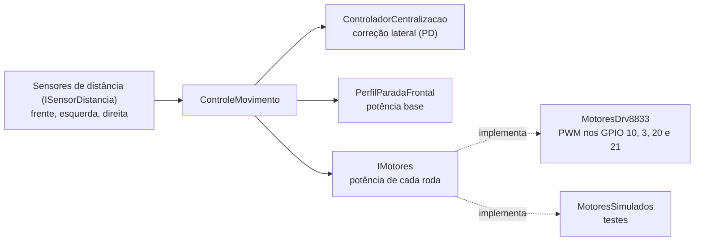

**Figura 19.** Fluxo do controle de movimento: a cada leitura dos sensores de distância, a distância frontal define a potência base, as distâncias laterais definem a correção, e o resultado vai para os motores pela interface `IMotores`.

### Geometria considerada

| Medida | Valor | Origem |
|---|---|---|
| Célula do labirinto | 180 mm, já com a parede | `TAMANHO_CELULA_MM` e tema do PI1 |
| Espessura da parede | 12 mm | Tema do PI1 |
| Chassi | 100 mm de comprimento × 120 mm de largura | [Estruturas](estruturas.md) |
| Distância do centro do robô a cada parede, centralizado | (180 − 12) / 2 = **84 mm** | `DISTANCIA_CENTRO_A_PAREDE_MM` |
| Folga entre o chassi e cada parede, centralizado | 84 − 60 = **24 mm** | Calculada |
| Folga até a parede da frente, parado no centro da célula | 84 − 50 = **34 mm** | Calculada |

O cálculo foi feito para um único sensor no centro do robô, com o feixe abaixo do topo das paredes (5 cm). Na Rev 2.0, cada VL53L0X fica numa posição diferente do chassi, que a estrutura ainda vai informar; os limiares serão recalculados para os 3 sensores na [#379](https://github.com/fcte-pi1/2026_2_PI1_Grupo01_Hilmer/issues/379). A folga lateral é pequena: ao virar de volta para o centro, a traseira do chassi gira para o lado da parede. Por isso o controle corrige com ângulos pequenos e ganhos baixos.

### Regras de Negócio e Algoritmo

* **Erro lateral:** deslocamento do robô para a direita do centro, em mm. Com parede dos dois lados, é `(esquerda − direita) / 2`; só com a da esquerda, `esquerda − 84`; só com a da direita, `84 − direita`. Leituras acima de 180 mm contam como lado sem parede; sem parede nenhuma, não há correção e o robô segue reto.
* **Correção PD:** `(20 × erro + 15 × derivada) / 10`, em unidades de potência, limitada a 250. A derivada é a variação do erro entre leituras, em mm/s, com filtro passa-baixa de 40% contra o ruído dos sensores de distância. Ela recomeça do zero quando a referência muda (por exemplo, quando uma parede lateral acaba), para não reagir ao salto da leitura.
* **Aplicação nas rodas:** a correção é subtraída da roda esquerda e somada à direita (positiva vira para a esquerda) e nunca passa de 60% da potência base, para nenhuma roda girar para trás perto da parada.
* **Parada frontal:** potência de cruzeiro (400 de 1000) até 264 mm da parede, rampa linear até a mínima (150) e parada a 84 mm, o centro da célula. Parado, o robô freia e fica travado até a navegação chamar `reiniciar()`.
* **Fail-safe dos sensores de distância:** sem leitura válida, o robô segue reto na potência mínima e sem correção; depois de 500 ms sem leitura, freia.
* **Motores:** potência de −1000 a 1000 por roda, positiva para a frente (a mesma convenção do `IEncoder`). O `MotoresDrv8833` usa PWM de 20 kHz e 10 bits, no modo *fast decay* do DRV8833, e freia ligando IN1 e IN2. O motor direito é invertido no `main.cpp`, pela montagem espelhada.

Os ganhos, as potências e as distâncias de desaceleração estão em `ConfiguracaoControle.h` e são **provisórios**: foram ajustados numa simulação do corredor ([Testes de Software](../07-testes/software-registro.md)) e precisam ser confirmados na bancada.

### Interface da Classe

* **`ControleMovimento::atualizar(ISensorDistancia&, IMotores&, dtMs)`:** lê os sensores de distância, calcula e aplica nos motores; chame uma vez por leitura nova (cerca de 100 ms). Devolve o `EstadoMovimento`: `Cruzeiro`, `Desacelerando`, `ParadoNaParede`, `SemLeitura` ou `ParadoSemLeitura`.
* **`ControleMovimento::calcular(const DistanciasLaterais*, dtMs)`:** a mesma conta sem acessar o hardware; `nullptr` representa a falta de leitura. Devolve `PotenciaRodas` (`esquerda`, `direita`).
* **`ControleMovimento::reiniciar()`:** destrava a parada e esquece o histórico da centralização, para um novo trecho reto.
* **`ControladorCentralizacao::calcular(leitura, dtMs)`** e **`PerfilParadaFrontal::potenciaBase(frenteMm)`:** as duas partes, testadas separadamente.

**Rastreabilidade:** `lib/atuacao` (`ControleMovimento`, `ControladorCentralizacao`, `PerfilParadaFrontal`, `SinaisDrv8833`), `lib/hal/IMotores`, `lib/simulacao/MotoresSimulados` e `lib/drivers_esp32/MotoresDrv8833` atendem à tarefa [#191](https://github.com/fcte-pi1/2026_2_PI1_Grupo01_Hilmer/issues/191), da [HU-12](https://github.com/fcte-pi1/2026_2_PI1_Grupo01_Hilmer/issues/182) (RF-12).

**Pendências:** o critério 3 da HU-12 (teste de bancada no labirinto sem contato com as paredes) depende do chassi montado e da pista 4×4. O `ControleMovimento` ainda não está na tarefa de navegação: entra junto com os sensores de distância e a navegação ([#183](https://github.com/fcte-pi1/2026_2_PI1_Grupo01_Hilmer/issues/183)).

## Navegação: execução dos movimentos entre células

A execução dos movimentos ([#184](https://github.com/fcte-pi1/2026_2_PI1_Grupo01_Hilmer/issues/184), [HU-01](https://github.com/fcte-pi1/2026_2_PI1_Grupo01_Hilmer/issues/42)) converte a decisão do algoritmo de resolução em movimento: **avançar uma célula (18 cm)**, **girar 90°** e **girar 180°**. É também onde a percepção, o mapa, a navegação e a atuação passam a rodar juntos na tarefa de navegação. As peças ficam em `lib/execucao`, sem Arduino, e reaproveitam o que já existia: o `ControleMovimento` ([#191](https://github.com/fcte-pi1/2026_2_PI1_Grupo01_Hilmer/issues/191)) e o `ControleGiro` ([#190](https://github.com/fcte-pi1/2026_2_PI1_Grupo01_Hilmer/issues/190)) para mover, o `ClassificadorParede` ([#379](https://github.com/fcte-pi1/2026_2_PI1_Grupo01_Hilmer/issues/379)) e o `AtualizadorMapa` ([#177](https://github.com/fcte-pi1/2026_2_PI1_Grupo01_Hilmer/issues/177)) para gravar as paredes, a `Navegacao` ([#183](https://github.com/fcte-pi1/2026_2_PI1_Grupo01_Hilmer/issues/183)) para decidir e o deslocamento sem encoder ([#380](https://github.com/fcte-pi1/2026_2_PI1_Grupo01_Hilmer/issues/380)) para saber onde o robô está. Quando os encoders chegarem, a execução não muda: só a fonte da posição.

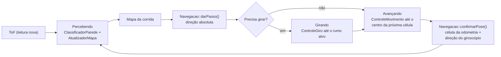

**Figura 20.** Ciclo de uma célula no `CicloNavegacao`: parado no centro, o robô grava as paredes vistas, o Flood Fill decide a próxima direção, o executor gira (se precisar) e avança uma célula, e a pose é confirmada antes de perceber de novo.

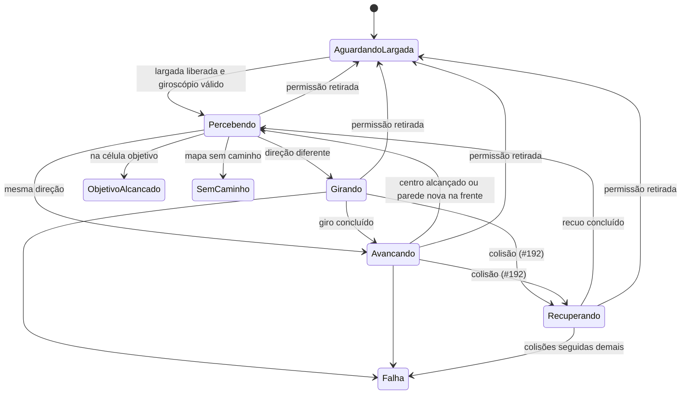

**Figura 21.** Estados do `CicloNavegacao`. `ObjetivoAlcancado`, `SemCaminho` e `Falha` freiam os motores e só saem com `reiniciar()` (comando `Z`). `Recuperando` é o recuo depois de uma colisão ([#192](https://github.com/fcte-pi1/2026_2_PI1_Grupo01_Hilmer/issues/192)); o estado `Realinhando` da [#188](https://github.com/fcte-pi1/2026_2_PI1_Grupo01_Hilmer/issues/188) está descrito na seção de localização.

### Regras de Negócio e Algoritmo

* **Avançar uma célula:** o destino é o centro da célula **seguinte à mais próxima** da posição atual, e não a posição atual mais 180 mm; assim um erro pequeno de parada não se acumula de uma célula para a outra. O `ControleMovimento` centraliza no corredor e mantém o rumo pelo giroscópio. A 60 mm do destino começa a rampa: um teto na potência base (`ControleMovimento::definirTetoPotenciaBase`) cai da potência de cruzeiro (400) até a mínima (150). O avanço termina a 3 mm do centro, ou quando passa dele.
* **Parede à frente:** a parada frontal do `ControleMovimento` continua valendo. Se ela parar o robô a até 40 mm do destino, o avanço conta como concluído (a parede é a melhor referência do centro). Mais longe, é uma parede que a percepção leu como livre: o avanço termina em `ParedeNaFrente`, a parede é gravada no mapa mesmo com o conflito (`Mapa::corrigirParede`), o passo é cancelado e o próximo planejamento a contorna.
* **Leitura do ToF no controle:** o ToF mede a partir da face de cada sensor, e o `ControleMovimento` usa distâncias a partir do centro do robô (84 mm até a parede com ele centralizado). Antes do controle, a leitura recebe o recuo de cada sensor: 50 mm na frente (o mesmo do deslocamento sem encoder) e 30 mm nas laterais (o mesmo da percepção). Uma leitura lateral acima de 100 mm (pela face do sensor) é tratada como lado sem parede ([#188](https://github.com/fcte-pi1/2026_2_PI1_Grupo01_Hilmer/issues/188)): perto do fim de uma parede, o sensor alcança a parede da célula vizinha (100 a 180 mm), e o `ControleMovimento`, que aceita paredes até 180 mm do centro, virava o robô para ela. O controle é recalculado a cada leitura nova (cerca de 33 ms); entre duas leituras, vale o último comando.
* **Girar 90° e 180°:** o `ControleGiro` gira até o **rumo alvo absoluto**, os múltiplos de 90° desde a largada (positivo para a esquerda, como o giroscópio), e não 90° a partir do ângulo atual. Se um giro parar 3° antes, o próximo compensa, e o erro não se acumula. O 180° é feito pela esquerda.
* **Direção da odometria:** no modo sem encoder, a direção da `Odometria` vem da diferença entre as rodas estimadas, que é imprecisa. No fim de cada giro, a direção confirmada pelo giroscópio passa a valer (`Odometria::definirDirecao`, que muda a direção sem mexer na posição), e fora dos giros a tarefa de navegação fixa a odometria nessa direção **a cada ciclo**, e não só quando ela diverge. Com a correção só na divergência, a diferença das rodas se acumulava nos giros pequenos do realinhamento ([#188](https://github.com/fcte-pi1/2026_2_PI1_Grupo01_Hilmer/issues/188)) e virava a direção estimada no meio da manobra.
* **Percepção no centro:** parado no centro da célula, o ciclo junta 3 leituras novas do ToF, classifica as paredes pela mediana e as grava no mapa na pose da navegação. Só então pede o próximo passo.
* **Confirmação da pose:** no fim do avanço, `confirmarPose()` recebe a célula da odometria e a direção do giroscópio. Se o robô continuar na célula de origem (parede no caminho ou estimativa que não cruzou a fronteira), o passo é cancelado e o ciclo percebe e replaneja, em vez de esperar um passo que não vai terminar.
* **Falhas:** sem leitura nova do ToF por 500 ms durante o avanço, avanço acima de 6 s, giro acima de 2,5 s ou pose fora da malha levam a `Falha`, com os motores freados. A colisão ([#192](https://github.com/fcte-pi1/2026_2_PI1_Grupo01_Hilmer/issues/192)) tem o estado `Recuperando` (o robô recua até o centro e percebe de novo), e a falha do I²C ([#241](https://github.com/fcte-pi1/2026_2_PI1_Grupo01_Hilmer/issues/241)) tira a permissão de mover até passar. O motor travado ([#341](https://github.com/fcte-pi1/2026_2_PI1_Grupo01_Hilmer/issues/341)) é cortado pela `MotoresComProtecao`, fora do ciclo.

**Parâmetros:** todos provisórios, em `lib/execucao/src/ConfiguracaoExecucao.h`. Foram ajustados na simulação dos testes e devem ser confirmados na bancada.

| Parâmetro | Valor | Origem |
|---|---|---|
| `DISTANCIA_SENSOR_LATERAL_AO_CENTRO_MM` | 30 | Recuo lateral da percepção (`ConfiguracaoPercepcao.h`: 84 − 30 = 54 mm lidos com parede). Com a #188, passou para `ConfiguracaoDeslocamento.h`, porque a correção pelas paredes também usa |
| `LIMIAR_PAREDE_LATERAL_CONTROLE_MM` | 100 | Leitura lateral (pela face) acima da qual o lado conta como sem parede na centralização ([#188](https://github.com/fcte-pi1/2026_2_PI1_Grupo01_Hilmer/issues/188)) |
| `DISTANCIA_SENSOR_FRONTAL_AO_CENTRO_MM` | 50 | O mesmo do deslocamento sem encoder (`ConfiguracaoDeslocamento.h`) |
| `TOLERANCIA_CHEGADA_MM` | 3 | Parada no centro da célula |
| `DISTANCIA_DESACELERACAO_MM` | 60 | Rampa antes do centro de destino |
| `FOLGA_PARADA_NA_PAREDE_MM` | 40 | Parada pela parede ainda conta como chegada |
| `TEMPO_MAXIMO_AVANCO_MS` | 6000 | 180 mm a 45 mm/s (potência mínima) levam 4 s |
| `AMOSTRAS_PERCEPCAO` | 3 | Cerca de 0,1 s parado no centro |

### Gatilho da largada

A Super Mini não tem botão livre (o BOOT fica no GPIO9, o SDA do I²C), e o dashboard ainda não manda comandos ao robô. A largada é dada por um **gesto na frente do ToF frontal**, o truque clássico de micromouse, ou pelo comando serial `L` na bancada:

1. Com o robô pronto (boot aprovado e giroscópio calibrado), a frente precisa estar livre (100 mm ou mais) para o gatilho armar.
2. A mão cobre o sensor (50 mm ou menos) por pelo menos 300 ms. Um vulto mais curto é ignorado.
3. A mão sai, e o robô espera 1 s antes de largar. Se a mão voltar nesse tempo, o gesto recomeça.

Com uma parede parada logo à frente da partida, o gatilho nunca arma: a largada fica só pelo comando `L`. Os limiares estão em `ConfiguracaoExecucao.h` e precisam ser conferidos com a mão e o VL53L0X montado.

### Interface das Classes

* **`ExecutorMovimentos::iniciar(Movimento)`:** começa `AvancarCelula`, `Girar90Esquerda`, `Girar90Direita` ou `Girar180`; recusa se outro estiver em andamento. O `Realinhar` da [#188](https://github.com/fcte-pi1/2026_2_PI1_Grupo01_Hilmer/issues/188) precisa de um plano e começa por `iniciarRealinhamento(plano)` (veja [Correção pelas paredes](#localizacao-correcao-do-erro-acumulado-pelas-paredes)).
* **`ExecutorMovimentos::atualizar(EntradaExecucao, IMotores&)`:** um ciclo de 10 ms. A entrada traz a leitura nova do ToF (ou `nullptr`), a `LeituraGiro` e a posição no eixo de avanço (`posicaoAoLongoDoAvancoUm`). Devolve `Ocioso`, `Executando`, `Concluido` ou `Falha` (motivo em `falha()`: `ParedeNaFrente`, `SemLeituraTof`, `TempoEsgotado` ou `GiroTempoEsgotado`). `restanteMm()` guarda o erro de chegada para a bancada.
* **`ExecutorMovimentos::cancelar(IMotores&)`** e **`definirRumoAlvo(miligraus)`:** interrompe e freia; define o rumo de referência.
* **`CicloNavegacao(Mapa&)`**, **`reiniciar(Pose, IMotores&)`** e **`atualizar(EntradaCiclo, IMotores&)`:** o ciclo completo. A entrada traz a permissão para mover (`liberado`), a pose e a posição da odometria, a leitura nova do ToF e a do giroscópio. `direcao()` e `direcaoDefinida()` dizem a quem chama em que direção manter a odometria.
* **`GatilhoLargada::atualizar(leituraNova, dtMs)`**, **`dispararManual()`** e **`reiniciar()`:** o gesto da largada.
* **`giroAte(atual, desejada, giro)`** e **`direcaoDepois(direcao, movimento)`** (`Movimento.h`): a conversão entre a direção absoluta da navegação e o giro.

**No `main.cpp`.** A tarefa de navegação, a cada 10 ms: mantém a direção da odometria na do ciclo (fora dos giros), atualiza o deslocamento e a detecção do objetivo, alimenta o gatilho com o robô pronto e chama `CicloNavegacao::atualizar` com os motores `motoresTracao` (a trava do boot e a estimativa do deslocamento continuam valendo). A **permissão para mover** é: boot aprovado, giroscópio calibrado, gatilho disparado, corrida não encerrada pela fase da corrida ([#242](https://github.com/fcte-pi1/2026_2_PI1_Grupo01_Hilmer/issues/242): o objetivo ou os 10 minutos) e nenhuma falha do I²C ([#241](https://github.com/fcte-pi1/2026_2_PI1_Grupo01_Hilmer/issues/241)). A detecção do objetivo continua no `DetectorObjetivo` do `main.cpp`, que freia os motores antes do ciclo. O comando `Z` volta a aguardar a largada, e o `L` libera a largada sem o gesto (vale quando o robô ficar pronto). No log: `{"status":"largada_liberada"}` e `{"status":"navegacao","estado":...,"falha":...,"celulas":...}` a cada troca de estado.

### Folga do giro no lugar

O chassi de 120 × 100 mm gira no lugar num corredor de 168 mm: a quina passa a √(60² + 50²) = **78,1 mm** do centro, e a parede fica a 84 mm. Sobram **5,9 mm**: um erro lateral ou de parada maior que isso encosta a quina na parede durante o giro. Na simulação, o avanço para a 2 a 4 mm do centro, mas com as rodas desiguais (5%) ou a largada 1° torta, a sintonia provisória da centralização e do rumo deixa o robô de 5 a 10 mm fora do centro, e alguns giros raspam a parede. Duas tentativas no executor (puxar o rumo para o eixo do corredor e compensar a diferença das rodas) não resolveram de forma confiável e foram descartadas. É um ponto para a mecânica (quinas chanfradas ou arredondadas) e para a sintonia na bancada ([#191](https://github.com/fcte-pi1/2026_2_PI1_Grupo01_Hilmer/issues/191), [#190](https://github.com/fcte-pi1/2026_2_PI1_Grupo01_Hilmer/issues/190)).

**Atualização ([#188](https://github.com/fcte-pi1/2026_2_PI1_Grupo01_Hilmer/issues/188)).** A correção pelas paredes passou a tratar a folga no firmware: o robô se realinha ao centro antes de cada giro no lugar, e o rumo é puxado para o eixo do corredor de outra forma (sem exigir o robô centrado). Na mesma varredura de 189 corridas, as corridas com contato caíram de 92 para 2, sem nenhuma falha. Veja [Correção pelas paredes](#localizacao-correcao-do-erro-acumulado-pelas-paredes). Chanfrar as quinas continua sendo uma margem a mais.

### Bancada da execução

O firmware de bancada do deslocamento (`src/bancada/bancada_deslocamento.cpp`) ganhou o MPU6050 e os comandos `CELULA n` (1 a 8 avanços seguidos), `GIRO90E`, `GIRO90D`, `GIRO180` e `CALIBRAR`, que rodam o mesmo `ExecutorMovimentos` do robô e terminam com uma linha `fim_execucao` (estado, falha, tempo, quanto faltou, giro medido pelo giroscópio e erro de rumo). O menu `scripts/bancada_deslocamento.py` ganhou duas etapas:

| Etapa | O que verifica | Critério provisório |
|---|---|---|
| 7. Execução: avançar n células | n avanços num corredor reto, medidos na régua a partir da marca de partida, e o desvio lateral no fim | Parada até ±10 mm de n × 180 mm; desvio lateral até ±5 mm (abaixo da folga de 5,9 mm do giro) |
| 8. Execução: giros | Calibração do giroscópio e os giros de 90° para a direita, 90° para a esquerda e 180°, medidos no transferidor | Erro até ±3° em cada giro |

**Rastreabilidade:** `lib/execucao` (`ExecutorMovimentos`, `CicloNavegacao`, `GatilhoLargada`, `Movimento.h`), `Odometria::definirDirecao`, `ControleMovimento::definirTetoPotenciaBase`, `Mapa::corrigirParede`, `lib/simulacao/RoboSimulado` e as etapas 7 e 8 da bancada atendem à tarefa [#184](https://github.com/fcte-pi1/2026_2_PI1_Grupo01_Hilmer/issues/184), da [HU-01](https://github.com/fcte-pi1/2026_2_PI1_Grupo01_Hilmer/issues/42) (RF01).

**Pendências:** medir o erro de deslocamento na bancada com o robô montado (critério 3 da #184, etapas 7 e 8), conferir o gesto da largada com o VL53L0X real, unificar o recuo do sensor frontal entre a percepção (30 mm) e o deslocamento (50 mm) quando a estrutura informar a posição real.

## Localização: correção do erro acumulado pelas paredes

A correção pelas paredes ([#188](https://github.com/fcte-pi1/2026_2_PI1_Grupo01_Hilmer/issues/188), [HU-05](https://github.com/fcte-pi1/2026_2_PI1_Grupo01_Hilmer/issues/41)) usa as paredes que o robô vê como referência fixa. Sem ela, a odometria e o giroscópio acumulam erro de três formas:

* a posição lateral só muda pela diferença entre as rodas, que a estimativa sem encoder não enxerga;
* com encoder, o erro de escala da roda se soma célula a célula;
* a deriva do giroscópio entorta o rumo de referência.

Com a folga de 5,9 mm do [giro no lugar](#folga-do-giro-no-lugar), alguns milímetros fora do centro já bastam para a quina do chassi encostar.

O escopo foi combinado na análise da tarefa. Nenhuma outra tarefa cobre o rumo pelo corredor, por isso ele entrou aqui. São quatro partes:

| Parte | O que faz | Onde |
|---|---|---|
| A. Posição pelas paredes | Corrige a posição lateral da `Odometria` pelas paredes laterais. Com encoder, também corrige ao longo do avanço pela parede da frente e pelas quinas, a mesma correção da [#380](https://github.com/fcte-pi1/2026_2_PI1_Grupo01_Hilmer/issues/380) | `lib/localizacao` (`CorrecaoPelasParedes`), `Odometria::ajustarPosicao` |
| B. Realinhamento antes do giro | Antes de girar no lugar, leva o robô fisicamente ao centro do corredor | `ExecutorMovimentos` (`Movimento::Realinhar`, `planejarRealinhamento`), `CicloNavegacao` (`Realinhando`) |
| C. Testes e bancada | Testes unitários e de integração, e as etapas 9 e 10 da bancada para o critério "célula estimada = real" | `test_localizacao`, `test_integracao_localizacao`, `scripts/bancada_deslocamento.py` |
| D. Rumo pelo corredor | Com duas paredes paralelas, puxa o rumo de referência para o eixo do corredor, o que corrige a deriva do giroscópio | `ExecutorMovimentos::ajustarRumoPeloCorredor` |

Ficam fora, com as suas tarefas:

* a recuperação depois de uma colisão ([#192](https://github.com/fcte-pi1/2026_2_PI1_Grupo01_Hilmer/issues/192), entregue depois deste PR);
* a sintonia dos ganhos da centralização e do giro ([#191](https://github.com/fcte-pi1/2026_2_PI1_Grupo01_Hilmer/issues/191), [#190](https://github.com/fcte-pi1/2026_2_PI1_Grupo01_Hilmer/issues/190));
* a calibração do giroscópio e a sua zona morta ([#378](https://github.com/fcte-pi1/2026_2_PI1_Grupo01_Hilmer/issues/378));
* os encoders físicos.

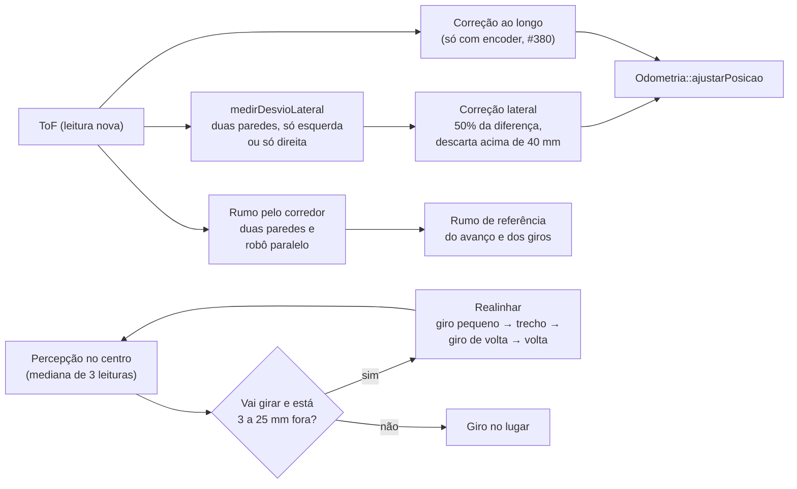

**Figura 22.** As três correções da #188. A cada leitura nova do ToF, a odometria é corrigida (A) e o rumo é ajustado pelo corredor (D). Antes de um giro, o ciclo confere o desvio e realinha o robô (B), até duas vezes.

### Regras de Negócio e Algoritmo

* **Desvio lateral medido** (`medirDesvioLateral`). Cada lado conta como parede com leitura de até 120 mm pela face, o mesmo limiar das quinas da #380. A leitura recebe o recuo de 30 mm do sensor, e o desvio, positivo para a direita, sai assim:
  * com as duas paredes, é a metade da diferença (esquerda − direita);
  * com uma parede só, é a distância a ela comparada aos 84 mm do centro à parede;
  * sem parede perto, não há referência e nada é corrigido.
* **Correção lateral** (`CorrecaoPelasParedes::aplicar`). O alvo é o centro de célula mais próximo da posição lateral estimada, mais o desvio medido. Por isso o erro acumulado se corrige mesmo que a estimativa já esteja numa célula vizinha.
  * Cada leitura nova aplica 50% da diferença (5 leituras levam a 97%), o que filtra o ruído do VL53L0X.
  * Uma diferença acima de 40 mm é descartada como leitura suspeita: o robô está muito torto ou o sensor leu outra coisa.
  * Durante uma manobra (giro ou realinhamento), nada é corrigido, e as leituras laterais guardadas para as quinas são esquecidas (`DeslocamentoEstimado::esquecerLaterais`), para a primeira leitura depois da manobra não parecer uma quina.
* **Correção ao longo do avanço** (só com `ENCODERS_INSTALADOS`). É a correção da #380 pela parede da frente e pelas quinas, aplicada direto na odometria. No modo sem encoder, ela já acontece dentro do `DeslocamentoEstimado`. `CorretorDeslocamentoTof::avaliar` passou a aceitar a potência das rodas direto, para valer sem o estimador.
* **`Odometria::ajustarPosicao(avanço, lateral)`**. Soma um deslocamento no referencial do robô: o avanço vai na direção atual, e a lateral é positiva para a direita (de Norte, a direita é Leste). A célula é recalculada e as contagens das rodas ficam como estão.
* **Quando realinhar.** No centro da célula, antes de um giro, o ciclo calcula o desvio pela mediana das amostras da percepção.
  * O robô realinha se houver parede lateral e o desvio estiver entre 3 mm (a margem para o ruído, abaixo da folga de 5,9 mm) e 25 mm (acima disso, a leitura é suspeita).
  * Depois do realinhamento, o ciclo junta amostras novas e decide de novo: são até 2 tentativas por giro, porque um desvio grande pede um ângulo pequeno e um trecho maior que o espaço disponível.
  * Sem permissão para mover, o realinhamento é cancelado e freado como os outros movimentos.
* **A manobra** (`Movimento::Realinhar`) tem quatro etapas:
  1. um giro pequeno de θ para o lado do centro;
  2. um trecho reto s, na potência mínima (150), com o rumo inclinado mantido pelo giroscópio;
  3. o giro de volta ao rumo nominal;
  4. um trecho de volta s·cos θ no sentido oposto, para o robô voltar ao centro da célula ao longo do eixo.

  O deslocamento lateral é s·sin θ. O robô vai primeiro de ré quando a célula de trás está livre (de onde veio) ou quando a frente tem parede. Cada trecho tem um tempo máximo de 3 s, e cada giro usa o tempo máximo dos giros.
* **Plano sem encostar** (`planejarRealinhamento`). Com o robô girado θ, a quina do chassi avança para os dois lados:
  * para o lado, ela fica a 78,1·sin(50,2° + θ) do centro;
  * ao longo do eixo, ela fica a 78,1·cos(50,2° − θ) do centro.

  O planejador testa os ângulos 5°, 8°, 10°, 12°, 15°, 20°, 25° e 30°. Escolhe o menor em que o trecho necessário cabe no espaço, deixando 4 mm entre a quina e a parede:
  * para o lado, o espaço é 84 − 4 − desvio;
  * ao longo do eixo, com paredes na frente e atrás, o espaço é 84 − 4 − o alcance ao longo da quina. Com um lado livre, o trecho vai até 60 mm.

  Se nenhum ângulo couber, o plano corrige só o que cabe, e a segunda tentativa completa. Num beco com 6 mm de desvio, o plano é de 20° e 12,5 mm de ré, que corrigem 4,3 mm (no robô simulado, o desvio cai para 1,7 mm).
* **Rumo pelo corredor** (`ajustarRumoPeloCorredor`). O ajuste acontece durante o avanço, a cada leitura nova, e só nestas condições:
  * há paredes dos dois lados;
  * o robô está a até 30 mm do centro;
  * o desvio lateral varia até 10 mm/s, ou seja, o robô anda paralelo às paredes.

  Nessas condições, o ângulo do giroscópio é o eixo do corredor, e o rumo de referência anda 15% (150‰) até ele. O ajuste não exige o robô centrado de propósito, porque é o erro de rumo que o tira do centro: com essa exigência, o ajuste ficava desligado justamente quando mais importava. O rumo nominal (os múltiplos de 90° desde a largada) pode se afastar até ±45°, o que cobre a deriva de uma corrida inteira (0,075 °/s em 10 minutos dá 45°). Os giros seguintes partem do rumo ajustado.

**Parâmetros:** todos provisórios, em `lib/localizacao/src/ConfiguracaoLocalizacao.h`. Foram ajustados na varredura simulada (abaixo) com a geometria provisória dos ToF.

| Parâmetro | Valor | Uso |
|---|---|---|
| `LIMIAR_PAREDE_CORRECAO_LATERAL_MM` | 120 | Leitura lateral (pela face) até a qual o lado conta como parede |
| `CORRECAO_LATERAL_MAXIMA_MM` | 40 | Diferença acima da qual a leitura é descartada |
| `GANHO_CORRECAO_LATERAL_PERCENTUAL` | 50 | Fração da diferença aplicada a cada leitura |
| `DESVIO_MINIMO_REALINHAMENTO_MM` e `DESVIO_MAXIMO_REALINHAMENTO_MM` | 3 e 25 | Faixa de desvio em que o robô realinha antes de girar |
| `TRECHO_MAXIMO_REALINHAMENTO_LIVRE_MM` | 60 | Trecho máximo com um lado livre |
| `FOLGA_MINIMA_REALINHAMENTO_MM` | 4 | Folga entre a quina e a parede durante a manobra |
| `TENTATIVAS_REALINHAMENTO` | 2 | Realinhamentos antes de cada giro |
| `POTENCIA_REALINHAMENTO` e `GANHO_RUMO_REALINHAMENTO_DECIMOS` | 150 e 80 | Potência dos trechos e ganho do rumo neles (décimos por grau) |
| `TEMPO_MAXIMO_TRECHO_REALINHAMENTO_MS` | 3000 | Tempo máximo de cada trecho |
| `AJUSTE_RUMO_PELO_CORREDOR_POR_MIL` | 150 | Quanto o rumo anda até o eixo do corredor a cada leitura (0 desliga) |
| `ERRO_LATERAL_MAXIMO_RUMO_MM` e `VARIACAO_LATERAL_MAXIMA_RUMO_MM_POR_S` | 30 e 10 | Condições do ajuste do rumo |
| `AJUSTE_RUMO_MAXIMO_MILIGRAUS` | 45000 | Limite do rumo ajustado em relação ao nominal |

### Interface das Classes

* **`medirDesvioLateral(leitura, limiar, recuo)`:** devolve um `DesvioLateral` com a referência (`SemParede`, `DuasParedes`, `SoEsquerda` ou `SoDireita`) e o desvio em µm, positivo para a direita.
* **`CorrecaoPelasParedes::aplicar(Odometria&, leitura, MovimentoRobo, corrigirAvanco)`:** aplica as correções de uma leitura nova. `MovimentoRobo` vale `Parado`, `Avancando` ou `Manobrando`. Devolve um `ResultadoCorrecaoParedes` com a referência lateral (ou `Descartada` ou `Manobrando`), o resultado da correção ao longo e os deltas aplicados.
* **`CorrecaoPelasParedes::reiniciar()`**, **`correcoesLaterais()`** e **`nomeDaReferenciaLateral()`:** recomeço (comando `Z`), contagem e nome para o log.
* **`planejarRealinhamento(desvio, recuarPrimeiro, trechoLivre, trechoMaximo, folga)`:** devolve um `PlanoRealinhamento` com o ângulo, o trecho, a volta e o deslocamento lateral esperado. O plano é vazio se não houver desvio ou espaço.
* **`ExecutorMovimentos::iniciarRealinhamento(plano)`**, **`planoRealinhamento()`** e **`etapaRealinhamento()`:** a manobra e as suas etapas (`GiroIda`, `Trecho`, `GiroVolta`, `Volta`).
* **`ExecutorMovimentos::rumoNominalMiligraus()`:** o rumo sem o ajuste do corredor. `definirRumoAlvo` define o rumo e o nominal juntos.
* **`CicloNavegacao`:** o estado novo é `Realinhando`. `movimentoRobo()` diz à correção se o robô está parado, avançando ou manobrando. `realinhamentos()` e `ultimoDesvioLateralMm()` alimentam o log. O construtor recebe a `ConfiguracaoRealinhamento`.
* **`ehManobra(movimento)`** (`Movimento.h`): verdadeiro para tudo que não é `AvancarCelula`. `ehGiro` cobre só os três giros.

**No `main.cpp`.** A tarefa de navegação, a cada ciclo:

* fixa a direção da odometria na do ciclo sempre que ela está definida;
* durante uma manobra, no modo sem encoder, esquece as laterais do deslocamento e não passa a leitura a ele;
* a cada leitura nova do ToF, chama `correcaoParedes.aplicar` com o `movimentoRobo()` do ciclo e `ENCODERS_INSTALADOS`, dentro da mesma seção crítica da odometria.

O comando `Z` também reinicia a correção.

### Resultado na simulação

Para medir o efeito, foi feita uma varredura de 189 corridas simuladas no simulador dos testes de integração:

* 3 robôs: o ideal, um com rodas a 92/97% da tabela e um com rodas a 103/95%;
* 7 ângulos de largada, de −3° a +3°;
* 3 desvios laterais na largada: 0 e ±8 mm;
* 3 labirintos: 4×4, 8×4 e 12×4.

A tabela compara a mesma varredura com e sem a #188, para cada deriva do giroscópio depois da calibração. "Sem a #188" já inclui o filtro de 100 mm na centralização. A base da #184 tinha 92 corridas com contato e 4 que não chegavam.

| Deriva do giroscópio | Corridas com contato, sem a #188 | Corridas com contato, com a #188 | Tempo total em contato, com a #188 | Sem chegar, com a #188 | Tempo médio, com a #188 |
|---|---|---|---|---|---|
| 0 | 84 | 2 | 162 ms | 0 | 43,1 s |
| +0,1 °/s | 128 | 2 | 86 ms | 0 | 43,5 s |
| −0,1 °/s | 117 | 1 | 71 ms | 0 | 44,4 s |
| +0,2 °/s | 172 | 2 | 188 ms | 0 | 45,1 s |
| −0,2 °/s | 173 | 23 | 32,9 s | 0 | 45,6 s |

* Em todas as corridas com a #188, a célula estimada no fim coincidiu com a real.
* O tempo médio sobe de 35,3 s para cerca de 43 s, por causa dos realinhamentos (de 545 a 690 na varredura, conforme a deriva).
* Os contatos que sobram sem deriva são do robô com rodas 8% desiguais, no meio de um giro em (3, 1).
* A deriva de −0,2 °/s é o limite atual.
* A zona morta de 0,3 °/s do integrador do giroscópio ([#378](https://github.com/fcte-pi1/2026_2_PI1_Grupo01_Hilmer/issues/378)), somada ao ruído, retifica a deriva e a deixa maior que a real.

### Bancada da correção pelas paredes

O firmware de bancada do deslocamento ganhou três comandos:

* `DESVIO` mede o desvio pela mediana de 3 leituras, sem mover.
* `REALINHAR [F]` mede, realinha e mede de novo. Por padrão começa de ré; com `F`, começa para a frente.
* `PERCURSO seq` executa a sequência: `A` avança, `D` e `E` giram 90°, `V` gira 180°. Antes de cada giro, realinha se for preciso, e no fim imprime uma linha `fim_percurso` com a célula estimada.

O comando `ZERAR` também reinicia a correção. O menu `scripts/bancada_deslocamento.py` ganhou duas etapas:

| Etapa | O que verifica | Critério provisório |
|---|---|---|
| 9. Desvio lateral e realinhamento | Desvio medido pelos ToF contra a régua (robô uns 8 mm fora do centro); realinhamento e o desvio que sobra; se o chassi encostou | Erro da medida até ±2 mm; desvio depois do realinhamento até ±2 mm; sem encostar |
| 10. Percurso | Sequência (padrão `AAADAEA`) a partir de (0, 0), virado para o Norte; a célula estimada contra a real | Todos os movimentos feitos e a célula estimada igual à real (critério 2 da #188) |

**Rastreabilidade:** atendem à tarefa [#188](https://github.com/fcte-pi1/2026_2_PI1_Grupo01_Hilmer/issues/188), da [HU-05](https://github.com/fcte-pi1/2026_2_PI1_Grupo01_Hilmer/issues/41) (RF05):

* `lib/localizacao` (`CorrecaoPelasParedes`, `ConfiguracaoLocalizacao.h`);
* `Odometria::ajustarPosicao`;
* o `Realinhar`, o planejador e o rumo pelo corredor no `ExecutorMovimentos`;
* o estado `Realinhando` do `CicloNavegacao`;
* a correção no `main.cpp`;
* as etapas 9 e 10 da bancada.

**Pendências:**

* rodar as etapas 9 e 10 com o robô montado (critério 2 da #188);
* medir as grandezas que fixam os parâmetros:
  * a posição real dos ToF e o centro de giro;
  * o formato das quinas do chassi;
  * o ruído do VL53L0X;
  * a deriva real do giroscópio depois da calibração;
  * as medidas reais do labirinto;
* rever a zona morta do giroscópio com a #378, se a deriva real passar de 0,1 °/s.

## Navegação: deslocamento sem encoder

A `Odometria` precisa de contagens de roda. Enquanto os encoders não estiverem montados no robô (`ENCODERS_INSTALADOS = false` em `ConfiguracaoDeslocamento.h`), as contagens vêm de uma estimativa ([#380](https://github.com/fcte-pi1/2026_2_PI1_Grupo01_Hilmer/issues/380), [HU-05](https://github.com/fcte-pi1/2026_2_PI1_Grupo01_Hilmer/issues/41)):

* o deslocamento é **estimado pela potência comandada aos motores vezes o tempo**;
* a estimativa é **corrigida pelos ToF** sempre que uma parede dá uma referência de posição.

As peças ficam em `lib/deslocamento`, sem Arduino, e implementam as mesmas interfaces de `hal`. Por isso a `Odometria` e o `ControleMovimento` não mudaram, e a troca para o encoder real é uma constante.

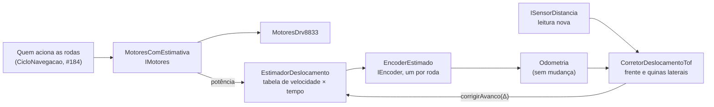

**Figura 23.** Deslocamento sem encoder: os comandos dos motores passam pelo estimador, que gera as contagens lidas pela `Odometria`. As leituras dos sensores de distância (`ISensorDistancia`) corrigem a posição, somando pulsos iguais às duas rodas.

### Regras de Negócio e Algoritmo

* **Velocidade por potência:** uma tabela de calibração dá a velocidade de cada roda, em mm/s, para a potência comandada.
  * Abaixo do primeiro ponto, a roda fica parada (zona morta).
  * Entre dois pontos, a velocidade é interpolada.
  * Acima do último ponto, vale a velocidade do último.
  * A ré usa a mesma tabela, com o sinal trocado.
* **Integração:** a cada ciclo de 10 ms, cada roda avança a velocidade vezes o tempo. O acumulado sai em pulsos, na unidade da `ConfiguracaoOdometria` (251 µm). A roda para no instante do comando, sem inércia.
* **Rodas e giro:** rodas em sentidos opostos geram diferença de pulsos, que a `Odometria` converte em giro. O rumo pelo giroscópio é da [#190](https://github.com/fcte-pi1/2026_2_PI1_Grupo01_Hilmer/issues/190).
* **Correção pela frente:** com o sensor frontal a até 300 mm de uma parede, a face da parede fica meia espessura (6 mm) antes de uma fronteira de célula. A fronteira mais próxima do que a leitura indica dá a posição real do centro do robô.
* **Correção pelas quinas laterais:** quando um lado passa de parede para livre (ou o contrário) com o robô avançando, o sensor lateral está na quina de uma parede. A quina fica 6 mm depois da fronteira de célula ao sair da parede, e 6 mm antes ao entrar. Uma histerese (parede até 120 mm, livre a partir de 160 mm) evita quinas inventadas pelo ruído.
* **Só o eixo de avanço:** as correções mudam quanto o robô andou, nunca o desvio lateral nem o rumo, que são da [#188](https://github.com/fcte-pi1/2026_2_PI1_Grupo01_Hilmer/issues/188) e da [#190](https://github.com/fcte-pi1/2026_2_PI1_Grupo01_Hilmer/issues/190). A correção entra como pulsos iguais nas duas rodas, então a `Odometria` avança ou recua sem girar.
* **Proteções:**
  * uma correção acima de 70 mm é descartada como leitura errada;
  * durante um giro no lugar, as leituras não servem de referência, e o estado das laterais é esquecido.
* **Confiança da pose:** se o robô andar mais de 360 mm (duas células) sem nenhuma correção, a pose deixa de ser confiável. A telemetria passa a informar `pose_valida: false` até a próxima correção.

**Parâmetros:** todos provisórios, num único arquivo, `lib/deslocamento/src/ConfiguracaoDeslocamento.h`. Cada valor diz o que faz, de onde veio e como medir na bancada.

| Parâmetro | Valor | Origem |
|---|---|---|
| `ENCODERS_INSTALADOS` | `false` | Sem encoders montados. Com `true`, a odometria volta aos `EncoderEsp32` (GPIO4 a 7) |
| `TABELA_VELOCIDADE` | 150 → 45, 400 → 120, 700 → 210, 1000 → 300 (potência → mm/s) | Modelo da simulação da [#191](https://github.com/fcte-pi1/2026_2_PI1_Grupo01_Hilmer/issues/191) (0,3 mm/s por unidade) e zona morta de 150. A medida na bancada precisa ter o limite de duty da [#341](https://github.com/fcte-pi1/2026_2_PI1_Grupo01_Hilmer/issues/341) valendo (`LIMITE_DUTY_MOTORES_MILESIMOS`, provisório em 70%) |
| `DISTANCIA_SENSOR_FRONTAL_AO_CENTRO_MM` | 50 | Meio comprimento do chassi |
| `AVANCO_SENSORES_LATERAIS_MM` | 0 | Sensores laterais supostos alinhados ao centro |
| `DISTANCIA_SENSOR_LATERAL_AO_CENTRO_MM` | 30 | Recuo lateral da percepção (`ConfiguracaoPercepcao.h`: 84 − 30 = 54 mm lidos com parede), usado no controle do avanço ([#184](https://github.com/fcte-pi1/2026_2_PI1_Grupo01_Hilmer/issues/184)) e na correção lateral ([#188](https://github.com/fcte-pi1/2026_2_PI1_Grupo01_Hilmer/issues/188)) |
| `DISTANCIA_FRONTAL_MAXIMA_PARA_CORRIGIR_MM` | 300 | Uma célula e meia |
| `LIMIAR_PAREDE_LATERAL_MM` e `HISTERESE_PAREDE_LATERAL_MM` | 120 e 40 | Entre a parede imediata (cerca de 54 mm pela face) e uma abertura (234 mm ou mais) |
| `CORRECAO_MAXIMA_MM` | 70 | Maior que a deriva esperada entre referências e menor que meia célula |
| `DISTANCIA_MAXIMA_SEM_CORRECAO_MM` | 360 | Duas células, com erro de tabela de até ~20% |

### Interface da Classe

* **`DeslocamentoEstimado(IMotores& reais, config)`:** junta as peças. `motores()` substitui o driver para quem aciona as rodas; `encoderEsquerdo()` e `encoderDireito()` substituem os encoders.
* **`ResultadoCorrecao ciclo(dtMs, Odometria&, const DistanciasLaterais* leituraNova)`:** estima o avanço, atualiza a `Odometria` e aplica a correção da leitura nova, se houver. Devolve `SemReferencia`, `PelaFrente`, `PelaLateral`, `Descartada` ou `Girando`.
* **`reiniciar(Odometria&, Pose)`**, **`poseConfiavel()`** e **`distanciaSemCorrecaoMm()`:** pose conhecida, confiança e distância desde a última correção.
* **`ultimaCorrecao()`:** resultado e tamanho (`deltaUm`) da correção do último ciclo com leitura, para o log.
* **`EstimadorDeslocamento`:** `velocidadeMmPorS(potencia)`, `comandar`, `parar`, `atualizar(dtMs)`, `corrigirAvanco(deltaUm)`, `contagem(roda)` e `girando()`.
* **`CorretorDeslocamentoTof::avaliar(odometria, leitura, estimador)`:** calcula a correção sem aplicar. `posicaoAoLongoDoAvancoUm(odometria)` dá a posição no eixo para onde o robô está virado.

**No `main.cpp`.** A tarefa de navegação:

* lê o ToF e considera a leitura nova quando o instante da amostra mais antiga muda (`idadeUltimaLeituraMs`, da [#344](https://github.com/fcte-pi1/2026_2_PI1_Grupo01_Hilmer/issues/344));
* chama `ciclo` a cada 10 ms.

A telemetria informa `pose_valida` como `posicaoValida() && poseConfiavel()` e acrescenta `deslocamento` (`"estimado"` ou `"encoder"`) e `sem_correcao_mm`. No modo estimado, o comando `Z` da bancada reposiciona o robô no centro da célula atual e devolve a confiança. Com `ENCODERS_INSTALADOS = true`, tudo volta ao caminho dos encoders reais.

**Limites deste modo:**

* **Mais deriva que com encoder:** patinagem, bateria fraca e erro da tabela viram erro de posição até a próxima referência.
* **Nenhuma velocidade medida:** a velocidade é a que a tabela supõe, então motor travado ou roda patinando não aparecem na estimativa.
* **Movimento simplificado:** a parada é instantânea, sem inércia, e o giro estimado é grosseiro.

### Bancada do deslocamento sem encoder

Para conferir a estimativa no robô montado, há um firmware de bancada (`src/bancada/bancada_deslocamento.cpp`, ambiente `bancada_deslocamento`) e um menu no computador (`scripts/bancada_deslocamento.py`).

* **O firmware** aciona os motores por um tempo e roda o mesmo `DeslocamentoEstimado` do robô. A cada 50 ms, manda o log pela serial (potência, pulsos, posição, pose, confiança e ToF), com uma linha à parte a cada correção. Qualquer byte recebido durante o movimento freia os motores, e cada movimento dura no máximo 10 s.
* **O menu** mostra o log ao vivo, salva cada movimento em CSV, compara a estimativa com a régua e gera um relatório.

| Etapa | O que verifica | Critério provisório |
|---|---|---|
| 1. Estado inicial | Modo estimado, ToF iniciados e pose (0, 0) Norte confiável | Tudo como esperado |
| 2. Tabela de velocidade | Zona morta e cada ponto da tabela, com 2 s de avanço medidos na régua; o menu imprime a tabela medida pronta para colar em `ConfiguracaoDeslocamento.h` | Velocidade real até ±10% da tabela |
| 3. Uma célula | ~180 mm sem correção: estimado contra régua e célula estimada | Erro até ±18 mm e célula certa |
| 4. Corredor com ToF | ~450 mm num corredor com parede no fim e, se possível, uma abertura lateral | Pelo menos uma correção, erro até ±15 mm e pose válida |
| 5. Confiança | ~450 mm sem correção e depois `ZERAR` | `pose_valida` falso acima de 360 mm e verdadeiro depois de `ZERAR` |
| 6. Giro de 90° | Giro no lugar pelo tempo que a tabela e a bitola supõem | Direção estimada Leste e giro real de 90 ± 20° |

O passo a passo está no [README do firmware](https://github.com/fcte-pi1/2026_2_PI1_Grupo01_Hilmer/blob/main/src/firmware/README.md#bancada-do-deslocamento-sem-encoder).

**Rastreabilidade:** atendem à tarefa [#380](https://github.com/fcte-pi1/2026_2_PI1_Grupo01_Hilmer/issues/380), da [HU-05](https://github.com/fcte-pi1/2026_2_PI1_Grupo01_Hilmer/issues/41) (RF05):

* `lib/deslocamento` (`EstimadorDeslocamento`, `EncoderEstimado`, `MotoresComEstimativa`, `CorretorDeslocamentoTof`, `DeslocamentoEstimado`, `ConfiguracaoDeslocamento.h`);
* a ligação no `main.cpp`;
* o firmware e o menu de bancada do deslocamento.

**Próximos passos:**

* **Calibrar na bancada** os valores de `ConfiguracaoDeslocamento.h`, com as etapas 1 a 6 do menu:
  * a `TABELA_VELOCIDADE`, medida com o limite de duty da [#341](https://github.com/fcte-pi1/2026_2_PI1_Grupo01_Hilmer/issues/341) valendo (70%, provisório; se o limite mudar, medir de novo);
  * a posição dos sensores frontal e laterais.
* **Conferir o limiar lateral das quinas** com o VL53L0X montado. A percepção da [#379](https://github.com/fcte-pi1/2026_2_PI1_Grupo01_Hilmer/issues/379) adotou 140 mm para classificar parede e livre, e as quinas usam 120 mm (parede) e 160 mm (livre, com a histerese), na mesma faixa entre a parede imediata (~54 mm) e uma abertura (234 mm ou mais). Se a bancada mostrar quinas perdidas ou inventadas, ajustar esses dois valores.

## Atuação: motores N20 e proteção sem encoder

Na Rev 2.0, os dois motores **N20** continuam no DRV8833, com pinos novos. O driver `MotoresDrv8833` foi ajustado para começar freado, limitar o duty em movimento e passar cada comando por uma proteção contra motor travado que não depende de encoder ([#341](https://github.com/fcte-pi1/2026_2_PI1_Grupo01_Hilmer/issues/341), PR [#396](https://github.com/fcte-pi1/2026_2_PI1_Grupo01_Hilmer/pull/396)). É a base dos giros ([#190](https://github.com/fcte-pi1/2026_2_PI1_Grupo01_Hilmer/issues/190)) e do movimento da [HU-01](https://github.com/fcte-pi1/2026_2_PI1_Grupo01_Hilmer/issues/42) (RF01).

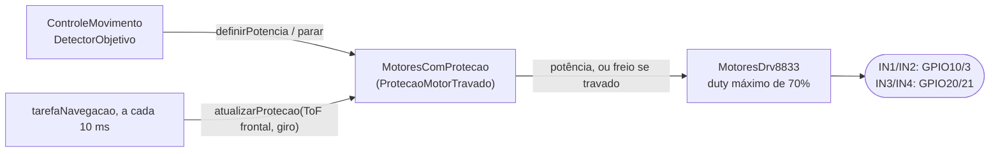

**Figura 24.** Caminho de um comando até as rodas: todo comando passa pela `MotoresComProtecao`, que a navegação alimenta com o ToF frontal e o giroscópio; o driver converte a potência em PWM, já limitado ao duty máximo.

### Regras de Negócio e Algoritmo

* **Pinos:** vêm de `Pinos.h` ([#377](https://github.com/fcte-pi1/2026_2_PI1_Grupo01_Hilmer/issues/377)): IN1/IN2 em GPIO10/GPIO3 (motor esquerdo) e IN3/IN4 em GPIO20/GPIO21 (motor direito, invertido no `main.cpp` pela montagem espelhada).
* **Freio antes do PWM:** `motores.iniciar()` é a primeira linha do `setup()`. Ele põe os quatro pinos como saída em nível alto, que é o freio do DRV8833 (IN1 e IN2 altos), e só depois liga o PWM, já com duty total, que também é freio. A ordem importa: no Arduino-ESP32 3.x, um `digitalWrite` antes do `pinMode` é ignorado.
* **Tranco no boot:** GPIO20 e GPIO21 são a UART0 do ESP32-C3. No reset, antes de o firmware rodar, a ROM escreve o log de boot no GPIO21, e o motor direito pode dar um tranco por cerca de 0,3 s. O firmware não alcança esse intervalo. As saídas, a decidir com a eletrônica: ligar o robô com as rodas fora do chão na bancada; resistores de *pull-down* em IN3/IN4; ou desligar o log da ROM pelo eFuse `UART_PRINT_CONTROL`, o que **não tem volta**.
* **Duty máximo:** a potência máxima pedida pelo controle (1000) vira `DUTY_MAXIMO_MOTORES`, e não 100%; as potências menores ficam proporcionais (500 vira 358 de 1023, e não 511). O freio sempre usa o duty total. O limite (70%) é provisório: um N20 de 6 V numa bateria 2S carregada recebe 6 / 8,4 ≈ 71% da tensão. Uma verificação na compilação garante que frequência × 2^bits não passa dos 80 MHz do LEDC.
* **Motor travado sem encoder (`ProtecaoMotorTravado`):** com `|potência|` de alguma roda a partir de 300, abre-se uma janela de 500 ms. Se, ao fim dela, o ToF frontal variou menos de 5 mm **e** o giroscópio nunca passou de 5 °/s, o robô está travado: andar em linha reta muda o ToF, girar no lugar muda o giroscópio, e só o robô preso não muda nenhum dos dois. Sem leitura frontal válida, nada é concluído e a contagem recomeça; potência baixa também zera a contagem. O estado `Travado` só sai com `reiniciar()`.
* **Freio e recusa (`MotoresComProtecao`):** o decorador repassa os comandos ao driver e, a cada ciclo, roda a proteção com a última potência repassada. Travado, freia na hora e transforma todo `definirPotencia` seguinte em freio, até a navegação chamar `liberar()`; assim o controle não religa o motor preso no ciclo seguinte. `parar()` sempre passa. Ele conta os cortes e os comandos recusados.
* **No `main.cpp`:** o resto do firmware comanda a camada de fora (`registradorPotencia` → `motoresComTrava` → `motoresProtegidos` → estimativa do deslocamento → driver), nunca o driver direto, e a navegação chama `atualizarProtecao(medidasDaProtecao(), 10)` a cada ciclo; um corte novo sai no log como `motor_travado`. `medidasDaProtecao()` usa o ToF frontal ([#344](https://github.com/fcte-pi1/2026_2_PI1_Grupo01_Hilmer/issues/344)) e a taxa do giroscópio ([#378](https://github.com/fcte-pi1/2026_2_PI1_Grupo01_Hilmer/issues/378)), e uma leitura frontal no alcance máximo do sensor (1200 mm) não vale como medida: num corredor longo a distância não muda andando, e a proteção cortaria os motores por engano. **O giroscópio é obrigatório**: sem ele, um giro no lugar seria lido como motor travado. Ao tratar uma colisão ([#192](https://github.com/fcte-pi1/2026_2_PI1_Grupo01_Hilmer/issues/192)), o `main.cpp` chama `motoresProtegidos.liberar()`, porque a proteção segura o freio e o recuo precisa de ré.

| Parâmetro | Arquivo | Valor | Como conferir na bancada |
|---|---|---|---|
| Frequência do PWM | `ConfiguracaoMotores.h` | 20 kHz | O motor não chia nem esquenta parado em duty baixo |
| Resolução do PWM | `ConfiguracaoMotores.h` | 10 bits (0 a 1023) | — |
| Duty máximo em movimento (`LIMITE_DUTY_MOTORES_MILESIMOS`) | `ConfiguracaoMotores.h` | 70% (716 de 1023) | Com VM de 5 V, pode subir para 100% |
| Potência que conta como duty alto | `ConfiguracaoProtecaoMotor.h` | 300 de 1000 | Acima da zona morta do N20 |
| Tempo até considerar travado | `ConfiguracaoProtecaoMotor.h` | 500 ms | Prender uma roda com a mão em potência de cruzeiro: o corte vem antes de o driver esquentar |
| Variação mínima do ToF frontal | `ConfiguracaoProtecaoMotor.h` | 5 mm | Acima do ruído do VL53L0X |
| Taxa de giro mínima | `ConfiguracaoProtecaoMotor.h` | 5 °/s | Acima do ruído do giroscópio parado |

Todos são **provisórios**: a eletrônica ainda não informou a tensão do VM (bateria 2S ou 5 V) nem a tensão nominal, a redução e a corrente de travamento do N20.

### Interface das Classes

* **`ConfiguracaoMotores.h`** (`lib/atuacao`): `FREQUENCIA_PWM_MOTORES_HZ`, `RESOLUCAO_PWM_MOTORES_BITS`, `LIMITE_DUTY_MOTORES_MILESIMOS`, `dutyTotalPwm(bits)`, `dutyMaximoMotores(bits, limite)` e as constantes `DUTY_TOTAL_MOTORES` e `DUTY_MAXIMO_MOTORES`.
* **`MotoresDrv8833`** (`lib/drivers_esp32`): `iniciar()` (freio e depois PWM), `definirPotencia(potencia)` (limitada a `DUTY_MAXIMO_MOTORES`) e `parar()` (freio com duty total).
* **`ProtecaoMotorTravado`** (`lib/atuacao`): `atualizar(comandada, medidas, dtMs)`, `estado()` (`Normal`, `Monitorando` ou `Travado`), `travado()`, `tempoMonitoradoMs()` e `reiniciar()`. As medidas vêm em `MedidasProtecao` (`frenteValida`, `frenteMm`, `taxaGiroDecimosDps`).
* **`MotoresComProtecao`** (`lib/atuacao`): `IMotores` com `atualizarProtecao(medidas, dtMs)`, `liberar()`, `travado()`, `estado()`, `ultimaPotencia()`, `cortes()` e `comandosRecusados()`.

**Rastreabilidade:** `lib/atuacao` (`ConfiguracaoMotores`, `ProtecaoMotorTravado`, `ConfiguracaoProtecaoMotor`, `MotoresComProtecao`) e `lib/drivers_esp32/MotoresDrv8833` atendem à tarefa [#341](https://github.com/fcte-pi1/2026_2_PI1_Grupo01_Hilmer/issues/341), da [HU-01](https://github.com/fcte-pi1/2026_2_PI1_Grupo01_Hilmer/issues/42) (RF01).

**Pendências:**

- A tabela de velocidade da [#380](https://github.com/fcte-pi1/2026_2_PI1_Grupo01_Hilmer/issues/380) precisa ser medida com o duty máximo de 70% já valendo.
- Bancada ([#381](https://github.com/fcte-pi1/2026_2_PI1_Grupo01_Hilmer/issues/381)): o tranco no boot, o sentido das rodas com `definirPotencia({300, 300})`, o duty máximo com a tensão real do VM e o corte com uma roda presa.

## Atuação: controle de rumo pelo giroscópio e giros em malha fechada

Na Rev 2.0 do hardware, os encoders físicos de roda ainda não estão disponíveis. O ângulo de guinada (*yaw*) medido e integrado a partir da IMU MPU6050 passa a ser a principal fonte de orientação do micromouse ([#190](https://github.com/fcte-pi1/2026_2_PI1_Grupo01_Hilmer/issues/190)). O sistema utiliza essa orientação em malha fechada para duas finalidades essenciais:
1. **Giros de 90° e 180° no próprio eixo** (`ControleGiro`): manobras precisas no centro das células com rampa de potência e tolerância angular configurável.
2. **Correção de desvio de rumo durante o avanço** (`ControleMovimento`): manutenção de trajetórias retilíneas em trechos abertos e amortecimento de oscilações em corredores com paredes.

Ambos os mecanismos compensam o escorregamento dos pneus, assimetrias mecânicas entre motores e irregularidades do piso, atendendo diretamente à [HU-11](https://github.com/fcte-pi1/2026_2_PI1_Grupo01_Hilmer/issues/181) (RF-11 / RNF-02).

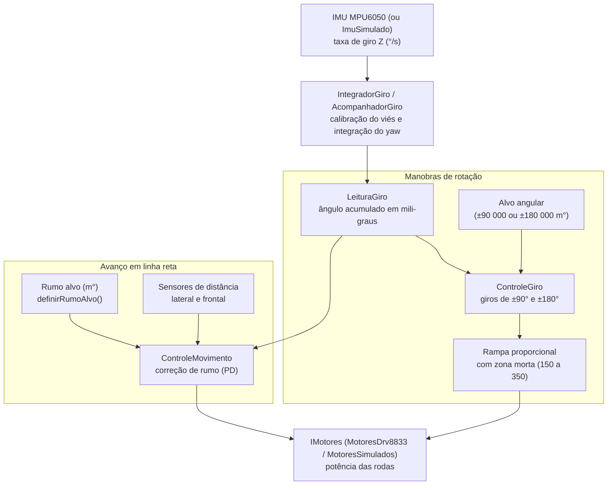

**Figura 25.** Controle de orientação em malha fechada: o ângulo de guinada (*yaw*) integrado da IMU orienta tanto os giros no próprio eixo (`ControleGiro`) quanto a manutenção da trajetória retilínea durante o avanço (`ControleMovimento`), compensando o deslizamento de rodas e irregularidades do piso (HU-11).

### Giros de 90° e 180° em malha fechada (`ControleGiro`)

* **Erro angular:** $e = \theta_{\text{alvo}} - \theta_{\text{atual}}$, calculado a cada ciclo de 10 ms em mili-graus (onde 1 000 m° = 1° e 90 000 m° = 90°).
* **Rampa de potência proporcional:** para erros grandes ($|e| \ge 50^\circ$), o controlador aplica a potência máxima (`potenciaMaxima = 350`). Conforme o robô se aproxima do alvo, a potência reduz proporcionalmente até a potência mínima (`potenciaMinima = 150`), valor calibrado para superar a zona morta de atrito estático dos motores N20 sem gerar sobre-elevação excessiva.
* **Tolerância configurável e estabilização:** quando o erro absoluto $|e| \le \text{toleranciaMiligraus}$ (padrão de $\pm 2,0^\circ$), um contador de ciclos é incrementado. O giro só é considerado concluído (`EstadoGiro::Concluido`) se permanecer na faixa por `ciclosEstabilizacao` consecutivos (3 ciclos = 30 ms), evitando falsos positivos por cruzamento em alta velocidade. Ao concluir, os motores são imediatamente freados.
* **Tratamento de ultrapassagem (*overshoot*):** se a inércia levar o robô além do alvo angular ($e < 0$), o sinal da potência diferencial é invertido automaticamente para trazê-lo de volta à faixa de tolerância.
* **Fail-safe de bloqueio (*timeout*):** se o robô colidir ou ficar preso durante a rotação e não atingir a meta em `tempoMaximoGiroMs` (2 500 ms), o controlador transiciona para `EstadoGiro::Timeout` e freia os motores.

### Retidão do avanço e correção de rumo (`ControleMovimento`)

* **Desvio de rumo:** $e_{\text{rumo}} = \text{rumoAlvo} - \theta_{\text{atual}}$. Padrão inicial: 0 m° (o rumo da largada). Pode ser redefinido com `definirRumoAlvo(alvo)` após cada curva.
* **Correção PD de rumo:** termo proporcional baseado no desvio ($K_p = 80$, ou 8,0 de potência por grau) somado a um termo derivativo filtrado ($K_d = 20$) que amortece variações bruscas de velocidade angular.
* **Avanço sem paredes laterais (`SemReferencia`):** em cruzamentos, salas abertas ou células sem paredes dos lados, a centralização lateral não tem referência ($0$). Nesses trechos, a correção de rumo do giroscópio assume o controle exclusivo das rodas, mantendo o robô em linha reta sem deriva.
* **Avanço em corredores com paredes:** a correção total é a soma da centralização lateral (alinhamento ao centro do corredor) com a correção de rumo (amortecimento de atitude angular).
* **Proteção contra reversão de roda:** a correção total é rigorosamente limitada a 60% da potência base (`correcaoMaximaPercentualDaBase`), garantindo que nenhuma roda gire para trás durante o deslocamento para a frente.

### Parâmetros provisórios de configuração

Todos os parâmetros foram ajustados em simulação física de dinâmica diferencial (`test_controle_giroscopio`) e documentados com comentários Doxygen:

| Parâmetro | Constante / Campo | Valor provisório | Origem / Justificativa |
|---|---|---|---|
| Tolerância do giro | `ConfiguracaoGiro::toleranciaMiligraus` | **2 000 m° (2,0°)** | Erro angular admissível para o robô sair alinhado na célula seguinte |
| Potência máxima de giro | `ConfiguracaoGiro::potenciaMaxima` | **350** | Limita a aceleração angular para evitar derrapagem violenta |
| Potência mínima de giro | `ConfiguracaoGiro::potenciaMinima` | **150** | Vence a zona morta de atrito estático dos micromotores N20 |
| Ganho proporcional do giro | `ConfiguracaoGiro::ganhoProporcionalDecimos` | **40 (4,0 pot/°)** | Desacelera a rotação conforme o robô se aproxima do alvo angular |
| Timeout do giro | `ConfiguracaoGiro::tempoMaximoGiroMs` | **2 500 ms** | Fail-safe caso o robô colida ou fique preso durante a rotação |
| Ciclos de estabilização | `ConfiguracaoGiro::ciclosEstabilizacao` | **3 ciclos (30 ms)** | Impede falsos positivos causados por simples cruzamento rápido da meta |
| Ganho proporcional de rumo | `ConfiguracaoControle::ganhoRumoProporcionalDecimos` | **80 (8,0 pot/°)** | Corrige desvios angulares durante o avanço retilíneo |
| Ganho derivativo de rumo | `ConfiguracaoControle::ganhoRumoDerivativoDecimos` | **20 (2,0 pot/(°/s))** | Amortece a taxa de rotação para evitar serpentear no corredor |
| Correção máxima de rumo | `ConfiguracaoControle::correcaoRumoMaxima` | **200** | Limita a autoridade de correção angular sobre os motores |

### Interface das Classes

* **`ControleGiro::iniciar(anguloRelativoMiligraus, anguloAtualMiligraus)`:** inicia o controle em malha fechada calculando o alvo absoluto.
* **`ControleGiro::iniciarGiro90Esquerda(anguloAtual)` / `iniciarGiro90Direita(anguloAtual)`:** atalhos para manobras de 90° (+90 000 m° e −90 000 m°).
* **`ControleGiro::iniciarGiro180(anguloAtual, paraEsquerda)`:** manobra de meia volta (±180 000 m°).
* **`ControleGiro::atualizar(anguloAtual, motores, dtMs)` / `atualizar(const LeituraGiro&, motores, dtMs)`:** calcula potências e comanda os atuadores; freia e retorna `EstadoGiro::Concluido` ao estabilizar dentro da tolerância.
* **`ControleGiro::cancelar()`:** interrompe imediatamente o giro e coloca o estado em `Inativo`.
* **`ControleMovimento::definirRumoAlvo(alvoMiligraus)`:** define a orientação alvo de avanço em linha reta.
* **`ControleMovimento::reiniciar(novoRumoAlvoMiligraus)`:** destrava a parada frontal e fixa a nova referência angular de rumo.
* **`ControleMovimento::desvioRumoMiligraus()`** e **`correcaoRumo()`:** telemetria e diagnóstico do controle angular.

**Rastreabilidade:** `lib/atuacao` (`ControleGiro`, `ControleMovimento`, `ConfiguracaoGiro`) atende à tarefa [#190](https://github.com/fcte-pi1/2026_2_PI1_Grupo01_Hilmer/issues/190), associada à [HU-11](https://github.com/fcte-pi1/2026_2_PI1_Grupo01_Hilmer/issues/181) (RF-11 / RNF-02).

## Falha do I²C durante a corrida (`SupervisorI2c`)

> **Situação:** implementado e testado no computador com falhas simuladas ([#241](https://github.com/fcte-pi1/2026_2_PI1_Grupo01_Hilmer/issues/241)); falta a bancada com o hardware.

Na Rev 2.0, a falha de um sensor passa a ser falha do barramento I²C: os 3 VL53L0X e o MPU6050 dividem o mesmo SDA/SCL. O boot confere os 4 dispositivos uma vez ([Boot do sistema](#boot-do-sistema-autoteste-do-i2c-autotesteboot)); com o robô andando, um mau contato, um tranco ou uma queda de tensão ainda podem tirar um deles do barramento. O firmware detecta a falha em cada dispositivo, repete a leitura um número limitado de vezes, reinicia o dispositivo que continua falhando (o ToF pelo XSHUT) e mantém os motores parados enquanto a falha durar, informando o motivo no log e na telemetria. A lógica fica em `lib/falhas`, sem Arduino, e é testada no computador; o `main.cpp` só a liga às tarefas.

```mermaid
flowchart LR
    ok["ok<br/>motores seguem"] -- "leitura com falha" --> tentando["tentando<br/>motores seguem,<br/>lê de novo no ciclo seguinte"]
    tentando -- "leitura boa" --> ok
    tentando -- "5 falhas seguidas" --> falha["em_falha<br/>motores parados,<br/>dispositivo reiniciado"]
    falha -- "5 falhas depois do reinício<br/>(reinícios a 500 ms ou mais)" --> falha
    falha -- "3 reinícios sem voltar" --> inop["inoperante<br/>motores parados,<br/>sem novo reinício"]
    falha -- "3 leituras boas seguidas" --> ok
    inop -- "3 leituras boas seguidas" --> ok
```

**Figura 26.** Situações de cada dispositivo no `SupervisorI2c`, com os valores provisórios de `ConfiguracaoFalhasI2c.h`. Os motores só andam com os 4 dispositivos em `ok` ou `tentando`.

### Regras de Negócio e Algoritmo

* **Falha de um ToF (`VigiaTof`):** a cada ciclo da navegação (10 ms), a última amostra de cada sensor no `CombinadorTof` vira uma leitura. Amostra nova em `Falha` (o sensor não respondeu ou o tempo do I²C esgotou) é falha. Amostra nova válida, fora de alcance ou abaixo do mínimo é leitura boa, porque o sensor respondeu. Sem amostra nova há mais de `IDADE_MAXIMA_LEITURA_TOF_MS` (100 ms), é falha (o sensor parou de medir), contada uma vez a cada 100 ms. Sem amostra nova dentro dos 100 ms, não há o que concluir: o sensor mede a cada 33 ms.
* **Falha da IMU:** a leitura do giroscópio (o `AcompanhadorGiro` a conta) ou do acelerômetro ([#192](https://github.com/fcte-pi1/2026_2_PI1_Grupo01_Hilmer/issues/192)) que falha é falha, porque os dois são o mesmo MPU6050, a menos que o barramento estivesse com a navegação naquele ciclo (as `esperasEsgotadas()` do `BarramentoI2c` aumentaram). Nesse caso, a navegação está reiniciando um ToF, e a leitura perdida não é culpa da IMU.
* **Tentativas:** com 1 a 4 falhas seguidas, o dispositivo fica `tentando`: a leitura é repetida no ciclo seguinte, e os motores seguem. Uma leitura boa volta a `ok`.
* **Falha declarada e reinício:** com 5 falhas seguidas, o dispositivo fica `em_falha`, os motores param e ele é reiniciado: o ToF pelo XSHUT (`TofVl53l0x::reiniciarSensor`), a IMU por `ImuMpu6050::iniciar()`. Depois de cada reinício, o dispositivo tem de novo as 5 tentativas, e dois reinícios do mesmo dispositivo ficam a pelo menos 500 ms um do outro, para o barramento não ficar ocupado só com reinícios.
* **Inoperante:** depois de 3 reinícios seguidos sem o dispositivo voltar, ele não é mais reiniciado, e os motores continuam parados. Se o último reinício não conseguiu configurá-lo, o driver o deixa em reset e não o lê mais: ele só volta com o robô reiniciado.
* **Recuperação:** em `em_falha` ou `inoperante`, 3 leituras boas seguidas devolvem o dispositivo a `ok` e zeram os reinícios. Uma falha no meio zera a contagem, para um mau contato que oscila não ficar ligando e desligando os motores.
* **Motores (`TravaFalhaI2c`):** os motores param enquanto qualquer um dos 4 estiver `em_falha` ou `inoperante`, pela mesma `MotoresComTrava` do boot ([#50](https://github.com/fcte-pi1/2026_2_PI1_Grupo01_Hilmer/issues/50)): travada, toda potência vira freio, e o estimador do deslocamento ([#380](https://github.com/fcte-pi1/2026_2_PI1_Grupo01_Hilmer/issues/380)) fica sabendo que o robô parou. A trava do I²C só solta a trava que ela mesma pôs, então um boot reprovado continua travado até o robô ser reiniciado.
* **Ciclo de navegação ([#184](https://github.com/fcte-pi1/2026_2_PI1_Grupo01_Hilmer/issues/184)):** enquanto a falha durar, a navegação tira a permissão do `CicloNavegacao` (`EntradaCiclo::liberado`). O ciclo cancela o movimento, freia e espera em `aguardando_largada`; quando a falha passa, percebe de novo a célula a partir de onde parou e segue a corrida. Sem isso, o movimento travado acabaria por tempo esgotado, como `Falha` do ciclo, e o robô não voltaria sozinho.
* **Estado informado:** cada mudança de situação, cada reinício e cada mudança da trava viram uma linha no log (Figura 27), e a telemetria repete em todo pacote `i2c_falhas` (os dispositivos em falha agora, separados por vírgula, ou `""`) e `i2c_reinicios` (os reinícios pedidos desde o boot).

```json
{"status":"i2c","dispositivo":"tof_frontal","situacao":"tentando"}
{"status":"i2c","dispositivo":"tof_frontal","situacao":"em_falha"}
{"status":"motores_travados_i2c"}
{"status":"reinicio_i2c","dispositivo":"tof_frontal","sucesso":true}
{"status":"navegacao","estado":"aguardando_largada","falha":"nenhuma","celulas":2}
{"status":"i2c","dispositivo":"tof_frontal","situacao":"ok"}
{"status":"motores_liberados_i2c"}
{"status":"navegacao","estado":"percebendo","falha":"nenhuma","celulas":2}
```

**Figura 27.** Log de uma falha do ToF frontal no meio de um avanço, que volta com o primeiro reinício: os motores param antes do reinício, o ciclo de navegação espera e, depois de 3 medidas boas, os motores voltam e o ciclo percebe a célula de novo.

| Parâmetro (`ConfiguracaoFalhasI2c.h`) | Valor | Observação |
|---|---|---|
| `TENTATIVAS_LEITURA_I2C` | 5 | **Provisório.** O mesmo número de falhas que invalida o ângulo de giro (`FALHAS_SEGUIDAS_GIRO_INVALIDO`, [#378](https://github.com/fcte-pi1/2026_2_PI1_Grupo01_Hilmer/issues/378)). Um dispositivo sem resposta é declarado em falha em cerca de 50 ms; um ToF que responde mas parou de medir, em cerca de 0,55 s |
| `LEITURAS_PARA_RECUPERAR_I2C` | 3 | **Provisório.** Para um ToF, cerca de 70 ms de medidas boas |
| `REINICIOS_MAXIMOS_I2C` | 3 | **Provisório** |
| `ESPERA_ENTRE_REINICIOS_I2C_MS` | 500 ms | **Provisório.** O reinício de um VL53L0X segura o barramento por algumas dezenas de ms |

### Na placa: navegação, tarefa da IMU e telemetria

* **Navegação (`supervisionarI2c()` no `main.cpp`):** logo depois da leitura dos ToF, registra os 3 sensores no supervisor, aplica a trava dos motores (que também vale para a falha da IMU) e só então reinicia o ToF que o supervisor pediu, segurando o barramento (`BarramentoI2c::Uso`). A trava vem antes porque o reinício segura a navegação por algumas dezenas de ms, e o robô não pode seguir andando nesse tempo. A função devolve se há falha, e a navegação usa isso para tirar a permissão do ciclo.
* **Reinício de um ToF (`TofVl53l0x::reiniciarSensor(lado)`):** põe o XSHUT do sensor em nível baixo, espera a partida, solta, atribui de novo o endereço e liga o modo contínuo. Só o sensor que falhou é reiniciado; os outros dois seguem medindo, porque estão nos endereços novos e não respondem no de fábrica (0x29).
* **Tarefa da IMU:** depois de cada ciclo (giroscópio e acelerômetro), registra o MPU6050 no supervisor. Se ele pedir o reinício, a tarefa chama `imu.iniciar()` (que espera 100 ms) e recomeça a contagem do período, para esses 100 ms não virarem uma rajada de leituras.
* **Concorrência:** o supervisor é usado pelas três tarefas, então todo acesso a ele fica na seção crítica `travaFalhasI2c`, curta; os reinícios e a trava ficam fora dela, porque esperam. A trava fica na `travaOdometria`, porque freia pelo estimador do deslocamento, que a telemetria também lê, como no `detectorObjetivo.processarChegada`.
* **Telemetria:** com `i2c_falhas` e `i2c_reinicios`, o pior caso do JSON de telemetria chegou a 658 bytes, dentro do buffer de 768 (`TAMANHO_MAX_JSON_TELEMETRIA`).

### Interface das Classes

* **`SupervisorI2c`** (`lib/falhas`): `registrarLeitura(dispositivo, leitura, agoraMs)` devolve a `DecisaoI2c` (a `acao`, `Nenhuma` ou `Reiniciar`, e a situação `antes` e `depois`, para o log anunciar só as mudanças); `registrarReinicio(dispositivo, sucesso)`; `situacao(dispositivo)`, `motoresDevemParar()`, `falhas`, `falhasSeguidas`, `reinicios`, `reiniciosSemSucesso`, `reiniciosTotais()` e `descreverFalhas(saida, capacidade)`, com até `TAMANHO_MAX_FALHAS_I2C` (48) bytes. Os dispositivos são os mesmos do `AutotesteBoot` (`Dispositivo`).
* **`LeituraI2c`** (`Ok`, `Falha` ou `SemNovidade`) e **`leituraDaImu(falhou, barramentoOcupado)`**: o resultado de uma leitura para o supervisor.
* **`VigiaTof`** (`lib/falhas`): `avaliar(lado, amostra, agoraMs)` e `sensorReiniciado(lado, agoraMs)`; `dispositivoDoTof(lado)` dá o dispositivo de cada lado.
* **`TravaFalhaI2c`** (`lib/falhas`): `aplicar(deveParar, MotoresComTrava&)` devolve a `MudancaTrava` (`Nenhuma`, `Travou` ou `Soltou`); `travouPorFalha()`.
* **`TofVl53l0x::reiniciarSensor(lado)`** (`lib/drivers_esp32`): reinicia um sensor só e devolve `true` se ele voltou.

### Limites conhecidos

* Durante o reinício de um VL53L0X (2 × 10 ms de partida mais a calibração do `init()` da biblioteca), a IMU perde leituras, que não contam como falha dela, e o ângulo de giro não soma. Os motores já estão parados.
* Os ToF são reiniciados um por vez. Se dois caírem juntos para o endereço de fábrica (0x29), por exemplo numa queda de tensão, um reinício pode não bastar: eles ficam `inoperante`, com os motores parados, e o robô precisa ser reiniciado.
* Nas tentativas da IMU (até 50 ms), o giro não soma ao ângulo, como já acontecia antes ([#378](https://github.com/fcte-pi1/2026_2_PI1_Grupo01_Hilmer/issues/378)). Se a falha pegar o robô girando, o rumo pode ficar alguns graus errado.
* Ao retomar depois de uma falha no meio de um avanço, o ciclo percebe de novo a partir da célula da navegação, com o robô parado onde a falha o pegou; é o mesmo caminho de quando a permissão sai no meio de um movimento ([#184](https://github.com/fcte-pi1/2026_2_PI1_Grupo01_Hilmer/issues/184)).

**Rastreabilidade:** `lib/falhas` (`SupervisorI2c`, `VigiaTof`, `TravaFalhaI2c`, `ConfiguracaoFalhasI2c.h`), `TofVl53l0x::reiniciarSensor`, os campos `i2c_falhas` e `i2c_reinicios` do `TelemetriaJson` e a supervisão no `main.cpp` atendem à tarefa [#241](https://github.com/fcte-pi1/2026_2_PI1_Grupo01_Hilmer/issues/241), da [HU-13](https://github.com/fcte-pi1/2026_2_PI1_Grupo01_Hilmer/issues/51) (Calibração de Hardware).

**Pendências:** a bancada com o hardware: com as rodas no ar e o monitor serial aberto, soltar e recolocar o conector de um VL53L0X e depois o do MPU6050 com o robô ligado, conferir a sequência da Figura 27 e ajustar os valores provisórios. A forma de soltar o conector sem curto no barramento precisa ser combinada com a eletrônica.

## Navegação: detecção de colisão e recuperação (`DetectorColisao`)

> **Situação:** implementado e integrado ao firmware na `main` (PR [#451](https://github.com/fcte-pi1/2026_2_PI1_Grupo01_Hilmer/pull/451)) e testado no computador com batidas simuladas; falta a bancada.

Se o robô bate numa parede que não viu, ele percebe a batida, recua até o centro da célula, percebe as paredes de novo e retoma a navegação, **sem perder o mapa nem a posição** ([#192](https://github.com/fcte-pi1/2026_2_PI1_Grupo01_Hilmer/issues/192), [HU-17](https://github.com/fcte-pi1/2026_2_PI1_Grupo01_Hilmer/issues/44)). A colisão é percebida por duas evidências independentes: o pico de aceleração na IMU e o ToF frontal parado com os motores acionados. A detecção por encoder parado fica para quando os encoders existirem. A lógica fica em `lib/execucao`, sem Arduino, e é testada no computador; só a leitura do acelerômetro é do hardware.

```mermaid
flowchart LR
    acel["Acelerômetro do MPU6050<br/>X e Y, em mg"] --> det["DetectorColisao<br/>impacto ou frente parada"]
    tof["ToF frontal e giroscópio"] --> det
    pot["RegistradorPotencia<br/>última potência comandada"] --> det
    det -- "colisão, com o robô em movimento" --> ciclo["CicloNavegacao<br/>cancela o movimento e freia"]
    ciclo --> rec["Recuperando<br/>ExecutorMovimentos::iniciarRecuo<br/>de ré até o centro da célula"]
    rec --> perc["Percebendo<br/>na mesma célula e direção"]
    perc --> dec["Navegacao::darPasso()<br/>decide de novo"]
    ciclo -. "evento colisao" .-> tel["Telemetria e log"]
```

**Figura 28.** Da batida à retomada: o detector junta o acelerômetro, o ToF frontal, o giroscópio e a potência comandada; o ciclo de navegação recua, percebe a célula de novo e decide o próximo passo, e a colisão sai no log e na telemetria.

### Regras de Negócio e Algoritmo

* **Quando a detecção fica ligada:** só com o robô sendo conduzido, isto é, avançando, girando ou nos trechos do realinhamento ([#188](https://github.com/fcte-pi1/2026_2_PI1_Grupo01_Hilmer/issues/188)), e com permissão para mover. Parado no centro, percebendo, recuando, antes da largada ou durante uma falha do I²C ([#241](https://github.com/fcte-pi1/2026_2_PI1_Grupo01_Hilmer/issues/241)), ela fica desligada: um robô erguido ou empurrado à mão não é uma colisão. Desligada, a referência de repouso do acelerômetro continua aprendendo.
* **Impacto (IMU):** a cada 10 ms, o detector mede o afastamento da aceleração no plano (X e Y) em relação à referência de repouso, pelo módulo (`√(dx² + dy²)`, em inteiros). Com 1000 mg ou mais por 1 leitura, é impacto. A referência é uma média lenta (cada leitura calma anda 1/16 do caminho até ela), então a inclinação do sensor e o zero dele não contam. Só leituras abaixo da metade do limiar ajustam a referência, para um impacto não virar o "novo repouso". A primeira leitura vira a referência.
* **Frente parada (ToF):** a mesma regra da proteção contra motor travado ([#341](https://github.com/fcte-pi1/2026_2_PI1_Grupo01_Hilmer/issues/341)): potência de 300 ou mais em uma das rodas por 500 ms, com o ToF frontal variando menos de 5 mm e o giroscópio abaixo de 5 °/s. Uma frente além do alcance do ToF (leitura no máximo, 1200 mm) não conta, porque também não muda andando por um corredor longo, como o do 12×4. Pega o encosto devagar, que o acelerômetro não vê, e o robô preso depois da batida.
* **Um aviso por colisão:** o detector avisa no ciclo em que percebe a colisão e fica quieto até a detecção desligar (o recuo) ou `reiniciar()`. Se as duas evidências chegam no mesmo ciclo, vale o impacto.
* **Recuperação:** com a colisão e o robô em movimento, o `CicloNavegacao` cancela o movimento, freia, esquece o passo planejado e vai para `Recuperando`. O `ExecutorMovimentos` recua de ré, em linha reta, segurando pelo giroscópio o rumo da direção atual. Se a batida foi num giro, o rumo alvo volta ao da direção de antes do giro. O recuo é o quanto a odometria diz que o robô passou do centro da célula, entre 10 e 40 mm (sem pose válida, 40 mm). Com a parede da frente da própria célula à vista, ele termina antes, quando o ToF mostra o robô no centro (84 mm do centro à parede, com 3 mm de tolerância). Um recuo que passa do tempo limite termina em `Falha` (`tempo_esgotado`).
* **Retomada:** concluído o recuo, o ciclo volta a `Percebendo` na mesma célula, junta as leituras novas, grava as paredes e decide de novo.
* **Mapa e posição preservados:** a célula e a direção da navegação não mudam, e o mapa fica como estava. A única escrita é a parede da frente (`Mapa::corrigirParede`), e só quando as três condições valem juntas:
  1. a batida **se repete** avançando, na mesma célula e direção (uma batida isolada só recua e percebe de novo);
  2. o robô está onde a batida na parede da própria célula acontece: a odometria na mesma célula da navegação, de 10 a 70 mm além do centro;
  3. o ToF frontal não mede a frente livre (acima de 120 mm e abaixo do alcance máximo).

  Assim a recuperação nunca grava uma parede que não existe, o que fecharia um caminho livre.
* **Colisões seguidas:** o ciclo tolera até 4 colisões seguidas sem concluir uma célula. Na 5ª, ele para em `Falha` (`colisoes_seguidas`), com os motores freados, para um problema que o robô não resolve (uma saliência no piso, por exemplo) não o fazer bater e recuar para sempre. Concluir uma célula zera a contagem.
* **Motor travado:** se a proteção da [#341](https://github.com/fcte-pi1/2026_2_PI1_Grupo01_Hilmer/issues/341) cortou os motores antes da colisão ser percebida, a navegação a libera (`motoresProtegidos.liberar()`), porque o recuo precisa de ré.
* **Telemetria:** cada colisão sai no log e como o evento `colisao` da telemetria serial, com a posição da navegação. Um evento por amostra: a chegada ao objetivo vai primeiro, e cada colisão pendente espera a sua amostra.

```json
{"status":"colisao","tipo":"impacto","desvio_mg":2412,"celulas":3}
{"status":"navegacao","estado":"recuperando","falha":"nenhuma","celulas":3}
{"status":"navegacao","estado":"percebendo","falha":"nenhuma","celulas":3}
```

**Figura 29.** Exemplo do log de uma batida: o tipo da colisão e o desvio medido no acelerômetro (o número que se compara com o limiar na bancada), o recuo (`recuperando`) e a volta à percepção na mesma célula.

| Parâmetro | Arquivo | Valor | Como ajustar |
|---|---|---|---|
| `LIMIAR_IMPACTO_MG` | `ConfiguracaoColisao.h` | 1000 mg | **Provisório.** Bater o robô devagar contra a parede e ver o `desvio_mg` no log; ficar entre o maior desvio andando sem bater e o menor batendo |
| `AMOSTRAS_CONFIRMACAO_IMPACTO` | `ConfiguracaoColisao.h` | 1 (10 ms) | **Provisório.** O pico de uma batida dura poucas leituras |
| `DESLIZAMENTO_REFERENCIA` | `ConfiguracaoColisao.h` | 4 (1/16 por leitura) | **Provisório** |
| `RECUO_COLISAO_MM` e `RECUO_MINIMO_COLISAO_MM` | `ConfiguracaoColisao.h` | 40 e 10 mm | **Provisório.** Do contato com a parede ao centro são cerca de 34 mm |
| `TOLERANCIA_CENTRO_RECUO_MM` e `FOLGA_PAREDE_DA_CELULA_RECUO_MM` | `ConfiguracaoColisao.h` | 3 e 26 mm | **Provisório.** Quando a parede vista é a da própria célula |
| `LIMIAR_FRENTE_LIVRE_COLISAO_MM` | `ConfiguracaoColisao.h` | 120 mm | **Provisório** |
| `EXCESSO_MINIMO_PAREDE_MM` e `EXCESSO_MAXIMO_PAREDE_MM` | `ConfiguracaoColisao.h` | 10 e 70 mm | **Provisório.** O encontrão acontece a cerca de 34 mm além do centro |
| `COLISOES_SEGUIDAS_MAXIMAS` | `ConfiguracaoColisao.h` | 4 | **Provisório** |
| `FAIXA_ACELEROMETRO` | `ConfiguracaoImu.h` | ±4 g | **Provisório.** Se o pico saturar (4000 mg), subir a faixa |
| Frente parada | `ConfiguracaoProtecaoMotor.h` | 300 de potência, 500 ms, 5 mm e 5 °/s | Os mesmos da proteção contra motor travado ([#341](https://github.com/fcte-pi1/2026_2_PI1_Grupo01_Hilmer/issues/341)) |

### Na placa: tarefa da IMU e tarefa de navegação

* **Tarefa da IMU:** a cada 10 ms, além do giroscópio, lê os eixos X e Y do acelerômetro (`ImuMpu6050::lerAceleracaoPlano`, registradores 0x3B a 0x3E, faixa ±4 g, o mesmo filtro de 42 Hz do giroscópio) e guarda a cópia sob a seção crítica `travaGiro`.
* **Tarefa de navegação:** a cada 10 ms, monta a `EntradaDeteccao`: ligada só com permissão para mover e o robô em movimento (`cicloNavegacao.emMovimento()`), com a última aceleração, a última potência comandada (`RegistradorPotencia`, a camada de fora de `motoresTracao`, que guarda o que a navegação mandou, mesmo que a trava ou a proteção tenham recusado) e o ToF frontal com a taxa do giroscópio. O resultado vai para o ciclo em `EntradaCiclo::colisao`.
* **Colisão tratada:** a navegação escreve a linha `colisao` no log, conta uma colisão pendente para a telemetria (sob `travaOdometria`) e libera a proteção dos motores para o recuo.
* **Comando `Z`:** recoloca o robô na largada e reinicia o detector, a correção pelas paredes e o ciclo.

### Interface das Classes

* **`IAcelerometro`** (`lib/hal`): `bool lerAceleracaoPlano(int16_t& axMg, int16_t& ayMg)`, em milésimos de g; implementado pelo `ImuMpu6050` e pelo `ImuSimulado` (`definirAceleracao(ax, ay)`).
* **`converterBrutoParaMg(bruto, faixa)`, `juntarBytesAceleracao(alto, baixo)` e `valorAccelConfig(faixa)`** (`ConversorAceleracao.h`, `lib/imu`): a conversão da leitura bruta, com arredondamento, e o registrador da faixa.
* **`RegistradorPotencia`** (`lib/atuacao`): `IMotores` que repassa tudo e guarda `ultimaPotencia()` (zero depois de `parar()`).
* **`DetectorColisao`** (`lib/execucao`): `atualizar(EntradaDeteccao)` devolve `TipoColisao` (`Nenhuma`, `Impacto` ou `FrenteParada`) no ciclo em que percebe a colisão; `reiniciar()`, `colisoes()`, `ultima()` e `desvioMg()`.
* **`ExecutorMovimentos::iniciarRecuo(distanciaMm)`:** o recuo de ré (`Movimento::Recuar`), com rumo pelo giroscópio e parada pelo centro.
* **`CicloNavegacao`:** o estado `Recuperando`, `EntradaCiclo::colisao`, `emMovimento()`, `colisoes()`, `recuperacoes()`, `paredesPorColisao()`, `ultimaColisao()` e a falha `ColisoesSeguidas`.
* **Simulação:** o `RoboSimulado` ganhou paredes sólidas (`paredesSolidas`: o chassi que encostaria fica parado, as rodas patinam e o encontrão vira um pico de aceleração), `aceleracaoPlanoMg`, `encontroes()` e `preso()`; a `SimulacaoCorrida` dos testes de integração ganhou `detectarColisao` e `cegarTofFrontal`.

### Limites conhecidos

* O recuo corrige a posição ao longo do eixo só até onde a odometria e o ToF frontal permitem.
* Depois de uma batida num giro, o rumo é refeito pelo giroscópio no giro seguinte, e não no recuo.
* A colisão lateral (raspar numa parede sem bater de frente) é detectada pelo impacto, mas o robô só recua e percebe de novo: não grava parede lateral.
* A detecção pelo impacto usa só o módulo no plano, então o sensor precisa estar plano (a gravidade fora de X e Y); o sinal e a orientação dos eixos não importam.
* Com o filtro de 42 Hz, uma batida curta pode chegar atenuada ao acelerômetro.
* O evento `colisao` sai na telemetria serial, mas a amostra enviada ao Supabase ([#238](https://github.com/fcte-pi1/2026_2_PI1_Grupo01_Hilmer/issues/238)) ainda não o leva: o `coletarAmostra()` do `main.cpp` só manda `objetivo_alcancado`, embora o contrato já tenha `EventoTelemetria::Colisao`.

**Rastreabilidade:** `DetectorColisao`, `ConfiguracaoColisao.h`, o estado `Recuperando` do `CicloNavegacao`, `ExecutorMovimentos::iniciarRecuo`, `RegistradorPotencia`, `IAcelerometro`, `ConversorAceleracao.h`, `ImuMpu6050::lerAceleracaoPlano`, as paredes sólidas do `RoboSimulado` e a detecção no `main.cpp` atendem à tarefa [#192](https://github.com/fcte-pi1/2026_2_PI1_Grupo01_Hilmer/issues/192), da [HU-17](https://github.com/fcte-pi1/2026_2_PI1_Grupo01_Hilmer/issues/44) (RF17).

**Pendências:** a bancada com o robô montado: bater devagar contra a parede para ajustar o limiar do impacto e conferir a faixa do acelerômetro, conferir onde o robô para depois do recuo e a frente parada com o robô preso. O evento `colisao` no envio ao Supabase. A detecção por encoder parado, quando os encoders existirem.

## Testes

Os testes rodam no computador, no ambiente `native`, com o framework **Unity**. Cada módulo tem sua pasta `test/test_<modulo>/`.

| Arquivo | Teste | Verifica |
|---|---|---|
| `test_nucleo/test_direcao.cpp` | `test_girar_direita_percorre_as_quatro_direcoes` | Norte → Leste → Sul → Oeste → Norte |
| | `test_girar_esquerda_desfaz_girar_direita` | Giro à esquerda é o inverso do giro à direita |
| | `test_oposta_inverte_a_direcao` | Norte ↔ Sul, Leste ↔ Oeste |
| | `test_direcao_absoluta_converte_lado_do_robo_em_direcao_do_labirinto` | Frente, esquerda e direita com o robô virado para Leste |
| `test_simulacao/test_sensor_distancia_simulado.cpp` | `test_sem_leitura_configurada_a_leitura_falha` | Sem configuração, a leitura falha |
| | `test_leitura_fixa_se_repete_a_cada_chamada` | A leitura fixa se repete |
| | `test_fila_entrega_as_leituras_em_ordem_e_depois_volta_para_a_fixa` | Fila em ordem e retorno à leitura fixa |
| | `test_falha_simulada_retorna_false_e_nao_consome_a_fila` | Falha simulada não perde leituras da fila |
| | `test_fila_cheia_recusa_novas_leituras` | Limite de 16 leituras |
| | `test_pode_ser_usado_pela_interface_ISensorDistancia` | O simulado funciona por meio da interface |
| `test_percepcao/test_classificador.cpp` | `test_classificador_parede_proxima` | Média <= 180 mm classificada como Parede |
| | `test_classificador_passagem_livre` | Média > 180 mm classificada como Livre |
| | `test_classificador_valor_no_limiar` | Limite exato de 180 mm |
| | `test_classificador_limiar_configuravel` | Alteração e consulta do limiar dinâmico em tempo de execução |
| | `test_classificador_leituras_com_ruido` | Atenuação de ruído via média |
| | `test_classificador_vetor_vazio` | Vetor de amostras vazio assume Desconhecido por segurança (*fail-safe*) |
| `test_atualizador_mapa/test_atualizador_mapa.cpp` | `test_registro_nova_parede` | Registra parede interior desconhecida como Registrada |
| | `test_registro_parede_ja_conhecida` | Mesma leitura repetida retorna JaConhecida |
| | `test_sem_conflito_ao_percorrer_labirinto` | Percorre células mantendo temConflito falso |
| | `test_parede_desconhecida_nao_registrada` | Desconhecido não altera mapa e retorna Invalida |
| | `test_parede_compartilhada_sem_conflito` | Paredes compartilhadas entre vizinhas coincidem |
| | `test_mapa_final_identico_ao_labirinto_4x4` | Exploração completa gera mapa idêntico ao labirinto |
| | `test_conflito_preserva_mapa_e_sinaliza_tem_conflito` | Conflito marca temConflito e preserva valor antigo |
| | `test_conversao_direcoes_nas_quatro_orientacoes` | Conversão correta nas 4 orientações cardeais |
| | `test_pose_fora_do_mapa_retorna_invalida` | Pose fora dos limites retorna Invalida |
| | `test_sobrecarga_multiplas_amostras_com_classificador` | Sobrecarga com múltiplas amostras filtra ruído |
| `test_integracao_mapa/test_integracao_mapa.cpp` | `test_mapa_final_identico_ao_labirinto_4x4` | Robô simulado explora labirinto 4×4 e mapa fica idêntico |
| | `test_mapa_final_identico_ao_labirinto_8x4` | Robô simulado explora labirinto 8×4 e mapa fica idêntico |
| | `test_mapa_final_identico_ao_labirinto_12x4` | Robô simulado explora labirinto 12×4 e mapa fica idêntico |
| | `test_mapa_nao_e_identico_antes_de_explorar` | Mapa inicial difere do labirinto antes da exploração |
| | `test_uma_celula_registra_so_as_tres_paredes_que_o_sensor_ve` | Registra apenas as paredes observadas na célula atual |
| `test_json_mapa/test_json_mapa.cpp` | `test_mapa_vazio_4x4_tem_so_o_perimetro_conhecido` | Mapa novo: só o perímetro sai `true`, o resto `null` |
| | `test_cabecalho_traz_dimensao_linhas_e_colunas` | Início do JSON do 12×4 traz `dimensao`, `linhas` e `colunas` corretos |
| | `test_parede_livre_e_parede_viram_false_e_true` | `Parede` vira `true` e `Livre` vira `false` |
| | `test_parede_registrada_aparece_nas_duas_celulas_vizinhas` | A mesma parede aparece espelhada nas duas células que ela separa |
| | `test_json_tem_exatamente_os_campos_combinados_para_a_telemetria` | Objeto raiz com 4 campos e cada célula com 6, sem campo a mais ou a menos |
| | `test_json_sai_compacto_sem_espacos_nem_quebras_de_linha` | Saída sem espaço, tab ou quebra de linha |
| | `test_dimensao_combina_com_as_linhas_e_as_colunas_nos_tres_tamanhos` | `"4x4"/4/4`, `"8x4"/4/8` e `"12x4"/4/12` nos três tamanhos da competição |
| | `test_serializa_mapa_4x4_completo` | Mapa 4×4 com todas as paredes internas: ida e volta bate célula a célula |
| | `test_serializa_mapa_8x4` | Mapa 8×4 parcialmente preenchido: ida e volta bate célula a célula |
| | `test_serializa_mapa_12x4_completo` | Mapa 12×4 com todas as paredes internas, dentro de `TAMANHO_MAX_JSON_MAPA` |
| | `test_serializa_mapa_12x4_parcial` | Mapa 12×4 com poucas paredes conhecidas, como no meio de uma corrida |
| | `test_mapa_12x4_completo_e_reconstruido_a_partir_do_json` | O JSON do 12×4 completo remonta um `Mapa` idêntico (`==`) ao original |
| | `test_mapa_parcial_reconstruido_mantem_as_paredes_desconhecidas` | `null` volta como `Desconhecido`, não como `Livre`, na reconstrução |
| | `test_serializar_nao_altera_o_mapa` | `serializar` não muda o `Mapa` original (HU-04) |
| | `test_serializacoes_repetidas_do_mesmo_mapa_geram_o_mesmo_json` | Duas serializações do mesmo mapa produzem o mesmo texto |
| | `test_pior_caso_cabe_em_tamanho_max_json_mapa` | 12×4 com todas as paredes `Livre` (o pior caso) cabe em `TAMANHO_MAX_JSON_MAPA`, com folga menor que 10% |
| | `test_buffer_pequeno_devolve_zero_e_deixa_string_vazia` | Buffer pequeno demais devolve `0` e deixa string vazia |
| | `test_buffer_com_o_tamanho_exato_serve_e_um_a_menos_nao` | Capacidade exata (JSON + `\0`) funciona; um byte a menos falha |
| | `test_buffer_nulo_ou_sem_capacidade_devolve_zero` | Buffer nulo ou capacidade zero devolvem `0` |
| | `test_nao_escreve_depois_do_fim_da_capacidade_informada` | Nada é escrito além da capacidade informada, no sucesso e na falha |
| | `test_capacidade_de_um_byte_devolve_zero_e_string_vazia` | Capacidade de 1 byte devolve `0` e grava só o `\0` |
| | `test_dimensao_fora_do_enum_sai_como_texto_vazio` | Valor fora do enum `DimensaoMapa` sai com `dimensao` vazio, sem travar (*fail-safe*) |
| `test_armazenamento_mapa/test_armazenamento_mapa.cpp` | `test_congelamento_do_mapa` | Ciclo de vida do congelamento: recusa sem corrida e em dobro, isolamento do mapa final e destrave com nova corrida |
| `test_mapa_final/test_mapa_final.cpp` | `test_congelamento_ao_sinalizar_objetivo` | Ao sinalizar o objetivo, o mapa é congelado uma única vez e guarda as paredes descobertas |
| | `test_serializacao_mapa_final_formato_5_3_3` | `serializarFinal` recusa antes de congelar e, depois, gera o JSON da #178 (16 células no 4×4); buffer pequeno devolve `0` |
| | `test_mapa_final_testado_no_labirinto_simulado` | Robô simulado vai de (0, 0) ao objetivo (3, 3) no labirinto 4×4, congela e serializa o mapa explorado |
| | `test_mapa_final_permanece_inalterado_apos_novos_registros` | Escritas depois do congelamento mudam só o mapa da corrida; o JSON do mapa final continua idêntico |
| `test_resolucao_mapa/test_resolucao_mapa.cpp` | `test_flood_fill_mapa_vazio_4x4` | Sem paredes internas, a distância de cada célula até (3, 3) é a de Manhattan; na partida, o empate escolhe a frente (Norte) |
| | `test_contorno_parede_conhecida` | Com parede conhecida ao Norte da partida, a decisão é Leste |
| | `test_sem_caminho_ate_objetivo` | Partida cercada por paredes: distância `DISTANCIA_INFINITA` e decisão recusada |
| | `test_dar_passo_aguarda_confirmacao_dos_sensores` | `darPasso()` registra a célula esperada sem mudar a pose e recusa um segundo passo pendente |
| | `test_confirmar_pose_em_andamento_e_chegada` | Pose na origem mantém o passo (`EmAndamento`); na célula esperada, conclui (`Confirmada`) |
| | `test_confirmar_pose_divergente_replaneja` | Pose em outra célula é adotada (`Divergente`) e o passo seguinte replaneja a partir dela |
| | `test_confirmar_pose_invalida_ignorada` | Pose fora do mapa é ignorada (`Invalida`): pose e passo pendente não mudam |
| | `test_atingimento_de_objetivo` | No objetivo, não há decisão nem passo |
| | `test_resolucao_labirinto_4x4_simulado` | Com o mapa vazio, o robô simulado vai de (0, 0) a (3, 3) no `LABIRINTO_4X4`, confirmando cada passo e sem atravessar parede real |
| | `test_resolucao_labirinto_8x4_simulado` | O mesmo no `LABIRINTO_8X4`, até (3, 7) |
| | `test_resolucao_labirinto_12x4_simulado` | O mesmo no `LABIRINTO_12X4`, até (3, 11) |
| | `test_resolucao_com_falhas_de_leitura` | Com o sensor de distância falhando uma a cada 3 leituras, o robô não decide sem leitura e ainda chega ao objetivo do 4×4 |
| `test_odometria/test_odometria.cpp` | `test_comeca_na_celula_0_0_virada_para_o_norte` | Pose inicial (0, 0) virada para o Norte e posição válida |
| | `test_uma_celula_para_o_norte_aumenta_a_linha` | Uma célula de avanço sobe a linha em 1 |
| | `test_a_celula_muda_ao_cruzar_a_parede_a_meia_celula` | A célula só muda depois de passar da parede, a meia célula do centro |
| | `test_marcha_a_re_volta_a_celula_anterior` | Marcha à ré volta à célula anterior |
| | `test_atualizar_de_uma_vez_ou_em_passos_da_o_mesmo_resultado` | Atualizar de uma vez ou em passos pequenos dá a mesma pose |
| | `test_giro_de_90_graus_para_a_direita_vai_para_leste` | Giro de 90° à direita vira para o Leste |
| | `test_giro_de_90_graus_para_a_esquerda_vai_para_oeste` | Giro de 90° à esquerda vira para o Oeste |
| | `test_giro_de_180_graus_vira_para_o_sul_nos_dois_sentidos` | Giro de 180° vira para o Sul nos dois sentidos |
| | `test_quatro_giros_para_a_direita_voltam_ao_norte` | Quatro giros à direita voltam ao Norte |
| | `test_giro_no_lugar_nao_muda_a_celula` | Giro no lugar não muda a célula |
| | `test_o_giro_so_passa_para_a_direcao_seguinte_depois_de_45_graus` | A direção só muda depois de 45° |
| | `test_uma_roda_um_pouco_mais_rapida_nao_muda_a_direcao_em_linha_reta` | Uma roda um pouco mais rápida em linha reta não gira o robô |
| | `test_percurso_em_L_dois_para_o_norte_e_dois_para_o_leste` | Percurso em L termina em (2, 2) virado para o Leste |
| | `test_percurso_em_U_e_volta_a_linha_da_partida` | Percurso em U volta à linha da partida |
| | `test_serpentina_pelo_labirinto_12x4` | Serpentina completa no 12×4 termina em (3, 0) virado para o Oeste |
| | `test_erro_pequeno_em_cada_celula_nao_atrapalha_um_corredor_de_11_celulas` | Erro de 1% em uma roda não atrapalha um corredor de 11 células |
| | `test_reiniciar_define_a_pose_e_usa_as_contagens_como_referencia` | `reiniciar` define a pose e a referência das contagens |
| | `test_atualizar_le_os_dois_encoders` | Atualização lendo dois `EncoderSimulado` |
| | `test_posicao_negativa_e_invalida_e_a_celula_fica_em_zero` | Posição negativa é inválida e a célula fica em 0 |
| | `test_posicao_acima_de_255_celulas_e_invalida_e_satura` | Acima de 255 a posição é inválida e a célula satura |
| | `test_contagem_muito_grande_nao_estoura` | Contagens extremas não estouram |
| `test_nucleo/test_direcao.cpp` | `test_letra_da_direcao_segue_o_banco_de_dados` | `N`, `L`, `S` e `O` como na coluna `orientacao` |
| `test_tof/test_tof.cpp` | `test_sem_amostras_a_leitura_falha` | Sem amostras, a leitura falha e a idade é desconhecida |
| | `test_tres_amostras_validas_montam_a_leitura_por_lado` | Cada sensor vai para o seu campo de `DistanciasLaterais` |
| | `test_classificacao_nos_limites_da_faixa` | 29 e 30 mm, 1200 e 1201 mm, e 8190, 8191 e 65535 mm |
| | `test_falha_tem_prioridade_sobre_a_distancia` | Sensor sem resposta é `Falha`, qualquer que seja a distância |
| | `test_sensor_com_falha_invalida_a_leitura` | Um sensor em falha invalida a leitura |
| | `test_fora_de_alcance_vale_limitado_ao_maximo_e_fica_exposto_por_sensor` | "Sem alvo" (8190 mm) vale como 1200 mm, e a amostra bruta continua disponível |
| | `test_abaixo_do_minimo_vale_limitado_ao_minimo` | Medida abaixo de 30 mm vale como 30 mm |
| | `test_os_tres_lados_fora_da_faixa_ainda_montam_a_leitura` | Os três fora da faixa, cada um limitado ao seu extremo |
| | `test_falha_derruba_a_leitura_mesmo_com_os_outros_fora_da_faixa` | A falha continua recusando a leitura |
| | `test_leitura_fora_da_faixa_velha_tambem_falha` | A limitação não dispensa o limite de 100 ms |
| | `test_sensor_que_nunca_mediu_invalida_a_leitura` | Faltando um sensor, a leitura falha |
| | `test_a_idade_e_a_da_amostra_mais_antiga` | A idade da leitura é a do sensor mais atrasado |
| | `test_leitura_velha_falha_e_volta_quando_chega_amostra_nova` | Limite exato de 100 ms; um sensor parado segura a leitura até voltar |
| | `test_leitura_volta_depois_de_uma_falha` | Depois de uma falha, a próxima medida válida restaura a leitura |
| | `test_idade_correta_quando_o_relogio_da_a_volta` | A idade continua certa quando o contador de ms volta a zero |
| | `test_reiniciar_esquece_as_amostras` | `reiniciar()` volta todos os sensores a `SemAmostra` |
| | `test_configuracao_altera_faixa_e_idade` | Faixa, limitação e idade vêm da `ConfiguracaoTof` |
| `test_integracao_tof/test_integracao_tof.cpp` | `test_mapa_final_identico_ao_labirinto_4x4`, `_8x4` e `_12x4` | Pelas amostras brutas dos ToF, o mapa final fica igual ao labirinto |
| | `test_corredores_sem_alvo_viram_passagem_livre_e_o_mapa_fecha` | 12×4 com corredores longos: "sem alvo" vira livre e a exploração cobre as 48 células |
| | `test_amostra_bruta_e_a_distancia_da_face_do_sensor` | O `TofSimulado` entrega 30 mm a menos que a distância do centro |
| | `test_sensor_sem_alvo_entrega_o_alcance_maximo` | Amostra de 8190 mm e leitura de 1200 mm |
| | `test_sensor_encostado_registra_parede` | 12 mm na esquerda vira 30 mm e a parede entra no mapa sem conflito |
| | `test_sensor_sem_resposta_nao_altera_o_mapa` | Sensor em falha: leitura recusada e mapa inalterado; volta ao religar |
| `test_pinos/test_pinos.cpp` | `test_enderecos_dos_vl53l0x_conferem_com_a_issue_344` | Endereços 0x30, 0x31 e 0x32, distintos do 0x29 e do 0x68 |
| `test_boot/test_boot.cpp` | `test_os_quatro_presentes_aprovam_o_boot` | Os 4 dispositivos `ok`, `WHO_AM_I` lido e nenhuma falha |
| | `test_a_varredura_cobre_0x08_a_0x77` | A varredura consulta os 112 endereços da faixa |
| | `test_cada_dispositivo_ausente_reprova_e_e_nomeado` | Cada um dos 4 ausente, um por vez: reprova e só ele é nomeado |
| | `test_tof_que_responde_mas_nao_iniciou_reprova` | ToF presente sem configuração do driver fica `nao_iniciou` |
| | `test_tof_iniciado_pelo_driver_mas_sem_resposta_fica_ausente` | O driver diz que iniciou, mas o sensor não responde: `ausente` |
| | `test_todos_ausentes_listam_todas_as_falhas_em_ordem` | Barramento vazio lista os 4, na ordem |
| | `test_outro_chip_no_0x68_nao_passa_por_mpu6050` | `WHO_AM_I` 0x70 no 0x68: `nao_identificado` |
| | `test_who_am_i_que_nao_le_reprova` | Leitura do `WHO_AM_I` falha: `nao_identificado` |
| | `test_who_am_i_aceito_vem_da_configuracao` | Outro `WHO_AM_I` aceito pela `ConfiguracaoBoot` |
| | `test_tof_no_endereco_de_fabrica_reprova` | Alguém no 0x29 reprova, mesmo com os 4 presentes |
| | `test_endereco_inesperado_so_avisa` | Um endereço a mais só entra em `inesperados` |
| | `test_inesperados_alem_da_capacidade_so_entram_na_contagem` | Acima de 8 inesperados, só a contagem cresce |
| | `test_enderecos_fora_da_faixa_varrida_sao_ignorados` | 0x00 e 0x7F não entram na varredura |
| | `test_pior_caso_das_falhas_cabe_em_tamanho_max_falhas_boot` | Todas as falhas cabem em `TAMANHO_MAX_FALHAS_BOOT` |
| | `test_falhas_que_nao_cabem_devolvem_texto_vazio` | Buffer pequeno ou nulo devolve 0 e texto vazio |
| | `test_nomes_dos_estados` | Nomes dos estados e dos dispositivos no relatório |
| | `test_prazo_de_2_s_do_rnf_09` | 2000 ms no prazo e 2001 ms fora; prazo configurável |
| | `test_relatorio_do_boot_aprovado` | Relatório JSON de um boot aprovado |
| | `test_relatorio_do_boot_com_falhas_e_atrasado` | Relatório com ToF ausente, IMU sem leitura, endereço a mais e boot de 2,5 s |
| | `test_pior_caso_do_relatorio_cabe_e_buffer_pequeno_devolve_zero` | Pior caso cabe em 512 bytes; buffer pequeno devolve 0 |
| | `test_trava_comeca_travada_e_freia_em_vez_de_andar` | A trava começa travada e transforma potência em freio |
| | `test_trava_liberada_repassa_a_potencia` | Liberada, a potência chega ao driver |
| | `test_travar_freia_na_hora_e_parar_sempre_passa` | `travar()` freia na hora; `parar()` sempre chega ao driver |
| | `test_sequencia_do_boot_so_libera_os_motores_com_tudo_presente` | Como no `main.cpp`: sem a IMU os motores não andam; com tudo presente, andam |
| `test_telemetria_json/test_telemetria_json.cpp` | `test_serializa_resultado_do_boot` | Campos `boot_ok`, `boot_falhas` e `boot_ms` |
| `test_calibracao_tof/test_calibracao_tof.cpp` | `test_comeca_nao_calibrado_e_desvios_zero` | Estado inicial `NaoCalibrado` e desvios zerados |
| | `test_calibracao_guarda_desvio_por_sensor` | Cálculo da média de 10 amostras e subtração da referência (54 mm) por sensor |
| | `test_media_arredonda_para_o_inteiro_mais_proximo` | Arredondamento exato da média das amostras |
| | `test_corrigir_aplica_desvio_nas_leituras` | Aplicação defensiva do desvio nas leituras brutas |
| | `test_corrigir_satura_em_zero_quando_desvio_e_maior_que_a_leitura` | Saturação defensiva em 0 quando desvio > leitura |
| | `test_recusa_se_algum_lado_variar_demais` | Amplitude > 8 mm comuta para `Recusada` (detecção de movimento) |
| | `test_recusa_mantem_desvios_da_calibracao_anterior` | Falha preserva integralmente os desvios calibrados anteriores |
| | `test_amostra_fora_de_calibrando_e_ignorada` | Injeção de amostras com estado fora de `Calibrando` é ignorada |
| | `test_orcamento_tof_cabe_no_rnf08` | Tempo estimado dos ToF (400 ms) cumpre o orçamento global de 1000 ms do RNF-08 |
| | `test_com_leituras_simuladas_do_lidar` | Integração com sensor simulado gerando amostras válidas |
| `test_rotina_calibracao/test_rotina_calibracao.cpp` | `test_calibrador_giro_inicial_nao_calibrado_e_vies_zero` | CalibradorGiro inicia em `NaoCalibrado` e viés zerado |
| | `test_calibrador_giro_calcula_vies_pela_media_arredondada` | Média arredondada de 50 amostras em décimos de °/s |
| | `test_calibrador_giro_vies_negativo_arredondado` | Média e arredondamento simétrico para viés negativo |
| | `test_calibrador_giro_aplica_vies_nas_leituras_corrigir` | Correção subtrai o viés da taxa medida (`taxaBruta − viés`) |
| | `test_calibrador_giro_recusa_se_robo_se_mover_variacao_excessiva` | Oscilação > 50 décimos de °/s (5,0 °/s) ativa recusa por movimento |
| | `test_calibrador_giro_recusa_mantem_vies_anterior` | Recusa preserva o viés da calibração bem-sucedida anterior |
| | `test_calibrador_giro_amostra_fora_de_calibrando_e_ignorada` | Amostras adicionadas fora do estado `Calibrando` são descartadas |
| | `test_rotina_calibracao_sucesso_com_imu_simulado_e_lidar_simulado` | Calibração simultânea completa com ToF e IMU simulados com sucesso |
| | `test_rotina_calibracao_duracao_medida_dentro_do_orcamento_rnf08` | Medição ativa de tempo encerra em 500 ms, cumprindo o limite de 1000 ms (RNF-08) |
| | `test_rotina_calibracao_falha_tempo_excedido_quando_estoura_orcamento` | Transiciona para `TempoExcedido` se o tempo acumulado ultrapassar 1000 ms |
| | `test_rotina_calibracao_recusa_quando_robo_se_move_no_giro` | Recusa por movimento do giroscópio transiciona a rotina para `RecusadaPorMovimento` |
| | `test_rotina_calibracao_recusa_quando_robo_se_move_no_tof` | Recusa por movimento dos ToF transiciona a rotina para `RecusadaPorMovimento` |
| | `test_rotina_calibracao_aborta_em_caso_de_falha_de_sensor` | Leituras inválidas dos sensores abortam a rotina com `FalhaSensor` |
| | `test_rotina_calibracao_iniciar_com_referencias_customizadas` | Iniciação com distâncias de referência customizadas para células não padrão |
| `test_controle_giroscopio/test_controle_giroscopio.cpp` | `test_giro_90_esquerda_conclui_na_tolerancia` | Giro de 90° à esquerda atinge o alvo dentro da tolerância |
| | `test_giro_90_direita_conclui_na_tolerancia` | Giro de 90° à direita atinge o alvo dentro da tolerância |
| | `test_giro_180_esquerda_conclui_na_tolerancia` | Giro de 180° fecha dentro da tolerância |
| | `test_tolerancia_configuravel_afeta_precisao` | Tolerância estrita (0,5°) vs tolerância ampla (5,0°) |
| | `test_deslizamento_de_rodas_compensa_e_atinge_90_graus` | Malha fechada compensa 40% de tração e conclui em 90° |
| | `test_giro_com_giroscopio_simulado_vies_e_calibracao` | Integração com `ImuSimulado` e calibração de viés sem deriva |
| | `test_rampa_de_potencia_reduz_ao_aproximar_do_alvo` | Rampa proporcional até a potência mínima (150) |
| | `test_overshoot_inverte_potencia_para_corrigir` | Inversão dos motores em caso de ultrapassagem angular |
| | `test_timeout_em_caso_de_bloqueio` | Bloqueio mecânico dispara timeout de segurança (2 500 ms) |
| | `test_avanco_sem_desvio_de_rumo` | Avanço alinhado ao rumo alvo não aplica correção |
| | `test_avanco_desvio_direita_vira_para_esquerda` | Desvio angular à direita gera correção para a esquerda |
| | `test_avanco_sem_paredes_laterais_mantem_linha_reta_por_giroscopio` | Sem paredes laterais, giroscópio mantém a retidão do avanço |
| | `test_avanco_compensa_deslizamento_assimetrico` | Malha fechada compensa assimetria contínua de tração |
| | `test_avanco_derivada_amortece_rotacao_rapida` | Termo derivativo amortece variações bruscas de atitude |
| | `test_serializa_falhas_do_i2c` | Campos `i2c_falhas` e `i2c_reinicios`, vazios por padrão |
| `test_falhas_i2c/test_falhas_i2c.cpp` | `test_tentativas_esgotadas_param_os_motores_e_pedem_reinicio_em_cada_dispositivo` | Em cada um dos 4 dispositivos, 4 falhas seguidas não param os motores e a 5ª para e pede o reinício, sem mexer nos outros |
| | `test_falha_isolada_tenta_de_novo_sem_parar_os_motores` e `test_sem_falha_fica_ok_e_nao_para_os_motores` | Falhas abaixo do limite só repetem a leitura; sem falha, nada muda |
| | `test_tentativas_vem_da_configuracao` e `test_configuracao_zerada_vale_como_um` | O número de tentativas vem da `ConfiguracaoFalhasI2c`; zero vale como 1 |
| | `test_depois_do_reinicio_o_dispositivo_tem_todas_as_tentativas_de_novo`, `test_reinicios_respeitam_a_espera` e `test_espera_entre_reinicios_com_o_relogio_dando_a_volta` | Cada reinício devolve as tentativas, e dois reinícios ficam a 500 ms, inclusive com o `millis()` dando a volta |
| | `test_reinicios_esgotados_deixam_o_dispositivo_inoperante` e `test_inoperante_nao_pede_mais_reinicio_mas_volta_com_leituras_boas` | Depois de 3 reinícios sem voltar, nenhum reinício a mais; 3 leituras boas o devolvem a `ok` |
| | `test_recuperar_exige_leituras_boas_seguidas` e `test_motores_so_seguem_com_todos_os_dispositivos_ok` | Uma falha no meio zera a recuperação; os motores só voltam com os 4 bem |
| | `test_sem_novidade_nao_muda_nada`, `test_leitura_da_imu_com_barramento_ocupado_nao_e_falha` | Ciclo sem medida nova e IMU sem o barramento não contam como falha |
| | `test_descreve_os_dispositivos_em_falha`, `test_contadores_de_falhas_e_reinicios` e `test_nomes_das_situacoes` | Texto de `i2c_falhas` (no limite do buffer), contadores e nomes do log |
| | `test_vigia_*` (6 casos) | Amostra nova boa ou em falha, mesma amostra, sensor parado (uma falha a cada 110 ms), sensor que nunca mediu, amostras de antes do reinício ignoradas e cada lado separado |
| | `test_trava_para_os_motores_e_solta_quando_a_falha_acaba` e `test_trava_nao_solta_a_trava_do_boot` | A trava freia na falha e solta no fim; a trava do boot reprovado continua |
| | `test_integracao_tof_frontal_sem_resposta_e_reiniciado_pelo_xshut` | Com o robô andando, o ToF frontal para de responder: os motores seguem nas tentativas, param antes do reinício, o sensor volta e os motores voltam em até 80 ms |
| | `test_integracao_tof_que_nao_volta_fica_inoperante_e_os_motores_seguem_parados` | ToF que não volta: 3 reinícios, inoperante, motores parados por 3 s, os outros intactos; quando ele volta, os motores voltam |
| | `test_integracao_tof_que_para_de_medir_e_reiniciado` | ToF que responde mas não mede mais é reiniciado em cerca de 0,55 s |
| | `test_integracao_imu_sem_resposta_e_reiniciada` | IMU sem resposta com o robô girando: o ângulo para de somar, os motores param, a IMU é reiniciada e o ângulo volta a somar |
| | `test_integracao_barramento_ocupado_nao_derruba_a_imu` | Leituras perdidas com o barramento ocupado não reiniciam a IMU nem param os motores |
| `test_integracao_falhas_i2c/test_integracao_falhas_i2c.cpp` | `test_sem_falha_a_corrida_chega_ao_objetivo` | Na corrida simulada do 4×4, com o supervisor ligado como no `main.cpp`, nenhum reinício e nenhuma trava sem falha |
| | `test_tof_sem_resposta_no_meio_do_avanco_para_reinicia_e_retoma_a_corrida` | O ToF frontal cai por 300 ms no meio de um avanço: em até 60 ms os motores travam e o ciclo espera; o robô fica parado, o 1º reinício falha, o 2º o traz de volta, e a corrida chega ao objetivo sem encostar nas paredes e com o mapa certo |
| | `test_tof_que_nao_volta_deixa_o_robo_parado` | ToF que não volta: 3 reinícios, inoperante, e o robô parado, sem bater |
| | `test_imu_sem_resposta_no_meio_do_avanco_para_e_retoma_a_corrida` | A IMU cai por 200 ms no meio de um avanço: os motores travam, o ciclo espera, a IMU volta e a corrida chega ao objetivo |
| `test_colisao/test_colisao.cpp` | `test_converte_o_bruto_do_acelerometro_para_mg_em_cada_faixa`, `test_a_conversao_do_acelerometro_arredonda_para_o_mais_proximo`, `test_junta_os_bytes_do_acelerometro_em_complemento_de_dois` e `test_registrador_de_faixa_do_acelerometro` | Conversão do acelerômetro do MPU6050 nas 4 faixas, arredondamento, complemento de dois e registrador `ACCEL_CONFIG` |
| | `test_imu_simulada_devolve_a_aceleracao_definida`, `test_imu_simulada_com_falha_nao_mexe_na_aceleracao`, `test_registrador_repassa_e_guarda_a_ultima_potencia` e `test_registrador_limita_a_potencia_como_o_motor` | `ImuSimulado` com aceleração (e sem mexer nela na falha); `RegistradorPotencia` guarda e limita a última potência |
| | `test_leituras_calmas_andando_nao_sao_colisao`, `test_pico_de_aceleracao_e_impacto`, `test_o_modulo_do_plano_conta_os_dois_eixos`, `test_o_desvio_e_o_modulo_exato` e `test_abaixo_do_limiar_nao_e_impacto_e_no_limiar_e` | Impacto pelo módulo no plano, no limiar de 1000 mg |
| | `test_o_zero_e_a_inclinacao_do_sensor_nao_contam`, `test_a_referencia_acompanha_a_inclinacao_devagar`, `test_a_referencia_e_media_lenta_e_nao_a_ultima_leitura_calma`, `test_um_impacto_nao_vira_o_novo_repouso` e `test_a_primeira_leitura_andando_vira_a_referencia` | A referência de repouso: média lenta das leituras calmas |
| | `test_confirmacao_exige_leituras_seguidas`, `test_zero_amostras_de_confirmacao_vale_uma`, `test_limiar_configuravel`, `test_o_extremo_da_escala_nao_estoura` e `test_sem_acelerometro_valido_nao_ha_impacto` | Confirmação, configuração e extremos |
| | `test_parado_ou_sem_permissao_um_pico_nao_e_colisao`, `test_cada_colisao_e_avisada_uma_vez_ate_o_robo_parar` e `test_reiniciar_permite_avisar_de_novo` | Detecção só com o robô em movimento e um aviso por colisão |
| | `test_potencia_alta_sem_nenhum_movimento_e_frente_parada`, `test_so_depois_do_tempo_limite`, `test_frente_que_varia_nao_e_parada`, `test_girando_no_lugar_nao_e_parada`, `test_potencia_baixa_nao_e_parada`, `test_sem_leitura_frontal_valida_nao_conclui_nada`, `test_frente_alem_do_alcance_nao_e_parada` e `test_parar_de_andar_zera_a_janela_da_frente_parada` | Frente parada pelo ToF: potência alta por 500 ms sem movimento, sem falso positivo no giro, no corredor longo e na potência baixa |
| | `test_o_impacto_vem_antes_da_frente_parada_no_mesmo_ciclo` e `test_nomes_dos_tipos_de_colisao` | Precedência e nomes do log |
| `test_recuperacao_colisao/test_recuperacao_colisao.cpp` | `test_o_recuo_nao_e_um_movimento_de_giro_nem_avanco`, `test_o_recuo_so_comeca_por_iniciar_recuo_e_com_distancia`, `test_o_recuo_anda_de_re_e_para_na_distancia`, `test_o_recuo_mantem_o_rumo_pelo_giroscopio`, `test_o_recuo_falha_por_tempo_se_o_robo_nao_anda`, `test_o_recuo_termina_no_centro_quando_a_parede_da_frente_esta_a_vista`, `test_o_recuo_ignora_parede_de_outra_celula_e_frente_sem_alvo` e `test_cancelar_o_recuo_freia` | O recuo do `ExecutorMovimentos`: de ré, até a distância, com o rumo pelo giroscópio, parada no centro pela parede da própria célula (e não pela de outra), falha por tempo e cancelamento |
| | `test_colisao_avancando_vai_para_recuperando_e_o_robo_recua` e `test_depois_do_recuo_o_ciclo_percebe_de_novo_na_mesma_celula_sem_mexer_no_mapa` | Critérios 2 e 3: recua, percebe de novo na mesma célula e direção, com o mapa intacto |
| | `test_o_recuo_vai_ate_o_centro_pela_odometria_com_minimo_e_maximo`, `test_sem_pose_valida_o_recuo_e_o_fixo` e `test_recuo_recusado_pelo_executor_para_o_ciclo_em_falha` | Distância do recuo entre 10 e 40 mm |
| | `test_colisao_fora_do_movimento_e_ignorada` e `test_colisao_durante_a_recuperacao_nao_conta_de_novo` | Colisão só com o robô em movimento |
| | `test_so_a_segunda_batida_na_mesma_frente_grava_a_parede_se_o_tof_nao_a_viu`, `test_a_parede_nao_e_gravada_se_o_tof_mede_a_frente_livre` e `test_a_parede_nao_e_gravada_se_o_robo_nao_esta_onde_a_batida_na_parede_acontece` | As três condições para gravar a parede da frente |
| | `test_colisoes_demais_seguidas_param_o_ciclo_em_falha` e `test_concluir_uma_celula_zera_a_contagem_das_colisoes_seguidas` | Limite de colisões seguidas |
| | `test_colisao_no_giro_volta_o_rumo_alvo_para_o_da_direcao_atual` e `test_colisao_no_giro_sem_giroscopio_desfaz_a_variacao_do_giro_no_rumo_alvo` | Batida no meio de um giro |
| | `test_tirar_a_permissao_na_recuperacao_volta_a_aguardar_a_largada`, `test_recuo_travado_pelo_tempo_para_em_falha`, `test_reiniciar_zera_os_contadores_da_colisao` e `test_nome_do_estado_recuperando` | Permissão, tempo, reinício e nome do estado |
| `test_integracao_colisao/test_integracao_colisao.cpp` | `test_corrida_sem_batidas_nao_detecta_colisao` | Nos labirintos 4×4, 8×4 e 12×4 com paredes sólidas, o robô que vê as paredes chega ao objetivo sem nenhuma colisão detectada (nem pelas partidas e frenagens, nem pelo corredor longo do 12×4) |
| | `test_batida_e_detectada_pelo_acelerometro_e_o_robo_recua` | Com o ToF frontal cego, o robô bate; o acelerômetro percebe, ele recua para dentro da célula, sai da parede e percebe de novo na mesma célula e direção, com o mapa intacto |
| | `test_corrida_com_tof_frontal_cego_recupera_de_cada_batida_e_chega_ao_objetivo` e `test_corrida_com_tof_frontal_cego_no_8x4` | A corrida inteira cega no 4×4 e no 8×4: recupera de cada batida, grava as paredes só pelas batidas repetidas, nenhuma parede falsa, e chega ao objetivo |
| | `test_sem_deteccao_o_robo_cego_acha_que_andou_mas_fica_preso_na_parede` | Sem a detecção, o mesmo robô fica preso na parede e não chega ao objetivo: o que a detecção resolve |
| `test_telemetria_json/test_telemetria_json.cpp` | `test_serializa_telemetria_com_evento_colisao` | Critério 4: o evento `colisao` sai na telemetria, com a posição |
| `test_deslocamento/test_deslocamento.cpp` | `test_tabela_zona_morta_pontos_e_interpolacao` | Tabela padrão: zona morta abaixo de 150, pontos exatos e interpolação |
| | `test_tabela_re_e_saturacao` | Ré com o sinal trocado e potência limitada a ±1000 |
| | `test_tabela_vazia_nao_move` | Sem tabela, a velocidade é zero |
| | `test_tabela_acima_do_ultimo_ponto_satura_e_re_arredonda_para_baixo` | Acima do último ponto vale o último; ré menor que um pulso já conta −1 |
| | `test_integra_velocidade_vezes_tempo_em_pulsos` | 1 s a 500 e 250 mm/s dá 2000 e 1000 pulsos |
| | `test_parar_congela_a_contagem_e_re_diminui` | Parado, a contagem não muda; em ré, ela diminui |
| | `test_encoders_estimados_seguem_o_iencoder` | `lerContagem` e `zerar` pela interface `IEncoder` |
| | `test_motores_com_estimativa_repassam_ao_driver_real` | Cada comando chega ao driver e ao estimador; rodas opostas contam como giro |
| | `test_odometria_avanca_uma_celula_com_encoders_estimados` | A `Odometria`, sem mudança, chega à célula (1, 0) |
| | `test_odometria_gira_90_graus_com_rodas_opostas` | Rodas opostas viram o robô para o Leste, sem mudar de célula |
| | `test_correcao_pela_frente_alinha_a_posicao_real` | Estimativa 50 mm atrás do real: a parede da frente zera o erro |
| | `test_parede_longe_nao_serve_de_referencia` | Parede além de 300 mm e lados livres não corrigem |
| | `test_correcao_grande_demais_e_descartada` | Correção de 30 mm aceita com limite de 70 mm e descartada com limite de 20 mm |
| | `test_girando_nao_corrige_e_esquece_as_laterais` | Durante o giro, a leitura não corrige |
| | `test_quina_lateral_corrige_na_fronteira_da_celula` | Real a 80% da tabela: a saída da parede direita corrige para 96 mm, com erro de até 3 mm |
| | `test_histerese_impede_quina_inventada_pelo_ruido` | Ruído dentro da histerese não gera quina |
| | `test_sem_estado_anterior_nao_corrige_pela_lateral` | Sem estado anterior, ou com o robô parado, a lateral não corrige |
| | `test_sem_tof_a_deriva_cresce_e_a_pose_deixa_de_ser_confiavel` | Sem ToF, 90 mm de erro em 450 mm e pose não confiável |
| | `test_com_tof_o_erro_fica_pequeno_ate_a_parede_da_frente` | Com ToF, o mesmo percurso termina com até 10 mm de erro, na linha 3 e com pose confiável |
| | `test_reiniciar_volta_a_pose_conhecida_e_confiavel` | `reiniciar` define a pose, zera as contagens e devolve a confiança |
| | `test_posicao_ao_longo_do_avanco_nas_quatro_direcoes` | Posição no eixo de avanço para Norte, Sul, Leste e Oeste |
| | `test_correcao_pela_frente_virado_para_o_sul` | A correção pela frente também vale virado para o Sul |
| `test_execucao_movimentos/test_execucao_movimentos.cpp` | `test_giro_ate_cada_direcao` e `test_direcao_depois_de_cada_movimento` | Direção absoluta convertida no giro certo, ida e volta nas 16 combinações |
| | `test_avanco_anda_em_cruzeiro_e_para_no_centro_da_proxima_celula` | Cruzeiro de 400, rampa perto do destino e parada a 3 mm do centro, com os motores freados |
| | `test_avanco_mira_o_centro_seguinte_ao_mais_proximo` | O destino é o centro seguinte ao mais próximo da posição, e não a posição mais 180 mm |
| | `test_avanco_converte_a_leitura_para_o_centro_do_robo` | Recuo de 50 mm na frente e de 30 mm nas laterais, sem estourar o `uint16_t` |
| | `test_parede_na_frente_perto_do_destino_conclui` e `test_parede_na_frente_longe_do_destino_falha` | Parada pela parede a até 40 mm conclui; mais longe, `ParedeNaFrente` |
| | `test_sem_leitura_do_tof_falha_e_freia` e `test_avanco_que_nao_chega_esgota_o_tempo` | 500 ms sem leitura nova e o tempo máximo do avanço levam a `Falha` |
| | `test_giro_90_esquerda_vai_ao_rumo_alvo` e `test_giro_90_direita_e_180` | Giros nos dois sentidos e de 180° chegam ao rumo alvo |
| | `test_giro_mira_o_rumo_absoluto_e_nao_acumula_erro` | Com o robô 3° fora, o giro de 90° mira o rumo absoluto (87° de erro, e não 90°) |
| | `test_giro_sem_giroscopio_espera_parado_e_desiste_no_tempo_limite` | Sem giroscópio válido, espera freado e desiste no tempo limite |
| | `test_gesto_completo_dispara_depois_da_espera`, `test_vulto_rapido_nao_conta`, `test_parede_parada_na_frente_nunca_arma` | Gesto da largada, vulto curto ignorado e parede fixa que nunca arma |
| | `test_ciclo_percebe_grava_as_paredes_e_decide_avancar` | 3 leituras no centro gravam as paredes e o passo é decidido |
| | `test_ciclo_gira_antes_de_avancar_e_adota_a_direcao_do_giro` | Giro para o Leste, direção adotada no fim do giro e avanço em seguida |
| | `test_ciclo_parede_nova_no_caminho_replaneja` | Parede que a percepção leu como livre é corrigida no mapa e contornada |
| | `test_ciclo_sem_permissao_no_meio_freia_e_retoma_percebendo` | Sem permissão, freia; ao voltar, percebe de novo com o rumo da direção atual |
| `test_integracao_execucao/test_integracao_execucao.cpp` | `test_avancar_uma_celula_tres_vezes_no_corredor` | Robô simulado 8% mais lento que a tabela: 3 células com parada até ±25 mm (medido: 2 a 4 mm) |
| | `test_girar_90_e_180_no_lugar` | Seis giros com viés e ruído no giroscópio: erro até ±3° em cada um (medido: abaixo de 1°) |
| | `test_corrida_no_4x4_chega_ao_objetivo`, `_8x4` e `_12x4` | Corrida completa até o objetivo, sem contato, com o mapa gravado igual ao labirinto e a pose certa |
| | `test_corrida_com_robo_imperfeito_e_largada_torta` | Rodas desiguais e largada 8 mm e 3° fora: chega com o mapa e a pose certos (o contato é registrado) |
| | `test_folga_do_giro_no_lugar` | Folga de 5,9 mm: 4 mm fora do centro não encosta; 8 mm encostam |
| `test_odometria/test_odometria.cpp` | `test_definir_direcao_mantem_a_posicao` e `test_definir_direcao_zera_o_giro_acumulado` | A direção do giroscópio entra sem mexer na posição e zera o giro acumulado das rodas |
| `test_controle_movimento/test_controle_movimento.cpp` | `test_teto_da_potencia_base_desacelera_sem_parede_a_frente` e `test_teto_da_potencia_base_nao_impede_a_parada_frontal` | O teto desacelera sem parede à frente, nunca abaixo da mínima, e a parada frontal continua valendo |
| `test_mapeamento/test_mapa.cpp` | `test_corrigir_parede_sobrescreve_nos_dois_lados` e `test_corrigir_parede_recusa_entradas_invalidas_e_o_perimetro_livre` | A correção sobrescreve nas duas células e nunca abre o perímetro |
| `test_localizacao/test_localizacao.cpp` | `test_desvio_com_as_duas_paredes_e_a_metade_da_diferenca` e `test_desvio_com_uma_parede_usa_a_distancia_ao_centro` | Desvio lateral com as duas paredes e com uma só |
| | `test_correcao_lateral_leva_a_posicao_ao_desvio_medido` e `test_correcao_lateral_corrige_um_erro_acumulado_numa_celula_vizinha` | Correção de 50% por leitura até o desvio medido, também com a estimativa na célula vizinha |
| | `test_correcao_lateral_grande_demais_e_descartada` e `test_correcao_nao_usa_leituras_de_manobra_nem_sem_parede` | Diferença acima de 40 mm descartada; nada é corrigido em manobra ou sem parede |
| | `test_com_os_encoders_corrige_tambem_pela_parede_da_frente` | Com encoder, a correção ao longo do avanço da #380 entra na odometria |
| | `test_plano_usa_o_menor_angulo_que_cabe`, `test_plano_nao_deixa_a_quina_chegar_a_parede` e `test_plano_num_beco_cabe_entre_a_quina_girada_e_a_parede` | Planejador do realinhamento: menor ângulo, folga de 4 mm para o lado e, no beco, ao longo do eixo |
| | `test_realinhamento_faz_as_quatro_etapas_e_volta_ao_rumo` | Giro pequeno, trecho, giro de volta e volta, terminando no rumo nominal |
| | `test_rumo_pelo_corredor_segue_o_angulo_com_duas_paredes_paralelas` e `test_rumo_pelo_corredor_nao_ajusta_se_o_robo_nao_esta_paralelo` | O rumo anda até o eixo do corredor só com duas paredes e o robô paralelo |
| | `test_ciclo_realinha_antes_de_girar_quando_esta_fora_do_centro` e `test_ciclo_confere_depois_do_realinhamento_e_tenta_de_novo` | O ciclo realinha antes do giro, confere de novo e faz até 2 tentativas |
| `test_integracao_localizacao/test_integracao_localizacao.cpp` | `test_posicao_lateral_estimada_segue_a_real_pelas_paredes` | Erro lateral estimado de −8,0 mm sem correção e −0,2 mm com ela |
| | `test_com_encoders_a_correcao_segura_o_erro_de_escala` | Encoder 5% maior, 3 células: 25,6 mm de erro sem correção e −0,7 mm com ela |
| | `test_realinhamento_leva_ao_centro_e_o_giro_nao_encosta` e `test_realinhamento_num_beco_cabe_no_espaco_curto` | 8 mm fora do centro terminam a 0,1 mm; no beco, 6 mm caem para −1,7 mm numa tentativa, sem encostar |
| | `test_corridas_com_robo_imperfeito_nao_encostam_e_a_celula_coincide` | Corridas nos três labirintos com o robô imperfeito: sem contato e com a célula estimada igual à real |
| | `test_rumo_pelo_corredor_segura_a_deriva_do_giroscopio` e `test_varredura_reduzida_de_largadas_e_robos` | Deriva de 0,1 °/s: 7 corridas com contato sem o rumo pelo corredor e 1 com ele; varredura de 18 corridas sem falhas |
| `test_odometria/test_odometria.cpp` | `test_ajustar_posicao_no_referencial_do_robo_nas_quatro_direcoes` e `test_ajustar_posicao_muda_a_celula_e_nao_mexe_nas_contagens` | `ajustarPosicao` no referencial do robô; muda a célula sem mexer nas contagens |
| `test_execucao_movimentos/test_execucao_movimentos.cpp` | `test_avanco_ignora_parede_lateral_distante_na_centralizacao` | A parede da célula vizinha (100 a 180 mm) não entra na centralização |

Para rodar, dentro de `src/firmware`:

```bash
pio test -e native                  # todos os testes
pio test -e native -f test_nucleo   # só um módulo
pio run -e esp32c3                  # compila para a placa
```

Resultado do projeto base, executado em 04/10/2026: **10 de 10 testes aprovados** e build para o ESP32-C3 concluído com 4,2% de RAM e 18,9% de Flash. O registro completo da execução (ambiente, saídas e pendências) está em [Testes de Software](../07-testes/software-registro.md#registro-de-execucao-dos-testes).

### Como ler uma falha

Exemplo real, com um valor esperado alterado de propósito (registrado em [Testes de Software](../07-testes/software-registro.md#verificacao-de-deteccao-de-falhas-teste-negativo)):

```text
test/test_nucleo/test_direcao.cpp:21: test_girar_direita_percorre_as_quatro_direcoes: Expected 2 Was 1  [FAILED]
```

| Parte | Significado |
|---|---|
| `test_direcao.cpp:21` | Arquivo e linha da verificação que falhou |
| `test_girar_direita_percorre_as_quatro_direcoes` | Caso de teste que falhou |
| `Expected 2 Was 1` | O teste esperava 2 (`Sul`) e o código devolveu 1 (`Leste`) |

Ao investigar uma falha, compare o esperado com o obtido: ou o código tem um erro, ou o teste espera um valor errado. Uma falha também faz o PlatformIO mostrar `Program received signal SIGHUP` e o status `ERRORED`, porque o programa de teste termina com o número de falhas como código de saída; isso não é um travamento.

## Rastreabilidade

| Parte do código | Tarefa | HU / requisito |
|---|---|---|
| Estrutura, camadas e padrão de testes | [#172](https://github.com/fcte-pi1/2026_2_PI1_Grupo01_Hilmer/issues/172) Projeto base do firmware | [HU-02](https://github.com/fcte-pi1/2026_2_PI1_Grupo01_Hilmer/issues/36) (RF02) |
| `ISensorDistancia`, `DistanciasLaterais` | Base para [#344](https://github.com/fcte-pi1/2026_2_PI1_Grupo01_Hilmer/issues/344) Driver dos VL53L0X (antes, [#173](https://github.com/fcte-pi1/2026_2_PI1_Grupo01_Hilmer/issues/173), do LiDAR) e [#174](https://github.com/fcte-pi1/2026_2_PI1_Grupo01_Hilmer/issues/174) Classificação | [HU-02](https://github.com/fcte-pi1/2026_2_PI1_Grupo01_Hilmer/issues/36) (RF02) |
| `Direcao`, `direcaoAbsoluta`, `EstadoParede` | Base para [#176](https://github.com/fcte-pi1/2026_2_PI1_Grupo01_Hilmer/issues/176) Estrutura do mapa e [#177](https://github.com/fcte-pi1/2026_2_PI1_Grupo01_Hilmer/issues/177) Atualização do mapa | [HU-03](https://github.com/fcte-pi1/2026_2_PI1_Grupo01_Hilmer/issues/37) (RF03) |
| `MAX_LINHAS_LABIRINTO`, `MAX_COLUNAS_LABIRINTO` | Base para [#179](https://github.com/fcte-pi1/2026_2_PI1_Grupo01_Hilmer/issues/179) Mapa em memória | [HU-04](https://github.com/fcte-pi1/2026_2_PI1_Grupo01_Hilmer/issues/38) (RF04) |
| `Pinos.h` (pinagem Rev 2.0) e log pela USB nativa | [#377](https://github.com/fcte-pi1/2026_2_PI1_Grupo01_Hilmer/issues/377) Pinagem Rev 2.0 e placa Super Mini | [HU-02](https://github.com/fcte-pi1/2026_2_PI1_Grupo01_Hilmer/issues/36) (RF02) |
| `PERIODO_TELEMETRIA_MS`, `tarefaTelemetria` | Épico 03 (envio e *buffer*) | [HU-08](https://github.com/fcte-pi1/2026_2_PI1_Grupo01_Hilmer/issues/45), [HU-16](https://github.com/fcte-pi1/2026_2_PI1_Grupo01_Hilmer/issues/46) (RF08, RF16, RNF05) |
| `LIMITE_TEMPO_CORRIDA_MS` | Épico 02 (encerramento por tempo) | [HU-01](https://github.com/fcte-pi1/2026_2_PI1_Grupo01_Hilmer/issues/42) (RNF03) |
| `lib/percepcao` (`ClassificadorParede`) | [#174](https://github.com/fcte-pi1/2026_2_PI1_Grupo01_Hilmer/issues/174) Classificação parede/livre | [HU-02](https://github.com/fcte-pi1/2026_2_PI1_Grupo01_Hilmer/issues/36) (RF02) |
| `lib/simulacao` (`LabirintoSimulado`) | [#224](https://github.com/fcte-pi1/2026_2_PI1_Grupo01_Hilmer/issues/224) Simulador de labirinto | [HU-02](https://github.com/fcte-pi1/2026_2_PI1_Grupo01_Hilmer/issues/36) (RF02) |
| `lib/comunicacao` (`MapaJson`) | [#178](https://github.com/fcte-pi1/2026_2_PI1_Grupo01_Hilmer/issues/178) Formato JSON do mapa | [HU-03](https://github.com/fcte-pi1/2026_2_PI1_Grupo01_Hilmer/issues/37) (RF03) |
| `ArmazenamentoMapa::congelarMapa`, `mapaFinal`, `MapaJson::serializarFinal` | [#180](https://github.com/fcte-pi1/2026_2_PI1_Grupo01_Hilmer/issues/180) Mapa final serializado | [HU-04](https://github.com/fcte-pi1/2026_2_PI1_Grupo01_Hilmer/issues/38) (RF04) |
| `lib/navegacao` (`Navegacao`) | [#183](https://github.com/fcte-pi1/2026_2_PI1_Grupo01_Hilmer/issues/183) Algoritmo de resolução sobre o mapa | [HU-01](https://github.com/fcte-pi1/2026_2_PI1_Grupo01_Hilmer/issues/42) (RF01) |
| `lib/navegacao` (`Odometria`) | [#187](https://github.com/fcte-pi1/2026_2_PI1_Grupo01_Hilmer/issues/187) Orientação e posição na malha | [HU-05](https://github.com/fcte-pi1/2026_2_PI1_Grupo01_Hilmer/issues/41) (RF05) |
| `lib/deslocamento` (`EstimadorDeslocamento`, `EncoderEstimado`, `MotoresComEstimativa`, `CorretorDeslocamentoTof`, `DeslocamentoEstimado`), firmware e menu de bancada do deslocamento | [#380](https://github.com/fcte-pi1/2026_2_PI1_Grupo01_Hilmer/issues/380) Deslocamento sem encoder | [HU-05](https://github.com/fcte-pi1/2026_2_PI1_Grupo01_Hilmer/issues/41) (RF05) |
| `lib/navegacao` (`DetectorObjetivo`), `lib/comunicacao` (`TelemetriaJson`) | [#189](https://github.com/fcte-pi1/2026_2_PI1_Grupo01_Hilmer/issues/189) Detecção da célula objetivo e evento na telemetria | [HU-07](https://github.com/fcte-pi1/2026_2_PI1_Grupo01_Hilmer/issues/43) (RF07) |
| `lib/navegacao` (`Navegacao`: validação da pose, `cancelarPasso`, `Bloqueado`) | [#357](https://github.com/fcte-pi1/2026_2_PI1_Grupo01_Hilmer/issues/357) Robustez da navegação | [HU-01](https://github.com/fcte-pi1/2026_2_PI1_Grupo01_Hilmer/issues/42) (RF01) |
| `lib/tof` (`CombinadorTof`), `TofVl53l0x`, `ISensorDistancia::idadeUltimaLeituraMs`, endereços em `Pinos.h`, firmware e menu de bancada | [#344](https://github.com/fcte-pi1/2026_2_PI1_Grupo01_Hilmer/issues/344) Driver dos 3 sensores VL53L0X | [HU-02](https://github.com/fcte-pi1/2026_2_PI1_Grupo01_Hilmer/issues/36) (RF02) |
| `lib/inicializacao` (`AutotesteBoot`, `RelatorioBoot`), `IBarramentoI2c`, `BarramentoI2cEsp32`, `MotoresComTrava` | [#50](https://github.com/fcte-pi1/2026_2_PI1_Grupo01_Hilmer/issues/50) Boot do sistema: varredura I²C, endereçamento dos sensores e autoteste | [RNF-09](https://github.com/fcte-pi1/2026_2_PI1_Grupo01_Hilmer/issues/27) |
| `lib/calibracao` (`CalibradorTof`, `CalibradorGiro`, `RotinaCalibracao`) | [#240](https://github.com/fcte-pi1/2026_2_PI1_Grupo01_Hilmer/issues/240) Rotina de calibração dos VL53L0X e do giroscópio | [HU-13](https://github.com/fcte-pi1/2026_2_PI1_Grupo01_Hilmer/issues/51) (RF13), [RNF-08](https://github.com/fcte-pi1/2026_2_PI1_Grupo01_Hilmer/issues/26) |
| `lib/falhas` (`SupervisorI2c`, `VigiaTof`, `TravaFalhaI2c`), `TofVl53l0x::reiniciarSensor`, `i2c_falhas` e `i2c_reinicios` na telemetria | [#241](https://github.com/fcte-pi1/2026_2_PI1_Grupo01_Hilmer/issues/241) Detecção de falha de I²C e nova tentativa | [HU-13](https://github.com/fcte-pi1/2026_2_PI1_Grupo01_Hilmer/issues/51) |
| `DetectorColisao`, `ConfiguracaoColisao.h`, estado `Recuperando` do `CicloNavegacao`, `ExecutorMovimentos::iniciarRecuo`, `RegistradorPotencia`, `IAcelerometro`, `ConversorAceleracao.h`, `ImuMpu6050::lerAceleracaoPlano`, paredes sólidas do `RoboSimulado` e a detecção no `main.cpp` | [#192](https://github.com/fcte-pi1/2026_2_PI1_Grupo01_Hilmer/issues/192) Detecção de colisão e recuperação sem perda do mapa | [HU-17](https://github.com/fcte-pi1/2026_2_PI1_Grupo01_Hilmer/issues/44) (RF17) |
| `lib/hal` (`IImu`), `lib/simulacao` (`ImuSimulado`), `lib/imu` (`IntegradorGiro`, `ConversorGiro`, `AcompanhadorGiro`), `ImuMpu6050`, `BarramentoI2c`, tarefa da IMU no `main.cpp` | [#378](https://github.com/fcte-pi1/2026_2_PI1_Grupo01_Hilmer/issues/378) Driver do MPU6050 e ângulo de giro | [HU-05](https://github.com/fcte-pi1/2026_2_PI1_Grupo01_Hilmer/issues/41) (RF05) |
| `lib/atuacao` (`ControleGiro`, `ControleMovimento`, `ConfiguracaoGiro`) | [#190](https://github.com/fcte-pi1/2026_2_PI1_Grupo01_Hilmer/issues/190) Controle de rumo pelo giroscópio: giros de 90° e retidão do avanço | [HU-11](https://github.com/fcte-pi1/2026_2_PI1_Grupo01_Hilmer/issues/181) (RF11, RNF-02) |
| `lib/atuacao` (`ConfiguracaoMotores`, `ProtecaoMotorTravado`, `MotoresComProtecao`), `lib/drivers_esp32` (`MotoresDrv8833`) | [#341](https://github.com/fcte-pi1/2026_2_PI1_Grupo01_Hilmer/issues/341) Motores N20 pelo DRV8833: novos pinos, tensão e proteção sem encoder | [HU-01](https://github.com/fcte-pi1/2026_2_PI1_Grupo01_Hilmer/issues/42) (RF01) |
| `lib/comunicacao` (`ControladorEnvio`, `BufferCircular`, `PoliticaReenvio`, `ContratoTelemetria`, `ReconexaoWifi`, `CredenciaisSupabase`), `lib/drivers_esp32` (`EnvioHttpSupabase`, `RedeWifiEsp32`, `TravaSecaoCritica`), `tarefaRede` | [#236](https://github.com/fcte-pi1/2026_2_PI1_Grupo01_Hilmer/issues/236) Envio de telemetria do ESP32 ao Supabase e [#238](https://github.com/fcte-pi1/2026_2_PI1_Grupo01_Hilmer/issues/238) Buffer local e reenvio sem duplicação | [HU-08](https://github.com/fcte-pi1/2026_2_PI1_Grupo01_Hilmer/issues/45), [HU-16](https://github.com/fcte-pi1/2026_2_PI1_Grupo01_Hilmer/issues/46) (RF08, RF16, RNF05) |
| `lib/execucao` (`ExecutorMovimentos`, `CicloNavegacao`, `GatilhoLargada`), `Odometria::definirDirecao`, `ControleMovimento::definirTetoPotenciaBase`, `Mapa::corrigirParede`, `RoboSimulado`, ciclo da navegação no `main.cpp` e etapas 7 e 8 da bancada | [#184](https://github.com/fcte-pi1/2026_2_PI1_Grupo01_Hilmer/issues/184) Execução dos movimentos entre células | [HU-01](https://github.com/fcte-pi1/2026_2_PI1_Grupo01_Hilmer/issues/42) (RF01) |
| `lib/localizacao` (`CorrecaoPelasParedes`), `Odometria::ajustarPosicao`, `Realinhar` e rumo pelo corredor no `ExecutorMovimentos`, estado `Realinhando` do `CicloNavegacao`, correção no `main.cpp` e etapas 9 e 10 da bancada | [#188](https://github.com/fcte-pi1/2026_2_PI1_Grupo01_Hilmer/issues/188) Correção do erro acumulado pelas paredes | [HU-05](https://github.com/fcte-pi1/2026_2_PI1_Grupo01_Hilmer/issues/41) (RF05) |

## Próximos passos

- **Simulador de labirinto** ([#224](https://github.com/fcte-pi1/2026_2_PI1_Grupo01_Hilmer/issues/224)), concluído: a atualização do mapa ([#177](https://github.com/fcte-pi1/2026_2_PI1_Grupo01_Hilmer/issues/177)) já pode ser validada num labirinto simulado inteiro (veja [Labirinto simulado](#labirinto-simulado-labirintosimulado)).
- **CI do firmware** ([#223](https://github.com/fcte-pi1/2026_2_PI1_Grupo01_Hilmer/issues/223)), concluído no PR [#295](https://github.com/fcte-pi1/2026_2_PI1_Grupo01_Hilmer/pull/295): todo PR para a `main` roda os testes nativos com cobertura mínima de 80% e o build do ESP32-C3. Os checks são obrigatórios na proteção da `main`. Com o PR [#391](https://github.com/fcte-pi1/2026_2_PI1_Grupo01_Hilmer/pull/391), o build também compila o `bancada_tof`, e o job "Scripts de bancada" roda os testes dos scripts de `scripts/`.
- **Rev 2.0 do hardware:** pinagem concluída ([#377](https://github.com/fcte-pi1/2026_2_PI1_Grupo01_Hilmer/issues/377)); em revisão, o driver dos 3 VL53L0X (PR [#391](https://github.com/fcte-pi1/2026_2_PI1_Grupo01_Hilmer/pull/391)), a IMU (PR [#403](https://github.com/fcte-pi1/2026_2_PI1_Grupo01_Hilmer/pull/403)) e a detecção de motor travado (PR [#396](https://github.com/fcte-pi1/2026_2_PI1_Grupo01_Hilmer/pull/396)); concluídos, os limiares para os VL53L0X ([#379](https://github.com/fcte-pi1/2026_2_PI1_Grupo01_Hilmer/issues/379)) e o deslocamento sem encoder ([#380](https://github.com/fcte-pi1/2026_2_PI1_Grupo01_Hilmer/issues/380)). A remoção do código do LiDAR (`lib/lidar`) e a troca do nome `ISensorDistancia` para um nome de sensor de distância ficam para um PR de código.
- **Validar com o hardware:** a bancada da Rev 2.0 ([#381](https://github.com/fcte-pi1/2026_2_PI1_Grupo01_Hilmer/issues/381)): I²C com os 3 VL53L0X e o MPU6050, motores N20 e o tranco no boot pelos GPIO20/21 (veja [Pinagem](#pinagem)).
- **Formato JSON do mapa** ([#178](https://github.com/fcte-pi1/2026_2_PI1_Grupo01_Hilmer/issues/178)): o formato foi validado com as outras equipes. O dashboard ([#239](https://github.com/fcte-pi1/2026_2_PI1_Grupo01_Hilmer/issues/239)) aceitou o JSON e vai tratar `null` como área não explorada, e a tabela `mapa_celulas` passou a aceitar `null` nas colunas `parede_*` ([#228](https://github.com/fcte-pi1/2026_2_PI1_Grupo01_Hilmer/issues/228), PR [#328](https://github.com/fcte-pi1/2026_2_PI1_Grupo01_Hilmer/pull/328)). Falta o envio de fato da lista de células ao banco, que entra com a telemetria (Épico 03).
- **Mapa final serializado** ([#180](https://github.com/fcte-pi1/2026_2_PI1_Grupo01_Hilmer/issues/180), PR [#330](https://github.com/fcte-pi1/2026_2_PI1_Grupo01_Hilmer/pull/330)), concluído: o mapa é congelado e serializado ao alcançar o objetivo e testado no labirinto simulado. Falta a navegação chamar `congelarMapa()` quando detectar o objetivo (Épico 02) e o envio do JSON do mapa final ao servidor, vinculado à corrida criada pela Edge Function `corridas` ([#233](https://github.com/fcte-pi1/2026_2_PI1_Grupo01_Hilmer/issues/233)), no Épico 03.
- **Algoritmo de resolução sobre o mapa** ([#183](https://github.com/fcte-pi1/2026_2_PI1_Grupo01_Hilmer/issues/183)), concluído: a `Navegacao` decide o próximo passo por *flood fill* com o mapa parcial e foi testada nos labirintos simulados 4×4, 8×4 e 12×4 (veja [Navegação: algoritmo de resolução do labirinto](#navegacao-algoritmo-de-resolucao-do-labirinto)). Falta ligar a navegação ao robô: o controle de movimento ([#184](https://github.com/fcte-pi1/2026_2_PI1_Grupo01_Hilmer/issues/184)) executa a direção decidida, e a odometria ([#187](https://github.com/fcte-pi1/2026_2_PI1_Grupo01_Hilmer/issues/187), PR [#343](https://github.com/fcte-pi1/2026_2_PI1_Grupo01_Hilmer/pull/343)) informa a pose a `confirmarPose()`, dentro de `tarefaNavegacao`.
- **Detecção do objetivo** ([#189](https://github.com/fcte-pi1/2026_2_PI1_Grupo01_Hilmer/issues/189), PR [#351](https://github.com/fcte-pi1/2026_2_PI1_Grupo01_Hilmer/pull/351)), concluídos: o robô detecta a chegada à célula objetivo (canto diametralmente oposto à partida), freia os motores imediatamente via DRV8833, congela o mapa explorado através de `congelarMapa()` e emite o evento `objetivo_alcancado` na telemetria JSON periódica. Falta o envio do JSON do mapa final ao servidor, vinculado à corrida criada pela Edge Function `corridas` ([#233](https://github.com/fcte-pi1/2026_2_PI1_Grupo01_Hilmer/issues/233)), no Épico 03.
- **Odometria** ([#187](https://github.com/fcte-pi1/2026_2_PI1_Grupo01_Hilmer/issues/187)): a lógica, os testes no computador e a ligação no `main.cpp` estão prontos. Falta a bancada: medir os pulsos de diferença entre as rodas num giro de 90° (hoje 625, provisório), testar giros de 90° e 180° e um percurso de 3 células, e registrar o erro.
- **Sensores VL53L0X** ([#344](https://github.com/fcte-pi1/2026_2_PI1_Grupo01_Hilmer/issues/344)): o driver, a regra de validade (com fora da faixa limitado à faixa), o teste de integração com o mapa e a ligação no `main.cpp` estão prontos, e o build da placa compila. Falta rodar o roteiro da [bancada](#bancada-dos-vl53l0x) com o hardware montado ([#175](https://github.com/fcte-pi1/2026_2_PI1_Grupo01_Hilmer/issues/175)) e trocar os valores provisórios de `ConfiguracaoTof.h` pelos medidos. Dependem desta tarefa a percepção para ToF ([#379](https://github.com/fcte-pi1/2026_2_PI1_Grupo01_Hilmer/issues/379)), a calibração ([#240](https://github.com/fcte-pi1/2026_2_PI1_Grupo01_Hilmer/issues/240)), o boot ([#50](https://github.com/fcte-pi1/2026_2_PI1_Grupo01_Hilmer/issues/50)) e a recuperação de falhas do I²C ([#241](https://github.com/fcte-pi1/2026_2_PI1_Grupo01_Hilmer/issues/241)).
- **Deslocamento sem encoder** ([#380](https://github.com/fcte-pi1/2026_2_PI1_Grupo01_Hilmer/issues/380)): a estimativa, as correções pelo ToF, os testes no computador e a ligação no `main.cpp` estão prontos, e o ciclo da navegação ([#184](https://github.com/fcte-pi1/2026_2_PI1_Grupo01_Hilmer/issues/184)) já aciona as rodas por `motoresTracao`, então a estimativa acompanha os comandos. Falta calibrar na bancada a `TABELA_VELOCIDADE` (com o limite de duty da [#341](https://github.com/fcte-pi1/2026_2_PI1_Grupo01_Hilmer/issues/341)) e as posições dos sensores, tudo em `ConfiguracaoDeslocamento.h`, com o roteiro da [bancada do deslocamento](#bancada-do-deslocamento-sem-encoder).
- **Boot do sistema** ([#50](https://github.com/fcte-pi1/2026_2_PI1_Grupo01_Hilmer/issues/50)): o autoteste do I²C, a trava dos motores e o relatório estão prontos e testados no computador com dispositivos simulados. Falta a bancada: medir o tempo desde o ligar (o `boot_ms` não conta a ROM nem o bootloader), conferir o `WHO_AM_I` do módulo montado e confirmar com a eletrônica que o pino AD0 do MPU6050 está em nível baixo (0x68).
- **Calibração dos sensores e do giroscópio** ([#240](https://github.com/fcte-pi1/2026_2_PI1_Grupo01_Hilmer/issues/240)): a rotina de autocalibração dos 3 VL53L0X e do MPU6050 (eixo Z), a verificação de repouso (rejeição de movimento), a medição do tempo decorrido dentro de 1 s (RNF-08) e todos os testes com simulação foram concluídos. Falta a validação na bancada com o robô físico parado na célula de largada ([#175](https://github.com/fcte-pi1/2026_2_PI1_Grupo01_Hilmer/issues/175)).
- **Falha do I²C durante a corrida** ([#241](https://github.com/fcte-pi1/2026_2_PI1_Grupo01_Hilmer/issues/241)): a detecção nos 4 dispositivos, as tentativas, o reinício do ToF pelo XSHUT e da IMU, a trava dos motores, a pausa do ciclo de navegação e o estado no log e na telemetria estão prontos e testados no computador com falhas simuladas, inclusive numa corrida inteira. Falta a bancada (veja [as pendências](#falha-do-i2c-durante-a-corrida-supervisori2c)).
- **Execução dos movimentos** ([#184](https://github.com/fcte-pi1/2026_2_PI1_Grupo01_Hilmer/issues/184)): os comandos "avançar uma célula", "girar 90°" e "girar 180°", o ciclo percepção → mapa → decisão → atuação e o gatilho da largada estão prontos, testados no computador (incluindo corridas completas no robô simulado) e ligados no `main.cpp`. Falta a bancada: medir o erro de deslocamento com as etapas 7 e 8 de `scripts/bancada_deslocamento.py` e registrar em [Testes de Software](../07-testes/software-registro.md). A folga de 5,9 mm do giro no lugar ([Folga do giro no lugar](#folga-do-giro-no-lugar)) precisa da mecânica e da sintonia da centralização.
- **Correção pelas paredes** ([#188](https://github.com/fcte-pi1/2026_2_PI1_Grupo01_Hilmer/issues/188)): a posição lateral pelas paredes, a correção ao longo do avanço com encoder, o realinhamento antes dos giros e o rumo pelo corredor estão prontos, testados no computador e ligados no `main.cpp`. Na simulação, as corridas com contato caíram de 84–92 para 2 em 189. Falta a bancada: rodar as etapas 9 e 10 de `scripts/bancada_deslocamento.py` e ajustar `ConfiguracaoLocalizacao.h` com a geometria real dos ToF e do chassi, o ruído do VL53L0X e a deriva real do giroscópio.
- **Colisão e recuperação** ([#192](https://github.com/fcte-pi1/2026_2_PI1_Grupo01_Hilmer/issues/192)): a detecção pelo acelerômetro e pelo ToF frontal, o recuo até o centro, a retomada sem perder o mapa nem a posição e o evento na telemetria serial estão prontos, testados no computador (inclusive em corridas inteiras com batidas) e ligados no `main.cpp`. Faltam a bancada (limiar do impacto e faixa do acelerômetro), o evento no envio ao Supabase e a detecção por encoder.

## Histórico de versões

| **Versão** | **Data** | **Descrição** | **Autor(es)** | **Revisor(es)** |
|:----------:|:--------:|---------------|---------------|-----------------|
| 0.1 | 04/10/2026 | Projeto base: camadas, ambientes, tipos, pinagem, `ILidar` e `LidarSimulado`, tarefas do FreeRTOS e testes ([#172](https://github.com/fcte-pi1/2026_2_PI1_Grupo01_Hilmer/issues/172)) | Ana Carolina Fialho | — |
| 0.2 | 05/10/2026 | Classificação parede/livre ([#174](https://github.com/fcte-pi1/2026_2_PI1_Grupo01_Hilmer/issues/174)) | Rafael Lima | — |
| 0.3 | 07/10/2026 | Início do labirinto simulado ([#224](https://github.com/fcte-pi1/2026_2_PI1_Grupo01_Hilmer/issues/224)) | Ana Carolina Fialho | — |
| 0.4 | 13/10/2026 | Labirinto simulado concluído; ajustes do classificador; atualização do mapa ([#224](https://github.com/fcte-pi1/2026_2_PI1_Grupo01_Hilmer/issues/224), [#174](https://github.com/fcte-pi1/2026_2_PI1_Grupo01_Hilmer/issues/174), [#177](https://github.com/fcte-pi1/2026_2_PI1_Grupo01_Hilmer/issues/177)) | Cláudio Henrique, Rafael Lima | — |
| 0.5 | 16/10/2026 | Formato JSON do mapa e sua validação; mapa final serializado ([#178](https://github.com/fcte-pi1/2026_2_PI1_Grupo01_Hilmer/issues/178), [#180](https://github.com/fcte-pi1/2026_2_PI1_Grupo01_Hilmer/issues/180)) | Marllon Fausto, Cláudio Henrique, Eduardo Viana | — |
| 0.6 | 19/10/2026 | Odometria; centralização no corredor e parada frontal ([#187](https://github.com/fcte-pi1/2026_2_PI1_Grupo01_Hilmer/issues/187), [#191](https://github.com/fcte-pi1/2026_2_PI1_Grupo01_Hilmer/issues/191)) | Cláudio Henrique, Eduardo Viana | — |
| 0.7 | 22/10/2026 | Algoritmo de resolução; detecção do objetivo e evento na telemetria ([#183](https://github.com/fcte-pi1/2026_2_PI1_Grupo01_Hilmer/issues/183), [#189](https://github.com/fcte-pi1/2026_2_PI1_Grupo01_Hilmer/issues/189)) | Rafael Lima | — |
| 1.0 | 23/10/2026 | Atualização para a Rev 2.0 do hardware: seção nova, pinagem conferida com o esquemático, sensores de distância VL53L0X no lugar do LiDAR, pastas e próximos passos; criação deste histórico ([#382](https://github.com/fcte-pi1/2026_2_PI1_Grupo01_Hilmer/issues/382)) | Ana Carolina Fialho | — |
| 1.1 | 24/10/2026 | Driver dos 3 VL53L0X: ligação, endereços, regra de validade com fora da faixa limitado, bancada e seus testes no CI, `TofSimulado` e integração com o mapa; interface renomeada para `ISensorDistancia` ([#344](https://github.com/fcte-pi1/2026_2_PI1_Grupo01_Hilmer/issues/344)) | Marllon Fausto | — |
| 1.2 | 24/10/2026 | Boot do sistema: autoteste do I²C, trava dos motores e relatório do boot; camadas dos motores com nome próprio e ordem combinada com as #341 e #380; integração do I²C com o #403 ([#50](https://github.com/fcte-pi1/2026_2_PI1_Grupo01_Hilmer/issues/50)) | Marllon Fausto | — |
| 1.3 | 25/10/2026 | Falha do I²C durante a corrida: detecção nos 4 dispositivos, tentativas configuráveis, reinício do ToF pelo XSHUT e da IMU, motores parados e ciclo de navegação em pausa enquanto durar a falha, e estado no log e na telemetria ([#241](https://github.com/fcte-pi1/2026_2_PI1_Grupo01_Hilmer/issues/241)) | Eduardo Viana | — |
| 1.4 | 24/10/2026 | Controle de rumo pelo giroscópio e giros de 90° e 180° em malha fechada ([#190](https://github.com/fcte-pi1/2026_2_PI1_Grupo01_Hilmer/issues/190)) | Rafael Lima | — |
| 1.5 | 24/10/2026 | Calibração de hardware: autocalibração dos VL53L0X e do giroscópio em até 1 s (RNF-08); CalibradorTof, CalibradorGiro e RotinaCalibracao (#240) | Rafael Lima | — |
| 1.6 | 24/10/2026 | Motores N20: freio no boot, duty máximo, detecção de motor travado sem encoder e `MotoresComProtecao` ([#341](https://github.com/fcte-pi1/2026_2_PI1_Grupo01_Hilmer/issues/341)) | Eduardo Viana, Cláudio Henrique | — |
| 1.7 | 24/10/2026 | Envio da telemetria ao Supabase: *buffer* circular, reenvio sem duplicação, cliente HTTPS, Wi-Fi com espera crescente e tarefa de rede ([#236](https://github.com/fcte-pi1/2026_2_PI1_Grupo01_Hilmer/issues/236), [#238](https://github.com/fcte-pi1/2026_2_PI1_Grupo01_Hilmer/issues/238)) | Cláudio Henrique, Eduardo Viana | — |
| 1.8 | 25/10/2026 | Deslocamento sem encoder: estimativa pela potência, correção pelos ToF, parâmetros provisórios, limites, bancada e seus testes ([#380](https://github.com/fcte-pi1/2026_2_PI1_Grupo01_Hilmer/issues/380)) | Marllon Fausto | — |
| 1.9 | 25/10/2026 | Execução dos movimentos entre células: executor, ciclo de navegação, gatilho da largada, folga do giro no lugar, bancada da execução e seus testes ([#184](https://github.com/fcte-pi1/2026_2_PI1_Grupo01_Hilmer/issues/184)) | Marllon Fausto | — |
| 1.10 | 25/10/2026 | Correção do erro acumulado pelas paredes: posição lateral e ao longo do avanço, realinhamento antes dos giros, rumo pelo corredor, resultado da varredura, bancada e testes; filtro da parede lateral distante e direção da odometria a cada ciclo na execução ([#188](https://github.com/fcte-pi1/2026_2_PI1_Grupo01_Hilmer/issues/188)) | Marllon Fausto | — |
| 1.11 | 26/10/2026 | Detecção de colisão pelo acelerômetro e pelo ToF frontal, recuo até o centro e retomada sem perder o mapa nem a posição ([#192](https://github.com/fcte-pi1/2026_2_PI1_Grupo01_Hilmer/issues/192)) | Eduardo Viana | — |
