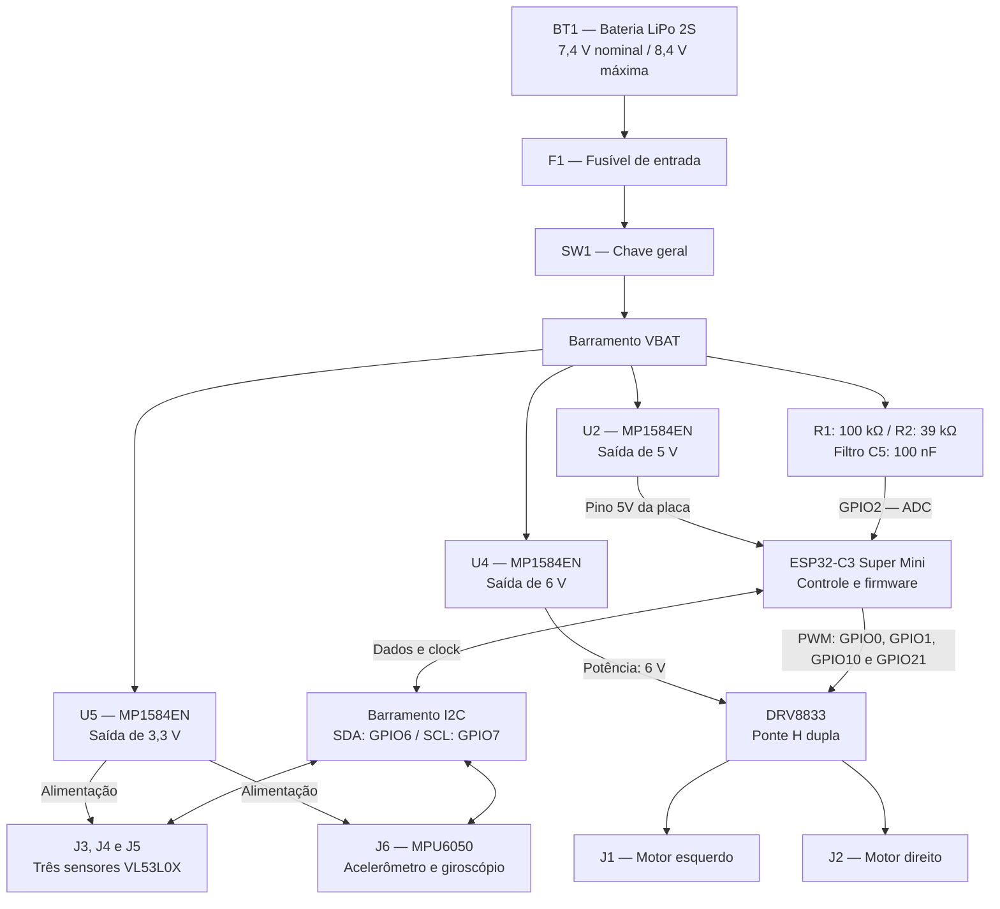

# Diagramas de _Hardware_ — Micromouse PI1

Esta página apresenta o **diagrama de blocos** e o **esquemático elétrico** do Micromouse, com os subsistemas, as conexões de alimentação e sinais e a pinagem do controlador.

O sistema organiza-se em quatro domínios: **energia**, com bateria, fusível, chave e conversores; **controle**, com o ESP32-C3; **sensoriamento**, com três VL53L0X e a IMU MPU6050; e **atuação**, com o DRV8833 e dois motores DC com redução. A descrição dos subsistemas e as justificativas das escolhas estão no [projeto conceitual de hardware](hardware.md).

## 1. Diagrama de blocos

O diagrama representa a distribuição de energia e as interfaces entre o microcontrolador, os sensores e o acionamento dos motores.

**Figura 1.** Diagrama de blocos elaborado a partir do esquemático. Todos os módulos compartilham a referência elétrica **GND**.

### 1.1 Fluxo de energia

A bateria **BT1, LiPo 2S**, fornece **7,4 V nominais** e até **8,4 V em carga plena**. A linha positiva passa pelo **fusível F1** e pela **chave geral SW1**, formando o barramento `VBAT` que alimenta os três conversores MP1584EN e o circuito de monitoramento da bateria.

| Conversor | Tensão de saída | Destino | Capacitores associados |
| :--- | :---: | :--- | :--- |
| **U2 — MP1584EN** | **5 V** | Pino `5V` da placa ESP32-C3 | C6: 10 µF; C2: 100 µF. |
| **U5 — MP1584EN** | **3,3 V** | Sensores VL53L0X e MPU6050 | C8: 10 µF; C7: 100 nF. |
| **U4 — MP1584EN** | **6 V** | Entrada de potência `VCC` do módulo DRV8833 | C3: 10 µF; C4: 100 µF. |

### 1.2 Controle e atuação

A placa **ESP32-C3 Super Mini** processa as leituras dos sensores e gera os sinais de controle dos motores. O **DRV8833** recebe quatro comandos PWM e aciona os dois motores por sua ponte H dupla:

- **Motor esquerdo — J1:** comandos IN1 e IN2, ligados aos GPIO0 e GPIO1; saídas de potência OUT1 e OUT2.
- **Motor direito — J2:** comandos IN3 e IN4, ligados aos GPIO10 e GPIO21; saídas de potência OUT3 e OUT4.

O barramento regulado de **6 V** alimenta o estágio de potência. O controle independente dos motores permite a locomoção diferencial, incluindo avanço, recuo e curvas.

### 1.3 Sensoriamento e comunicação

Os três sensores **VL53L0X**, representados pelos conectores **J3, J4 e J5**, medem as distâncias das paredes nas direções frontal e laterais. A **MPU6050**, conectada em **J6**, fornece medidas de aceleração e taxa de rotação para apoiar a estimativa da orientação.

Todos recebem alimentação de **3,3 V** e utilizam o barramento **I²C compartilhado**, com **SDA no GPIO6** e **SCL no GPIO7**. O gerenciamento dos endereços individuais dos sensores de distância integra a rotina de inicialização prevista no relatório técnico.

### 1.4 Monitoramento da bateria

O divisor de tensão utiliza **R1 de 100 kΩ** e **R2 de 39 kΩ**, com **C5 de 100 nF** para filtragem. O nó de leitura conecta-se ao **GPIO2** do ESP32-C3.

A relação `V_ADC = V_BAT × 39/139` reduz a tensão de **8,4 V** para aproximadamente **2,357 V** na entrada analógica, permitindo acompanhar a condição da alimentação.

## 2. Esquemático elétrico

O esquemático apresenta os símbolos elétricos, as referências dos componentes, as conexões e os terminais dos módulos. A imagem abaixo foi extraída do arquivo `hw/Micromouse.pdf`; o PDF pode ser aberto para ampliar os detalhes.

**Figura 2.** Esquemático principal do Micromouse, com bateria LiPo 2S, proteção por fusível, chave geral, três conversores MP1584EN, ESP32-C3, VL53L0X, MPU6050, DRV8833 e motores.

### 2.1 Conexões de alimentação e potência

| Origem | Destino | Função |
| :--- | :--- | :--- |
| BT1, terminal positivo | F1 → SW1 → VBAT | Entrada de energia com fusível e chave geral. |
| VBAT | Entradas de U2, U4 e U5 | Alimentação dos conversores. |
| U2, saída de 5 V | Terminal `5V` da placa ESP32-C3 | Alimentação do controlador. |
| U5, saída de 3,3 V | J3, J4, J5 e J6 | Alimentação dos sensores. |
| U4, saída de 6 V | `VCC` de potência do módulo DRV8833 | Alimentação dos motores pela ponte H. |
| DRV8833, OUT1/OUT2 | J1 | Motor esquerdo. |
| DRV8833, OUT3/OUT4 | J2 | Motor direito. |
| VBAT | Divisor R1/R2 e filtro C5 | Monitoramento da tensão da bateria. |
| Terras dos módulos | GND comum | Referência elétrica para alimentação e sinais. |

O circuito de habilitação do DRV8833 inclui o resistor **R4 de 47 kΩ**, conforme representado no esquemático.

### 2.2 Pinagem do microcontrolador

A tabela apresenta os GPIOs lógicos utilizados nas interfaces do circuito.

| GPIO / terminal do ESP32-C3 | Destino / origem | Sinal | Função |
| :---: | :--- | :--- | :--- |
| **GPIO0** | DRV8833 | IN1 — motor esquerdo | Saída de controle PWM. |
| **GPIO1** | DRV8833 | IN2 — motor esquerdo | Saída de controle PWM. |
| **GPIO10** | DRV8833 | IN3 — motor direito | Saída de controle PWM. |
| **GPIO21 / TX** | DRV8833 | IN4 — motor direito | Saída de controle PWM. |
| **GPIO6** | VL53L0X e MPU6050 | SDA | Dados I²C. |
| **GPIO7** | VL53L0X e MPU6050 | SCL | Clock I²C. |
| **GPIO2** | Nó do divisor R1/R2 | ADC de bateria | Entrada analógica. |
| **5V** | Saída do conversor U2 | Alimentação | Entrada de 5 V regulados na placa. |
| **GND** | Todos os subsistemas | Terra | Referência comum. |

A montagem e a verificação do conjunto seguem a sequência descrita no relatório técnico: inspeção de continuidade, ajuste independente dos três conversores, verificação da chave e do fusível, teste da placa de controle, varredura do barramento I²C e acionamento progressivo dos motores com as rodas suspensas.
