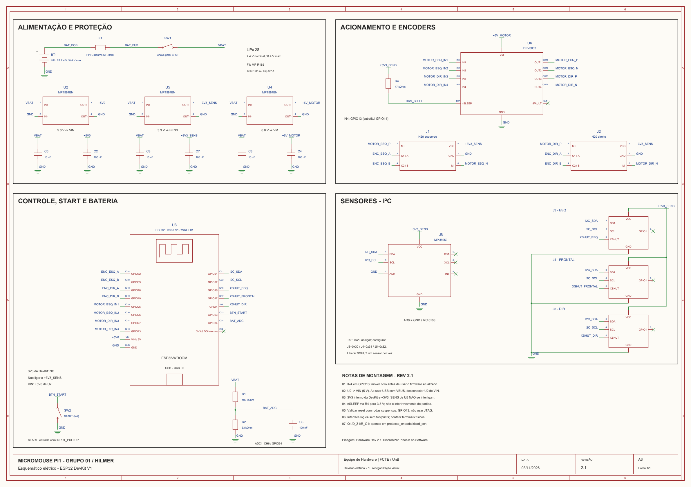

# Diagramas de Hardware — Micromouse PI1

A revisão vigente é a **2.1 de 03/11/2026**, com ESP32 DevKit V1. Consulte o [diagrama de blocos](hardware.md#2-diagrama-de-blocos) e a [tabela única de pinagem](hardware.md#42-pinagem-do-esp32-devkit-v1), definida no CSV de Hardware `hw/diagramas/pinagem.csv`. A `main` já contém o bloco `PLACA_ESP32_DEVKIT` em `Pinos.h` e o ambiente `bancada_geral_devkit`, integrados pela [#485](https://github.com/fcte-pi1/2026_2_PI1_Grupo01_Hilmer/pull/485). Para alinhar a pinagem à Rev 2.1, falta apenas trocar `MOTOR_DIR_IN4` de GPIO14 para GPIO13; os demais 14 sinais coincidem. O ambiente do firmware completo do robô será tratado na [#489](https://github.com/fcte-pi1/2026_2_PI1_Grupo01_Hilmer/issues/489).

O esquema usa folha A3 horizontal, blocos por subsistema, símbolos elétricos, fios e rótulos de rede, com moldura e carimbo. A apresentação mantém todas as conexões da Rev 2.1.

**Bulk de VM pendente de adequação com Energia:** os artefatos abaixo mostram C4 de 100 µF; a [#216](https://github.com/fcte-pi1/2026_2_PI1_Grupo01_Hilmer/issues/216) requer 470 µF Low-ESR. Atualizar KiCad, PDF, figura e BOM em conjunto ao adequar C4 e validar o ruído em bancada; a publicação atual não comprova atendimento a esse requisito.

O [PDF](https://github.com/fcte-pi1/2026_2_PI1_Grupo01_Hilmer/blob/documentacao/hw/Micromouse.pdf) e o [KiCad editável](https://github.com/fcte-pi1/2026_2_PI1_Grupo01_Hilmer/blob/documentacao/hw/Micromouse.kicad_sch) representam as mesmas conexões da Rev 2.1. Após editar o esquema no KiCad, atualizar o PDF e a figura desta página. O desenho representa interfaces lógicas de módulos, sem footprints; conferir terminais físicos antes de criar PCB.

VIN recebe 5 V de U2; o 3V3 interno da DevKit não se liga ao `+3V3_SENS` de U5. Usar uma fonte para U3 por vez: desconectar VIN de U2 ao conectar USB com VBUS. Ver as [restrições de montagem](hardware.md#43-alimentacao-inicializacao-e-restricoes).
