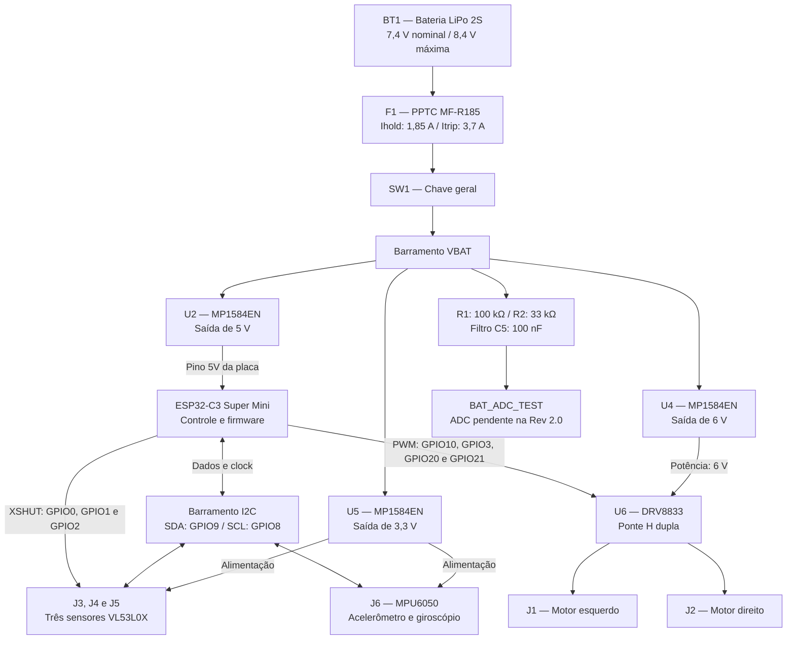

# Projeto Conceitual de _Hardware_

## 1. Visão geral

O _hardware_ do Micromouse integra alimentação, processamento, sensoriamento e acionamento para permitir a navegação autônoma em labirintos. A arquitetura utiliza uma placa **ESP32-C3 Super Mini**, três sensores de distância **VL53L0X**, uma unidade de medição inercial **MPU6050**, um _driver_ de motores **DRV8833** e dois micromotores DC com redução.

A alimentação parte de uma **bateria LiPo 2S**, com 7,4 V nominais e 8,4 V em carga plena. Três conversores **MP1584EN** fornecem barramentos independentes de **3,3 V, 5 V e 6 V**, destinados aos sensores, à placa de controle e ao estágio de potência dos motores, respectivamente.

 O conjunto fornece a base eletrônica para reconhecer paredes, estimar a orientação, controlar o movimento e disponibilizar dados de operação ao sistema de telemetria.

## 2. Diagrama de blocos

O diagrama organiza os subsistemas e identifica as conexões de alimentação e de sinais descritas no relatório técnico e no esquemático.



**Figura 1.** Visão geral do hardware do Micromouse. Todos os estágios compartilham a referência elétrica **GND**.

## 3. Subsistemas e justificativas de projeto

### 3.1 Alimentação e proteção de entrada

A bateria **BT1**, do tipo LiPo 2S, fornece energia ao robô. Sua linha positiva passa pelo **fusível F1** e pela **chave geral SW1** antes de formar o barramento de distribuição `VBAT`. F1 adota o PPTC **Bourns MF-R185** definido pela energia, com **Ihold = 1,85 A** e **Itrip = 3,7 A a 25 °C**. A chave permite interromper a alimentação do conjunto.

O uso de uma fonte recarregável permite a operação móvel e autônoma. A distribuição em três conversores reduz a tensão da bateria para os níveis utilizados por cada subsistema e permite organizar separadamente as cargas de potência e os circuitos de sensoriamento e controle.

| Estágio | Componente | Saída | Destino | Filtragem indicada no esquemático |
| :--- | :--- | :---: | :--- | :--- |
| U5 | MP1584EN | **3,3 V** | Três VL53L0X e MPU6050 | C8 de 10 µF e C7 de 100 nF. |
| U2 | MP1584EN | **5 V** | Pino `5V` da placa ESP32-C3 | C6 de 10 µF e C2 de 100 µF. |
| U4 | MP1584EN | **6 V** | Alimentação de potência do DRV8833 | C3 de 10 µF e C4 de 100 µF. |

Os capacitores associados aos conversores auxiliam na filtragem e no atendimento às variações de carga. A alimentação dedicada dos motores busca reduzir a influência de suas comutações sobre os sensores e o microcontrolador.

### 3.2 Unidade central de controle

A **ESP32-C3 Super Mini** executa o processamento embarcado e coordena os periféricos. O barramento de 5 V alimenta a entrada correspondente da placa, enquanto as interfaces digitais realizam a comunicação I²C e o comando da ponte H.

Sua função no projeto compreende adquirir as distâncias e as informações inerciais, identificar paredes, estimar o ângulo de guinada e calcular os comandos de movimento. O relatório prevê controle PID para alinhamento e navegação e geração de sinais PWM para ajustar a velocidade dos motores.

A escolha reúne processamento, periféricos de comunicação e conectividade em uma placa compacta, adequada à integração no chassi do Micromouse.

### 3.3 Sensores de distância VL53L0X

O sensoriamento de paredes utiliza **três módulos VL53L0X**, representados pelos conectores **J3, J4 e J5**. A distribuição funcional é frontal, esquerda e direita, permitindo reconhecer obstáculos e passagens nas direções relevantes à navegação.

Os sensores utilizam medição por tempo de voo (_Time of Flight_ — ToF), recebem alimentação de **3,3 V** e compartilham o barramento **I²C**. Essa configuração concentra a comunicação em duas linhas: **SDA no GPIO9** e **SCL no GPIO8**.

Os três sensores iniciam no endereço I²C de 7 bits **0x29**. Cada módulo precisa expor XSHUT: **J3 esquerdo → GPIO0**, **J4 frontal → GPIO1** e **J5 direito → GPIO2**. Na inicialização, o firmware deve manter todos em reset (XSHUT baixo), liberar um por vez e atribuir endereços distintos, por exemplo **0x30, 0x31 e 0x32**, antes de liberar o próximo. Essa atribuição deve ser repetida a cada reinicialização; a rotina ainda precisa ser implementada no firmware. A aquisição das três distâncias fornece a referência para detectar paredes e manter o alinhamento nos corredores.

### 3.4 Unidade de medição inercial MPU6050

A **MPU6050**, representada pelo conector **J6**, reúne acelerômetro e giroscópio de seis eixos. Sua função é fornecer informações de aceleração e taxa de rotação para estimar a orientação do robô e apoiar a correção de desvios.

O módulo recebe **3,3 V** e utiliza o mesmo barramento I²C dos sensores de distância. A combinação de medidas inerciais e distâncias permite apoiar tanto o deslocamento em linha reta quanto a execução de curvas de 90°.

### 3.5 Acionamento dos motores

O **DRV8833** é o estágio de potência entre o ESP32-C3 e os dois motores DC com redução. A ponte H dupla permite controlar separadamente o sentido de rotação e a velocidade de cada motor a partir de sinais PWM.

Sua alimentação de potência utiliza o barramento regulado de **6 V**. O esquemático também apresenta o resistor **R4 de 47 kΩ** no circuito de habilitação do módulo. As saídas **OUT1/OUT2** acionam o motor esquerdo, conectado a **J1**, e **OUT3/OUT4** acionam o motor direito, conectado a **J2**.

O controle independente dos motores permite tração diferencial: a combinação de velocidades e sentidos produz avanço, recuo e curvas. O driver fornece a interface de corrente necessária aos motores, preservando a função dos GPIOs como sinais de comando.

### 3.6 Monitoramento da tensão da bateria

O circuito de monitoramento utiliza **R1 de 100 kΩ**, **R2 de 33 kΩ** e **C5 de 100 nF**. O divisor reduz a tensão de `VBAT` no ponto de teste, enquanto o capacitor filtra transientes nesse nó. A conexão a uma entrada analógica está pendente na Rev 2.0.

A relação entre as tensões é:

```text
V_ADC = V_BAT × R2 / (R1 + R2)
V_ADC = V_BAT × 33 / 133
```

Com a bateria em **8,4 V**, a tensão calculada no nó de medição é de aproximadamente **2,084 V**.

## 4. Esquemático elétrico

O esquemático principal, **Rev 2.0 de 21/10/2026**, apresenta os símbolos elétricos, as referências dos componentes, as conexões de alimentação e sinais e os terminais dos módulos. A figura abaixo foi extraída do PDF disponível na pasta `hw`.

[](../../hw/Micromouse.pdf)

**Figura 2.** Esquemático elétrico do Micromouse — **Rev 2.0**, com bateria, fusível, chave, três conversores MP1584EN, ESP32-C3, sensores VL53L0X, MPU6050, DRV8833 e motores. O [PDF](../../hw/Micromouse.pdf) e o [arquivo editável KiCad](../../hw/Micromouse.kicad_sch) representam a mesma revisão e permitem consultar os detalhes das conexões. Os conectores dos VL53L0X representam a interface lógica do projeto (pino 5 = XSHUT); conferir a ordem física dos terminais no módulo adquirido.

### 4.1 Conexões principais

| Origem | Destino | Função |
| :--- | :--- | :--- |
| BT1, terminal positivo | F1 → SW1 → VBAT | Entrada protegida por fusível e comando geral. |
| VBAT | Entradas dos conversores U2, U4 e U5 | Distribuição de energia. |
| U2, saída de 5 V | Pino `5V` da placa ESP32-C3 | Alimentação da unidade de controle. |
| U5, saída de 3,3 V | J3, J4, J5 e J6 | Alimentação dos sensores de distância e da IMU. |
| U4, saída de 6 V | `VCC` de potência do módulo DRV8833 | Alimentação do acionamento. |
| GPIO9 e GPIO8 | SDA e SCL dos sensores | Comunicação I²C compartilhada. |
| GPIO10 e GPIO3 | IN1 e IN2 do DRV8833 | Comandos do motor esquerdo. |
| GPIO20 e GPIO21 | IN3 e IN4 do DRV8833 | Comandos do motor direito. |
| DRV8833, OUT1/OUT2 | J1, motor esquerdo | Saída de potência. |
| DRV8833, OUT3/OUT4 | J2, motor direito | Saída de potência. |
| GPIO0 / GPIO1 / GPIO2 | XSHUT de J3 / J4 / J5 | Habilitação individual dos VL53L0X. |
| VBAT → R1/R2 e C5 | BAT_ADC_TEST | Ponto de teste; conexão ADC pendente. |
| Terras dos módulos | GND comum | Referência elétrica do conjunto. |

### 4.2 Pinagem do ESP32-C3

A tabela identifica os **GPIOs lógicos**, os sinais e suas funções no circuito. A identificação física dos terminais deve acompanhar a placa empregada na montagem.

| GPIO / terminal | Periférico | Sinal | Função |
| :---: | :--- | :--- | :--- |
| **GPIO9** | VL53L0X e MPU6050 | SDA | Dados I²C. |
| **GPIO8** | VL53L0X e MPU6050 | SCL | Clock I²C. |
| **GPIO0** | J3 — VL53L0X esquerdo | XSHUT | Habilitação individual. |
| **GPIO1** | J4 — VL53L0X frontal | XSHUT | Habilitação individual. |
| **GPIO2** | J5 — VL53L0X direito | XSHUT | Habilitação individual. |
| **GPIO10 / GPIO3** | U6 — DRV8833 | IN1 / IN2 | PWM do motor esquerdo. |
| **GPIO20 / GPIO21** | U6 — DRV8833 | IN3 / IN4 | PWM do motor direito. |
| **GPIO4 / GPIO5** | Encoder esquerdo | A / B | Reservados; encoder não instalado. |
| **GPIO6 / GPIO7** | Encoder direito | A / B | Reservados; encoder não instalado. |
| **GPIO18 / GPIO19** | USB nativa | D− / D+ | Log e gravação; uso exclusivo da USB. |
| **5V** | Conversor U2 | Alimentação da placa | Entrada de 5 V regulados. |
| **GND** | Todos os subsistemas | Terra | Referência comum. |

### 4.3 Inicialização e restrições

O log da aplicação usa **Serial pela USB CDC nativa**, configurada em `platformio.ini`, liberando GPIO20/21 para os motores. **Isso não desativa as mensagens da ROM no GPIO21/U0TXD durante o reset**. A montagem precisa validar uma forma de manter o driver desabilitado durante o boot antes de energizar os motores; o resistor R4 existente não comprova essa proteção. Até essa validação, testar com as rodas suspensas.

GPIO2, GPIO8 e GPIO9 são pinos de *strapping*. Validar os níveis durante o reset com os módulos conectados, incluindo os pull-ups I²C e a carga de XSHUT. O botão BOOT da Super Mini compartilha GPIO9: não o acionar durante a comunicação I²C. Conferir o pinout físico da placa; o símbolo do controlador identifica sinais lógicos, sem representar a ordem dos terminais da Super Mini.

## 5. Integração e sequência de montagem

A montagem organiza a bateria, os conversores, a placa de controle e o driver no chassi, com os motores nas laterais. Os sensores de distância devem manter seus campos de medição desobstruídos nas direções frontal e laterais, e a IMU deve permanecer fixada à estrutura para acompanhar o movimento do robô.

O relatório técnico estabelece a seguinte sequência de montagem e verificação:

1. Inspecionar as ligações e verificar a ausência de curtos entre VBAT, os barramentos regulados e GND.
2. Ajustar os conversores individualmente para **3,3 V, 5 V e 6 V**, antes de conectar as cargas.
3. Verificar o fusível e a interrupção da alimentação pela chave geral.
4. Conectar a placa ESP32-C3 e verificar alimentação e gravação de firmware básico via USB.
5. Inicializar os VL53L0X sequencialmente pelos três XSHUT, atribuir endereços distintos e executar uma varredura I²C nos GPIO9 e GPIO8. Verificar também a IMU.
6. Testar os motores com as rodas suspensas, aplicando PWM progressivo e verificando o sentido de rotação.
7. Integrar a aquisição de distâncias, as medidas inerciais e o controle de movimento.

## 6. Componentes

| Componente / conjunto | Quantidade | Referência no circuito |
| :--- | :---: | :--- |
| Bateria LiPo 2S | 1 | BT1. |
| PPTC Bourns MF-R185 | 1 | F1: Ihold 1,85 A; Itrip 3,7 A a 25 °C. |
| Chave geral | 1 | SW1. |
| Conversor MP1584EN de 5 V | 1 | U2. |
| Conversor MP1584EN de 3,3 V | 1 | U5. |
| Conversor MP1584EN de 6 V | 1 | U4. |
| Placa ESP32-C3 | 1 | U3. |
| Módulo VL53L0X com XSHUT acessível | 3 | J3, J4 e J5; fabricante/pinout do módulo a confirmar na BOM. |
| IMU MPU6050 | 1 | J6. |
| Módulo DRV8833 | 1 | `U6`. |
| Motor GA12-N20-S0310D-E, 6 V (modelo sugerido) | 2 | J1 e J2; fonte: [lista de compras, item 9](../06-orcamento.md#lista-de-componentes). Relação de redução e identificação do fornecedor a confirmar. |
| Resistores de monitoramento | 2 | R1: 100 kΩ; R2: 33 kΩ. |
| Resistor de habilitação do driver | 1 | R4: 47 kΩ. |
| Capacitores de filtragem | 7 | C2 e C4: 100 µF; C3, C6 e C8: 10 µF; C5 e C7: 100 nF. |

### 6.1 Fonte da identificação dos motores

O código **GA12-N20-S0310D-E** e a tensão nominal de **6 V** foram transcritos da [lista de compras do projeto, item 9 — Motor DC com encoder](../06-orcamento.md#lista-de-componentes), onde constam como **modelo sugerido**. Essa é a fonte interna da seleção; ainda não há ficha técnica ou link de fornecedor que confirme o código completo, a relação de redução e a corrente do motor adquirido. No esquemático, **J1 e J2 representam somente os dois terminais de potência**; os encoders permanecem reservados e não instalados na Rev 2.0.

## 7. Histórico de versões

| Versão | Data | Descrição | Autor |
| :---: | :---: | :--- | :--- |
| 2.0 | 21/10/2026 | Sincronização do esquemático KiCad, PDF e Figura 2: R2 de 33 kΩ, I²C em GPIO9/8, motores em GPIO10/3/20/21, XSHUT em GPIO0/1/2 e divisor em BAT_ADC_TEST. Inclusão da fonte interna do modelo sugerido dos motores. | Eduardo Gaspar |
