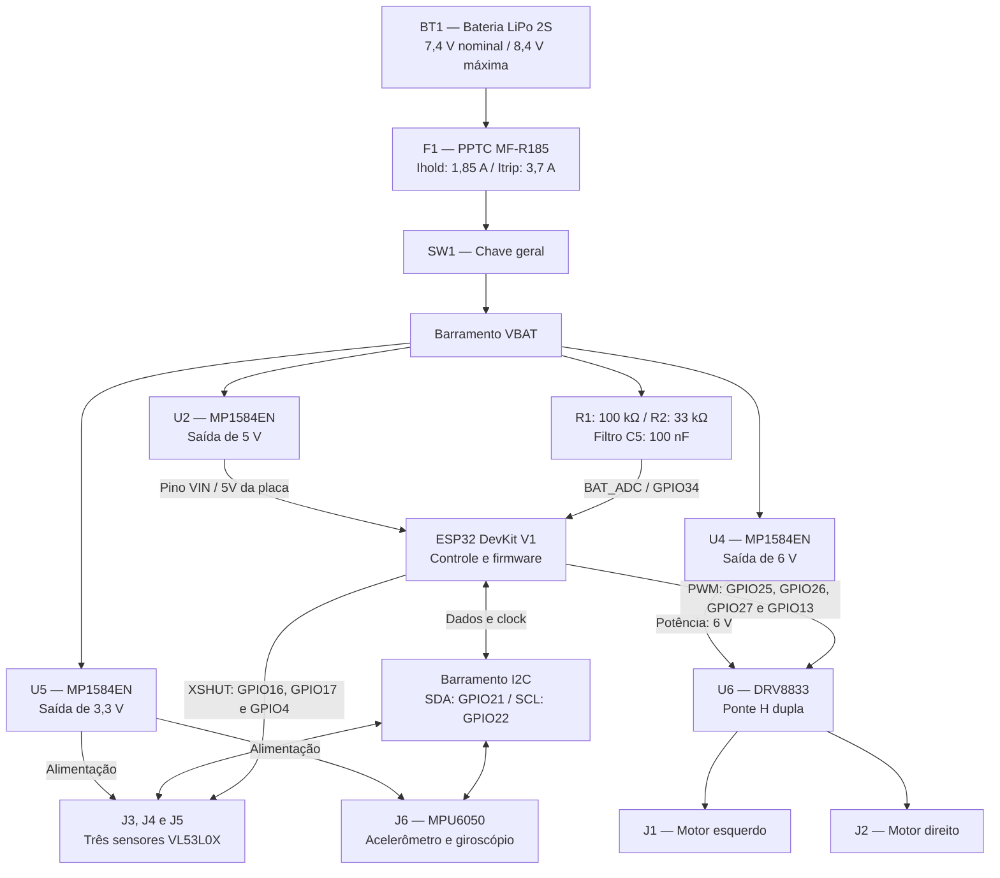
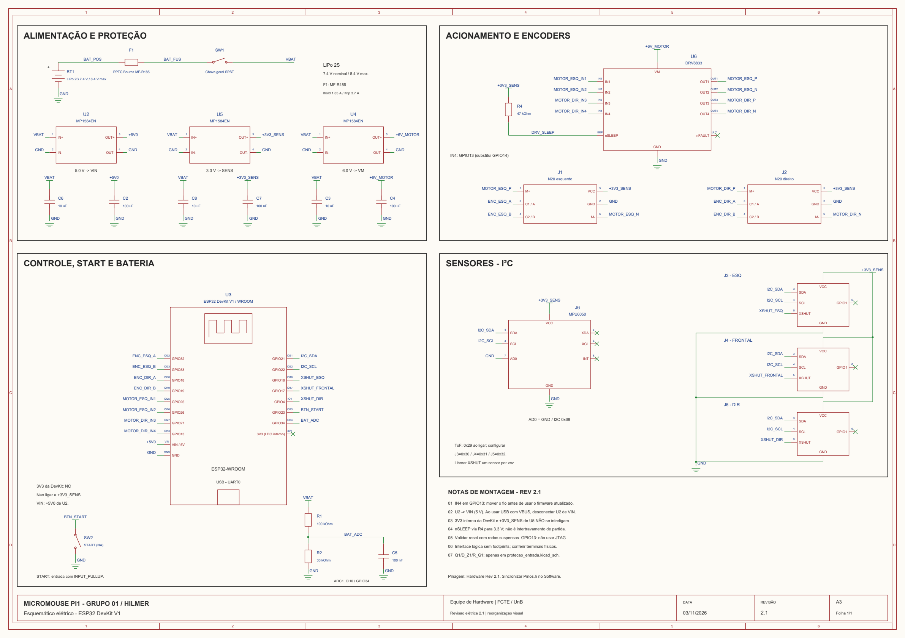

# Projeto Conceitual de _Hardware_

## 1. Visão geral

O _hardware_ do Micromouse integra alimentação, processamento, sensoriamento e acionamento para permitir a navegação autônoma em labirintos. A arquitetura utiliza uma placa **ESP32 DevKit V1**, três sensores de distância **VL53L0X**, uma unidade de medição inercial **MPU6050**, um _driver_ de motores **DRV8833** e dois micromotores DC com redução.

A alimentação parte de uma **bateria LiPo 2S**, com 7,4 V nominais e 8,4 V em carga plena. Três conversores **MP1584EN** fornecem barramentos independentes de **3,3 V, 5 V e 6 V**, destinados aos sensores, à placa de controle e ao estágio de potência dos motores, respectivamente.

 O conjunto fornece a base eletrônica para reconhecer paredes, estimar a orientação, controlar o movimento e disponibilizar dados de operação ao sistema de telemetria.

## 2. Diagrama de blocos

O diagrama organiza os subsistemas e identifica as conexões de alimentação e de sinais descritas no relatório técnico e no esquemático.



**Figura 1.** Visão geral do hardware do Micromouse. Todos os estágios compartilham a referência elétrica **GND**.

## 3. Subsistemas e justificativas de projeto

### 3.1 Alimentação e proteção de entrada

A bateria **BT1**, do tipo LiPo 2S, fornece energia ao robô. Sua linha positiva passa pelo **fusível F1** e pela **chave geral SW1** antes de formar o barramento de distribuição `VBAT`. F1 adota o PPTC **Bourns MF-R185** definido pela energia, com **Ihold = 1,85 A** e **Itrip = 3,7 A a 25 °C**. A chave permite interromper a alimentação do conjunto.

O uso de uma fonte recarregável permite a operação móvel e autônoma. A distribuição em três conversores reduz a tensão da bateria para os níveis utilizados por cada subsistema e permite organizar separadamente as cargas de potência e os circuitos de sensoriamento e controle.

| Estágio | Componente | Saída | Destino | Filtragem indicada no esquemático |
| :--- | :--- | :---: | :--- | :--- |
| U5 | MP1584EN | **3,3 V** | Três VL53L0X e MPU6050 | C8 de 10 µF e C7 de 100 nF. |
| U2 | MP1584EN | **5 V** | Pino `VIN / 5V` da placa ESP32 DevKit V1 | C6 de 10 µF e C2 de 100 µF. |
| U4 | MP1584EN | **6 V** | Alimentação de potência do DRV8833 | C3 de 10 µF e C4 de 100 µF, mantido conforme confirmação com Energia em 10/11/2026. |

**Alinhamento com Energia — 10/11/2026:** o responsável confirmou com Energia que **C4 deve permanecer em 100 µF**, conforme KiCad, PDF, figura e BOM da Rev 2.1. A referência a 470 µF na [#216](https://github.com/fcte-pi1/2026_2_PI1_Grupo01_Hilmer/issues/216) não implica substituição de C4 nesta revisão. A confirmação do valor não comprova a eficácia da filtragem em ensaio de ruído.

Os capacitores associados aos conversores auxiliam na filtragem e no atendimento às variações de carga. A alimentação dedicada dos motores busca reduzir a influência de suas comutações sobre os sensores e o microcontrolador.

### 3.2 Unidade central de controle

A **ESP32 DevKit V1** executa o processamento embarcado e coordena os periféricos. O barramento de 5 V alimenta a entrada correspondente da placa, enquanto as interfaces digitais realizam a comunicação I²C e o comando da ponte H.

Sua função no projeto compreende adquirir as distâncias e as informações inerciais, identificar paredes, estimar o ângulo de guinada e calcular os comandos de movimento. O relatório prevê controle PID para alinhamento e navegação e geração de sinais PWM para ajustar a velocidade dos motores.

A escolha reúne processamento, periféricos de comunicação e conectividade em uma placa compacta, adequada à integração no chassi do Micromouse.

### 3.3 Sensores de distância VL53L0X

O sensoriamento de paredes utiliza **três módulos VL53L0X**, representados pelos conectores **J3, J4 e J5**. A distribuição funcional é frontal, esquerda e direita, permitindo reconhecer obstáculos e passagens nas direções relevantes à navegação.

Os sensores utilizam medição por tempo de voo (_Time of Flight_ — ToF), recebem alimentação de **3,3 V** e compartilham o barramento **I²C**. Essa configuração concentra a comunicação em duas linhas: **SDA no GPIO21** e **SCL no GPIO22**.

Os três sensores iniciam no endereço I²C de 7 bits **0x29**. Cada módulo precisa expor XSHUT: **J3 esquerdo → GPIO16**, **J4 frontal → GPIO17** e **J5 direito → GPIO4**. Na inicialização, o firmware deve manter todos em reset (XSHUT baixo), liberar um por vez e atribuir endereços distintos, por exemplo **0x30, 0x31 e 0x32**, antes de liberar o próximo. Essa atribuição deve ser repetida a cada reinicialização; a rotina já está disponível na bancada geral integrada pela #485; a migração do robô para DevKit segue na #489. A aquisição das três distâncias fornece a referência para detectar paredes e manter o alinhamento nos corredores.

### 3.4 Unidade de medição inercial MPU6050

A **MPU6050**, representada pelo conector **J6**, reúne acelerômetro e giroscópio de seis eixos. Sua função é fornecer informações de aceleração e taxa de rotação para estimar a orientação do robô e apoiar a correção de desvios.

O módulo recebe **3,3 V** e utiliza o mesmo barramento I²C dos sensores de distância. A combinação de medidas inerciais e distâncias permite apoiar tanto o deslocamento em linha reta quanto a execução de curvas de 90°.

### 3.5 Acionamento dos motores

O **DRV8833** é o estágio de potência entre o ESP32 DevKit V1 e os dois motores DC com redução. A ponte H dupla permite controlar separadamente o sentido de rotação e a velocidade de cada motor a partir de sinais PWM.

Sua alimentação de potência utiliza o barramento regulado de **6 V**. O resistor **R4 de 47 kΩ** liga `nSLEEP/EEP` a `+3V3_SENS` de U5, mantendo o driver habilitado. Não ligar esse terminal aos 6 V. A Rev 2.1 move IN4 de GPIO14 para GPIO13; a bancada deve receber a mesma troca. As saídas **OUT1/OUT2** acionam o motor esquerdo, conectado a **J1**, e **OUT3/OUT4** acionam o motor direito, conectado a **J2**.

O controle independente dos motores permite tração diferencial: a combinação de velocidades e sentidos produz avanço, recuo e curvas. O driver fornece a interface de corrente necessária aos motores, preservando a função dos GPIOs como sinais de comando.

### 3.6 Monitoramento da tensão da bateria

O circuito de monitoramento utiliza **R1 de 100 kΩ**, **R2 de 33 kΩ** e **C5 de 100 nF**. O divisor reduz a tensão de `VBAT` no ponto de teste, enquanto o capacitor filtra transientes nesse nó. O nó `BAT_ADC` conecta-se ao **GPIO34 / ADC1_CH6**, somente entrada, na Rev 2.1.

A relação entre as tensões é:

```text
V_ADC = V_BAT × R2 / (R1 + R2)
V_ADC = V_BAT × 33 / 133
```

Com a bateria em **8,4 V**, a tensão calculada no nó de medição é de aproximadamente **2,084 V**.

## 4. Esquemático elétrico

O esquemático principal é a **Rev 2.1 de 03/11/2026**, para ESP32 DevKit V1. A representação é uma interface elétrica de módulos por redes nomeadas, com símbolos incorporados e sem footprints; os números de U3 identificam GPIOs lógicos, não pads físicos.

A folha A3 horizontal reúne quatro blocos: **alimentação e proteção**, **acionamento e encoders**, **controle, START e bateria** e **sensores I²C**. Os componentes discretos usam símbolos elétricos, e as conexões são apresentadas por fios, rótulos de rede e símbolos de alimentação. A moldura e o carimbo identificam projeto, revisão, data e folha. Essa reorganização visual preserva as redes e a pinagem da Rev 2.1.

[](https://github.com/fcte-pi1/2026_2_PI1_Grupo01_Hilmer/blob/documentacao/hw/Micromouse.pdf)

**Figura 2.** Rev 2.1: [PDF](https://github.com/fcte-pi1/2026_2_PI1_Grupo01_Hilmer/blob/documentacao/hw/Micromouse.pdf) e [KiCad editável](https://github.com/fcte-pi1/2026_2_PI1_Grupo01_Hilmer/blob/documentacao/hw/Micromouse.kicad_sch). Ambos representam as mesmas conexões da Rev 2.1. Após editar o esquema no KiCad, atualizar o PDF e a figura publicada nesta página. Conferir a ordem física e a serigrafia dos módulos antes de fabricar; esta publicação não comprova validação de PCB ou da bancada modificada.

### 4.1 Conexões principais

| Origem | Destino | Função |
| :--- | :--- | :--- |
| BT1, terminal positivo | F1 → SW1 → VBAT | Entrada protegida por fusível e comando geral. |
| VBAT | Entradas dos conversores U2, U4 e U5 | Distribuição de energia. |
| U2, saída de 5 V | Pino `VIN / 5V` da placa ESP32 DevKit V1 | Alimentação da unidade de controle. |
| U5, saída de 3,3 V | J3, J4, J5 e J6 | Alimentação dos sensores de distância e da IMU. |
| U4, saída de 6 V | `VCC` de potência do módulo DRV8833 | Alimentação do acionamento. |
| DRV8833, OUT1/OUT2 | J1, motor esquerdo | Saída de potência. |
| DRV8833, OUT3/OUT4 | J2, motor direito | Saída de potência. |
| VBAT → R1/R2 e C5 | BAT_ADC | Entrada analógica do controlador; ver tabela única abaixo. |
| Terras dos módulos | GND comum | Referência elétrica do conjunto. |

### 4.2 Pinagem do ESP32 DevKit V1

A pinagem de Hardware da Rev 2.1 está definida no CSV `hw/diagramas/pinagem.csv` e apresentada na tabela abaixo. Os nomes da primeira coluna são as constantes reais do bloco `PLACA_ESP32_DEVKIT` de `Pinos.h` na `main`. Ao alterar a pinagem, manter esta tabela, o CSV e o esquemático consistentes por conferência manual.

**Sincronização com Software:** o bloco `PLACA_ESP32_DEVKIT` de `src/firmware/lib/nucleo/src/Pinos.h` e o ambiente de bancada `bancada_geral_devkit` já estão na `main`, integrados pela [#485](https://github.com/fcte-pi1/2026_2_PI1_Grupo01_Hilmer/pull/485). A comparação dos 15 sinais abaixo com esse bloco encontrou uma única divergência: `MOTOR_DIR_IN4` ainda usa GPIO14 e deve passar para GPIO13. Os demais 14 GPIOs coincidem. Após essa correção, repetir a conferência linha a linha e compilar `bancada_geral_devkit`. A migração do firmware completo do robô para DevKit será tratada na [#489](https://github.com/fcte-pi1/2026_2_PI1_Grupo01_Hilmer/issues/489). Não há confirmação de envio externo do aviso.

| Constante em `Pinos.h` | GPIO | Ligação / função |
| :--- | :---: | :--- |
| `I2C_SDA` | **GPIO21** | Dados I²C — J3/J4/J5/J6 |
| `I2C_SCL` | **GPIO22** | Clock I²C — J3/J4/J5/J6 |
| `XSHUT_ESQ` | **GPIO16** | XSHUT — J3 esquerdo |
| `XSHUT_FRONTAL` | **GPIO17** | XSHUT — J4 frontal |
| `XSHUT_DIR` | **GPIO4** | XSHUT — J5 direito |
| `MOTOR_ESQ_IN1` | **GPIO25** | DRV8833 IN1/AIN1 — motor esquerdo |
| `MOTOR_ESQ_IN2` | **GPIO26** | DRV8833 IN2/AIN2 — motor esquerdo |
| `MOTOR_DIR_IN3` | **GPIO27** | DRV8833 IN3/BIN1 — motor direito |
| `MOTOR_DIR_IN4` | **GPIO13** | DRV8833 IN4/BIN2 — motor direito; substitui GPIO14 |
| `ENCODER_ESQ_A` | **GPIO32** | Encoder esquerdo C1/A |
| `ENCODER_ESQ_B` | **GPIO33** | Encoder esquerdo C2/B |
| `ENCODER_DIR_A` | **GPIO18** | Encoder direito C1/A |
| `ENCODER_DIR_B` | **GPIO19** | Encoder direito C2/B |
| `BOTAO_START` | **GPIO23** | START — INPUT_PULLUP; botão normalmente aberto para GND |
| `BATERIA_ADC` | **GPIO34** | ADC1_CH6 — nó R1 (100 kΩ) / R2 (33 kΩ) / C5 (100 nF); somente entrada |

As redes `BTN_START` e `BAT_ADC` do esquemático correspondem às constantes `BOTAO_START` e `BATERIA_ADC`, respectivamente. Os nomes de rede são preservados nos diagramas.

### 4.3 Alimentação, inicialização e restrições

**U2 → VIN / 5V:** ajustar U2 para 5,0 V antes de conectar U3. O LDO da DevKit gera o seu próprio 3V3. **Não interligar o terminal 3V3 da DevKit ao trilho `+3V3_SENS` de U5**; são saídas de reguladores diferentes. U5 alimenta ToF, IMU, encoders e o pull-up R4 de nSLEEP. Todos compartilham GND.

**USB e VIN:** usar uma fonte de alimentação da DevKit por vez. Para gravação/log com USB comum (VBUS presente), desconectar a saída de U2 do VIN. Uso simultâneo exige isolamento de VBUS ou seleção de fontes comprovada para o exemplar da DevKit; não presumir proteção contra retorno de corrente. A [orientação da Espressif para DevKitC](https://docs.espressif.com/projects/esp-idf/en/v5.0.4/esp32/hw-reference/esp32/get-started-devkitc.html#power-supply-options) trata as fontes como mutuamente exclusivas; conferir o circuito específico da DevKit V1 adquirida.

**Decisão de 03/11/2026: trocar IN4 de GPIO14 para GPIO13.** GPIO13 está livre nesta distribuição, permite PWM e não é strapping. É também MTCK: não usar JTAG nesse terminal. A motivação é o risco relatado de pulso/tranco no reset em GPIO14; a forma de onda ainda deve ser medida na placa real. Não tratar isso como frequência/duração de PWM garantida pelo fabricante. Ver [registro da decisão e aviso ao Software](../../hw/REVISAO-2.1.md) e [GPIOs oficiais da Espressif](https://docs.espressif.com/projects/esp-idf/en/stable/esp32/api-reference/peripherals/gpio.html).

**Ação de bancada obrigatória:** com alimentação desligada, mover o fio de IN4 de GPIO14 para GPIO13 e corrigir `MOTOR_DIR_IN4` em `Pinos.h` para GPIO13 antes de compilar e gravar `bancada_geral_devkit` (`pio run -e bancada_geral_devkit -t upload`, em `src/firmware`). GPIO14 fica sem conexão. Testar energização, reset por EN, reinicialização por software e gravação, com rodas suspensas; medir entradas e saídas do driver. A troca não comprova ausência de trancos. R4 mantém nSLEEP habilitado e não é intertravamento de partida.

O log usa UART0 por conversor USB–serial da DevKit; GPIO18/19 pertencem ao encoder direito, sem USB nativa. GPIO16/17 pressupõem módulo ESP32-WROOM, sem PSRAM nesses terminais. GPIO34 é somente entrada e não tem pull-up interno; o divisor fornece sua polarização. START usa INPUT_PULLUP. A bancada `bancada_geral_devkit` integrada na #485 já permite testar ToF/IMU, ADC e botão START; a integração dessas funções ao firmware completo do robô na DevKit pertence à #489.

## 5. Integração e sequência de montagem

A montagem organiza a bateria, os conversores, a placa de controle e o driver no chassi, com os motores nas laterais. Os sensores de distância devem manter seus campos de medição desobstruídos nas direções frontal e laterais, e a IMU deve permanecer fixada à estrutura para acompanhar o movimento do robô.

O relatório técnico estabelece a seguinte sequência de montagem e verificação:

1. Inspecionar as ligações e verificar a ausência de curtos entre VBAT, os barramentos regulados e GND.
2. Ajustar os conversores individualmente para **3,3 V, 5 V e 6 V**, antes de conectar as cargas.
3. Verificar o fusível e a interrupção da alimentação pela chave geral.
4. Conectar a placa ESP32 DevKit V1 e verificar alimentação e gravação de firmware básico via USB.
5. Inicializar os VL53L0X sequencialmente pelos três XSHUT, atribuir endereços distintos e executar uma varredura I²C nos GPIO21 e GPIO22. Verificar também a IMU.
6. Testar os motores com as rodas suspensas, aplicando PWM progressivo e verificando o sentido de rotação.
7. Integrar a aquisição de distâncias, as medidas inerciais e o controle de movimento.

## 6. Componentes

| Componente / conjunto | Quantidade | Referência no circuito |
| :--- | :---: | :--- |
| Bateria LiPo 2S | 1 | BT1. |
| PPTC Bourns MF-R185 | 1 | F1: Ihold 1,85 A; Itrip 3,7 A a 25 °C. |
| Chave geral | 1 | SW1. |
| Botão START normalmente aberto | 1 | SW2, entre BTN_START e GND. |
| Conversor MP1584EN de 5 V | 1 | U2. |
| Conversor MP1584EN de 3,3 V | 1 | U5. |
| Conversor MP1584EN de 6 V | 1 | U4. |
| Placa ESP32 DevKit V1 | 1 | U3. |
| Módulo VL53L0X com XSHUT acessível | 3 | J3, J4 e J5; fabricante/pinout do módulo a confirmar na BOM. |
| IMU MPU6050 | 1 | J6. |
| Módulo DRV8833 | 1 | `U6`. |
| Motor GA12-N20-S0310D-E, 6 V (modelo sugerido) | 2 | J1 e J2; fonte: [lista de compras, item 9](../06-orcamento.md#lista-de-componentes). Relação de redução e identificação do fornecedor a confirmar. |
| Resistores de monitoramento | 2 | R1: 100 kΩ; R2: 33 kΩ. |
| Resistor de habilitação do driver | 1 | R4: 47 kΩ. |
| Capacitores de filtragem | 7 | C2 e C4: 100 µF; C3, C6 e C8: 10 µF; C5 e C7: 100 nF. C4 mantido conforme confirmação com Energia em 10/11/2026. |

### 6.1 Fonte da identificação dos motores

O código **GA12-N20-S0310D-E** e a tensão nominal de **6 V** foram transcritos da [lista de compras do projeto, item 9 — Motor DC com encoder](../06-orcamento.md#lista-de-componentes), onde constam como **modelo sugerido**. Essa é a fonte interna da seleção; ainda não há ficha técnica ou link de fornecedor que confirme o código completo, a relação de redução e a corrente do motor adquirido. No esquemático, **J1 e J2 representam os conectores de seis vias dos motores e encoders**; a Rev 2.1 passa a representar também os quatro sinais dos encoders nos conectores de seis vias. As cores são a referência do PDF de bancada; conferir o motor adquirido.

## 7. Histórico de versões

| Versão | Data | Descrição | Autor |
| :---: | :---: | :--- | :--- |
| 2.0 | 21/10/2026 | Sincronização do esquemático KiCad, PDF e Figura 2: R2 de 33 kΩ, I²C em GPIO9/8, motores em GPIO10/3/20/21, XSHUT em GPIO0/1/2 e divisor em BAT_ADC_TEST. Inclusão da fonte interna do modelo sugerido dos motores. | Eduardo Gaspar |
| 2.1 | 03/11/2026 | Migração para DevKit V1; tabela conforme o CSV de Hardware, IN4 em GPIO13, encoders e START, BAT_ADC em ADC1_CH6, trilhos 3V3 separados e nSLEEP em 3,3 V. Sincronização pelo Software e validação física pendentes. | Eduardo Gaspar |
| 2.1 (correção documental) | 09/11/2026 | Referência à #485 e ao ambiente bancada_geral_devkit; nomes reais de Pinos.h; única divergência de GPIO em MOTOR_DIR_IN4; requisito de bulk de 470 µF Low-ESR da #216 registrado como adequação pendente. | Eduardo Gaspar |
| 2.1 (confirmação de C4) | 10/11/2026 | C4 mantido em 100 µF conforme confirmação com Energia informada pelo responsável; removida a pendência de troca para 470 µF. | Eduardo Gaspar |
