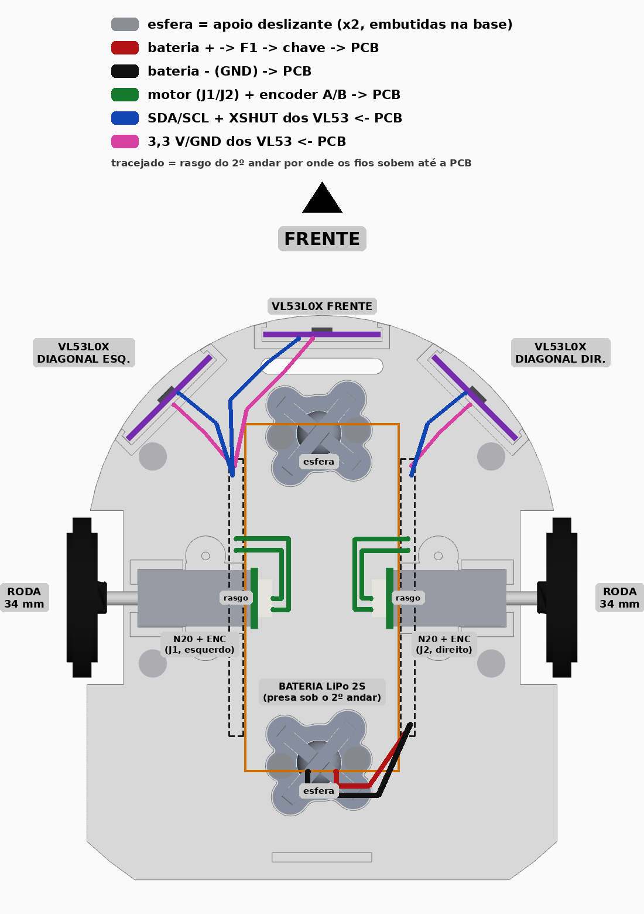
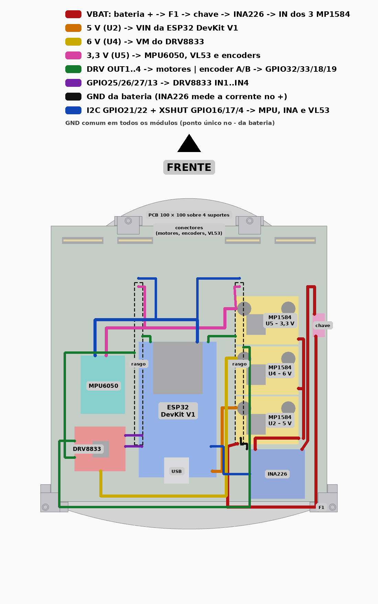
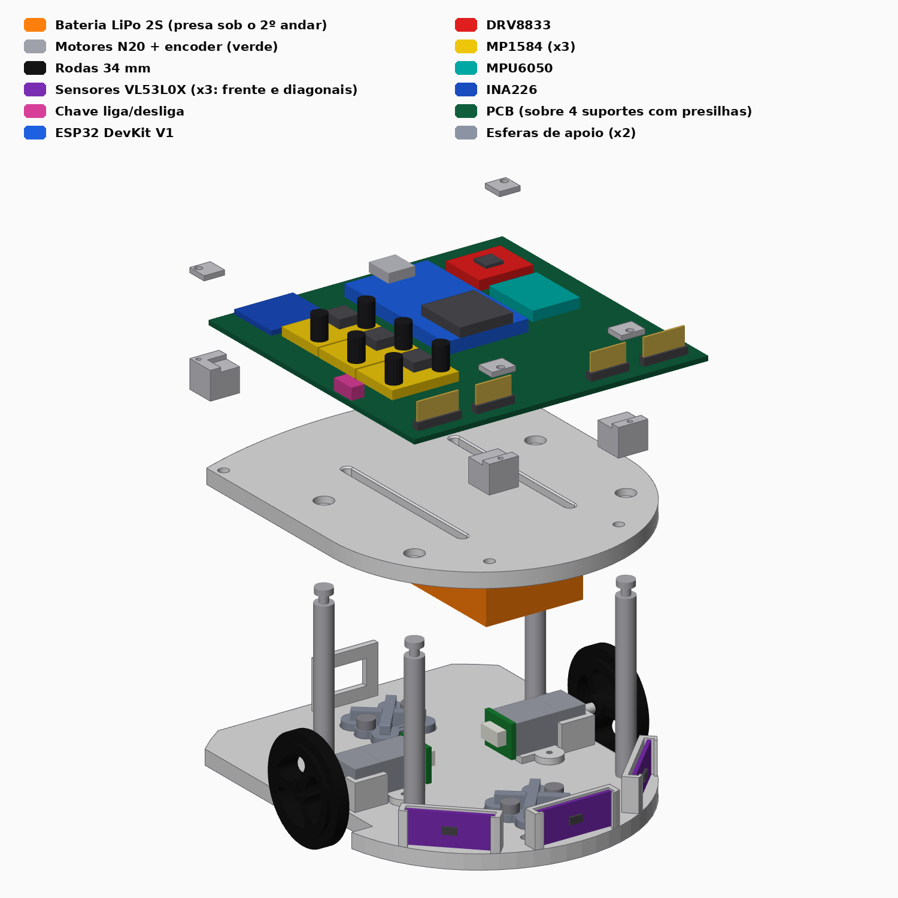
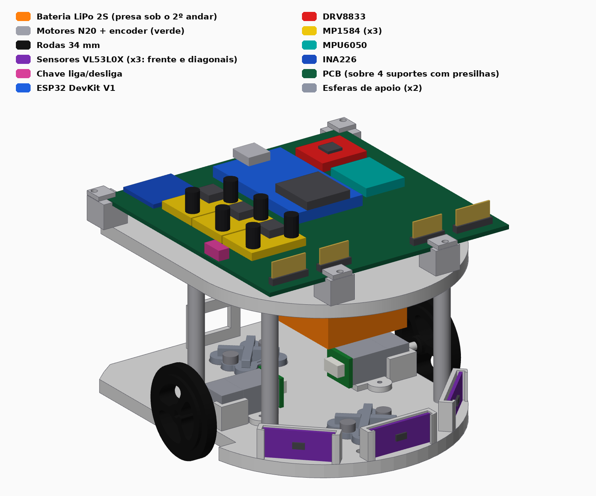
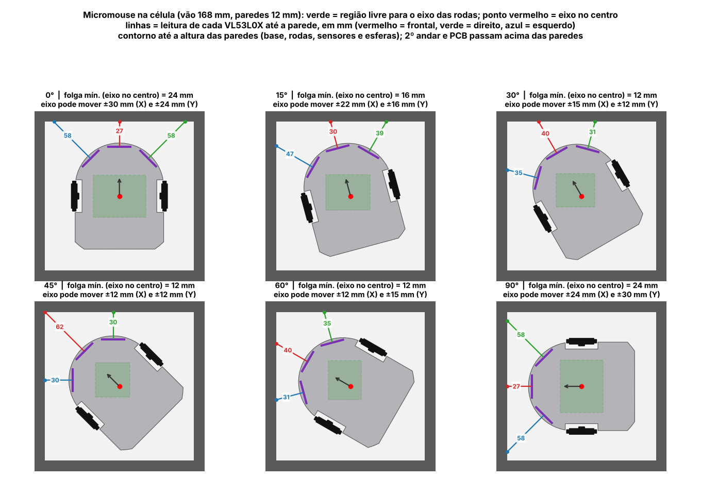
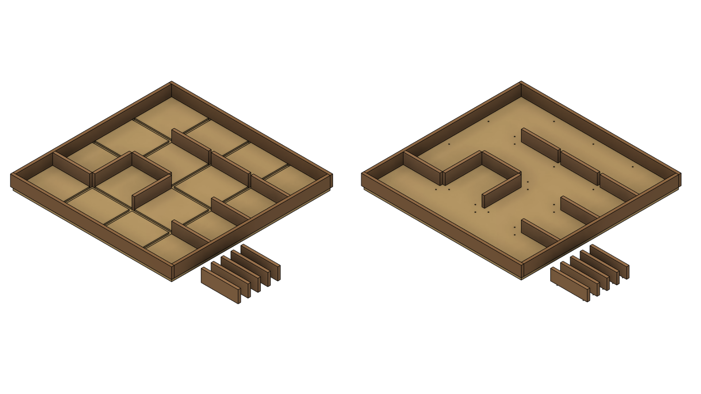

# Testes de Estrutura

Os itens **1.1–1.6** referem-se à validação em CAD do **labirinto de testes 4×4** (base 720 × 720 mm). O labirinto adotado é o de 72 × 72 cm com paredes em rasgos (Modelo 1), construído em MDF; a escolha e seus motivos estão na [seção 3.1](#31-labirinto-de-testes-adotado). Detalhes, desenhos e arquivos em [Labirinto de testes](../04-projeto-conceitual/labirinto-testes.md).

Os itens **1.7–1.16** referem-se à **estrutura do robô na versão v10** (arquivo [`mec/estrutura_modelo_final/step/micromouse_montagem_final.step`](https://github.com/fcte-pi1/2026_2_PI1_Grupo01_Hilmer/blob/main/mec/estrutura_modelo_final/step/micromouse_montagem_final.step)) e ao dimensionamento de tração. A v10 tem dois andares: a **base** com rodas Ø34 mm, motores N20 6 V 300 rpm, três VL53L0X e duas esferas de apoio embutidas; e o **2º andar**, apoiado em 4 espaçadores de 55 mm, com a bateria LiPo 2S presa por baixo e a PCB de 100 × 100 mm por cima. Os itens **1.17–1.24** foram incluídos nesta revisão para cobrir a fixação da PCB e da bateria, a altura de rodas e esferas, a integração com o hardware e os ensaios físicos do cronograma. Todos os testes foram validados pela equipe e apresentados aos professores. O teste de integração geral do robô foi feito em 24/11/2026 (item 1.24). As mudanças em relação ao projeto conceitual, que previa um LiDAR no topo, estão na [seção 6](#6-alteracoes-em-relacao-ao-projeto-conceitual). Arquivos CAD em [`mec/estrutura_modelo_final/`](https://github.com/fcte-pi1/2026_2_PI1_Grupo01_Hilmer/tree/main/mec/estrutura_modelo_final).

| **ID** | **Descrição** | **Data de Início** | **Data de Conclusão** | **Responsável** | **Resultados Esperados** | **Resultados Obtidos** | **Aprovação Interna (S/N)** | **Aprovação do Orientador (S/N)** | **Observações** |
| :---: | :--- | :---: | :---: | :--- | :--- | :--- | :---: | :---: | :--- |
| 1.1 | Conferência das dimensões da base no CAD (720 × 720 mm, grade 4 × 4) — [#270](https://github.com/fcte-pi1/2026_2_PI1_Grupo01_Hilmer/issues/270) | 08/10/2026 | 10/10/2026 | Ana Carolina Nunes e Ágata Dias Vieira | Contorno externo 720 × 720 mm e 16 células no desenho técnico | Contorno 720 × 720 mm confirmado nas folhas do Modelo 1 e do Modelo 2; grade 4 × 4 | S | S | Prints nas Figuras 2 e 6 de [Labirinto de testes](../04-projeto-conceitual/labirinto-testes.md) |
| 1.2 | Conferência do passo nominal da célula (180 mm) no CAD — [#270](https://github.com/fcte-pi1/2026_2_PI1_Grupo01_Hilmer/issues/270) | 08/10/2026 | 10/10/2026 | Ana Carolina Nunes e Ágata Dias Vieira | Passo entre eixos de parede = 180 mm | Passo de 180 mm conferido na grade do desenho (paredes internas 168 mm + espessura 12 mm) | S | S | Ver seção 3 e desenhos em [Labirinto de testes](../04-projeto-conceitual/labirinto-testes.md) |
| 1.3 | Conferência do comprimento e do encaixe das paredes internas (168 × 12 × 50 mm) — [#270](https://github.com/fcte-pi1/2026_2_PI1_Grupo01_Hilmer/issues/270) | 08/10/2026 | 10/10/2026 | Ana Carolina Nunes e Ágata Dias Vieira | Parede interna 168 mm; montagem sem sobrepor a célula de 180 mm | Peça 168 × 12 × 50 mm (Modelo 2) / 168 × 12 × 56 mm com inserção (Modelo 1) dimensionada no CAD e nos PDFs | S | S | Figuras 1 e 5 (montagem virtual) e folhas de parede nos PDFs. Labirinto físico em MDF, ver seção 3.1 |
| 1.4 | Conferência dos rasgos do Modelo 1 (largura ~12,4 mm, profundidade 6 mm) — [#272](https://github.com/fcte-pi1/2026_2_PI1_Grupo01_Hilmer/issues/272) | 11/10/2026 | 14/10/2026 | Ana Carolina Nunes e Ágata Dias Vieira | Rasgos compatíveis com parede de 12 mm e inserção de 6 mm | Desenho técnico do Modelo 1 com rasgos dimensionados; vista CAD da base com grade de rasgos | S | S | Figuras 1–4; [`micromouse_modelo1_rasgos.step`](https://github.com/fcte-pi1/2026_2_PI1_Grupo01_Hilmer/blob/documentacao/mec/micromouse_modelo1_rasgos.step) |
| 1.5 | Conferência dos furos e cavilhas do Modelo 2 (Ø4,2 mm, cavilha Ø4 × 14 mm) — [#272](https://github.com/fcte-pi1/2026_2_PI1_Grupo01_Hilmer/issues/272) | 11/10/2026 | 14/10/2026 | Ana Carolina Nunes e Ágata Dias Vieira | Furos e cavilhas alinhados à parede; base 720 × 720 × 15 mm | Desenho e CAD do Modelo 2 com furos Ø4,2 mm e base 15 mm; montagem virtual com paredes | S | S | Figuras 5–9; [`micromouse_modelo2_cavilhas.step`](https://github.com/fcte-pi1/2026_2_PI1_Grupo01_Hilmer/blob/documentacao/mec/micromouse_modelo2_cavilhas.step) |
| 1.6 | Montagem virtual do labirinto no CAD (dois modelos) — [#272](https://github.com/fcte-pi1/2026_2_PI1_Grupo01_Hilmer/issues/272) | 11/10/2026 | 14/10/2026 | Ana Carolina Nunes e Ágata Dias Vieira | Conjunto montado no CAD sem interferência grosseira; paredes e base coerentes | Vistas isométricas dos dois modelos geradas; PDFs de fabricação e STEPs publicados | S | S | Figuras 1 e 5; PDFs em [`mec/`](https://github.com/fcte-pi1/2026_2_PI1_Grupo01_Hilmer/tree/documentacao/mec). Modelo adotado: 1 (rasgos), ver seção 3.1 |
| 1.7 | Integridade geométrica do [`micromouse_montagem_final.step`](https://github.com/fcte-pi1/2026_2_PI1_Grupo01_Hilmer/blob/main/mec/estrutura_modelo_final/step/micromouse_montagem_final.step) — [#258](https://github.com/fcte-pi1/2026_2_PI1_Grupo01_Hilmer/issues/258), [#259](https://github.com/fcte-pi1/2026_2_PI1_Grupo01_Hilmer/issues/259), [#277](https://github.com/fcte-pi1/2026_2_PI1_Grupo01_Hilmer/issues/277), [#278](https://github.com/fcte-pi1/2026_2_PI1_Grupo01_Hilmer/issues/278), [#290](https://github.com/fcte-pi1/2026_2_PI1_Grupo01_Hilmer/issues/290) | 24/09/2026 | 23/11/2026 | Ana Carolina Nunes, Ágata Dias Vieira, Leticia Lima e João Arthur | Todas as peças impressas como sólidos fechados | Base, 2º andar, espaçadores, suportes e presilhas: sólidos fechados (0 arestas livres nas malhas exportadas) | S | S | Revisão v10; na versão anterior a base era casca aberta (256 arestas livres) |
| 1.8 | Dimensões externas do robô — [#260](https://github.com/fcte-pi1/2026_2_PI1_Grupo01_Hilmer/issues/260), [#261](https://github.com/fcte-pi1/2026_2_PI1_Grupo01_Hilmer/issues/261), [#264](https://github.com/fcte-pi1/2026_2_PI1_Grupo01_Hilmer/issues/264), [#290](https://github.com/fcte-pi1/2026_2_PI1_Grupo01_Hilmer/issues/290) | 29/09/2026 | 23/11/2026 | Ágata Dias Vieira, Leticia Lima e João Arthur | Pegada compatível com o corredor de 168 mm e com o RNF01 ([#19](https://github.com/fcte-pi1/2026_2_PI1_Grupo01_Hilmer/issues/19)): no máximo 165 mm de comprimento e de largura | Base 120 × 100 mm; 108,7 mm de largura com as rodas; 81,2 mm de altura do chão ao topo das presilhas | S | S | Atende o RNF01 (120 mm de comprimento e 108,7 mm de largura, contra o máximo de 165 mm). Figuras 1 a 4 |
| 1.9 | Passagem em corredor de 168 mm — [#264](https://github.com/fcte-pi1/2026_2_PI1_Grupo01_Hilmer/issues/264), [#290](https://github.com/fcte-pi1/2026_2_PI1_Grupo01_Hilmer/issues/290) | 04/10/2026 | 23/11/2026 | Ágata Dias Vieira, Leticia Lima e João Arthur | Largura do robô menor que o vão de 168 mm e que o máximo de 165 mm do RNF01 ([#19](https://github.com/fcte-pi1/2026_2_PI1_Grupo01_Hilmer/issues/19)) | Folga de 29,6 mm por lado (largura 108,7 mm, com as rodas) | S | S | Atende o RNF01. Rodas 5 mm mais para fora, como no robô montado |
| 1.10 | Giro no lugar (90° e 180°) em célula de 168 × 168 mm — [#264](https://github.com/fcte-pi1/2026_2_PI1_Grupo01_Hilmer/issues/264), [#290](https://github.com/fcte-pi1/2026_2_PI1_Grupo01_Hilmer/issues/290) | 04/10/2026 | 23/11/2026 | Ágata Dias Vieira, Leticia Lima e João Arthur | Raio de varredura ≤ 84 mm até a altura das paredes | Raio de 72,0 mm em torno do eixo das rodas; folga de 12,0 mm | S | S | Revisão v10; Figura 5. O 2º andar e a PCB passam acima das paredes |
| 1.11 | Massa e centro de massa da estrutura (sem eletrônica) — [#252](https://github.com/fcte-pi1/2026_2_PI1_Grupo01_Hilmer/issues/252), [#253](https://github.com/fcte-pi1/2026_2_PI1_Grupo01_Hilmer/issues/253), [#263](https://github.com/fcte-pi1/2026_2_PI1_Grupo01_Hilmer/issues/263), [#265](https://github.com/fcte-pi1/2026_2_PI1_Grupo01_Hilmer/issues/265), [#266](https://github.com/fcte-pi1/2026_2_PI1_Grupo01_Hilmer/issues/266), [#543](https://github.com/fcte-pi1/2026_2_PI1_Grupo01_Hilmer/issues/543) | 08/10/2026 | 24/11/2026 | Ana Carolina Nunes, Ágata Dias Vieira, Leticia Lima e João Arthur | Massa e CG conhecidos para dimensionar a tração | Massa máxima 143,1 g (PETG maciço); CG em (57,0; 50,0; 33,3) mm | S | S | Valor de CAD, limite superior (peças maciças). A massa de 200 g da seção 5 é uma premissa de cálculo |
| 1.12 | Montagem virtual da base e do 2º andar — [#259](https://github.com/fcte-pi1/2026_2_PI1_Grupo01_Hilmer/issues/259), [#262](https://github.com/fcte-pi1/2026_2_PI1_Grupo01_Hilmer/issues/262), [#280](https://github.com/fcte-pi1/2026_2_PI1_Grupo01_Hilmer/issues/280), [#290](https://github.com/fcte-pi1/2026_2_PI1_Grupo01_Hilmer/issues/290) | 27/09/2026 | 23/11/2026 | Ana Carolina Nunes, Ágata Dias Vieira e Leticia Lima | Montagem sem interferência e com elementos de ligação definidos | Sem interferência; 4 espaçadores de 55 mm com parafusos M3 ligam a base ao 2º andar | S | S | Revisão v10; na versão anterior não havia elementos de ligação |
| 1.13 | Tração: torque e velocidade nas rodas, com apoio skid e esfera — [#250](https://github.com/fcte-pi1/2026_2_PI1_Grupo01_Hilmer/issues/250) | 03/10/2026 | 12/10/2026 | Leticia Lima e João Arthur | Torque e rotação suficientes para a aceleração e a velocidade-alvo | Torque por roda a 2 m/s²: 5,3 mN·m (skid) e 4,0 mN·m (esfera) | S | S | Ver [Memória de cálculo de tração](#5-memoria-de-calculo-de-tracao). Tração validada no robô montado no teste de integração de 24/11/2026 (item 1.24) |
| 1.14 | Limite de aderência e aceleração máxima, com apoio skid e esfera — [#251](https://github.com/fcte-pi1/2026_2_PI1_Grupo01_Hilmer/issues/251) | 05/10/2026 | 07/10/2026 | Leticia Lima e João Arthur | Tração requerida menor que a aderência, com margem | Aceleração máxima 3,0 m/s² (skid) e 3,8 m/s² (esfera); giro de 90° em ≥ 0,25 s sem derrapar | S | S | Premissas μ = 0,6 e f = 0,7. Giro recalculado com a bitola de 100 mm. No robô montado, a esfera dianteira fixada com silicone aumentou a aderência das rodas motrizes e eliminou os giros em falso (item 1.18) |
| 1.15 | Compatibilidade motor × driver × bateria × rodas — [#250](https://github.com/fcte-pi1/2026_2_PI1_Grupo01_Hilmer/issues/250), [#256](https://github.com/fcte-pi1/2026_2_PI1_Grupo01_Hilmer/issues/256), [#257](https://github.com/fcte-pi1/2026_2_PI1_Grupo01_Hilmer/issues/257) | 03/10/2026 | 24/11/2026 | Ana Carolina Nunes, Leticia Lima e João Arthur | Rotação ≥ 281 rpm na roda; torque e corrente dentro dos limites | Atende até ≈ 0,43 m/s (cálculo). No robô montado a tração foi suficiente: corridas completas no labirinto 4 × 4 em 21,8 a 31,2 s e teste de integração de 24/11/2026 aprovado | S | S | Torque e corrente estimados (seção 5.6) e validados no robô montado, sem ensaio de torque em bancada ([#256](https://github.com/fcte-pi1/2026_2_PI1_Grupo01_Hilmer/issues/256)) |
| 1.16 | Ensaio físico: fabricação, montagem e passagem no labirinto — [#254](https://github.com/fcte-pi1/2026_2_PI1_Grupo01_Hilmer/issues/254), [#255](https://github.com/fcte-pi1/2026_2_PI1_Grupo01_Hilmer/issues/255), [#267](https://github.com/fcte-pi1/2026_2_PI1_Grupo01_Hilmer/issues/267), [#268](https://github.com/fcte-pi1/2026_2_PI1_Grupo01_Hilmer/issues/268), [#269](https://github.com/fcte-pi1/2026_2_PI1_Grupo01_Hilmer/issues/269), [#271](https://github.com/fcte-pi1/2026_2_PI1_Grupo01_Hilmer/issues/271), [#284](https://github.com/fcte-pi1/2026_2_PI1_Grupo01_Hilmer/issues/284), [#289](https://github.com/fcte-pi1/2026_2_PI1_Grupo01_Hilmer/issues/289), [#543](https://github.com/fcte-pi1/2026_2_PI1_Grupo01_Hilmer/issues/543) | 13/10/2026 | 24/11/2026 | Ana Carolina Nunes, Ágata Dias Vieira, Leticia Lima e João Arthur | Peças conforme o CAD; robô percorre o labirinto e gira nas células | Concluído. Peças impressas em PETG conforme o CAD final; suportes e encaixes de acordo, inclusive os dos VL53L0X e dos motores, que falharam no protótipo v1 (05/11/2026, [estrutura_relatorio_testes_prototipo.pdf](https://github.com/fcte-pi1/2026_2_PI1_Grupo01_Hilmer/blob/main/mec/estrutura_relatorio_testes_prototipo.pdf)). O robô percorreu o labirinto 4 × 4 nos dois desenhos usados ([7.6 Corrida completa](corrida-completa.md)) e passou no teste de integração geral de 24/11/2026 | S | S | As três falhas do protótipo v1 foram corrigidas na versão final |
| 1.17 | Fixação da PCB 100 × 100 mm no 2º andar — [#249](https://github.com/fcte-pi1/2026_2_PI1_Grupo01_Hilmer/issues/249), [#275](https://github.com/fcte-pi1/2026_2_PI1_Grupo01_Hilmer/issues/275), [#277](https://github.com/fcte-pi1/2026_2_PI1_Grupo01_Hilmer/issues/277), [#281](https://github.com/fcte-pi1/2026_2_PI1_Grupo01_Hilmer/issues/281), [#282](https://github.com/fcte-pi1/2026_2_PI1_Grupo01_Hilmer/issues/282), [#283](https://github.com/fcte-pi1/2026_2_PI1_Grupo01_Hilmer/issues/283), [#285](https://github.com/fcte-pi1/2026_2_PI1_Grupo01_Hilmer/issues/285) | 30/09/2026 | 13/11/2026 | Ana Carolina Nunes, Ágata Dias Vieira, Leticia Lima e João Arthur | PCB presa sem furar a placa e sem peças que precisem flexionar; suportes com no máximo 10 mm por lado | 4 suportes de 10 × 10 mm parafusados por baixo (M3 × 10) e 4 presilhas rígidas por cima (M2 × 8); PCB em z = 73,0 a 74,6 mm, sem interferência. Na montagem e no teste de integração de 24/11/2026, PCB firme, sem folga e sem quebra | S | S | Substitui as garras de encaixe, que quebravam. Desenhos MM-05 e MM-06. Montagem registrada em [estrutura_montagem_final.md](https://github.com/fcte-pi1/2026_2_PI1_Grupo01_Hilmer/blob/main/mec/estrutura_montagem_final.md) |
| 1.18 | Rodas e esferas na mesma altura — [#246](https://github.com/fcte-pi1/2026_2_PI1_Grupo01_Hilmer/issues/246), [#247](https://github.com/fcte-pi1/2026_2_PI1_Grupo01_Hilmer/issues/247), [#248](https://github.com/fcte-pi1/2026_2_PI1_Grupo01_Hilmer/issues/248), [#279](https://github.com/fcte-pi1/2026_2_PI1_Grupo01_Hilmer/issues/279), [#543](https://github.com/fcte-pi1/2026_2_PI1_Grupo01_Hilmer/issues/543) | 27/09/2026 | 24/11/2026 | Ana Carolina Nunes, Ágata Dias Vieira e Leticia Lima | Rodas e esferas tocam o chão juntas, sem a esfera levantar a roda | Esferas embutidas na base, na altura das rodas. A esfera de 3/8" (9,53 mm) passa do limite de 9 mm; a diferença foi compensada subindo o alojamento do suporte da esfera para dentro da base, sem arruelas. A esfera dianteira foi fixada com silicone, e as rodas motrizes ficaram com boa aderência, sem giros em falso | S | S | Ajuste validado no teste de integração de 24/11/2026 |
| 1.19 | Fixação da bateria LiPo 2S (74 × 33 × 20 mm) — [#278](https://github.com/fcte-pi1/2026_2_PI1_Grupo01_Hilmer/issues/278), [#290](https://github.com/fcte-pi1/2026_2_PI1_Grupo01_Hilmer/issues/290) | 11/10/2026 | 23/11/2026 | Ágata Dias Vieira, Leticia Lima e João Arthur | Bateria presa sem interferir com motores, esferas e espaçadores | Bateria sob o 2º andar (z = 40 a 60 mm), presa por 2 abraçadeiras em rasgos arredondados; sem interferência no CAD | S | S | Revisão v10. Fica acima das esferas: parafusar as esferas antes de montar o 2º andar |
| 1.20 | Integração dos módulos de hardware na estrutura — [#276](https://github.com/fcte-pi1/2026_2_PI1_Grupo01_Hilmer/issues/276), [#286](https://github.com/fcte-pi1/2026_2_PI1_Grupo01_Hilmer/issues/286), [#289](https://github.com/fcte-pi1/2026_2_PI1_Grupo01_Hilmer/issues/289) | 04/10/2026 | 24/11/2026 | Ágata Dias Vieira, Leticia Lima e João Arthur | Todos os módulos e fios cabem na estrutura, com passagem dos fios até a PCB | Todos os módulos montados na estrutura, com os fios passando pelos rasgos do 2º andar (Figuras 1 e 2). PCB alimentada pela LiPo 2S, com saídas de 3,3 V, 5,1 V e 6,6 V ([7.5 Integração](integracao.md), teste 5.3). Sistema completo aprovado no teste de integração de 24/11/2026 | S | S | Na versão final o INA226 ficou desconectado e não há fusível PPTC (teste 5.3 de integração) |
| 1.21 | Distância dos sensores VL53L0X até as paredes da célula — [#277](https://github.com/fcte-pi1/2026_2_PI1_Grupo01_Hilmer/issues/277), [#289](https://github.com/fcte-pi1/2026_2_PI1_Grupo01_Hilmer/issues/289) | 08/10/2026 | 24/11/2026 | Ágata Dias Vieira e João Arthur | Distâncias geométricas conhecidas para comparar com as leituras reais | CAD, robô centrado a 0°: frontal 27 mm e diagonais 58 mm. Nas corridas, os sensores diagonais leram paredes entre 105 e 146 mm e aberturas entre 200 e 237 mm; o firmware usa 190 mm como limite de abertura lateral | S | S | Figura 5. Calibração em [7.3.1](hardware/calibracao-vl53l0x.md) e leituras em [7.6](corrida-completa.md) |
| 1.22 | Construção do labirinto físico (72 × 72 cm, 4 × 4, MDF) e trocas de configuração — [#273](https://github.com/fcte-pi1/2026_2_PI1_Grupo01_Hilmer/issues/273), [#274](https://github.com/fcte-pi1/2026_2_PI1_Grupo01_Hilmer/issues/274), [#544](https://github.com/fcte-pi1/2026_2_PI1_Grupo01_Hilmer/issues/544) | 22/10/2026 | — (previsto 01/12/2026) | Ana Carolina Nunes, Ágata Dias Vieira e Leticia Lima | Paredes montadas e trocadas sem folga nem quebra | Arena em MDF concluída: paredes brancas com topo vermelho, piso preto e verniz ([relatório de construção do labirinto](https://github.com/fcte-pi1/2026_2_PI1_Grupo01_Hilmer/blob/main/mec/estruturas_labirinto_relatorio_construcao.pdf)). Montagem completa cronometrada e 3 trocas de configuração sem paredes travando ([critérios do labirinto](https://github.com/fcte-pi1/2026_2_PI1_Grupo01_Hilmer/blob/main/mec/estruturas_labirinto_criterios.pdf)) | S | S | Labirinto usado nas corridas completas e no teste de integração de 24/11/2026. Pendente até 01/12/2026, na inspeção final ([#546](https://github.com/fcte-pi1/2026_2_PI1_Grupo01_Hilmer/issues/546)): registrar o tempo de montagem e a largura medida dos corredores. Os layouts 8 × 4 e 12 × 4 foram descartados por custo e transporte |
| 1.23 | Resistência da estrutura montada ([#24](https://github.com/fcte-pi1/2026_2_PI1_Grupo01_Hilmer/issues/24), RNF06) — [#287](https://github.com/fcte-pi1/2026_2_PI1_Grupo01_Hilmer/issues/287), [#288](https://github.com/fcte-pi1/2026_2_PI1_Grupo01_Hilmer/issues/288) | 16/11/2026 | — (previsto 01/12/2026) | Leticia Lima e João Arthur | Estrutura sem trincas ou folgas após manuseio e testes | Estrutura resistente: sem trincas, folgas ou parafusos soltos após as corridas e o teste de integração geral de 24/11/2026 | S | S | Procedimento na seção 1.23. Pendente até 01/12/2026, na inspeção final ([#546](https://github.com/fcte-pi1/2026_2_PI1_Grupo01_Hilmer/issues/546)): anexar as fotos da estrutura depois dos testes |
| 1.24 | Teste de integração geral do robô (estrutura, energia, hardware e software) — [#289](https://github.com/fcte-pi1/2026_2_PI1_Grupo01_Hilmer/issues/289), [#543](https://github.com/fcte-pi1/2026_2_PI1_Grupo01_Hilmer/issues/543) | 24/11/2026 | 24/11/2026 | Ana Carolina Nunes, Ágata Dias Vieira, Leticia Lima e João Arthur | Robô completo funcionando no labirinto, com a estrutura sem falhas | Estrutura 100 %: resistente, com todos os suportes e encaixes de acordo e ótima tração. Esferas de 3/8" compensadas pelo rebaixo na base e esfera dianteira fixada com silicone para garantir a aderência das rodas motrizes | S | S | Resultados das outras frentes em [7.5 Integração](integracao.md) e [7.6 Corrida completa](corrida-completa.md) |

### Relação entre o cronograma e os testes

Cada tarefa de estrutura do [cronograma](https://github.com/orgs/fcte-pi1/projects/43/views/2) aparece abaixo com os testes em que é usada. As datas de início e conclusão da tabela de testes vêm destas issues: a data de início é a da primeira issue relacionada e a de conclusão é a da última. Quando alguma issue relacionada ainda está aberta, a conclusão fica como prevista.

| **Etapa do cronograma** | **Issue** | **Tarefa** | **Período** | **Situação** | **Testes relacionados** |
| :--- | :---: | :--- | :---: | :---: | :---: |
| Labirinto de testes (#155, #156, #157, #158) | [#270](https://github.com/fcte-pi1/2026_2_PI1_Grupo01_Hilmer/issues/270) | Definir layout do labirinto de testes | 08/10 a 10/10 | Fechada | 1.1, 1.2, 1.3 |
|  | [#272](https://github.com/fcte-pi1/2026_2_PI1_Grupo01_Hilmer/issues/272) | Desenhar planta de corte/montagem | 11/10 a 14/10 | Fechada | 1.4, 1.5, 1.6 |
|  | [#273](https://github.com/fcte-pi1/2026_2_PI1_Grupo01_Hilmer/issues/273) | Cortar e montar paredes do labirinto | 22/10 a 24/10 | Fechada | 1.22 |
|  | [#274](https://github.com/fcte-pi1/2026_2_PI1_Grupo01_Hilmer/issues/274) | Pintar e fixar labirinto de testes | 25/10 a 26/10 | Fechada | 1.22 |
|  | [#544](https://github.com/fcte-pi1/2026_2_PI1_Grupo01_Hilmer/issues/544) | Testar a montagem e a troca de configuração do labirinto (4×4, 8×4 e 12×4) | 11/11 a 14/11 | Fechada | 1.22 |
| Modelagem CAD (#55, #63, #70) | [#258](https://github.com/fcte-pi1/2026_2_PI1_Grupo01_Hilmer/issues/258) | Modelar chassi base | 24/09 a 26/09 | Fechada | 1.7 |
|  | [#259](https://github.com/fcte-pi1/2026_2_PI1_Grupo01_Hilmer/issues/259) | Modelar encaixes internos | 27/09 a 28/09 | Fechada | 1.7, 1.12 |
|  | [#246](https://github.com/fcte-pi1/2026_2_PI1_Grupo01_Hilmer/issues/246) | Modelagem da geometria das rodas | 06/10 a 09/10 | Fechada | 1.18 |
|  | [#247](https://github.com/fcte-pi1/2026_2_PI1_Grupo01_Hilmer/issues/247) | Modelar suporte dos motores | 27/09 a 28/09 | Fechada | 1.18 |
|  | [#277](https://github.com/fcte-pi1/2026_2_PI1_Grupo01_Hilmer/issues/277) | Modelar suportes de PCB/sensores | 08/10 a 10/10 | Fechada | 1.7, 1.17, 1.21 |
|  | [#278](https://github.com/fcte-pi1/2026_2_PI1_Grupo01_Hilmer/issues/278) | Modelar suporte da bateria | 11/10 a 14/10 | Fechada | 1.7, 1.19 |
| Desenho técnico (#57, #64, #72) | [#260](https://github.com/fcte-pi1/2026_2_PI1_Grupo01_Hilmer/issues/260) | Desenho técnico do chassi base | 29/09 a 30/09 | Fechada | 1.8 |
|  | [#261](https://github.com/fcte-pi1/2026_2_PI1_Grupo01_Hilmer/issues/261) | Desenho técnico do chassi base (duplicada de #260) | — | Fechada | 1.8 |
|  | [#262](https://github.com/fcte-pi1/2026_2_PI1_Grupo01_Hilmer/issues/262) | Desenho técnico dos encaixes | 01/10 a 02/10 | Fechada | 1.12 |
|  | [#248](https://github.com/fcte-pi1/2026_2_PI1_Grupo01_Hilmer/issues/248) | Gerar desenho técnico das rodas | 29/09 a 30/09 | Fechada | 1.18 |
|  | [#249](https://github.com/fcte-pi1/2026_2_PI1_Grupo01_Hilmer/issues/249) | Gerar desenho técnico dos suportes | 30/09 a 05/11 | Fechada | 1.17 |
|  | [#281](https://github.com/fcte-pi1/2026_2_PI1_Grupo01_Hilmer/issues/281) | Gerar desenho técnico final dos suportes | 22/10 a 24/10 | Fechada | 1.17 |
|  | [#282](https://github.com/fcte-pi1/2026_2_PI1_Grupo01_Hilmer/issues/282) | Revisar desenho com o time | 24/10 a 26/10 | Fechada | 1.17 |
| Análise e refinamento (#56, #71) | [#263](https://github.com/fcte-pi1/2026_2_PI1_Grupo01_Hilmer/issues/263) | Analisar esforços estruturais | 12/10 a 16/10 | Fechada | 1.11 |
|  | [#264](https://github.com/fcte-pi1/2026_2_PI1_Grupo01_Hilmer/issues/264) | Refinar o design do chassi | 04/10 a 12/10 | Fechada | 1.8, 1.9, 1.10 |
|  | [#276](https://github.com/fcte-pi1/2026_2_PI1_Grupo01_Hilmer/issues/276) | Revisar com Hardware os encaixes necessários | 04/10 a 12/10 | Fechada | 1.20 |
| Dimensionamento e seleção de materiais (#62, #58, #65) | [#250](https://github.com/fcte-pi1/2026_2_PI1_Grupo01_Hilmer/issues/250) | Calcular torque necessário dos motores | 03/10 a 12/10 | Fechada | 1.13, 1.15 |
|  | [#251](https://github.com/fcte-pi1/2026_2_PI1_Grupo01_Hilmer/issues/251) | Validar dimensionamento por simulação | 05/10 a 07/10 | Fechada | 1.14 |
|  | [#252](https://github.com/fcte-pi1/2026_2_PI1_Grupo01_Hilmer/issues/252) | Pesquisar fornecedores de material | 08/10 a 09/10 | Fechada | 1.11 |
|  | [#253](https://github.com/fcte-pi1/2026_2_PI1_Grupo01_Hilmer/issues/253) | Definir e registrar material escolhido | 10/10 | Fechada | 1.11 |
|  | [#265](https://github.com/fcte-pi1/2026_2_PI1_Grupo01_Hilmer/issues/265) | Pesquisar materiais (PLA/PETG/fibra) | 08/10 a 09/10 | Fechada | 1.11 |
|  | [#266](https://github.com/fcte-pi1/2026_2_PI1_Grupo01_Hilmer/issues/266) | Definir material final do chassi | 10/10 | Fechada | 1.11 |
| Prototipagem e fabricação (#59, #60, #66, #73) | [#267](https://github.com/fcte-pi1/2026_2_PI1_Grupo01_Hilmer/issues/267) | Imprimir protótipo em escala | 19/10 a 23/10 | Fechada | 1.16 |
|  | [#268](https://github.com/fcte-pi1/2026_2_PI1_Grupo01_Hilmer/issues/268) | Avaliar encaixe do protótipo | 13/10 a 14/10 | Fechada | 1.16 |
|  | [#269](https://github.com/fcte-pi1/2026_2_PI1_Grupo01_Hilmer/issues/269) | Fabricar chassi final | 15/10 a 18/10 | Fechada | 1.16 |
|  | [#271](https://github.com/fcte-pi1/2026_2_PI1_Grupo01_Hilmer/issues/271) | Fazer acabamento e furação | 19/10 a 20/10 | Fechada | 1.16 |
|  | [#254](https://github.com/fcte-pi1/2026_2_PI1_Grupo01_Hilmer/issues/254) | Imprimir/usinar peças das rodas | 15/10 a 17/10 | Fechada | 1.16 |
|  | [#255](https://github.com/fcte-pi1/2026_2_PI1_Grupo01_Hilmer/issues/255) | Montar peças fabricadas no chassi | 18/10 a 20/10 | Fechada | 1.16 |
|  | [#283](https://github.com/fcte-pi1/2026_2_PI1_Grupo01_Hilmer/issues/283) | Fabricar suportes finais | 29/10 a 01/11 | Fechada | 1.17 |
| Montagem e integração (#74, #68) | [#280](https://github.com/fcte-pi1/2026_2_PI1_Grupo01_Hilmer/issues/280) | Ajustar tolerâncias de montagem | 19/10 a 21/10 | Fechada | 1.12 |
|  | [#285](https://github.com/fcte-pi1/2026_2_PI1_Grupo01_Hilmer/issues/285) | Montar suportes no chassi | 12/11 a 13/11 | Fechada | 1.17 |
|  | [#286](https://github.com/fcte-pi1/2026_2_PI1_Grupo01_Hilmer/issues/286) | Integrar módulos de hardware no chassi | 14/11 a 15/11 | Fechada | 1.20 |
| Validação e testes (#75, #76, #67) | [#279](https://github.com/fcte-pi1/2026_2_PI1_Grupo01_Hilmer/issues/279) | Validar encaixes com peças reais | 15/10 a 17/10 | Fechada | 1.18 |
|  | [#284](https://github.com/fcte-pi1/2026_2_PI1_Grupo01_Hilmer/issues/284) | Inspecionar qualidade das peças | 03/11 a 04/11 | Fechada | 1.16 |
|  | [#287](https://github.com/fcte-pi1/2026_2_PI1_Grupo01_Hilmer/issues/287) | Testar resistência da estrutura montada | 16/11 a 17/11 | Fechada | 1.23 |
|  | [#288](https://github.com/fcte-pi1/2026_2_PI1_Grupo01_Hilmer/issues/288) | Registrar validação estrutural | 18/11 | Fechada | 1.23 |
|  | [#289](https://github.com/fcte-pi1/2026_2_PI1_Grupo01_Hilmer/issues/289) | Testar integração mecânica com hardware/software | 19/11 a 21/11 | Fechada | 1.16, 1.20, 1.21, 1.24 |
|  | [#290](https://github.com/fcte-pi1/2026_2_PI1_Grupo01_Hilmer/issues/290) | Corrigir ajustes identificados nos testes | 22/11 a 23/11 | Fechada | 1.7, 1.8, 1.9, 1.10, 1.12, 1.19 |
|  | [#543](https://github.com/fcte-pi1/2026_2_PI1_Grupo01_Hilmer/issues/543) | Medir o robô montado e testar a passagem em corredores e curvas do labirinto | 19/11 a 22/11 | Fechada | 1.11, 1.16, 1.18, 1.24 |
|  | [#546](https://github.com/fcte-pi1/2026_2_PI1_Grupo01_Hilmer/issues/546) | Inspeção final da estrutura para a APT: fixações, peças reserva e versão do CAD | 26/11 a 01/12 | Aberta | — |
|  | [#256](https://github.com/fcte-pi1/2026_2_PI1_Grupo01_Hilmer/issues/256) | Testar torque em bancada | 22/10 a 24/10 | Fechada | 1.15 |
|  | [#257](https://github.com/fcte-pi1/2026_2_PI1_Grupo01_Hilmer/issues/257) | Registrar resultados no plano de testes | 25/10 a 26/10 | Fechada | 1.15 |

Ficam fora da tabela de testes as issues de planejamento e gestão da frente de estrutura: projeto conceitual ([#54](https://github.com/fcte-pi1/2026_2_PI1_Grupo01_Hilmer/issues/54), [#162](https://github.com/fcte-pi1/2026_2_PI1_Grupo01_Hilmer/issues/162)), gestão de riscos ([#545](https://github.com/fcte-pi1/2026_2_PI1_Grupo01_Hilmer/issues/545), [#547](https://github.com/fcte-pi1/2026_2_PI1_Grupo01_Hilmer/issues/547)) e documentação ([#146](https://github.com/fcte-pi1/2026_2_PI1_Grupo01_Hilmer/issues/146)).

---

## Evidências (estrutura e labirinto)

### 1. Peças da estrutura

A estrutura v10 tem **dois andares** com a mesma pegada em forma de "D" (frente arredondada), de 120 × 100 mm, ligados por **4 espaçadores de 55 mm**. A base leva rodas, motores, sensores, esferas e chave. O 2º andar leva a bateria por baixo e a PCB por cima. As Figuras 1 e 2 mostram a posição dos componentes e das ligações em cada andar.

<figure markdown>

<figcaption>

**Figura 1 — Base (vista superior): rodas de 34 mm, motores N20 com encoder, três VL53L0X (frontal e diagonais esquerda e direita), duas esferas de apoio embutidas e a bateria LiPo 2S presa sob o 2º andar (contorno laranja). Os fios sobem até a PCB pelos rasgos tracejados do 2º andar.**

</figcaption>

</figure>

<figure markdown>

<figcaption>

**Figura 2 — 2º andar (vista superior): PCB de 100 × 100 mm sobre 4 suportes, com ESP32 DevKit V1, DRV8833, MPU-6050, INA226 (desconectado na versão final) e três MP1584 (U2: 5 V; U4: 6 V; U5: 3,3 V), com as ligações de alimentação, motores, encoders e I²C conforme o esquemático Rev 2.1.**

</figcaption>

</figure>

| **Peça** | **Qtd.** | **Dimensões (mm)** | **Volume (cada)** | **Observação** |
| :--- | :---: | :---: | :---: | :--- |
| Base | 1 | 120 × 100 × 21,2 (chapa de 5 mm) | 53,2 cm³ | Rebaixos e recortes para as 2 esferas; suportes dos VL53L0X e dos motores |
| 2º andar | 1 | 120 × 100 × 5 | 50,8 cm³ | Rasgos para os fios e para as abraçadeiras da bateria |
| Espaçador | 4 | Ø6 × 55 | 1,28 cm³ | Pode ser trocado por espaçador comercial M3 × 55 ou 30 + 25 rosqueados |
| Suporte da PCB | 4 | 10 × 10 × 9,4 | 0,80 a 0,84 cm³ | Parafusado por baixo do 2º andar (M3 × 10) |
| Presilha da PCB | 4 | 7 × 7 × 1,6 (traseiras) e 6,5 × 8 × 1,6 (dianteiras) | 0,07 a 0,08 cm³ | Parafusada por cima do suporte (M2 × 8) |

**Elementos comprados:** parafusos M3 × 8 (8), M3 × 10 (8) e M2 × 8 (4); abraçadeiras de nylon (2).

### 2. Estrutura montada

<figure markdown>

<figcaption>

**Figura 3 — Vista isométrica explodida: PCB com suportes e presilhas, 2º andar com a bateria por baixo, espaçadores de 55 mm e base com motores, rodas, sensores, esferas e chave.**

</figcaption>

</figure>

<figure markdown>

<figcaption>

**Figura 4 — Estrutura montada (120 × 100 mm em planta, 108,7 mm de largura com as rodas e 81,2 mm de altura), com PCB, rodas de 34 mm e módulos.**

</figcaption>

</figure>

### 3. Montagem virtual e verificação no labirinto

A Figura 5 apresenta a verificação do giro do robô dentro de uma célula do labirinto (vão livre de 168 × 168 mm), usando a pegada da v10 até a altura das paredes (base, rodas, sensores e esferas). O 2º andar e a PCB ficam acima das paredes. As linhas coloridas mostram a distância de cada VL53L0X até a parede. A Figura 6 mostra o labirinto de testes 4×4 nos dois modelos de fixação das paredes (rasgos ou cavilhas).

<figure markdown>

<figcaption>

**Figura 5 — Micromouse na célula (vão de 168 mm, paredes de 12 mm), nos ângulos de 0°, 15°, 30°, 45°, 60° e 90°. Em verde, a região livre para o eixo das rodas; o ponto vermelho marca o eixo no centro da célula. As linhas indicam a distância de cada VL53L0X até a parede (vermelho: frontal; verde: direito; azul: esquerdo).**

</figcaption>

</figure>

Valores indicados na própria Figura 5 (eixo das rodas no centro da célula):

| **Ângulo** | **Folga mínima (eixo no centro)** | **Deslocamento livre do eixo em X** | **Deslocamento livre do eixo em Y** |
| :---: | :---: | :---: | :---: |
| 0° | 24 mm | ± 30 mm | ± 24 mm |
| 15° | 16 mm | ± 22 mm | ± 16 mm |
| 30° | 12 mm | ± 15 mm | ± 12 mm |
| 45° | 12 mm | ± 12 mm | ± 12 mm |
| 60° | 12 mm | ± 12 mm | ± 15 mm |
| 90° | 24 mm | ± 24 mm | ± 30 mm |

<figure markdown>

<figcaption>

**Figura 6 — Montagem virtual do labirinto de testes: Modelo 1 (paredes encaixadas em rasgos na base, à esquerda) ou Modelo 2 (paredes fixadas por cavilhas, à direita).**

</figcaption>

</figure>

### 3.1 Labirinto de testes adotado

**Requisito.** O [TAP](../01-tap.md) prevê três configurações de labirinto: 4 × 4 células (72 × 72 cm), 8 × 4 (144 × 72 cm) e 12 × 4 (216 × 72 cm). Todas usam células de 180 mm (corredor de 168 mm + parede de 12 mm).

**Alternativas estudadas.**

| **Decisão** | **Opções** | **Escolha** | **Motivo** | **Fonte** |
| :--- | :--- | :--- | :--- | :--- |
| Tamanho do labirinto físico | 216 × 72 cm, montando as três configurações com paredes removíveis; ou só 72 × 72 cm | **72 × 72 cm (4 × 4)**, com paredes removíveis | Custo e locomoção (transporte e armazenamento) | [critérios do labirinto](https://github.com/fcte-pi1/2026_2_PI1_Grupo01_Hilmer/blob/main/mec/estruturas_labirinto_criterios.pdf) |
| Fixação das paredes | Modelo 1: rasgos na base (base de 12 mm, rasgos de 12,4 × 6 mm). Modelo 2: cavilhas Ø4 × 14 mm em furos (base de 15 mm, 56 cavilhas) | **Modelo 1 (rasgos)** | Critério definido em [Labirinto de testes](../04-projeto-conceitual/labirinto-testes.md): preço de produção. O Modelo 1 dispensa cavilhas e furação, e a planta de corte só prevê rasgos | [Labirinto de testes](../04-projeto-conceitual/labirinto-testes.md), [planta de corte do labirinto](https://github.com/fcte-pi1/2026_2_PI1_Grupo01_Hilmer/blob/main/mec/estruturas_labirinto_planta_corte.pdf) |
| Material | Compensado (previsto em [Labirinto de testes](../04-projeto-conceitual/labirinto-testes.md)) ou MDF | **MDF de 6 mm** | Material usado no corte e na construção | [planta de corte do labirinto](https://github.com/fcte-pi1/2026_2_PI1_Grupo01_Hilmer/blob/main/mec/estruturas_labirinto_planta_corte.pdf), [relatório de construção do labirinto](https://github.com/fcte-pi1/2026_2_PI1_Grupo01_Hilmer/blob/main/mec/estruturas_labirinto_relatorio_construcao.pdf) |

**Labirinto construído.** A base de 72 × 72 × 0,6 cm recebe 16 placas de 16,5 × 16,5 × 0,6 cm coladas. Os vãos de 12 mm entre as placas formam os rasgos (69,6 × 1,2 × 0,6 cm). As paredes têm 5,6 cm de altura: 5 cm ficam expostos e 0,6 cm entram no rasgo. São 24 paredes internas de 16,8 cm e 8 peças de parede externa (4 de 72 cm e 4 de 69,6 cm), cortadas de uma chapa de MDF de 275 × 185 × 0,6 cm. Paredes brancas com topo vermelho, piso preto e verniz acrílico. O relatório registra o labirinto como concluído ([relatório de construção do labirinto](https://github.com/fcte-pi1/2026_2_PI1_Grupo01_Hilmer/blob/main/mec/estruturas_labirinto_relatorio_construcao.pdf)).

**Observações.**

- **Espessura das paredes internas.** O layout pede paredes de 1,2 cm, para preencher o rasgo de 12 mm. A planta de corte prevê 24 peças de 0,6 cm, uma por posição de parede. Para paredes de 1,2 cm feitas com duas chapas coladas seriam necessárias 48 peças. A espessura das paredes prontas não foi registrada. O labirinto funcionou nas corridas completas e no teste de integração.
- **Configurações 8 × 4 e 12 × 4.** Sem o labirinto de 216 × 72 cm, essas configurações não podem ser testadas fisicamente. O título da [#544](https://github.com/fcte-pi1/2026_2_PI1_Grupo01_Hilmer/issues/544) ainda cita as três configurações. A mudança foi apresentada aos professores e deve constar no TAP. Ela também afeta o requisito de autonomia para três labirintos seguidos ([#22](https://github.com/fcte-pi1/2026_2_PI1_Grupo01_Hilmer/issues/22)).
- **Documento do labirinto.** [Labirinto de testes](../04-projeto-conceitual/labirinto-testes.md) ainda diz que a escolha entre os modelos 1 e 2 está em aberto. Deve ser atualizado com esta decisão.

### 4. Arquivos CAD e documentos

Os arquivos do robô ficam na pasta [`mec/` da branch `main`](https://github.com/fcte-pi1/2026_2_PI1_Grupo01_Hilmer/tree/main/mec). O modelo final está em [`mec/estrutura_modelo_final/`](https://github.com/fcte-pi1/2026_2_PI1_Grupo01_Hilmer/tree/main/mec/estrutura_modelo_final), com STEP, STL para impressão em PETG, desenhos em PNG, imagens e um README de montagem.

| **Arquivo** | **Descrição** |
| :--- | :--- |
| [`estrutura_modelo_final/step/micromouse_montagem_final.step`](https://github.com/fcte-pi1/2026_2_PI1_Grupo01_Hilmer/blob/main/mec/estrutura_modelo_final/step/micromouse_montagem_final.step) | CAD — robô montado (versão final) |
| [`estrutura_modelo_final/step/`](https://github.com/fcte-pi1/2026_2_PI1_Grupo01_Hilmer/tree/main/mec/estrutura_modelo_final/step) | CAD de cada peça: base, 2º andar, espaçadores de 55 mm com parafusos, suportes e presilhas da PCB |
| [`estrutura_modelo_final/stl/`](https://github.com/fcte-pi1/2026_2_PI1_Grupo01_Hilmer/tree/main/mec/estrutura_modelo_final/stl) | Peças para impressão 3D |
| [`estrutura_modelo_final/README.md`](https://github.com/fcte-pi1/2026_2_PI1_Grupo01_Hilmer/blob/main/mec/estrutura_modelo_final/README.md) | Lista de peças, parafusos, ajuste da altura das esferas e pontos a conferir antes de montar |
| [`estrutura_entregaveis.pdf`](https://github.com/fcte-pi1/2026_2_PI1_Grupo01_Hilmer/blob/main/mec/estrutura_entregaveis.pdf) | Desenhos técnicos finais MM-01 a MM-07 (também em PNG em [`estrutura_modelo_final/desenhos/`](https://github.com/fcte-pi1/2026_2_PI1_Grupo01_Hilmer/tree/main/mec/estrutura_modelo_final/desenhos)) |
| [`estrutura_montagem_final.md`](https://github.com/fcte-pi1/2026_2_PI1_Grupo01_Hilmer/blob/main/mec/estrutura_montagem_final.md) | Procedimento e inspeção da montagem dos suportes |
| [`estrutura_fiacao_previa_visual.zip`](https://github.com/fcte-pi1/2026_2_PI1_Grupo01_Hilmer/blob/main/mec/estrutura_fiacao_previa_visual.zip) | Componentes e ligações na base e na PCB (Figuras 1 e 2) |
| [`estrutura_relatorio_testes_prototipo.pdf`](https://github.com/fcte-pi1/2026_2_PI1_Grupo01_Hilmer/blob/main/mec/estrutura_relatorio_testes_prototipo.pdf) | Testes do protótipo v1 (05/11/2026) |
| [`estrutura_analise_materiais.pdf`](https://github.com/fcte-pi1/2026_2_PI1_Grupo01_Hilmer/blob/main/mec/estrutura_analise_materiais.pdf) | Seleção do material do chassi (PETG) |
| [`estrutura_riscos.pdf`](https://github.com/fcte-pi1/2026_2_PI1_Grupo01_Hilmer/blob/main/mec/estrutura_riscos.pdf) | Riscos da frente de estrutura e planos de mitigação |
| [`estruturas_roda_34mm.STEP`](https://github.com/fcte-pi1/2026_2_PI1_Grupo01_Hilmer/blob/main/mec/estruturas_roda_34mm.STEP) e [`estruturas_roda_34mm_desenho.pdf`](https://github.com/fcte-pi1/2026_2_PI1_Grupo01_Hilmer/blob/main/mec/estruturas_roda_34mm_desenho.pdf) | CAD e desenho técnico da roda |
| [`estruturas_labirinto_planta_corte.pdf`](https://github.com/fcte-pi1/2026_2_PI1_Grupo01_Hilmer/blob/main/mec/estruturas_labirinto_planta_corte.pdf) | Planta de corte do labirinto físico |
| [`estruturas_labirinto_relatorio_construcao.pdf`](https://github.com/fcte-pi1/2026_2_PI1_Grupo01_Hilmer/blob/main/mec/estruturas_labirinto_relatorio_construcao.pdf) | Construção do labirinto físico |
| [`estruturas_labirinto_criterios.pdf`](https://github.com/fcte-pi1/2026_2_PI1_Grupo01_Hilmer/blob/main/mec/estruturas_labirinto_criterios.pdf) | Decisão de tamanho e critérios de aceitação do labirinto |

Arquivos do labirinto em CAD, na pasta [`mec/`](https://github.com/fcte-pi1/2026_2_PI1_Grupo01_Hilmer/tree/documentacao/mec) desta branch:

| **Arquivo** | **Descrição** |
| :--- | :--- |
| [`micromouse_modelo1_rasgos.step`](https://github.com/fcte-pi1/2026_2_PI1_Grupo01_Hilmer/blob/documentacao/mec/micromouse_modelo1_rasgos.step) | CAD — labirinto Modelo 1 (rasgos) |
| [`micromouse_modelo1_rasgos-desenho-v1.pdf`](https://github.com/fcte-pi1/2026_2_PI1_Grupo01_Hilmer/blob/documentacao/mec/micromouse_modelo1_rasgos-desenho-v1.pdf) | Desenho técnico — Modelo 1 |
| [`micromouse_modelo2_cavilhas.step`](https://github.com/fcte-pi1/2026_2_PI1_Grupo01_Hilmer/blob/documentacao/mec/micromouse_modelo2_cavilhas.step) | CAD — labirinto Modelo 2 (cavilhas) |
| [`micromouse_modelo2_cavilhas-desenho-v1.pdf`](https://github.com/fcte-pi1/2026_2_PI1_Grupo01_Hilmer/blob/documentacao/mec/micromouse_modelo2_cavilhas-desenho-v1.pdf) | Desenho técnico — Modelo 2 |

Os arquivos da carcaça anterior (`micromouse_total.step`, `micromouse_base_inferior.step` e `micromouse_tampa_superior_v2.step`) ficam em `mec/` desta branch como histórico. O modelo v4 e seus desenhos ficam no histórico da `main`.

## Detalhamento dos testes 1.7 a 1.24

#### 1.7 — Integridade geométrica do arquivo [`micromouse_montagem_final.step`](https://github.com/fcte-pi1/2026_2_PI1_Grupo01_Hilmer/blob/main/mec/estrutura_modelo_final/step/micromouse_montagem_final.step)

- **Esperado:** todas as peças impressas como sólidos fechados (estanques), aptas a fatiamento e ao cálculo de massa.
- **Obtido:** base, 2º andar, espaçadores, suportes e presilhas exportados como sólidos fechados, sem arestas livres. A base, que na versão anterior era uma casca aberta, foi corrigida.

#### 1.8 — Dimensões externas do robô

- **Esperado:** pegada compatível com o corredor de 168 mm e com o RNF01 ([#19](https://github.com/fcte-pi1/2026_2_PI1_Grupo01_Hilmer/issues/19)): no máximo 165 mm de comprimento e de largura, sem limite de altura.
- **Obtido:** base e 2º andar com 120 × 100 mm e o mesmo contorno; 108,7 mm de largura com as rodas; base com 21,2 mm de altura (chapa de 5 mm e suportes); 2º andar em z = 60 a 65 mm; PCB em z = 73,0 a 74,6 mm. Altura total de 81,2 mm do chão ao topo das presilhas (o chão fica 5 mm abaixo da base). Atende o RNF01: 120 mm de comprimento e 108,7 mm de largura, contra o máximo de 165 mm.
- **Observações:** Figuras 1 a 4.

#### 1.9 — Passagem em corredor de 168 mm (vão livre entre paredes)

- **Esperado:** largura do robô menor que o vão de 168 mm, com folga para correção de trajetória.
- **Obtido:** largura de 108,7 mm com as rodas, com folga de 29,6 mm por lado com o robô centrado (34 mm por lado na base). O comprimento de 120 mm cabe na célula. A largura também atende o RNF01 (máximo de 165 mm).

#### 1.10 — Giro no lugar (90° e 180°) dentro de uma célula de 168 × 168 mm

- **Esperado:** raio de varredura ≤ 84 mm (círculo inscrito na célula), considerando tudo o que fica até a altura das paredes.
- **Obtido:** girando em torno do eixo das rodas (x = 60 mm), o raio de varredura é de 72,0 mm, com folga de 12,0 mm. O 2º andar e a PCB ficam acima das paredes e não entram nessa conta.
- **Observações:** Figura 5 (giro nos ângulos de 0° a 90°, com folga mínima de 12 mm entre 30° e 60° com o eixo no centro).

#### 1.11 — Massa e centro de massa da estrutura (sem eletrônica)

- **Esperado:** massa e CG conhecidos para dimensionar a tração; CG próximo ao eixo das rodas.
- **Obtido:** volume das peças impressas de 112,7 cm³. Massa máxima (PETG, ρ = 1,27 g/cm³, 100 % de preenchimento) de 143,1 g, limite superior. O PETG é o material definido em [estrutura_analise_materiais.pdf](https://github.com/fcte-pi1/2026_2_PI1_Grupo01_Hilmer/blob/main/mec/estrutura_analise_materiais.pdf) (nota 3,65 na matriz de decisão, contra 3,60 do PLA). CG da estrutura sozinha em (x, y, z) = (57,0; 50,0; 33,3) mm, a 3 mm do eixo das rodas em x.
- **Observações:** valor de CAD, limite superior para peças maciças. A massa de 200 g usada na seção 5 é uma premissa de cálculo; a tração foi validada no robô montado (itens 1.15 e 1.24).

#### 1.12 — Montagem virtual da base e do 2º andar

- **Esperado:** base e 2º andar montados sem interferência, com elementos de ligação definidos.
- **Obtido:** sem interferência. 4 espaçadores de 55 mm, presos com M3 × 8 na base e M3 × 10 no 2º andar. O 2º andar fica em z = 60 mm, com 55 mm livres acima da base para a bateria e os fios.

#### 1.13 — Tração: torque e velocidade requeridos nas rodas, para os dois apoios traseiros (skid e esfera)

- **Esperado:** torque por roda e rotação suficientes para a aceleração e a velocidade-alvo no labirinto.
- **Obtido:** robô de 200 g, roda Ø34 mm, a = 2 m/s², v = 1 m/s.
  - **Skid:** 5,3 mN·m por roda (0,054 kgf·cm).
  - **Esfera:** 4,0 mN·m por roda (0,041 kgf·cm).
  - Rotação na roda: 281 rpm a 0,5 m/s e 562 rpm a 1 m/s.
  - Potência mecânica: 0,62 W (skid) e 0,47 W (esfera).
  - Giro de 90° em 0,35 s: 3,6 mN·m por roda (bitola de 100 mm).
- **Observações:** a v10 usa duas esferas de apoio. Memória de cálculo na seção [Memória de cálculo de tração](#5-memoria-de-calculo-de-tracao). Com o motor N20 de 300 rpm, a velocidade máxima é ≈ 0,43 m/s, então o valor de 1 m/s é só referência (ver 1.15).

#### 1.14 — Limite de aderência (derrapagem) e aceleração máxima, para os dois apoios traseiros

- **Esperado:** força de tração requerida menor que a força máxima de aderência, com margem.
- **Obtido:** força máxima de tração de 0,82 N. Aceleração máxima por aderência de 3,0 m/s² (skid) e 3,8 m/s² (esfera). Com a = 2 m/s², usa-se 75 % (skid) e 57 % (esfera) do limite. Com a bitola de 100 mm da v10, o giro de 90° em 0,25 s exige 0,41 N por roda, no limite de 0,41 N; o tempo mínimo sem derrapar é de ≈ 0,25 s.
- **Observações:** depende de μ (0,6 assumido) e da fração de peso sobre as rodas (0,7 assumida). Com uma esfera à frente e outra atrás das rodas, essa fração depende da altura final das esferas (ver 1.18). No robô montado, a esfera dianteira foi fixada com silicone, o que aumentou a carga sobre as rodas motrizes e eliminou os giros em falso (item 1.18).

#### 1.15 — Compatibilidade motor × driver × bateria × rodas

- **Esperado:** tensão do motor ≤ 6 V; rotação ≥ 281 rpm na roda para 0,4 m/s com folga de 20 %; torque de parada ≥ 0,21 kgf·cm (4× o torque de projeto); corrente de parada dentro do limite do DRV8833 (1,5 A RMS por ponte).
- **Obtido:** motor N20 de 6 V e 300 rpm, com LiPo 2S (7,4 V nominal, 6,0 a 8,4 V) e MP1584EN (U4) regulado em 6 V: tensão compatível; o DRV8833 aceita 2,7 a 10,8 V. Velocidade no vazio de 0,53 m/s e sob carga de ≈ 0,43 m/s (com folga de 20 %): atende 0,4 m/s e não atende 1 m/s (exigiria ≥ 702 rpm na roda). Torque de parada estimado em ≈ 0,83 kgf·cm (3,9× o necessário). Corrente de parada de N20 de 6 V semelhantes: 0,2 a 0,55 A (bem abaixo de 1,5 A). Aceleração de 2 m/s² sustentada até ≈ 0,50 m/s. Tempo por célula (180 mm) a 0,43 m/s e a = 2 m/s²: ≈ 0,53 s.
- **Validação no robô montado:** tração suficiente nas corridas completas no labirinto 4 × 4 (21,8 a 31,2 s, [7.6](corrida-completa.md)) e no teste de integração geral de 24/11/2026.
- **Observações:** atende para velocidade de até ~0,43 m/s. Torque e corrente foram estimados e validados no robô montado, sem ensaio de torque em bancada ([#256](https://github.com/fcte-pi1/2026_2_PI1_Grupo01_Hilmer/issues/256)). Para 1 m/s seria preciso o N20 de 1000 rpm. Detalhes na seção 5.6.

#### 1.16 — Ensaio físico: fabricação, montagem e passagem do robô no labirinto

- **Esperado:** peças impressas conforme o CAD, montagem sem folgas indevidas, robô percorre o labirinto e gira nas células.
- **Obtido:** concluído.
  - **Protótipo v1 (05/11/2026, [estrutura_relatorio_testes_prototipo.pdf](https://github.com/fcte-pi1/2026_2_PI1_Grupo01_Hilmer/blob/main/mec/estrutura_relatorio_testes_prototipo.pdf)):** a montagem dos componentes reais na primeira impressão mostrou três falhas: encaixe dos VL53L0X com folgas e travas incorretas (alta), alojamento dos motores menor que os motores e cabos (alta) e mudança nas dimensões da PCB (média). Na v10, os motores foram reposicionados conforme as fotos do robô montado e a PCB passou a ser a placa real de 100 × 100 mm. Na peça final, todos os suportes e encaixes ficaram de acordo, inclusive os dos VL53L0X.
  - **Montagem:** [estrutura_montagem_final.md](https://github.com/fcte-pi1/2026_2_PI1_Grupo01_Hilmer/blob/main/mec/estrutura_montagem_final.md) registra como OK a posição dos suportes, o alinhamento, o aperto, a estabilidade e o encaixe a seco de PCB, bateria e sensores, com material PETG.
  - **Labirinto:** o robô percorreu o labirinto 4 × 4 do início ao objetivo nos dois desenhos usados, entre 21/11 e 23/11/2026 ([7.6 Corrida completa](corrida-completa.md)).
  - **Teste de integração geral (24/11/2026):** estrutura 100 %, resistente, com todos os suportes e encaixes de acordo e ótima tração (item 1.24).

#### 1.17 — Fixação da PCB 100 × 100 mm no 2º andar

- **Esperado:** PCB presa sem furar a placa e sem peças que precisem flexionar; suportes com no máximo 10 mm por lado.
- **Obtido:** 4 suportes de 10 × 10 × 9,4 mm, dois na traseira e dois na frente, parafusados por baixo do 2º andar com M3 × 10. A PCB apoia num degrau dos suportes e é travada por 4 presilhas rígidas de 1,6 mm parafusadas por cima com M2 × 8. PCB em z = 73,0 a 74,6 mm. Sem interferência com os módulos da placa no CAD.
- **Montagem física:** [estrutura_montagem_final.md](https://github.com/fcte-pi1/2026_2_PI1_Grupo01_Hilmer/blob/main/mec/estrutura_montagem_final.md) registra posição, alinhamento, aperto e encaixe a seco como OK. No teste de integração de 24/11/2026, a PCB ficou firme, sem folga e sem quebra.
- **Observações:** substitui as garras de encaixe da versão anterior, que eram frágeis e quebravam. Desenhos técnicos MM-05 (suporte e presilha traseiros) e MM-06 (dianteiros), na escala 5:1, em [`estrutura_entregaveis.pdf`](https://github.com/fcte-pi1/2026_2_PI1_Grupo01_Hilmer/blob/main/mec/estrutura_entregaveis.pdf).

#### 1.18 — Rodas e esferas na mesma altura

- **Esperado:** rodas e esferas tocam o chão juntas. Se a esfera ficar mais baixa, a roda perde contato e o robô não anda; se ficar mais alta, a esfera não apoia.
- **Obtido:** eixo das rodas a 12 mm acima da face de baixo da base, igual ao robô montado. Com as rodas de Ø34 mm, o chão fica 5,0 mm abaixo da base. As esferas foram embutidas na base (placa num rebaixo de 1,46 mm e garras num recorte vazado) e presas com 2 × M3 × 8 por cima. O rebaixo leva o suporte da esfera para dentro da base, de modo que a esfera de 3/8" fique na altura das rodas.
- **Robô montado:** a esfera de 3/8" (9,53 mm) passa do limite de 9 mm. A equipe manteve essa esfera e compensou a diferença no próprio chassi: o alojamento do suporte da esfera "subiu" para dentro da base (rebaixo na face de baixo), sem arruelas e sem trocar a esfera (decisão registrada na [#543](https://github.com/fcte-pi1/2026_2_PI1_Grupo01_Hilmer/issues/543)). A esfera dianteira foi fixada com silicone, o que garantiu a aderência das rodas motrizes com o chão e eliminou os giros em falso.
- **Observações:** ajuste validado no teste de integração geral de 24/11/2026.

#### 1.19 — Fixação da bateria LiPo 2S (74 × 33 × 20 mm)

- **Esperado:** bateria presa sem interferir com motores, esferas e espaçadores, e fácil de retirar para recarga.
- **Obtido:** bateria sob o 2º andar, em z = 40 a 60 mm, centrada entre os espaçadores e presa por 2 abraçadeiras de nylon passadas em rasgos arredondados do 2º andar. Ficam 30 mm livres entre a bateria e o topo dos parafusos das esferas. Sem interferência no CAD.
- **Observações:** as esferas ficam abaixo da bateria, então devem ser parafusadas antes de montar o 2º andar. Bateria firme no teste de integração de 24/11/2026.

#### 1.20 — Integração dos módulos de hardware na estrutura

- **Esperado:** todos os módulos e fios cabem na estrutura, com caminho para os fios da base até a PCB.
- **Obtido:** a PCB segue o esquemático Rev 2.1 (Figura 2): ESP32 DevKit V1, DRV8833 (GPIO25/26/27/13), MPU-6050 no I²C (GPIO21/22), três MP1584 (U2 5 V para a ESP32, U4 para o DRV8833, U5 3,3 V para sensores, MPU e encoders) e chave. Alimentada pela LiPo 2S, a PCB fornece 3,3 V, 5,1 V e 6,6 V ([7.5 Integração](integracao.md), teste 5.3). Os fios dos motores, encoders e VL53L0X sobem pelos rasgos do 2º andar (Figura 1).
- **Observações:** sistema completo aprovado no teste de integração geral de 24/11/2026. Na versão final o INA226 ficou desconectado e não há fusível PPTC. As posições dos MP1584 na Figura 2 são indicativas.

#### 1.21 — Distância dos sensores VL53L0X até as paredes da célula

- **Esperado:** distâncias geométricas conhecidas, para comparar com as leituras reais e calibrar os sensores.
- **Obtido:** com o eixo das rodas no centro da célula e o robô a 0°: sensor frontal a 27 mm da parede e sensores diagonais a 58 mm cada. A 90° os valores se repetem. Os demais ângulos estão na Figura 5.
- **Leituras no robô montado:** nas corridas, os sensores diagonais leram paredes entre 105 e 146 mm e aberturas entre 200 e 237 mm. O firmware considera abertura lateral uma leitura de pelo menos 190 mm em 4 amostras seguidas ([7.6](corrida-completa.md)).
- **Observações:** o robô tem três VL53L0X (frontal e diagonais), sem sensor traseiro. Calibração em [7.3.1](hardware/calibracao-vl53l0x.md).

#### 1.22 — Construção do labirinto físico (72 × 72 cm, 4 × 4, MDF) e trocas de configuração

- **Esperado:** paredes montadas e trocadas entre configurações sem travar, soltar ou entortar; corredores com cerca de 168 mm.
- **Decisão de projeto:** o labirinto de 216 × 72 cm (configurações 8×4 e 12×4) foi descartado por custo e transporte. Foi construído só o de 72 × 72 cm, com paredes removíveis ([critérios do labirinto](https://github.com/fcte-pi1/2026_2_PI1_Grupo01_Hilmer/blob/main/mec/estruturas_labirinto_criterios.pdf)).
- **Obtido:** arena em MDF concluída ([relatório de construção do labirinto](https://github.com/fcte-pi1/2026_2_PI1_Grupo01_Hilmer/blob/main/mec/estruturas_labirinto_relatorio_construcao.pdf)): base de 72 × 72 × 0,6 cm, 16 placas de 16,5 × 16,5 × 0,6 cm, 24 paredes internas de 16,8 × 5,6 × 0,6 cm e paredes externas de 72 e 69,6 × 5,6 × 0,6 cm ([Corte de peças.pdf](https://github.com/fcte-pi1/2026_2_PI1_Grupo01_Hilmer/blob/main/mec/estruturas_labirinto_planta_corte.pdf)). Paredes brancas com topo vermelho, piso preto e verniz acrílico. O relatório marca como atendidos a montagem cronometrada e as 3 trocas de configuração sem paredes travando.
- **Uso nos testes:** o labirinto foi usado nas corridas completas, com dois desenhos 4 × 4, e no teste de integração geral de 24/11/2026.
- **Pendente:** registrar o tempo de montagem completa e a largura medida dos corredores até 01/12/2026, na inspeção final ([#546](https://github.com/fcte-pi1/2026_2_PI1_Grupo01_Hilmer/issues/546)).
- **Cronograma:** corte e montagem das paredes ([#273](https://github.com/fcte-pi1/2026_2_PI1_Grupo01_Hilmer/issues/273)), pintura e fixação ([#274](https://github.com/fcte-pi1/2026_2_PI1_Grupo01_Hilmer/issues/274)) e teste de troca de configuração ([#544](https://github.com/fcte-pi1/2026_2_PI1_Grupo01_Hilmer/issues/544)) concluídos no cronograma.

#### 1.23 — Resistência da estrutura montada

- **Requisito:** RNF06 ([#24](https://github.com/fcte-pi1/2026_2_PI1_Grupo01_Hilmer/issues/24)). A estrutura deve suportar os esforços e as colisões sem prejudicar o funcionamento.
- **Esperado:** estrutura sem trincas, folgas ou soltura de parafusos após o manuseio e os testes.
- **Procedimento:** inspeção visual e manual da estrutura depois das corridas completas no labirinto (21/11 a 23/11/2026) e do teste de integração geral (24/11/2026). Foram verificados trincas nas peças impressas, folga nos suportes e encaixes e aperto dos parafusos dos espaçadores, dos suportes da PCB e das esferas.
- **Obtido:** estrutura resistente, sem trincas, folgas ou parafusos soltos ([#287](https://github.com/fcte-pi1/2026_2_PI1_Grupo01_Hilmer/issues/287), [#288](https://github.com/fcte-pi1/2026_2_PI1_Grupo01_Hilmer/issues/288)).
- **Pendente:** anexar as fotos da estrutura depois dos testes até 01/12/2026, na inspeção final ([#546](https://github.com/fcte-pi1/2026_2_PI1_Grupo01_Hilmer/issues/546)).

#### 1.24 — Teste de integração geral do robô

- **Esperado:** robô completo (estrutura, energia, hardware e software) funcionando no labirinto, com a estrutura sem falhas.
- **Obtido (24/11/2026):** estrutura 100 %, bem resistente, com todos os suportes e encaixes de acordo e ótima tração. A esfera de 3/8" passa do limite de 9 mm, mas a diferença foi compensada subindo o alojamento do suporte para dentro da base; a esfera dianteira foi fixada com silicone para garantir a aderência das rodas motrizes e evitar giros em falso.
- **Observações:** validado pela equipe e apresentado aos professores. Resultados das outras frentes em [7.5 Integração](integracao.md) e [7.6 Corrida completa](corrida-completa.md).

## 5. Memória de cálculo de tração

### 5.1 Componentes considerados

| **Qtd.** | **Componente** | **Observação para o dimensionamento** |
| :---: | :--- | :--- |
| 1 | ESP32 DevKit V1 | Controle (esquemático Rev 2.1) |
| 1 | DRV8833 | Alimentação do motor de 2,7 a 10,8 V (compatível com motor de 6 V); corrente de 1,5 A RMS por ponte (pacote PWP/RTY, a 5 V) |
| 2 | Motor N20 com encoder, 6 V, 300 rpm | Torque e corrente de parada ainda não informados pelo fornecedor (valores estimados na seção 5.6) |
| 3 | Sensores de distância VL53L0X | Frontal e diagonais esquerda e direita |
| 1 | MPU-6050 | — |
| 1 | INA226 | Montado na PCB, mas desconectado na versão final |
| 1 | Bateria LiPo 2S | 7,4 V nominal (6,0 a 8,4 V); abaixa-se a 6 V para o motor |
| 3 | MP1584EN | Reguladores abaixadores: U2 5 V (ESP32), U4 6 V nominal, 6,6 V medidos (motor, via DRV8833) e U5 3,3 V (MPU-6050, VL53L0X e encoders), conforme a Figura 2 |
| 1 | Chave liga/desliga | Sem fusível PPTC na versão final |
| 2 | Roda Ø34 mm | Banda de 4 mm, aro de 6,6 mm e cubo de 8,6 mm de largura; furo Ø3 mm com chato (eixo em D), conforme [estruturas_roda_34mm_desenho.pdf](https://github.com/fcte-pi1/2026_2_PI1_Grupo01_Hilmer/blob/main/mec/estruturas_roda_34mm_desenho.pdf) |
| 2 | Esfera de apoio | Embutidas na base, uma à frente e outra atrás das rodas |

### 5.2 Premissas

| **Símbolo** | **Descrição** | **Valor adotado** | **Origem** |
| :---: | :--- | :---: | :--- |
| $m$ | Massa total do robô | 200 g | Estimativa da equipe (revisar com a pesagem, ver 1.11) |
| $r$ | Raio da roda | 17 mm (Ø34 mm) | Especificação da roda |
| $\mu$ | Aderência roda × piso do labirinto | 0,6 | Premissa |
| $f$ | Fração do peso sobre as rodas motrizes | 0,7 | Premissa |
| $C_{rr}$ | Resistência ao rolamento das rodas | 0,03 | Premissa |
| $\mu_s$ | Atrito do apoio tipo **skid** | 0,30 | Premissa |
| $\mu_e$ | Resistência equivalente do apoio tipo **esfera** | 0,05 | Premissa |
| $b$ | Bitola (distância entre os centros das rodas) | 100 mm | CAD v10 (antes: 60 mm, premissa) |
| $C \times L$ | Pegada | 120 × 100 mm | CAD |
| $g$ | Aceleração da gravidade | 9,81 m/s² | — |

### 5.3 Força resistente e aderência

Força resistente (rolamento das rodas e atrito do apoio), força máxima de tração e aceleração máxima por aderência:

$$F_{res} = m\,g\,\Big(C_{rr}\,f + \mu_{apoio}\,(1-f)\Big)$$

$$F_{max} = \mu\,f\,m\,g = 0{,}824\ \text{N} \quad (0{,}412\ \text{N por roda})$$

$$a_{max} = \frac{F_{max} - F_{res}}{m}$$

| **Apoio** | **$F_{res}$** | **$a_{max}$** |
| :--- | :---: | :---: |
| A — skid ($\mu_s = 0{,}30$) | 0,218 N | 3,03 m/s² (0,31 g) |
| B — esfera ($\mu_e = 0{,}05$), adotado na v10 | 0,071 N | 3,77 m/s² (0,38 g) |

### 5.4 Translação

Força total, torque por roda e rotação na roda:

$$F_{total} = m\,a + F_{res}$$

$$\tau_{roda} = \frac{F_{total}}{2}\,r$$

$$n_{roda} = \frac{v}{r}\cdot\frac{60}{2\pi}$$

| **Apoio** | **$a$ (m/s²)** | **$F_{total}$** | **$\tau_{roda}$ (mN·m)** | **$\tau_{roda}$ (kgf·cm)** | **Uso do limite de aderência** |
| :--- | :---: | :---: | :---: | :---: | :---: |
| A — skid | 1 | 0,418 N | 3,55 | 0,036 | 51 % |
| A — skid | 2 | 0,618 N | 5,25 | 0,054 | 75 % |
| A — skid | 3 | 0,818 N | 6,95 | 0,071 | 99 % |
| B — esfera | 1 | 0,271 N | 2,30 | 0,023 | 33 % |
| B — esfera | 2 | 0,471 N | 4,00 | 0,041 | 57 % |
| B — esfera | 3 | 0,671 N | 5,70 | 0,058 | 81 % |

Rotação necessária na roda: 281 rpm a 0,5 m/s, 562 rpm a 1,0 m/s e 843 rpm a 1,5 m/s.

Potência mecânica com $a = 2\ \text{m/s}^2$:

| **Apoio** | **0,5 m/s** | **1,0 m/s** | **1,5 m/s** |
| :--- | :---: | :---: | :---: |
| A — skid | 0,31 W | 0,62 W | 0,93 W |
| B — esfera | 0,24 W | 0,47 W | 0,71 W |

Tempo para percorrer uma célula (180 mm) partindo do repouso:

| **Aceleração** | **Tempo** | **Velocidade ao final da célula** |
| :---: | :---: | :---: |
| 1 m/s² | 0,60 s | 0,60 m/s |
| 2 m/s² | 0,42 s | 0,85 m/s |
| 3 m/s² | 0,35 s | 1,04 m/s |

**Conclusão:** com $a = 2\ \text{m/s}^2$ o skid usa 75 % da aderência e a esfera 57 %. Com $a = 3\ \text{m/s}^2$ o skid fica no limite (99 %). A esfera, adotada na v10, dá mais folga.

### 5.5 Giro no lugar

Momento de inércia (retângulo), aceleração angular (acelera e freia em um giro de 90° no tempo $t$), força por roda (binário) e tempo mínimo sem derrapar, com a bitola de 100 mm da v10:

$$I = \frac{m\,(C^2 + L^2)}{12} = 4{,}07\times 10^{-4}\ \mathrm{kg{\cdot}m}^{2}$$

$$\alpha = \frac{4\,(\pi/2)}{t^2} \qquad\qquad F_{roda} = \frac{I\,\alpha}{b}$$

$$t_{min} = \sqrt{\frac{4\,(\pi/2)\,I}{(F_{max}/2)\;b}} \approx 0{,}25\ \text{s}$$

| **$t$ (90°)** | **$\alpha$** | **$F_{roda}$** | **$\tau_{roda}$** | **Limite por roda** | **Resultado** |
| :---: | :---: | :---: | :---: | :---: | :---: |
| 0,25 s | 101 rad/s² | 0,41 N | 7,0 mN·m | 0,41 N | **No limite** (99 %) |
| 0,35 s | 51 rad/s² | 0,21 N | 3,6 mN·m | 0,41 N | Passa (51 %) |

Com a bitola de 100 mm (antes era usada a premissa de 60 mm), a força por roda no giro cai 40 %. O tempo mínimo de giro de 90° sem derrapar passa de ≈ 0,32 s para ≈ 0,25 s. O cálculo não inclui o arrasto das esferas durante o giro. Com a bitola real, o caso crítico de torque passa a ser a aceleração em linha reta (5,25 mN·m com skid e 4,0 mN·m com esfera, a 2 m/s²).

### 5.6 Compatibilidade motor × driver × bateria (N20 6 V, 300 rpm, LiPo 2S)

**Tensão.** O motor é de 6 V nominal e a LiPo 2S fornece de 6,0 a 8,4 V. Ligar o motor direto na bateria o deixaria acima da tensão nominal (até 40 %) e reduziria sua vida útil. A solução é usar um MP1584EN (U4) regulado em 6 V para a alimentação do motor (o regulador só reduz tensão), como previsto na Figura 2. O DRV8833 aceita de 2,7 a 10,8 V, então não limita o projeto. É preciso conferir se o regulador mantém os 6 V até a tensão de corte da bateria.

**Velocidade.** Roda Ø34 mm, motor a 6 V. A velocidade de projeto considera 20 % de queda sob carga:

$$v_{vazio} = n_{nom}\,\frac{2\pi r}{60} = 300\cdot\frac{2\pi \cdot 0{,}017}{60} = 0{,}53\ \text{m/s}$$

$$v_{projeto} \approx 0{,}8\,v_{vazio} = 0{,}43\ \text{m/s}$$

| **Velocidade-alvo** | **Rotação na roda** | **Com folga de 20 %** | **Atende (300 rpm)?** |
| :---: | :---: | :---: | :---: |
| 0,4 m/s | 225 rpm | 281 rpm | ✔ (margem pequena) |
| 0,5 m/s | 281 rpm | 352 rpm | ✘ |
| 1,0 m/s | 562 rpm | 702 rpm | ✘ |

O motor de 300 rpm **não atinge 1 m/s**, valor usado como referência nos cálculos das seções 5.3 a 5.5. A velocidade de cruzeiro realista é de 0,4 a 0,43 m/s. Para 1 m/s seria preciso o N20 de 1000 rpm.

**Torque e corrente.** Não se dispõe da ficha técnica do motor exato, então os valores foram estimados a partir de unidades N20 de 6 V vendidas com encoder:

| **Grandeza** | **Valor de referência** | **Origem** |
| :--- | :---: | :--- |
| Torque de parada, 6 V, 500 rpm | 0,5 kgf·cm | [SparkFun ROB-28633](https://www.sparkfun.com/n20-motor-with-encoder-and-cable-pair.html) (31,5:1) |
| Corrente de parada, 6 V | 0,45 A (500 rpm) e 0,55 A (200 rpm) | SparkFun; [ThinkRobotics N20 com encoder](https://thinkrobotics.com/products/n20-dc-gear-motor-magnetic-hall-encoder-high-precision-reduction-motor) |
| Corrente de parada em função da redução | Não depende da redução | [Adafruit N20 com encoder, 6 V](https://adafruit.com/product/4641) |

O torque de parada cresce com a redução. Escalando a unidade de 500 rpm para 300 rpm:

$$\tau_{parada} \approx 0{,}5\cdot\frac{500}{300} \approx 0{,}83\ \mathrm{kgf{\cdot}cm} \;\approx\; 81{,}7\ \mathrm{mN{\cdot}m}$$

Essa é uma estimativa; o valor real deve vir do fornecedor ou do ensaio em bancada ([#256](https://github.com/fcte-pi1/2026_2_PI1_Grupo01_Hilmer/issues/256)).

Verificação dos critérios:

| **#** | **Critério** | **Requisito** | **Valor** | **Resultado** |
| :---: | :--- | :--- | :--- | :---: |
| 1 | Tensão do motor | ≤ 6 V, com MP1584EN regulado em 6 V | 6 V | ✔ |
| 2 | Rotação na roda, para $v = 0{,}4$ m/s com folga de 20 % | ≥ 281 rpm | 300 rpm | ✔ (margem pequena) |
| 3 | Torque de parada | $\geq 4\,\tau_{roda,projeto} = 4 \cdot 5{,}25 = 21{,}0$ mN·m (0,21 kgf·cm) | ≈ 81,7 mN·m (estimado), 3,9× o mínimo | ✔ |
| 4 | Corrente de parada | ≤ 1,5 A RMS por ponte do DRV8833 | ≈ 0,2 a 0,55 A | ✔ |

O fator 4 do critério 3 é uma regra prática: operar a até 50 % do torque de parada, com margem de 2×. Com a bitola de 100 mm, o torque de projeto passou a ser o da aceleração em linha reta com skid (5,25 mN·m), o caso mais exigente.

**Aceleração na faixa de rotação.** Com uma curva linear de torque × rotação e o torque de parada estimado, o torque disponível na roda é:

$$\tau(v) = \tau_{parada}\left(1 - \frac{v}{v_{vazio}}\right)$$

Para $a = 2\ \text{m/s}^2$, o torque necessário é de 5,25 mN·m com skid e 4,0 mN·m com esfera, o que dá uma velocidade máxima de ≈ 0,50 m/s (skid) e 0,51 m/s (esfera) nessa aceleração. Em cruzeiro, o torque resistente por roda é de 1,85 mN·m (skid) e a velocidade chega a ≈ 0,52 m/s. O tempo para percorrer uma célula de 180 mm, a 0,43 m/s e $a = 2\ \text{m/s}^2$, é de ≈ 0,53 s.

**Conclusão do teste 1.15:** o conjunto atende a velocidades de até ≈ 0,43 m/s, com torque e corrente folgados. O limitante é a rotação do motor. Os valores de torque e corrente são estimados e precisam ser confirmados na ficha do fornecedor ou no ensaio em bancada.

## 6. Alterações em relação ao projeto conceitual

O [Projeto conceitual de estruturas](../04-projeto-conceitual/estruturas.md) ([#162](https://github.com/fcte-pi1/2026_2_PI1_Grupo01_Hilmer/issues/162), fechado em 30/09/2026) foi feito para um robô com **sensor LiDAR 360° (ST-L50B2) no topo**. O LiDAR não foi usado, por causa da massa, da complexidade de integração e da altura que ele dava ao robô. Na **Rev 2.0 do hardware** (21/10/2026), ele foi trocado por **três sensores VL53L0X e uma IMU MPU-6050**, e quase todos os componentes eletrônicos e de energia mudaram junto. A estrutura teve de ser refeita em torno dos componentes novos, e os testes desta página se referem a essa estrutura final, não à do projeto conceitual.

<figure markdown>

<figcaption>

**Figura 7 — Projeto conceitual: duas placas ligadas por colunas, rodas na borda reta e LiDAR no topo. Compare com a estrutura final da Figura 4.**

</figcaption>

</figure>

### 6.1 Componentes eletrônicos e de energia

| **Função** | **Projeto conceitual** | **Projeto final** | **Efeito na estrutura** |
| :--- | :--- | :--- | :--- |
| Sensores de distância | LiDAR 360° ST-L50B2 por UART, numa torre no topo | 3 VL53L0X por I²C (frontal e diagonais esquerda e direita) | Sai a torre do topo. Entram 3 suportes na borda da base, na altura das paredes |
| Orientação | Só encoders | Encoders + IMU MPU-6050 | MPU-6050 montada na PCB |
| Microcontrolador | ESP32-C3-MINI-1 (depois ESP32-C3 Super Mini) | ESP32 DevKit V1 (decisão de 10/11/2026) | Placa maior, na PCB de 100 × 100 mm |
| Motores | Motor DC com redução, 6 V (motor TT na primeira versão do firmware) | N20 6 V 300 rpm com encoder magnético | Suportes de motor menores, refeitos com as medidas do robô montado |
| Encoders | GPIO0/1 (M1) e GPIO3/10 (M2) | GPIO32/33 (esquerdo) e GPIO18/19 (direito) | Fios dos encoders sobem pelos rasgos do 2º andar |
| Bateria | Li-ion 2S (18650, 2200 mAh, com BMS), com suporte e trava na parte de baixo | LiPo 2S Tattu 650 mAh, 74 × 33 × 20 mm | Bateria presa por abraçadeiras sob o 2º andar |
| Reguladores | Buck +5V0 e +3V3 (LM2596 para o LiDAR) | 3 MP1584EN: U2 5 V, U4 6 V (motores) e U5 3,3 V | Montados na PCB |
| Proteção e medição | Chave de potência | Chave geral e INA226 (desconectado na versão final) | Montados na PCB; chave com acesso externo |
| Placa | Placa de controle no nível intermediário | PCB de 100 × 100 mm no topo, sobre 4 suportes com presilhas | Suportes e presilhas novos (teste 1.17) |

### 6.2 Estrutura

| **Item** | **Projeto conceitual** | **Projeto final (v10)** | **Por que mudou** |
| :--- | :--- | :--- | :--- |
| Dimensões externas | 100 × 120 × 60 mm | 120 × 100 mm na base; 108,7 mm de largura com as rodas; 81,2 mm de altura | Mesma pegada. A altura cresceu para caber a bateria sob o 2º andar e a PCB de 100 × 100 mm por cima |
| Arranjo | Duas placas ligadas por colunas de 25 mm, com o LiDAR no topo | Base e 2º andar ligados por 4 espaçadores de 55 mm, com a PCB por cima | Espaço para a bateria e os fios entre os andares |
| Posição das rodas | Eixo na borda reta da base | Eixo no centro do robô (x = 60 mm) | O robô batia na parede ao girar. Com o eixo no centro, o raio de giro cai para 72 mm (teste 1.10) |
| Apoio | 1 esfera de transferência | 2 esferas embutidas na base, à frente e atrás das rodas, na altura das rodas | Com o eixo no centro, o robô precisa de apoio dos dois lados. As esferas foram embutidas para não levantar as rodas (teste 1.18) |
| Rodas | Rodas de alta aderência (borracha ou silicone) | Roda Ø34 mm com eixo em D para o N20 | Compatível com o eixo do motor N20 |
| Sensores | Torre do LiDAR no topo | 3 suportes de VL53L0X na borda da base | Os sensores ficam na altura das paredes (50 mm). Com o LiDAR no topo, o feixe ficaria perto ou acima do topo das paredes |
| Bateria | Na parte de baixo, no centro, com trava | Suspensa sob o 2º andar por 2 abraçadeiras | Libera a base para motores, esferas e sensores, e mantém a bateria no centro |
| Fixação da placa | Parafusos M2 e M2.5 na placa | 4 suportes parafusados (M3) e 4 presilhas (M2); a PCB não é furada | A PCB não tem furos de fixação. As garras de encaixe testadas antes quebravam |
| Material | PLA ou PETG | PETG | Escolhido pela matriz de decisão em [estrutura_analise_materiais.pdf](https://github.com/fcte-pi1/2026_2_PI1_Grupo01_Hilmer/blob/main/mec/estrutura_analise_materiais.pdf) |

### 6.3 Versões da estrutura

| **Versão** | **Data** | **O que tinha** | **Onde está** |
| :--- | :--- | :--- | :--- |
| Projeto conceitual | até 30/09/2026 | Duas placas com colunas, LiDAR no topo, bateria Li-ion embaixo | [Projeto conceitual de estruturas](../04-projeto-conceitual/estruturas.md) |
| Carcaça base + tampa | outubro de 2026 | Pegada de 120 × 100 mm em "D", base e tampa sem ligação entre elas | `micromouse_total.step` (versão anterior desta página) |
| Protótipo v1 impresso | testado em 05/11/2026 | Primeira impressão com os componentes reais. Falhas no encaixe dos VL53L0X, no alojamento dos motores e na PCB | [estrutura_relatorio_testes_prototipo.pdf](https://github.com/fcte-pi1/2026_2_PI1_Grupo01_Hilmer/blob/main/mec/estrutura_relatorio_testes_prototipo.pdf) |
| v4 | 11/11/2026 | Eixo no centro, 2º andar com espaçadores de 35 mm, bateria suspensa, PCB presa por 6 clipes de encaixe | Histórico da pasta [`mec/`](https://github.com/fcte-pi1/2026_2_PI1_Grupo01_Hilmer/tree/main/mec) |
| v10 (atual) | 23/11/2026 | Espaçadores de 55 mm, PCB em suportes parafusados com presilhas, esferas embutidas, eixo das rodas na altura real | [`mec/estrutura_modelo_final/`](https://github.com/fcte-pi1/2026_2_PI1_Grupo01_Hilmer/tree/main/mec/estrutura_modelo_final) e esta página |

