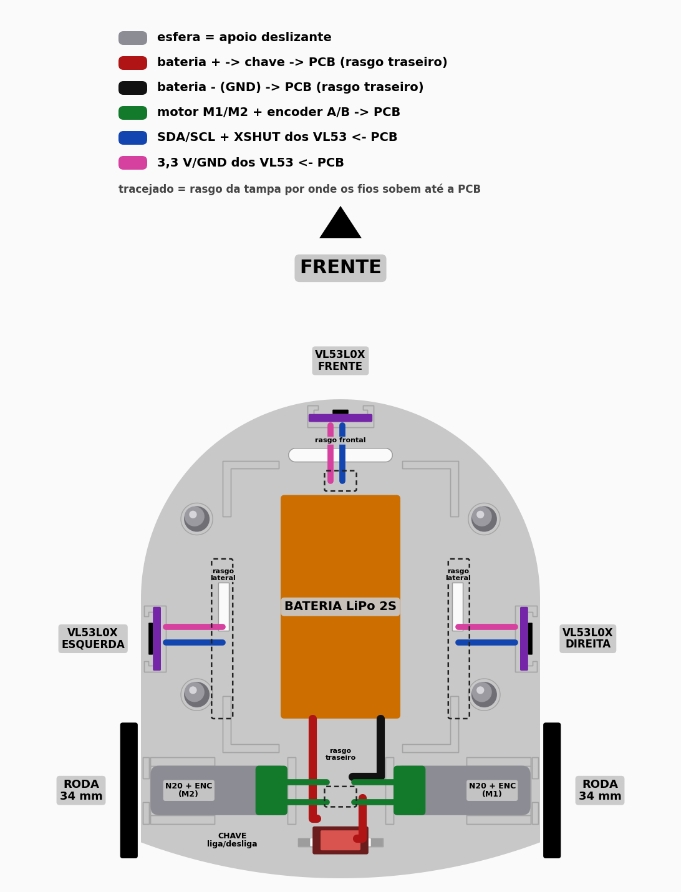
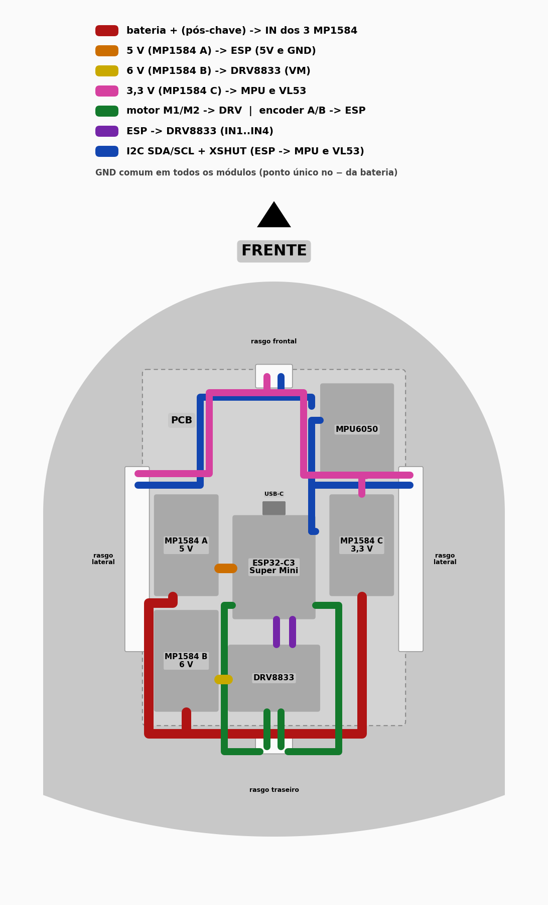
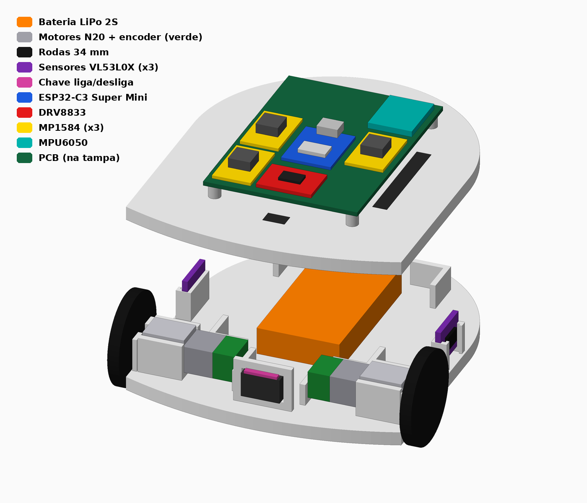
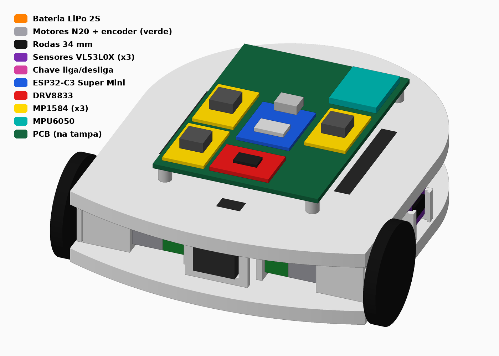
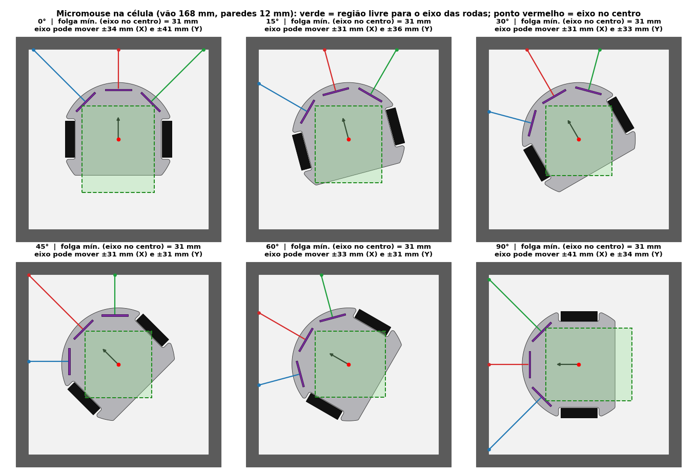
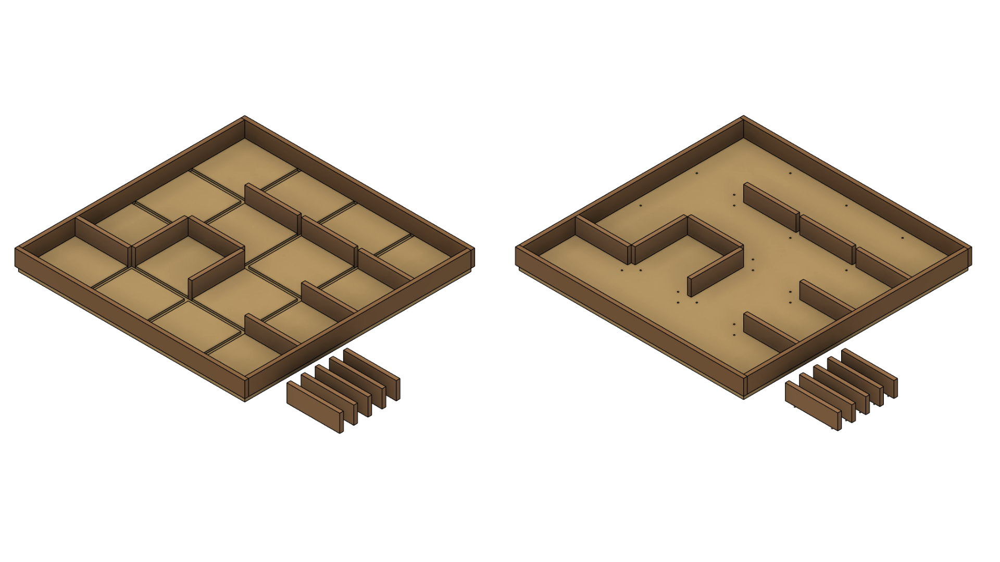

# Testes de Estrutura

Os itens **1.1–1.6** referem-se à validação em CAD do **labirinto de testes 4×4** (base 720 × 720 mm). Detalhes, desenhos e arquivos em [Labirinto de testes](../04-projeto-conceitual/labirinto-testes.md).

Os itens **1.7–1.16** referem-se à **carcaça do robô** (arquivo [`mec/micromouse_total.step`](https://github.com/fcte-pi1/2026_2_PI1_Grupo01_Hilmer/blob/documentacao/mec/micromouse_total.step)) e ao dimensionamento de tração, com rodas de Ø34 mm, motor N20 de 6 V e 300 rpm, LiPo 2S e os dois tipos de apoio traseiro (skid e esfera). Itens que dependem de protótipo físico estão marcados como pendentes. O detalhamento dos itens 1.7–1.16 e a memória de cálculo estão nas seções abaixo. Arquivos CAD em [`mec/`](https://github.com/fcte-pi1/2026_2_PI1_Grupo01_Hilmer/tree/documentacao/mec).

| **ID** | **Descrição** | **Data de Início** | **Data de Conclusão** | **Responsável** | **Resultados Esperados** | **Resultados Obtidos** | **Aprovação Interna (S/N)** | **Aprovação do Orientador (S/N)** | **Observações** |
| :---: | :--- | :---: | :---: | :--- | :--- | :--- | :---: | :---: | :--- |
| 1.1 | Conferência das dimensões da base no CAD (720 × 720 mm, grade 4 × 4) — [#270](https://github.com/fcte-pi1/2026_2_PI1_Grupo01_Hilmer/issues/270) | 14/10/2026 | 19/10/2026 | Ana Carolina Nunes e Ágata Dias Vieira | Contorno externo 720 × 720 mm e 16 células no desenho técnico | Contorno 720 × 720 mm confirmado nas folhas do Modelo 1 e do Modelo 2; grade 4 × 4 | S | — | Prints nas Figuras 2 e 6 de [Labirinto de testes](../04-projeto-conceitual/labirinto-testes.md) |
| 1.2 | Conferência do passo nominal da célula (180 mm) no CAD | 14/10/2026 | 19/10/2026 | Ana Carolina Nunes e Ágata Dias Vieira | Passo entre eixos de parede = 180 mm | Passo de 180 mm conferido na grade do desenho (paredes internas 168 mm + espessura 12 mm) | S | — | Ver seção 2 e desenhos em [Labirinto de testes](../04-projeto-conceitual/labirinto-testes.md) |
| 1.3 | Conferência do comprimento e do encaixe das paredes internas (168 × 12 × 50 mm) | 14/10/2026 | 19/10/2026 | Ana Carolina Nunes e Ágata Dias Vieira | Parede interna 168 mm; montagem sem sobrepor a célula de 180 mm | Peça 168 × 12 × 50 mm (Modelo 2) / 168 × 12 × 56 mm com inserção (Modelo 1) dimensionada no CAD e nos PDFs | S | — | Figuras 1 e 5 (montagem virtual) e folhas de parede nos PDFs |
| 1.4 | Conferência dos rasgos do Modelo 1 (largura ~12,4 mm, profundidade 6 mm) | 14/10/2026 | 19/10/2026 | Ana Carolina Nunes e Ágata Dias Vieira | Rasgos compatíveis com parede de 12 mm e inserção de 6 mm | Desenho técnico do Modelo 1 com rasgos dimensionados; vista CAD da base com grade de rasgos | S | — | Figuras 1–4; [`micromouse_modelo1_rasgos.step`](https://github.com/fcte-pi1/2026_2_PI1_Grupo01_Hilmer/blob/documentacao/mec/micromouse_modelo1_rasgos.step) |
| 1.5 | Conferência dos furos e cavilhas do Modelo 2 (Ø4,2 mm, cavilha Ø4 × 14 mm) | 14/10/2026 | 19/10/2026 | Ana Carolina Nunes e Ágata Dias Vieira | Furos e cavilhas alinhados à parede; base 720 × 720 × 15 mm | Desenho e CAD do Modelo 2 com furos Ø4,2 mm e base 15 mm; montagem virtual com paredes | S | — | Figuras 5–9; [`micromouse_modelo2_cavilhas.step`](https://github.com/fcte-pi1/2026_2_PI1_Grupo01_Hilmer/blob/documentacao/mec/micromouse_modelo2_cavilhas.step) |
| 1.6 | Montagem virtual do labirinto no CAD (dois modelos) — [#272](https://github.com/fcte-pi1/2026_2_PI1_Grupo01_Hilmer/issues/272) | 14/10/2026 | 19/10/2026 | Ana Carolina Nunes e Ágata Dias Vieira | Conjunto montado no CAD sem interferência grosseira; paredes e base coerentes | Vistas isométricas dos dois modelos geradas; PDFs de fabricação e STEPs publicados | S | — | Figuras 1 e 5; PDFs em [`mec/`](https://github.com/fcte-pi1/2026_2_PI1_Grupo01_Hilmer/tree/documentacao/mec) |
| 1.7 | Integridade geométrica do [`micromouse_total.step`](https://github.com/fcte-pi1/2026_2_PI1_Grupo01_Hilmer/blob/documentacao/mec/micromouse_total.step) | 10/10/2026 | 20/10/2026 | Leticia Lima e João Arthur | Duas peças como sólidos fechados | Tampa: sólido fechado. Base: casca aberta (256 arestas livres) | S | — | |
| 1.8 | Dimensões externas da carcaça | 01/10/2026 | 05/10/2026 | Leticia Lima e João Arthur | Pegada compatível com o corredor de 168 mm | 120 × 100 mm; altura 50,4 mm; contornos da base e da tampa coincidem | S | — | Figuras 1 a 4 |
| 1.9 | Passagem em corredor de 168 mm | 01/10/2026 | 05/10/2026 | Leticia Lima e João Arthur | Largura do robô menor que o vão de 168 mm | Folga de 34 mm por lado (largura 100 mm) | S | — | |
| 1.10 | Giro no lugar (90° e 180°) em célula de 168 × 168 mm | 05/10/2026 | 10/10/2026 | Leticia Lima e João Arthur | Raio de varredura ≤ 84 mm | Raio mínimo 66,8 mm; folga de 17,2 mm | S | — | Figura 5 |
| 1.11 | Massa e centro de massa da estrutura (sem eletrônica) | 21/10/2026 | 25/10/2026 | Leticia Lima e Ana Carolina Nunes | Massa e CG conhecidos para dimensionar a tração | Massa máxima 143,8 g (PLA maciço); CG em (55,8; 50,0; 20,7) mm | S | — | Pendente: pesar as peças impressas |
| 1.12 | Montagem virtual das duas peças (base + tampa) | 19/10/2026 | 21/10/2026 | Leticia Lima e João Arthur | Montagem sem interferência e com elementos de ligação definidos | Sem interferência; peças afastadas 14,8 mm, sem elementos de ligação modelados | S | — | |
| 1.13 | Tração: torque e velocidade nas rodas, com apoio skid e esfera | 21/10/2026 | 25/10/2026 | Leticia Lima e Ana Carolina Nunes | Torque e rotação suficientes para a aceleração e a velocidade-alvo | Torque por roda a 2 m/s²: 5,3 mN·m (skid) e 4,0 mN·m (esfera) | S | — | Ver [Memória de cálculo de tração](#5-memória-de-cálculo-de-tração). Com o N20 de 300 rpm a velocidade máxima é ≈ 0,43 m/s (ver 1.15) |
| 1.14 | Limite de aderência e aceleração máxima, com apoio skid e esfera | 19/10/2026 | 21/10/2026 | Leticia Lima e João Arthur | Tração requerida menor que a aderência, com margem | Aceleração máxima 3,0 m/s² (skid) e 3,8 m/s² (esfera) | S | — | Depende de μ = 0,6 e f = 0,7 (medir no piso do labirinto) |
| 1.15 | Compatibilidade motor × driver × bateria × rodas | 20/10/2026 | 24/10/2026 | Leticia Lima e João Arthur | Rotação ≥ 281 rpm na roda; torque e corrente dentro dos limites | Atende até ≈ 0,43 m/s; não atende 1 m/s | — | — | Torque e corrente estimados (seção 5.6) |
| 1.16 | Ensaio físico: fabricação, montagem e passagem no labirinto | — | — | Ana Carolina Nunes e Ágata Dias Vieira | Peças conforme o CAD; robô percorre o labirinto e gira nas células | Pendente: protótipo físico ainda não construído | — | — | |

---

## Evidências (carcaça e labirinto)

### 1. Peças separadas da carcaça

A carcaça é formada por **duas peças**: a base inferior e a tampa superior. Ambas têm a mesma pegada em forma de "D" (frente arredondada, traseira em arco), de 120 × 100 mm. As Figuras 1 e 2 mostram a posição dos componentes e das ligações em cada peça.

<figure markdown>

<figcaption>

**Figura 1 — Base inferior (vista superior): rodas de 34 mm, motores N20 com encoder, bateria LiPo 2S, sensores VL53L0X, esfera de apoio e chave liga/desliga. Os fios sobem à placa pelos rasgos tracejados da tampa.**

</figcaption>

</figure>

<figure markdown>

<figcaption>

**Figura 2 — Tampa superior (vista superior): PCB com ESP32-C3 Super Mini, DRV8833, MPU-6050 e três MP1584 (A: 5 V; B: 6 V; C: 3,3 V), com as ligações de alimentação, motores, encoders e I²C.**

</figcaption>

</figure>

| **Peça** | **Dimensões (mm)** | **Espessura da chapa** | **Volume** | **Observação** |
| :--- | :---: | :---: | :---: | :--- |
| Base inferior | 120 × 100 × 21,2 | 5 mm (z = 0 a 5) | ≈ 59,3 cm³ | 2 aberturas de 12 × 2,5 mm e 1 de 3 × 26 mm; casca aberta no STEP (teste 1.7) |
| Tampa superior | 120 × 100 × 14,4 | 5 mm (z = 36 a 41) | 56,7 cm³ | Sólido fechado, sem aberturas passantes |

Arquivos STEP das peças: [`micromouse_base_inferior.step`](https://github.com/fcte-pi1/2026_2_PI1_Grupo01_Hilmer/blob/documentacao/mec/micromouse_base_inferior.step) e [`micromouse_tampa_superior_v2.step`](https://github.com/fcte-pi1/2026_2_PI1_Grupo01_Hilmer/blob/documentacao/mec/micromouse_tampa_superior_v2.step).

### 2. Estrutura montada

<figure markdown>

<figcaption>

**Figura 3 — Vista isométrica da estrutura com os componentes: tampa com a PCB separada da base, que leva bateria, motores, rodas, sensores e chave.**

</figcaption>

</figure>

<figure markdown>

<figcaption>

**Figura 4 — Estrutura montada (120 × 100 mm em planta) com tampa, PCB, rodas de 34 mm e módulos.**

</figcaption>

</figure>

### 3. Montagem virtual e verificação no labirinto

A Figura 5 apresenta a verificação do giro do robô dentro de uma célula do labirinto (vão livre de 168 × 168 mm), usando a pegada real extraída do CAD. A Figura 6 mostra o labirinto de testes 4×4 nos dois modelos de fixação das paredes (rasgos ou cavilhas).

<figure markdown>

<figcaption>

**Figura 5 — Micromouse na célula (vão de 168 mm, paredes de 12 mm), nos ângulos de 0°, 15°, 30°, 45°, 60° e 90°. Em verde, a região livre para o eixo das rodas; o ponto vermelho marca o eixo no centro da célula.**

</figcaption>

</figure>

Valores indicados na própria Figura 5 (eixo das rodas no centro da célula):

| **Ângulo** | **Folga mínima (eixo no centro)** | **Deslocamento livre do eixo em X** | **Deslocamento livre do eixo em Y** |
| :---: | :---: | :---: | :---: |
| 0° | 31 mm | ± 34 mm | ± 41 mm |
| 15° | 31 mm | ± 31 mm | ± 36 mm |
| 30° | 31 mm | ± 31 mm | ± 33 mm |
| 45° | 31 mm | ± 31 mm | ± 31 mm |
| 60° | 31 mm | ± 33 mm | ± 31 mm |
| 90° | 31 mm | ± 41 mm | ± 34 mm |

<figure markdown>

<figcaption>

**Figura 6 — Montagem virtual do labirinto de testes: Modelo 1 (paredes encaixadas em rasgos na base, à esquerda) ou Modelo 2 (paredes fixadas por cavilhas, à direita).**

</figcaption>

</figure>

### 4. Arquivos CAD

Os arquivos de projeto ficam em [`mec/`](https://github.com/fcte-pi1/2026_2_PI1_Grupo01_Hilmer/tree/documentacao/mec):

| **Arquivo** | **Descrição** |
| :--- | :--- |
| [`micromouse_total.step`](https://github.com/fcte-pi1/2026_2_PI1_Grupo01_Hilmer/blob/documentacao/mec/micromouse_total.step) | CAD — carcaça montada (base + tampa) |
| [`micromouse_base_inferior.step`](https://github.com/fcte-pi1/2026_2_PI1_Grupo01_Hilmer/blob/documentacao/mec/micromouse_base_inferior.step) | CAD — base inferior |
| [`micromouse_tampa_superior_v2.step`](https://github.com/fcte-pi1/2026_2_PI1_Grupo01_Hilmer/blob/documentacao/mec/micromouse_tampa_superior_v2.step) | CAD — tampa superior |
| [`micromouse_modelo1_rasgos.step`](https://github.com/fcte-pi1/2026_2_PI1_Grupo01_Hilmer/blob/documentacao/mec/micromouse_modelo1_rasgos.step) | CAD — labirinto Modelo 1 (rasgos) |
| [`micromouse_modelo1_rasgos-desenho-v1.pdf`](https://github.com/fcte-pi1/2026_2_PI1_Grupo01_Hilmer/blob/documentacao/mec/micromouse_modelo1_rasgos-desenho-v1.pdf) | Desenho técnico — Modelo 1 |
| [`micromouse_modelo2_cavilhas.step`](https://github.com/fcte-pi1/2026_2_PI1_Grupo01_Hilmer/blob/documentacao/mec/micromouse_modelo2_cavilhas.step) | CAD — labirinto Modelo 2 (cavilhas) |
| [`micromouse_modelo2_cavilhas-desenho-v1.pdf`](https://github.com/fcte-pi1/2026_2_PI1_Grupo01_Hilmer/blob/documentacao/mec/micromouse_modelo2_cavilhas-desenho-v1.pdf) | Desenho técnico — Modelo 2 |

## Detalhamento dos testes 1.7 a 1.16

#### 1.7 — Integridade geométrica do arquivo [`micromouse_total.step`](https://github.com/fcte-pi1/2026_2_PI1_Grupo01_Hilmer/blob/documentacao/mec/micromouse_total.step)

- **Esperado:** as duas peças importadas como sólidos fechados (estanques), aptas a fatiamento/usinagem e ao cálculo de massa.
- **Obtido:** tampa: sólido fechado, 56,7 cm³. Base inferior: importada como casca aberta (256 arestas livres na malha); volume estimado em ≈ 59,3 cm³, com incerteza. Ambas as peças são facetadas (só faces planas, sem superfícies cilíndricas).

#### 1.8 — Dimensões externas da carcaça

- **Esperado:** pegada compatível com o corredor de 168 mm; contorno da base e da tampa idênticos.
- **Obtido:** pegada de 120 × 100 mm (área de 106,3 cm²); base com 21,2 mm de altura, tampa com 14,4 mm, conjunto com 50,4 mm; chapas de 5 mm; contornos da base e da tampa coincidem (sobreposição de 100 %).
- **Observações:** Figuras 1 a 4.

#### 1.9 — Passagem em corredor de 168 mm (vão livre entre paredes)

- **Esperado:** largura do robô menor que o vão de 168 mm, com folga para correção de trajetória.
- **Obtido:** largura de 100 mm, com folga de 34 mm por lado com o robô centrado. O comprimento de 120 mm cabe na célula (168 mm).

#### 1.10 — Giro no lugar (90° e 180°) dentro de uma célula de 168 × 168 mm

- **Esperado:** raio de varredura ≤ 84 mm (círculo inscrito na célula).
- **Obtido:** menor círculo envolvente com raio de 66,8 mm (pivô em x = 53,2 mm da traseira), folga de 17,2 mm. Em torno do centróide da pegada (x = 56,7 mm), o raio é de 69,1 mm. Para raio ≤ 84 mm, o eixo das rodas deve ficar entre x = 36 e 76 mm; para folga de 4 mm, entre 40 e 71 mm.
- **Observações:** Figura 5 (giro nos ângulos de 0° a 90°, com folga mínima de 31 mm com o eixo no centro).

#### 1.11 — Massa e centro de massa da estrutura (sem eletrônica)

- **Esperado:** massa e CG conhecidos para dimensionar a tração; CG próximo ao eixo das rodas.
- **Obtido:** volume total de 116,0 cm³. Massa máxima (PLA, ρ = 1,24 g/cm³, 100 % de preenchimento) de 143,8 g, limite superior. CG da estrutura sozinha em (x, y, z) = (55,8; 50,0; 20,7) mm.
- **Observações:** pendente pesar as peças impressas e substituir a estimativa. Massa do conjunto completo (200 g, estimada), ver 1.13.

#### 1.12 — Montagem virtual das duas peças (base + tampa)

- **Esperado:** base e tampa montadas sem interferência, com elementos de ligação definidos.
- **Obtido:** sem interferência. As peças estão afastadas 14,8 mm (a base termina em z = 21,2 mm e a tampa começa em z = 36,0 mm). Não há espaçadores, parafusos ou encaixes modelados entre elas.

#### 1.13 — Tração: torque e velocidade requeridos nas rodas, para os dois apoios traseiros (skid e esfera)

- **Esperado:** torque por roda e rotação suficientes para a aceleração e a velocidade-alvo no labirinto.
- **Obtido:** robô de 200 g, roda Ø34 mm, a = 2 m/s², v = 1 m/s.
  - **Skid:** 5,3 mN·m por roda (0,054 kgf·cm).
  - **Esfera:** 4,0 mN·m por roda (0,041 kgf·cm).
  - Rotação na roda: 281 rpm a 0,5 m/s e 562 rpm a 1 m/s.
  - Potência mecânica: 0,62 W (skid) e 0,47 W (esfera).
  - Giro de 90° em 0,35 s: 5,9 mN·m por roda.
- **Observações:** memória de cálculo na seção [Memória de cálculo de tração](#5-memória-de-cálculo-de-tração). Com o motor N20 de 300 rpm, a velocidade máxima é ≈ 0,43 m/s, então o valor de 1 m/s é só referência (ver 1.15).

#### 1.14 — Limite de aderência (derrapagem) e aceleração máxima, para os dois apoios traseiros

- **Esperado:** força de tração requerida menor que a força máxima de aderência, com margem.
- **Obtido:** força máxima de tração de 0,82 N. Aceleração máxima por aderência de 3,0 m/s² (skid) e 3,8 m/s² (esfera). Com a = 2 m/s², usa-se 75 % (skid) e 57 % (esfera) do limite. O giro de 90° em 0,25 s exige 0,68 N por roda, acima do limite de 0,41 N (derrapa); o tempo mínimo sem derrapar é de 0,32 s.
- **Observações:** depende de μ (0,6 assumido) e da fração de peso sobre as rodas (0,7 assumida). Medir os valores reais com o piso do labirinto.

#### 1.15 — Compatibilidade motor × driver × bateria × rodas

- **Esperado:** tensão do motor ≤ 6 V; rotação ≥ 281 rpm na roda para 0,4 m/s com folga de 20 %; torque de parada ≥ 0,24 kgf·cm (4× o torque de projeto); corrente de parada dentro do limite do DRV8833 (1,5 A RMS por ponte).
- **Obtido:** motor N20 de 6 V e 300 rpm, com LiPo 2S (7,4 V nominal, 6,0 a 8,4 V) e MP1584EN regulado em 6 V: tensão compatível; o DRV8833 aceita 2,7 a 10,8 V. Velocidade no vazio de 0,53 m/s e sob carga de ≈ 0,43 m/s (com folga de 20 %): atende 0,4 m/s e não atende 1 m/s (exigiria ≥ 702 rpm na roda). Torque de parada estimado em ≈ 0,83 kgf·cm (3,5× o necessário). Corrente de parada de N20 de 6 V semelhantes: 0,2 a 0,55 A (bem abaixo de 1,5 A). Aceleração de 2 m/s² sustentada até ≈ 0,50 m/s. Tempo por célula (180 mm) a 0,43 m/s e a = 2 m/s²: ≈ 0,53 s.
- **Observações:** atende para velocidade de até ~0,43 m/s, com torque e corrente estimados, não medidos. Confirmar torque e corrente de parada na ficha do fornecedor. Para 1 m/s seria preciso o N20 de 1000 rpm. Detalhes na seção 5.6 da memória de cálculo.

#### 1.16 — Ensaio físico: fabricação, montagem e passagem do robô no labirinto

- **Esperado:** peças impressas conforme o CAD, montagem sem folgas indevidas, robô percorre o labirinto e gira nas células.
- **Obtido:** pendente — protótipo físico ainda não construído.

## 5. Memória de cálculo de tração

### 5.1 Componentes considerados

| **Qtd.** | **Componente** | **Observação para o dimensionamento** |
| :---: | :--- | :--- |
| 1 | ESP32-C3 Super Mini ou ESP32 DevKit V1 | Controle |
| 1 | DRV8833 | Alimentação do motor de 2,7 a 10,8 V (compatível com motor de 6 V); corrente de 1,5 A RMS por ponte (pacote PWP/RTY, a 5 V) |
| 2 | Motor N20 com encoder, 6 V, 300 rpm | Torque e corrente de parada ainda não informados pelo fornecedor (valores estimados na seção 5.6) |
| 3 | Sensores de distância VL53L0X | — |
| 1 | MPU-6050 | — |
| 1 | Bateria LiPo 2S | 7,4 V nominal (6,0 a 8,4 V); abaixa-se a 6 V para o motor |
| 3 | MP1584EN | Reguladores abaixadores: 5 V (ESP), 6 V (motor, via DRV8833) e 3,3 V (MPU-6050 e VL53L0X), conforme a Figura 2 |
| 1 | Chave liga/desliga | — |
| 2 | Roda Ø34 mm | Borracha, largura do pneu 6,5 mm, 3,2 g cada, eixo em D de 3 mm |

### 5.2 Premissas

| **Símbolo** | **Descrição** | **Valor adotado** | **Origem** |
| :---: | :--- | :---: | :--- |
| $m$ | Massa total do robô | 200 g | Estimativa da equipe |
| $r$ | Raio da roda | 17 mm (Ø34 mm) | Especificação da roda |
| $\mu$ | Aderência roda × piso do labirinto | 0,6 | Premissa |
| $f$ | Fração do peso sobre as rodas motrizes | 0,7 | Premissa |
| $C_{rr}$ | Resistência ao rolamento das rodas | 0,03 | Premissa |
| $\mu_s$ | Atrito do apoio traseiro tipo **skid** | 0,30 | Premissa |
| $\mu_e$ | Resistência equivalente do apoio tipo **esfera** | 0,05 | Premissa |
| $b$ | Bitola (distância entre rodas) | 60 mm | Premissa |
| $C \times L$ | Pegada | 120 × 100 mm | CAD |
| $g$ | Aceleração da gravidade | 9,81 m/s² | — |

### 5.3 Força resistente e aderência

Força resistente (rolamento das rodas e atrito do apoio traseiro), força máxima de tração e aceleração máxima por aderência:

$$F_{res} = m\,g\,\Big(C_{rr}\,f + \mu_{apoio}\,(1-f)\Big)$$

$$F_{max} = \mu\,f\,m\,g = 0{,}824\ \text{N} \quad (0{,}412\ \text{N por roda})$$

$$a_{max} = \frac{F_{max} - F_{res}}{m}$$

| **Apoio traseiro** | **$F_{res}$** | **$a_{max}$** |
| :--- | :---: | :---: |
| A — skid ($\mu_s = 0{,}30$) | 0,218 N | 3,03 m/s² (0,31 g) |
| B — esfera ($\mu_e = 0{,}05$) | 0,071 N | 3,77 m/s² (0,38 g) |

### 5.4 Translação

Força total, torque por roda e rotação na roda:

$$F_{total} = m\,a + F_{res}$$

$$\tau_{roda} = \frac{F_{total}}{2}\,r$$

$$n_{roda} = \frac{v}{r}\cdot\frac{60}{2\pi}$$

| **Apoio** | **$a$ (m/s²)** | **$F_{total}$** | **$\tau_{roda}$ (mN·m)** | **$\tau_{roda}$ (kgf·cm)** | **Uso do limite de aderência** |
| :--- | :---: | :---: | :---: | :---: | :---: |
| A — skid | 1 | 0,418 N | 3,55 | 0,036 | 51 % |
| A — skid | 2 | 0,618 N | 5,25 | 0,054 | 75 % |
| A — skid | 3 | 0,818 N | 6,95 | 0,071 | 99 % |
| B — esfera | 1 | 0,271 N | 2,30 | 0,023 | 33 % |
| B — esfera | 2 | 0,471 N | 4,00 | 0,041 | 57 % |
| B — esfera | 3 | 0,671 N | 5,70 | 0,058 | 81 % |

Rotação necessária na roda: 281 rpm a 0,5 m/s, 562 rpm a 1,0 m/s e 843 rpm a 1,5 m/s.

Potência mecânica com $a = 2\ \text{m/s}^2$:

| **Apoio** | **0,5 m/s** | **1,0 m/s** | **1,5 m/s** |
| :--- | :---: | :---: | :---: |
| A — skid | 0,31 W | 0,62 W | 0,93 W |
| B — esfera | 0,24 W | 0,47 W | 0,71 W |

Tempo para percorrer uma célula (180 mm) partindo do repouso:

| **Aceleração** | **Tempo** | **Velocidade ao final da célula** |
| :---: | :---: | :---: |
| 1 m/s² | 0,60 s | 0,60 m/s |
| 2 m/s² | 0,42 s | 0,85 m/s |
| 3 m/s² | 0,35 s | 1,04 m/s |

**Conclusão:** com $a = 2\ \text{m/s}^2$ o skid usa 75 % da aderência e a esfera 57 %. Com $a = 3\ \text{m/s}^2$ o skid fica no limite (99 %), então a aceleração de projeto recomendada com skid é de até 2 m/s². A esfera dá mais folga.

### 5.5 Giro no lugar

Momento de inércia (retângulo), aceleração angular (acelera e freia em um giro de 90° no tempo $t$), força por roda (binário) e tempo mínimo sem derrapar:

$$I = \frac{m\,(C^2 + L^2)}{12} = 4{,}07\times 10^{-4}\ \mathrm{kg{\cdot}m}^{2}$$

$$\alpha = \frac{4\,(\pi/2)}{t^2} \qquad\qquad F_{roda} = \frac{I\,\alpha}{b}$$

$$t_{min} = \sqrt{\frac{4\,(\pi/2)\,I}{(F_{max}/2)\;b}} \approx 0{,}32\ \text{s}$$

| **$t$ (90°)** | **$\alpha$** | **$F_{roda}$** | **$\tau_{roda}$** | **Limite por roda** | **Resultado** |
| :---: | :---: | :---: | :---: | :---: | :---: |
| 0,25 s | 101 rad/s² | 0,68 N | 11,6 mN·m | 0,41 N | **Derrapa** (165 %) |
| 0,35 s | 51 rad/s² | 0,35 N | 5,9 mN·m | 0,41 N | Passa (84 %) |

O tempo mínimo de giro de 90° sem derrapar é de ≈ 0,32 s. O cálculo não inclui o arrasto do apoio traseiro durante o giro, que é maior com o skid e menor com a esfera, o que reforça a vantagem da esfera nessa manobra. O giro é o caso crítico de torque, porque exige mais que a aceleração em linha reta.

### 5.6 Compatibilidade motor × driver × bateria (N20 6 V, 300 rpm, LiPo 2S)

**Tensão.** O motor é de 6 V nominal e a LiPo 2S fornece de 6,0 a 8,4 V. Ligar o motor direto na bateria o deixaria acima da tensão nominal (até 40 %) e reduziria sua vida útil. A solução é usar um MP1584EN regulado em 6 V para a alimentação do motor (o regulador só reduz tensão), como previsto na Figura 2. O DRV8833 aceita de 2,7 a 10,8 V, então não limita o projeto. É preciso conferir se o regulador mantém os 6 V até a tensão de corte da bateria.

**Velocidade.** Roda Ø34 mm, motor a 6 V. A velocidade de projeto considera 20 % de queda sob carga:

$$v_{vazio} = n_{nom}\,\frac{2\pi r}{60} = 300\cdot\frac{2\pi \cdot 0{,}017}{60} = 0{,}53\ \text{m/s}$$

$$v_{projeto} \approx 0{,}8\,v_{vazio} = 0{,}43\ \text{m/s}$$

| **Velocidade-alvo** | **Rotação na roda** | **Com folga de 20 %** | **Atende (300 rpm)?** |
| :---: | :---: | :---: | :---: |
| 0,4 m/s | 225 rpm | 281 rpm | ✔ (margem pequena) |
| 0,5 m/s | 281 rpm | 352 rpm | ✘ |
| 1,0 m/s | 562 rpm | 702 rpm | ✘ |

O motor de 300 rpm **não atinge 1 m/s**, valor usado como referência nos cálculos das seções 5.3 a 5.5. A velocidade de cruzeiro realista é de 0,4 a 0,43 m/s. Para 1 m/s seria preciso o N20 de 1000 rpm.

**Torque e corrente.** Não se dispõe da ficha técnica do motor exato, então os valores foram estimados a partir de unidades N20 de 6 V vendidas com encoder:

| **Grandeza** | **Valor de referência** | **Origem** |
| :--- | :---: | :--- |
| Torque de parada, 6 V, 500 rpm | 0,5 kgf·cm | [SparkFun ROB-28633](https://www.sparkfun.com/n20-motor-with-encoder-and-cable-pair.html) (31,5:1) |
| Corrente de parada, 6 V | 0,45 A (500 rpm) e 0,55 A (200 rpm) | SparkFun; [ThinkRobotics N20 com encoder](https://thinkrobotics.com/products/n20-dc-gear-motor-magnetic-hall-encoder-high-precision-reduction-motor) |
| Corrente de parada em função da redução | Não depende da redução | [Adafruit N20 com encoder, 6 V](https://adafruit.com/product/4641) |

O torque de parada cresce com a redução. Escalando a unidade de 500 rpm para 300 rpm:

$$\tau_{parada} \approx 0{,}5\cdot\frac{500}{300} \approx 0{,}83\ \mathrm{kgf{\cdot}cm} \;\approx\; 81{,}7\ \mathrm{mN{\cdot}m}$$

Essa é uma estimativa; o valor real deve vir do fornecedor.

Verificação dos critérios:

| **#** | **Critério** | **Requisito** | **Valor** | **Resultado** |
| :---: | :--- | :--- | :--- | :---: |
| 1 | Tensão do motor | ≤ 6 V, com MP1584EN regulado em 6 V | 6 V | ✔ |
| 2 | Rotação na roda, para $v = 0{,}4$ m/s com folga de 20 % | ≥ 281 rpm | 300 rpm | ✔ (margem pequena) |
| 3 | Torque de parada | $\geq 4\,\tau_{roda,projeto} = 4 \cdot 5{,}9 = 23{,}6$ mN·m (0,24 kgf·cm) | ≈ 81,7 mN·m (estimado), 3,5× o mínimo | ✔ |
| 4 | Corrente de parada | ≤ 1,5 A RMS por ponte do DRV8833 | ≈ 0,2 a 0,55 A | ✔ |

O fator 4 do critério 3 é uma regra prática: operar a até 50 % do torque de parada, com margem de 2×.

**Aceleração na faixa de rotação.** Com uma curva linear de torque × rotação e o torque de parada estimado, o torque disponível na roda é:

$$\tau(v) = \tau_{parada}\left(1 - \frac{v}{v_{vazio}}\right)$$

Para $a = 2\ \text{m/s}^2$, o torque necessário é de 5,25 mN·m com skid e 4,0 mN·m com esfera, o que dá uma velocidade máxima de ≈ 0,50 m/s (skid) e 0,51 m/s (esfera) nessa aceleração. Em cruzeiro, o torque resistente por roda é de 1,85 mN·m (skid) e a velocidade chega a ≈ 0,52 m/s. O tempo para percorrer uma célula de 180 mm, a 0,43 m/s e $a = 2\ \text{m/s}^2$, é de ≈ 0,53 s.

**Conclusão do teste 1.15:** o conjunto atende a velocidades de até ≈ 0,43 m/s, com torque e corrente folgados. O limitante é a rotação do motor. Os valores de torque e corrente são estimados e precisam ser confirmados na ficha do fornecedor.

