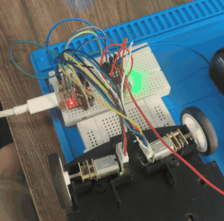
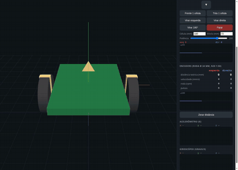
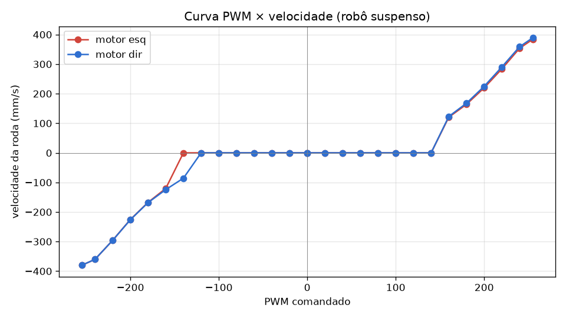
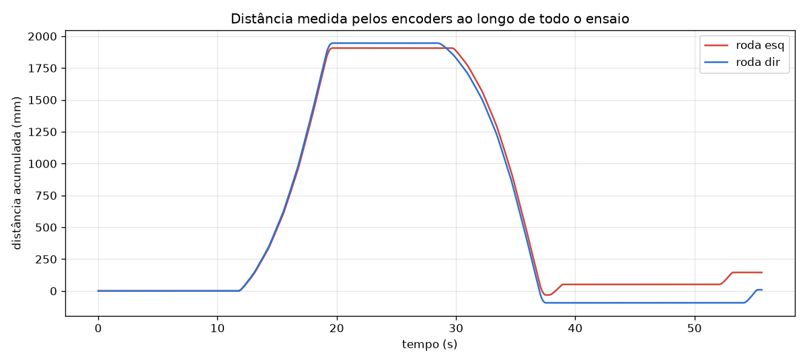
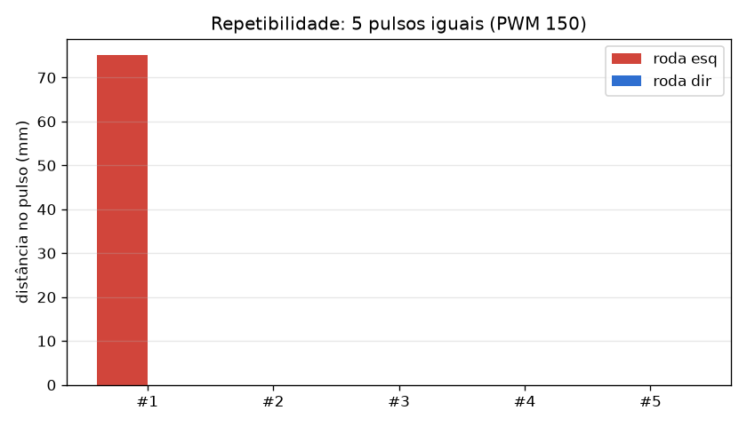
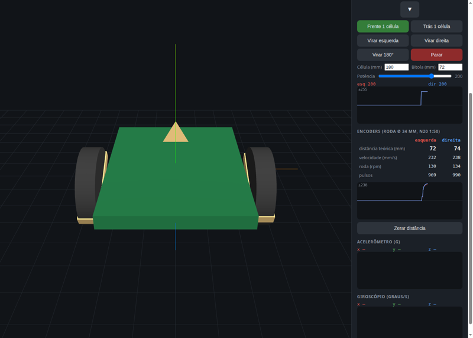
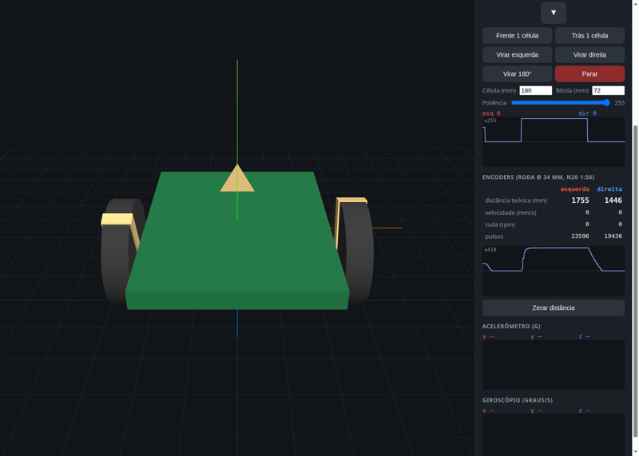

# Testes de Hardware

## Testes de _hardware_

> Apresentar com detalhes os testes feitos para conferir se os objetivos do *hardware* foram atendidos, incluindo:
>
> 1. Processamento (Arduino, ESP32 etc):
>    - Definir interface de desenvolvimento;
>    - Rodar exemplo mínimo.
> 2. Sensores (temperatura, pressão, posição, velocidade etc.):
>    - Realizar leitura básica de dados;
>    - Validar/calibrar leituras;
>    - Definir taxas de amostragem e quantidade de dados para transmissão e/ou armazenamento;
>    - Validar taxas definidas e quantidade de dados;
>    - Realizar processamento básico de dados (*thresholding*, filtro média-móvel etc.).
> 3. Armazenamento (memória interna, cartão SD, pendrive etc.):
>    - Armazenar dados básicos;
>    - Armazenar e validar dados de sensores.
> 4. Atuadores (Motores DC, relés, LEDs etc.):
>    - Realizar acionamentos básicos;
>    - Realizar acionamentos com base em dados de sensores;
>    - Realizar processamento básico de dados (PWM etc.).
> 5. Comunicações (UART, I2C, SPI, USB, WiFi, Bluetooth etc.):
>    - Transmissão básica de dados;
>    - Transmissão de dados de sensores dentro da taxa de amostragem.

| **ID** | **Descrição** | **Data de Início** | **Data de Conclusão** | **Responsável** | **Resultados Esperados** | **Resultados Obtidos** | **Aprovação Interna (S/N)** | **Aprovação do Orientador (S/N)** | **Observações** |
|:------:|---------------|--------------------|-----------------------|-----------------|--------------------------|------------------------|:---------------------------:|:--------------------------------:|-----------------|
| 3.1 | Alimentação e Linhas de Tensão | | | | 3,3 V e VBAT estáveis | | | | Verificado em bancada |
| 3.2 | Comunicação LiDAR (UART) | | | | Recepção dos pacotes LD06 | | | | |
| 3.3 | Acionamento dos Motores e Encoders (N20) | 29/10/2026 | 10/11/2026 | Bruno / Equipe | Resposta PWM nos dois motores; encoders sem ruído e sem contagem cruzada | Zona morta em PWM 160; até ~386 mm/s em 255; lados diferem ≤ 3,3 %; manobras ultrapassam o alvo | S | | Ver procedimento 3.3 abaixo |
| 3.4 | IMU (I2C) | | | | Dados de aceleração e giro | | | | |
| 3.5 | **Encoders de Quadratura (18 cm)** | 16/10/2026 | 17/10/2026 | Cláudio / Equipe | Leitura x4 por interrupção; erro $\le \pm 3\%$ em 180 mm | Roteiro e script serial automatizados; aguardando bancada final | S | | Issue #186, HU-05 |
| 3.6 | | | | | | | | | |

---

## Procedimento de Teste 3.5: Encoders e Deslocamento em Bancada (Issue #186)

### 1. Objetivo
Validar a decodificação em quadratura (x4) via interrupções nos pinos GPIO do ESP32-C3 e aferir a exatidão da conversão de pulsos em milímetros ao longo de um percurso de **18 cm (180 mm)** — correspondente à dimensão de uma célula do labirinto do Micromouse.

### 2. Instrumentação e Configuração
* **Hardware:** Microcontrolador ESP32-C3 com firmware carregado.
* **Sensores:** 2 encoders de efeito Hall acoplados aos micromotores N20.
  * Encoder Esquerdo: `GPIO0` (Canal A) e `GPIO1` (Canal B).
  * Encoder Direito: `GPIO3` (Canal A) e `GPIO10` (Canal B).
* **Guia de Medição:** Régua milimetrada calibrada de 300 mm ou paquímetro digital com batente fixo em 180,0 mm.
* **Ferramenta de Coleta:** Script Python `src/firmware/scripts/calibrar_deslocamento_18cm.py`.

### 3. Critérios de Aceitação
1. **Contagem por Interrupção:** Contagem bidirecional em ambas as rodas sem perda de pulsos e sem transições inválidas reportadas.
2. **Tolerância de Erro:**
   $$\text{Erro Relativo} = \frac{|D_{\text{medido}} - 180{,}0\text{ mm}|}{180{,}0\text{ mm}} \times 100\% \le 3{,}0\%$$
   $$\text{Erro Absoluto Máximo Permissível} = \pm 5{,}4\text{ mm}$$
3. **Calibração:** Determinação da constante de calibração $\mu\text{m/pulso}$ real:
   $$K = \frac{180 \times 1000}{\text{Pulsos}}$$

### 4. Roteiro de Execução
1. Conectar a placa ao computador via USB.
2. Posicionar o micromouse na marca de 0 mm da régua guia.
3. Executar o script de teste:
   ```bash
   python3 src/firmware/scripts/calibrar_deslocamento_18cm.py --porta /dev/ttyUSB0
   ```
4. Pressionar **ENTER** para enviar o comando de zerar (`Z`) e iniciar a amostragem.
5. Deslocar o robô manualmente de forma suave até a marca de 180,0 mm.
6. Finalizar a captura com **CTRL+C**.
7. O script registrará o relatório com os pulsos acumulados, as distâncias calculadas por roda, o erro relativo/absoluto e a nova constante recomendada para `ConfiguracaoEncoder.h`.


---

## Procedimento de Teste 3.3: Motores N20 e Encoders em Bancada

### 1. Objetivo
Caracterizar os dois micromotores N20 (300 rpm @ 6 V, redução real medida ~1:51,3) acionados pela ponte H e lidos pelos encoders de quadratura x4, levantando:

* a curva PWM × velocidade de cada roda e a zona morta;
* a simetria entre os lados esquerdo e direito e entre frente e ré;
* a ausência de contagem cruzada (um motor girando não pode mexer no encoder do outro);
* a precisão das manobras básicas (frente, ré, curvas) comandadas pelo visualizador 3D.

### 2. Instrumentação e Configuração
* **Firmware:** `src/teste_motores.cpp` (ambiente `motores` do PlatformIO), que recebe `M,<esq>,<dir>` pela serial e devolve linhas `E,...` a cada 20 ms com pulsos e distância teórica por roda.
* **Coleta:** `visualizador/relatorio.py`, que executa a sequência automática (parado → curva de 0 a ±255 em passos de 20 → 5 repetições → estabilidade → só esquerdo → só direito) e grava CSV + HTML.
* **Visualizador:** `visualizador/index.html`, que comanda as manobras com base na célula de 180 mm e bitola de 72 mm.
* **Constantes:** roda de 34 mm, 1436 pulsos por volta da roda (medido em 10 voltas: 14357 pulsos), logo $\approx 0{,}0744$ mm/pulso.
* **Montagem:** robô **suspenso** (rodas livres), alimentado por USB/power bank de 5 V.

### 3. Vídeo do ensaio

<video controls preload="metadata" width="100%" src="../../figs/testes-motores/teste-motores.mp4"></video>

Vídeo editado (≈2 min, 2,9 MB, H.264 960×540): cartela, gravação da bancada durante a sequência do `relatorio.py` e captura do visualizador 3D executando as manobras.

| Bancada | Visualizador 3D |
|:---:|:---:|
|  |  |

### 4. Resultados (ensaio de 10/11/2026, `motores_2026-11-10_0222.csv`)

#### 4.1 Curva PWM × velocidade



| PWM | Esquerdo (mm/s) | Direito (mm/s) | Diferença |
|:---:|:---:|:---:|:---:|
| 160 | 120 | 123 | 2,1 % |
| 200 | 220 | 225 | 2,3 % |
| 255 | 384 | 389 | 1,3 % |
| −160 | −120 | −124 | 3,3 % |
| −200 | −225 | −226 | 0,3 % |
| −255 | −380 | −380 | 0,0 % |

* **Zona morta:** nenhuma roda gira de 0 a ±140; ambas partem em **160** (o direito já gira em −140 na ré). Abaixo disso a potência não vence o atrito estático da caixa de redução.
* **Velocidade máxima:** ~386 mm/s em 255, o que equivale a ~217 rpm na roda — abaixo dos 300 rpm nominais porque o motor está em 5 V e não em 6 V.
* **Simetria:** os dois lados diferem no máximo 3,3 %, e frente e ré têm praticamente a mesma curva. Acima da zona morta a relação é quase linear (~2,8 mm/s por unidade de PWM).

#### 4.2 Distância acumulada no ensaio completo



* **Parado:** 0 pulsos de deriva nos 2 s iniciais em ambos os encoders (sem ruído nos canais A/B).
* **Sem contagem cruzada:** com só o esquerdo em 150, o esquerdo contou 1135 pulsos e o direito 0; com só o direito, 1218 e 0.

#### 4.3 Repetibilidade e estabilidade em PWM 150



As etapas de repetibilidade (5 × 1 s) e estabilidade (4 s) rodaram em **PWM 150, abaixo da zona morta de 160**. Só a primeira repetição do lado esquerdo girou (75 mm); as demais ficaram paradas, então esta etapa **não é conclusiva**. O mesmo valor de 150 fez as rodas girarem nas etapas "só esquerdo/só direito", o que mostra que 150 está exatamente no limiar de partida: às vezes vence o atrito, às vezes não. **Ação:** repetir essas etapas com PWM ≥ 180.

#### 4.4 Manobras pelo visualizador

| Manobra | Alvo por roda | Esquerdo | Direito | Erro médio |
|---|:---:|:---:|:---:|:---:|
| Frente 1 célula | 180 mm | 238,2 mm | 245,1 mm | +34 % |
| Trás 1 célula | 180 mm | 231,5 mm | 231,3 mm | +29 % |
| Virar esquerda (90°) | 56,5 mm | 114,9 mm | 117,9 mm | +106 % |
| Virar direita (90°) | 56,5 mm | 121,8 mm | 112,3 mm | +107 % |
| Virar 180° | 113,1 mm | 169,8 mm | 174,4 mm | +52 % |

Velocidade no _pad_: 129/134 mm/s em PWM 160 e 411/415 mm/s em PWM 255 (esq/dir).

| Manobra "frente" | Estado final |
|:---:|:---:|
|  |  |

Os encoders mediram o deslocamento de forma coerente entre as rodas (diferença ≤ 8 %), mas **todas as manobras passaram do alvo**. O controle atual é malha aberta: desliga o motor ~0,2 s antes do alvo e deixa a roda parar por inércia. Com o robô suspenso as rodas livres giram muito mais tempo depois de desligadas, e nas curvas curtas (56 mm) essa sobra domina o resultado.

### 5. Conclusões

| Critério | Resultado | Situação |
|---|---|:---:|
| Encoders contam nos dois sentidos, sem ruído parado | 0 pulsos de deriva; sinal correto em frente e ré | Aprovado |
| Sem interferência entre os lados | 0 pulsos cruzados | Aprovado |
| Simetria esquerdo × direito | ≤ 3,3 % na curva PWM | Aprovado |
| Repetibilidade/estabilidade | Rodou abaixo da zona morta (PWM 150) | Refazer com PWM ≥ 180 |
| Precisão das manobras | Ultrapassa o alvo de 29 % a 107 % | Reprovado: precisa de freio ativo e controle PID por encoder |

**Próximos passos:** usar PWM mínimo de 160–180 como piso nos controladores, frear ativamente (curto na ponte H) ao chegar no alvo, fechar a malha de posição com os encoders e repetir as manobras com o robô no chão.
