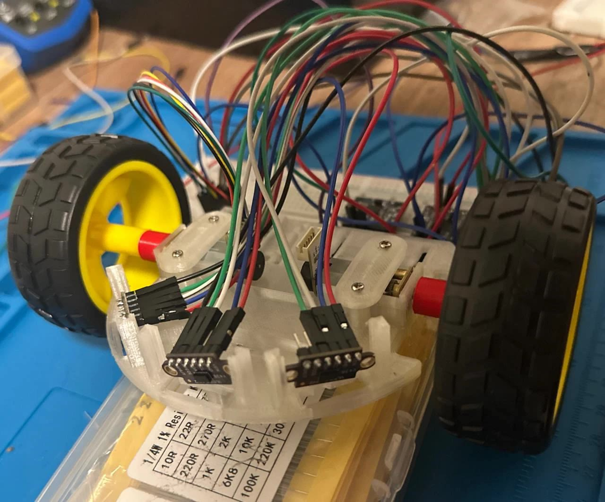
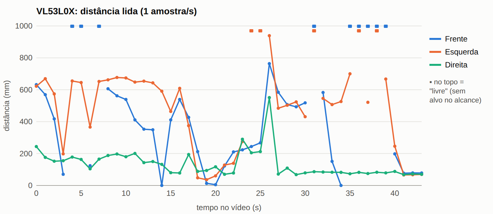
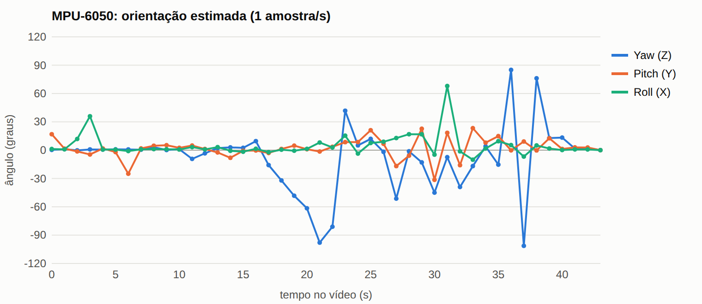

# Testes de Hardware

## Testes de _hardware_

> Apresentar com detalhes os testes feitos para conferir se os objetivos do *hardware* foram atendidos, incluindo:
>
> 1. Processamento (Arduino, ESP32 etc):
>    - Definir interface de desenvolvimento;
>    - Rodar exemplo mínimo.
> 2. Sensores (temperatura, pressão, posição, velocidade etc.):
>    - Realizar leitura básica de dados;
>    - Validar/calibrar leituras;
>    - Definir taxas de amostragem e quantidade de dados para transmissão e/ou armazenamento;
>    - Validar taxas definidas e quantidade de dados;
>    - Realizar processamento básico de dados (*thresholding*, filtro média-móvel etc.).
> 3. Armazenamento (memória interna, cartão SD, pendrive etc.):
>    - Armazenar dados básicos;
>    - Armazenar e validar dados de sensores.
> 4. Atuadores (Motores DC, relés, LEDs etc.):
>    - Realizar acionamentos básicos;
>    - Realizar acionamentos com base em dados de sensores;
>    - Realizar processamento básico de dados (PWM etc.).
> 5. Comunicações (UART, I2C, SPI, USB, WiFi, Bluetooth etc.):
>    - Transmissão básica de dados;
>    - Transmissão de dados de sensores dentro da taxa de amostragem.

| **ID** | **Descrição** | **Data de Início** | **Data de Conclusão** | **Responsável** | **Resultados Esperados** | **Resultados Obtidos** | **Aprovação Interna (S/N)** | **Aprovação do Orientador (S/N)** | **Observações** |
|:------:|---------------|--------------------|-----------------------|-----------------|--------------------------|------------------------|:---------------------------:|:--------------------------------:|-----------------|
| 3.1 | Alimentação e Linhas de Tensão | | | | 3,3 V e VBAT estáveis | | | | Verificado em bancada |
| 3.2 | Comunicação LiDAR (UART) | | | | Recepção dos pacotes LD06 | | | | |
| 3.3 | Acionamento dos Motores (DRV8833) | | | | Resposta PWM nos canais A e B | | | | |
| 3.4 | IMU (I2C) | | | | Dados de aceleração e giro | | | | |
| 3.5 | **Encoders de Quadratura (18 cm)** | 16/10/2026 | 17/10/2026 | Cláudio / Equipe | Leitura x4 por interrupção; erro $\le \pm 3\%$ em 180 mm | Roteiro e script serial automatizados; aguardando bancada final | S | | Issue #186, HU-05 |
| 3.6 | | | | | | | | | |

---

## Procedimento de Teste 3.5: Encoders e Deslocamento em Bancada (Issue #186)

### 1. Objetivo
Validar a decodificação em quadratura (x4) via interrupções nos pinos GPIO do ESP32-C3 e aferir a exatidão da conversão de pulsos em milímetros ao longo de um percurso de **18 cm (180 mm)** — correspondente à dimensão de uma célula do labirinto do Micromouse.

### 2. Instrumentação e Configuração
* **Hardware:** Microcontrolador ESP32-C3 com firmware carregado.
* **Sensores:** 2 encoders de efeito Hall acoplados aos micromotores N20.
  * Encoder Esquerdo: `GPIO0` (Canal A) e `GPIO1` (Canal B).
  * Encoder Direito: `GPIO3` (Canal A) e `GPIO10` (Canal B).
* **Guia de Medição:** Régua milimetrada calibrada de 300 mm ou paquímetro digital com batente fixo em 180,0 mm.
* **Ferramenta de Coleta:** Script Python `src/firmware/scripts/calibrar_deslocamento_18cm.py`.

### 3. Critérios de Aceitação
1. **Contagem por Interrupção:** Contagem bidirecional em ambas as rodas sem perda de pulsos e sem transições inválidas reportadas.
2. **Tolerância de Erro:**
   $$\text{Erro Relativo} = \frac{|D_{\text{medido}} - 180{,}0\text{ mm}|}{180{,}0\text{ mm}} \times 100\% \le 3{,}0\%$$
   $$\text{Erro Absoluto Máximo Permissível} = \pm 5{,}4\text{ mm}$$
3. **Calibração:** Determinação da constante de calibração $\mu\text{m/pulso}$ real:
   $$K = \frac{180 \times 1000}{\text{Pulsos}}$$

### 4. Roteiro de Execução
1. Conectar a placa ao computador via USB.
2. Posicionar o micromouse na marca de 0 mm da régua guia.
3. Executar o script de teste:
   ```bash
   python3 src/firmware/scripts/calibrar_deslocamento_18cm.py --porta /dev/ttyUSB0
   ```
4. Pressionar **ENTER** para enviar o comando de zerar (`Z`) e iniciar a amostragem.
5. Deslocar o robô manualmente de forma suave até a marca de 180,0 mm.
6. Finalizar a captura com **CTRL+C**.
7. O script registrará o relatório com os pulsos acumulados, as distâncias calculadas por roda, o erro relativo/absoluto e a nova constante recomendada para `ConfiguracaoEncoder.h`.


---

## Registro de 26/10/2026: protótipo em protoboard e situação dos testes

A pinagem de referência passou a ser a do protótipo testado em 23/10/2026: **I²C com SDA no GPIO6 e SCL no GPIO7**, XSHUT esquerdo no GPIO9, direito no GPIO8 e frontal solto, motores em GPIO0/1 (esquerdo) e GPIO10/21 (direito) e encoder esquerdo em GPIO3/4. A tabela completa está em [`hw/diagramas/pinagem.csv`](https://github.com/fcte-pi1/2026_2_PI1_Grupo01_Hilmer/blob/documentacao/hw/diagramas/pinagem.csv) e os componentes em [`hw/bom/bom.csv`](https://github.com/fcte-pi1/2026_2_PI1_Grupo01_Hilmer/blob/documentacao/hw/bom/bom.csv).

| **ID** | **Descrição** | **Data de Início** | **Data de Conclusão** | **Responsável** | **Resultados Esperados** | **Resultados Obtidos** | **Aprovação Interna (S/N)** | **Aprovação do Orientador (S/N)** | **Observações** |
|:------:|---------------|--------------------|-----------------------|-----------------|--------------------------|------------------------|:---------------------------:|:--------------------------------:|-----------------|
| 3.6 | Protótipo em protoboard: 3 VL53L0X e MPU6050 no mesmo I²C (SDA GPIO6, SCL GPIO7) | 23/10/2026 | 23/10/2026 | Bruno Duarte | Os 4 dispositivos lidos ao mesmo tempo pelo ESP32-C3 | **Sucesso parcial.** Cerca de 100 amostras/s; ToF de 0 a 939 mm conforme o obstáculo, com ruído de 1 a 2 mm parado; IMU acompanha o giro feito à mão (*yaw* até −105,9°, *roll* até 79,8°). Após "Zerar orientação", os dados congelam (ver resultados abaixo) | S | | Motores desconectados; alimentação pela USB. [Dados](https://github.com/fcte-pi1/2026_2_PI1_Grupo01_Hilmer/blob/documentacao/hw/testes/registros/P-1) |

<figure markdown>

{ width="500" }

<figcaption>

**Figura 1.** Protótipo de 23/10/2026: os três VL53L0X (frontal, esquerdo e direito) no chassi, ligados ao ESP32-C3 Super Mini na protoboard.

</figcaption>

</figure>

### Resultados do teste 3.6

Procedimento: gravar o firmware de teste do protótipo (`pololu/VL53L0X@^1.3.1` e `electroniccats/MPU6050@^1.4.5`), abrir o painel no navegador, aproximar e afastar um anteparo de cada VL53L0X, girar o robô à mão nos três eixos, deixar o robô parado com um anteparo perto dos sensores e apertar "Zerar orientação". O ensaio foi gravado em vídeo, e os valores do painel foram transcritos a 1 leitura/s (0 a 43 s) e a 4 leituras/s com o robô parado (41,5 a 43,5 s): [`leituras_1hz.csv`](https://github.com/fcte-pi1/2026_2_PI1_Grupo01_Hilmer/blob/documentacao/hw/testes/registros/P-1/leituras_1hz.csv) e [`leituras_repouso_4hz.csv`](https://github.com/fcte-pi1/2026_2_PI1_Grupo01_Hilmer/blob/documentacao/hw/testes/registros/P-1/leituras_repouso_4hz.csv). O tempo tem incerteza de ±0,5 s, e picos rápidos ficam fora dos gráficos.

<figure markdown>

{ width="700" }

<figcaption>

**Figura 2.** Distância lida pelos três VL53L0X durante o teste 3.6.

</figcaption>

</figure>

<figure markdown>

{ width="700" }

<figcaption>

**Figura 3.** Orientação estimada pela MPU-6050 durante o teste 3.6.

</figcaption>

</figure>

| Medida (robô parado) | Frente | Esquerda | Direita |
| :--- | :---: | :---: | :---: |
| Distância média | 77,6 mm | 67,3 mm | 69,0 mm |
| Desvio padrão | 1,2 mm | 1,0 mm | 1,9 mm |

| Medida (robô parado) | X | Y | Z |
| :--- | :---: | :---: | :---: |
| Acelerômetro, média | −0,04 g | 0,01 g | 1,03 g |
| Giroscópio, média | −0,11 °/s | −0,01 °/s | −0,06 °/s |

- **Taxa:** 100 amostras/s em 40 das 44 leituras; quedas para 94, 95 e 86 amostras/s.
- **Acelerômetro:** 1,03 g em repouso, 3% acima do esperado; precisa de calibração.
- **Giroscópio:** *offset* abaixo de 0,2 °/s; em Z, cerca de 1,8° de deriva em 30 s sem compensação.
- **Anomalia:** logo após "Zerar orientação" (43 s até o fim), com o robô parado, o acelerômetro passa a 2,00 g nos três eixos, o giroscópio a cerca de 1000 °/s, as distâncias ficam fixas em 77, 67 e 74 mm e a taxa em 72 amostras/s. Repetir com o *log* serial gravado para achar a causa (I²C, firmware ou painel).

**Pendências:** varredura I²C com os endereços 0x29, 0x30, 0x31 e 0x68 e conferência de qual endereço é qual sensor; medidas contra a régua a 54, 90, 180 e 270 mm; deriva do giroscópio parado por 30 s; teste com bateria e *bucks*.

### Atualização dos testes 3.3 e 3.5

- **3.3, acionamento dos motores:** a falha da integração em protoboard foi no **conector mini do encoder do N20**, que também leva os fios de potência do motor. O DRV8833 não apresentou falha. Falta refazer o conector e repetir o acionamento pelo driver.
- **3.5, encoders:** o procedimento acima usa os pinos da Rev 1 (GPIO0/1/3/10). Na pinagem adotada, o encoder esquerdo fica em GPIO3 (A) e GPIO4 (B); o direito, reservado em GPIO5 e GPIO20, ainda não está ligado.

### Issues e tarefas relacionadas

| Issue | Tipo | Situação no GitHub | Relação com os testes |
| :--- | :--- | :---: | :--- |
| [#79 Sistemas Eletrônicos](https://github.com/fcte-pi1/2026_2_PI1_Grupo01_Hilmer/issues/79) | Entrega | Aberta | Entrega da eletrônica |
| [#87 Esquemático Elétrico](https://github.com/fcte-pi1/2026_2_PI1_Grupo01_Hilmer/issues/87) | Pacote | Aberta | Atualizar para a pinagem adotada |
| [#93 Projeto e Montagem do Circuito](https://github.com/fcte-pi1/2026_2_PI1_Grupo01_Hilmer/issues/93) | Pacote | Aberta | — |
| [#94 Montagem do protótipo](https://github.com/fcte-pi1/2026_2_PI1_Grupo01_Hilmer/issues/94) | Atividade | Aberta | Evidência no teste 3.6 |
| [#95 Projeto da PCB](https://github.com/fcte-pi1/2026_2_PI1_Grupo01_Hilmer/issues/95), [#96 Soldagem](https://github.com/fcte-pi1/2026_2_PI1_Grupo01_Hilmer/issues/96), [#97 Cabeamento e conectores](https://github.com/fcte-pi1/2026_2_PI1_Grupo01_Hilmer/issues/97) | Atividade | Abertas | Conector do encoder (3.3) entra no #97 |
| [#98 Integração dos Componentes](https://github.com/fcte-pi1/2026_2_PI1_Grupo01_Hilmer/issues/98) | Pacote | Aberta | — |
| [#99 Sensores → MCU](https://github.com/fcte-pi1/2026_2_PI1_Grupo01_Hilmer/issues/99) | Atividade | Aberta | Teste 3.6; falta HI-04 |
| [#100 Encoders → MCU](https://github.com/fcte-pi1/2026_2_PI1_Grupo01_Hilmer/issues/100) | Atividade | Aberta | Teste 3.5 na pinagem adotada |
| [#101 MCU → Driver](https://github.com/fcte-pi1/2026_2_PI1_Grupo01_Hilmer/issues/101), [#102 Driver → Motores](https://github.com/fcte-pi1/2026_2_PI1_Grupo01_Hilmer/issues/102) | Atividade | Abertas | Teste 3.3, a repetir |
| [#103 Alimentação → Sistema](https://github.com/fcte-pi1/2026_2_PI1_Grupo01_Hilmer/issues/103) | Atividade | Aberta | Teste 3.1 e ensaios 2.5 e 2.7 de energia |
| [#104 Testes de Hardware](https://github.com/fcte-pi1/2026_2_PI1_Grupo01_Hilmer/issues/104) | Pacote | Aberta | Esta página |
| [#105 Teste do microcontrolador](https://github.com/fcte-pi1/2026_2_PI1_Grupo01_Hilmer/issues/105) | Atividade | Aberta | HI-03 do roteiro |
| [#106 Teste dos sensores](https://github.com/fcte-pi1/2026_2_PI1_Grupo01_Hilmer/issues/106) | Atividade | Aberta | Teste 3.6; falta HI-05 |
| [#107 Teste dos motores](https://github.com/fcte-pi1/2026_2_PI1_Grupo01_Hilmer/issues/107), [#108 Teste do driver](https://github.com/fcte-pi1/2026_2_PI1_Grupo01_Hilmer/issues/108) | Atividade | Abertas | Teste 3.3 |
| [#109 Teste dos encoders](https://github.com/fcte-pi1/2026_2_PI1_Grupo01_Hilmer/issues/109) | Atividade | Aberta | Teste 3.5 |
| [#110 Teste de alimentação](https://github.com/fcte-pi1/2026_2_PI1_Grupo01_Hilmer/issues/110) | Atividade | Aberta | Teste 3.1 |
| [#111 Teste integrado](https://github.com/fcte-pi1/2026_2_PI1_Grupo01_Hilmer/issues/111) | Atividade | Aberta | HI-07 e HI-08 do roteiro |
| [#112 Validação do Hardware](https://github.com/fcte-pi1/2026_2_PI1_Grupo01_Hilmer/issues/112), [#113 Verificação dos requisitos](https://github.com/fcte-pi1/2026_2_PI1_Grupo01_Hilmer/issues/113) | Pacote / atividade | Abertas | Depois dos testes integrados |
| [#116 Aprovação para integração com o software](https://github.com/fcte-pi1/2026_2_PI1_Grupo01_Hilmer/issues/116) | Atividade | Aberta | Depende do #111 |
| [#175 Teste de bancada dos sensores VL53L0X](https://github.com/fcte-pi1/2026_2_PI1_Grupo01_Hilmer/issues/175) | Tarefa (software) | Aberta | Medidas contra a régua (HI-05) |
| [#381 Testes isolados de software da Rev 2.0](https://github.com/fcte-pi1/2026_2_PI1_Grupo01_Hilmer/issues/381) | Tarefa (software) | Aberta | Bancada com os 3 ToF e a IMU juntos |
| [#213 Energização inicial da placa](https://github.com/fcte-pi1/2026_2_PI1_Grupo01_Hilmer/issues/213) | Tarefa (energia) | Aberta | HI-02; a descrição ainda cita o LiDAR |
| [#214 Queda de tensão na aceleração](https://github.com/fcte-pi1/2026_2_PI1_Grupo01_Hilmer/issues/214), [#216 Capacitores de *bulk*](https://github.com/fcte-pi1/2026_2_PI1_Grupo01_Hilmer/issues/216), [#218 UVLO na pista](https://github.com/fcte-pi1/2026_2_PI1_Grupo01_Hilmer/issues/218) | Tarefa (energia) | Abertas | HI-06 e HI-07 |
| [#286 Integrar módulos no chassi](https://github.com/fcte-pi1/2026_2_PI1_Grupo01_Hilmer/issues/286), [#289 Integração mecânica com hardware e software](https://github.com/fcte-pi1/2026_2_PI1_Grupo01_Hilmer/issues/289) | Tarefa (estrutura) | Abertas | HI-08 |
| [#186 Leitura dos encoders](https://github.com/fcte-pi1/2026_2_PI1_Grupo01_Hilmer/issues/186) | Tarefa (software) | Fechada | Origem do teste 3.5 |
| [#344 Driver dos 3 VL53L0X](https://github.com/fcte-pi1/2026_2_PI1_Grupo01_Hilmer/issues/344), [#378 Driver do MPU6050](https://github.com/fcte-pi1/2026_2_PI1_Grupo01_Hilmer/issues/378) | Tarefa (software) | Fechadas | Firmware dos sensores do teste 3.6 |
| [#201](https://github.com/fcte-pi1/2026_2_PI1_Grupo01_Hilmer/issues/201), [#202](https://github.com/fcte-pi1/2026_2_PI1_Grupo01_Hilmer/issues/202), [#204](https://github.com/fcte-pi1/2026_2_PI1_Grupo01_Hilmer/issues/204), [#206](https://github.com/fcte-pi1/2026_2_PI1_Grupo01_Hilmer/issues/206), [#207](https://github.com/fcte-pi1/2026_2_PI1_Grupo01_Hilmer/issues/207), [#209](https://github.com/fcte-pi1/2026_2_PI1_Grupo01_Hilmer/issues/209) | Tarefa (energia) | Fechadas | Ensaios 2.1 a 2.7 de [Energia](energia.md) |
| [#170 Teste com o LiDAR real](https://github.com/fcte-pi1/2026_2_PI1_Grupo01_Hilmer/issues/170) | Tarefa | Fechada | Sem efeito: o LiDAR saiu do projeto na Rev 2.0 |
