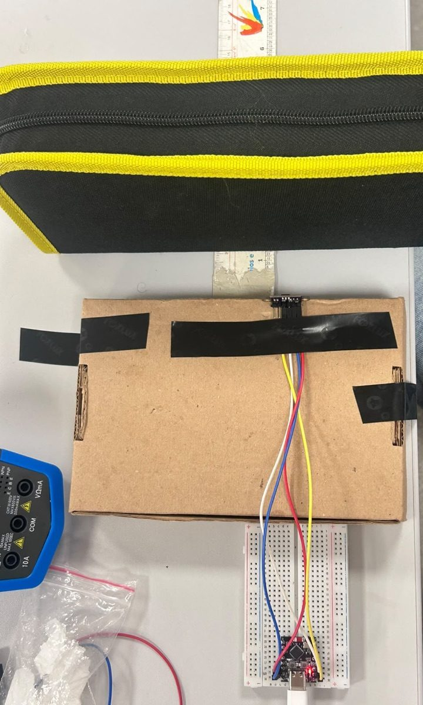
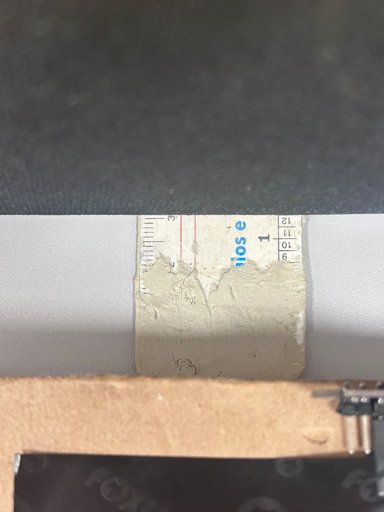
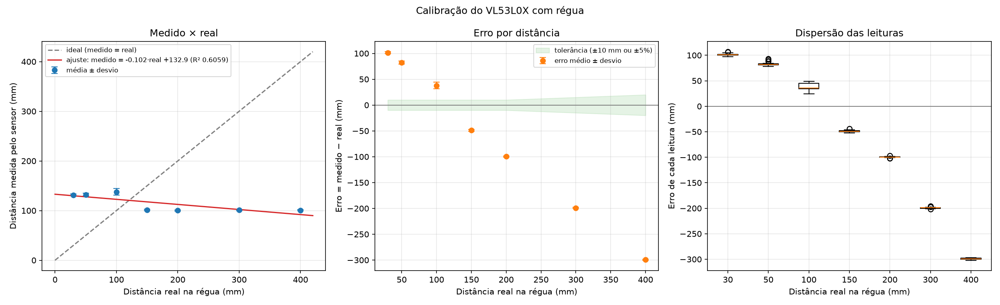
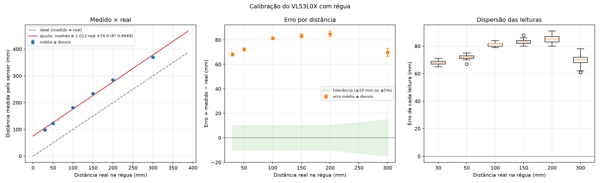
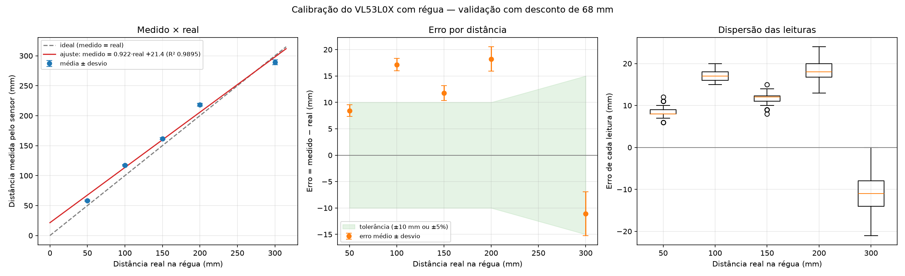
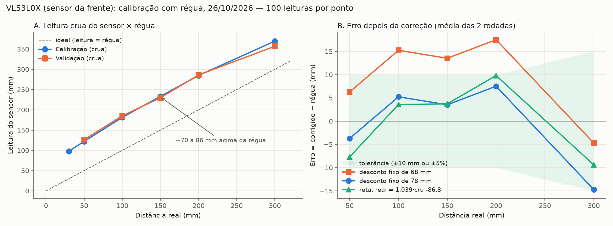

# Calibração do sensor de distância VL53L0X

!!! note "Escopo deste registro"
    Teste de bancada de **um** VL53L0X (o sensor da frente), ligado sozinho a um ESP32-C3 Super Mini numa protoboard, com o firmware e a pinagem do repositório [brun0duarte/micromouse](https://github.com/brun0duarte/micromouse) (commit `baa44c9`). **Não é a placa Rev 2.0 do projeto** nem o firmware do robô. Os outros dois VL53L0X, a integração com o MPU6050 e os motores e a repetição na placa Rev 2.0 estão em [Pendências](#pendencias).

| Item | Valor |
|---|---|
| Componente | Sensor de distância ToF VL53L0X (módulo, sensor da frente) |
| Requisito | Leitura de distância das paredes para a percepção ([#175](https://github.com/fcte-pi1/2026_2_PI1_Grupo01_Hilmer/issues/175), HU-02 / RF02) |
| Data da execução | 26/10/2026 |
| Executado por | Ana Carolina Fialho |
| Tipo de teste | Bancada, com o sensor real e régua; estatística com 100 leituras por distância |
| Resultado | Sensor estável e linear, com **desvio próprio de ~57 a 86 mm** (lê a mais); precisa de correção em software |

## Objetivo

1. Medir a **exatidão** do VL53L0X (quanto a leitura se afasta da distância real) e a **repetibilidade** (quanto ela varia com o alvo parado), de 3 a 30 cm, a faixa que o robô usa dentro do labirinto.
2. Encontrar a **correção** que deixa a leitura dentro da tolerância e validar essa correção numa segunda rodada.

## Montagem

**Figura 1.** Montagem: o VL53L0X fica na borda da caixa de papelão, olhando para o alvo (a bolsa). A régua passa entre os dois, e o ESP32-C3 na protoboard envia as leituras pela USB.

**Figura 2.** Detalhe da régua: o zero fica na face do sensor, e o alvo é posicionado em cada marca.

| Item | Detalhe |
|---|---|
| Placa | ESP32-C3 Super Mini, ligada ao computador pela USB-C |
| Ligação do sensor | VIN no 3V3 da placa, GND, SDA no GPIO6, SCL no GPIO7, XSHUT solto (pinagem do `PINAGEM.md` do repositório micromouse) |
| Firmware | `src/main.cpp` do repositório micromouse: envia uma linha CSV a cada 20 ms (50 por segundo); a 11ª coluna é a distância do sensor da frente em mm |
| Compilação | PlatformIO com `espressif32@7.1.3` (a mesma plataforma do firmware do projeto) e um arquivo local de compatibilidade para a chamada `analogWriteFrequency(pino, frequência)`, que o repositório micromouse usa na versão 3 do Arduino-ESP32. O código do repositório não foi alterado |
| Alvo | Superfície plana, perpendicular ao sensor: a bolsa preta da Figura 1 e, numa verificação, uma folha branca (ver [Verificações](#verificacoes-das-causas-do-desvio)) |
| Coleta e análise | [`docs/scripts/calibrar_tof.py`](../../scripts/calibrar_tof.py), em Python com `pyserial` e `matplotlib` |

## Procedimento

1. Gravar o firmware na placa e conferir no monitor serial a linha `VL53L0X frente ok`.
2. Rodar o script: `python calibrar_tof.py` (calibração, sem desconto: `--desconto 0`).
3. Para cada distância da régua, posicionar o alvo, conferir com a opção **`v`** (4 s de leituras ao vivo) que a leitura está **estável**, e só então confirmar.
4. O script descarta as 10 primeiras leituras depois de cada ajuste, coleta **100 leituras válidas** e calcula média, desvio-padrão, mínimo, máximo, mediana, erro e percentual de leituras válidas.
5. No fim, o script gera a tabela, a reta de correção (mínimos quadrados) e o gráfico.

**Critério de aceitação** (o mesmo da bancada dos ToF do firmware): erro médio dentro de **±10 mm ou ±5% da distância**, o que for maior, e pelo menos **95% de leituras válidas**.

## Resultados

### Tentativa descartada: o sensor via a montagem, e não o alvo

Na primeira tentativa, a leitura ficou **parada** perto de 130 mm e depois de 100 mm, de 3 a 40 cm, mesmo com o alvo mudando de lugar. O sensor estava vendo um objeto fixo da montagem a uns 10 cm, e não o alvo. Essa rodada foi **descartada**. Depois de refazer a montagem e passar a conferir cada distância com a opção `v`, a leitura passou a acompanhar o alvo.

| Real (mm) | 30 | 50 | 100 | 150 | 200 | 300 | 400 |
|---|---:|---:|---:|---:|---:|---:|---:|
| Média lida (mm) | 131,4 | 132,3 | 137,8 | 101,1 | 100,3 | 100,9 | 100,7 |

**Figura 3.** Tentativa descartada: a leitura não acompanha a régua. Mantida aqui como registro do erro de montagem e da conferência que passou a ser feita.

Também se descobriu, nessa etapa, que leituras antigas se acumulavam na porta USB enquanto o script esperava a confirmação. O script passou a descartar esse acúmulo antes de cada medida e a avisar se chegarem mais de 50 leituras por segundo.

### Rodada 1: calibração (leitura crua)

| Real (mm) | Média (mm) | Desvio-padrão (mm) | Mín. | Máx. | Diferença (mm) | Válidas |
|---:|---:|---:|---:|---:|---:|---:|
| 30 | 98,1 | 1,3 | 95 | 101 | +68,1 | 100% |
| 50 | 122,1 | 1,4 | 117 | 125 | +72,1 | 100% |
| 100 | 181,3 | 1,2 | 179 | 184 | +81,3 | 100% |
| 150 | 233,3 | 1,6 | 230 | 238 | +83,3 | 100% |
| 200 | 284,8 | 2,4 | 280 | 291 | +84,8 | 100% |
| 300 | 369,7 | 3,4 | 361 | 378 | +69,7 | 100% |

Resposta do sensor: **leitura = 1,012 · real + 74,9 mm** (R² = 0,995). A inclinação perto de 1 mostra que o sensor é **linear**: o erro vem de um **desvio somado** à distância, e não de uma escala errada.

**Figura 4.** Rodada 1 (calibração): leitura × régua, erro por distância e dispersão das 100 leituras de cada ponto.

### Rodada 2: validação com desconto de 68 mm

A equipe escolheu inicialmente um desconto de **68 mm**, o mesmo usado no visualizador do repositório micromouse. A segunda rodada aplicou esse desconto a cada leitura.

| Real (mm) | Média crua (mm) | Média corrigida (mm) | Desvio-padrão (mm) | Erro (mm) | Tolerância | Dentro? |
|---:|---:|---:|---:|---:|---:|:-:|
| 50 | 126,4 | 58,4 | 1,1 | +8,4 | ±10 | sim |
| 100 | 185,1 | 117,1 | 1,2 | +17,1 | ±10 | **não** |
| 150 | 229,8 | 161,8 | 1,4 | +11,8 | ±10 | **não** |
| 200 | 286,2 | 218,2 | 2,3 | +18,2 | ±10 | **não** |
| 300 | 356,9 | 288,9 | 4,1 | −11,1 | ±15 | sim |

Com 68 mm, **3 das 5 distâncias ficaram fora da tolerância**, todas com a leitura a mais: o desconto de 68 mm é pequeno para este módulo.

**Figura 5.** Rodada 2 (validação com desconto de 68 mm).

### Verificações das causas do desvio

Um desvio de 70 a 86 mm é grande para o VL53L0X, então duas outras causas foram verificadas antes de atribuí-lo ao sensor:

| Hipótese | Verificação | Resultado |
|---|---|---|
| Zero da régua fora da face do sensor | Conferência visual da posição (Figura 2) | Descartada: o zero está na face do sensor |
| Alvo preto (reflete pouco infravermelho) | Folha branca presa na frente do alvo, a 10 e a 20 cm, com a opção `v` | Descartada: o desvio se repetiu. Verificação qualitativa, sem registro numérico |

**Limite mínimo:** a 3 cm, a leitura variou muito entre as tentativas (85 a 195 mm). Abaixo de **~5 cm** o sensor não mede de forma confiável, e o ponto de 3 cm ficou fora do ajuste da correção.

### Comparação das correções

**Figura 6.** A: leitura crua das duas rodadas contra a régua. B: erro que sobra depois de cada correção, na média das duas rodadas, com a faixa de tolerância.

Erro que sobra em cada correção (rodada 1 / rodada 2 / média), em mm:

| Real (mm) | Desconto de 68 mm | Desconto de 78 mm | Reta: real = 1,039 · cru − 86,8 |
|---:|---|---|---|
| 50 | +4,1 / +8,4 / +6,3 | −5,9 / −1,6 / −3,7 | −10,0 / −5,5 / −7,7 |
| 100 | +13,3 / +17,1 / **+15,2** | +3,3 / +7,1 / +5,2 | +1,6 / +5,5 / +3,5 |
| 150 | +15,3 / +11,8 / **+13,5** | +5,3 / +1,8 / +3,5 | +5,5 / +1,9 / +3,7 |
| 200 | +16,8 / +18,2 / **+17,5** | +6,8 / +8,2 / +7,5 | +9,1 / +10,5 / +9,8 |
| 300 | +1,7 / −11,1 / −4,7 | −8,3 / **−21,1** / −14,7 | −2,8 / −16,0 / −9,4 |

- **Desconto de 78 mm:** de 5 a 20 cm, todos os pontos das duas rodadas ficam dentro de ±10 mm (pior caso, +8,2 mm). A 30 cm, a rodada 2 sai da tolerância (−21,1 mm, para ±15 mm).
- **Reta:** melhora o 30 cm (média de −9,4 mm), mas tem os piores casos em 5 cm (−10,0 mm) e 20 cm (+10,5 mm).

As colunas de 78 mm e da reta foram **calculadas sobre os mesmos dados** das duas rodadas, e não numa rodada independente. Elas indicam a correção a validar, e não substituem a validação.

## Precisão observada

| Medida | Resultado |
|---|---|
| Repetibilidade (desvio-padrão com o alvo parado) | 1,1 a 4,1 mm de 5 a 30 cm, crescendo com a distância |
| Leituras válidas | 100% em todas as distâncias das rodadas 1 e 2 |
| Linearidade | Inclinação da reta leitura × régua de 1,01 (rodada 1) e 0,92 (rodada 2, puxada pelo ponto de 30 cm), com R² de 0,995 e 0,989 |
| Desvio do módulo (leitura − régua) | +72 a +86 mm de 5 a 20 cm; +57 a +70 mm a 30 cm |
| Faixa útil medida | 5 a 30 cm (abaixo de ~5 cm, sem medida confiável) |

O VL53L0X não traz o desvio de cada módulo corrigido de fábrica na biblioteca usada (`pololu/VL53L0X`). Segundo a fabricante (ST), a exatidão especificada depende da calibração do *offset* de cada módulo, o que confirma a necessidade da correção em software.

## Conclusão

1. O sensor está **funcionando**: responde, acompanha o alvo, é praticamente linear de 5 a 20 cm e muito repetível (desvio-padrão de 1 a 4 mm). A 30 cm, a leitura variou mais entre as rodadas (369,7 e 356,9 mm).
2. **Sem correção, ele não atende** ao critério: lê de 57 a 86 mm a mais.
3. O desconto de **68 mm** (rodada 2) **não atende** de 10 a 20 cm.
4. O desconto de **78 mm** é o candidato para **5 a 20 cm**, a faixa das paredes laterais e da parede da frente na célula seguinte. **Falta a validação independente.**
5. O desvio é **do módulo**: cada um dos três VL53L0X precisa ser calibrado separadamente. No firmware do robô, a calibração do boot ([#240](https://github.com/fcte-pi1/2026_2_PI1_Grupo01_Hilmer/issues/240)) mede e desconta o desvio de cada sensor na largada; este teste dá a ordem de grandeza esperada para conferir esse valor.

## Pendências

- [ ] Validação independente do desconto de 78 mm: 3 rodadas, de 5 a 30 cm (`python calibrar_tof.py --desconto 78`).
- [ ] Calibração dos outros dois VL53L0X (esquerda e direita), um de cada vez.
- [ ] Teste dos 3 VL53L0X juntos no mesmo barramento (`pio test -f test_distancia` do repositório micromouse) e com os motores ligados.
- [ ] Repetição na placa Rev 2.0, com o firmware do projeto e a calibração do boot (#240).

## Dados e reprodução

| Arquivo | Conteúdo |
|---|---|
| [`rodada1-calibracao-leituras.csv`](dados/vl53l0x/rodada1-calibracao-leituras.csv) | As 600 leituras da rodada 1 (crua) |
| [`rodada1-calibracao-resumo.csv`](dados/vl53l0x/rodada1-calibracao-resumo.csv) | Resumo por distância da rodada 1 |
| [`rodada2-validacao68-leituras.csv`](dados/vl53l0x/rodada2-validacao68-leituras.csv) | As 500 leituras da rodada 2 (já com o desconto de 68 mm) |
| [`rodada2-validacao68-resumo.csv`](dados/vl53l0x/rodada2-validacao68-resumo.csv) | Resumo por distância da rodada 2 |
| [`descartada-montagem-resumo.csv`](dados/vl53l0x/descartada-montagem-resumo.csv) | Resumo da tentativa descartada |
| [`calibrar_tof.py`](../../scripts/calibrar_tof.py) | Script de coleta e análise |
| [`grafico_comparativo_vl53l0x.py`](../../scripts/grafico_comparativo_vl53l0x.py) | Gera a Figura 6 a partir das duas rodadas |

Para repetir: grave o `src/main.cpp` do repositório micromouse, instale `pyserial` e `matplotlib` e rode `python calibrar_tof.py --desconto 0` (calibração) ou `python calibrar_tof.py --desconto 78` (validação). Cada rodada gera uma pasta com as leituras, o resumo, o relatório e o gráfico.

## Histórico de versões

| Versão | Data | Descrição | Autor | Revisor |
|---|---|---|---|---|
| 1.0 | 26/10/2026 | Calibração do VL53L0X da frente com régua: tentativa descartada, rodada de calibração, validação com 68 mm e comparação das correções | Ana Carolina Fialho | — |
