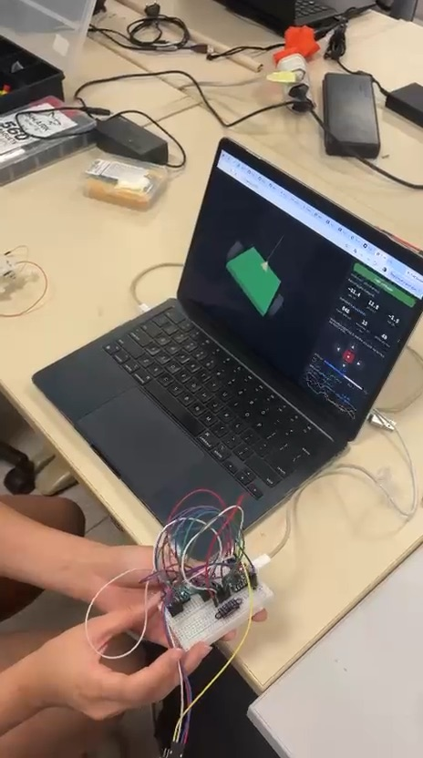
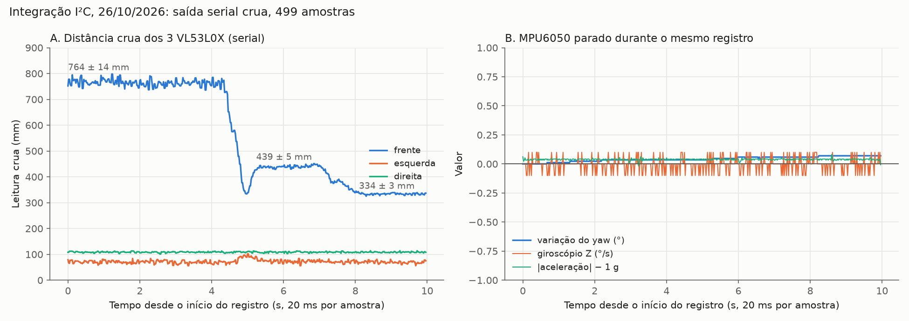
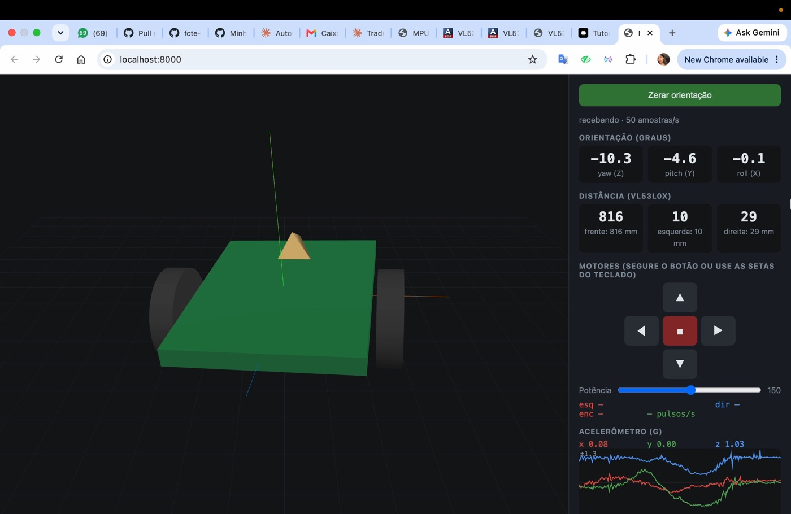
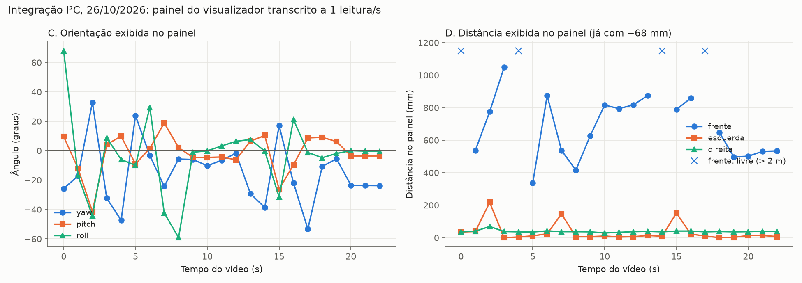

# Integração dos sensores I²C: 3 VL53L0X e MPU6050

!!! note "Escopo deste registro"
    Teste de bancada dos **três VL53L0X e do MPU6050 ligados ao mesmo tempo** no barramento I²C de um ESP32-C3 Super Mini, no protótipo em protoboard, com alimentação pela USB. Usa a pinagem do repositório [brun0duarte/micromouse](https://github.com/brun0duarte/micromouse) (SDA no GPIO6, SCL no GPIO7). **Não é a placa Rev 2.0 do projeto** nem o firmware do robô. **Os motores e o encoder não foram acionados**: o firmware usado não envia comandos a eles (ver [Firmware](#firmware)).

| Item | Valor |
|---|---|
| Componentes | 3 × VL53L0X (frente, esquerda, direita) e 1 × MPU6050, no mesmo I²C |
| Requisitos | Percepção das paredes ([#175](https://github.com/fcte-pi1/2026_2_PI1_Grupo01_Hilmer/issues/175), HU-02 / RF02) e orientação pela IMU ([#378](https://github.com/fcte-pi1/2026_2_PI1_Grupo01_Hilmer/issues/378)); integração sensores → MCU ([#99](https://github.com/fcte-pi1/2026_2_PI1_Grupo01_Hilmer/issues/99), [#106](https://github.com/fcte-pi1/2026_2_PI1_Grupo01_Hilmer/issues/106)) |
| Data da execução | 26/10/2026 |
| Executado por | Ana Carolina Fialho e equipe de eletrônica |
| Tipo de teste | Integração em bancada, com os sensores reais; registro serial cru (499 amostras) e vídeo do painel (22,6 s) |
| Resultado | **Sucesso parcial.** Os 4 dispositivos responderam juntos durante todo o registro, a 50 amostras/s. O sensor da frente e a IMU responderam como esperado; a resposta do sensor da direita não foi demonstrada, e os motores ficaram fora do teste |

## Objetivo

1. Verificar se os **quatro dispositivos I²C** iniciam e respondem **ao mesmo tempo** no mesmo barramento, cada VL53L0X no seu endereço.
2. Verificar se a leitura acompanha o que acontece na bancada: a distância muda quando o anteparo se move, e a orientação muda quando a protoboard gira.
3. Medir o **ruído** de cada sensor com a montagem parada e a **taxa de amostragem** efetiva.

## Montagem

{ width="360" }

**Figura 1.** Quadro do vídeo da bancada (10 s): a protoboard com os três VL53L0X e o MPU6050 é girada à mão, e o painel no computador acompanha o movimento.

| Item | Detalhe |
|---|---|
| Placa | ESP32-C3 Super Mini, alimentado e lido pela USB-C do computador |
| Barramento I²C | SDA no GPIO6, SCL no GPIO7, 400 kHz; todos os sensores em 3V3 e GND da placa |
| VL53L0X | Frente com XSHUT solto (0x30), esquerda com XSHUT no GPIO9 (0x31), direita com XSHUT no GPIO8 (0x29) |
| MPU6050 | Endereço 0x68, INT e AD0 soltos |
| Firmware | [`hw/testes/firmware/integracao-sensores-i2c`](https://github.com/fcte-pi1/2026_2_PI1_Grupo01_Hilmer/tree/documentacao/hw/testes/firmware/integracao-sensores-i2c), detalhado [abaixo](#firmware) |
| Painel | `visualizador/servidor.py` do repositório micromouse, aberto em `http://localhost:8000` |

!!! warning "As distâncias do painel têm 68 mm descontados"
    Para a calibração ([7.3.1](calibracao-vl53l0x.md)), o painel do visualizador foi alterado localmente para descontar **68 mm** de todas as distâncias. Essa alteração ainda estava ativa durante este ensaio. Por isso, **as distâncias que aparecem nos vídeos e na Figura 4 são a leitura crua menos 68 mm**, com piso em 0. O registro serial ([Figura 2](#registro-serial-com-a-montagem-parada)) traz a leitura **crua**, sem desconto.

## Firmware

O código gravado no ESP32-C3 está no repositório, exatamente como foi usado, em [`hw/testes/firmware/integracao-sensores-i2c/src/main.cpp`](https://github.com/fcte-pi1/2026_2_PI1_Grupo01_Hilmer/blob/documentacao/hw/testes/firmware/integracao-sensores-i2c/src/main.cpp). Ele foi compilado de novo na mesma plataforma do firmware do projeto (`espressif32@7.1.3`), sem avisos: RAM 4,4% e Flash 21,4%.

Na partida, o firmware:

1. **Libera o barramento I²C** com 9 pulsos de clock e um STOP, caso um sensor tenha ficado preso no meio de uma leitura, e inicia o `Wire` a 400 kHz.
2. **Inicia os VL53L0X um por vez** pelos XSHUT: desliga o esquerdo e o direito, configura o da frente para 0x30, liga o esquerdo e o configura para 0x31, liga o direito e o deixa em 0x29. Cada sensor fica em medição contínua.
3. **Inicia o MPU6050** com o DMP (que calcula a orientação dentro do sensor) e **calibra só o giroscópio**, com a montagem parada.

No `loop()`, a cada 20 ms, o firmware lê os sensores que têm medida nova e envia uma linha:

```
w,x,y,z,ax,ay,az,gx,gy,gz,frente,esquerda,direita
```

| Colunas | Conteúdo | Unidade |
|---|---|---|
| `w,x,y,z` | Quaternion da orientação (DMP) | — |
| `ax,ay,az` | Acelerômetro | g |
| `gx,gy,gz` | Giroscópio | graus/s |
| `frente,esquerda,direita` | Distância crua de cada VL53L0X | mm; `-1` = nada a menos de 2 m; `-2` = sensor não respondeu |

!!! info "O que este firmware não faz"
    O comentário do cabeçalho descreve 17 colunas e comandos para os motores, mas o código envia só as 13 colunas acima, e a leitura de comandos está comentada. **Os motores e o encoder não foram testados neste ensaio.** As demais diferenças entre o comentário e o código estão no [README do firmware](https://github.com/fcte-pi1/2026_2_PI1_Grupo01_Hilmer/blob/documentacao/hw/testes/firmware/integracao-sensores-i2c/README.md).

## Procedimento

1. Montar os quatro sensores na protoboard conforme a [tabela de montagem](#montagem) e ligar o ESP32-C3 na USB.
2. Gravar o firmware (`pio run -t upload`) e deixar a protoboard **parada** durante a calibração do giroscópio.
3. **Registro serial:** com a protoboard parada, ler a saída no terminal e aproximar um anteparo do sensor da frente em etapas. A saída foi copiada do terminal ([`serial_bruto.txt`](https://github.com/fcte-pi1/2026_2_PI1_Grupo01_Hilmer/blob/documentacao/hw/testes/registros/integracao-2026-10-26/serial_bruto.txt)).
4. **Painel:** abrir o visualizador, segurar a protoboard e girá-la à mão nos três eixos, apontando os sensores para objetos a distâncias diferentes. O ensaio foi filmado com o celular e com a gravação de tela, ao mesmo tempo.
5. Transcrever os valores do painel a 1 leitura por segundo ([`painel_1hz.csv`](https://github.com/fcte-pi1/2026_2_PI1_Grupo01_Hilmer/blob/documentacao/hw/testes/registros/integracao-2026-10-26/painel_1hz.csv)) e gerar os gráficos com [`docs/scripts/grafico_integracao_i2c.py`](../../scripts/grafico_integracao_i2c.py).

### Critérios de avaliação

Definidos para este registro, a partir dos itens 3.2 e 3.4 da [tabela de testes](../hardware.md):

| # | Critério | Como foi verificado |
|:---:|---|---|
| C1 | Os 4 dispositivos respondem juntos, sem nenhum `-2` (sensor sem resposta) | Registro serial e painel |
| C2 | Taxa de envio de 50 amostras/s, a do firmware | Contador do painel |
| C3 | O sensor da frente acompanha o anteparo, com desvio-padrão de até 15 mm com ele parado | Registro serial |
| C4 | A IMU parada mede cerca de 1 g, giro próximo de 0 °/s e orientação sem deriva visível | Registro serial |
| C5 | A orientação no painel acompanha o giro feito à mão | Vídeos |
| C6 | Os sensores da esquerda e da direita mudam de leitura com um obstáculo à frente deles | Vídeos e painel |

## Resultados

### Registro serial com a montagem parada



**Figura 2.** Saída serial crua: 499 amostras seguidas (cerca de 10 s, a 20 ms por amostra). **A:** o anteparo da frente foi aproximado em três patamares. **B:** o MPU6050 parado no mesmo intervalo.

| Patamar do anteparo (frente) | Amostras | Frente: média ± desvio | Esquerda: média ± desvio | Direita: média ± desvio |
|---|:---:|:---:|:---:|:---:|
| Longe | 0 a 219 | 763,8 ± 13,5 mm | 70,4 ± 5,7 mm | 108,5 ± 2,2 mm |
| Médio | 262 a 355 | 439,1 ± 5,2 mm | 73,5 ± 6,1 mm | 108,3 ± 2,3 mm |
| Perto | 405 a 498 | 333,9 ± 3,0 mm | 69,5 ± 4,7 mm | 108,5 ± 1,9 mm |

As distâncias reais do anteparo não foram medidas com régua, então esta tabela mostra **repetibilidade**, não exatidão. Para a exatidão do sensor da frente, ver a [calibração](calibracao-vl53l0x.md).

| MPU6050 parado (499 amostras) | X | Y | Z |
|---|:---:|:---:|:---:|
| Acelerômetro: média ± desvio | 0,069 ± 0,003 g | −0,011 ± 0,003 g | 1,036 ± 0,007 g |
| Giroscópio: média ± desvio | −0,18 ± 0,06 °/s | 0,05 ± 0,09 °/s | −0,01 ± 0,06 °/s |

- **Nenhum `-2` nem `-1`** nas 499 amostras: os três VL53L0X responderam o tempo todo.
- **Módulo da aceleração parada: 1,039 g**, 4% acima de 1 g. Isso confirma o que o [registro 3.6](../hardware.md#registro-de-26102026-prototipo-em-protoboard-e-situacao-dos-testes) já tinha visto (1,03 g): o acelerômetro precisa de calibração, que o firmware não faz.
- **Giroscópio:** depois da calibração da partida, o *offset* ficou abaixo de 0,2 °/s nos três eixos. O maior pico foi de −0,9 °/s no eixo Y, em uma amostra.
- **Orientação:** o *yaw* calculado pelo DMP foi de 13,39° a 13,46° no registro inteiro, ou seja, **0,07° de deriva em cerca de 10 s**.
- **Leituras repetidas:** em 72 das 499 amostras (14%), as três distâncias são iguais às da amostra anterior. Isso é esperado, porque o firmware envia a cada 20 ms e cada VL53L0X gera uma medida nova a cada ~33 ms.
- **Esquerda e direita quase constantes:** de 56 a 102 mm (esquerda) e de 101 a 114 mm (direita), cruas, nos três patamares. Pela calibração, o módulo lê de 57 a 86 mm a mais. Esses valores, portanto, indicam algo **a poucos centímetros** dos dois sensores durante o registro, provavelmente os fios ou a própria protoboard. Isso não foi verificado na bancada.

### Painel com a protoboard girada à mão

<video controls preload="metadata" width="100%" src="../../../videos/integracao-i2c-tela.mp4"></video>

**Vídeo 1.** Gravação da tela do visualizador durante o ensaio (22,6 s). Arquivo: [`docs/videos/integracao-i2c-tela.mp4`](https://github.com/fcte-pi1/2026_2_PI1_Grupo01_Hilmer/blob/documentacao/docs/videos/integracao-i2c-tela.mp4).

<video controls preload="metadata" width="360" src="../../../videos/integracao-i2c-bancada.mp4"></video>

**Vídeo 2.** Mesmo ensaio, filmado com o celular: a protoboard sendo girada e o painel respondendo (22,6 s). Arquivo: [`docs/videos/integracao-i2c-bancada.mp4`](https://github.com/fcte-pi1/2026_2_PI1_Grupo01_Hilmer/blob/documentacao/docs/videos/integracao-i2c-bancada.mp4).



**Figura 3.** Painel aos 10 s do Vídeo 1: 50 amostras/s; *yaw* −10,3°, *pitch* −4,6°, *roll* −0,1°; frente 816 mm, esquerda 10 mm e direita 29 mm (já com −68 mm); acelerômetro 0,08 / 0,00 / 1,03 g. Os campos dos motores ("esq —", "enc —") estão vazios porque o firmware não envia essas colunas.



**Figura 4.** Valores do painel transcritos a cada 1 s do Vídeo 1. **C:** orientação. **D:** distâncias, já com o desconto de 68 mm; os "×" marcam os instantes em que o painel mostrou a frente como "livre" (nada a menos de 2 m).

| Medida (23 leituras do painel, 0 a 22 s) | Faixa observada |
|---|---|
| Taxa | 49 a 51 amostras/s |
| *Yaw* | −53,3° a 32,9° |
| *Pitch* | −41,4° a 18,9° |
| *Roll* | −59,2° a 68,0° |
| Frente | 337 a 1.048 mm, e "livre" em 4 das 23 leituras |
| Esquerda | 0 a 217 mm; acima de 140 mm em 3 leituras (2, 7 e 15 s), com a protoboard inclinada |
| Direita | 29 a 69 mm |

- O modelo 3D acompanhou todos os giros, inclinações e rotações feitos à mão. Nas últimas 3 leituras (20 a 22 s), com a protoboard parada, a orientação ficou estável (*yaw* −23,5° a −23,8°, *pitch* −3,6°).
- Durante os 22,6 s, os valores continuaram mudando até o fim. O congelamento visto no [registro 3.6](../hardware.md#registro-de-26102026-prototipo-em-protoboard-e-situacao-dos-testes) depois de "Zerar orientação" **não apareceu**, mas não há registro de o botão ter sido apertado neste ensaio.

### Avaliação dos critérios

| # | Critério | Resultado | Situação |
|:---:|---|---|:---:|
| C1 | 4 dispositivos juntos, sem `-2` | Nenhum `-2` nas 499 amostras seriais nem nas 23 leituras do painel | Atendido |
| C2 | 50 amostras/s | 49 a 51 amostras/s no painel | Atendido |
| C3 | Frente acompanha o anteparo, desvio ≤ 15 mm | Três patamares distintos (764, 439 e 334 mm crus), com desvio de 13,5, 5,2 e 3,0 mm | Atendido |
| C4 | IMU parada coerente | 1,039 g, giro < 0,2 °/s, *yaw* com 0,07° de deriva em ~10 s | Atendido, com o acelerômetro 4% alto |
| C5 | Orientação acompanha o giro | Modelo 3D acompanhou o movimento nos 22,6 s dos vídeos | Atendido (qualitativo) |
| C6 | Esquerda e direita respondem a obstáculo | Esquerda subiu para 146 a 217 mm em 3 momentos; a direita ficou entre 29 e 69 mm o tempo todo | **Esquerda atendido; direita não demonstrado** |

## Conclusão

1. **O barramento I²C compartilhado funciona com os 4 dispositivos.** Os três VL53L0X, cada um no seu endereço, e o MPU6050 responderam juntos durante todo o ensaio, sem nenhuma falha de leitura, a 50 amostras/s.
2. **O sensor da frente e a IMU se comportaram como esperado.** A frente separou bem três distâncias, com ruído de 3 a 14 mm. A IMU parada não derivou de forma visível em 10 s e acompanhou o giro feito à mão.
3. **O acelerômetro lê cerca de 4% a mais em repouso** (1,04 g), o mesmo que o registro 3.6. Antes de usar a aceleração no robô, ele precisa de calibração.
4. **O sensor da direita não teve a resposta demonstrada.** Ele leu um valor quase constante, compatível com algo encostado nele (provavelmente fios). O da esquerda respondeu quando a protoboard foi inclinada.
5. **Motores e encoder ficaram fora deste teste**, porque o firmware não os aciona.

## Pendências

1. **Sensor da direita:** repetir com um anteparo controlado na frente dele e os fios afastados, para confirmar que a leitura muda.
2. **Exatidão com os 3 sensores juntos:** repetir os patamares com régua (como na [calibração](calibracao-vl53l0x.md)) para a esquerda e a direita.
3. **Motores e encoder:** incluir os comandos `M,esq,dir` e as colunas do encoder no firmware e repetir com o DRV8833 ligado, depois de refazer o conector do encoder (ver teste 3.3 na [tabela](../hardware.md)).
4. **Varredura I²C:** registrar a varredura com os endereços 0x29, 0x30, 0x31 e 0x68 no log serial.
5. **Calibração do acelerômetro** e um registro parado mais longo (30 s ou mais) para medir a deriva do giroscópio.
6. **"Zerar orientação":** repetir apertando o botão, com o log serial gravado, para investigar o congelamento do registro 3.6.
7. **Placa Rev 2.0:** repetir na placa definitiva, que usa outra pinagem (I²C em GPIO9/8, XSHUT em GPIO0/1/2).

## Dados e reprodução

Os registros estão em [`hw/testes/registros/integracao-2026-10-26`](https://github.com/fcte-pi1/2026_2_PI1_Grupo01_Hilmer/tree/documentacao/hw/testes/registros/integracao-2026-10-26):

| Arquivo | Conteúdo |
|---|---|
| `serial_bruto.txt` | Saída serial copiada do terminal, sem edição. Cada amostra aparece em duas linhas, sem a vírgula entre `gz` e `frente` |
| `serial.csv` | As 499 amostras completas, com as distâncias cruas |
| `painel_1hz.csv` | Painel transcrito a 1 leitura/s (distâncias com −68 mm) |
| `quadros/` | Quadros da gravação da tela a cada 2 s |
| [`grafico_integracao_i2c.py`](../../scripts/grafico_integracao_i2c.py) | Gera as Figuras 2 e 4 e imprime os números das tabelas |

Para repetir: grave o firmware de [`hw/testes/firmware/integracao-sensores-i2c`](https://github.com/fcte-pi1/2026_2_PI1_Grupo01_Hilmer/tree/documentacao/hw/testes/firmware/integracao-sensores-i2c), copie a saída do `pio device monitor` para um arquivo e rode o script sobre a pasta dos registros.

## Histórico de versões

| Versão | Data | Descrição | Autor | Revisor |
|---|---|---|---|---|
| 1.0 | 26/10/2026 | Integração dos 3 VL53L0X e do MPU6050 no I²C: firmware, registro serial, vídeos, painel transcrito e avaliação | Ana Carolina Fialho | — |
