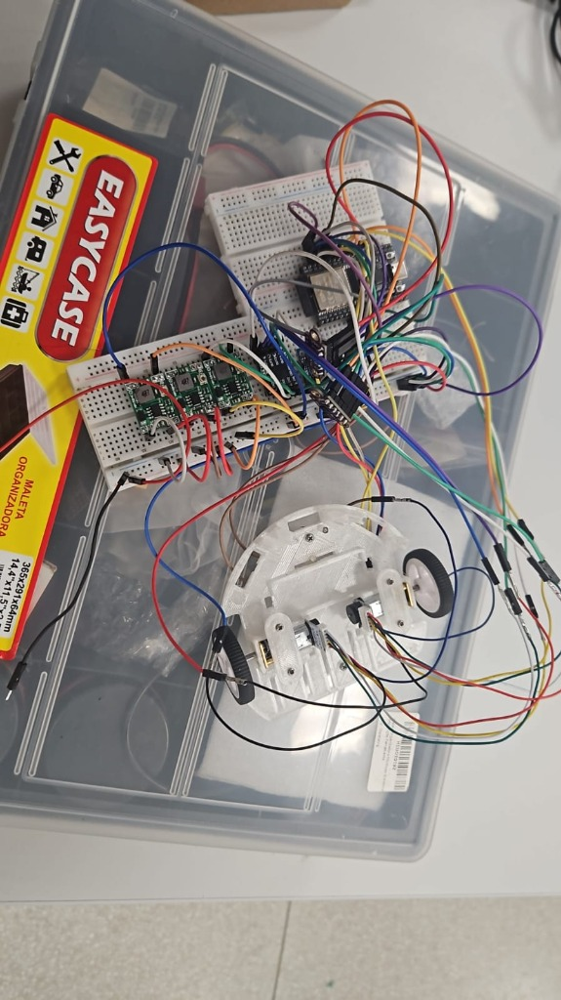

# Ensaio Integrado em Protoboard: Energia, Hardware, Firmware e Telemetria (ESP32 DevKit V1)

	 Este documento registra o **ensaio de integração geral em bancada (protoboard), contemplando a energização simultânea de todos os subsistemas do Micromouse, a validação das saídas dos três conversores Buck com multímetro, o acionamento do driver de motores e dos micromotores N20, a leitura dos sensores no barramento I²C com o firmware do projeto e a transmissão de telemetria via Wi-Fi diretamente da **ESP32 DevKit V1** para as *Edge Functions* do banco de dados **Supabase**.

| Item | Valor |
| :--- | :--- |
| **Subsistemas Integrados** | Energia (LiPo 2S + 3× Buck MP1584EN), Hardware (ESP32 DevKit V1, DRV8833, 2× Motores N20 c/ Encoder, 3× VL53L0X, IMU MPU6050) e Software/Firmware (Sensores, Controle e Telemetria Wi-Fi/Supabase) |
| **Data da Execução** | 03/11/2026 |
| **Responsáveis / Executores** | Elias Oliveira e Cláudio Henrique |
| **Ambiente de Montagem** | Duas protoboards interligadas ao chassi impresso em 3D com motores e rodas (operação equivalente ao robô completo em bancada) |
| **Resultado Global** | **Aprovado.** Circuito integralmente energizado e estável; tensões dos 3 reguladores aferidas; driver DRV8833, motores N20 e sensores I²C operacionais; conexão Wi-Fi e envio de lotes de telemetria às *Edge Functions* do Supabase (`HTTP 201` e `HTTP 200`) validados com persistência confirmada no banco |

---

## 1. Edições e Adaptações Realizadas na Montagem de Bancada

Para viabilizar a validação funcional completa de ponta a ponta antes da montagem na placa de circuito impresso (PCB) definitiva, foram adotadas as seguintes **edições e simplificações de hardware** em relação ao esquemático teórico da Rev 2.0:

1. **Montagem sem Resistores e Capacitores Discretos Externos:**
   * Todo o circuito foi montado e testado **sem a utilização de resistores e capacitores discretos avulsos** na protoboard.
   * **Supressão do divisor resistivo e filtro do ADC (`R1 = 100 kΩ`, `R2 = 33 kΩ` e `C5 = 100 nF`):** o circuito de monitoramento analógico da tensão da bateria no pino `GPIO 34` (`BAT_ADC`) não foi populado nesta montagem em protoboard.
   * **Habilitação direta do driver `DRV8833` (sem `R4 = 47 kΩ`):** o pino `nSLEEP` (`EEP`/`STBY`) do módulo DRV8833 foi conectado diretamente ao barramento regulado de `+3,3 V` (`+3V3_SENS`), garantindo nível lógico alto estável para operação da ponte H.
   * **Operação sem capacitores eletrolíticos/cerâmicos externos (`C2`, `C3`, `C4`, `C6`, `C7`, `C8`):** a filtragem de entrada e saída operou exclusivamente com os capacitores cerâmicos SMD (MLCC) e resistores de *pull-up* já integrados de fábrica nos próprios módulos comerciais (*breakouts* dos conversores `MP1584EN`, dos sensores `VL53L0X`, da `MPU6050` e do `DRV8833`), além dos resistores internos de *pull-up* (`INPUT_PULLUP`) da própria ESP32.
2. **Emprego da Placa `ESP32 DevKit V1`:**
   * Utilizou-se o módulo **ESP32 DevKit V1** (ESP32 clássico, ambiente `bancada_geral_devkit` / `bancada_telemetria` no PlatformIO com a flag `-DPLACA_ESP32_DEVKIT`), permitindo alimentar o microcontrolador pelo pino `VIN` (`5,0 V` vindos do Buck `U2`) e dedicar 17 pinos de I/O sem conflito entre a interface serial USB, o barramento I²C, os sinais `XSHUT`, o PWM dos motores e os canais de quadratura dos encoders.
3. **Configuração Funcional Equivalente ao Robô ("Rato em Protoboard"):**
   * Os componentes eletrônicos (três conversores Buck, ESP32 DevKit V1, driver DRV8833, IMU MPU6050 e os três sensores VL53L0X) foram dispostos em duas protoboards acopladas por chicotes diretamente ao chassi mecânico impresso em 3D contendo os dois micromotores DC N20 e rodas, reproduzindo fielmente o comportamento elétrico e lógico do Micromouse completo.

<figure markdown>

{ width="520" }

<figcaption>

**Figura 1.** Montagem integrada em bancada: os três reguladores Step-Down Buck MP1584EN, a placa ESP32 DevKit V1, o driver DRV8833, a IMU MPU6050 e os sensores ToF VL53L0X montados nas protoboards e interligados ao chassi impresso com os dois motores N20 e rodas, operando como o robô completo sem resistores ou capacitores discretos externos.

</figcaption>

</figure>

---

## 2. Plano de Ligação Utilizado (Mapeamento Pino a Pino)

Abaixo estão as tabelas de fiação pino a pino utilizadas como referência para a montagem, segmentadas individualmente por componente.

!!! info "Nota sobre os componentes passivos na bancada"
    Conforme descrito na [Seção 1](#1-edicoes-e-adaptacoes-realizadas-na-montagem-de-bancada), durante a execução prática deste ensaio **não foram instalados os resistores (`R1`, `R2`) nem os capacitores externos (`C5` e capacitor de *bulk* na saída de `U4`)**. A Tabela 3 é mantida abaixo como registro integral do plano de pinagem do `ESP32 DevKit V1`, destacando-se a omissão física dos passivos discretos na protoboard.

### 2.1. Entrada de Bateria, Proteção (`F1`) e Chave Geral (`SW1`)

| Componente de Origem | Terminal / Pino (Origem) | Componente de Destino | Terminal / Pino (Destino) | Nível de Tensão | Descrição / Função |
| :--- | :--- | :--- | :--- | :---: | :--- |
| **Bateria LiPo 2S** | Fio Vermelho (`+`) | **Fusível PPTC `F1`** (MF-R185) | `Terminal 1` | $7{,}4\text{ V a }8{,}4\text{ V}$ | Entrada primária da bateria |
| **Fusível PPTC `F1`** | `Terminal 2` | **Chave Geral `SW1`** | `Pino 1` (Entrada) | $7{,}4\text{ V a }8{,}4\text{ V}$ | Linha protegida contra sobrecorrente |
| **Chave Geral `SW1`** | `Pino 2` (Saída) | **Barramento `VBAT`** | Trilha / Linha `VBAT` | $7{,}4\text{ V a }8{,}4\text{ V}$ | Alimenta `U2`, `U4`, `U5` (e $R_1$ no plano completo) |
| **Bateria LiPo 2S** | Fio Preto (`-`) | **Barramento `GND`** | Trilha / Linha `GND Comum` | $0{,}0\text{ V}$ | Terra de referência unificado de todo o robô |

### 2.2. Conversores Step-Down Buck (`U2`, `U5` e `U4` — MP1584EN)

> **Regra de Bancada Aplicada:** Foram conectados primeiro os pinos `IN+` e `IN-`, ajustado o trimpot de cada módulo com o multímetro na saída e **só depois** conectados os pinos `OUT+` ao restante do circuito.

| Componente de Origem | Terminal / Pino (Origem) | Componente de Destino | Terminal / Pino (Destino) | Nível de Tensão | Descrição / Função |
| :--- | :--- | :--- | :--- | :---: | :--- |
| **Buck `U2` (5,0 V)** | `IN+` | **Chave Geral `SW1`** | `Pino 2` (Barramento `VBAT`) | $7{,}4\text{ V a }8{,}4\text{ V}$ | Entrada de alta tensão do conversor 5 V |
| **Buck `U2` (5,0 V)** | `IN-` | **Barramento `GND`** | `GND Comum` | $0{,}0\text{ V}$ | Terra de entrada do conversor 5 V |
| **Buck `U2` (5,0 V)** | `OUT+` | **ESP32 DevKit V1** | Pino `VIN` (ou `5V`) | $+5{,}0\text{ V}$ | Alimentação exclusiva do ESP32 |
| **Buck `U2` (5,0 V)** | `OUT-` | **ESP32 DevKit V1** | Pino `GND` | $0{,}0\text{ V}$ | Retorno de terra para o ESP32 |
| **Buck `U5` (3,3 V)** | `IN+` | **Chave Geral `SW1`** | `Pino 2` (Barramento `VBAT`) | $7{,}4\text{ V a }8{,}4\text{ V}$ | Entrada de alta tensão do conversor 3,3 V |
| **Buck `U5` (3,3 V)** | `IN-` | **Barramento `GND`** | `GND Comum` | $0{,}0\text{ V}$ | Terra de entrada do conversor 3,3 V |
| **Buck `U5` (3,3 V)** | `OUT+` | **Barramento `+3V3_SENS`** | `VIN` (3× ToF, MPU), `VCC` (Encoders) e `nSLEEP` (DRV8833) | $+3{,}3\text{ V}$ | Alimentação lógica externa regulada |
| **Buck `U5` (3,3 V)** | `OUT-` | **Barramento `GND`** | `GND Comum` | $0{,}0\text{ V}$ | Retorno de terra dos sensores e lógica |
| **Buck `U4` (6,0 V)** | `IN+` | **Chave Geral `SW1`** | `Pino 2` (Barramento `VBAT`) | $7{,}4\text{ V a }8{,}4\text{ V}$ | Entrada de alta tensão do conversor 6 V |
| **Buck `U4` (6,0 V)** | `IN-` | **Barramento `GND`** | `GND Comum` | $0{,}0\text{ V}$ | Terra de entrada do conversor 6 V |
| **Buck `U4` (6,0 V)** | `OUT+` | **Driver DRV8833** | Pino `VM` | $+6{,}0\text{ V}$ | Alimentação de potência dos motores DC |
| **Buck `U4` (6,0 V)** | `OUT-` | **Driver DRV8833** | Pino `GND` (Potência) | $0{,}0\text{ V}$ | Retorno de potência dos motores DC |

### 2.3. Circuito Divisor de Tensão (`R1`, `R2`, `C5` — *Omitidos no Ensaio*) e Botão (`BTN_START`)

| Componente de Origem | Terminal / Pino (Origem) | Componente de Destino | Terminal / Pino (Destino) | Nível de Tensão | Descrição / Função |
| :--- | :--- | :--- | :--- | :---: | :--- |
| **Resistor `R1` ($100\text{ k}\Omega$)** *(omitido)* | `Terminal 1` | **Chave Geral `SW1`** | `Pino 2` (Barramento `VBAT`) | $7{,}4\text{ V a }8{,}4\text{ V}$ | Coleta tensão da bateria pós-chave *(não montado na protoboard)* |
| **Resistor `R1` ($100\text{ k}\Omega$)** *(omitido)* | `Terminal 2` | **ESP32 DevKit V1** | Pino `GPIO 34` (Nó `BAT_ADC`) | $1{,}83\text{ V a }2{,}08\text{ V}$ | Entrega sinal atenuado ao ADC1 *(não montado na protoboard)* |
| **Resistor `R2` ($33\text{ k}\Omega$)** *(omitido)* | `Terminal 1` | **ESP32 DevKit V1** | Pino `GPIO 34` (Nó `BAT_ADC`) | $1{,}83\text{ V a }2{,}08\text{ V}$ | Junta-se ao `Terminal 2` de `R1` *(não montado na protoboard)* |
| **Resistor `R2` ($33\text{ k}\Omega$)** *(omitido)* | `Terminal 2` | **Barramento `GND`** | `GND Comum` | $0{,}0\text{ V}$ | Fecha o divisor resistivo para o terra *(não montado na protoboard)* |
| **Capacitor `C5` ($100\text{ nF}$)** *(omitido)* | `Terminal 1` | **ESP32 DevKit V1** | Pino `GPIO 34` (Nó `BAT_ADC`) | $1{,}83\text{ V a }2{,}08\text{ V}$ | Em paralelo com `R2` — filtro passa-baixas *(não montado na protoboard)* |
| **Capacitor `C5` ($100\text{ nF}$)** *(omitido)* | `Terminal 2` | **Barramento `GND`** | `GND Comum` | $0{,}0\text{ V}$ | Desvia ruído de alta frequência para o terra *(não montado na protoboard)* |
| **Botão `BTN_START`** | `Terminal 1` | **ESP32 DevKit V1** | Pino `GPIO 23` | $3{,}3\text{ V}$ (Pull-up) | Aciona partida/calibração ao ir para `0 V` |
| **Botão `BTN_START`** | `Terminal 2` | **Barramento `GND`** | `GND Comum` | $0{,}0\text{ V}$ | Aterra o pino `GPIO 23` quando pressionado |

### 2.4. Sensores Laser ToF VL53L0X (`J3` Esquerdo, `J4` Frontal, `J5` Direito)

#### 2.4.1. VL53L0X Esquerdo (`J3` — Endereço final `0x30`)

| Componente de Origem | Terminal / Pino (Origem) | Componente de Destino | Terminal / Pino (Destino) | Nível de Tensão | Descrição / Função |
| :--- | :--- | :--- | :--- | :---: | :--- |
| **VL53L0X Esquerdo (`J3`)** | `VIN` (ou `VCC`) | **Buck `U5` (3,3 V)** | `OUT+` (Barramento `+3V3_SENS`) | $+3{,}3\text{ V}$ | Alimentação do módulo esquerdo |
| **VL53L0X Esquerdo (`J3`)** | `GND` | **Barramento `GND`** | `GND Comum` | $0{,}0\text{ V}$ | Referência elétrica |
| **VL53L0X Esquerdo (`J3`)** | `SDA` | **ESP32 DevKit V1** | Pino `GPIO 21` | $3{,}3\text{ V}$ (I²C) | Via de dados I²C (em paralelo com os demais) |
| **VL53L0X Esquerdo (`J3`)** | `SCL` | **ESP32 DevKit V1** | Pino `GPIO 22` | $3{,}3\text{ V}$ (I²C) | Via de clock I²C (em paralelo com os demais) |
| **VL53L0X Esquerdo (`J3`)** | `XSHUT` | **ESP32 DevKit V1** | Pino `GPIO 16` | $0\text{ V} / 3{,}3\text{ V}$ | Pino exclusivo para acordar e mudar endereço |
| **VL53L0X Esquerdo (`J3`)** | `GPIO1` | *Não conectado* | *Em aberto (Isolado)* | — | Interrupção não utilizada |

#### 2.4.2. VL53L0X Frontal (`J4` — Endereço final `0x31`)

| Componente de Origem | Terminal / Pino (Origem) | Componente de Destino | Terminal / Pino (Destino) | Nível de Tensão | Descrição / Função |
| :--- | :--- | :--- | :--- | :---: | :--- |
| **VL53L0X Frontal (`J4`)** | `VIN` (ou `VCC`) | **Buck `U5` (3,3 V)** | `OUT+` (Barramento `+3V3_SENS`) | $+3{,}3\text{ V}$ | Alimentação do módulo frontal |
| **VL53L0X Frontal (`J4`)** | `GND` | **Barramento `GND`** | `GND Comum` | $0{,}0\text{ V}$ | Referência elétrica |
| **VL53L0X Frontal (`J4`)** | `SDA` | **ESP32 DevKit V1** | Pino `GPIO 21` | $3{,}3\text{ V}$ (I²C) | Via de dados I²C (em paralelo com os demais) |
| **VL53L0X Frontal (`J4`)** | `SCL` | **ESP32 DevKit V1** | Pino `GPIO 22` | $3{,}3\text{ V}$ (I²C) | Via de clock I²C (em paralelo com os demais) |
| **VL53L0X Frontal (`J4`)** | `XSHUT` | **ESP32 DevKit V1** | Pino `GPIO 17` | $0\text{ V} / 3{,}3\text{ V}$ | Pino exclusivo para acordar e mudar endereço |
| **VL53L0X Frontal (`J4`)** | `GPIO1` | *Não conectado* | *Em aberto (Isolado)* | — | Interrupção não utilizada |

#### 2.4.3. VL53L0X Direito (`J5` — Endereço final `0x32`)

| Componente de Origem | Terminal / Pino (Origem) | Componente de Destino | Terminal / Pino (Destino) | Nível de Tensão | Descrição / Função |
| :--- | :--- | :--- | :--- | :---: | :--- |
| **VL53L0X Direito (`J5`)** | `VIN` (ou `VCC`) | **Buck `U5` (3,3 V)** | `OUT+` (Barramento `+3V3_SENS`) | $+3{,}3\text{ V}$ | Alimentação do módulo direito |
| **VL53L0X Direito (`J5`)** | `GND` | **Barramento `GND`** | `GND Comum` | $0{,}0\text{ V}$ | Referência elétrica |
| **VL53L0X Direito (`J5`)** | `SDA` | **ESP32 DevKit V1** | Pino `GPIO 21` | $3{,}3\text{ V}$ (I²C) | Via de dados I²C (em paralelo com os demais) |
| **VL53L0X Direito (`J5`)** | `SCL` | **ESP32 DevKit V1** | Pino `GPIO 22` | $3{,}3\text{ V}$ (I²C) | Via de clock I²C (em paralelo com os demais) |
| **VL53L0X Direito (`J5`)** | `XSHUT` | **ESP32 DevKit V1** | Pino `GPIO 4` | $0\text{ V} / 3{,}3\text{ V}$ | Pino exclusivo para acordar e mudar endereço |
| **VL53L0X Direito (`J5`)** | `GPIO1` | *Não conectado* | *Em aberto (Isolado)* | — | Interrupção não utilizada |

### 2.5. Unidade de Medição Inercial — IMU (`MPU6050` / GY-521)

| Componente de Origem | Terminal / Pino (Origem) | Componente de Destino | Terminal / Pino (Destino) | Nível de Tensão | Descrição / Função |
| :--- | :--- | :--- | :--- | :---: | :--- |
| **IMU `MPU6050`** | `VCC` | **Buck `U5` (3,3 V)** | `OUT+` (Barramento `+3V3_SENS`) | $+3{,}3\text{ V}$ | Alimentação do módulo giroscópio/acelerômetro |
| **IMU `MPU6050`** | `GND` | **Barramento `GND`** | `GND Comum` | $0{,}0\text{ V}$ | Referência elétrica |
| **IMU `MPU6050`** | `SCL` | **ESP32 DevKit V1** | Pino `GPIO 22` | $3{,}3\text{ V}$ (I²C) | Via de clock I²C |
| **IMU `MPU6050`** | `SDA` | **ESP32 DevKit V1** | Pino `GPIO 21` | $3{,}3\text{ V}$ (I²C) | Via de dados I²C |
| **IMU `MPU6050`** | `XDA` e `XCL` | *Não conectados* | *Em aberto (Isolado)* | — | Barramento I²C auxiliar não utilizado |
| **IMU `MPU6050`** | `AD0` | **Barramento `GND`** | `GND Comum` | $0{,}0\text{ V}$ | Trava o endereço I²C em `0x68` |
| **IMU `MPU6050`** | `INT` | *Não conectado* | *Em aberto (Isolado)* | — | Leitura feita via I²C direto |

### 2.6. Driver de Ponte H Dupla (`DRV8833`)

| Componente de Origem | Terminal / Pino (Origem) | Componente de Destino | Terminal / Pino (Destino) | Nível de Tensão | Descrição / Função |
| :--- | :--- | :--- | :--- | :---: | :--- |
| **Driver `DRV8833`** | `VM` (ou `VCC`) | **Buck `U4` (6,0 V)** | `OUT+` *(sem cap. externo no ensaio)* | $+6{,}0\text{ V}$ | Alimentação da ponte H dos motores |
| **Driver `DRV8833`** | `GND` | **Barramento `GND`** | `GND Comum` | $0{,}0\text{ V}$ | Terra de potência e lógica do driver |
| **Driver `DRV8833`** | `nSLEEP` (ou `EEP`/`STBY`) | **Buck `U5` (3,3 V)** | `OUT+` (Barramento `+3V3_SENS`) | $+3{,}3\text{ V}$ | **Obrigatório:** habilita o funcionamento do chip (ligação direta, sem resistor) |
| **Driver `DRV8833`** | `IN1` (ou `AIN1`) | **ESP32 DevKit V1** | Pino `GPIO 25` | $0\text{ V a }3{,}3\text{ V}$ (PWM) | Entrada de controle Motor Esquerdo (A) |
| **Driver `DRV8833`** | `IN2` (ou `AIN2`) | **ESP32 DevKit V1** | Pino `GPIO 26` | $0\text{ V a }3{,}3\text{ V}$ (PWM) | Entrada de controle Motor Esquerdo (B) |
| **Driver `DRV8833`** | `IN3` (ou `BIN1`) | **ESP32 DevKit V1** | Pino `GPIO 27` | $0\text{ V a }3{,}3\text{ V}$ (PWM) | Entrada de controle Motor Direito (A) |
| **Driver `DRV8833`** | `IN4` (ou `BIN2`) | **ESP32 DevKit V1** | Pino `GPIO 14` | $0\text{ V a }3{,}3\text{ V}$ (PWM) | Entrada de controle Motor Direito (B) |
| **Driver `DRV8833`** | `OUT1` (ou `AOUT1`) | **Motor N20 Esquerdo** | Pino 1 — Fio Vermelho (`M+`) | $0\text{ V a }6{,}0\text{ V}$ (PWM) | Saída de potência positiva Motor Esquerdo |
| **Driver `DRV8833`** | `OUT2` (ou `AOUT2`) | **Motor N20 Esquerdo** | Pino 6 — Fio Branco (`M-`) | $0\text{ V a }6{,}0\text{ V}$ (PWM) | Saída de potência negativa Motor Esquerdo |
| **Driver `DRV8833`** | `OUT3` (ou `BOUT1`) | **Motor N20 Direito** | Pino 1 — Fio Vermelho (`M+`) | $0\text{ V a }6{,}0\text{ V}$ (PWM) | Saída de potência positiva Motor Direito |
| **Driver `DRV8833`** | `OUT4` (ou `BOUT2`) | **Motor N20 Direito** | Pino 6 — Fio Branco (`M-`) | $0{,}0\text{ V a }6{,}0\text{ V}$ (PWM) | Saída de potência negativa Motor Direito |
| **Driver `DRV8833`** | `nFAULT` (ou `ULT`) | *Não conectado* | *Em aberto (Isolado)* | — | Saída de alarme de sobrecorrente (opcional) |

### 2.7. Motores DC N20 com Encoder Hall (Esquerdo e Direito)

#### 2.7.1. Motor N20 Esquerdo (Conector de 6 Vias)

| Componente de Origem | Terminal / Pino (Origem) | Componente de Destino | Terminal / Pino (Destino) | Nível de Tensão | Descrição / Função |
| :--- | :--- | :--- | :--- | :---: | :--- |
| **Motor N20 Esquerdo** | Pino 1: `M+` (Vermelho) | **Driver `DRV8833`** | Pino `OUT1` | $0\text{ V a }6{,}0\text{ V}$ (PWM) | Bobina do motor (Polo $+$) |
| **Motor N20 Esquerdo** | Pino 2: `GND` (Preto) | **Barramento `GND`** | `GND Comum` | $0{,}0\text{ V}$ | Terra exclusivo do sensor Hall |
| **Motor N20 Esquerdo** | Pino 3: `C1` (Amarelo) | **ESP32 DevKit V1** | Pino `GPIO 32` | $0\text{ V} / 3{,}3\text{ V}$ | Pulso de quadratura — Canal A Esquerdo |
| **Motor N20 Esquerdo** | Pino 4: `C2` (Verde) | **ESP32 DevKit V1** | Pino `GPIO 33` | $0\text{ V} / 3{,}3\text{ V}$ | Pulso de quadratura — Canal B Esquerdo |
| **Motor N20 Esquerdo** | Pino 5: `VCC` (Azul) | **Buck `U5` (3,3 V)** | `OUT+` (Barramento `+3V3_SENS`) | $+3{,}3\text{ V}$ | Alimentação lógica do sensor Hall |
| **Motor N20 Esquerdo** | Pino 6: `M-` (Branco) | **Driver `DRV8833`** | Pino `OUT2` | $0\text{ V a }6{,}0\text{ V}$ (PWM) | Bobina do motor (Polo $-$) |

#### 2.7.2. Motor N20 Direito (Conector de 6 Vias)

| Componente de Origem | Terminal / Pino (Origem) | Componente de Destino | Terminal / Pino (Destino) | Nível de Tensão | Descrição / Função |
| :--- | :--- | :--- | :--- | :---: | :--- |
| **Motor N20 Direito** | Pino 1: `M+` (Vermelho) | **Driver `DRV8833`** | Pino `OUT3` | $0\text{ V a }6{,}0\text{ V}$ (PWM) | Bobina do motor (Polo $+$) |
| **Motor N20 Direito** | Pino 2: `GND` (Preto) | **Barramento `GND`** | `GND Comum` | $0{,}0\text{ V}$ | Terra exclusivo do sensor Hall |
| **Motor N20 Direito** | Pino 3: `C1` (Amarelo) | **ESP32 DevKit V1** | Pino `GPIO 18` | $0\text{ V} / 3{,}3\text{ V}$ | Pulso de quadratura — Canal A Direito |
| **Motor N20 Direito** | Pino 4: `C2` (Verde) | **ESP32 DevKit V1** | Pino `GPIO 19` | $0\text{ V} / 3{,}3\text{ V}$ | Pulso de quadratura — Canal B Direito |
| **Motor N20 Direito** | Pino 5: `VCC` (Azul) | **Buck `U5` (3,3 V)** | `OUT+` (Barramento `+3V3_SENS`) | $+3{,}3\text{ V}$ | Alimentação lógica do sensor Hall |
| **Motor N20 Direito** | Pino 6: `M-` (Branco) | **Driver `DRV8833`** | Pino `OUT4` | $0\text{ V a }6{,}0\text{ V}$ (PWM) | Bobina do motor (Polo $-$) |

### 2.8. Microcontrolador (`ESP32 DevKit V1` — Conferência Final de Todos os Pinos)

| Componente de Origem | Terminal / Pino (Origem) | Componente de Destino | Terminal / Pino (Destino) | Nível de Tensão | Descrição / Função |
| :--- | :--- | :--- | :--- | :---: | :--- |
| **ESP32 DevKit V1** | Pino `VIN` (ou `5V`) | **Buck `U2` (5,0 V)** | Pino `OUT+` | $+5{,}0\text{ V}$ | Entrada de alimentação regulada |
| **ESP32 DevKit V1** | Pino `GND` | **Barramento `GND`** | `GND Comum` (e `OUT-` de `U2`) | $0{,}0\text{ V}$ | Referência elétrica geral |
| **ESP32 DevKit V1** | Pino `GPIO 4` | **VL53L0X Direito (`J5`)** | Pino `XSHUT` | $0\text{ V} / 3{,}3\text{ V}$ | Habilitação do ToF Direito |
| **ESP32 DevKit V1** | Pino `GPIO 14` | **Driver `DRV8833`** | Pino `IN4` (ou `BIN2`) | $0\text{ V a }3{,}3\text{ V}$ (PWM) | Comando Motor Direito (Ré/Freio) |
| **ESP32 DevKit V1** | Pino `GPIO 16` (`RX2`) | **VL53L0X Esquerdo (`J3`)** | Pino `XSHUT` | $0\text{ V} / 3{,}3\text{ V}$ | Habilitação do ToF Esquerdo |
| **ESP32 DevKit V1** | Pino `GPIO 17` (`TX2`) | **VL53L0X Frontal (`J4`)** | Pino `XSHUT` | $0\text{ V} / 3{,}3\text{ V}$ | Habilitação do ToF Frontal |
| **ESP32 DevKit V1** | Pino `GPIO 18` | **Motor N20 Direito** | Pino 3 — Fio Amarelo (`C1`) | $0\text{ V} / 3{,}3\text{ V}$ | Interrupção Encoder Direito (Canal A) |
| **ESP32 DevKit V1** | Pino `GPIO 19` | **Motor N20 Direito** | Pino 4 — Fio Verde (`C2`) | $0\text{ V} / 3{,}3\text{ V}$ | Quadratura Encoder Direito (Canal B) |
| **ESP32 DevKit V1** | Pino `GPIO 21` | **3× VL53L0X e `MPU6050`** | Pinos `SDA` (dos 4 módulos) | $3{,}3\text{ V}$ (I²C) | Barramento de Dados I²C |
| **ESP32 DevKit V1** | Pino `GPIO 22` | **3× VL53L0X e `MPU6050`** | Pinos `SCL` (dos 4 módulos) | $3{,}3\text{ V}$ (I²C) | Barramento de Clock I²C |
| **ESP32 DevKit V1** | Pino `GPIO 23` | **Botão `BTN_START`** | `Terminal 1` | $3{,}3\text{ V} \rightarrow 0\text{ V}$ | Botão de largada (`INPUT_PULLUP`) |
| **ESP32 DevKit V1** | Pino `GPIO 25` | **Driver `DRV8833`** | Pino `IN1` (ou `AIN1`) | $0\text{ V a }3{,}3\text{ V}$ (PWM) | Comando Motor Esquerdo (Frente) |
| **ESP32 DevKit V1** | Pino `GPIO 26` | **Driver `DRV8833`** | Pino `IN2` (ou `AIN2`) | $0\text{ V a }3{,}3\text{ V}$ (PWM) | Comando Motor Esquerdo (Ré/Freio) |
| **ESP32 DevKit V1** | Pino `GPIO 27` | **Driver `DRV8833`** | Pino `IN3` (ou `BIN1`) | $0\text{ V a }3{,}3\text{ V}$ (PWM) | Comando Motor Direito (Frente) |
| **ESP32 DevKit V1** | Pino `GPIO 32` | **Motor N20 Esquerdo** | Pino 3 — Fio Amarelo (`C1`) | $0\text{ V} / 3{,}3\text{ V}$ | Interrupção Encoder Esquerdo (Canal A) |
| **ESP32 DevKit V1** | Pino `GPIO 33` | **Motor N20 Esquerdo** | Pino 4 — Fio Verde (`C2`) | $0\text{ V} / 3{,}3\text{ V}$ | Quadratura Encoder Esquerdo (Canal B) |
| **ESP32 DevKit V1** | Pino `GPIO 34` | **Divisor (`R1`, `R2`, `C5`)** | Junção central (`BAT_ADC_TEST`) | $1{,}83\text{ V a }2{,}08\text{ V}$ | Leitura analógica da tensão da bateria *(divisor não montado neste ensaio)* |

---

## 3. Procedimento de Verificação de Ligações e Saídas com Multímetro

Para garantir a integridade dos módulos antes e durante a energização completa do circuito na protoboard, todas as ligações e saídas foram inspecionadas com **multímetro digital** seguindo três etapas sistemáticas:

### 3.1. Inspeção a Frio (Escala de Continuidade / Bip Sonoro e Resistência $\Omega$)
Com a bateria LiPo 2S desconectada:

1. **Unificação do Terra (`GND Comum`):** Com a ponta de prova preta fixa no barramento principal de `GND`, tocou-se a ponta vermelha nos pinos `IN-` e `OUT-` dos três conversores `MP1584EN` (`U2`, `U4`, `U5`), no pino `GND` da `ESP32 DevKit V1`, no `GND` do `DRV8833`, nos pinos `GND` dos 3 sensores `VL53L0X`, nos pinos `GND` e `AD0` da `MPU6050` e no fio preto (Pino 2) dos dois encoders N20, confirmando continuidade plena ($\approx 0{,}0\ \Omega\text{ a }0{,}2\ \Omega$).
2. **Ausência de Curto-Circuito entre Barramentos:** Mediu-se a impedância entre `VBAT` e `GND`, `+6V0` e `GND`, `+5V0` e `GND`, e `+3V3_SENS` e `GND`, bem como entre barramentos adjacentes (`+6V0` vs. `+3V3_SENS`), verificando ausência de curto-circuito antes de energizar.
3. **Conferência Ponto a Ponto de Sinais:** Verificou-se a continuidade entre os terminais metálicos dos módulos (`SDA`, `SCL`, `XSHUT`, `IN1..IN4`, `OUT1..OUT4`, `C1/C2`) e os respectivos pinos da `ESP32 DevKit V1` e do `DRV8833` para descartar mau contato nos barramentos das duas protoboards.

### 3.2. Calibração Prévia e Aferição dos 3 Reguladores Buck (Escala de Tensão Contínua — `20 V DC`)
Aplicando a **Regra de Bancada**:

1. Com as saídas `OUT+` dos três conversores desconectadas das cargas (em aberto), conectou-se apenas a entrada primária (`VBAT` em `IN+` e `GND Comum` em `IN-`).
2. Com a ponta preta do multímetro no `GND Comum` e a ponta vermelha no pino `OUT+` de cada conversor `MP1584EN`, ajustou-se o trimpot multivoltas e aferiu-se a tensão regulada:
   * **Regulador `U2` (ESP32 DevKit V1):** ajustado e aferido em **$5{,}00\text{ V} \pm 0{,}02\text{ V}$**.
   * **Regulador `U5` (Sensores I²C, Encoders e `nSLEEP`):** ajustado e aferido em **$3{,}30\text{ V} \pm 0{,}02\text{ V}$**.
   * **Regulador `U4` (Potência dos Motores / `DRV8833`):** ajustado e aferido em **$6{,}00\text{ V} \pm 0{,}02\text{ V}$**.

### 3.3. Aferição com o Circuito Totalmente Energizado (Sob Carga)
Após interligar os pinos `OUT+` às cargas da protoboard e energizar todo o sistema:

| Ponto de Medição com Multímetro (Ponta Vermelha vs. `GND`) | Tensão Esperada | Resultado Aferido em Bancada | Status |
| :--- | :---: | :---: | :---: |
| **Barramento de Entrada (`VBAT` nos pinos `IN+` de `U2`, `U4`, `U5`)** | $7{,}4\text{ V a }8{,}4\text{ V}$ | Tensão da bateria LiPo 2S presente e estável nos 3 conversores | **Aprovado** |
| **Saída do Regulador `U2` (`OUT+` $\rightarrow$ pino `VIN` da ESP32 DevKit V1)** | $+5{,}00\text{ V} \pm 2\%$ | $\approx 5{,}0\text{ V}$ estáveis com ESP32 e rádio Wi-Fi em operação | **Aprovado** |
| **Saída do Regulador `U5` (`OUT+` $\rightarrow$ `+3V3_SENS`)** | $+3{,}30\text{ V} \pm 2\%$ | $\approx 3{,}3\text{ V}$ estáveis alimentando 3× VL53L0X, MPU6050, encoders e `nSLEEP` | **Aprovado** |
| **Saída do Regulador `U4` (`OUT+` $\rightarrow$ pino `VM` do DRV8833)** | $+6{,}00\text{ V} \pm 2\%$ | $\approx 6{,}0\text{ V}$ estáveis no estágio de potência da ponte H | **Aprovado** |
| **Pino `nSLEEP` (`EEP`) do Driver `DRV8833`** | $+3{,}3\text{ V}$ (Habilitado) | $3{,}3\text{ V}$ contínuos (driver ativo e fora de *sleep*) | **Aprovado** |
| **Barramento I²C (`GPIO 21` SDA e `GPIO 22` SCL em repouso)** | $\approx +3{,}3\text{ V}$ | Nível alto em repouso mantido pelos *pull-ups* internos dos módulos sensores | **Aprovado** |
| **Saídas da Ponte H (`OUT1/OUT2` e `OUT3/OUT4`) sob comando PWM** | $0\text{ V a }6{,}0\text{ V}$ | Excursão de tensão proporcional ao *duty cycle* comandado e inversão de polaridade na ré | **Aprovado** |

---

## 4. Resultados dos Testes Funcionais Integrados

### 4.1. Operação do Driver `DRV8833`, Motores N20 e Firmware na `ESP32 DevKit V1`

Com todo o circuito energizado na protoboard e o chassi posicionado sobre a caixa organizadora na bancada (Figura 1), foi gravado o firmware de bancada integrada na **ESP32 DevKit V1**:

* **Inicialização e Autoteste I²C:** a ESP32 executou a sequência de *reset* individual pelos pinos `XSHUT` (`GPIO 16` para o sensor esquerdo `0x30`, `GPIO 17` para o frontal `0x31` e `GPIO 4` para o direito `0x32`) e reconheceu os sensores ToF juntamente com a IMU `MPU6050` (`0x68`) no barramento I²C (`GPIO 21` / `GPIO 22`).
* **Acionamento do Driver `DRV8833` e Motores N20:** os sinais PWM nos pinos `GPIO 25/26` (motor esquerdo) e `GPIO 27/14` (motor direito) acionaram corretamente as duas pontes H do `DRV8833` alimentadas pelos $6{,}0\text{ V}$ do regulador `U4`, movimentando ambos os micromotores N20 nos sentidos de avanço, recuo e parada sem reinicialização (*brownout*) do microcontrolador, mesmo sem os capacitores eletrolíticos externos na protoboard.

### 4.2. Teste Dinâmico dos Sensores de Distância (`VL53L0X`) no Firmware

No primeiro vídeo do ensaio, validou-se a leitura contínua em tempo real dos sensores de proximidade `VL53L0X` executando o firmware desenvolvido na própria `ESP32 DevKit V1`:

* No monitor serial do VS Code / PlatformIO, o firmware imprime continuamente o quadro de telemetria local dos sensores:
  ```text
  ToF | frente: 102 mm | esquerda: 373 mm | direita: fora de alcance
  ToF | frente:  78 mm | esquerda: 374 mm | direita:  76 mm
  ToF | frente:  53 mm | esquerda: 373 mm | direita:  67 mm
  ToF | frente: 131 mm | esquerda: 378 mm | direita: fora de alcance
  ```
* Ao aproximar e afastar a mão diante dos sensores montados na protoboard, as leituras de distância (`frente` e `direita`) respondem instantaneamente (variando de `fora de alcance` para `174 mm`, `121 mm`, `76 mm`, `53 mm` e retornando a `fora de alcance` quando desobstruídos), enquanto o sensor apontado para um obstáculo estacionário na bancada (`esquerda`) mantém leitura estável em torno de `372 mm a 379 mm`.

<video controls preload="metadata" width="420" src="../../../videos/integracao-protoboard-sensores.mp4"></video>

**Vídeo 1.** Teste dinâmico dos sensores de distância ToF VL53L0X na protoboard: a aproximação da mão altera em tempo real as leituras exibidas pelo firmware da ESP32 no terminal serial. Arquivo: [`docs/videos/integracao-protoboard-sensores.mp4`](https://github.com/fcte-pi1/2026_2_PI1_Grupo01_Hilmer/blob/documentacao/docs/videos/integracao-protoboard-sensores.mp4).

### 4.3. Teste de Comunicação Wi-Fi e Envio de Telemetria para as *Edge Functions* do Supabase

No segundo vídeo do ensaio, validou-se o fluxo completo de comunicação sem fio da **ESP32 DevKit V1** utilizando o adaptador Wi-Fi interno (`2,4 GHz`) e o cliente HTTPS (`EnvioHttpSupabase`) autenticando e enviando pacotes JSON para as *Edge Functions* (`corridas` e `telemetria`) do projeto no **Supabase**:

1. **Comando executado no terminal:**
   ```bash
   pio run -e bancada_telemetria -t upload && pio device monitor -e bancada_telemetria
   ```
2. **Conexão ao Ponto de Acesso Wi-Fi (`Teste_Esp`):**
   * A ESP32 conectou-se à rede Wi-Fi `Teste_Esp`, recebendo o endereço IP `10.155.121.234` com nível de sinal RSSI de `-43 dBm`.
3. **Criação de Corrida na *Edge Function* (`POST /functions/v1/corridas`):**
   * O firmware disparou a chamada HTTPS autenticada com `apikey`, `Authorization: Bearer` e `x-device-token`, obtendo:
     ```text
     [OK] criar corrida: HTTP 201 em 2033 ms, corrida_id 11
     ```
4. **Envio de Lotes de Telemetria (`POST /functions/v1/telemetria`):**
   * Foram disparados três lotes consecutivos de 5 amostras cada para a `corrida_id = 11`:
     * **1º Lote (sequências 1 a 5):** `[OK] enviar lote: HTTP 200 em 813 ms, gravadas 5, ja existentes 0`
     * **2º Lote (sequências 6 a 10):** `[OK] enviar lote: HTTP 200 em 752 ms, gravadas 5, ja existentes 0`
     * **3º Lote (sequências 11 a 15):** `[OK] enviar lote: HTTP 200 em 752 ms, gravadas 5, ja existentes 0`
5. **Verificação Direta no Banco de Dados Supabase (`public.telemetria`):**
   * No vídeo, ao atualizar o painel *Table Editor* do Supabase em produção (`public.telemetria`), o total de registros da tabela passa imediatamente de **18 records** (até o `id 42`, `numero_sequencia = 10`) para **23 records** (exibindo as novas linhas `id 43` a `id 47`, vinculadas à `corrida_id = 11` com `numero_sequencia` de `11` a `15`), comprovando a persistência ponta a ponta a partir da ESP32.

<video controls preload="metadata" width="420" src="../../../videos/integracao-protoboard-telemetria-supabase.mp4"></video>

**Vídeo 2.** Teste de envio de telemetria pela ESP32 via Wi-Fi para as *Edge Functions* do Supabase (`POST /functions/v1/corridas` $\rightarrow$ `HTTP 201`, `corrida_id = 11`; `POST /functions/v1/telemetria` $\rightarrow$ `HTTP 200`, 3 lotes de 5 amostras) e confirmação imediata das linhas inseridas na tabela `public.telemetria` do Supabase. Arquivo: [`docs/videos/integracao-protoboard-telemetria-supabase.mp4`](https://github.com/fcte-pi1/2026_2_PI1_Grupo01_Hilmer/blob/documentacao/docs/videos/integracao-protoboard-telemetria-supabase.mp4).

---

## 5. Resumo da Avaliação e Conclusão

| Item Avaliado | Critério Esperado | Resultado Obtido | Situação |
| :--- | :--- | :--- | :---: |
| **Energização Geral e 3 Reguladores Buck (`U2`, `U4`, `U5`)** | Saídas estáveis em $5{,}0\text{ V}$, $6{,}0\text{ V}$ e $3{,}3\text{ V}$ aferidas com multímetro | Os três conversores MP1584EN mantiveram as tensões nominais com todo o circuito energizado na protoboard | **Aprovado** |
| **Operação sem Resistores e Capacitores Externos** | Funcionamento lógico e de potência em bancada sem `R1`, `R2`, `R4` e `C2..C8` | Circuito operou de forma estável apoiado nos passivos internos dos módulos e no `nSLEEP` ligado em $+3{,}3\text{ V}$ | **Aprovado** |
| **Operação da `ESP32 DevKit V1` e Sensores I²C** | Inicialização via `XSHUT` e leitura contínua dos `VL53L0X` e `MPU6050` | Leituras de distância responsivas em tempo real no terminal serial (Vídeo 1) | **Aprovado** |
| **Operação do Driver `DRV8833` e Motores N20** | Acionamento de ambos os motores do chassi via comandos PWM da ESP32 | Driver habilitado em $+3{,}3\text{ V}$, alimentado em $+6{,}0\text{ V}$ e motores respondendo aos comandos do firmware | **Aprovado** |
| **Comunicação Wi-Fi e Telemetria no Supabase** | Conexão Wi-Fi, criação de corrida e ingestão de lotes via *Edge Functions* | `HTTP 201` em `/functions/v1/corridas` (`corrida_id 11`) e `HTTP 200` em `/functions/v1/telemetria` (15 amostras persistidas em `public.telemetria`, Vídeo 2) | **Aprovado** |

---

## Histórico de Versões

| Versão | Data | Descrição | Autor(es) | Revisor(es) |
| :---: | :---: | :--- | :--- | :--- |
| 1.0 | 03/11/2026 | Criação do documento de ensaio integrado em protoboard (sem resistores e capacitores externos): plano de ligação completo para a ESP32 DevKit V1, procedimento de aferição com multímetro, validação dos 3 reguladores Buck, driver DRV8833, motores N20, sensores ToF e telemetria Wi-Fi/Supabase com foto e vídeos | Elias Oliveira e Cláudio Henrique | Equipe de Energia, Hardware e Software |
