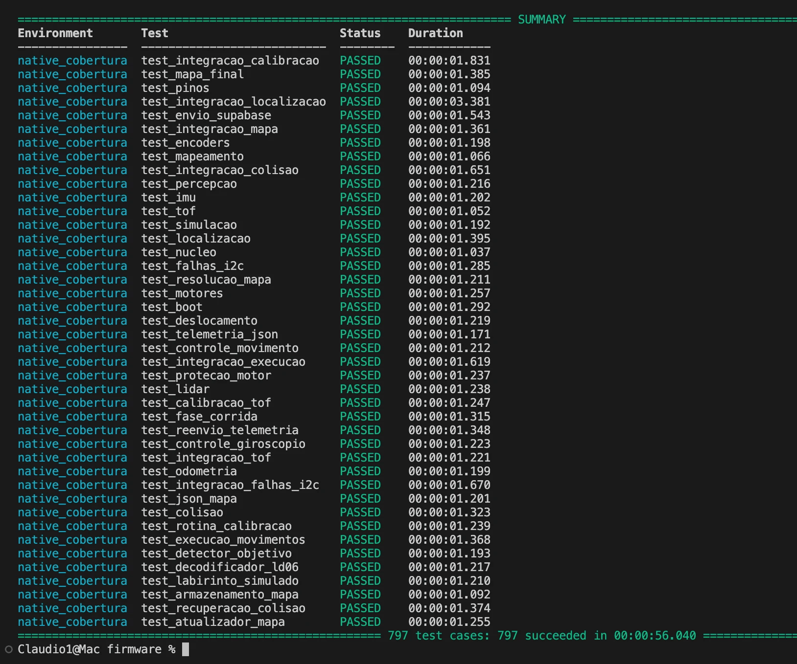
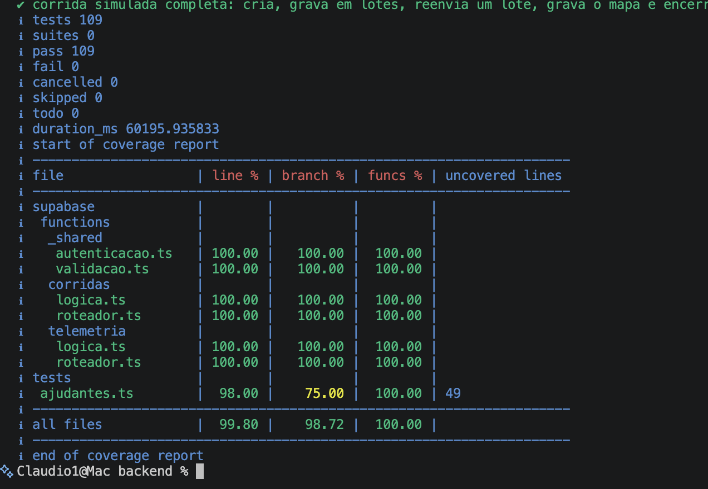
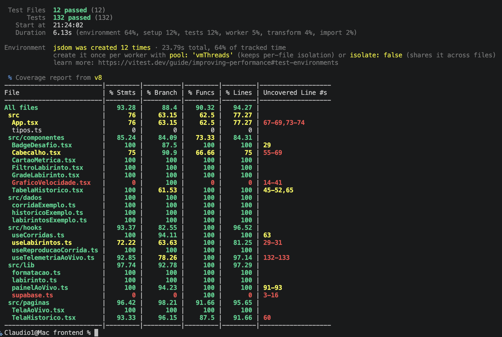

# Testes de Software
## Testes de _software_

Este documento reúne a evidência dos testes de _software_ da ED1: resultado, cobertura de código-fonte e a ligação entre as histórias de usuário (HUs) e os testes. O registro caso a caso de cada tarefa, por sprint, está em [Registro de execução dos testes](software-registro.md).

### Escopo da ED1

A ED1 avalia testes isolados de _software_, com simuladores. Os testes automatizados cobrem as três camadas sem hardware real:

- **Firmware** (C++ no ESP32-C3): PlatformIO e Unity, rodando no computador, com sensores, motores, Wi-Fi e labirinto simulados.
- **Backend** (Supabase): `node:test` sobre as Edge Functions e as funções SQL, com um PostgreSQL de verdade em WebAssembly (PGlite).
- **Frontend** (React): Vitest e Testing Library, com um cliente Supabase simulado.

**Teste unitário** é o de um módulo isolado, com dependências simuladas. **Teste de integração** encadeia módulos reais: as suítes `test_integracao_*` do firmware (o robô simulado anda num labirinto e o firmware só vê o que veria na placa), a Edge Function com as funções SQL no PGlite e as telas e hooks com o Supabase simulado. O teste de sistema (E2E) não faz parte desta entrega, conforme definido com o professor, e fica para a ED2.

### Resultado da execução

Execução de 26/10/2026 sobre o commit `9612a3b` da `main`, por Cláudio Henrique, em macOS.

| Camada | Ferramentas | Comando (em `src/<camada>`) | Testes | Unitários | Integração | Resultado | Cobertura de linhas |
|---|---|---|:-:|:-:|:-:|:-:|:-:|
| Firmware | PlatformIO 6.2.0, Unity, gcovr 8.6 | `pio test -e native_cobertura` | 797 (42 suítes) | 746 | 51 | **797 aprovados, 0 falhas** | **98,2%**; ramos 84,8% |
| Backend | `node:test`, PGlite 0.5.10 | `npm run test:cobertura` | 109 (8 arquivos) | 52 | 57 | **109 aprovados, 0 falhas** | **99,80%**; ramos 98,72% |
| Frontend | Vitest 5.0.5, Testing Library, v8 | `npm run test:cobertura` | 132 (12 arquivos) | 85 | 47 | **132 aprovados, 0 falhas** | **94,27%**; ramos 88,40% |
| **Total** | | | **1 038** | **883** | **155** | **1 038 aprovados, 0 falhas** | todas acima de 80% |

O critério é de pelo menos 80% do código-fonte. No firmware e no backend o CI falha se a cobertura de linhas ficar abaixo disso. A medição inclui:

- **Firmware:** todo o `lib/` que roda no computador (4 727 linhas). Ficam de fora o `main.cpp` e os drivers de hardware (`lib/drivers_esp32`), que só compilam para a placa.
- **Backend:** lógica, roteador e autenticação das Edge Functions. O `index.ts` de cada função (`Deno.serve`) não roda no Node e é conferido pelo `deno check` do CI.
- **Frontend:** todo o `src/`, exceto os testes, `src/test/` e `main.tsx`.

| Outra verificação | Comando | Resultado |
|---|---|---|
| Compilação para a ESP32-C3 | `pio run -e esp32c3` | Sucesso. RAM 26,9% (88 292 de 327 680 bytes), Flash 74,0% (969 906 de 1 310 720 bytes) |
| Tipagem e _build_ do frontend | `npm run build` | Sucesso |
| Tipagem das Edge Functions | `deno check` (CI do backend) | Sucesso |

### Evidência da execução

O CI do GitHub executou as mesmas suítes no mesmo commit, todas com sucesso: [CI Firmware](https://github.com/fcte-pi1/2026_2_PI1_Grupo01_Hilmer/actions/runs/40250337687), [CI Backend](https://github.com/fcte-pi1/2026_2_PI1_Grupo01_Hilmer/actions/runs/40250337647) e [CI Frontend](https://github.com/fcte-pi1/2026_2_PI1_Grupo01_Hilmer/actions/runs/40250337633).

#### Saída dos comandos

As figuras 1 a 3 mostram a saída dos comandos no commit `9612a3b`, com as linhas intermediárias omitidas onde há `[...]`.

<figure markdown>

{ width="800" }

<figcaption>

Figura 1. Firmware: 797 testes aprovados em 42 suítes e cobertura de 98% das linhas e 84% dos ramos de lib/, com o mínimo de 80% atendido (código de saída 0).

</figcaption>

</figure>

<figure markdown>

{ width="800" }

<figcaption>

Figura 2. Backend: 109 testes aprovados e cobertura de 99,80% das linhas.

</figcaption>

</figure>

<figure markdown>

{ width="800" }

<figcaption>

Figura 3. Frontend: 132 testes aprovados em 12 arquivos e cobertura de 94,27% das linhas.

</figcaption>

</figure>

#### Execução local

As figuras 4 a 6 são capturas do terminal do notebook de Cláudio Henrique, com os mesmos comandos e os mesmos resultados.

<figure markdown>

{ width="800" }

<figcaption>

Figura 4. Firmware, pio test -e native_cobertura: resumo das 42 suítes, todas PASSED, e 797 casos de teste aprovados.

</figcaption>

</figure>

<figure markdown>

{ width="800" }

<figcaption>

Figura 5. Backend, npm run test:cobertura: 109 testes aprovados, 0 falhas, e cobertura de 99,80% das linhas.

</figcaption>

</figure>

<figure markdown>

{ width="800" }

<figcaption>

Figura 6. Frontend, npm run test:cobertura: 12 arquivos e 132 testes aprovados, e cobertura de 94,27% das linhas.

</figcaption>

</figure>

### Módulos de teste

Os testes estão agrupados em 13 módulos por assunto. Cada suíte pertence a um só módulo, e a coluna de HUs mostra quais histórias o módulo verifica. Os nomes das suítes levam ao código de teste na `main` e as HUs levam às issues de histórias de usuário. As suítes do firmware ficam em `src/firmware/test/`, as do backend em `src/backend/` e as do frontend ao lado do código em `src/frontend/src/`.

| Módulo | Assunto | Camada | Suítes | Unit. | Integ. | Total | HUs |
|:-:|---|---|---|:-:|:-:|:-:|---|
| M1 | Núcleo e simulação | Firmware | [`test_nucleo`](https://github.com/fcte-pi1/2026_2_PI1_Grupo01_Hilmer/tree/main/src/firmware/test/test_nucleo), [`test_simulacao`](https://github.com/fcte-pi1/2026_2_PI1_Grupo01_Hilmer/tree/main/src/firmware/test/test_simulacao), [`test_labirinto_simulado`](https://github.com/fcte-pi1/2026_2_PI1_Grupo01_Hilmer/tree/main/src/firmware/test/test_labirinto_simulado) | 34 | 0 | 34 | [HU-02](https://github.com/fcte-pi1/2026_2_PI1_Grupo01_Hilmer/issues/36), [HU-03](https://github.com/fcte-pi1/2026_2_PI1_Grupo01_Hilmer/issues/37) |
| M2 | Percepção e sensores de distância | Firmware | [`test_percepcao`](https://github.com/fcte-pi1/2026_2_PI1_Grupo01_Hilmer/tree/main/src/firmware/test/test_percepcao), [`test_tof`](https://github.com/fcte-pi1/2026_2_PI1_Grupo01_Hilmer/tree/main/src/firmware/test/test_tof), [`test_lidar`](https://github.com/fcte-pi1/2026_2_PI1_Grupo01_Hilmer/tree/main/src/firmware/test/test_lidar), [`test_decodificador_ld06`](https://github.com/fcte-pi1/2026_2_PI1_Grupo01_Hilmer/tree/main/src/firmware/test/test_decodificador_ld06), [`test_pinos`](https://github.com/fcte-pi1/2026_2_PI1_Grupo01_Hilmer/tree/main/src/firmware/test/test_pinos), [`test_integracao_tof`](https://github.com/fcte-pi1/2026_2_PI1_Grupo01_Hilmer/tree/main/src/firmware/test/test_integracao_tof) | 72 | 8 | 80 | [HU-02](https://github.com/fcte-pi1/2026_2_PI1_Grupo01_Hilmer/issues/36) |
| M3 | Mapa: estrutura, atualização, JSON e armazenamento | Firmware | [`test_mapeamento`](https://github.com/fcte-pi1/2026_2_PI1_Grupo01_Hilmer/tree/main/src/firmware/test/test_mapeamento), [`test_atualizador_mapa`](https://github.com/fcte-pi1/2026_2_PI1_Grupo01_Hilmer/tree/main/src/firmware/test/test_atualizador_mapa), [`test_json_mapa`](https://github.com/fcte-pi1/2026_2_PI1_Grupo01_Hilmer/tree/main/src/firmware/test/test_json_mapa), [`test_armazenamento_mapa`](https://github.com/fcte-pi1/2026_2_PI1_Grupo01_Hilmer/tree/main/src/firmware/test/test_armazenamento_mapa), [`test_mapa_final`](https://github.com/fcte-pi1/2026_2_PI1_Grupo01_Hilmer/tree/main/src/firmware/test/test_mapa_final), [`test_integracao_mapa`](https://github.com/fcte-pi1/2026_2_PI1_Grupo01_Hilmer/tree/main/src/firmware/test/test_integracao_mapa) | 67 | 5 | 72 | [HU-03](https://github.com/fcte-pi1/2026_2_PI1_Grupo01_Hilmer/issues/37), [HU-04](https://github.com/fcte-pi1/2026_2_PI1_Grupo01_Hilmer/issues/38) |
| M4 | Navegação, execução dos movimentos e motores | Firmware | [`test_resolucao_mapa`](https://github.com/fcte-pi1/2026_2_PI1_Grupo01_Hilmer/tree/main/src/firmware/test/test_resolucao_mapa), [`test_execucao_movimentos`](https://github.com/fcte-pi1/2026_2_PI1_Grupo01_Hilmer/tree/main/src/firmware/test/test_execucao_movimentos), [`test_motores`](https://github.com/fcte-pi1/2026_2_PI1_Grupo01_Hilmer/tree/main/src/firmware/test/test_motores), [`test_protecao_motor`](https://github.com/fcte-pi1/2026_2_PI1_Grupo01_Hilmer/tree/main/src/firmware/test/test_protecao_motor), [`test_integracao_execucao`](https://github.com/fcte-pi1/2026_2_PI1_Grupo01_Hilmer/tree/main/src/firmware/test/test_integracao_execucao) | 100 | 11 | 111 | [HU-01](https://github.com/fcte-pi1/2026_2_PI1_Grupo01_Hilmer/issues/42) |
| M5 | Odometria, IMU e localização | Firmware | [`test_imu`](https://github.com/fcte-pi1/2026_2_PI1_Grupo01_Hilmer/tree/main/src/firmware/test/test_imu), [`test_encoders`](https://github.com/fcte-pi1/2026_2_PI1_Grupo01_Hilmer/tree/main/src/firmware/test/test_encoders), [`test_odometria`](https://github.com/fcte-pi1/2026_2_PI1_Grupo01_Hilmer/tree/main/src/firmware/test/test_odometria), [`test_localizacao`](https://github.com/fcte-pi1/2026_2_PI1_Grupo01_Hilmer/tree/main/src/firmware/test/test_localizacao), [`test_deslocamento`](https://github.com/fcte-pi1/2026_2_PI1_Grupo01_Hilmer/tree/main/src/firmware/test/test_deslocamento), [`test_integracao_localizacao`](https://github.com/fcte-pi1/2026_2_PI1_Grupo01_Hilmer/tree/main/src/firmware/test/test_integracao_localizacao) | 155 | 7 | 162 | [HU-05](https://github.com/fcte-pi1/2026_2_PI1_Grupo01_Hilmer/issues/41) |
| M6 | Rumo, centralização e colisão | Firmware | [`test_controle_giroscopio`](https://github.com/fcte-pi1/2026_2_PI1_Grupo01_Hilmer/tree/main/src/firmware/test/test_controle_giroscopio), [`test_controle_movimento`](https://github.com/fcte-pi1/2026_2_PI1_Grupo01_Hilmer/tree/main/src/firmware/test/test_controle_movimento), [`test_colisao`](https://github.com/fcte-pi1/2026_2_PI1_Grupo01_Hilmer/tree/main/src/firmware/test/test_colisao), [`test_recuperacao_colisao`](https://github.com/fcte-pi1/2026_2_PI1_Grupo01_Hilmer/tree/main/src/firmware/test/test_recuperacao_colisao), [`test_integracao_colisao`](https://github.com/fcte-pi1/2026_2_PI1_Grupo01_Hilmer/tree/main/src/firmware/test/test_integracao_colisao) | 121 | 5 | 126 | [HU-11](https://github.com/fcte-pi1/2026_2_PI1_Grupo01_Hilmer/issues/181), [HU-12](https://github.com/fcte-pi1/2026_2_PI1_Grupo01_Hilmer/issues/182), [HU-17](https://github.com/fcte-pi1/2026_2_PI1_Grupo01_Hilmer/issues/44) |
| M7 | Objetivo e fase da corrida | Firmware | [`test_detector_objetivo`](https://github.com/fcte-pi1/2026_2_PI1_Grupo01_Hilmer/tree/main/src/firmware/test/test_detector_objetivo), [`test_fase_corrida`](https://github.com/fcte-pi1/2026_2_PI1_Grupo01_Hilmer/tree/main/src/firmware/test/test_fase_corrida) | 37 | 0 | 37 | [HU-07](https://github.com/fcte-pi1/2026_2_PI1_Grupo01_Hilmer/issues/43), [HU-14](https://github.com/fcte-pi1/2026_2_PI1_Grupo01_Hilmer/issues/48) |
| M8 | Boot, calibração e falhas do I²C | Firmware | [`test_boot`](https://github.com/fcte-pi1/2026_2_PI1_Grupo01_Hilmer/tree/main/src/firmware/test/test_boot), [`test_calibracao_tof`](https://github.com/fcte-pi1/2026_2_PI1_Grupo01_Hilmer/tree/main/src/firmware/test/test_calibracao_tof), [`test_rotina_calibracao`](https://github.com/fcte-pi1/2026_2_PI1_Grupo01_Hilmer/tree/main/src/firmware/test/test_rotina_calibracao), [`test_falhas_i2c`](https://github.com/fcte-pi1/2026_2_PI1_Grupo01_Hilmer/tree/main/src/firmware/test/test_falhas_i2c), [`test_integracao_calibracao`](https://github.com/fcte-pi1/2026_2_PI1_Grupo01_Hilmer/tree/main/src/firmware/test/test_integracao_calibracao), [`test_integracao_falhas_i2c`](https://github.com/fcte-pi1/2026_2_PI1_Grupo01_Hilmer/tree/main/src/firmware/test/test_integracao_falhas_i2c) | 88 | 15 | 103 | [HU-13](https://github.com/fcte-pi1/2026_2_PI1_Grupo01_Hilmer/issues/51) |
| M9 | Telemetria, buffer e reenvio (robô) | Firmware | [`test_telemetria_json`](https://github.com/fcte-pi1/2026_2_PI1_Grupo01_Hilmer/tree/main/src/firmware/test/test_telemetria_json), [`test_envio_supabase`](https://github.com/fcte-pi1/2026_2_PI1_Grupo01_Hilmer/tree/main/src/firmware/test/test_envio_supabase), [`test_reenvio_telemetria`](https://github.com/fcte-pi1/2026_2_PI1_Grupo01_Hilmer/tree/main/src/firmware/test/test_reenvio_telemetria) | 72 | 0 | 72 | [HU-08](https://github.com/fcte-pi1/2026_2_PI1_Grupo01_Hilmer/issues/45), [HU-16](https://github.com/fcte-pi1/2026_2_PI1_Grupo01_Hilmer/issues/46) |
| M10 | Edge Function de corridas e banco | Backend | [`autenticacao`](https://github.com/fcte-pi1/2026_2_PI1_Grupo01_Hilmer/blob/main/src/backend/supabase/functions/_shared/autenticacao.test.ts), [`corridas/logica`](https://github.com/fcte-pi1/2026_2_PI1_Grupo01_Hilmer/blob/main/src/backend/supabase/functions/corridas/logica.test.ts), [`corridas/roteador`](https://github.com/fcte-pi1/2026_2_PI1_Grupo01_Hilmer/blob/main/src/backend/supabase/functions/corridas/roteador.test.ts), [`tests/banco`](https://github.com/fcte-pi1/2026_2_PI1_Grupo01_Hilmer/blob/main/src/backend/tests/banco.test.ts) | 37 | 13 | 50 | [HU-09](https://github.com/fcte-pi1/2026_2_PI1_Grupo01_Hilmer/issues/47), [HU-15](https://github.com/fcte-pi1/2026_2_PI1_Grupo01_Hilmer/issues/225) |
| M11 | Edge Function de telemetria, mapa final e consolidação | Backend | [`telemetria/logica`](https://github.com/fcte-pi1/2026_2_PI1_Grupo01_Hilmer/blob/main/src/backend/supabase/functions/telemetria/logica.test.ts), [`telemetria/roteador`](https://github.com/fcte-pi1/2026_2_PI1_Grupo01_Hilmer/blob/main/src/backend/supabase/functions/telemetria/roteador.test.ts), [`tests/telemetria`](https://github.com/fcte-pi1/2026_2_PI1_Grupo01_Hilmer/blob/main/src/backend/tests/telemetria.test.ts), [`tests/funcoes`](https://github.com/fcte-pi1/2026_2_PI1_Grupo01_Hilmer/blob/main/src/backend/tests/funcoes.test.ts) | 15 | 44 | 59 | [HU-04](https://github.com/fcte-pi1/2026_2_PI1_Grupo01_Hilmer/issues/38), [HU-08](https://github.com/fcte-pi1/2026_2_PI1_Grupo01_Hilmer/issues/45), [HU-09](https://github.com/fcte-pi1/2026_2_PI1_Grupo01_Hilmer/issues/47), [HU-16](https://github.com/fcte-pi1/2026_2_PI1_Grupo01_Hilmer/issues/46) |
| M12 | Dashboard ao vivo | Frontend | [`painelAoVivo`](https://github.com/fcte-pi1/2026_2_PI1_Grupo01_Hilmer/blob/main/src/frontend/src/lib/painelAoVivo.test.ts), [`useReproducaoCorrida`](https://github.com/fcte-pi1/2026_2_PI1_Grupo01_Hilmer/blob/main/src/frontend/src/hooks/useReproducaoCorrida.test.ts), [`formatacao`](https://github.com/fcte-pi1/2026_2_PI1_Grupo01_Hilmer/blob/main/src/frontend/src/lib/formatacao.test.ts), [`labirinto`](https://github.com/fcte-pi1/2026_2_PI1_Grupo01_Hilmer/blob/main/src/frontend/src/lib/labirinto.test.ts), [`GradeLabirinto`](https://github.com/fcte-pi1/2026_2_PI1_Grupo01_Hilmer/blob/main/src/frontend/src/componentes/GradeLabirinto.test.tsx), [`supabaseSimulado`](https://github.com/fcte-pi1/2026_2_PI1_Grupo01_Hilmer/blob/main/src/frontend/src/test/supabaseSimulado.test.ts), [`App`](https://github.com/fcte-pi1/2026_2_PI1_Grupo01_Hilmer/blob/main/src/frontend/src/App.test.tsx), [`useTelemetriaAoVivo`](https://github.com/fcte-pi1/2026_2_PI1_Grupo01_Hilmer/blob/main/src/frontend/src/hooks/useTelemetriaAoVivo.test.ts), [`TelaAoVivo`](https://github.com/fcte-pi1/2026_2_PI1_Grupo01_Hilmer/blob/main/src/frontend/src/paginas/TelaAoVivo.test.tsx) | 79 | 32 | 111 | [HU-06](https://github.com/fcte-pi1/2026_2_PI1_Grupo01_Hilmer/issues/227), [HU-07](https://github.com/fcte-pi1/2026_2_PI1_Grupo01_Hilmer/issues/43), [HU-08](https://github.com/fcte-pi1/2026_2_PI1_Grupo01_Hilmer/issues/45), [HU-14](https://github.com/fcte-pi1/2026_2_PI1_Grupo01_Hilmer/issues/48) |
| M13 | Histórico de corridas | Frontend | [`FiltroLabirinto`](https://github.com/fcte-pi1/2026_2_PI1_Grupo01_Hilmer/blob/main/src/frontend/src/componentes/FiltroLabirinto.test.tsx), [`useCorridas`](https://github.com/fcte-pi1/2026_2_PI1_Grupo01_Hilmer/blob/main/src/frontend/src/hooks/useCorridas.test.ts), [`TelaHistorico`](https://github.com/fcte-pi1/2026_2_PI1_Grupo01_Hilmer/blob/main/src/frontend/src/paginas/TelaHistorico.test.tsx) | 6 | 15 | 21 | [HU-10](https://github.com/fcte-pi1/2026_2_PI1_Grupo01_Hilmer/issues/226), [HU-15](https://github.com/fcte-pi1/2026_2_PI1_Grupo01_Hilmer/issues/225) |
| | **Total** | | | **883** | **155** | **1 038** | |

### Histórias de usuário e protótipos

As HUs e os critérios de aceitação estão em [Requisitos funcionais](../04-projeto-conceitual/software.md#requisitos-funcionais), e os _frames_ de alta fidelidade, no [Protótipo Funcional Navegável](../04-projeto-conceitual/software.md#prototipo-funcional-do-software-navegavel). A interface em React implementa as telas de aguardando largada, corrida em andamento, desafio concluído e histórico, com prints no [registro por sprint](software-registro.md). A tabela liga cada HU (issue com a etiqueta `HU`) ao detalhamento no projeto de software, ao _frame_ do protótipo e aos módulos de teste que a verificam.

| HU | Título | Protótipo | Módulos de teste |
|:-:|---|---|---|
| [HU-01](https://github.com/fcte-pi1/2026_2_PI1_Grupo01_Hilmer/issues/42) | [Percorrer o labirinto de forma autônoma até o objetivo](../04-projeto-conceitual/software.md#hu-01) | [`02_Running`](https://www.figma.com/design/90hJ4r7jT0yDMtCwJ0yzy9/Prot%C3%B3tipo-Telemetria-Web?node-id=13-211) | M4 |
| [HU-02](https://github.com/fcte-pi1/2026_2_PI1_Grupo01_Hilmer/issues/36) | [Reconhecer paredes e piso em cada célula](../04-projeto-conceitual/software.md#hu-02) | [`02_Running`](https://www.figma.com/design/90hJ4r7jT0yDMtCwJ0yzy9/Prot%C3%B3tipo-Telemetria-Web?node-id=13-211) | M1, M2 |
| [HU-03](https://github.com/fcte-pi1/2026_2_PI1_Grupo01_Hilmer/issues/37) | [Construir o mapa quadriculado durante o percurso](../04-projeto-conceitual/software.md#hu-03) | [`02_Running`](https://www.figma.com/design/90hJ4r7jT0yDMtCwJ0yzy9/Prot%C3%B3tipo-Telemetria-Web?node-id=13-211) | M1, M3 |
| [HU-04](https://github.com/fcte-pi1/2026_2_PI1_Grupo01_Hilmer/issues/38) | [Armazenar o mapa do labirinto percorrido](../04-projeto-conceitual/software.md#hu-04) | [`03_Completed`](https://www.figma.com/design/90hJ4r7jT0yDMtCwJ0yzy9/Prot%C3%B3tipo-Telemetria-Web?node-id=14-337) | M3, M11 |
| [HU-05](https://github.com/fcte-pi1/2026_2_PI1_Grupo01_Hilmer/issues/41) | [Estimar a posição do robô por odometria](../04-projeto-conceitual/software.md#hu-05) | [`02_Running`](https://www.figma.com/design/90hJ4r7jT0yDMtCwJ0yzy9/Prot%C3%B3tipo-Telemetria-Web?node-id=13-211) | M5 |
| [HU-06](https://github.com/fcte-pi1/2026_2_PI1_Grupo01_Hilmer/issues/227) | [Visualizar o percurso do robô sobre o mapa](../04-projeto-conceitual/software.md#hu-06) | [`01_Idle`](https://www.figma.com/design/90hJ4r7jT0yDMtCwJ0yzy9/Prot%C3%B3tipo-Telemetria-Web?node-id=7-121), [`02_Running`](https://www.figma.com/design/90hJ4r7jT0yDMtCwJ0yzy9/Prot%C3%B3tipo-Telemetria-Web?node-id=13-211), [`03_Completed`](https://www.figma.com/design/90hJ4r7jT0yDMtCwJ0yzy9/Prot%C3%B3tipo-Telemetria-Web?node-id=14-337) | M12 |
| [HU-07](https://github.com/fcte-pi1/2026_2_PI1_Grupo01_Hilmer/issues/43) | [Detectar e sinalizar a chegada à célula objetivo](../04-projeto-conceitual/software.md#hu-07) | [`03_Completed`](https://www.figma.com/design/90hJ4r7jT0yDMtCwJ0yzy9/Prot%C3%B3tipo-Telemetria-Web?node-id=14-337) | M7, M12 |
| [HU-08](https://github.com/fcte-pi1/2026_2_PI1_Grupo01_Hilmer/issues/45) | [Acompanhar a telemetria do robô em tempo real](../04-projeto-conceitual/software.md#hu-08) | [`02_Running`](https://www.figma.com/design/90hJ4r7jT0yDMtCwJ0yzy9/Prot%C3%B3tipo-Telemetria-Web?node-id=13-211) | M9, M11, M12 |
| [HU-09](https://github.com/fcte-pi1/2026_2_PI1_Grupo01_Hilmer/issues/47) | [Persistir a telemetria das corridas no banco de dados](../04-projeto-conceitual/software.md#hu-09) | [`03_Completed`](https://www.figma.com/design/90hJ4r7jT0yDMtCwJ0yzy9/Prot%C3%B3tipo-Telemetria-Web?node-id=14-337), [`04_History_View`](https://www.figma.com/design/90hJ4r7jT0yDMtCwJ0yzy9/Prot%C3%B3tipo-Telemetria-Web?node-id=21-411) | M10, M11 |
| [HU-10](https://github.com/fcte-pi1/2026_2_PI1_Grupo01_Hilmer/issues/226) | [Consultar o histórico de todas as corridas](../04-projeto-conceitual/software.md#hu-10) | [`04_History_View`](https://www.figma.com/design/90hJ4r7jT0yDMtCwJ0yzy9/Prot%C3%B3tipo-Telemetria-Web?node-id=21-411) | M13 |
| [HU-11](https://github.com/fcte-pi1/2026_2_PI1_Grupo01_Hilmer/issues/181) | [Compensar irregularidades do solo](../04-projeto-conceitual/software.md#hu-11) | Sem tela | M6 |
| [HU-12](https://github.com/fcte-pi1/2026_2_PI1_Grupo01_Hilmer/issues/182) | [Evitar colisões com as paredes](../04-projeto-conceitual/software.md#hu-12) | Sem tela | M6 |
| [HU-13](https://github.com/fcte-pi1/2026_2_PI1_Grupo01_Hilmer/issues/51) | [Autocalibrar os sensores antes da largada](../04-projeto-conceitual/software.md#hu-13) | [`01_Idle`](https://www.figma.com/design/90hJ4r7jT0yDMtCwJ0yzy9/Prot%C3%B3tipo-Telemetria-Web?node-id=7-121) | M8 |
| [HU-14](https://github.com/fcte-pi1/2026_2_PI1_Grupo01_Hilmer/issues/48) | [Supervisionar a corrida pelo dashboard web](../04-projeto-conceitual/software.md#hu-14) | [`01_Idle`](https://www.figma.com/design/90hJ4r7jT0yDMtCwJ0yzy9/Prot%C3%B3tipo-Telemetria-Web?node-id=7-121), [`02_Running`](https://www.figma.com/design/90hJ4r7jT0yDMtCwJ0yzy9/Prot%C3%B3tipo-Telemetria-Web?node-id=13-211), [`03_Completed`](https://www.figma.com/design/90hJ4r7jT0yDMtCwJ0yzy9/Prot%C3%B3tipo-Telemetria-Web?node-id=14-337) | M7, M12 |
| [HU-15](https://github.com/fcte-pi1/2026_2_PI1_Grupo01_Hilmer/issues/225) | [Registrar e filtrar corridas por tipo de labirinto](../04-projeto-conceitual/software.md#hu-15) | [`04_History_View_M1`](https://www.figma.com/design/90hJ4r7jT0yDMtCwJ0yzy9/Prot%C3%B3tipo-Telemetria-Web?node-id=21-573), [`04_History_View_M2`](https://www.figma.com/design/90hJ4r7jT0yDMtCwJ0yzy9/Prot%C3%B3tipo-Telemetria-Web?node-id=21-655), [`04_History_View_M3`](https://www.figma.com/design/90hJ4r7jT0yDMtCwJ0yzy9/Prot%C3%B3tipo-Telemetria-Web?node-id=21-737) | M10, M13 |
| [HU-16](https://github.com/fcte-pi1/2026_2_PI1_Grupo01_Hilmer/issues/46) | [Não perder telemetria em quedas de conexão](../04-projeto-conceitual/software.md#hu-16) | [`02_Running`](https://www.figma.com/design/90hJ4r7jT0yDMtCwJ0yzy9/Prot%C3%B3tipo-Telemetria-Web?node-id=13-211) | M9, M11 |
| [HU-17](https://github.com/fcte-pi1/2026_2_PI1_Grupo01_Hilmer/issues/44) | [Recuperar-se de colisões sem perder o mapa](../04-projeto-conceitual/software.md#hu-17) | Sem tela | M6 |

O [roteiro de testes funcionais](../04-projeto-conceitual/software.md#roteiro-de-testes-funcionais) guia os testes de sistema da próxima entrega.

### Escopo da próxima entrega (ED2)

| Issue | Teste | Por que não está na ED1 |
|---|---|---|
| [#175](https://github.com/fcte-pi1/2026_2_PI1_Grupo01_Hilmer/issues/175) | Teste de bancada dos sensores VL53L0X | Exige os sensores reais montados. |
| [#185](https://github.com/fcte-pi1/2026_2_PI1_Grupo01_Hilmer/issues/185) | Teste de corrida completa no labirinto | Exige o robô montado e o labirinto real. |
| [#232](https://github.com/fcte-pi1/2026_2_PI1_Grupo01_Hilmer/issues/232) | Teste ponta a ponta: corrida do ESP32 ao dashboard | É teste de sistema, deixado para a próxima entrega. |
| [#237](https://github.com/fcte-pi1/2026_2_PI1_Grupo01_Hilmer/issues/237) | Medição da latência ponta a ponta | Mede o RNF-05 (até 2 s) com o robô e o dashboard reais. |
| - | Testes de sistema funcionais (E2E) pela interface gráfica | Seguem o roteiro de testes funcionais. |

### Como reproduzir

Com PlatformIO 6.2.0, gcovr 8.6 e Node 22, a partir da raiz do repositório:

```bash
cd src/firmware && pio test -e native_cobertura
cd ../backend && npm ci && npm run test:cobertura
cd ../frontend && npm ci && npm run test:cobertura
```
