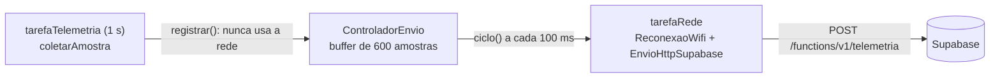

# Firmware

Firmware do micromouse para o ESP32-C3 (Arduino Core, C++17), organizado nas camadas *sense-think-act* definidas na [arquitetura de software](../../docs/04-projeto-conceitual/software.md). O projeto usa [PlatformIO](https://platformio.org/).

A documentação detalhada do código (camadas, tipos, pinagem, interface do LiDAR, tarefas e testes) está em [Firmware: implementação](../../docs/04-projeto-conceitual/firmware.md). Os arquivos `.h` têm comentários de documentação no formato Doxygen (`///`).

## Estrutura

```
src/firmware/
├── platformio.ini     # ambientes esp32c3 (placa), native (testes no computador), native_cobertura (testes com cobertura, usado no CI), bancada_geral, bancada_tof e bancada_deslocamento (firmwares de bancada)
├── src/main.cpp       # ponto de entrada: cria as tarefas FreeRTOS (navegação e telemetria)
├── src/bancada/       # programas de bancada, fora do firmware do robô
├── lib/               # uma biblioteca por camada
├── scripts/           # ferramentas de bancada no computador (Python)
└── test/              # testes unitários e de integração (Unity)
```

| Pasta em `lib/` | Camada | O que entra |
|---|---|---|
| `nucleo` | Base | Tipos compartilhados (`Direcao`, `Lado`, `EstadoParede`, `PosicaoCelula`, `Pose`, `DistanciasLaterais`), constantes e pinagem |
| `hal` | Interfaces de hardware | Interfaces abstratas (`ISensorDistancia`, `IEncoder`, `IMotores`, `IBarramentoI2c` e `IImu`) |
| `percepcao` | Percepção | Classificação `parede`/`livre` para os 3 sensores ToF (VL53L0X) com limiares por lado, filtro digital e saturação defensiva (#379) |
| `calibracao` | Calibração | Desvio de cada VL53L0X contra distância conhecida (`CalibradorTof`), calibração do giroscópio (`CalibradorGiro`) e rotina unificada de calibração dentro de 1 s (#240, HU-13 / RF-13 / RNF-08) |
| `inicializacao` | Boot | Autoteste do boot (`AutotesteBoot`): varredura do I²C, conferência dos 4 dispositivos e relatório (`RelatorioBoot`), com os parâmetros em `ConfiguracaoBoot.h` |
| `falhas` | Robustez | Falha do I²C durante a corrida (#241): tentativas, reinício e recuperação dos 4 dispositivos (`SupervisorI2c`), leitura de cada ToF pelas amostras (`VigiaTof`) e motores parados enquanto durar a falha (`TravaFalhaI2c`), com os parâmetros em `ConfiguracaoFalhasI2c.h` |
| `tof` | Sensoriamento | Regra de validade das leituras dos 3 VL53L0X (`CombinadorTof`) e seus parâmetros provisórios (`ConfiguracaoTof.h`), sem Arduino |
| `imu` | Sensoriamento | Giroscópio: conversão da leitura do MPU6050, calibração do viés, ângulo de giro (`IntegradorGiro`) e o ciclo da tarefa da IMU (`AcompanhadorGiro`) |
| `deslocamento` | Sensoriamento | Deslocamento sem encoder: estimativa pela potência dos motores (`EncoderEstimado`, `MotoresComEstimativa`) e correção pelos ToF; todos os ajustes em `ConfiguracaoDeslocamento.h` |
| `encoders` | Sensoriamento | Decodificação em quadratura (x4) dos canais A e B, conversão de pulsos em milímetros (calibrável) e distância percorrida por cada roda |
| `lidar` | Drivers / Hardware | Driver de leitura do sensor LiDAR 360° via UART (decodificador LD06) e agregação de leituras por setores |
| `mapeamento` | Mapeamento | Mapa do labirinto (4 paredes por célula) e armazenamento em memória |
| `navegacao` | Navegação | Localização (`Odometria`: pose pela odometria diferencial dos encoders), decisão de movimento (`Navegacao`), detecção do objetivo (`DetectorObjetivo`) e as fases do robô na telemetria (`FaseCorrida`, #242) |
| `atuacao` | Atuação | Controle dos motores, correção de trajetória e rumo pelo giroscópio, giros de 90° e 180° em malha fechada (`ControleGiro`) e trava dos motores (`MotoresComTrava`) (#190, #191) |
| `comunicacao` | Comunicação | Pacotes de telemetria (`TelemetriaJson`), serialização JSON do mapa (`MapaJson`) e *buffer* de reenvio |
| `simulacao` | Falsos para teste | `SensorDistanciaSimulado`, um `ISensorDistancia` que devolve as leituras configuradas pelo teste, `LabirintoSimulado`, o labirinto de referência que alimenta o `SensorDistanciaSimulado`, `TofSimulado`, os 3 VL53L0X no labirinto, com amostras brutas pelo `CombinadorTof` real, `EncoderSimulado`, um `IEncoder` com a contagem definida pelo teste, `MotoresSimulados`, um `IMotores` que guarda o último comando, `BarramentoI2cSimulado`, um `IBarramentoI2c` com os dispositivos escolhidos pelo teste, e `ImuSimulado`, um `IImu` com taxa, viés, ruído e falha definidos pelo teste, sem hardware |
| `drivers_esp32` | Implementações do hardware | Drivers que dependem do Arduino (3 VL53L0X e varredura pelo I²C, MPU6050, barramento I²C com mutex, encoders, DRV8833, WiFi) |

## Regras de dependência

- As camadas de lógica (`nucleo`, `percepcao`, `calibracao`, `mapeamento`, `navegacao`, `comunicacao`, `simulacao`) **não incluem `Arduino.h`**. Assim elas compilam e são testadas no computador, sem a placa.
- O acesso ao hardware passa pelas interfaces de `hal`. Os drivers reais ficam em `drivers_esp32`, e `src/main.cpp` liga cada driver à sua interface.
- Para testar a lógica sem sensor, use o `SensorDistanciaSimulado` (`lib/simulacao`): `definirLeituraFixa` repete uma leitura, `enfileirarLeitura` entrega leituras em sequência, `simularFalha(true)` faz o sensor parar de responder e, com um `LabirintoSimulado`, `posicionar` faz a leitura vir da posição do robô (veja [Labirinto simulado](#labirinto-simulado)).
- Evite alocação dinâmica na lógica: o maior labirinto tem 12×4 células, então estruturas de tamanho fixo (`MAX_LINHAS_LABIRINTO` × `MAX_COLUNAS_LABIRINTO`) bastam.

## Mapa do labirinto

O `Mapa` (`lib/mapeamento`) guarda o estado das quatro paredes de cada célula. O tamanho vem do enum `DimensaoMapa` (`Labirinto4x4`, `Labirinto8x4` e `Labirinto12x4`), escrito como colunas × linhas: `Labirinto12x4` tem 12 colunas e 4 linhas. A matriz tem capacidade fixa para o maior labirinto, sem alocação dinâmica, e o objeto ocupa 195 bytes.

**Eixos:** a partida é a célula (0, 0), no canto inferior esquerdo; Norte aumenta a linha e Leste aumenta a coluna. `vizinha()` (`nucleo/Direcao.h`) calcula a célula ao lado de uma posição.

```cpp
Mapa mapa(DimensaoMapa::Labirinto12x4);
mapa.registrarParede({0, 0}, Direcao::Norte, EstadoParede::Parede);
mapa.obterParede({1, 0}, Direcao::Sul);  // Parede: a célula vizinha foi atualizada junto
```

| Regra | Comportamento |
|---|---|
| Paredes ainda não observadas | `Desconhecido` |
| Perímetro | Já nasce como `Parede` |
| Registro | Grava também o lado oposto da célula vizinha |
| Estado já conhecido | `registrarParede` não sobrescreve: retorna `JaConhecida` (mesmo valor) ou `Conflito` (valor diferente); a política para o conflito fica com quem chama |
| Entrada inválida | `Invalida`: célula fora do mapa ou estado `Desconhecido` |
| Comparação | `==` compara o tamanho e todas as paredes |

### Armazenamento do mapa

O `ArmazenamentoMapa` (`lib/mapeamento`) é o dono do único `Mapa` da corrida. Ele fica em `src/main.cpp`, como variável estática fora das tarefas, para que reiniciar o estado de navegação (por exemplo, após uma colisão) ou perder a conexão não apague o mapa (HU-04).

```cpp
armazenamentoMapa.iniciarCorrida(DimensaoMapa::Labirinto12x4);  // único jeito de zerar o mapa
Mapa& paraNavegacao = armazenamentoMapa.mapa();                  // lê e registra paredes
const Mapa& paraTelemetria = armazenamentoMapa.mapa();           // só lê (pelo acesso const)
```

O armazenamento não pode ser copiado, e o acesso `const` impede que a telemetria altere o mapa; as duas regras são conferidas em tempo de compilação. Medido no ESP32-C3, o objeto ocupa **196 bytes** de RAM estática (`.bss`): 195 do mapa e 1 do indicador de corrida.

## Labirinto simulado

O `LabirintoSimulado` (`lib/simulacao`) é um labirinto com todas as paredes conhecidas. Com ele, o `SensorDistanciaSimulado` devolve o que o sensor real veria na posição do robô, sem digitar leituras à mão. Serve para testar a classificação de paredes e a atualização do mapa num labirinto inteiro.

**Formato do texto.** O labirinto é escrito em ASCII: cada célula ocupa 4 colunas e 2 linhas de texto, `+` marca os cantos, `---` uma parede horizontal, `|` uma parede vertical e espaço é passagem livre. A primeira linha é a borda Norte e a partida (0, 0) é a célula do canto inferior esquerdo, como no `Mapa`. Cada parede aparece uma única vez, então as duas células vizinhas sempre concordam. Há um exemplo de cada tamanho (4×4, 8×4 e 12×4) em `test/test_labirinto_simulado/LabirintosExemplo.h`.

```cpp
LabirintoSimulado labirinto;
labirinto.carregar(exemplos::LABIRINTO_4X4);   // ResultadoCarga::Carregado
labirinto.temParede({0, 0}, Direcao::Leste);   // true

SensorDistanciaSimulado lidar;
lidar.usarLabirinto(labirinto);                // o labirinto precisa continuar vivo
lidar.posicionar({{0, 0}, Direcao::Norte});
DistanciasLaterais d;
lidar.lerDistanciasLaterais(d);                // d = {630, 90, 90} (frente, esquerda, direita, em mm)
```

**Distâncias.** O robô fica no centro da célula: a parede da própria célula está a 90 mm e cada célula livre no caminho soma 180 mm. Com o robô virado para Norte em (0, 0) do 4×4 há três células livres à frente, ou seja, 90 + 3 × 180 = 630 mm.

| Operação | O que faz |
|---|---|
| `carregar(texto)` | Lê o labirinto. Se o texto for inválido, devolve o motivo (`TamanhoInvalido`, `CaractereInvalido`, `ParedeIncompleta` ou `PerimetroAberto`) e mantém o labirinto anterior |
| `temParede(celula, direcao)` | `true` se há parede naquele lado; célula fora do labirinto conta como parede |
| `distancias(pose, saida)` | Distâncias à frente, à esquerda e à direita para a pose; `false` sem carga ou com a célula fora do labirinto |
| `SensorDistanciaSimulado::usarLabirinto` e `posicionar` | Liga o modo labirinto. A falha e a fila continuam com prioridade; sem `posicionar`, vale a leitura fixa; com a pose fora do labirinto, a leitura falha |

## Calibração dos Sensores e Giroscópio (`lib/calibracao`)

A camada `lib/calibracao` implementa a autocalibração dos sensores de distância VL53L0X e do giroscópio MPU6050 com o robô parado na célula de partida ([#240](https://github.com/fcte-pi1/2026_2_PI1_Grupo01_Hilmer/issues/240), HU-13 / RF-13 / RNF-08).

A rotina unificada atende a todos os critérios de pronto da issue:
1. **Viés do giroscópio:** calculado pela média aritmética de amostras com o robô parado; a rotina é recusada/abortada se o robô se mover durante a calibração (`CalibradorGiro`).
2. **Desvio dos ToF:** calculado e guardado por sensor (frente, esquerda e direita) contra referências conhecidas, aplicado diretamente nas leituras com saturação (`CalibradorTof`).
3. **Orçamento de 1 segundo (RNF-08):** duração medida e controlada pela `RotinaCalibracao`; caso a calibração ultrapasse 1000 ms, o estado é marcado como `TempoExcedido`.
4. **Testes no computador:** testável sem hardware usando `ImuSimulado` e `SensorDistanciaSimulado`/`TofSimulado`.

**Tudo ou nada.** A rotina só entrega resultado em `Sucesso`. Em qualquer outro estado, `desviosTof()` e `viesGiroDecimosDps()` devolvem zero e `corrigirTof()`/`corrigirGiro()` devolvem a leitura como veio: um ToF calibrado enquanto o giroscópio acusava movimento não é confiável.

### Na placa (`main.cpp`)

1. No `setup()`, depois do autoteste aprovado e da IMU iniciada, `calibrarSensores()` roda a `RotinaCalibracao` a cada 10 ms até ela terminar (no máximo 1 s) e escreve `{"status":"calibracao","estado":"sucesso","duracao_ms":...,"no_prazo":true}` no log. O robô precisa estar parado na célula de partida.
2. **Giroscópio:** com `Sucesso`, o viés vai para o `AcompanhadorGiro` (`definirVies`) e o ângulo já vale. Sem `Sucesso`, a tarefa da IMU calibra o viés sozinha nos primeiros 2 s (`AMOSTRAS_CALIBRACAO_GIRO` de `ConfiguracaoImu.h`), como antes.
3. **ToF:** a tarefa de navegação aplica `corrigirTof()` a toda leitura válida; a telemetria e o deslocamento já recebem a leitura corrigida.
4. **Referências da largada** (`REFERENCIAS_TOF_NA_LARGADA`): paredes dos dois lados a 54 mm da face do sensor e **frente sem referência** (`SEM_REFERENCIA_TOF_MM`), porque a frente da célula de partida é o caminho do labirinto. Um lado sem referência fica fora da calibração (desvio zero, variação ignorada). Para calibrar o ToF frontal, ponha uma parede a uma distância conhecida e use `iniciar(referencias)`.
5. **Desvio máximo** (`DESVIO_MAXIMO_TOF_MM`, 30 mm): um desvio maior é quase sempre referência errada (o robô não estava onde se esperava). A calibração é descartada (`DesvioForaDaFaixa`) e as leituras seguem sem correção.

```cpp
RotinaCalibracao rotina;  // ConfiguracaoRotinaCalibracao padrão
rotina.iniciar();

// Execução passo a passo ou via método executar:
EstadoRotinaCalibracao resultado = rotina.executar(sensorDistancia, imu);
if (resultado == EstadoRotinaCalibracao::Sucesso) {
  DistanciasLaterais distCorrigida = rotina.corrigirTof(distBruta);
  int16_t taxaCorrigida = rotina.corrigirGiro(taxaBruta);
  uint32_t duracaoMs = rotina.duracaoMedidaMs(); // <= 1000 ms (RNF-08)
}
```

| Componente | Responsabilidade | Comportamento em caso de movimento |
|---|---|---|
| `CalibradorTof` | Desvio por lado: `média arredondada − referência` (mm) | Se `maior − menor > variacaoMaximaMm`, estado `Recusada` e mantém desvios anteriores; desvio acima de `desvioMaximoMm`, `ForaDaFaixa` |
| `CalibradorGiro` | Viés do giroscópio Z: `média arredondada das amostras` (décimos de °/s) | Se `maior − menor > variacaoMaximaDecimosDps`, estado `Recusada` e mantém viés anterior |
| `RotinaCalibracao` | Orquestração simultânea dos sensores e controle da duração | Estado `RecusadaPorMovimento` se qualquer sensor acusar movimento; `TempoExcedido` se passar de 1 s; `DesvioForaDaFaixa` se a referência dos ToF estiver errada |

### Valores nominais e provisórios (`ConfiguracaoCalibracao.h`)

| Parâmetro | Constante | Valor | Nota |
|---|---|---|---|
| Orçamento total | `ORCAMENTO_CALIBRACAO_MS` | **1000 ms** | RNF-08; duração medida e verificada na rotina |
| Fatia prevista ToF | `ORCAMENTO_CALIBRACAO_TOF_MS` | **400 ms** | 10 amostras × ~33 ms ≈ 330 ms |
| Fatia prevista Giro | `ORCAMENTO_CALIBRACAO_GIRO_MS` | **500 ms** | 50 amostras × 10 ms = 500 ms |
| Amostras ToF | `AMOSTRAS_CALIBRACAO_TOF` | **10** | Período de ~33 ms do VL53L0X |
| Amostras Giro | `AMOSTRAS_CALIBRACAO_BOOT_GIRO` | **50** | Período de 10 ms da IMU |
| Variação máx. ToF | `VARIACAO_MAXIMA_CALIBRACAO_TOF_MM` | **8 mm** | Acima disso assume oscilação ou robô mexendo |
| Variação máx. Giro | `VARIACAO_MAXIMA_CALIBRACAO_GIRO_DECIMOS_DPS` | **50** (5 °/s) | Acima disso assume robô em movimento |
| Distância referência | `DISTANCIA_REFERENCIA_TOF_MM` | **54 mm** | Geometria nominal da célula com sensores recuados |
| Desvio máximo ToF | `DESVIO_MAXIMO_TOF_MM` | **30 mm** | Acima disso a referência provavelmente está errada |

Testes:
- `pio test -e native -f test_calibracao_tof` (testes unitários dos ToF)
- `pio test -e native -f test_rotina_calibracao` (testes do giroscópio, orquestração e RNF-08 com `ImuSimulado`)
- `pio test -e native -f test_integracao_calibracao` (integração: ToF desviado → calibração → mapa do 4×4 idêntico ao labirinto; viés do giroscópio → ângulo parado em zero e giro de 90°)

## Percepção ToF (VL53L0X) e classificação de paredes

A camada de percepção (`lib/percepcao`, `ClassificadorParede`) processa as leituras de distância dos 3 sensores Time-of-Flight VL53L0X (frontal, esquerdo e direito, I²C) introduzidos na Rev 2.0 em substituição ao LiDAR ([#379](https://github.com/fcte-pi1/2026_2_PI1_Grupo01_Hilmer/issues/379), HU-02).

```cpp
ClassificadorParede classificador; // Inicializa com ConfiguracaoPercepcao padrão
DistanciasLaterais leitura = {54, 250, 52}; // Leitura dos ToF em mm
ClassificadorParede::ResultadoClassificacao paredes = classificador.classificar(leitura);
// paredes.frente: Parede, paredes.esquerda: Livre, paredes.direita: Parede
```

### Geometria dos sensores e dedução dos limiares

No labirinto da competição, a célula mede 180 mm (`TAMANHO_CELULA_MM`) e as paredes têm 12 mm de espessura (`ESPESSURA_PAREDE_MM`), resultando em um corredor livre de 168 mm. Com o robô centralizado, a distância do centro do robô à parede é de **84 mm** (`DISTANCIA_CENTRO_A_PAREDE_MM`).

O chassi possui 120 mm de largura (meia largura: 60 mm) e 100 mm de comprimento (meio comprimento: 50 mm). Se os sensores laterais fossem montados na borda externa do chassi, a distância até a parede seria de apenas $84 - 60 = 24\text{ mm}$, valor que cai abaixo do limite operacional confiável do VL53L0X (~30 mm). Portanto, a montagem física exige sensores recuados em relação à borda.

Para um sensor com offset $d_{\text{offset}}$ em relação ao centro do robô na direção da medição:
- **Distância nominal com parede imediata:** $d_{\text{parede}} = 84 - d_{\text{offset}}$
- **Distância nominal com passagem livre (parede na célula seguinte):** $d_{\text{livre}} = d_{\text{parede}} + 180\text{ mm}$
- **Limiar de decisão ideal (ponto médio):** $\text{limiar} = d_{\text{parede}} + 90\text{ mm}$

Adotando provisoriamente um offset de montagem de $30\text{ mm}$ (sensores recuados 30 mm para o interior do chassi):
- $d_{\text{parede}} = 84 - 30 = 54\text{ mm}$ (com boa margem acima dos 30 mm mínimos do VL53L0X).
- $d_{\text{livre}} = 54 + 180 = 234\text{ mm}$ (ou fora de alcance em corredores abertos).
- $\text{Limiar ideal} = 54 + 90 = 144\text{ mm}$, adotado provisoriamente como **140 mm**.

O valor de 140 mm também é 100% compatível com o ambiente simulado (`LabirintoSimulado`), onde paredes imediatas medem 90 mm ($\le 140\text{ mm} \to \text{Parede}$) e passagens livres medem $\ge 270\text{ mm}$ ($> 140\text{ mm} \to \text{Livre}$).

### Valores provisórios de configuração (`ConfiguracaoPercepcao.h`)

| Parâmetro | Constante | Valor provisório | Origem / Justificativa |
|---|---|---|---|
| Limiar frontal | `limiarFrenteMm` | **140 mm** | Ponto de decisão para offset frontal de 30 mm (centro da célula: 54 mm vs 234 mm) |
| Limiar esquerdo | `limiarEsquerdaMm` | **140 mm** | Ponto de decisão para offset lateral de 30 mm (robô centralizado: 54 mm vs 234 mm) |
| Limiar direito | `limiarDireitaMm` | **140 mm** | Ponto de decisão para offset lateral de 30 mm (robô centralizado: 54 mm vs 234 mm) |
| Distância mínima | `distanciaMinimaMm` | **30 mm** | Limite operacional inferior do VL53L0X (datasheet ST DocID029104) |
| Distância máxima | `distanciaMaximaMm` | **1200 mm** | Alcance máximo confiável em ambiente interno sem alvos difusos de alta refletância |
| Código fora de alcance | `DISTANCIA_OUT_OF_RANGE_TOF_MM` | **8190 mm** | Código retornado pelo firmware/hardware VL53L0X na ausência de eco de retorno |
| Tipo de filtro | `tipoFiltro` | **`Mediana`** | Mediana sobre janela de até 16 amostras, imune a outliers pontuais |

> [!WARNING]
> **Valores provisórios:** os limiares e offsets acima foram calculados teoricamente a partir das dimensões do labirinto e do esquemático Rev 2.0. A calibração final e o ajuste dos offsets dependem da medição na bancada com o hardware real montado ([#175](https://github.com/fcte-pi1/2026_2_PI1_Grupo01_Hilmer/issues/175)).

### Tratamento defensivo de limites e filtro de ruído

- **"Fora de alcance" ($\ge 8190\text{ mm}$ ou $> 1200\text{ mm}$):** interpretado como lado livre. A função `tratarDistancia()` satura a medida em 1200 mm, garantindo que o valor fique estritamente acima do limiar ($\to \text{Livre}$).
- **"Abaixo do mínimo" ($< 30\text{ mm}$):** interpretado como parede muito próxima (ou robô encostado na parede). A função satura a medida em 30 mm, garantindo que o valor fique estritamente abaixo do limiar ($\to \text{Parede}$).
- **Filtro digital:** o método `classificar(amostras, quantidade)` filtra um lote de amostras antes da decisão. O filtro padrão por **mediana** descarta outliers pontuais (como um falso fora de alcance de 8190 mm durante a passagem por uma parede ou uma queda espúria momentânea para 0 mm num corredor aberto), mantendo a integridade do mapa.

## Controle de movimento

O `ControleMovimento` e o `ControleGiro` (`lib/atuacao`) controlam a trajetória e orientação do robô no labirinto: avanço retilíneo centralizado no corredor com parada frontal ([#191](https://github.com/fcte-pi1/2026_2_PI1_Grupo01_Hilmer/issues/191), HU-12), correção contínua do desvio de rumo pelo giroscópio e giros de 90° e 180° no próprio eixo em malha fechada ([#190](https://github.com/fcte-pi1/2026_2_PI1_Grupo01_Hilmer/issues/190), HU-11).

```cpp
// Avanço com centralização lateral e correção de rumo pelo giroscópio:
ControleMovimento controle;
controle.definirRumoAlvo(0); // Rumo reto na partida (0 m°)
EstadoMovimento estado = controle.atualizar(lidar, motores, 100, leituraGiro);
if (estado == EstadoMovimento::ParadoNaParede) {
  // Giro de 90° para a direita em malha fechada:
  ControleGiro giro;
  giro.iniciarGiro90Direita(leituraGiro.anguloMiligraus);
  while (!giro.concluido()) {
    giro.atualizar(leituraGiro, motores, 10);
  }
  controle.reiniciar(giro.anguloAlvoMiligraus()); // Novo rumo alvo travado
}
```

| Regra | Comportamento |
|---|---|
| Centralização lateral | PD sobre o deslocamento lateral: `(esquerda - direita) / 2` com parede dos dois lados, ou a diferença para 84 mm com uma só; sem parede ao lado, segue reto |
| Correção de rumo | PD sobre o erro angular de guinada: $e = \text{rumoAlvo} - \text{anguloAtual}$. Em trechos abertos (`SemReferencia`), o giroscópio é a referência que mantém a linha reta; em corredores com paredes, atua como amortecimento |
| Correção total | Soma da centralização lateral com a correção de rumo, limitada a `correcaoMaximaPercentualDaBase` (60%) da potência base, impedindo que qualquer roda inverta durante cruzeiro |
| Parada frontal | Cruzeiro (400) até 264 mm da parede, rampa até a mínima (150) e parada a 84 mm, o centro da célula |
| Giros de 90° e 180° | Rotação diferencial no lugar em malha fechada sobre o ângulo integrado (`ControleGiro`): rampa proporcional com desaceleração suave até a potência mínima (150), parada com freio ao atingir a tolerância configurável (padrão $\pm 2,0^\circ$) e confirmação por ciclos de estabilização |
| Deslizamento do piso | Sem encoders nas rodas na Rev 2.0, a malha fechada no ângulo do giroscópio compensa escorregamento dos pneus e desníveis do solo (HU-11), mantendo giros precisos e avanço retilíneo |
| Parado / Falha | `ParadoNaParede` e `ParadoSemLeitura` freiam até `reiniciar()`; timeout de giro acusa `Timeout` e freia |

### Parâmetros provisórios de giro e rumo (`ConfiguracaoGiro.h` e `ConfiguracaoControle.h`)

| Parâmetro | Constante / Campo | Valor provisório | Origem / Justificativa |
|---|---|---|---|
| Tolerância do giro | `toleranciaMiligraus` | **2 000 m° (2,0°)** | Erro angular admissível para o robô sair alinhado na célula seguinte |
| Potência máxima de giro | `potenciaMaxima` | **350** | Limita a aceleração angular para evitar derrapagem violenta |
| Potência mínima de giro | `potenciaMinima` | **150** | Vence a zona morta de atrito estático dos micromotores N20 |
| Ganho proporcional do giro | `ganhoProporcionalDecimos` | **40 (4,0 pot/°)** | Desacelera a rotação conforme o robô se aproxima do alvo angular |
| Timeout do giro | `tempoMaximoGiroMs` | **2 500 ms** | Fail-safe caso o robô colida ou fique preso durante a rotação |
| Ciclos de estabilização | `ciclosEstabilizacao` | **3 ciclos (30 ms)** | Impede falsos positivos causados por simples cruzamento rápido da meta |
| Ganho proporcional de rumo | `ganhoRumoProporcionalDecimos` | **80 (8,0 pot/°)** | Corrige desvios angulares durante o avanço retilíneo |
| Ganho derivativo de rumo | `ganhoRumoDerivativoDecimos` | **20 (2,0 pot/(°/s))** | Amortece a taxa de rotação para evitar serpentear no corredor |
| Correção máxima de rumo | `correcaoRumoMaxima` | **200** | Limita a autoridade de correção angular sobre os motores |

O `MotoresDrv8833` (`lib/drivers_esp32`) aplica a potência com PWM de 20 kHz e 10 bits nos GPIO 4 a 7, no modo *fast decay*; `parar()` liga IN1 e IN2 (freio). O motor direito fica invertido no `main.cpp`, pela montagem espelhada.

## Motores N20 (DRV8833)

Os dois motores N20 são acionados pelo DRV8833 com PWM nas quatro entradas (`MotoresDrv8833`, em `drivers_esp32`). Os pinos vêm de `Pinos.h` (Rev 2.0): IN1/IN2 = GPIO10/GPIO3 (motor esquerdo) e IN3/IN4 = GPIO20/GPIO21 (motor direito, invertido no `main.cpp` pela montagem espelhada).

| Peça | Onde | O que faz |
|---|---|---|
| `ConfiguracaoMotores.h` | `lib/atuacao` | Frequência e resolução do PWM e o **duty máximo** em movimento |
| `SinaisDrv8833.h` | `lib/atuacao` | Potência de uma roda → duty de IN1 e IN2 (frente, ré, roda livre e freio) |
| `MotoresDrv8833` | `lib/drivers_esp32` | Freia antes de ligar o PWM e escreve os duties nos pinos |
| `ProtecaoMotorTravado` | `lib/atuacao` | Diz se o robô está travado sem usar encoder: potência alta por 500 ms sem variação do ToF frontal **e** do giroscópio |
| `MotoresComProtecao` | `lib/atuacao` | Decorador de `IMotores`: repassa os comandos, roda a proteção a cada ciclo e, travado, freia e recusa comandos até `liberar()` |

**Duty máximo.** A potência máxima pedida pelo controle (`POTENCIA_MAXIMA`, 1000) vira `DUTY_MAXIMO_MOTORES`, e não 100%: as potências menores ficam proporcionais. O freio sempre usa o duty total. O teste `test_motores` confere que nenhuma potência passa do limite.

**No `main.cpp`.** As camadas dos motores ficam nesta ordem, de fora para dentro: `MotoresComTrava` (#50) → `MotoresComProtecao` (#341) → `MotoresComEstimativa` (#380) → `MotoresDrv8833`. O resto do firmware comanda `motoresTracao`, a camada de fora, nunca `motores` direto. A navegação chama `motoresProtegidos.atualizarProtecao(medidasDaProtecao(leituraTof), 10)` a cada ciclo, com o ToF frontal (#344) e a taxa do giroscópio sem o viés (#378). **O giroscópio é obrigatório**: sem ele, um giro no lugar (ToF frontal parado) seria lido como motor travado. Por isso, sem ToF ou sem giroscópio válidos (por exemplo, antes da calibração do viés), a medida vai como inválida: a proteção não freia por engano, mas também não protege. Quando ela corta, a navegação escreve `{"status":"motor_travado"}` no log.

### Tranco no boot

GPIO20 e GPIO21 são a UART0 do ESP32-C3. Durante o reset, antes de o firmware rodar, a ROM escreve o log de boot no GPIO21 (TX), e o GPIO20 (RX) fica como entrada. Como esses pinos são o IN3/IN4 do DRV8833, **o motor direito pode receber pulsos e dar um tranco** nos primeiros instantes depois de ligar ou de um reset (cerca de 0,3 s, até o `setup()`).

O que o firmware faz: `motores.iniciar()` é a **primeira linha** do `setup()`. Ele põe os quatro pinos como saída em nível alto (freio) e só depois liga o PWM, já com duty total (freio também).

O que o firmware **não** consegue evitar é o intervalo antes do `setup()`. Opções, a decidir com a eletrônica:

- **Na bancada:** ligar e resetar o robô com as rodas fora do chão.
- **No hardware:** resistores de pull-down em IN3/IN4, para os pinos ficarem em nível baixo (roda livre) enquanto a ROM não os controla. O ideal seria o nSLEEP do DRV8833 num GPIO, mas os 15 já estão em uso.
- **Irreversível:** desligar o log da ROM pelo eFuse `UART_PRINT_CONTROL` (`espefuse.py`). Não grave sem combinar com o grupo: o eFuse não volta atrás.

### Valores provisórios

A eletrônica ainda não informou a tensão do VM (bateria 2S ou 5 V) nem a tensão nominal, a redução e a corrente de travamento do N20. Ajuste na bancada:

| Parâmetro | Arquivo | Valor | Como conferir |
|---|---|---|---|
| Frequência do PWM | `ConfiguracaoMotores.h` | 20 kHz | O motor não chia nem esquenta parado em duty baixo |
| Resolução do PWM | `ConfiguracaoMotores.h` | 10 bits (0 a 1023) | — |
| Duty máximo em movimento | `ConfiguracaoMotores.h` (`LIMITE_DUTY_MOTORES_MILESIMOS`) | 70% | N20 de 6 V na bateria 2S carregada (6 / 8,4 ≈ 71%). Com VM de 5 V, pode subir para 100% |
| Motor direito invertido | `main.cpp` | sim | `definirPotencia({300, 300})` faz as duas rodas andarem para a frente |
| Potência que conta como duty alto | `ConfiguracaoProtecaoMotor.h` | 300 (30%) | Acima da zona morta do N20 |
| Tempo até considerar travado | `ConfiguracaoProtecaoMotor.h` | 500 ms | Prender uma roda com a mão em potência de cruzeiro: o corte vem antes de o driver esquentar |
| Variação mínima do ToF frontal | `ConfiguracaoProtecaoMotor.h` | 5 mm | Acima do ruído do VL53L0X |
| Taxa de giro mínima | `ConfiguracaoProtecaoMotor.h` | 5 °/s | Acima do ruído do giroscópio parado |

## Deslocamento sem encoder

Na Rev 2.0 os encoders ainda não estão instalados. Enquanto isso, o deslocamento é **estimado pela potência comandada vezes o tempo** e **corrigido pelos ToF** ([#380](https://github.com/fcte-pi1/2026_2_PI1_Grupo01_Hilmer/issues/380)). O `EncoderEstimado` implementa o `IEncoder`, então a `Odometria` não muda; o `MotoresComEstimativa` implementa o `IMotores`, então quem aciona as rodas também não.

```cpp
DeslocamentoEstimado deslocamento(motoresDrv8833);
IMotores& motores = deslocamento.motores();      // quem aciona as rodas usa este, não o driver
// a cada 10 ms, na tarefa de navegação:
deslocamento.ciclo(10, odometria, leituraNova ? &leitura : nullptr);
bool poseValida = odometria.posicaoValida() && deslocamento.poseConfiavel();
```

| Regra | Comportamento |
|---|---|
| Estimativa | Cada roda anda a velocidade da `TABELA_VELOCIDADE` para a potência comandada vezes o tempo; abaixo do primeiro ponto, fica parada (zona morta) |
| Correção pela frente | Com parede a até 300 mm do sensor frontal, a posição é ajustada pela distância à parede |
| Correção pelas laterais | Quando um lado passa de parede para livre (ou o contrário) com o robô avançando, a posição é ajustada para a quina da parede, na fronteira de célula |
| Eixo corrigido | Só quanto o robô andou; o desvio lateral e o rumo são da #188 e da #190 |
| Proteções | Correção acima de 70 mm é descartada; durante um giro, o ToF não corrige |
| `pose_valida` | Fica `false` depois de 360 mm sem nenhuma correção, até a próxima |
| Telemetria | Campos `deslocamento` (`"estimado"` ou `"encoder"`) e `sem_correcao_mm`. O comando `Z` reposiciona o robô no centro da célula atual e reinicia o `DetectorObjetivo` |
| Objetivo | O `DetectorObjetivo` freia por `deslocamento.motores()`, para o estimador saber que o robô parou, e só declara a chegada com `poseConfiavel()` |
| Troca para o encoder real | `ENCODERS_INSTALADOS = true` em `ConfiguracaoDeslocamento.h`; nada mais muda |

### Limites deste modo

- **Mais deriva:** patinagem, bateria fraca, piso diferente ou uma tabela mal calibrada viram erro de posição, que só some na próxima referência do ToF (parede à frente ou quina lateral).
- **Sem velocidade medida:** a velocidade é a que a tabela supõe. Um motor travado ou uma roda patinando não aparecem na estimativa.
- **Sem inércia:** a roda para no instante do comando.
- **Giro grosseiro:** o giro vem da diferença de potência entre as rodas; o rumo confiável é o do giroscópio (#190).
- **Corredores longos:** enquanto a #379 não tratar "fora de alcance" como livre, uma leitura com um lado aberto para mais de 1,2 m é recusada e não corrige (8×4 e 12×4).

### Valores provisórios

Todos ficam em **`lib/deslocamento/src/ConfiguracaoDeslocamento.h`**, e cada um diz o que faz, de onde veio e como medir:

| Valor | Hoje | Como medir na bancada |
|---|---|---|
| `TABELA_VELOCIDADE` | 150 → 45, 400 → 120, 700 → 210, 1000 → 300 (potência → mm/s) | Etapa 2 da bancada abaixo: 2 s por ponto, medidos na régua; o menu imprime a tabela pronta para colar. Só com o limite de duty de 70% da #341 valendo, senão os mm/s ficam acima dos reais |
| `DISTANCIA_SENSOR_FRONTAL_AO_CENTRO_MM` | 50 | Régua do centro entre as rodas até a face do sensor frontal |
| `AVANCO_SENSORES_LATERAIS_MM` | 0 | Régua do centro até o eixo dos sensores laterais, para a frente |
| `DISTANCIA_FRONTAL_MAXIMA_PARA_CORRIGIR_MM` | 300 | Até onde o erro do sensor frontal fica pequeno (#175) |
| `LIMIAR_PAREDE_LATERAL_MM` / `HISTERESE_PAREDE_LATERAL_MM` | 120 / 40 | Usar os limiares da #379 |
| `CORRECAO_MAXIMA_MM` | 70 | Maior que a deriva entre duas referências, menor que meia célula |
| `DISTANCIA_MAXIMA_SEM_CORRECAO_MM` | 360 | Quanto o robô anda antes de errar a célula; aumentar com a tabela calibrada |

### Bancada do deslocamento sem encoder

Para conferir a estimativa com o robô montado (motores e ToF), use o menu de bancada (precisa de `pip install pyserial`):

```bash
./scripts/bancada_deslocamento.py          # escolhe a porta; ou --porta /dev/ttyACM0 (COM5 no Windows)
```

**ATENÇÃO:** as etapas acionam os motores. Robô no chão, com espaço livre. **Ctrl+C freia na hora**, e cada movimento dura no máximo 10 s.

1. **Opção 1:** grava o firmware de bancada (`pio run -e bancada_deslocamento -t upload`).
2. **Opção 3:** roteiro completo. Em cada etapa o menu explica o que montar, aciona o robô e mostra o log ao vivo (posição estimada, célula, `pose_valida`, distância sem correção, ToF e cada correção aplicada), pede a medida da régua e dá APROVADO, REPROVADO ou OBSERVADO.
3. **Logs:** cada movimento vira um CSV numa pasta `bancada_deslocamento_<data>/`, junto com o `relatorio.md`, para registrar em `docs/07-testes/software.md`.
4. Ao terminar, grave de volta o firmware do robô: `pio run -e esp32c3 -t upload`.

| Etapa | O que verifica |
|---|---|
| 1. Estado inicial | Modo estimado, ToF iniciados e pose (0, 0) Norte confiável |
| 2. Tabela de velocidade | Zona morta e cada ponto da tabela contra a régua (±10%); imprime a tabela medida para colar em `ConfiguracaoDeslocamento.h` |
| 3. Uma célula | ~180 mm sem correção: erro até ±18 mm e célula estimada certa |
| 4. Corredor com ToF | ~450 mm num corredor com parede no fim e uma abertura lateral: correção aplicada, erro até ±15 mm e pose válida |
| 5. Confiança | ~450 mm sem correção: `pose_valida` falso; `ZERAR` devolve a confiança |
| 6. Giro de 90° | Direção estimada Leste e giro real de 90 ± 20° |

Há ainda **movimento livre** (potência, duração e correção à escolha, com o log ao vivo) e **ver o estado atual**. Os critérios ficam no topo do script e são provisórios. O firmware também funciona direto no `pio device monitor -e bancada_deslocamento`: `AJUDA` lista `INFO`, `VEL`, `ZERAR`, `CORRECAO`, `ANDAR`, `GIRAR` e `LER`.

## Detecção do objetivo e conclusão do desafio

O `DetectorObjetivo` (`lib/navegacao`) identifica o instante em que o robô chega à célula de destino (canto diametralmente oposto à partida) a partir da pose estimada pela odometria ([#189](https://github.com/fcte-pi1/2026_2_PI1_Grupo01_Hilmer/issues/189), HU-07 / RF-07):

```cpp
DetectorObjetivo detector(DimensaoMapa::Labirinto4x4); // Objetivo em (3, 3)
// A cada ciclo da tarefa de navegação:
if (detector.processarChegada(pose, motores, &armazenamentoMapa)) {
  // Motores freados imediatamente e mapa final congelado
}
```

| Critério de aceite | Solução implementada |
|---|---|
| Chegada detectada na malha | `DetectorObjetivo::calcularObjetivo` determina a célula oposta (`linhas - 1, colunas - 1`) para 4x4 (`(3, 3)`), 8x4 (`(3, 7)`), 12x4 (`(3, 11)`) ou dimensões customizadas, comparando com a célula atual estimada pela odometria |
| Motores parados imediatamente | Ao detectar a chegada, aciona `motores.parar()` (freio elétrico instantâneo via DRV8833) e congela o estado de navegação |
| Congelamento do mapa final | `ArmazenamentoMapa::congelarMapa()` salva a imagem imutável das paredes exploradas para telemetria e persistência (HU-04) |
| Evento pontual na telemetria | `DetectorObjetivo::consumirEventoChegada()` sinaliza e consome a chegada pontual, fazendo `TelemetriaJson` incluir `"evento": "objetivo_alcancado"` em um único pacote serializado após a chegada, voltando a `null` nos pacotes subsequentes |

> [!NOTE]
> **Dimensão do labirinto em `main.cpp`:** a inicialização com `Labirinto4x4` no `main.cpp` (tanto em `detectorObjetivo` quanto em `armazenamentoMapa.iniciarCorrida`) é **provisória** para bancada e testes iniciais. Em labirintos 8x4 ou 12x4 a chegada só é detectada se o tamanho correto for configurado. A seleção definitiva do tamanho será recebida dinamicamente no início da corrida.
>
> **Sincronização entre tarefas:** `processarChegada`, `consumirEventoChegada` e `resetar` acessam o estado de detecção e odometria sob a seção crítica `travaOdometria`, garantindo thread-safety entre `tarefaNavegacao` (10 ms) e `tarefaTelemetria` (100 ms).
>
> **Arquitetura dos detectores:** atualmente coexistem duas instâncias (`Navegacao::detector_` para planejamento BFS/Flood Fill e `detectorObjetivo` em `main.cpp` para o laço do firmware). Ambas serão unificadas e a API de construtores será simplificada quando `Navegacao` for incorporada diretamente ao laço da tarefa FreeRTOS.

### Telemetria e compatibilidade com o banco de dados

O serializador `TelemetriaJson` (`lib/comunicacao`) gera payloads compatíveis com a tabela `telemetria` do Supabase e diagnósticos de bancada:

| Campo JSON | Tabela `telemetria` (Supabase) | Descrição |
|---|---|---|
| `numero_sequencia` | `numero_sequencia` (INT) | Sequencial monotônico incremental |
| `posicao_linha` | `posicao_linha` (INT) | Coordenada atual da linha na malha |
| `posicao_coluna` | `posicao_coluna` (INT) | Coordenada atual da coluna na malha |
| `orientacao` | `orientacao` (VARCHAR(2)) | Letra da direção: "N", "S", "L", "O" |
| `velocidade` | `velocidade` (FLOAT) | Velocidade linear instantânea (m/s) |
| `tensao_bateria` | `tensao_bateria` (FLOAT) | Tensão instantânea da bateria (V) |
| `evento` | `evento` (VARCHAR(30)) | Evento pontual (`"objetivo_alcancado"`, `"colisao"` ou `null`) |

Campos diagnósticos adicionais (`esq_pulsos`, `dir_pulsos`, `esq_mm`, `dir_mm`, `medio_mm`, `pose_valida`, e também os do ToF, do boot e do I²C, como `i2c_falhas` e `i2c_reinicios`) são úteis para calibração de bancada e scripts de teste (como `calibrar_deslocamento_18cm.py`), e podem ser descartados pelo gateway antes da inserção no banco de dados.

## Detecção de colisão e recuperação (#192)

Se o robô bate numa parede que não viu, ele detecta a batida, recua até o centro da célula e volta a perceber e decidir, **sem perder o mapa nem a posição** da navegação (HU-17). A lógica fica em `lib/execucao` e é testada no computador; só a leitura do acelerômetro é do hardware.

| Peça | Onde | O que faz |
|---|---|---|
| `IAcelerometro` | `lib/hal` | `lerAceleracaoPlano(ax, ay)`: aceleração nos eixos X e Y do chão, em mg |
| `DetectorColisao` | `lib/execucao` | Percebe a colisão por **impacto** (pico de aceleração) ou por **frente parada** (ToF) e a avisa uma vez |
| `RegistradorPotencia` | `lib/atuacao` | Camada de fora de `motoresTracao`: guarda a última potência comandada, que a detecção compara com o movimento |
| `ExecutorMovimentos::iniciarRecuo` | `lib/execucao` | Recuo em linha reta, de ré, segurando o rumo pelo giroscópio |
| `EstadoCiclo::Recuperando` | `lib/execucao` | Etapa do `CicloNavegacao` entre a batida e a nova percepção |

**Como a colisão é percebida.** Duas evidências independentes, ligadas só com o robô sendo conduzido (avançando, girando ou realinhando; parado ou em recuperação a detecção fica desligada, para um robô erguido ou empurrado à mão não contar):

- **Impacto (IMU):** a aceleração no plano se afasta da referência de repouso por `LIMIAR_IMPACTO_MG` (1 g) ou mais. A referência é uma média lenta das leituras calmas, então a inclinação do sensor e o zero dele não contam, e um impacto não vira o "novo repouso".
- **Frente parada (ToF):** potência alta por 500 ms e nem o ToF frontal nem o giroscópio mostram movimento (a mesma regra da `ProtecaoMotorTravado`, #341). Uma frente além do alcance do ToF (leitura no máximo, 1200 mm) não conta: ela também não muda andando por um corredor longo, como o do 12×4.
- A detecção por encoder parado fica para quando os encoders existirem.

**O que o ciclo faz.** Com `EntradaCiclo::colisao` e o robô em movimento:

1. Cancela o movimento, freia e esquece o passo planejado.
2. **Recuperando:** recua até o centro da célula pela odometria (no mínimo 10 mm, no máximo 40 mm). Com a parede da frente à vista, termina antes, quando o ToF mostra o robô a 84 mm dela. O rumo alvo volta ao da direção atual, também depois de um giro interrompido.
3. Volta a **Percebendo** na mesma célula e decide de novo.

**Mapa e posição.** A célula e a direção da navegação não mudam. A única escrita no mapa é a parede da frente, e só quando a batida **se repete** avançando na mesma célula e direção, o robô está onde a batida na parede da própria célula acontece (odometria na mesma célula, a 10–70 mm além do centro) e o ToF frontal não mede a frente livre. Uma batida isolada só recua e percebe de novo: se a percepção vê a parede, o mapa a grava como sempre. Depois de `COLISOES_SEGUIDAS_MAXIMAS` (4) colisões sem concluir uma célula, o ciclo pára em `Falha` (`colisoes_seguidas`).

**Telemetria.** Cada colisão sai no log como `{"status":"colisao","tipo":"impacto","desvio_mg":...}` e como o evento `colisao` da telemetria (um evento por amostra: a chegada ao objetivo vai primeiro, e cada colisão pendente espera a sua amostra).

**Valores provisórios**, para conferir na bancada (`ConfiguracaoColisao.h` e `ConfiguracaoImu.h`):

| Parâmetro | Valor | Como ajustar |
|---|---|---|
| `LIMIAR_IMPACTO_MG` | 1000 mg | Bata o robô devagar contra a parede e veja `desvio_mg` no log; fique entre o maior desvio andando sem bater e o menor batendo |
| `FAIXA_ACELEROMETRO` | ±4 g | Se o pico saturar (4000 mg), suba a faixa |
| Filtro do sensor | 42 Hz (o mesmo do giroscópio) | Uma batida curta pode sair atenuada; se faltar sensibilidade, aumente a banda do filtro |
| `RECUO_COLISAO_MM` e `RECUO_MINIMO_COLISAO_MM` | 40 e 10 mm | Confira onde o robô para depois do recuo |
| Eixos do acelerômetro | qualquer | A detecção usa só o módulo no plano: o sinal e a orientação dos eixos não importam. O sensor tem que estar plano (a gravidade fora de X e Y) |

**Limites.** O recuo corrige a posição ao longo do eixo só até onde a odometria e o ToF frontal permitem. Depois de uma batida num giro, o rumo é refeito pelo giroscópio no giro seguinte, e não no recuo. A colisão lateral (raspar numa parede sem bater de frente) é detectada pelo impacto, mas o robô só recua e percebe de novo: não grava parede lateral.

## Sensores de distância (VL53L0X)

Na Rev 2.0 do hardware, o LiDAR deu lugar a 3 VL53L0X no I²C (esquerdo, frontal e direito). O `TofVl53l0x` (`lib/drivers_esp32`) implementa o `ISensorDistancia`, então mapa, percepção e navegação não mudaram ([#344](https://github.com/fcte-pi1/2026_2_PI1_Grupo01_Hilmer/issues/344)). A regra de validade fica no `CombinadorTof` (`lib/tof`), testado no `native`; a biblioteca `pololu/VL53L0X` só entra no `esp32c3`.

```cpp
Wire.begin(pinos::I2C_SDA, pinos::I2C_SCL);   // barramento compartilhado com o MPU6050
TofVl53l0x tof(Wire, {pinos::XSHUT_FRONTAL, pinos::ENDERECO_TOF_FRONTAL},
               {pinos::XSHUT_ESQ, pinos::ENDERECO_TOF_ESQ},
               {pinos::XSHUT_DIR, pinos::ENDERECO_TOF_DIR});
tof.iniciar();                                // XSHUT um por vez e endereços 0x31, 0x30, 0x32

DistanciasLaterais d;
if (tof.lerDistanciasLaterais(d)) { /* os 3 sensores respondendo, medidas recentes e limitadas à faixa */ }
tof.amostra(Lado::Frente);                    // medida bruta, estado e instante, mesmo com a leitura recusada
```

| Regra | Comportamento |
|---|---|
| Inicialização | Os 3 XSHUT em nível baixo; cada sensor é solto, inicializado e recebe o endereço antes do próximo. Sensor que não responde fica em reset (`sensorIniciado(lado)` diz quais iniciaram) |
| Leitura | Nunca espera medida: só lê os sensores que já têm medida pronta. A leitura vale com os 3 respondendo e a amostra mais antiga com até 100 ms |
| Fora da faixa | Não recusa a leitura: a medida sai limitada à faixa, como a percepção (#379) trata. `ForaDeAlcance` (acima de 1200 mm, inclui os 8190 mm "sem alvo") vira 1200 mm, lado livre; `AbaixoDoMinimo` (menos de 30 mm) vira 30 mm, parede muito perto. O valor bruto continua em `amostra(lado)` |
| Recusa | `false` com algum sensor em `Falha`, sem nenhuma medida ou parado há mais de 100 ms |
| Idade | `idadeUltimaLeituraMs()`: idade do sensor mais atrasado, para a navegação não repetir dado antigo |
| Referência | Distância a partir da face de cada sensor; a geometria do robô e os limiares ficam na percepção ([#379](https://github.com/fcte-pi1/2026_2_PI1_Grupo01_Hilmer/issues/379)) |

Os parâmetros estão em `lib/tof/src/ConfiguracaoTof.h` e são **provisórios** até a bancada ([#175](https://github.com/fcte-pi1/2026_2_PI1_Grupo01_Hilmer/issues/175)). A telemetria serial do `main.cpp` traz os campos `tof_frente_mm`, `tof_esq_mm`, `tof_dir_mm`, `tof_valida` e `tof_idade_ms`.

No computador, o `TofSimulado` (`lib/simulacao`) faz o papel do driver: gera a amostra bruta de cada sensor no `LabirintoSimulado` (distância da face, 30 mm mais perto que o centro, e 8190 mm sem alvo além de 1200 mm) e a passa pelo `CombinadorTof`. `forcarAmostra(lado, mm)` troca a próxima amostra de um lado (por exemplo, sensor encostado) e `simularFalha(lado, true)` faz um sensor parar de responder. O `test_integracao_tof` explora os labirintos 4×4, 8×4 e 12×4 por essa cadeia, mais um 12×4 com corredores longos que só se fecha com o "sem alvo" tratado como livre, e confere que o mapa final é igual ao labirinto.

### Bancada geral: menu de sensores e motores

Para conferir o robô montado (sensores, motores e encoders) sem escrever código, grave o firmware de bancada geral e use o menu pelo monitor serial. Ele usa os mesmos drivers do robô (`TofVl53l0x`, `ImuMpu6050` e `MotoresDrv8833`) e a pinagem do `Pinos.h`.

```bash
pio run -e bancada_geral -t upload && pio device monitor -e bancada_geral
```

**Guia completo, para Windows, macOS e Linux, com instalação, solução de problemas e exemplos de diagnóstico:** [Guia da bancada geral](https://github.com/fcte-pi1/2026_2_PI1_Grupo01_Hilmer/blob/documentacao/docs/07-testes/guia-bancada-geral.md). Digite só a tecla do menu, sem Enter. O menu aparece sozinho quando o monitor abre, e Enter mostra o menu de novo (para sair do monitor, `Ctrl+C`).

| Tecla | O que faz |
|:-:|---|
| `t` | **Autoteste**: confere o I²C, os 3 ToF, o MPU6050 e os encoders parados e mostra `[OK]` ou `[FALHA]` com a dica de cada item. Não aciona motor |
| `1` | Varredura I²C: lista quem responde e compara com o esperado (`0x30`, `0x31`, `0x32` e `0x68`) |
| `2` | Reinicia os 3 ToF e o MPU6050 e diz qual não respondeu |
| `3` / `4` | ToF: uma leitura / leitura contínua dos 3 sensores, em mm ou com o estado (fora de alcance, falha) |
| `5` / `6` | MPU6050: uma leitura / leitura contínua do giro Z e da aceleração X e Y |
| `7` | Abre o menu de motores |
| `8` | Mostra a pinagem em uso |
| `9` / `0` | Encoders: contagem contínua dos dois (gire a roda à mão) / zera a contagem |
| `r` | Reinicia a placa por software (não precisa do botão RESET) |

No menu de motores, as teclas `1` a `8` acionam o motor esquerdo, o direito, os dois e os giros no lugar, para a frente e para trás; `c` abre o modo contínuo (até 60 s): o motor fica ligado e a tela mostra os pulsos e a velocidade ao vivo, e dá para trocar o motor (`e`, `d`, `b`), o sentido (`r`) e a potência (`+`, `-`) sem parar; qualquer outra tecla freia, e fechar o monitor também; `9` e `a` fazem uma rampa no motor esquerdo ou no direito (sobe a potência de 100 a 1000 em degraus de 0,3 s e diz em qual a roda começou a girar, pelo encoder); `+` e `-` mudam a potência (100 a 1000, começa em 300) e `0` volta. Cada teste dura no máximo 2 s (a rampa, até 6 s) e qualquer tecla freia os motores. Com VM de 5 V, a potência 300 equivale a um duty de só 21% (cerca de 1 V no motor), que costuma ficar abaixo da zona morta do N20: se a roda não gira, suba a potência ou use a rampa. Ao fim de cada teste, o programa mostra os pulsos de cada encoder e compara o sinal com o do comando: sem pulsos, sinal coerente ou **sinal oposto** (nesse caso, se a roda andou ao contrário o motor está invertido; se andou para o lado certo, o encoder está com A e B trocados). Os motores ficam freados no boot e fora desse menu.

> **Segurança:** faça o primeiro teste de motor com as rodas fora do chão. A potência 1000 já fica limitada pelo driver ao duty de `LIMITE_DUTY_MOTORES_MILESIMOS` (`ConfiguracaoMotores.h`).

Os encoders usam a mesma inversão do `main.cpp` (esquerdo normal, direito invertido) e entradas com pull-up: o sinal dos canais A e B não pode passar de 3,3 V. Esse programa só compila e roda na placa, então não tem teste automatizado. O CI não o compila hoje; para conferir, rode `pio run -e bancada_geral`.

#### Como acrescentar um componente ao menu

A bancada é uma ferramenta de equipe: ao mudar um driver, um pino ou a arquitetura de um componente, atualize também o menu, para ele continuar testando o que o robô usa.

1. **Reuse o driver do robô** (`lib/drivers_esp32`) e os pinos do `Pinos.h`. A bancada não define pinos próprios: assim, uma mudança de pino aparece nela automaticamente.
2. **Crie o objeto no topo** de `src/bancada/bancada_geral.cpp`, como os de `imu`, `tof` e `encoderEsq`, e inicie-o no `setup()`.
3. **Escreva uma função por teste**, no `namespace` anônimo, que imprima o resultado em uma ou poucas linhas, sem acentos (a USB CDC e alguns terminais do Windows quebram caracteres acentuados).
4. **Ligue uma tecla** em `executarPrincipal()` (ou em `executarMotores()`, se for atuador) e descreva-a em `imprimirMenuPrincipal()`. Funções que ficam em laço devem terminar com `teclaPressionada()`.
5. **Se o componente se move ou esquenta**, limite a duração (como `DURACAO_TESTE_MOTOR_MS`), freie no fim e deixe qualquer tecla interromper.
6. **Se for um sensor**, inclua um item em `autoteste()` com `registrar(...)`, informando a dica de diagnóstico para o caso de falha.
7. Rode `pio run -e bancada_geral` (sem warnings), teste na placa, descreva a tecla na tabela acima e no guia da bancada.

Exemplo: ler um botão de largada em um pino novo `BOTAO_LARGADA` (declarado no `Pinos.h`):

```cpp
void lerBotao() {
  Serial.printf("Botao de largada: %s\n", digitalRead(pinos::BOTAO_LARGADA) == LOW ? "pressionado" : "solto");
}
// em executarPrincipal(): case 'b': lerBotao(); break;
// em imprimirMenuPrincipal(): Serial.println(" b  botao de largada");
```

### Bancada dos VL53L0X

Para conferir o driver no hardware montado, junto com a eletrônica, use o menu de bancada (precisa de `pip install pyserial`):

```bash
./scripts/bancada_tof.py                   # escolhe a porta; ou --porta /dev/ttyACM0 (COM5 no Windows)
```

1. **Opção 1:** grava o firmware de bancada (`pio run -e bancada_tof -t upload`). Ele mantém os motores freados o tempo todo.
2. **Opção 3:** roteiro completo, com APROVADO, REPROVADO ou OBSERVADO em cada verificação, e um relatório em Markdown no fim, para registrar em `docs/07-testes/software.md`.
3. Ao terminar, grave de volta o firmware do robô: `pio run -e esp32c3 -t upload`.

O CI compila o `bancada_tof` junto com o firmware do robô e roda os testes do menu (`scripts/testes/test_bancada_tof.py`), que conferem cada etapa com respostas falsas da placa, sem hardware nem `pyserial`. Para rodar localmente: `python3 -m unittest discover -s scripts/testes -v`.

| Etapa | O que verifica |
|---|---|
| 1. Fiação | Cada XSHUT liga só o seu sensor, que aparece sozinho no 0x29 |
| 2. Inicialização | Os 3 sensores iniciam em 0x30, 0x31 e 0x32, e o 0x29 fica livre |
| 3. Taxa e tempo | 20 a 40 Hz por sensor, leitura em até 5 ms e ≥ 95% de leituras válidas |
| 4. Régua | Média, erro e desvio contra distâncias medidas (tolerância de ±10 mm ou ±5%) |
| 5. Fora da faixa | Sensor sem alvo e sensor encostado: leitura válida, limitada a 1200 mm ou 30 mm, com o motivo na amostra |
| 6. Sensor ausente | Um sensor desconectado (com a placa desligada) não impede os outros |

Os critérios ficam no topo do script e são provisórios. O firmware de bancada também funciona direto no monitor serial: `pio device monitor -e bancada_tof` e o comando `AJUDA` listam `SCAN`, `ISOLAR`, `INIT`, `LER`, `FLUXO` e `ESTAT`; cada resposta é uma linha JSON.

## Boot e autoteste

Na Rev 2.0, o robô só libera os motores depois de encontrar os 4 dispositivos do I²C ([#50](https://github.com/fcte-pi1/2026_2_PI1_Grupo01_Hilmer/issues/50)). A sequência do `setup()`:

1. Motores freados e **travados** (`MotoresComTrava`): travado, todo comando de potência vira freio.
2. `Wire.begin` e `tof.iniciar()`: os 3 VL53L0X saem do reset um por vez e recebem 0x30, 0x31 e 0x32 (#344).
3. `AutotesteBoot::verificar`: varre de 0x08 a 0x77 e confere os ToF esquerdo (0x30), frontal (0x31) e direito (0x32) e o MPU6050 (0x68, com o `WHO_AM_I` = 0x68).
4. Aprovado, `motoresComTrava.liberar()`; com qualquer falha, os motores ficam travados **até reiniciar** e o log diz o que falhou.
5. A linha `{"tipo":"boot",...}` sai no log, e as tarefas sobem mesmo com falha.

```cpp
MotoresComTrava motoresComTrava(motores);            // quem aciona as rodas usa este, não o driver
ResultadoBoot r = autoteste.verificar(barramento, {tofEsqIniciado, tofFrenteIniciado, tofDirIniciado});
if (r.aprovado()) { motoresComTrava.liberar(); }
```

No `main.cpp`, cada camada dos motores tem o próprio nome (`motores` é o driver, `motoresComTrava` a trava) e a navegação aciona as rodas só por `motoresTracao`, uma referência à camada de fora. Ordem combinada quando as outras camadas entrarem: `MotoresComTrava` (#50) → `MotoresComProtecao` (#341) → `MotoresComEstimativa` (#380) → `MotoresDrv8833`. O `motores.iniciar()` é a primeira linha do `setup()`, para frear antes de tudo.

| Situação | Estado no relatório | Libera os motores? |
|---|---|---|
| Dispositivo responde no endereço esperado | `ok` | Sim, se os 4 estiverem `ok` |
| Ninguém no endereço | `ausente` | Não |
| ToF responde, mas o driver não conseguiu configurá-lo | `nao_iniciou` | Não |
| Algo no 0x68 com outro `WHO_AM_I` (ou sem leitura) | `nao_identificado` | Não |
| Algo no 0x29: um ToF ficou no endereço de fábrica | `tof_0x29: true` | Não |
| Outro endereço qualquer | `inesperados` (só aviso) | Sim |
| Boot acima de 2 s (RNF-09) | `no_prazo: false` (só aviso) | Sim |

Exemplo do relatório:

```json
{"tipo":"boot","ok":false,"motores_liberados":false,"falhas":"tof_frontal","boot_ms":412,"prazo_ms":2000,"no_prazo":true,"dispositivos":{"tof_esquerdo":"ok","tof_frontal":"ausente","tof_direito":"ok","mpu6050":"ok"},"tof_0x29":false,"mpu6050_who_am_i":104,"inesperados":[],"inesperados_total":0}
```

**Na USB nativa, a linha do boot se perde se o monitor abrir depois do reset.** Por isso a telemetria repete `boot_ok`, `boot_falhas` e `boot_ms` em todo pacote, e o comando `B` no monitor serial reimprime o relatório.

O `boot_ms` é o `millis()` no fim do `setup()`, contado desde o início do programa: a ROM e o bootloader do ESP32-C3 rodam antes e ficam de fora. Para o tempo desde o ligar, meça na bancada.

Os parâmetros ficam em `lib/inicializacao/src/ConfiguracaoBoot.h`. O `WHO_AM_I` esperado é **provisório**: módulos com clone do MPU6050 respondem outro valor (0x70, 0x72, 0x98); se a bancada mostrar um desses em `mpu6050_who_am_i`, confirme com a eletrônica e troque lá. O boot confere o barramento uma vez; durante a corrida, quem cuida das falhas é a seção seguinte.

## Falha do I²C durante a corrida

Com o robô andando, um mau contato, um tranco ou uma queda de tensão podem tirar do barramento um dos 4 dispositivos (os 3 VL53L0X e o MPU6050). O firmware detecta a falha em cada um, repete a leitura, reinicia o dispositivo que falhou e para os motores enquanto a falha durar ([#241](https://github.com/fcte-pi1/2026_2_PI1_Grupo01_Hilmer/issues/241)). A lógica fica em `lib/falhas`, testada no computador (`test_falhas_i2c`, e a corrida inteira com falhas no `test_integracao_falhas_i2c`); o `main.cpp` só liga as peças às tarefas.

**O que conta como falha.**

| Dispositivo | Falha | Não é falha | Quem avalia |
|---|---|---|---|
| VL53L0X | Não respondeu no I²C (amostra `Falha` no `CombinadorTof`) ou ficou mais de `IDADE_MAXIMA_LEITURA_TOF_MS` (100 ms) sem medida nova | Medida fora de alcance ou abaixo do mínimo (o sensor respondeu); ciclo sem medida nova dentro dos 100 ms (o sensor ainda está medindo) | `VigiaTof`, na navegação |
| MPU6050 | Leitura do giroscópio (o `AcompanhadorGiro` conta a falha) ou do acelerômetro não confirmada | Leitura que falhou porque a navegação estava com o barramento, reiniciando um ToF | `leituraDaImu`, na tarefa da IMU |

**Situações de cada dispositivo** (`SupervisorI2c`), com os valores de `ConfiguracaoFalhasI2c.h`:

| Situação | Quando | Motores | O que acontece |
|---|---|---|---|
| `ok` | Respondendo | Seguem | Nada |
| `tentando` | De 1 a 4 falhas seguidas | Seguem | A leitura é repetida no ciclo seguinte (10 ms); uma leitura boa volta a `ok` |
| `em_falha` | 5 falhas seguidas | Parados | O dispositivo é reiniciado: o ToF pelo XSHUT (`TofVl53l0x::reiniciarSensor`), a IMU por `ImuMpu6050::iniciar()`. Depois de cada reinício, ele tem de novo as 5 tentativas, e dois reinícios ficam a pelo menos 500 ms um do outro |
| `inoperante` | 3 reinícios seguidos sem voltar | Parados | Não é mais reiniciado |

Em `em_falha` ou `inoperante`, 3 leituras boas seguidas devolvem o dispositivo a `ok`, e os motores voltam quando os 4 estiverem bem. Um dispositivo que ficou em reset no último reinício (o driver não conseguiu configurá-lo) não é mais lido, então só volta com o robô reiniciado.

**Motores.** A `TravaFalhaI2c` usa a mesma `MotoresComTrava` do boot: travada, toda potência vira freio, e o estimador do deslocamento fica sabendo que o robô parou. Ela só solta a trava que ela mesma pôs, então um boot reprovado continua travando até reiniciar. A navegação aplica a trava a cada ciclo, inclusive pela falha da IMU, e antes de reiniciar um ToF, para o robô não seguir andando durante o reinício. Ela também tira a permissão do `CicloNavegacao` (`EntradaCiclo::liberado`) enquanto a falha durar: o ciclo cancela o movimento e espera, e, quando a falha passa, percebe de novo a partir de onde parou e segue a corrida. Sem isso, o movimento travado acabaria por tempo esgotado, como `Falha` do ciclo.

**Log e telemetria.** Cada mudança de situação, cada reinício e cada mudança da trava viram uma linha. No exemplo, o ToF frontal falha no meio de um avanço e volta no primeiro reinício: o ciclo de navegação espera (`aguardando_largada`) e retoma percebendo a célula de novo:

```json
{"status":"i2c","dispositivo":"tof_frontal","situacao":"tentando"}
{"status":"i2c","dispositivo":"tof_frontal","situacao":"em_falha"}
{"status":"motores_travados_i2c"}
{"status":"reinicio_i2c","dispositivo":"tof_frontal","sucesso":true}
{"status":"navegacao","estado":"aguardando_largada","falha":"nenhuma","celulas":2}
{"status":"i2c","dispositivo":"tof_frontal","situacao":"ok"}
{"status":"motores_liberados_i2c"}
{"status":"navegacao","estado":"percebendo","falha":"nenhuma","celulas":2}
```

A telemetria repete em todo pacote `i2c_falhas`, os dispositivos em falha agora separados por vírgula (`""` sem falha), e `i2c_reinicios`, os reinícios pedidos desde o boot.

**Limites conhecidos.**

- O reinício de um VL53L0X segura a navegação e o barramento por algumas dezenas de ms (2 × 10 ms de partida mais a calibração do `init()`). Nesse tempo a IMU perde leituras, que não contam como falha, e o ângulo de giro não soma; os motores já estão parados.
- Os ToF são reiniciados um por vez. Se dois caírem juntos para o endereço de fábrica (0x29), por exemplo numa queda de tensão, um reinício pode não bastar: eles ficam `inoperante`, com os motores parados, e o robô precisa ser reiniciado.
- Um ToF sem resposta é declarado em falha em cerca de 50 ms; um ToF que responde mas parou de medir, em cerca de 0,55 s (uma falha a cada 110 ms sem medida nova).
- Nas tentativas da IMU (até 50 ms), o giro não soma ao ângulo, como já acontecia antes (#378). Se a falha pegar o robô girando, o rumo pode ficar alguns graus errado.

**Valores provisórios.** As 5 tentativas, as 3 leituras para recuperar, os 3 reinícios e os 500 ms entre reinícios ficam em `lib/falhas/src/ConfiguracaoFalhasI2c.h` e não foram medidos. Na bancada, com as rodas no ar e o monitor serial aberto, solte e recoloque o conector de um VL53L0X ou do MPU6050 com o robô ligado e confira, no log, a sequência acima e a volta dos motores. Combine com a eletrônica como soltar o conector sem curto no barramento.

## Envio da telemetria ao Supabase

A telemetria vai ao Supabase pelas Edge Functions, por HTTPS, a cada 1 s e sem atrasar a navegação (#236), sem perder amostras quando o Wi-Fi cai e sem duplicá-las quando ele volta (#238). O robô nunca escreve direto nas tabelas: a chave `anon` só lê.



| Peça | Onde | O que faz |
|---|---|---|
| `ControladorEnvio`, `BufferCircular`, `PoliticaReenvio` | `lib/comunicacao` | Guardam as amostras até o servidor confirmar, reenviam em ordem com espera crescente e classificam as respostas |
| `ContratoTelemetria` | `lib/comunicacao` | JSON do lote, da criação e do encerramento da corrida, e a leitura das respostas |
| `ReconexaoWifi` | `lib/comunicacao` | Conecta e reconecta o Wi-Fi com espera crescente (1 s até 30 s), sem travar a tarefa |
| `CredenciaisSupabase` | `lib/comunicacao` | Confere as credenciais e monta as URLs das funções |
| `EnvioHttpSupabase` | `lib/drivers_esp32` | `IEnvioTelemetria` real: `HTTPClient` com `WiFiClientSecure`, cabeçalhos `apikey`, `Authorization` e `x-device-token` |
| `RedeWifiEsp32`, `TravaSecaoCritica` | `lib/drivers_esp32` | O Wi-Fi do ESP32 e a `ITrava` real (seção crítica do FreeRTOS) |
| `tarefaRede` | `src/main.cpp` | Prioridade 1 e pilha de 10 KB (TLS): Wi-Fi, criação da corrida, um lote por ciclo e o encerramento |

**Fluxo de uma corrida.** Com o Wi-Fi conectado, a tarefa de rede cria a corrida (`POST /corridas`, labirinto 4×4 por enquanto) e só então a coleta começa a registrar amostras, numeradas na hora (`numero_sequencia` 1, 2, 3...). Na chegada ao objetivo, ou aos 10 minutos, a coleta registra a última amostra e pede o encerramento; o `POST /corridas/{id}/encerrar` só sai depois de o buffer esvaziar, com `status` `concluida` ou `nao_concluida`.

### Credenciais

As credenciais **não vão para o Git**. Copie `include/credenciais.exemplo.h` para `include/credenciais.h` (ignorado pelo Git) e preencha:

| Campo | De onde vem |
|---|---|
| `CREDENCIAL_WIFI_SSID` e `CREDENCIAL_WIFI_SENHA` | Rede de 2,4 GHz do laboratório |
| `CREDENCIAL_SUPABASE_URL` | Supabase → Settings → API → Project URL |
| `CREDENCIAL_SUPABASE_ANON` | Supabase → Settings → API → chave `anon` |
| `CREDENCIAL_DEVICE_TOKEN` | O mesmo `DEVICE_TOKEN` dos segredos das Edge Functions (peça a quem administra o Supabase) |
| `CREDENCIAL_CERTIFICADO_RAIZ` | Certificado raiz do HTTPS do projeto, em PEM (cadeado do navegador → certificado → o primeiro da cadeia → exportar) |

Sem `include/credenciais.h`, o firmware compila, inicia e não envia nada: o log mostra `{"status":"envio_desligado","motivo":"sem_credenciais"}`. `CREDENCIAL_SEM_VALIDAR_CERTIFICADO 1` aceita qualquer servidor (`setInsecure`): **só na bancada**, nunca na versão da competição (o log avisa com `https_sem_validar_certificado`).

### Log

| Mensagem | Quando |
|---|---|
| `corrida_criada` (com o `corrida_id`) | O servidor criou a corrida; a coleta começa |
| `falha_criar_corrida` (com o `codigo`) | Não criou; tenta de novo em 1 s, 2 s, 4 s... até 30 s |
| `envio` (a cada 10 s) | Contadores: `ocupacao` do buffer, `perdidas` por buffer cheio, `confirmadas`, `existentes` (reenvios que o servidor já tinha), `descartadas`, `tentativas`, `falhas`, `reenvios`, `wifi_quedas` e `pausado` |
| `envio_pausado` | O servidor respondeu `401`/`403`: a chave ou o token estão errados; o envio para |
| `corrida_encerrada` | O servidor confirmou o encerramento |

### Valores provisórios e memória

| Parâmetro | Arquivo | Valor |
|---|---|---|
| Capacidade do buffer | `ConfiguracaoReenvio.h` | 600 amostras (10 min a 1/s), 24 bytes cada: cerca de 14 KB |
| Maior lote | `ConfiguracaoReenvio.h` | 100 amostras (o limite do servidor) |
| Espera entre tentativas de envio | `ConfiguracaoReenvio.h` | 1 s, dobrando até 30 s; volta a 1 s depois de um sucesso |
| Tempo limite do encerramento | `ConfiguracaoReenvio.h` | 10 s (depois disso o robô pode seguir; o envio continua tentando) |
| Tempo limite de uma chamada HTTPS | `ConfiguracaoRede.h` | 5 s |
| Ciclo da tarefa de rede | `ConfiguracaoRede.h` | 100 ms (um lote por ciclo, no máximo) |
| Tempo para o Wi-Fi conectar e esperas entre tentativas | `ConfiguracaoRede.h` | 10 s; 1 s dobrando até 30 s |
| Espaço do JSON do lote | `ConfiguracaoRede.h` | 280 bytes por amostra, cerca de 28 KB reservados no cliente HTTP |

O envio ocupa cerca de 45 KB de RAM fixa (buffer, cópia do lote e JSON), de 320 KB do ESP32-C3.

**Ainda falta, fora deste firmware:** a Edge Function `telemetria` (#229), que recebe o lote e responde `{"gravadas": n, "existentes": m}`. Enquanto ela não existir, o servidor responde `404` e o `ControladorEnvio` descarta os lotes (contados em `descartadas`). A velocidade vai zerada até o cálculo da velocidade instantânea entrar na telemetria, e a tensão e a corrente vão zeradas porque a Rev 2.0 não mede a bateria.

## Aguardando Largada (`lib/navegacao`, #242)

Depois de calibrar, o robô avisa que está pronto: envia amostras com `estado_corrida = aguardando`, na célula de partida, com tempo e velocidade zerados, e o dashboard mostra o Frame 01_Idle (robô na partida e cards zerados) até ele largar. A `FaseCorrida` decide, a cada ciclo da telemetria, o que registrar.

```
AguardandoCalibracao --calibração bem-sucedida--> AguardandoLargada --largou--> EmCorrida --objetivo ou 10 min--> Encerrada
```

| Fase | O que o robô faz | Telemetria |
|---|---|---|
| `aguardando_calibracao` | Calibrando (boot) | Nada. A corrida nem é criada no servidor |
| `aguardando_largada` | Parado na partida | `aguardando`, tempo 0, velocidade 0: a primeira logo ao entrar e uma a cada `PERIODO_AMOSTRA_AGUARDANDO_MS` (5 s). Uma espera de 5 min gera 60 amostras, e não 300 |
| `em_corrida` | Largou: deslocamento ≥ `DESLOCAMENTO_MINIMO_LARGADA_MM` (20 mm) | `explorando`, uma por ciclo; o cronômetro dos 10 min começa na largada |
| `encerrada` | Objetivo alcançado ou 10 min | Última amostra `parado`, e o encerramento da corrida |

**Quando o robô passa a aguardar.** (1) A `RotinaCalibracao` do boot termina com `Sucesso` (log `{"status":"aguardando_largada"}`). (2) Se ela falha mas o autoteste foi aprovado e o giroscópio calibra sozinho (tarefa da IMU), o robô também passa a aguardar (`"calibracao":"giroscopio"` no log). Sem calibração, nenhuma corrida é criada.

**A corrida é criada depois da calibração**, e não ao ligar o Wi-Fi como antes: assim o dashboard só vê uma corrida `em_andamento` com o robô pronto. O tempo de espera não gasta os 10 minutos.

**Largada.** O log mostra `{"status":"largada"}`. O comando serial `Z` (robô recolocado na partida à mão) volta a `aguardando_largada`; uma corrida encerrada continua encerrada. A telemetria serial traz o campo `fase`.

**Dashboard.** Uma corrida `em_andamento` sem leitura de depois da largada aparece como "AGUARDANDO LARGADA DO ROBÔ". As leituras `aguardando` mostram o robô na célula de partida, mas não contam para o gráfico, a velocidade média nem o cronômetro; a primeira leitura `explorando` passa a tela para "CORRIDA EM ANDAMENTO".

Valores **provisórios** em `ConfiguracaoLargada.h`: o deslocamento mínimo (acima da oscilação da estimativa parado e abaixo de meia célula) e o período da amostra de espera. Confira na bancada com o robô parado e depois empurrado.

**Validação do limiar de 20 mm na bancada.** Hoje, sem encoder, o deslocamento vem da potência comandada aos motores, então mexer o robô à mão (alinhar contra as paredes da partida) não soma deslocamento e não dispara a largada. Com os encoders instalados isso muda: o deslocamento passa a ser medido nas rodas. Nesse caso, posicione o robô encostando nas paredes da célula de partida, confira que nenhum `{"status":"largada"}` sai no log e, se sair, aumente `DESLOCAMENTO_MINIMO_LARGADA_MM` (sem passar de meia célula, 90 mm).

**Nova tentativa.** Depois do objetivo ou dos 10 minutos a corrida está encerrada no servidor. O comando `Z` zera a odometria, mas **não** começa outra tentativa: o log mostra `{"status":"aviso","motivo":"corrida_encerrada_reinicie_a_placa_para_nova_tentativa"}`, e é preciso reiniciar a placa (cada tentativa é uma corrida nova).

Testes: `pio test -e native -f test_fase_corrida` (fases, limiares, volta do `millis()` e o caminho até o servidor simulado, com o JSON do lote).

## Instalação

Instale o PlatformIO por uma das opções:

- Extensão **PlatformIO IDE** no VS Code (abra a pasta `src/firmware`).
- Linha de comando: `pip install platformio`.

## Compilar, gravar e testar

Execute os comandos dentro de `src/firmware`:

| Objetivo | Comando |
|---|---|
| Compilar para o ESP32-C3 | `pio run -e esp32c3` |
| Gravar na placa | `pio run -e esp32c3 -t upload` |
| Gravar a bancada geral (menu de sensores e motores) | `pio run -e bancada_geral -t upload && pio device monitor -e bancada_geral` |
| Gravar o firmware de bancada dos VL53L0X | `pio run -e bancada_tof -t upload` (ou pelo `scripts/bancada_tof.py`) |
| Gravar o firmware de bancada do deslocamento | `pio run -e bancada_deslocamento -t upload` (ou pelo `scripts/bancada_deslocamento.py`) |
| Abrir o monitor serial | `pio device monitor` (`B` repete o relatório do boot; `Z` zera os encoders) |
| Rodar os testes no computador | `pio test -e native` |
| Rodar um teste específico | `pio test -e native -f test_nucleo` |

## Pinagem e log serial (Rev 2.0)

A placa é a **ESP32-C3 Super Mini** (esquemático Rev 2.0 de 21/10/2026). Todos os 15 GPIOs do ESP32-C3 estão em uso:

| Função | GPIO |
|---|---|
| I²C: SDA / SCL (3 VL53L0X e MPU6050) | 9 / 8 |
| XSHUT dos VL53L0X: esquerdo / frontal / direito | 0 / 1 / 2 |
| Motor esquerdo no DRV8833: IN1 / IN2 | 10 / 3 |
| Motor direito no DRV8833: IN3 / IN4 | 20 / 21 |
| Encoder esquerdo: A / B (reservado, ainda não instalado) | 4 / 5 |
| Encoder direito: A / B (reservado, ainda não instalado) | 6 / 7 |
| USB nativa: D− / D+ (log e gravação) | 18 / 19 |

O **log serial sai pela USB nativa** (`ARDUINO_USB_MODE=1` e `ARDUINO_USB_CDC_ON_BOOT=1` no `platformio.ini`), porque GPIO20/21, a UART0, são as entradas do driver dos motores. O `main.cpp` não compila sem essas opções. Ao ligar, a ROM do ESP32-C3 ainda escreve no GPIO21 durante o reset: a montagem precisa manter o driver desabilitado no boot (validação da eletrônica na bancada; veja [Tranco no boot](#tranco-no-boot)). A porta serial aparece no computador como um dispositivo USB (`pio device monitor` a encontra sozinho); sem um computador conectado, o log é descartado.

## IMU (MPU6050) e barramento I²C

O giroscópio do MPU6050 dá o **ângulo de giro** (yaw) do robô, a principal fonte de orientação enquanto não há encoders. A lógica (`lib/imu`) é testada no computador com o `ImuSimulado`; o driver (`ImuMpu6050`, em `drivers_esp32`) só lê os registradores.

| Peça | Onde | O que faz |
|---|---|---|
| `IImu` | `lib/hal` | `lerTaxaGiroZ(taxa)`: taxa de giro em décimos de °/s, positiva para a esquerda |
| `ImuMpu6050` | `lib/drivers_esp32` | Reinicia o sensor, confere o `WHO_AM_I`, liga o filtro de 42 Hz, configura a faixa e lê os dois bytes do eixo Z (registradores 0x47 e 0x48) |
| `BarramentoI2c` | `lib/drivers_esp32` | O `Wire` com um mutex do FreeRTOS: toda transação I²C passa por `BarramentoI2c::Uso` |
| `IAcelerometro` | `lib/hal` | `lerAceleracaoPlano(ax, ay)`: aceleração no plano do chão, em mg (detecção de colisão, #192). O `ImuMpu6050` também a implementa, lendo os registradores 0x3B a 0x3E |
| `AcompanhadorGiro` | `lib/imu` | Um ciclo da tarefa da IMU: calibra o viés na largada (recomeça sozinha se o robô se mexer), integra o ângulo e invalida o ângulo depois de 5 falhas seguidas |
| `tarefaImu` | `src/main.cpp` | Lê a IMU a cada 10 ms com `vTaskDelayUntil` (intervalo fixo), com prioridade 3, e publica a `LeituraGiro`, que as outras tarefas leem por `lerGiro()`. Cada leitura passa pelo supervisor do I²C, que reinicia a IMU depois de 5 falhas seguidas (#241) |
| `tarefaImu` | `src/main.cpp` | Lê a IMU a cada 10 ms com `vTaskDelayUntil` (intervalo fixo), com prioridade 3, e publica a `LeituraGiro`, que as outras tarefas leem por `lerGiro()`, e a aceleração no plano, que a navegação lê por `lerAceleracao()` |

**Barramento compartilhado.** Os 3 VL53L0X (lidos pela navegação) e o MPU6050 (lido pela tarefa da IMU) usam o mesmo SDA/SCL. Uma transação no meio de outra mistura os bytes dos dois sensores, então **todo acesso ao `Wire` precisa estar dentro de um `BarramentoI2c::Uso`**, inclusive o do driver dos ToF. A proteção é um mutex, e não uma seção crítica (`portENTER_CRITICAL`): a seção crítica desliga as interrupções, de que o driver I²C depende. Se o barramento não vier em `ESPERA_MAXIMA_I2C_MS` (8 ms), a leitura falha e é contada, em vez de atrasar a tarefa.

```cpp
micromouse::BarramentoI2c::Uso uso(barramentoI2c);
if (uso.conseguiu()) {
  valida = tof.lerDistanciasLaterais(distancias);   // o barramento fica livre ao sair do bloco
}
```

**Na largada.** A calibração do boot (`lib/calibracao`, 50 leituras em 0,5 s) dá o viés; se ela falhar, nos primeiros 2 s (200 leituras) a tarefa da IMU calibra sozinha. Em ambos os casos o robô precisa ficar parado: a média vira o viés. A mensagem `{"status":"giroscopio_calibrado"}` sai no log quando a calibração termina. Ao iniciar, o log mostra `imu_iniciada` com o `who_am_i` (0x68 no MPU6050) ou `falha_imu` se o sensor não respondeu.

**Valores provisórios**, para conferir na bancada:

| Parâmetro | Arquivo | Valor |
|---|---|---|
| Faixa do giroscópio | `ConfiguracaoImu.h` | ±500 °/s |
| Faixa do acelerômetro | `ConfiguracaoImu.h` | ±4 g |
| Período de leitura | `ConfiguracaoImu.h` | 10 ms (100 leituras por segundo, igual à taxa configurada no sensor) |
| Amostras da calibração, variação máxima e zona morta | `ConfiguracaoImu.h` | 200, 5 °/s e 0,3 °/s |
| Sensor de cabeça para baixo | `ConfiguracaoImu.h` (`INVERTER_GIRO_Z`) | `false`: girando o robô para a esquerda com a mão, a taxa tem que ser positiva |
| Falhas seguidas que invalidam o ângulo | `ConfiguracaoImu.h` | 5 (50 ms) |
| Frequência do I²C e espera pelo barramento | `Configuracao.h` | 100 kHz e 8 ms |

## Padrão de testes

| Nível | Onde roda | Ferramenta | Quando usar |
|---|---|---|---|
| Unitário | Computador (`native`) | Unity | Lógica pura: tipos, classificação, mapa, serialização |
| Integração | Computador (`native`) | Unity, com falsos de `simulacao` no lugar do hardware | Percepção → mapa em labirinto simulado; ToF → mapa pelas amostras brutas (`test_integracao_tof`) |
| Bancada | Placa com o hardware real | Monitor serial, checklist do teste e os scripts de `scripts/` (testados em `scripts/testes/`, sem a placa) | Sensores VL53L0X (`bancada_tof.py`), deslocamento sem encoder (`bancada_deslocamento.py`), encoders, motores |

Para criar um teste:

1. Crie a pasta `test/test_<modulo>/` (o prefixo `test_` é obrigatório).
2. Adicione um arquivo `.cpp` com `setUp`, `tearDown`, as funções `test_*` e um `main` com `RUN_TEST`. Use `test/test_nucleo/test_direcao.cpp` como modelo.
3. Rode `pio test -e native -f test_<modulo>`.

Nomeie as funções de teste pelo comportamento esperado (`test_classifica_como_parede_quando_distancia_abaixo_do_limiar`) e mantenha cada teste verificando uma única regra.

## Convenções

**Idioma do código:** nomes de pastas, arquivos, tipos, funções, variáveis, constantes e testes em português, sem acentos (identificadores só com ASCII), e comentários em português. Mantêm-se em inglês apenas as APIs e os termos consagrados: `setup`/`loop`, `Serial`, `xTaskCreate`, `LiDAR`, `UART`, `PWM`, `buffer`, `ISensorDistancia` (prefixo `I` de interface).

| Elemento | Estilo | Exemplo |
|---|---|---|
| Tipos e enums | `PascalCase` | `Direcao`, `EstadoParede` |
| Valores de enum | `PascalCase` | `Direcao::Norte` |
| Funções e variáveis | `camelCase` | `girarDireita`, `frenteMm` |
| Constantes | `MAIÚSCULAS_COM_SUBLINHADO`, sem acento | `MAX_LINHAS_LABIRINTO` |
| Unidade no nome | sufixo | `distanciaMm`, `periodoMs` |
| Testes | `test_<comportamento>` | `test_oposta_inverte_a_direcao` |

**Estrutura:**

- Código dentro do namespace `micromouse`.
- Um arquivo `.h` por tipo ou conceito, com `#pragma once`.
- Cada tarefa do épico adiciona seus arquivos na pasta da própria camada e seus testes em `test/test_<modulo>/`.
- A pinagem está em `lib/nucleo/src/Pinos.h` e segue o esquemático Rev 2.0 (ver [hardware](../../docs/04-projeto-conceitual/hardware.md)). Ela é o único lugar com número de GPIO; o teste `test_pinos` reprova repetição e GPIO inexistente.

## CI

Todo PR para a `main` (e todo push nela) roda o workflow **CI Firmware** (`.github/workflows/ci-firmware.yml`). A `main` é protegida: o PR só pode ser integrado com os dois checks verdes.

| Check | O que faz | Reprova quando |
|---|---|---|
| **Testes nativos** | Roda `pio test -e native_cobertura` (os testes do `native` com medição de cobertura) e gera o relatório com o `gcovr` | Algum teste falha ou a cobertura das linhas de `lib/` fica abaixo de 80% |
| **Build ESP32-C3** | Roda `pio run -e esp32c3` | O firmware não compila para a placa |

A cobertura mede só o código compilado nos testes nativos (`lib/`, sem `drivers_esp32`); `src/main.cpp` fica de fora. Código novo em `lib/` sem teste derruba a cobertura e reprova o PR.

### Como ler o resultado

1. No PR, abra a aba **Checks** e escolha **CI Firmware**.
2. Clique no job com ✗ e expanda o passo que falhou:
   - **Rodar os testes com cobertura:** procure a linha `FAIL`. Ela mostra o arquivo, a linha e a mensagem do Unity, por exemplo `Expected 2 Was 1`.
   - **Exigir cobertura mínima de 80%:** a cobertura ficou abaixo da meta. Veja na tabela do resumo quais arquivos têm linhas sem teste.
   - **`pio run -e esp32c3`:** erro de compilação. A mensagem do compilador indica o arquivo e a linha.
3. A tabela de cobertura aparece no **Summary** do workflow. O relatório HTML linha a linha fica no artefato **cobertura-firmware** (no fim da página do Summary, disponível por 14 dias): baixe, descompacte e abra o `index.html`.

### Rodar localmente antes de abrir o PR

Dentro de `src/firmware`:

| Objetivo | Comando |
|---|---|
| Mesmos testes do CI, com cobertura | `pio test -e native_cobertura` |
| Ver a cobertura (precisa de `pip install gcovr`) | `gcovr --root . --filter 'lib/' --object-directory .pio/build/native_cobertura --txt` |
| Conferir a meta de 80% | `gcovr --root . --filter 'lib/' --object-directory .pio/build/native_cobertura --fail-under-line 80` |
| Mesmo build do CI | `pio run -e esp32c3` |

O resultado esperado hoje é **10 testes aprovados** e cobertura de 100%. A pasta `cobertura/` é ignorada pelo Git.
